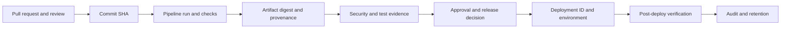

# Keeping Control Processes Verifiable Without Creating Rubber-Stamp Bureaucracy

A release process can be packed with forms, meetings, and approval buttons and still fail to stop an untested artifact from entering production. Conversely, a pipeline can run many automated checks yet leave behind evidence too vague to show who made the change, which conditions were verified, and why the system permitted deployment.

In CI/CD, a security control has value when it maps to a concrete risk objective, is enforced consistently, and leaves verifiable evidence. **A sound process turns control requirements into technical behaviors and accountable decisions; it does not merely add more sign-off steps.**

Keeping a process verifiable does not mean automating every decision or removing humans. Decisions involving risk, exceptions, and business impact still require authorized people. However, those people must receive the right context, while repetitive checks should be automated to reduce human error and wait times.

## 1. What Is a Control in CI/CD?

A control is a mechanism designed to reduce the likelihood of a risk occurring or limit the consequences when it does. In a pipeline, a control can be a technical rule, a verification step, a permission boundary, an approval, or an exception-handling workflow.

Examples:

- Requiring pre-merge reviews reduces the risk of unexamined changes entering the main branch.
- Secret scanning detects committed credentials.
- Production deploy jobs using narrowly scoped workload identities limit the blast radius if a runner is compromised.
- Quality gates checking artifact digests and scan results prevent deploying unverified artifacts.
- Release owner approval for high-impact changes ensures an authorized person reviewed the evidence and recovery plan.
- Audit logs recording who approved, which artifact deployed, and which environment changed support incident investigation.

A control must answer four questions:

1. **What risk is being mitigated?** For instance, one person pushing unreviewed code straight to production.
2. **Which mechanism addresses the risk?** For instance, branch protection requiring independent reviews and required checks.
3. **What evidence shows the mechanism worked?** For instance, review state, commit SHA, and CI results bound to the pull request.
4. **Who is accountable when the control fails or requires an exception?** For instance, the repository owner and security owner.

If these four questions cannot be answered, the step may be pure ceremony without demonstrable protection.

## 2. Distinguishing Substantive Controls from Security Theater

Security theater typically appears when participants complete a step out of habit, yet the step never alters a decision, verifies evidence, or reduces risk.

| Security Theater | Verifiable Control |
|---|---|
| Reviewers click Approve without context about the change | Approval displays commit, artifact, test results, scan findings, blast radius, and rollback plan |
| Checklist asks to confirm "tested" | Pipeline binds required test reports to the exact revision and artifact |
| One person can self-review and self-merge every change | Branch rules require independent review, restrict bypasses, and log audit events |
| Security review is demanded identically for every change | Review depth scales with data sensitivity, permissions, exposure, and blast radius |
| Logs record only "deployment successful" | Deployment record links commit, digest, environment, actor, approval, and verification outcome |
| Exceptions granted via unrecorded chat messages | Waivers include finding, rationale, owner, approver, compensating controls, and expiry |
| Lengthy written policy with no enforcement mechanism | Policy is codified into rules, tests, and gates with explicit states |

A manual step can still be a substantive control if it resolves a judgment call machines cannot make. Conversely, an automated step is not automatically trustworthy: a scanner running against the wrong scope, reports detached from artifacts, or jobs that always mark themselves as passing provide unreliable control.

## 3. Starting from Control Objectives and Risk

Do not start by asking "how many more approvals do we need?" Start from what can harm the system, users, or organization.

Common CI/CD control objectives include:

- Only reviewed code passing mandatory checks may be merged.
- Only artifacts produced from trusted sources and pipelines may be released.
- Secrets must never enter source code, logs, caches, or artifacts.
- Jobs hold only the permissions needed for their specific task and environment.
- High-risk changes are reviewed by authorized owners.
- Production state is traceable back to commit, artifact, and configuration.
- Deployments have mechanisms to detect failures, halt rollouts, and recover.
- Exceptions are scoped, approved, and periodically re-evaluated.

### Contextual Risk Assessment

A change should be assessed across multiple factors:

| Factor | Question |
|---|---|
| Assets | Does the change affect personal data, financial data, secrets, or critical services? |
| Exposure | Is the component reachable from the Internet or untrusted networks? |
| Privileges | Does the job or service hold admin rights, data write rights, or multi-environment access? |
| Scope | Does the change affect only one module or a shared library and pipeline? |
| Reversibility | Can it roll back quickly? Are there irreversible migrations or side effects? |
| Detectability | Do telemetry, auditing, and alerts exist to catch adverse impacts? |
| Evidence reliability | Are tests, scans, and provenance bound to the exact artifact? |

There is no need to turn every factor into a complex numeric formula. A clear impact matrix with concrete criteria and examples is usually far more practical than a formula nobody understands. When information is missing, the pipeline should request additional input or apply stricter checks rather than defaulting to low risk.

## 4. Classifying Controls by Timing of Impact

Controls can be organized by purpose and when they intervene.

| Type | Role | Examples in CI/CD |
|---|---|---|
| Preventive | Stops risky actions from occurring | Branch protection, least privilege, blocking production secrets in untrusted jobs |
| Detective | Detects improper behavior or configurations | Secret scans, audit logs, drift detection, post-deploy alerts |
| Corrective | Limits impact and restores safe state | Token revocation, rollback, disabling feature flags, credential rotation |
| Compensating | Reduces risk when a primary control cannot be applied | Network restrictions, heightened monitoring, reduced privileges, or shorter exception windows |

A critical objective typically requires multiple layers. Protecting production, for instance, cannot rely on approvals alone. It requires dedicated deploy privileges, artifact verification, environment protection, rollout guardrails, and audit logs. If one layer fails, the remaining layers contain the damage.

## 5. Turning Control Requirements into Executable Policy

Policy as Code expresses rules as configuration or code that pipelines, platforms, or deployment systems can evaluate automatically. It eliminates differing interpretations across teams and makes pass/fail criteria explicit.

A policy can specify:

- Scope of application: repository, branch, service, artifact, or environment.
- Input conditions: event type, commit, impact level, and metadata.
- Mandatory requirements: reviews, tests, scans, signatures, or approvals.
- Permission rules: which jobs can read secrets or deploy to which environments.
- Violation actions: block, warn, require review, or fallback behavior.
- Owner, version, and effective date.

The following YAML example is purely conceptual, not an executable schema for any specific platform:

```yaml
release_policy:
  scope:
    environment: production

  required_evidence:
    - approved_commit
    - required_ci_checks_passed
    - artifact_digest
    - security_scan_result
    - provenance_verified
    - deployment_plan

  change_risk:
    high:
      require:
        - service_owner_review
        - security_review_when_security_sensitive
        - recovery_plan
    normal:
      require:
        - service_owner_review

  artifact:
    immutable_reference: true
    verify_signature: true
    reject_unknown_provenance: true

  failure_behavior:
    missing_required_evidence: block
    policy_evaluation_error: block

  exception:
    require_owner: true
    require_approver: true
    require_expiry: true
    require_compensating_controls: true
```

A policy has value only when the pipeline genuinely enforces it, results cannot be altered by untrusted jobs, and operators can understand why a release was blocked. Version policies, test rules, and review policy edits like critical source code changes.

### Policies Must Have Owners

Every policy should have an owning person or team, authorized approvers for edits, and an update process. Without an owner, rules grow stale, overly broad, or accumulate permanent exceptions. Owners should revisit policies whenever architecture, threat models, legal requirements, or deployment practices change.

## 6. Automating Repetitive Controls

Conditions verifiable by machines should be placed into the pipeline or platform to reduce reliance on human memory.

Examples:

- Required status checks confirm mandatory linting, tests, and scans completed.
- Secret scanning detects newly introduced credentials in diffs.
- SCA validates dependencies against policy.
- IaC policies check permissions, networking, and storage settings.
- Artifact signing and provenance record how artifacts were built.
- Deployment controllers admit only artifacts with valid digests and signatures.
- Environment protections restrict which people or workflows may deploy to production.
- Post-deploy checks verify health and telemetry thresholds.

Automation does not mean every check must block merges immediately. Some checks can run in observation mode during rollout, provided they have a clear status, an owner, and a target enforcement date. Never allow a critical warning to linger indefinitely with no accountable owner.

### Controls Must Bind to the Exact Subject

Test results on commit A do not prove an artifact built from commit B was tested. Staging approval does not automatically authorize production to run a different artifact. A scan report without a digest cannot prove the deployed image is the image that was scanned.

Therefore, bind evidence to immutable identifiers:

- Commit SHA and repository.
- Pipeline run ID and workflow version.
- Artifact name, version, and digest.
- SBOM, scan reports, and provenance.
- Deployment ID, environment, and config revision.

## 7. Meaningful Approvals and Separation of Duties

Approvals are appropriate when evaluating residual risk, business impact, or risk acceptance. They should never substitute for checks that can be automated.

A useful approval prompt should display:

- Which changes will be released and their blast radius.
- Commit SHA and artifact digest.
- Test, security scan, and quality gate outcomes.
- Unresolved findings and active waivers.
- Configuration or migration changes.
- Rollout, observability, and recovery plans.
- Owning person or team for the service.

Approvers must know what they are deciding on. A context-free Approve button quickly turns into habitual rubber-stamping.

### Separation of Duties

Separation of duties prevents one person from controlling the entire chain from authoring a change to self-approving and deploying a high-risk change. For instance, a pull request author cannot approve their own required review; someone editing production policies cannot unilaterally disable controls without independent review.

Separation depth should scale with team size and risk:

| Scenario | Appropriate Control |
|---|---|
| Routine service change | Another reviewer, required checks, and clear owner |
| Authentication or authorization change | Security-knowledgeable reviewer, permission tests, and policy approval |
| Pipeline change granting production privileges | Independent review, CODEOWNERS or policy owner, permission checks, and auditing |
| Production IAM or network change | Infrastructure/security owner reviewing the plan and affected privileges |
| Emergency incident requiring urgent action | Scoped break-glass access, full logging, and post-incident review |

Small teams may lack enough people to split every role completely. In that case, apply compensating controls: post-action reviews, time-bound privileges, immutable logs, automated alerts, and requiring a second person to verify after emergency actions.

## 8. Producing Verifiable Evidence

Evidence is data allowing others to verify that a control executed and what its outcome was. Sound evidence is specific enough to answer who, what, when, on which subject, and with what result.

Examples:

| Control Objective | Useful Evidence |
|---|---|
| Change was reviewed | Pull request ID, commit SHA, reviewer identity, timestamp, and review status |
| Tests passed | Test run ID, revision, report, test count, and gate status |
| Artifact was scanned | Digest, scanner/rule version, timestamp, result, and accepted findings |
| Artifact has trusted origin | Provenance, build identity, source revision, and signature |
| Production deploy was approved | Approval identity, environment, artifact digest, and deployment ID |
| Credentials were properly scoped | Workload identity, trust policy revision, and audit event |
| Rollout was verified | Health checks, telemetry window, thresholds, and outcome |
| Exception was accepted | Finding ID, rationale, approver, owner, expiry, and compensating controls |

Generate evidence automatically where controls are enforced. Never ask users to take screenshots or re-type results when the system already holds trustworthy data. Manual documentation should supply only context machines cannot capture, such as risk acceptance rationale.

### Evidence Integrity and Retention

Evidence must be protected from unauthorized modification with proper access controls and retention policies. Depending on requirements, use centralized audit logs, versioned artifact stores, digital signatures, or immutable storage.

Not every log must be kept forever. Classify evidence by purpose: debug logs, test reports, deployment records, approvals, security findings, and incident records each warrant different retention windows. Avoid putting secrets, personal data, or unnecessary sensitive content into evidence.

## 9. Building an End-to-End Traceability Chain from Change to Production

A release must connect steps along a single chain using unambiguous identifiers.



During a production incident, investigators must be able to answer:

- Which artifact is currently running?
- Which commit and workflow built it?
- Who reviewed and approved it?
- Which checks ran against that exact artifact?
- Are there any unresolved findings or active waivers?
- Which configuration was loaded into the environment?
- When did the deployment happen and what did verification show?

If finding answers requires manually stitching spreadsheets together or asking multiple teams, traceability is inadequate. Maintain a central deployment record that links IDs rather than copying full payloads into yet another form.

## 10. Designing Time-Bound Exception Workflows

Not every risk can be fixed immediately. A compatible patch might not exist yet, a third-party dependency may lack an upstream fix, or a production outage may require an urgent change. Exceptions are sometimes necessary, but must be managed as time-bound decisions.

A waiver should specify:

1. Exact scope: which finding, service, artifact, environment, or policy is exempted.
2. Rationale: why the standard requirement cannot yet be met.
3. Residual risk assessment: likelihood and impact if exploited.
4. Compensating controls: network restrictions, reduced permissions, disabled features, heightened monitoring, or constrained rollouts.
5. Remediation owner accountable for fixing the issue.
6. Authorized approver accepting the risk.
7. Expiration date and re-evaluation trigger.
8. Closure evidence once remediated.

Scope waivers to specific findings and artifacts. Never create blanket exceptions like "ignore all scans for service X." When a waiver expires, the pipeline must automatically revert the condition to blocking or require a fresh approval.

### Never Turn Break-Glass into the Routine Release Path

Break-glass is an emergency privilege or workflow for handling incidents when the standard path is unavailable. Protect it with dedicated permissions, short lifetimes, mandatory justification, audit logging, and post-action review.

If break-glass is used frequently, that signals a flaw in the normal process. Investigate the root cause and fix the standard release path instead of expanding emergency privileges.

## 11. Handling Ambiguous Control States

A quality gate should not collapse everything into pass or fail. In practice, checks can be skipped, tools can fail, data can be missing, or scope may not apply.

| Status | Meaning | Recommended Action |
|---|---|---|
| `pass` | Sufficient evidence exists and conditions are met | Allow next step |
| `fail` | Evidence shows a violation or test failure | Halt and require remediation |
| `warning` | Issue detected that is non-blocking under policy | Record owner, deadline, or monitoring |
| `not_applicable` | Check does not apply per defined rules | Record rationale and governing rule |
| `waived` | Valid exception is active | Allow within waiver scope and log audit event |
| `skipped` | Job did not execute | Determine why; never treat as pass automatically |
| `unknown/error` | Insufficient data or tool failure | Apply fallback or block based on risk level |

For controls protecting production, missing evidence must normally fail closed: block release until trustworthy results exist. For auxiliary checks that do not directly govern release safety, proceeding with a warning and assigned owner may be acceptable. Policies must specify clearly which rules apply.

## 12. Reducing Manual Steps Through Better Design

To cut bureaucracy while preserving control, improve the workflow rather than simply deleting approvals.

### Single Source of Truth

Use CI systems, artifact registries, secret managers, deployment controllers, and audit logs as the source of evidence. Avoid forcing release engineers to re-enter commits, versions, test statuses, or digests into forms when systems already hold them.

### Verify Once, Reuse Evidence

If an artifact was scanned by digest and its contents have not changed, promotion steps can reference those results. There is no need to re-scan the identical artifact in every environment unless policy or context requires it. However, if a target environment or deployment mechanism introduces new risks, test those changed aspects accordingly.

### Provide Paved Release Paths

The platform team can offer reusable workflows or pipeline templates with built-in reviews, scans, artifact signing, deployment records, and health checks. Service teams configure only the metadata and business criteria they need. This gives teams shared guardrails without rewriting control logic.

### Ask Humans to Intervene Only at Decision Points

Machines can verify signatures, digests, test statuses, and permissions. Humans should focus on residual risk evaluation, business impact, exceptions, and changes that cannot be assessed automatically.

## 13. Allocating Controls by Risk Level

A simple matrix helps teams see when automated controls suffice and when specialist review is needed.

| Change Tier | Automated Controls | Human Controls |
|---|---|---|
| Low | Baseline checks, required checks, appropriate secret scans | Standard review |
| Normal | Tests, SAST/SCA, artifact traceability | Peer reviewer and service owner when needed |
| Notable | Additional contract/API/IaC/container checks, provenance, and rollout guardrails | Review by dependency or environment owner |
| High/Critical | Full suite of relevant checks, policy enforcement, artifact verification, telemetry gates | Specialist review, authorized approvals, recovery plan |

This matrix is not a rigid universal rule. What matters is having clear, verifiable criteria and preventing change authors from self-declaring low risk without independent verification.

## 14. End-to-End Example: Releasing a Change Affecting Access Permissions

Suppose a pull request modifies how `orders-api` checks permissions to read invoices. Because the endpoint can return financial data, the change is classified as high-risk.

**Step 1 — Pull request:** branch rules require a reviewer other than the author, CODEOWNERS requires the service owner, and required checks must complete. The pipeline runs policy unit tests, SAST, secret scans, and dependency scans.

**Step 2 — Scope checks:** change-impact analysis identifies affected API contracts, database queries, and consumers. Integration tests verify cross-user and cross-tenant authorization; contract tests confirm responses do not leak fields outside the schema.

**Step 3 — Artifact:** build an immutable image, scan the image, and generate an SBOM and provenance. Results are bound to the digest. If a scanner fails to run or provenance is missing, the gate does not mark pass.

**Step 4 — Staging:** deploy the exact digest to staging. Run API security tests using test accounts, verifying user A cannot read user B's invoices. Dashboards and alerts are verified before release.

**Step 5 — Approval:** the release owner receives a consolidated summary containing change scope, test reports, scan results, artifact digest, open findings, canary plan, and endpoint kill switch. Approval is recorded with identity and timestamp.

**Step 6 — Production:** the deployment controller verifies digest and signature, assumes a narrowly scoped workload identity, rolls out a canary, and monitors 401/403 rates, cross-tenant access, and error rates. If signals cross thresholds, rollout halts and the team disables the endpoint or restores the stable version.

**Step 7 — Audit:** the deployment record links commit, reviews, evidence, approval, digest, environment, and post-deploy verification. During any future investigation, the team can reconstruct the decision without hunting for screenshots from multiple people.

This workflow includes multiple controls, yet each maps to a specific risk. Most evidence is generated automatically; humans focus on specialist review and high-impact release decisions.

## 15. Measuring Control System Effectiveness

Do not judge control quality by counting approvals, checklists, or policies. Measure both risk reduction and the operational friction the process creates.

| Metric | What to Understand | Improvement Question |
|---|---|---|
| Control coverage | Percentage of repositories/services/artifacts enforcing mandatory controls | Are any areas left unprotected? |
| Evidence completeness | Percentage of releases carrying full policy-required evidence | Are any steps failing to produce or link evidence? |
| Policy bypass rate | Frequency and reasons for bypasses | Are bypasses becoming a routine path to ship? |
| Waiver age | Age of open exceptions | Are exceptions being renewed endlessly or lacking owners? |
| Approval lead time | Wait time for human decisions | Do approvers lack context or get asked to approve too often? |
| False positive rate | Rate of findings or gates not reflecting real risk | Do rules or scanners need tuning? |
| Change failure rate | Percentage of changes causing post-release failures | Are gates catching critical risks? |
| Time to restore | Time to recover service health | Do sufficient permissions, runbooks, and evidence exist for recovery? |
| Manual evidence effort | Effort spent creating and collecting evidence manually | Can data be pulled automatically from source systems? |

Warning signs worth investigating:

- Approvals routinely complete in seconds with no comments or evidence inspected.
- Expired waivers are repeatedly extended without a remediation plan.
- Teams frequently use bypass permissions to hit release deadlines.
- Evidence must be re-entered manually across multiple systems.
- Gates fail more often due to broken scanners or noisy rules than real defects.
- Pipelines stay green while incidents keep recurring at the same boundary.

Use metrics to improve the system—never as personal leaderboards. High approval lead time may point to poor evidence presentation or unclear ownership rather than slow reviewers.

## 16. Common Anti-Patterns

| Anti-Pattern | Consequence | Improvement |
|---|---|---|
| Adding approvals to every step | Creates queues without improving decision quality | Require approvals only at real risk or decision points |
| Checklists unbound to evidence | Operators check boxes subjectively | Auto-attach tests, scans, digests, and deployment records |
| One person authoring, approving, and deploying sensitive changes | Lacks independent verification | Enforce separation of duties or audited compensating controls |
| Policies living only in documents | Inconsistent enforcement across teams | Policy as Code, tests, and owners |
| Scanners always run yet never block anything | Creates a false sense of security | Define severity/risk thresholds and concrete enforcement actions |
| Evidence unbound to artifacts | Unknown which artifact was actually verified | Use immutable digests and provenance |
| Waivers without expiration dates | Exceptions become permanent rules | Require owner, approver, expiry, and auto-expiry alerts/blocks |
| Failing open when tools error | Releases proceed with zero verification evidence | Classify unknown/error and fail closed at critical gates |
| Unaudited bypasses | Cannot explain release decisions | Record actor, reason, timestamp, and run post-bypass reviews |
| Retaining all logs forever | High cost and increased data exposure | Tier retention by purpose and sensitivity |
| Using control count as a metric | Incentivizes bureaucracy over risk reduction | Measure coverage, incidents, evidence quality, and effort |

## 17. Checklist for Designing Verifiable Control Processes

Before putting a process into operation, review:

- [ ] Every control maps to a clear risk and objective.
- [ ] Owners exist for policies, repositories, services, and environments.
- [ ] Criteria for pass/fail/warning/waived/unknown are explicitly defined.
- [ ] Repetitive checks are automated and bound to exact commits/artifacts.
- [ ] Artifacts use immutable identifiers; provenance and signatures are verified as needed.
- [ ] Approvals surface sufficient context to assess scope, risk, and recovery options.
- [ ] Separation of duties scales with change impact.
- [ ] Small teams enforce compensating controls when full role separation is infeasible.
- [ ] Evidence is generated where controls execute, with appropriate access and retention.
- [ ] Traceability links pull request, commit, pipeline, artifact, approval, and deployment.
- [ ] Waivers include rationale, owner, approver, compensating controls, and expiration date.
- [ ] Break-glass privileges are scoped, audited, and reviewed after use.
- [ ] Tool or policy errors never default to pass at critical gates.
- [ ] Bypasses and policy changes are audited.
- [ ] Periodic testing verifies controls still work as intended.
- [ ] Metrics measure risk, evidence quality, and wait times rather than number of manual steps.

## 18. Conclusion

A CI/CD control process is verifiable when every safeguard is connected to a concrete risk, an enforcement mechanism, trustworthy evidence, and an accountable owner. Automating repetitive checks, reserving approvals for decisions genuinely requiring judgment, scoping privileges by impact, and governing time-bound exceptions eliminate hollow bureaucracy.

A strong control system is not measured by the number of forms or approval clicks. It is measured by its ability to block dangerous actions, detect drift, contain blast radius, explain release decisions, and recover during incidents. When policies, evidence, and auditing are built directly into the pipeline, security becomes part of daily delivery rather than an external layer of paperwork outside engineering work.
