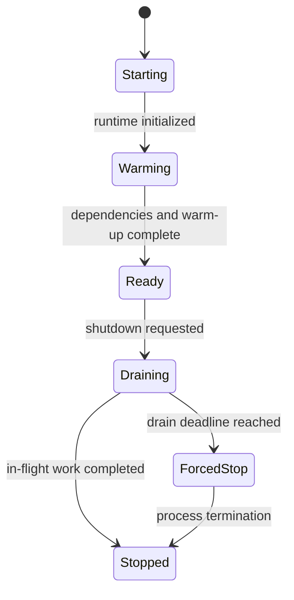
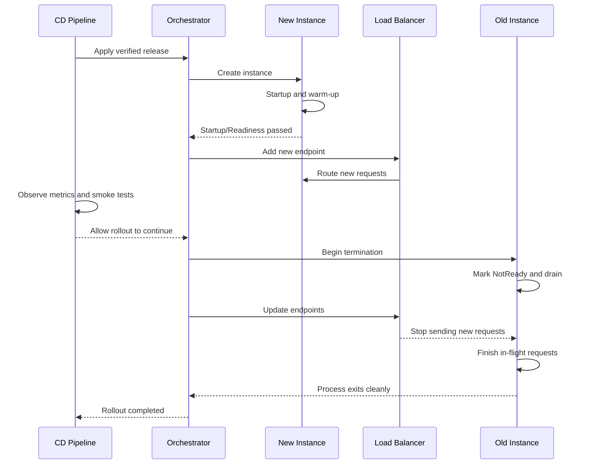

# Reducing Disruption Through Controlled Startup, Traffic Shifting, and Shutdown

An automated deployment is not just creating a new version and replacing the old one. During the transition window, the system must keep accepting requests, finish in-flight work, and keep data consistent. If old instances are stopped too early, traffic is routed to a new instance before it is ready, or a process terminates while requests are still executing, users can experience errors even when the pipeline reports deploy success.

To minimize disruption, the deployment process must coordinate three phases: **starting the new version, shifting traffic in a controlled manner, and stopping the old version after draining**. Each phase needs readiness criteria, wait deadlines, observable signals, and actions to take when conditions are not met.

This principle applies to VMs, containers, Kubernetes, services behind load balancers, and queue-processing workers. Platforms differ in their exact mechanisms, yet all must ensure the new version is ready before receiving load and the old version has enough time to finish its work before termination.

## 1. Why Can Deployments Cause Disruption?

A deployment can disrupt service at multiple points:

- A new instance starts up but has not finished loading configuration, connecting to the database, or warming up caches.
- The load balancer routes requests to a new instance merely because its port is open, while the application cannot yet handle business logic.
- Old instances are removed from the pool too quickly, leaving fewer serving instances than actual load requires.
- In-flight requests, transactions, or background tasks are abruptly terminated when the process receives a stop signal.
- Keep-alive connections, WebSockets, streams, or long-polling requests are not drained.
- New and old versions access the database concurrently while an incompatible schema change was applied.
- The deployment controller marks a pod Ready before the application finishes warming up or connecting to mandatory dependencies.
- The new release has a bug after all traffic shifts over, and the team lacks a fast path to revert.

Reducing disruption requires looking at the full lifecycle of an instance, not just container status or the deploy command. A live process is not synonymous with an instance ready to serve requests; an instance no longer accepting new requests may still need time to finish existing ones.

### Three Phases to Coordinate

| Phase | Goal | Condition to Advance |
|---|---|---|
| Starting the new version | Load config, open connections, initialize resources, and warm up | Readiness is stable; basic checks pass |
| Shifting traffic | Route partial or full traffic to the new version per strategy | Metrics and health checks remain within thresholds |
| Stopping the old version | Stop accepting new work, drain in-flight requests/tasks, release resources | No work remains to preserve, or safe drain window elapsed |

The process should advance to the next phase only after the current phase's conditions are confirmed. If the new version is not Ready, keep traffic on the old version and handle the failure instead of forcing progression.

## 2. Designing State-Aware Application Startup

An application typically passes through several states from process creation until it can serve:

1. Process starts and reads configuration.
2. Initializes runtime, dependency injection, and internal components.
3. Establishes connections to databases, caches, message brokers, or required services.
4. Loads background data, warms up caches, or prepares models.
5. Begins accepting new requests or work items.

Do not open traffic the instant a process opens its listening socket. Expose readiness through a health endpoint or equivalent signal so the orchestrator knows when the instance can enter the serving pool.

### Separating Liveness from Readiness

Two concepts are frequently confused:

- **Liveness:** the process is running and not stuck in a state requiring a restart. Liveness detects deadlocks or internal failures from which the process cannot recover.
- **Readiness:** the instance can accept and process new requests right now. Readiness may be false during startup, warm-up, or while the instance is draining.

A readiness failure normally means temporarily withholding traffic from the instance; it does not necessarily warrant a restart. A liveness failure can cause the orchestrator to restart the container. If liveness checks a shared dependency such as a database, a database outage can trigger continuous restarts across every instance, making system recovery even harder.

Some applications also use a **startup probe** to allow sufficient time for slow initialization. While the startup probe has not succeeded, liveness and readiness probes are held off from periodic evaluation. Once startup succeeds, readiness continues governing whether the instance receives traffic.

### Never Use One Health Check for Every Purpose

Health endpoints should reflect the exact question each probe asks:

| Endpoint | Question | Desired Behavior |
|---|---|---|
| `/health/live` | Is the process alive and able to continue running? | Avoid arbitrary external service dependencies; fail only when truly unrecoverable |
| `/health/ready` | Can the instance accept new requests? | Succeeds only after initialization finishes and required conditions are met |
| `/health/startup` | Has initialization completed? | Succeeds only after the application completes required startup |

These paths are examples only. You may use Actuator endpoints, framework endpoints, or TCP/exec probes depending on architecture. What matters is never equating an open port with application readiness.

### Be Careful When Readiness Checks Dependencies

Readiness can verify the database or services required by requests. However, if a shared dependency fails, every instance might flip to NotReady simultaneously, leaving the load balancer with zero healthy endpoints. For optional dependencies or ones with fallbacks, the application can continue serving partial functionality.

Decide which dependencies are genuinely mandatory for accepting requests. You can separate overall readiness from per-feature health, or keep the instance in the pool while returning controlled errors for a specific degraded feature. Avoid putting every dependency alert into readiness if it does not prevent the instance from serving.

## 3. Warming Up Before Receiving Traffic

An instance can report Ready right after process startup yet still suffer poor performance on its initial requests. Common causes include JIT compilation, connection pool creation, cache loading, remote configuration fetches, model loading, or initializing clients to downstream services.

Warm-up performs those preparations before the instance receives user traffic. For example:

- Create and validate database connection pools.
- Load required metadata or configuration.
- Initialize serializers, templates, routes, and clients.
- Preload reference data into local caches.
- Execute safe internal operations to warm critical code paths.
- Run a minimal read-only query or check.

Warm-up must have timeouts and resource bounds. Never load massive datasets or perform business writes merely to warm up the application. If warm-up fails, the instance should stay NotReady and emit clear diagnostic errors.

### Separating Startup from Readiness

Startup can finish before warm-up completes. For instance, the server has bound its port, but caches are not yet populated. In that case, the startup probe can pass while readiness remains failing. This lets the system distinguish a started process from an instance ready to serve traffic.

For applications with multiple features, readiness can rely on a core set of prerequisites. Non-essential warm-up tasks can run in the background without blocking all traffic, provided the application handles the unready state of that specific feature gracefully.

## 4. Shifting Traffic by Deployment Strategy

Once the new version is ready, the system determines how traffic shifts over. Three common strategies are rolling, blue-green, and canary.

| Strategy | Shift Mechanism | Strengths | What Must Be Controlled |
|---|---|---|---|
| Rolling update | Replaces groups of old instances with new ones | Reuses existing pool without duplicating the entire environment | Capacity during transition, readiness, and minimum available instances |
| Blue-green | Stands up a parallel new environment and switches routes from old to new | Fast cutover, easy switchback to old environment | Cost of parallel capacity, data and schema compatibility |
| Canary | Shifts a small share of traffic to the new version and increases gradually if healthy | Detects bugs under real load with a small blast radius | Weighted routing, reliable metrics, and clear abort criteria |

### Rolling update

A rolling update creates a batch of new instances, waits until they become Ready, and then terminates old instances. The process repeats in batches until all replicas run the new version.

To keep rolling updates from degrading capacity excessively, configure how many extra instances may be created (`maxSurge`) and how many may be unavailable relative to desired replicas (`maxUnavailable`). Setting `maxUnavailable: 0` forces the controller to maintain full available capacity while spinning up new instances; in return, the cluster needs headroom to run additional pods.

Rolling updates fit stateless services or services whose state is externalized to shared storage. If an instance holds in-memory sessions or local files, define a state migration strategy before replacing it.

### Blue-green deployment

Blue-green maintains two environments:

- Blue is the version currently serving traffic.
- Green is the new version stood up and verified in parallel.

Once Green is Ready and smoke tests pass, the load balancer or router shifts traffic to Green. Blue is kept running for a period so traffic can switch back if metrics degrade. Blue is retired only after the observation window and rollback criteria are satisfied.

This strategy enables fast traffic cutover, but it does not automatically solve data compatibility. If Green runs a migration that breaks Blue's ability to read the schema, switching routes back to Blue may no longer be safe.

### Canary deployment

Canary starts with a small share of traffic—such as 1%, 5%, or 10%—and increases in steps if metrics stay within thresholds. Exact percentages depend on traffic volume, routing granularity, and risk tolerance.

At each step, monitor at minimum:

- HTTP or business error rates.
- Latency p50/p95/p99.
- Throughput and in-flight request count.
- CPU, memory, thread pools, and connection pools.
- Timeouts, retries, queue lag, and failed tasks.
- Key business metrics such as successful payments or created orders.

Never increase traffic share solely because pods are Ready. Readiness only shows an instance can accept traffic; canary requires additional proof that the new version performs well under real load.

## 5. Conditions for Safely Shifting Traffic

Before adding the new version to the pool, confirm:

1. The artifact is verified and matches the intended commit/release.
2. Environment configuration and secrets are scoped properly.
3. The process started cleanly and completed mandatory initialization.
4. Readiness has remained stable over an interval, not just passed a single probe.
5. Internal smoke tests or critical endpoint checks passed.
6. Cluster or pool capacity suffices for both old and new versions during overlap.
7. Schemas, APIs, and message formats remain compatible with the concurrently running version.

A single passing probe can be a transient signal. `minReadySeconds` or an equivalent stabilization mechanism requires an instance to remain Ready for a period before counting as available in the rollout. Also monitor startup failures and readiness flapping: instances oscillating between Ready and NotReady destabilize rollout progression.

### Checking capacity before rollout

If there are 4 replicas and the rollout adds 1 new pod, the cluster needs enough CPU, memory, quota, and network addresses for the extra pod. Without enough capacity, the new pod stays Pending; rollout pauses while the old version keeps serving. That is generally safer than deleting old instances prematurely, though the deployment stays blocked until resources are freed.

Never set `maxUnavailable: 0` without accounting for quotas or scheduling capacity. Safe configuration balances availability against headroom to schedule extra instances.

## 6. Controlled Shutdown of the Old Version

Once the new version is receiving traffic, old instances must be removed from the serving pool before their processes terminate. Controlled shutdown typically follows these steps:

1. Mark the instance as draining so readiness transitions to NotReady.
2. Stop accepting new requests or work items.
3. Wait for load balancers, service discovery, or endpoint controllers to update and stop sending new traffic.
4. Allow in-flight requests, transactions, WebSockets, or background tasks to complete within the allotted time.
5. Close connection pools, consumers, thread pools, and internal resources.
6. Exit the process before the termination deadline expires.

Never kill the server immediately upon receiving a deploy command. If the load balancer continues sending requests while the process closes its listener, clients receive connection resets or 5xx errors.

### Graceful shutdown and the SIGTERM signal

In Linux containers, orchestrators typically send `SIGTERM` to request process termination, followed by `SIGKILL` only after the grace period expires. Applications must handle `SIGTERM` to stop accepting new work and complete in-flight work.

For Java services, frameworks can provide built-in graceful shutdown. For example, Spring Boot:

```properties
server.shutdown=graceful
spring.lifecycle.timeout-per-shutdown-phase=30s
```

This setting instructs the embedded server to stop accepting new requests and grants in-flight requests time to finish up to the lifecycle phase timeout. Check your framework/server version and actual configuration, as exact behavior can differ across embedded servers or applications managing custom threads.

For applications managing custom executors, consumers, or connections, add lifecycle hooks to:

- Stop accepting new tasks.
- Stop queue polling or consumers before closing connections.
- Wait for active tasks to finish or return them to a safely retryable state.
- Flush required data/buffers.
- Close clients and executors in dependency order.

Never wait indefinitely. Every step needs a timeout shorter than the total grace period so the process has time to exit cleanly.

### Connection draining

Connection draining allows active requests to complete while new requests route to other instances. For HTTP keep-alive, the load balancer should stop opening new connections to the draining instance while letting existing connections finish within the configured drain window.

For WebSockets, gRPC streams, or long polling, drain durations can be lengthy. Define a clear policy: maximum wait duration, whether to send close frames or prompt clients to reconnect, and how to prevent message loss. If clients can retry, requests must carry idempotency keys or duplicate-processing protection.

### Stopping queue-processing workers

Workers should not be killed mid-message whenever avoidable. During shutdown:

1. Pause consumers or stop fetching new messages.
2. Wait for in-flight messages to finish processing within the deadline.
3. Commit offsets or acknowledge messages after successful processing.
4. If processing cannot finish, do not acknowledge so messages are retried per broker semantics.
5. Close connections only after processing state is safe.

For queues using visibility timeouts or leases, processing and shutdown times must fit within the lease duration. Otherwise, a message may be redelivered to another worker while the old worker is still running, causing duplicate processing.

## 7. Kubernetes: Readiness, Rollout, and Termination Lifecycle

Kubernetes provides probes and Deployment rolling updates to coordinate Pod replacement. Applications must still implement health endpoints and graceful shutdown properly; Kubernetes cannot automatically know whether a business request has finished.

### Example Deployment with startup, readiness, and liveness probes

```yaml
apiVersion: apps/v1
kind: Deployment
metadata:
  name: orders-api
spec:
  replicas: 3
  minReadySeconds: 10
  progressDeadlineSeconds: 600
  strategy:
    type: RollingUpdate
    rollingUpdate:
      maxSurge: 1
      maxUnavailable: 0
  selector:
    matchLabels:
      app: orders-api
  template:
    metadata:
      labels:
        app: orders-api
    spec:
      terminationGracePeriodSeconds: 60
      containers:
        - name: orders-api
          image: registry.example.com/team/orders-api@sha256:<approved-image-digest>
          ports:
            - name: http
              containerPort: 8080
          startupProbe:
            httpGet:
              path: /actuator/health/liveness
              port: http
            periodSeconds: 5
            timeoutSeconds: 2
            failureThreshold: 30
          readinessProbe:
            httpGet:
              path: /actuator/health/readiness
              port: http
            periodSeconds: 5
            timeoutSeconds: 2
            failureThreshold: 3
          livenessProbe:
            httpGet:
              path: /actuator/health/liveness
              port: http
            periodSeconds: 10
            timeoutSeconds: 2
            failureThreshold: 3
          lifecycle:
            preStop:
              httpGet:
                path: /internal/drain
                port: http
```

This manifest illustrates a service exposing matching endpoints. `/internal/drain` is an application-implemented endpoint: upon receiving a request, it marks the instance as draining, causes readiness to fail, and may wait briefly for endpoint controllers/load balancers to update before returning. This endpoint does not exist in Spring Boot by default; implement and secure it according to your architecture.

`startupProbe` uses the liveness endpoint to confirm the application initialized its runtime; it does not wait on external dependencies or business warm-up. Separating them prevents a failing shared database from failing startup probes and forcing continuous container restarts. `startupProbe` grants the application up to roughly 150 seconds to pass startup in this sample configuration (`periodSeconds × failureThreshold`), excluding scheduling and timeout overhead. While `startupProbe` has not succeeded, Kubernetes does not run periodic liveness or readiness probes. Once startup succeeds, readiness continues governing whether the Pod receives traffic.

`maxUnavailable: 0` maintains the desired available Pod count throughout rollout; `maxSurge: 1` permits creating one additional Pod. `minReadySeconds: 10` requires a Pod to stay Ready long enough before counting as available. Adjust these values based on traffic load, quotas, and measured startup times.

### Configuring Spring Boot health endpoints

With Spring Boot Actuator, enable probe health groups and expose only needed endpoints on the internal network:

```properties
server.shutdown=graceful
spring.lifecycle.timeout-per-shutdown-phase=30s

management.endpoint.health.probes.enabled=true
management.endpoints.web.exposure.include=health
```

When probe health groups are enabled, the application can serve `/actuator/health/liveness` and `/actuator/health/readiness`. Verify the Actuator dependency is present and endpoints are not unintentionally exposed externally. Avoid exposing detailed internal health data to the public Internet unnecessarily.

Spring Boot's readiness can reflect application availability states such as `REFUSING_TRAFFIC` during startup/shutdown. If the application performs asynchronous warm-up or depends on specific services, add a custom HealthIndicator or state mechanism so readiness switches to UP only when real preconditions are met.

### Role of `preStop` and termination grace period

Kubernetes invokes the `preStop` lifecycle hook before sending `SIGTERM` to the container process. Hook execution time counts toward `terminationGracePeriodSeconds`. Once the hook finishes, the runtime sends the stop signal; if the process does not exit before the grace period expires, the container may be forcefully killed.

Therefore:

- `preStop` must be short, have a timeout, and not depend on unstable external services.
- The drain endpoint should transition readiness to NotReady before waiting on in-flight requests.
- The application must handle `SIGTERM` with an appropriate shutdown timeout.
- Total duration of hook execution, propagation, draining, and cleanup must stay within the grace period.
- Do not rely solely on a fixed `sleep` without understanding endpoint and load balancer propagation delays in your environment.

When a Pod terminates, EndpointSlices and routing components update endpoint status. Propagating that change takes time; the application should remain capable of handling requests safely during that transition window. For setups with ingress, service mesh, or external load balancers, verify drain timing at every layer.

### Monitoring the rollout

After applying the manifest:

```bash
kubectl apply -f deployment.yaml
kubectl rollout status deployment/orders-api --timeout=10m
kubectl get pods -l app=orders-api -w
```

If rollout stalls, inspect Pending Pods, image pulls, startup probes, readiness probes, events, and container logs. Never manually delete old Pods to force a rollout before understanding why new Pods are not Ready.

## 8. Implementing Graceful Shutdown in the Application

Readiness only coordinates traffic routing; the application still needs shutdown logic to stop accepting new work and avoid dropping active work.

### Drain state model

A service can manage internal state as follows:



Upon entering `Draining`, the application should:

- Return NotReady for readiness checks.
- Reject or redirect new requests according to the service contract.
- Stop pulling new messages/tasks.
- Track active in-flight requests/tasks.
- Wait until in-flight work reaches zero or the deadline expires.
- Close resources in order: consumers, server listeners, pools, clients, and executors.

The drain endpoint must have proper access controls. If exposed externally, an attacker could deliberately knock instances out of traffic rotation. Restrict it to the internal network, require authentication, or protect it at the platform layer.

### Never let shutdown hooks run too long

A shutdown hook must not wait indefinitely or run large migrations. If a request runs longer than the shutdown deadline, define a clear policy: finish, cancel safely, or let the client retry. For write operations, use transactions and idempotency to avoid half-completed states.

The combined timeout of all lifecycle phases must be lower than the orchestrator's grace period. For instance, if Kubernetes grants 60 seconds, the application might allocate 30 seconds for server request draining, 15 seconds for workers, and 5 seconds for cleanup, leaving buffer for hooks and scheduling. These numbers are illustrative only; measure actual p95/p99 request and task durations.

## 9. Compatibility Between Old and New Versions

During rolling or canary deployments, two versions run concurrently and access the same database, cache, or message broker. Protocol and schema changes must therefore remain compatible during the overlap window.

### Database migrations via the expand-contract model

A safe approach splits migrations into phases:

1. **Expand:** add new columns, tables, or indexes while the old version continues working.
2. **Deploy compatible code:** the new version can read/write both old and new schemas during the transition.
3. **Backfill:** migrate data in batches, safely re-runnable with observable progress.
4. **Switch:** shift read logic to the new structure once data is ready.
5. **Contract:** drop old columns or structures only after all old versions have stopped and no consumers still depend on them.

Never drop or rename a column still used by the old version. If a migration breaks backward compatibility, a rolling update can fail requests immediately while both versions run side by side.

### APIs and message schemas

APIs should introduce optional fields before requiring clients to send new fields; servers must continue accepting the old format during transition. For message queues, new consumers should read old messages and old consumers should not break on new messages if both can coexist.

When a breaking change is unavoidable, deploy in two phases: release compatible consumers/providers first, then enable producers or clients using the new schema. Monitor legacy message counts and client versions before removing compatibility paths.

### Sessions and local state

Do not store critical sessions solely in instance memory if traffic shifts between versions. Use a shared session store or versioned stateless tokens. If clients rely on sticky sessions, define what happens when an old instance leaves the pool.

Uploaded files or temporary data should live in shared storage with clear permissions and lifecycle rules. Never depend on an old Pod's local filesystem to serve requests after that Pod is replaced.

## 10. Handling Failures and Rollbacks During Traffic Shifting

Automated deployments must predefine rollout abort criteria. Never wait for user complaints to discover a new version is unstable.

Signals that can trigger a halt or rollback:

- Repeated readiness failures or Pod restarts exceeding thresholds.
- 5xx or business error rates rising sharply above baseline.
- p95/p99 latency breaching SLOs during the observation window.
- Queue lag spiking or workers failing to process messages.
- CPU, memory, thread pools, or connection pools hitting saturation limits.
- Smoke tests or synthetic transactions failing.
- Unusual spikes in retries, timeouts, or open circuit breakers.

### Stop increasing traffic before deciding

In canary rollouts, when metrics degrade, first halt traffic ramp-up. If possible, hold current weight or shift traffic back to the old version per policy. Collect logs, traces, and release metadata to pinpoint the defect.

In rolling updates, when a rollout exceeds `progressDeadlineSeconds`, the Deployment is marked with `ProgressDeadlineExceeded`; the controller still keeps reconciling toward desired state. The pipeline or operator must inspect this condition and decide whether to pause, fix the root cause, or roll back. Never assume Kubernetes automatically halts or rolls back a rollout, and never manually delete all old replicas before the new version is verified.

### Application rollback and data rollback are two different things

Reverting to a previous image or binary restores code, but it does not automatically undo database migrations, emitted messages, or business data mutations. Migrations must therefore be backward-compatible and have a dedicated recovery plan.

If a migration deleted data or applied irreversible transformations, rolling back code may break the old application. In such cases, use a forward fix or a tested data restoration procedure rather than running ad-hoc reverse migrations.

### Example Kubernetes rollback commands

```bash
kubectl rollout history deployment/orders-api
kubectl rollout undo deployment/orders-api
kubectl rollout status deployment/orders-api --timeout=10m
```

`rollout undo` reverts the Deployment to its prior revision if revision history remains and that revision's image/config are still usable. After rolling back, run smoke tests and confirm traffic and metrics recovered. If secrets or ConfigMaps use mutable names, an older revision may still pick up newer configuration; version configuration alongside releases.

## 11. Observing Startup, Traffic Shifting, and Shutdown

Do not monitor only `Deployment Available`. Observe both request behavior and background work throughout the transition.

| Phase | Metrics / Signals | Operational Question |
|---|---|---|
| Startup | Startup duration, probe failures, restart count | Did instances start within the expected timeframe? |
| Warm-up | Cache load duration, dependency connections, initialization errors | Are mandatory components ready? |
| Readiness | Ready replicas, readiness flapping, time-to-ready | Are enough instances stably accepting traffic? |
| Traffic shift | Request rate by version, 4xx/5xx, latency, saturation | Is the new version behaving well under load? |
| Drain | In-flight requests, active connections, queue consumer lag | Did old instances stop taking new work and finish prior work? |
| Shutdown | Shutdown duration, forced kills, exit codes | Did processes exit cleanly before the deadline? |
| Post-deploy | Smoke tests, synthetic transactions, business KPIs | Is the service truly functioning properly after cutover? |

Attach version, commit SHA, or release ID to metrics and logs to distinguish old and new versions. Avoid placing personal data or secrets in metric labels. High-cardinality values such as request IDs must not be metric dimensions; use traces or log correlation instead.

### Setting thresholds against baselines

No single 5xx or latency threshold fits every service. Compare the canary against a baseline from the same time window and comparable traffic. A brief spike over a few seconds may be noise; a sustained upward trend across multiple windows indicates regression. Rollback criteria should define an observation window, minimum sample size, and agreed impact thresholds upfront.

## 12. Example Controlled Deployment Sequence

A rolling deployment sequence for a stateless service might look like:

1. CI builds the artifact, verifies checksum/signature, and stores release metadata.
2. CD validates configuration, secret references, capacity, and environment policy.
3. Orchestrator creates one replica of the new version.
4. Startup probe waits for runtime initialization; readiness passes only after warm-up.
5. Once the Pod stays Ready long enough, the Service begins routing traffic to the new Pod.
6. Metrics and smoke tests are observed; if errors appear, halt rollout and act per policy.
7. Once the new Pod serves stably, the controller scales down one old Pod.
8. The old Pod transitions to draining, stops accepting new requests, and finishes active requests/tasks.
9. The application handles SIGTERM, closes resources, and exits before the grace period.
10. Repeat until all replicas run the new version; run post-deployment verification.



The diagram depicts a conceptual sequence. In Kubernetes, endpoint removal and Pod termination proceed concurrently; configure readiness, `preStop`, grace periods, and load balancers to handle propagation delays. Never assume new requests vanish instantaneously the moment a Pod enters Terminating.

## 13. Scenarios Requiring Special Handling

### Long-lived requests and WebSockets

Long-lived requests may exceed default drain windows. Set maximum deadlines, emit proper close signals, and ensure clients can reconnect. For WebSockets, the server can send a close frame with an appropriate status code before closing. For gRPC streams, define deadlines and retry behavior.

### Write operations that cannot be retried blindly

A payment or order creation request interrupted mid-flight may be retried by the client. Use idempotency keys, clear transaction boundaries, and explicit processing states so retries do not create duplicate transactions. Graceful shutdown lowers disruption probability but does not eliminate network failures or process crashes.

### Consumers running multiple versions

During rolling updates, old and new consumers may read the same queue simultaneously. Ensure message schema compatibility, idempotent processing, and proper partition/lease management. On shutdown, consumers must stop fetching new messages and finish or release active messages per broker semantics.

### Services with local state

If a service holds state in memory or on local disk, define how state is migrated, synchronized, or reconstructed. Rolling updates do not automatically move state between Pods. For stateful workloads, use appropriate rollout and storage mechanisms, accounting for startup/shutdown ordering and fencing to prevent two instances from writing the same data concurrently.

## 14. Deployment Practices That Cause Disruption

| Practice | Consequence | Improvement |
|---|---|---|
| Routing traffic as soon as port opens | Requests hit un-warmed instances | Use readiness probes reflecting serving capability |
| Using liveness to check all dependencies | DB outage restarts every Pod | Separate liveness from readiness and check dependencies selectively |
| Stopping old instances before new ones are Ready | Drops capacity or loses endpoints | Wait for readiness and maintain overlap |
| Not draining in-flight requests | Clients see resets/5xx, tasks aborted | Mark NotReady, stop new work, wait for in-flight |
| Grace period shorter than processing time | Process killed via SIGKILL mid-request | Measure drain durations and size deadlines accordingly |
| `preStop` only sleeps without changing readiness | Instance still receives traffic while waiting | Drain endpoint or real deregistration mechanism |
| Using mutable image tags | Deployed version may differ from tested version | Pin immutable digests |
| Breaking migrations in rolling updates | Old and new versions clash on schema | Expand-contract and backward compatibility |
| Increasing canary traffic based only on Ready status | Misses business errors under load | Monitor metrics, traces, and synthetic tests |
| Rolling back code while ignoring data | Old version cannot read new schema | Separate data rollback/forward-fix plan |

## 15. Checklist for Minimizing Deployment Disruption

Before enabling automated rollouts, verify:

- [ ] Artifact and configuration are verified and tied to a specific release ID/digest.
- [ ] Application distinguishes startup, liveness, readiness, and draining.
- [ ] Readiness succeeds only after mandatory preconditions and warm-up complete.
- [ ] Liveness does not arbitrarily depend on external services that can fail together.
- [ ] Startup probe allows enough time for startup under realistic load.
- [ ] Capacity is sufficient to run old and new versions concurrently during overlap.
- [ ] Rolling, blue-green, or canary strategy has explicit traffic-shifting criteria.
- [ ] Abort/rollback thresholds exist based on errors, latency, saturation, and business metrics.
- [ ] Old instances are marked NotReady before stopping acceptance of new requests.
- [ ] Load balancer/service discovery has appropriate propagation and connection-draining windows.
- [ ] Application handles SIGTERM, stops consumers, and finishes in-flight work within timeouts.
- [ ] Combined preStop, drain, and cleanup time fits inside termination grace period.
- [ ] WebSockets, streams, long requests, and queue workers have dedicated shutdown policies.
- [ ] Databases, APIs, and message schemas remain compatible while two versions coexist.
- [ ] Smoke tests and metric observation run after each traffic-shift step.
- [ ] Code rollback does not rely on assuming database migrations reverse automatically.
- [ ] Logs, metrics, and traces are tagged with release/version for rapid investigation.

Reducing disruption comes from coordinating the right timing: the new version receives traffic only when genuinely ready, traffic shifts according to an observable strategy, and the old version terminates only after draining its work. When startup, readiness, routing, graceful shutdown, and rollback are designed together, automated deployments can run continuously while keeping service stable for users.
