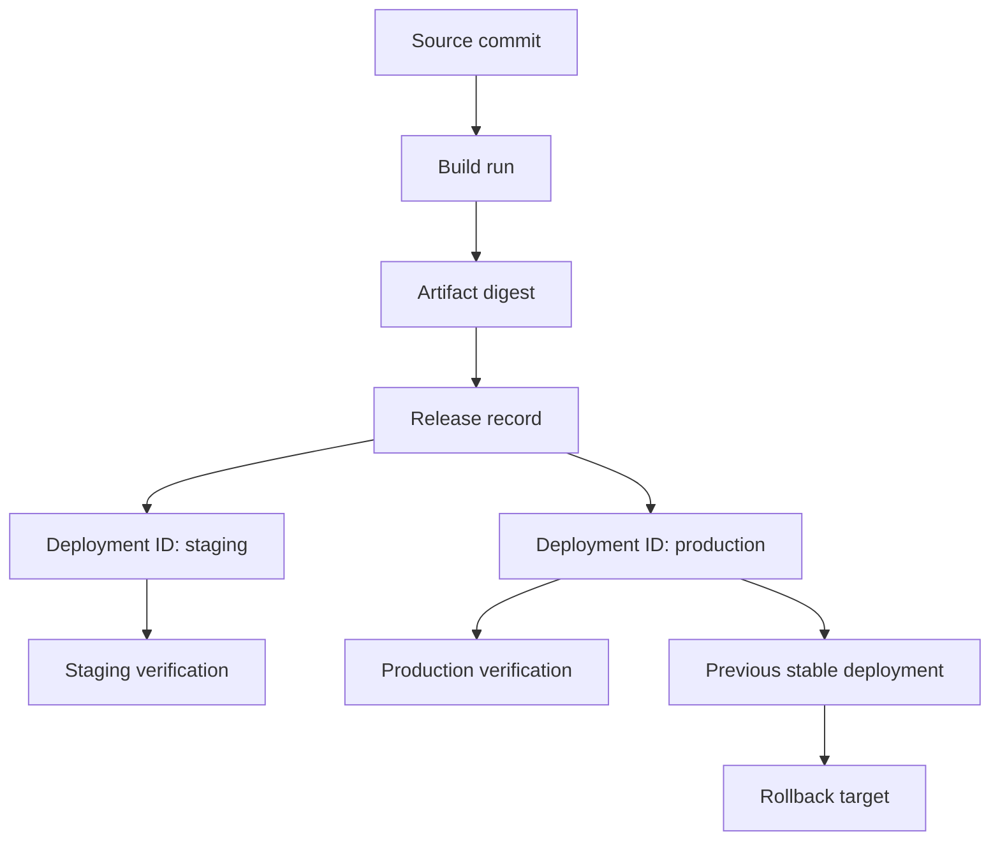
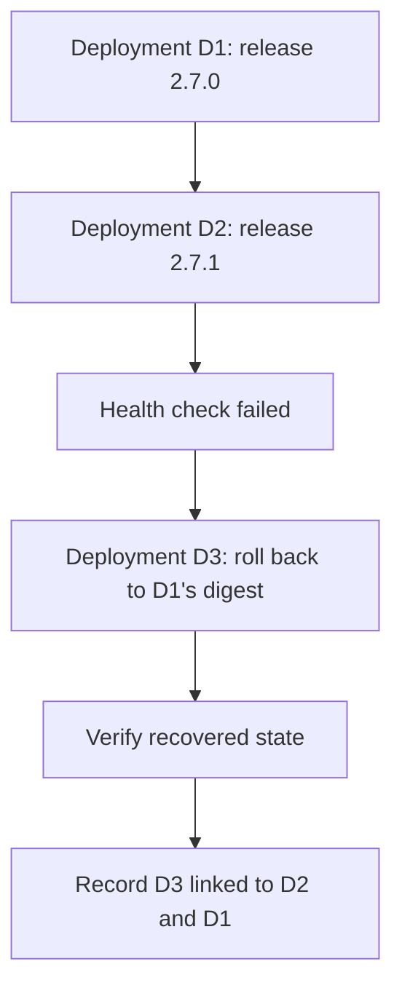

# Storing Deployment Identity for Verification and Recovery

An artifact that has been built and tested still does not tell you which version production is currently running. The same image can be deployed multiple times, across multiple environments, with different configurations and rollout strategies. A deployment can also fail mid-way, update only a subset of instances, or be modified manually after the pipeline ends.

Therefore, CI/CD must persist a **deployment identity** every time a version is introduced into an environment. This identity links the deployment action to the specific artifact, source code, configuration, infrastructure, environment, executing actor or process, and verification results. During an incident, the team can answer precisely what was deployed, where, how, and which state to recover to.

Within the CI/CD module, deployment identity is the link connecting artifact management, pipeline automation, environment configuration, quality gates, auditing, and rollback. It turns the vague question "which version is production on?" into a queryable, verifiable record.

## 1. Distinguishing Release, Artifact, and Deployment

These three concepts are related but not synonymous:

- **Release** is a version or set of changes accepted by the organization for delivery. A release may include the application, migrations, manifests, documentation, and related components.
- **Artifact identity** identifies the exact produced content, usually by digest or checksum. For example, a container image has digest sha256:....
- **Deployment identity** identifies a single application of an artifact and configuration to a specific target. The same artifact can have multiple deployment identities across staging, production, regions, or separate rollouts.

For instance, an orders-service image with digest sha256:abc... is built from commit 4f2a9c1. The pipeline deploys that image to staging in the morning and to production in the afternoon. Both deployments use the same artifact digest, yet they are two distinct deployments with different IDs, environments, approvers, configurations, and check results.

Do not use tags like latest, branch names, or display versions as a unique identifier. Tags can move; a version can be deployed multiple times; an environment name does not reveal which deployment produced the current state. Each deployment needs its own ID referencing the artifact by an immutable content identifier.

## 2. What Must a Deployment Identity Answer?

A deployment record should allow answering at least these questions:

1. **What was deployed?** Artifact name, version, and digest/checksum.
2. **Where was it built from?** Repository, commit SHA, pipeline run, and build provenance.
3. **Where was it deployed?** Environment, account/project, cluster, region, namespace, and workload.
4. **Which configuration was used?** Config revision, deployment manifest, chart version, and appropriate secret version references.
5. **Who or what process executed it?** Actor, service identity, workflow run, and approval record.
6. **How was it deployed?** Rolling, blue-green, canary, or another strategy; rollout scope and key parameters.
7. **What was the outcome?** Status, timestamps, health checks, smoke tests, metrics, and any failing steps.
8. **Where can it recover to?** Prior stable deployment, corresponding artifact/config, and data compatibility conditions.

Not every system needs to store every field in a single file. You can use a deployment database, release catalog, event store, or metadata service. What matters is that records have stable IDs, link cleanly together, and are not lost when pipeline logs expire.

## 3. Identity Model and Relationships Between Records

A simple model may include these entities:

| Entity | Identifier | Role |
|---|---|---|
| Source revision | Commit SHA | Identifies source code contents |
| Build run | Pipeline run ID | Records the build run and toolchain used |
| Artifact | Digest/checksum | Precisely identifies packaged contents |
| Release | Release ID/version | Accepted bundle of artifacts and metadata |
| Deployment | Deployment ID | Identifies one deployment into one target |
| Environment target | Environment/cluster/namespace ID | Identifies where the deployment lands |
| Configuration revision | Config commit/version/digest | Identifies non-secret configuration applied |
| Verification evidence | Test/health/scan run ID | Captures post-deployment evidence |

General relationships:



A release can contain multiple artifacts—for example, backend image, frontend bundle, and migration package. A deployment can also roll out multiple workloads at once. In that case, the deployment record should store a list of artifacts by role rather than a single shared digest.

Deployment IDs should be unique and never reused, such as a UUID or an ID issued by the deployment controller. An ID can be generated before starting to record deployment intent, while distinguishing states such as requested, started, succeeded, failed, cancelled, or partially_succeeded. Never mark success merely because the deploy command exited 0; verify actual runtime state against defined criteria.

## 4. Recording Both Desired State and Observed State

A deployment record has two perspectives:

- **Desired state:** the artifact, replica count, manifest, chart, and configuration the pipeline asked the system to apply.
- **Observed state:** the image digest, revision, replicas, pods, or instances actually running after deployment.

These two states can diverge. A rollout may update only part of the instances; the controller may not have converged yet; a manual change may introduce drift post-deployment; or an old instance may still be serving traffic.

Therefore, the record must store both the desired digest and observed verification results. With container orchestration, query the workload/controller and runtime to confirm the actual image digest or revision. Never rely solely on the manifest submitted to the API.

For example, in Kubernetes, a deployment manifest can reference an image by digest:

```yaml
apiVersion: apps/v1
kind: Deployment
metadata:
  name: orders-service
  namespace: production-orders
  annotations:
    delivery.example.com/deployment-id: "dep-2026-004281"
    delivery.example.com/source-commit: "4f2a9c1..."
spec:
  template:
    spec:
      containers:
        - name: orders-service
          image: registry.example.com/orders-service@sha256:abc...
```

The annotations above are illustrative examples. Real systems must use full digests and verify syntax, registry access permissions, and rollout behavior. Annotations aid lookup but do not replace data from the deployment controller or runtime. You may also need to record the observed image ID/digest of each instance after rollout finishes.

## 5. Fields to Include in a Deployment Record

A record can be organized into the following groups:

| Group | Reference Fields | Purpose |
|---|---|---|
| Identity | deployment_id, release_id, idempotency_key | Distinguish deployments and prevent duplicates on retry |
| Source | Repository, commit SHA, verified branch/tag | Trace back to source code |
| Artifact | Name, version, digest, registry/repository | Pinpoint exact deliverable |
| Build | Pipeline run ID, builder, toolchain, provenance | Verify origin |
| Target | Environment, cloud account/project, region, cluster, namespace, workload | Identify deployment destination |
| Configuration | Config revision/digest, chart/manifest version, secret reference version | Reconstruct config without storing secret values |
| Execution | Actor/principal, workflow, runner, strategy, start/end time | Know who ran it and how |
| Approval | Reviewer, approval ID, policy result | Prove approval conditions |
| Verification | Desired/observed digest, health, smoke test, metric window | Confirm actual state |
| Recovery | Previous deployment ID, rollback target, migration compatibility | Support recovery |
| Status | Requested, running, succeeded, failed, partial, rolled_back | Track lifecycle |

Never put passwords, tokens, private keys, or secret values into the record. If you need to know which credential was used, record the secret reference name, version ID, or identity principal; secret data remains managed inside the secret manager with separate permissions.

## 6. Example Deployment Record

The YAML example below illustrates a production deployment:

```yaml
deployment:
  deployment_id: "dep-2026-004281"
  release_id: "orders-service-2.7.1"
  status: "succeeded"
  requested_at: "2026-11-18T08:30:00Z"
  started_at: "2026-11-18T08:31:12Z"
  completed_at: "2026-11-18T08:34:50Z"

source:
  repository: "platform/orders-service"
  commit: "4f2a9c1..."
  build_run_id: "ci-18452"

artifact:
  name: "orders-service"
  reference: "registry.example.com/orders-service"
  digest: "sha256:abc..."

target:
  environment: "production"
  region: "ap-southeast-1"
  cluster: "prod-apps"
  namespace: "production-orders"
  workload: "deployment/orders-service"

configuration:
  manifest_revision: "deploy-config@7c91e2..."
  chart_version: "orders-chart-4.3.0"
  secret_references:
    - "secret://production/orders-db#version-12"

execution:
  strategy: "rolling"
  actor: "ci-production-deployer"
  workflow_run_id: "release-9821"
  approval_id: "approval-771"

verification:
  desired_digest: "sha256:abc..."
  observed_digest: "sha256:abc..."
  rollout: "complete"
  smoke_test_run: "smoke-2917"
  health_check: "passed"

recovery:
  previous_deployment_id: "dep-2026-004105"
  rollback_artifact_digest: "sha256:def..."
```

These values and schema are illustrative, not a standard format from Kubernetes or any CI vendor. secret_references stores only reference identifiers; never store secret values. In real systems, normalize timestamps to UTC, enforce unique IDs, and ensure status reflects verified outcomes.

## 7. Emitting Event-Based Records During Deployment

Do not construct a single final record afterward from text logs. The pipeline or deployment controller should emit events at key milestones:

1. **Requested:** a request arrived to deploy a release/artifact to a specific target.
2. **Authorized:** policies, branch protection, and approvals were checked.
3. **Started:** the controller began updating the target.
4. **Progressed:** the rollout hit milestones such as canary percentages or ready replica counts.
5. **Verified:** observed state matched desired state and health/smoke checks passed.
6. **Completed or failed:** finished with outcome, duration, and reason.
7. **Rolled back:** on recovery, links the new deployment to the superseded deployment and rollback target.

Event-based recording distinguishes deployments that failed before touching resources from ones that partially updated the target. It also supports calculating deployment duration, spotting stalled rollouts, and auditing who triggered each action.

### Idempotency on retries

A CI job may time out after the target system already accepted the request. If the pipeline retries without idempotency, it may create two deployment records or execute the same operation multiple times unintentionally.

Use an idempotency key or stable deployment request ID for the same request. On retry, query the current request's state before starting a new operation. When a genuinely new deployment is needed, issue a new deployment ID and link it to the previous one.

Never reuse a deployment ID for a different release or an independent rollout. Unique IDs keep audits and event reconciliation accurate.

## 8. Verifying the Deployment After Applying

A deployment should transition to succeeded only when all defined criteria are satisfied. Depending on the system, this may require:

- The controller reports rollout completion and ready instances meet requirements.
- The actual running image digest or package version matches the approved digest.
- Health endpoints and smoke tests pass.
- Error rate, latency, and saturation metrics stay within thresholds over an observation window.
- Logs show no critical startup or migration errors.
- Dependencies and auxiliary services function properly.
- Traffic has shifted according to the intended strategy.

For canary rollouts, succeeded may be confirmed only after all traffic increments finish and metrics stay within thresholds. If canary fails, the record should capture the traffic share exposed to the new version, stop timestamp, and recovery action.

For blue-green, the record should capture the new color/target, traffic switch timestamp, and the old target retained for rollback. For rolling deployments, record desired replicas, updated/available replicas, and actual revision.

## 9. Linking Deployments to Configuration and Infrastructure

The same artifact with different configuration can behave very differently. For verification and recovery, the deployment record must link to the applied configuration:

- Kubernetes manifest or Helm chart version.
- Terraform plan/apply run and infrastructure code revision.
- Config repository commit or configuration bundle digest.
- Feature flag state/version if it affects release behavior.
- Database migration version and execution status.
- Secret reference/version, never the secret value.

If configuration is updated independently after deployment, maintain a separate config change record or event. During investigations, teams must distinguish artifact bugs from config drift.

Do not copy entire configurations that may hold sensitive data into deployment records. Store the revision/digest and reference an access-controlled configuration management system. When reconstruction is needed, only authorized users or jobs can fetch the corresponding values.

## 10. Using Deployment Identity for Recovery

Rollback must target a known-good state, not merely a lower version number. Deployment records help identify:

- Which artifact digest ran previously.
- Which configuration, manifest, and chart revision accompanied it.
- Which environment and workload received that version.
- Which health checks and smoke tests the prior version passed.
- Which migrations or data changes occurred afterward.

A rollback can be recorded as a new deployment referencing the older release. Never delete the record of the failed deployment. Instead, create a new deployment ID for the recovery action and link rollback_of or recovery_from to the affected ID.

Example:



Preserving D2's history is critical: it shows which version caused the incident, how long it ran, and which changes to investigate. D3 represents the recovery action, while D1 is the prior stable deployment.

### Check data compatibility before rollback

An old artifact may fail to run against a newer database schema or message format. Before rolling back, verify migrations and compatibility between old and new versions. The expand-and-contract strategy preserves compatibility across the rollback window: add new structures first, keep both old and new versions working, migrate data, and drop old structures only after the recovery window ends.

If safe rollback is impossible, the record should point to an alternative recovery path such as roll-forward, hotfix, database backup restoration, or disabling a feature flag. Never record rolled_back merely because a redeploy command ran; verify system state after the action.

## 11. Storing and Protecting Deployment History

Deployment history is valuable for auditing and investigation, so retention should be defined separately from debug logs:

- Retain release identity and status records for the required audit period.
- Preserve links to artifact digest, provenance, SBOM, test evidence, and approvals.
- Protect records against arbitrary edits/deletions; audit any adjustments.
- Restrict read access to sensitive environment details and secret references.
- Back up or replicate critical metadata so history is not lost if the CI platform goes down.
- Never store secret values or tokens in records or logs.

If records live outside CI, ensure the pipeline can still record events when a job terminates abnormally. A deployment controller or event collector can serve as the source of truth while the CI run acts as one metadata source.

## 12. Example Deployment Flow with Traceability

A reference pipeline for a containerized service:

1. Merge a reviewed commit into a protected branch.
2. Build image, generate digest, sign artifact, and store provenance.
3. Run tests and scans against that exact digest.
4. Create a release record linking commit, pipeline run, artifact, and evidence.
5. Create a staging deployment ID, deploy by digest, and record target/config revision.
6. Verify rollout, observed digest, health, and smoke tests; update deployment status.
7. After approval, create a separate production deployment ID referencing the same artifact digest.
8. Monitor rollout/metrics; save approval and observed state.
9. On failure, create a new recovery deployment referencing the prior deployment and chosen artifact/config.

Pseudocode example:

```text
release = create_release_record(
    source_commit,
    build_run_id,
    artifact_digest,
    test_evidence,
    provenance
)

deployment = create_deployment_record(
    release_id = release.id,
    target = production_target,
    config_revision = approved_config_revision,
    actor = deployment_identity,
    previous_deployment_id = current_stable_deployment
)

result = deploy_by_digest(release.artifact_digest)
observed = verify_runtime_state(target)

if result.completed and observed.digest == release.artifact_digest:
    run_health_and_smoke_checks()
    mark_deployment_succeeded(deployment.id)
else:
    mark_deployment_failed_or_partial(deployment.id, observed)
    initiate_recovery_using_recorded_target()
```

This pseudocode illustrates system responsibilities, not a ready-made API. Creating records, deploying, and updating state must handle retries, concurrency, and mid-flight errors. Never let a record report success before runtime verification completes.

## 13. Common Mistakes

| Mistake | Consequence | Fix |
|---|---|---|
| Using release version as deployment ID | Cannot distinguish deployments of the same version | Generate a unique ID per deployment |
| Recording only image tag name | Cannot determine actual deployed content | Record digest and observed digest |
| Recording only desired manifest | Unknown whether runtime actually converged | Collect observed state from controller/runtime |
| Writing one record only after pipeline ends | Loses data on timeouts or partial deployments | Emit events at each stage |
| Not linking config revision | Hard to separate artifact bugs from config drift | Record config/manifest/chart revisions |
| Writing secret values into records | Increases credential leak risk | Store only secret reference/version |
| Deleting failed deployment history | Loses investigation evidence | Keep immutable records and link recovery records |
| Retries creating duplicate deployments | Hard to tell which run is active | Use idempotency keys and request IDs |
| Marking success as soon as deploy command returns | Old instances or failed health checks may remain | Verify rollout and runtime before completing |
| Rolling back by version while ignoring migrations | Old version may be incompatible with data | Record migration state and verify rollback safety |

## 14. Deployment Identity Design Checklist

- [ ] Every deployment has a unique, non-reusable deployment ID.
- [ ] Release ID, artifact digest, and deployment ID are clearly distinguished.
- [ ] Records link source commit, build run, artifact, and provenance.
- [ ] Target environment, region, cluster, namespace, and workload are recorded.
- [ ] Config/manifest/chart/infrastructure revisions are recorded; only secret references are stored, never secret values.
- [ ] Actor, workflow, approval, strategy, and timestamps are recorded.
- [ ] Desired state is distinguished from observed runtime state.
- [ ] Actual digest, rollout, health, smoke tests, and metrics are verified before marking success.
- [ ] Failed/partial/cancelled statuses are recorded and history is preserved.
- [ ] Idempotency keys handle retries safely.
- [ ] Rollback records link to the superseded deployment and prior stable target.
- [ ] Database/config/API compatibility is checked before recovery.
- [ ] Deployment history, retention, and audit trails are protected.

Deployment identity turns each deployment into a traceable, verifiable event. When the ID links artifact digest, source revision, configuration, environment, actor, and observed state, teams know precisely what is running, can investigate which change caused an incident, and can recover to a verified state.
