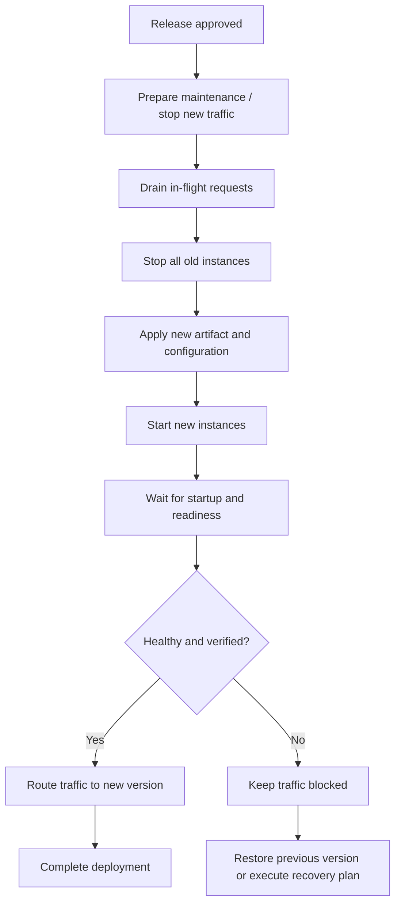

# Understanding Recreate Deployment and Downtime Windows

## 1. The challenge when replacing application versions

When releasing a new version, the system needs to replace the running processes or instances with the new version. The replacement approach directly affects how long users cannot access the service, the required resource levels, operational complexity, and recovery capability when errors occur.

A straightforward strategy is to stop all instances of the old version, and only then start the new version. This approach is commonly called **Recreate deployment** or full replacement deployment. In the interval between the two versions, no application instances are ready to serve. Therefore, this strategy can create intentional downtime.

For example, an internal service runs only a single instance. When deploying a new release, the pipeline stops the old instance, updates the package, starts the service, and waits for the health check. While the old service has stopped and the new service is not yet ready, users may receive connection errors or a maintenance page.

This strategy is easy to understand and can fit systems that accept a maintenance window. To use it safely, the team needs to predict the outage duration, handle in-flight requests, control data changes, and prepare a rollback plan.

## 2. How does Recreate deployment work?

Recreate replaces the entire old instance group with a new instance group in sequence. High-level sequence:

1. Verify artifacts, configuration, migrations, and release conditions.
2. Put the service into a maintenance-preparation state or stop accepting new requests.
3. Drain traffic and allow in-flight requests/connections to complete within the allowed time.
4. Stop all old instances.
5. Apply the new artifact version and configuration.
6. Start the new instances.
7. Wait for startup, readiness, and post-startup checks.
8. Put the new instances into traffic-serving rotation.
9. Run smoke tests and verify operational metrics.
10. Complete the release or trigger the recovery procedure if checks fail.



Platforms may implement the details differently. The core of Recreate is that all old workloads are stopped before new workloads are created or started under that strategy. There is no concurrent serving phase between two versions like in rolling update or blue-green.

## 3. Where does the downtime window come from?

User-perceived downtime typically starts when the last old instance stops serving and ends when the first new instance is placed into stable service. Preparation steps may happen before this point, but if the team has already blocked traffic, they also contribute to the duration users experience an outage.

A conservative way to estimate it is to sum the sequential execution durations:

\[
T_{maintenance} \approx T_{drain} + T_{shutdown} + T_{release} + T_{startup} + T_{readiness} + T_{routing} + T_{verification}
\]

Where:

| Component | Meaning | Influencing factors |
|---|---|---|
| Drain | Stop accepting new requests and wait for in-flight requests/connections | Long requests, WebSockets, keep-alive, timeouts |
| Shutdown | Safely stop old instances | Grace period, shutdown hooks, background task handling |
| Release | Replace packages, images, configs, or mount volumes | Image/package download speed, file operations, migrations |
| Startup | Start the new process | Runtime initialization, dependency connections, cache warm-up |
| Readiness | Wait for the instance to qualify to receive traffic | Health/readiness checks, data initialization time |
| Routing | Update load balancer, service endpoints, or proxy | Health polling, propagation delay, DNS if applicable |
| Verification | Run smoke tests and confirm core behavior | Number of tests, dependency response time, observation window |

The formula is a planning model, not an exact measurement across every platform. Some operations may overlap. Actual outage duration should be measured from the moment the last endpoint of the old version stops accepting traffic until the new endpoint is ready and traffic is restored.

For example: drain takes 20 seconds, shutdown 8 seconds, package update 15 seconds, startup 35 seconds, readiness 20 seconds, and routing/verification 12 seconds. If all occur sequentially, the estimated maintenance window is around 110 seconds. When scheduling, add a buffer for load fluctuations, cold caches, slow registries, or unstable dependencies.

## 4. Distinguishing deployment duration from user-visible downtime

Not all pipeline execution time is downtime. Building, testing, scanning, approval, and artifact preparation can finish before the maintenance window. Downtime mainly lies in the phase where the service has no ready instances or traffic is blocked.

Milestones should be separated:

- **Pipeline duration:** from when the pipeline starts until it completes.
- **Deployment duration:** from when workload changes begin until deployment ends.
- **Maintenance window:** the time period during which the system intentionally restricts or stops serving.
- **User-visible downtime:** the time period during which valid requests cannot be served according to service objectives.

A pipeline may run for 15 minutes yet cause only 90 seconds of downtime if most of the time is spent building and verifying beforehand. Conversely, a deployment operation lasting only a few minutes can still have major impact if it coincides with peak hours or lacks a maintenance notice.

To measure accurately, record timestamps for drain, old endpoints stopping service, new instances becoming ready, traffic reopening, and smoke tests passing. Do not rely solely on the deploy job duration as a proxy for downtime.

## 5. When is Recreate appropriate?

Recreate can be a reasonable choice when:

- The application is small, has few users, or serves internal users only.
- The system has an acceptable, announced maintenance window.
- A new version cannot run concurrently with the old version due to resource or protocol conflicts.
- The application runs only one instance and has no continuous availability requirement.
- The environment lacks sufficient resources to run two groups of instances concurrently.
- Stopping all processes simplifies changes with special constraints, after evaluating data and recovery capability.
- The service starts quickly, state is stored externally, and requests can be safely retried.

Examples include an internal admin tool used only during business hours, a demo application, a scheduled batch service, or a system operated within an agreed maintenance window.

Recreate is usually unsuitable when a service must operate continuously, has a strict SLA, has slow startup, has non-retryable requests, or where downtime causes lost transactions. In such cases, consider strategies that maintain capacity while replacing versions.

## 6. Advantages and limitations

| Aspect | Advantages | Limitations |
|---|---|---|
| Simplicity | Stop-then-start flow is easy to understand, fewer parallel deployment states | Requires precise coordination of when to stop/open traffic |
| Resources | No need to maintain full old and new capacity simultaneously | No instances serving during the transition window |
| Version compatibility | No phase where two versions receive traffic at the same time | Rollback still requires checking configuration and data compatibility |
| Operations | Easy to identify which group of instances is being replaced | A startup error can keep the entire service down longer than expected |
| Testing | Can verify the new version before opening traffic | Testing after stopping the old version increases outage duration |
| Cost | Fits resource-constrained environments | May incur maintenance, support, and business-interruption costs |

No single deployment strategy is best in every situation. Recreate optimizes the simplicity of the replacement sequence; the team must accept and manage the corresponding downtime.

## 7. Preparing traffic before stopping the old version

If instances are stopped as soon as the pipeline starts, in-flight requests can be interrupted. Before stopping, coordinate with the load balancer, ingress, reverse proxy, or service discovery to:

1. Mark instances as not accepting new requests or enable a maintenance response.
2. Wait for the routing system to stop sending new requests to the instances.
3. Let in-flight requests finish within the configured drain period.
4. Handle long-lived connections such as WebSockets, streaming, or gRPC according to policy.
5. After the deadline, terminate remaining processes via graceful shutdown and then force stop if needed.

Drain only works when the routing layer understands instance state and has time for state propagation. If the application receives traffic directly via DNS or clients hold long-lived connections, stopping new requests can be more complex. DNS TTL does not guarantee every client updates on time because resolvers and applications can cache differently.

For systems without a load balancer, a maintenance page can be enabled or endpoints can enter a controlled request-rejection state. A 503 response with `Retry-After` can be useful for clients that support retries, but only use it when retry behavior is designed to avoid traffic spikes or duplicate transactions.

## 8. Handling in-flight requests and background jobs

Graceful shutdown helps the application finish work in progress before the process terminates. Define a maximum wait time and the behavior when the timeout expires.

Scenarios to consider:

- In-flight HTTP requests: complete within the grace period or return a retryable error.
- Payment/order transactions: ensure idempotency and provide a state-check mechanism before retrying.
- WebSockets/streaming: notify connection closure and guide clients to reconnect.
- Background workers: stop picking up new jobs, finish or safely return jobs to the queue.
- Scheduled tasks: avoid duplicate runs between the old and new processes.
- Message consumers: commit offsets/ack after successful processing; avoid data loss or duplicate processing beyond tolerance.

Do not assume sending a stop signal means all requests have completed. Observe the number of active requests, queued jobs, and consumer state before terminating the process.

## 9. State and data must persist outside the instance

Recreate removes all old instances. If the application stores sessions, uploads, user files, or business state on the local filesystem, that data can be lost when the instance is deleted.

Before choosing a strategy, classify data:

| Data type | Appropriate handling |
|---|---|
| User sessions | Store in a shared session store or client-side token mechanism |
| Business data | Store in a database/storage service with backups and recovery policies |
| Uploaded files | Store in object storage or separately managed persistent volumes |
| Cache | Determine whether it can be rebuilt; prepare cache warm-up if needed |
| Queue/job state | Use a persistent broker or store supporting ack/retry/idempotency |
| Temporary files | Keep inside the workspace/instance only if they can be regenerated |

If data must be stored on a persistent volume, check detach/attach behavior, permissions, filesystem recovery, and whether the new version can read old data. A persistent volume does not automatically guarantee the application flushes data consistently before shutdown.

## 10. Database compatibility and migrations

An easily overlooked point is that Recreate does not eliminate migration risks. Having only one application version active at a time reduces the need for concurrent compatibility between two versions during serving, but the database may contain data that must be preserved and the old version may still need to read it after a rollback.

Before migrating, determine:

- Is the migration destructive or does it change data types?
- Is there a backup and has restore been tested?
- Does the migration duration fit within the maintenance window?
- If the migration fails halfway, what is the state of the schema and data?
- Is the old artifact compatible with the post-migration schema?
- Can the migration be rolled back, or is a roll-forward with a data-fix script required?
- Is a step needed to verify record counts or data integrity?

The expand-and-contract pattern remains useful: expand the schema compatibly first, deploy the application, migrate the data, and remove old structures only when no version uses them anymore. If choosing Recreate because the new application requires an incompatible schema, treat the migration as a separate change with appropriate gates, backups, recovery plans, and approvals.

Do not automatically run irreversible migrations as soon as the deploy job starts. If a migration breaks the ability to run the old version again, rolling back the application alone will not suffice.

## 11. Managing configuration and secrets during the replacement window

The new artifact may require different configuration or a new config schema. Before stopping the old application, verify:

- The config revision is compatible with the new artifact version.
- Required variables have values and match the target environment.
- Secrets/certificates are valid and the deployment identity has read access.
- Configuration has been validated, with a revision available to revert to if needed.
- Secrets are not embedded into images or log files.
- If secrets change, the old version remains valid during the rollback window or a re-issuance plan exists.

The deployment record should link the artifact digest, config revision, and secret reference/version. When the new version fails to start, the team needs to know the exact combination of inputs applied in order to recover or investigate.

## 12. Health checks and when to reopen traffic

A successful process start does not mean the application is ready to serve. A process may be running but not yet connected to the database, not yet warmed up caches, or not yet finished migrations.

Distinguish the checks:

- **Startup check/probe:** determines whether the application has completed its startup phase within the allowed limit.
- **Readiness check/probe:** determines whether the instance can accept traffic yet.
- **Liveness check/probe:** determines whether the process is still alive or stuck and needs restarting.
- **Smoke test:** verifies a few core flows through the interface used by users or other systems.
- **Post-deploy verification:** verifies metrics, logs, traces, and business behavior after opening traffic.

Readiness is the critical condition for adding a new instance to a load balancer or Service endpoints. Liveness should not replace readiness; if liveness is too sensitive, a slow-starting application can enter a restart loop.

In Recreate, keep traffic in maintenance mode or unrouted until the new instances pass readiness and minimal smoke tests. If checks fail, do not open traffic just to finish the pipeline quickly.

## 13. Kubernetes Deployment with the Recreate strategy

Kubernetes Deployment supports `strategy.type: Recreate`. When updating a Deployment with this strategy, old Pods are terminated before new Pods are created. Because no new Pod group runs in parallel to maintain capacity during replacement, the application may experience a period with no Pods ready to serve.

Illustrative configuration example:

```yaml
apiVersion: apps/v1
kind: Deployment
metadata:
  name: internal-admin
spec:
  replicas: 2
  strategy:
    type: Recreate
  selector:
    matchLabels:
      app: internal-admin
  template:
    metadata:
      labels:
        app: internal-admin
    spec:
      terminationGracePeriodSeconds: 30
      containers:
        - name: app
          image: registry.example.com/internal-admin@sha256:<image-digest>
          ports:
            - containerPort: 8080
          startupProbe:
            httpGet:
              path: /startup
              port: 8080
            periodSeconds: 5
            failureThreshold: 24
          readinessProbe:
            httpGet:
              path: /ready
              port: 8080
            periodSeconds: 5
            failureThreshold: 3
          livenessProbe:
            httpGet:
              path: /health/live
              port: 8080
            periodSeconds: 10
            failureThreshold: 3
```

This is an illustrative configuration; image digests, endpoints, and probe thresholds must match the actual application. `terminationGracePeriodSeconds` sets the time for a Pod to terminate gracefully before being forcibly killed. The application needs to handle `SIGTERM` and stop accepting new work during this window.

With `Recreate`, do not configure `maxSurge`/`maxUnavailable` as in a RollingUpdate strategy; those rollout parameters belong to the RollingUpdate strategy. Verify specific controller and workload behavior, especially when multiple controllers or other jobs operate on the same resources.

A Service should only include ready Pods in serving endpoints based on readiness. Still, maintenance handling is needed at the ingress/load balancer layer if you want users to see a clear notice instead of connection errors when no endpoints exist.

## 14. Replacement deployment on VMs or traditional services

For applications running on VMs or dedicated servers, Recreate can be implemented using systemd, deployment scripts, or configuration management tools.

An illustrative sequence:

```bash
set -euo pipefail

sudo systemctl stop order-service

# Install the verified artifact into a new release directory.
sudo install -d -m 0755 /opt/order-service/releases/2.4.1
sudo install -m 0644 order-service.jar /opt/order-service/releases/2.4.1/order-service.jar

# Create a new symlink and replace the release pointer on the same filesystem.
sudo ln -sfn /opt/order-service/releases/2.4.1 /opt/order-service/current.next
sudo mv -Tf /opt/order-service/current.next /opt/order-service/current

sudo systemctl start order-service
sudo systemctl is-active --quiet order-service
```

This is a Linux example using GNU `mv -T`; it is simplified and not yet a complete production runbook. `current.next` and `current` need to reside on the same filesystem so the rename replacement is atomic; check status if symlink creation or rename fails. Artifacts should be fetched by digest, verified via checksum/signature, file permissions managed, previous releases retained, configuration validated, readiness endpoints awaited, and logs/metrics checked. `systemctl is-active` only confirms the service unit is active, not that business endpoints are ready.

Do not overwrite a running package in place if a separate release directory can be prepared. Keep the old release until the new version is verified and rollback is viable. When updating symlinks, perform the operation atomically according to filesystem and operating system procedures.

## 15. Designing a maintenance window

If downtime is acceptable, manage it as a planned change:

- Identify affected users, dependent systems, and business workflows.
- Choose a time with low traffic or low impact based on actual data.
- Announce in advance and publish the expected duration, scope, and contact channels.
- Separate preparation time from service interruption time.
- Set maximum durations for drain, shutdown, migration, startup, and verification.
- Prepare a maintenance page or controlled error response.
- Define stop-deployment criteria and when to switch to rollback.
- Assign on-call personnel, dashboards, and runbooks.
- Have a plan if the maintenance window is exceeded, such as restoring the old version or extending the window per approved decision.

Do not announce downtime solely based on the average duration of a single deployment. Use historical data, higher percentiles such as p95, and a safety buffer. If no data exists, run a timed rehearsal on an equivalent environment and announce a range with buffer.

## 16. Estimating and measuring downtime

A deployment plan should include a step-by-step estimation table and record actual times after each run.

Example:

| Step | Estimate | Actual time | Notes |
|---|---:|---:|---|
| Drain traffic | 20 seconds |  | Wait for in-flight requests |
| Shutdown | 10 seconds |  | Graceful termination |
| Replace artifact/config | 15 seconds |  | Excludes pre-release build |
| Startup | 35 seconds |  | JVM initialization |
| Readiness | 20 seconds |  | Dependencies and cache warm-up |
| Routing/smoke | 15 seconds |  | Endpoints and core flows |
| Buffer | 30 seconds |  | Environmental variance |
| **Planned total** | **145 seconds** |  | Re-measure after deployment |

Milestones that should be collected automatically:

- `maintenance_started_at`
- `last_old_endpoint_removed_at`
- `old_workload_stopped_at`
- `new_workload_started_at`
- `first_new_instance_ready_at`
- `traffic_restored_at`
- `smoke_test_passed_at`

From these, you can calculate the duration with no available endpoints, total maintenance time, and verification time. If multiple old instances stop at different times, the last timestamp stopping service and the first timestamp resuming service matter for user-visible downtime.

## 17. Rollback plan when the new version fails to start

In Recreate, the old version has already been stopped before the new version is checked. Therefore, if the new version fails to start or fails readiness, the service may remain down until recovery completes.

A rollback plan prepared in advance should include:

1. Keep the old artifact in the repository with a known digest.
2. Save the previous config revision and identify still-valid secret versions.
3. Verify the old artifact is compatible with the current database schema.
4. Define the command or procedure to revert to the previous release pointer.
5. Keep traffic in maintenance state during recovery.
6. Start the old version and wait for readiness.
7. Run smoke tests, inspect logs/metrics, and only then reopen traffic.
8. Record the rollback reason and required fixes before the next release.

Rolling back the application does not mean rolling back data. If a migration altered schema or data, a roll-forward or dedicated recovery script may be needed. Do not automatically run down-migrations unless proven safe and without losing new data.

## 18. Failure points and responses

| Failure point | Impact | Response |
|---|---|---|
| Drain fails to complete | Dangling requests/connections | Set timeouts, inspect connections, decide to wait or cut per policy |
| Old process refuses to stop | Release stuck or two processes contending for resources | Investigate process, use controlled escalation, avoid arbitrarily deleting in-use files |
| Artifact download fails | No new package to run | Keep traffic in maintenance, retry from trusted registry or roll back |
| Migration fails | Schema in unknown state or app fails to start | Halt rollout, inspect migration state, execute data runbook |
| New app crash-loops | No ready instances | Collect logs, hold traffic, roll back artifact/config if compatible |
| Readiness fails | Cannot safely open traffic | Check dependencies and config; do not confuse liveness with readiness |
| Routing not updated | Requests still go to old endpoints or miss new ones | Inspect load balancer/service discovery and propagation |
| Smoke test fails | New version may fail core flows | Hold traffic, triage errors, and roll back/roll forward |
| Maintenance window exceeded | Prolonged user impact | Trigger go/rollback decision via authorized owner |

Each scenario should have an owner, timeout, observability signals, and exit criteria. Avoid letting the pipeline wait indefinitely on a health check or retry endlessly when the service cannot become ready.

## 19. Brief comparison with Rolling, Blue-Green, and Canary

Recreate is one of several version replacement strategies. The choice depends on acceptable downtime, resources, compatibility, and operational capability.

| Strategy | Version transition | Expected downtime | Resource needs / complexity |
|---|---|---|---|
| Recreate | Stop all old versions then start new version | Can have noticeable downtime | Simpler, no need to maintain two capacity groups simultaneously |
| Rolling | Replace instances incrementally, keeping partial capacity serving | Can be very low if capacity and readiness are designed properly | May need surge capacity; requires compatibility while two versions run together |
| Blue-Green | Provision new environment in parallel, then switch traffic | Can be near zero-interruption during traffic switch | Requires capacity for two environments and data-state control |
| Canary | Shift a portion of traffic to new version and increase gradually | Usually avoids service-wide downtime | Requires good routing, metrics, and rollout analysis |

Recreate should not be called zero-downtime. Conversely, Rolling or Blue-Green do not automatically guarantee zero interruption either: misconfigured readiness, incompatible migrations, dropped connections, or insufficient capacity can still cause user-facing errors.

## 20. Example Recreate runbook for an internal service

Assume an admin application serving employees only, allowing up to three minutes of maintenance. The team has prepared the artifact, config revision, and previous rollback release.

| Phase | Action | Transition condition |
|---|---|---|
| Pre-window | Build/test/scan artifact, verify digest, validate config, and notify | All pre-deploy gates pass |
| Start | Enable maintenance response, stop accepting new requests | Load balancer no longer routes new requests to old instances |
| Drain | Wait for in-flight requests and background jobs to complete | Connections within threshold or handled per policy |
| Stop | Stop all old instances | Old processes exited, resources released |
| Replace | Install new artifact and apply approved config revision | Digest/config revision matches release manifest |
| Start | Start new instances | Startup completes, no crash loop |
| Verify | Readiness, smoke tests, inspect logs and metrics | Mandatory checks pass |
| Resume | Reopen traffic, disable maintenance response | Endpoints serving steadily |
| Close | Record deployment log and actual durations | No critical alerts; release confirmed |

If startup or smoke tests fail, the runbook keeps the maintenance response active, restores the previous artifact/config if compatible, restarts, and verifies. If a migration has changed data irreversibly, the owner must choose a roll-forward/repair approach rather than running an automated rollback.

## 21. Common anti-patterns

| Anti-pattern | Consequence | Improvement |
|---|---|---|
| Calling Recreate zero-downtime | Wrong expectations and no downtime planning | Clearly announce the outage window and measure actual duration |
| Stopping the app before preparing artifacts | Longer downtime from downloading/building while offline | Build, scan, publish, and validate before the maintenance window |
| Opening traffic as soon as process runs | Requests hit an unready application | Wait for readiness and minimal smoke tests |
| Not draining in-flight requests | Lost transactions or dropped connections | Graceful shutdown, timeouts, and idempotency |
| Storing sessions/files on the instance | State lost when instances are replaced | Externalize state and use persistent storage |
| Migrating without a backup/restore plan | Application rollback cannot restore data | Gate migrations, test restore, and prepare roll-forward |
| Checking only that the service is active | Process runs while dependencies or business logic fail | Readiness, smoke tests, and post-deploy metrics |
| Not keeping old artifacts/configs | Cannot restore accurately | Retain release bundles and deployment records |
| Retrying startup indefinitely | Prolonged downtime and hidden root cause | Timeouts, retry limits, and rollback conditions |
| Not measuring downtime milestones | Unknown actual impact on SLA | Record endpoint and traffic timestamps at each stage |

## 22. Checklist before choosing Recreate

Before deciding to use full replacement deployment, verify:

- [ ] Is downtime acceptable to the business and SLA?
- [ ] Are a maintenance window, notification, and on-call coverage in place?
- [ ] Has the new artifact been built, tested, scanned, and published before stopping the old version?
- [ ] Can in-flight requests, connections, and background jobs be safely drained?
- [ ] Have sessions, files, and required state been externalized or backed up?
- [ ] Do migrations have backups, compatibility checks, and a recovery plan?
- [ ] Have config revisions and secret versions been verified for the new artifact?
- [ ] Have shutdown, startup, readiness, and routing durations been measured/estimated with a buffer?
- [ ] Are health/readiness checks and smoke tests in place before opening traffic?
- [ ] Are the old artifact/config available and compatible for rollback?
- [ ] Are there clear criteria to halt deployment or switch to recovery?
- [ ] Does the deployment record store the digest, config revision, environment, and actual downtime?

## 23. Core practical principles

1. Understand Recreate as stopping all old workloads before starting new workloads; expect an unavailable window.
2. Separate pipeline, deployment, maintenance window, and user-visible downtime durations.
3. Prepare artifacts, configuration, checks, and approvals before starting the maintenance window.
4. Drain requests and background work; use graceful shutdown with explicit timeouts.
5. Externalize sessions, files, and persistent data from replaced instances.
6. Control migrations, backups, and schema compatibility before stopping the old version.
7. Open traffic only after new instances pass readiness and mandatory smoke tests.
8. Retain previous artifact/config/secret references and verify rollback capability.
9. Measure actual downtime from endpoint and traffic states, not just job runtime.
10. Choose Recreate when downtime is acceptable and the simplicity of full replacement fits the system's risk profile.

Full replacement deployment is a clear strategy: stop the old version, replace it with the new version, and verify before resuming service. Its value lies in simplicity and predictable resource requirements; the cost is an outage window that must be planned, measured, and communicated. When a team manages traffic, data, migrations, readiness, and rollback well, Recreate can be a suitable choice for systems that accept a maintenance window.
