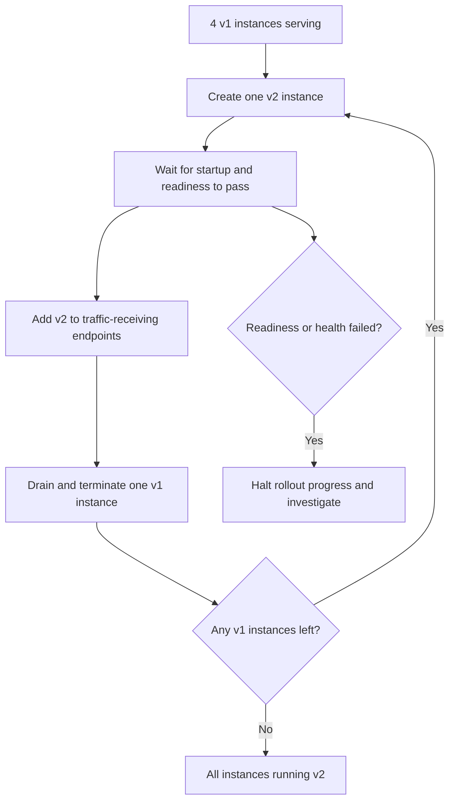
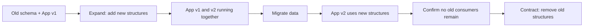
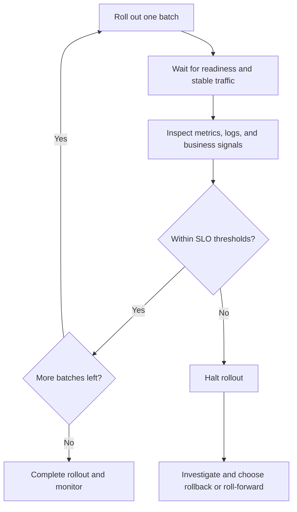

# Understanding Rolling Deployment and Compatibility Requirements

A rolling deployment (or rolling update) replaces instances of the currently running version with instances of the new version in small batches. During the transition, the old and new versions coexist and can receive traffic simultaneously. This approach helps maintain serving capacity without stopping the entire system, but it is only safe when the versions can operate concurrently with the same APIs, data, messages, configuration, and shared resources.

The hardest part of a rolling deployment is not creating new Pods or VMs. It is the mixed-version period: some requests hit the old version while others hit the new version; old workers may read messages produced by new workers; the database schema may already be expanded while the old application is still running. If changes are incompatible, a rollout can surface errors even when each version works fine running in isolation.

## 1. How does rolling deployment work?

Suppose a service has four instances of version `v1`. A rolling update creates a number of `v2` instances, waits for them to become ready to receive traffic, and then gradually reduces the number of `v1` instances. The process continues until all replicas run `v2` or the rollout is halted due to errors.



During the transition, the system can run `v1` and `v2` concurrently. Therefore, compatibility requirements must be designed before release. Rolling deployment does not automatically guarantee zero downtime: if new instances are not ready, old instances are stopped too early, capacity is insufficient, or in-flight requests are dropped, users can still experience disruptions.

### 1.1. Rolling update vs. full replacement

With full replacement (recreate), the system may stop old instances before starting new ones; this approach is simpler but usually creates an outage window. Rolling update retains a portion of old capacity while gradually adding new capacity. In return, the system must tolerate a period where two versions run concurrently and handle differences between them.

### 1.2. Steps in a rollout cycle

1. The orchestrator determines how many new instances to create based on the rollout policy.
2. New instances start up, load configuration, and connect to dependencies.
3. Startup/health checks confirm the process has started properly.
4. Readiness checks confirm the instance can accept traffic.
5. The load balancer or service discovery adds the new instance to the endpoints.
6. Old instances stop accepting new requests, drain connections, and terminate gracefully.
7. The orchestrator continues until the desired replica count and state are reached.
8. The system verifies rollout completion and monitors post-deployment metrics.

## 2. Why is compatibility between old and new versions required?

A rolling deployment does not switch all instances at the exact same moment. During that window, components can interact across versions:

- The load balancer sends requests to both `v1` and `v2`.
- `v2` writes data that `v1` still needs to read.
- `v1` produces messages for a `v2` consumer, or vice versa.
- A session is created by the new version but read by the old version.
- Cache keys or cache values are written by one version and read by another.
- Mobile apps, browsers, or external partners still call APIs using the old contract.
- Background jobs or long-running workers may outlive the rollout duration.

Compatibility must be considered in both backward and forward directions:

- **Backward compatibility:** the new version still accepts data, requests, or protocols produced by the old version.
- **Forward compatibility:** the old version can safely ignore or handle new data, fields, or messages it does not yet recognize.

In a rolling update, the new version typically needs to be compatible with the current state, and the old version must not be broken by changes deployed before or during the rollout. Testing `v2` against a new database alone is not enough; you must also test `v1` and `v2` running together against the existing schema.

## 3. Defining a compatibility matrix before release

List all interfaces and state shared between versions:

| Boundary | Compatibility questions |
|---|---|
| HTTP/API | Do requests/responses add required fields, change data types, or change status/error semantics? |
| Database schema | Can the old version still run after the schema is expanded? Can the new version read old data? |
| Message/event | Do old consumers ignore new fields? Do new producers still emit schemas old consumers understand? |
| Session/cookie | Can the old version read sessions or cookies created by the new version? |
| Cache | Do both versions agree on keys, values, and serialization formats? |
| File/object storage | Are file names, formats, metadata, and lifecycles compatible? |
| Config/feature flag | Will new values cause the old version to fail startup or misinterpret behavior? |
| Background job | Will old jobs continue running after the new version is deployed? |
| Protocol/service discovery | Have TLS, gRPC, DNS, endpoints, or auth protocols changed? |

For each boundary, identify the producer, consumer, concurrently running versions, and how to test them. If compatibility cannot be guaranteed, a controlled transition step is needed, such as pausing consumers, draining queues, or splitting the rollout into phases.

## 4. API compatibility during the mixed-version period

### 4.1. Changes that are generally safer

The following changes are usually easier to keep compatible when implemented properly:

- Adding optional response fields that old clients can ignore.
- Adding new endpoints without removing old endpoints.
- Adding metadata values where consumers are designed to ignore unknown fields.
- Extending enums in a way where clients handle unknown values safely.
- Adding optional headers that do not alter the semantics of old requests.

However, "adding a field" is not always safe. A client might deserialize strictly and reject unknown fields; a schema validator might forbid additional properties; an enum client might crash upon receiving an unknown value. Test actual consumer behavior, not just server-side changes.

### 4.2. Changes likely to break compatibility

- Removing or renaming fields/endpoints currently in use.
- Changing field types, such as an integer to a string or a timestamp to a local date.
- Turning an optional field into a required one.
- Changing value meanings, units, or rounding rules.
- Changing authentication/authorization in ways old clients do not yet support.
- Changing message ordering or semantics when consumers depend on order.
- Returning status codes or error formats different from the published contract.

These changes usually require a transition phase: support both old and new contracts, migrate consumers, observe usage, and only remove the old contract in a subsequent release.

### 4.3. Example of adding a field to an API

Suppose the old API returns:

```json
{
  "orderId": "ORD-1042",
  "status": "CONFIRMED"
}
```

The new version wants to add `fulfillmentMode`:

```json
{
  "orderId": "ORD-1042",
  "status": "CONFIRMED",
  "fulfillmentMode": "DELIVERY"
}
```

To roll out safely, old clients must ignore unknown fields or the schema contract must allow extension. The server should not immediately require all clients to send `fulfillmentMode` in requests while old clients remain active. Roll out in stages: the server accepts the new field as optional, new clients begin sending it, monitor adoption, and only then consider requiring the field in a planned release.

### 4.4. Consumer-driven contract testing

Contract tests verify the contract between consumer and provider. In CI, you can verify that a new provider still satisfies contracts of supported consumers and that a new consumer still works with the current provider. In multi-service systems, contract versions and a compatibility matrix help detect breaking changes before deployment.

Do not test the provider solely against mocks authored by the provider itself. Contracts must reflect how real consumers use the API, including optional fields, unknown values, error handling, and business semantics.

## 5. Database migration: the most critical compatibility requirement

The database is typically shared between old and new versions throughout a rolling update. Therefore, schema migrations must allow both versions to run together.

### 5.1. Expand-and-contract

The expand-and-contract pattern splits breaking changes across multiple releases:

1. **Expand:** add new columns/tables/indexes or extend the schema in a way where the old version still works.
2. **Deploy compatible code:** deploy the new version capable of reading/writing both old and new structures.
3. **Migrate data:** migrate data in batches, safely resumable with observable progress.
4. **Switch usage:** gradually switch code to the new fields/structures and verify results.
5. **Contract:** in a later release, once no old versions or old consumers remain, drop the old columns/tables/APIs.



For example, renaming column `customer_name` to `display_name`: do not rename or drop the old column directly during the rollout. Instead, add `display_name`, have the new code read both and write compatibly, backfill data, migrate consumers, monitor, and only drop `customer_name` in a later release.

### 5.2. Use dual-write with caution

During the transition phase, code can write to both the old and new columns. This lets both old and new versions read data, but introduces the risk of the two values diverging if a write fails halfway. When dual-write is needed, perform it within the same transaction when possible, accompanied by reconciliation checks and drift-detection metrics. Another option is writing to the canonical source only and backfilling via an idempotent job that can safely re-run.

### 5.3. Migrations must be resumable and observable

Large data migrations should be batched, checkpointed, rate-limited, and resumable after errors. Avoid long table-locking migrations while production traffic is running. Check query plans, index builds, replication lag, and storage capacity beforehand. Destructive migrations require separate approvals and recovery plans.

### 5.4. Application rollback does not mean schema rollback

After the new application writes data using the new schema, the old version may not understand that data. Rolling the binary back to `v1` might not restore the system. Therefore, during the mixed-version phase, the schema must remain compatible with both versions; contract changes should only execute once there is no path back to the old version or a roll-forward plan is ready.

## 6. Messages, events, and background workers

In asynchronous architectures, producers and consumers may be deployed at different times. A new message can sit in a queue for minutes or hours before a consumer processes it. Thus, compatibility must outlast the rollout duration.

Useful principles:

- Add new fields as optional or with safe defaults.
- Consumers ignore unknown fields when the schema permits.
- Do not change the meaning of existing fields while keeping the same schema version.
- Version events when making incompatible contract changes.
- Keep consumers capable of reading old messages as long as the queue still holds them.
- Use dead-letter queues, bounded retries, and per-schema/version metrics.
- Verify idempotency so redelivered messages do not cause incorrect side effects.

Old event example:

```json
{
  "eventType": "OrderCreated",
  "orderId": "ORD-1042",
  "customerId": "CUS-91"
}
```

New event adding `sourceChannel`:

```json
{
  "eventType": "OrderCreated",
  "orderId": "ORD-1042",
  "customerId": "CUS-91",
  "sourceChannel": "MOBILE"
}
```

Old consumers must ignore the new field, or the schema registry must enforce compatible changes. If changing semantics or removing fields, use a new event version and run a parallel support period. Do not remove old consumers before queues, retry topics, and dead-letter queues are drained of messages those consumers need to process.

## 7. Sessions, cookies, and caches during rollout

### 7.1. Sessions shared across versions

If sessions are stored in Redis or a database, old and new versions can read the same sessions. When changing the serialization format, maintain the ability to read the old format during the transition. You can add a version field to the session payload, but parsers must safely handle old sessions and unversioned sessions.

If sessions are stored in per-instance memory, the load balancer may route subsequent requests to another instance and lose the session. Sticky sessions only mitigate this; they do not replace proper session design when instances are replaced. For rolling deployments, use a shared session store or compatible stateless tokens.

### 7.2. Signing and encryption key rotation

When rotating signing/encryption keys for cookies or tokens, the old version may be unable to verify tokens issued by the new version. One transition pattern is to have the new version sign with the new key while temporarily accepting both old and new keys; after old tokens expire and all instances are updated, retire the old key. This process requires secure secret management and a bounded overlap window.

### 7.3. Cache keys and value formats

Caches represent shared state across versions. If `v2` changes the value format while `v1` still reads the same key, deserialization errors or corrupted data can occur. Include a version in the cache key, such as `orders:v2:<id>`, or maintain a compatible parser during rollout. Proactive cache invalidation is possible if data can be recomputed, but evaluate traffic spikes when caches are cold.

## 8. Configuration and feature flags during transition

A rolling update may run new code while a new feature remains disabled. Feature flags decouple code deployment from feature activation. However, both versions must understand flag and configuration states during the overlap period.

- Add new configuration with compatible defaults before deploying code that depends on it.
- Do not remove old configuration keys while old instances still need them.
- Configure safe defaults when the flag service is unreachable.
- Test flags by user segment and verify rollback behavior.
- Track ownership, expiration, and cleanup plans to remove flags after rollout completes.
- Do not use flags to mask a compatibility-breaking schema migration.

If configuration is loaded at startup, ensure all instances receive the required configuration before shifting traffic. If configuration refreshes dynamically, verify the new version handles transitional states and refresh failures.

## 9. Readiness, startup, liveness, and graceful shutdown

Rolling updates rely on signals indicating when new instances can accept traffic and when old instances can safely stop.

### 9.1. Startup probe

Startup probes support applications with long startup times. They let the application finish initialization before liveness/readiness take effect as configured. Without an appropriate startup probe, liveness might repeatedly restart an application that is still legitimately starting up.

### 9.2. Readiness probe

Readiness answers whether the instance is ready to accept requests. Only when readiness passes should the platform add the instance to traffic-serving endpoints per its mechanism. Readiness should reflect real serving ability: the application has loaded config, opened necessary connections, and is ready to serve.

Do not let readiness always return 200 just because the process is alive. Conversely, avoid checking non-essential secondary dependencies so strictly that an auxiliary service outage removes all instances from traffic continuously.

### 9.3. Liveness probe

Liveness helps detect hung or unrecoverable processes. It should not depend too tightly on a shared external service. If the database drops connections briefly and liveness restarts every instance, the system can trigger a restart storm that worsens the outage.

### 9.4. Graceful shutdown and connection draining

When an old instance is terminated, it needs to stop accepting new requests, finish in-flight requests within allowed limits, close consumers or connections, and release resources. Applications should handle SIGTERM or equivalent signals, enforce an explicit drain period, and avoid starting new work after receiving a shutdown signal.

For queue workers, stop fetching new messages and finish or return in-flight messages according to broker semantics. If a process is killed before acking, messages may be redelivered; handlers must be idempotent.

## 10. Configuring rolling updates in Kubernetes

Kubernetes Deployment supports the `RollingUpdate` strategy. Two key parameters:

- `maxSurge`: maximum extra Pods that can be created above the desired replica count during rollout.
- `maxUnavailable`: maximum Pods allowed to be unavailable during rollout.

Values can be integers or percentages. With default Deployment settings, both parameters are typically 25%; configure them explicitly when predictable behavior is required. When `maxUnavailable: 0`, allow at least one surge Pod so the rollout can proceed.

For example, with four replicas, `maxSurge: 1` and `maxUnavailable: 0` allow creating at most one additional Pod while not intentionally reducing available Pods below the desired count during rollout. This configuration requires sufficient CPU/RAM quota and cluster capacity to run extra Pods.

```yaml
apiVersion: apps/v1
kind: Deployment
metadata:
  name: orders
spec:
  replicas: 4
  minReadySeconds: 10
  progressDeadlineSeconds: 600
  revisionHistoryLimit: 5
  strategy:
    type: RollingUpdate
    rollingUpdate:
      maxSurge: 1
      maxUnavailable: 0
  selector:
    matchLabels:
      app: orders
  template:
    metadata:
      labels:
        app: orders
    spec:
      terminationGracePeriodSeconds: 45
      containers:
        - name: orders
          image: registry.example.com/orders@sha256:0123456789abcdef...
          ports:
            - containerPort: 8080
          startupProbe:
            httpGet:
              path: /health/startup
              port: 8080
            periodSeconds: 5
            failureThreshold: 30
          readinessProbe:
            httpGet:
              path: /health/ready
              port: 8080
            periodSeconds: 5
            failureThreshold: 3
          livenessProbe:
            httpGet:
              path: /health/live
              port: 8080
            periodSeconds: 10
            failureThreshold: 3
```

The digest in the example is a placeholder. Probe paths must be provided by the application and accurately reflect state. `minReadySeconds` requires a Pod to remain Ready for a period before counting as available for the Deployment. `progressDeadlineSeconds` detects stalled rollouts; when exceeded, the Deployment reports a progress failure status without automatically rolling back to the old version.

### 10.1. Monitoring the rollout

Common commands:

```bash
kubectl rollout status deployment/orders --timeout=10m
kubectl get deployment orders
kubectl get pods -l app=orders -o wide
kubectl describe deployment orders
kubectl rollout history deployment/orders
```

When a rollout fails, inspect Pod events, probe failures, container logs, scheduling constraints, image pull errors, resource quotas, and readiness. Do not rely solely on Deployment status; verify actual endpoints and traffic.

### 10.2. Capacity and scheduling

`maxSurge` creates extra Pods during the overlap window. The cluster must have enough resources and quota for the scheduler to place new Pods. If CPU/RAM is insufficient, Pods can stay Pending and stall the rollout. Account for headroom, autoscaler lag, image pull time, and shared resources.

### 10.3. PodDisruptionBudget does not replace rollout settings

PodDisruptionBudget (PDB) primarily governs voluntary disruptions going through the eviction API. Do not rely on PDB as a substitute for `maxUnavailable` in a Deployment rollout. Configure rolling update parameters directly and understand PDB's actual scope during node maintenance or cluster drains.

## 11. Conditions for zero-disruption rolling deployments

No single configuration guarantees zero downtime for every application. Multiple conditions must work together:

- At least a sufficient set of instances remains capable of serving throughout the rollout.
- Readiness accurately reflects traffic-serving capability.
- New instances do not receive traffic until startup and dependency connections finish.
- Old instances are drained and terminated gracefully.
- Load balancers/service discovery update endpoints properly with sufficient convergence time.
- APIs, schemas, sessions, caches, and messages remain compatible during the overlap window.
- Database migrations do not lock or break the currently running version.
- Capacity exists for surge and headroom if instances fail.
- Error rates, latency, saturation, and business metrics are monitored throughout each rollout wave.
- Mechanisms exist to halt the rollout and recover when metrics breach thresholds.

If the application maintains long-lived connections such as WebSockets, streaming, or gRPC, account for connection draining and connection lifetimes. Removing a Pod from endpoints does not necessarily terminate existing established connections immediately.

## 12. Compatibility testing before rolling updates

CI should verify more than building the new version in isolation:

1. **API contract tests:** new provider satisfies old consumer contracts; new consumer handles current provider responses.
2. **Schema compatibility tests:** both old and new code run against the schema across every migration phase.
3. **Migration tests:** expand, backfill, retry, resume, and rollback/roll-forward tested on representative data.
4. **Message compatibility tests:** consumers handle old and new events; producers do not emit schemas unsupported consumers cannot parse.
5. **Session/cache tests:** the old version reads sessions/caches created by the new version during overlap.
6. **Graceful shutdown tests:** in-flight requests drain, workers do not lose messages, and processes exit within deadlines.
7. **Load/capacity tests:** the system withstands temporarily reduced instance counts and surge resource overhead.
8. **Deployment rehearsal:** test on staging with production-like rolling settings, observing readiness, traffic, and rollback.

For multi-service systems, maintain an `N` and `N-1` compatibility matrix: the current version must interoperate with the immediately preceding version across supported boundaries. The matrix should reflect actual versioning policy; you do not necessarily have to support every historical combination.

## 13. Monitoring rollouts and deciding to proceed or halt

Rolling updates should have explicit halt conditions. Monitor at least:

- HTTP 5xx rates or business errors.
- p95/p99 latency and timeouts.
- Throughput and CPU/RAM/thread/connection pool saturation.
- Readiness failures, restart counts, and startup durations.
- Queue lag, dead-letter counts, and message processing failures.
- Database connections, lock waits, replication lag, and migration progress.
- Completion rates of key user workflows.

You can roll out in small batches and wait for an observation window before continuing. If errors exceed thresholds, halt the rollout to avoid expanding the blast radius. Thresholds should be anchored to baselines/SLOs, rather than choosing one universal number for every service.



## 14. Rollback in a rolling rollout

If the new version causes errors, you can halt the rollout and redeploy the previous revision. However, rollback is only safe when the old version is compatible with the current schema, data, messages, sessions, and configuration.

Before rolling back, verify:

- Has the database undergone any destructive migration?
- Has `v2` written data that `v1` cannot understand?
- Are there new messages in queues that old consumers cannot process?
- Have sessions/cookies/caches changed format or keys?
- Have external APIs or clients begun depending on new fields?
- Are current feature flags and configuration compatible with `v1`?

If conditions prevent reverting to `v1`, you may need to roll forward with a compatible fix or restore data via a separate procedure. Do not automatically roll back the schema simply because the application rolled back. Migrations and application rollbacks have separate lifecycles.

## 15. End-to-end example: adding a shipping address field

The `orders` service currently stores shipping addresses in an `address` column. The new version wants to split it into `street`, `city`, and `postal_code`. If schema and code change in a single release, a rolling update could immediately break `v1` as soon as `address` is dropped.

A safer transition:

1. **Release A – Expand:** add the new nullable columns; retain `address` and old indexes. `v1` code keeps working.
2. **Release B – Compatible app:** deploy code able to read both `address` and the new columns. On writes, code maintains data using transitional rules with reconciliation.
3. **Backfill:** run a batched job to migrate old data into the new columns, checkpointing and verifying record counts.
4. **Switch:** shift primary reads to the new columns; monitor for missing or mismatched records. Remaining `v1` instances can still read `address`.
5. **Drain old version:** confirm no instances, workers, or consumers still require the old column; wait for long-running jobs and the defined rollback window to pass.
6. **Release C – Contract:** in a later release, stop reading/writing `address`, and only then drop the column and legacy compatibility code.

Within each rolling update, readiness and graceful shutdown replace instances safely; expand-and-contract lets both versions work with the schema; metrics and data reconciliation verify migration correctness. This combines deployment strategy with compatibility design, not just Deployment configuration.

## 16. Common anti-patterns

| Anti-pattern | Risk | Better practice |
|---|---|---|
| Making breaking schema changes in the same rollout | Old instances fail when the schema changes | Expand-and-contract across multiple releases |
| Readiness only checks process liveness | Pods receive traffic before being ready | Readiness checks actual serving readiness |
| Using liveness to check all dependencies | Mass restarts when an external service fails | Separate startup, readiness, and liveness |
| Killing old instances immediately | In-flight requests/workers get interrupted | Graceful shutdown and draining |
| Assuming adding API fields is always safe | Strict client parsers may fail | Contract tests and unknown-field testing |
| Changing session/cache serialization in one step | Old versions cannot read new state | Versioned formats or key namespaces |
| Testing each version only in isolation | Misses bugs when versions coexist | Test N/N-1 and mixed-version scenarios |
| Relying on PDB to control Deployment rollouts | Misunderstands PDB protection scope | Configure `maxSurge`/`maxUnavailable` directly |
| Rolling back binaries without checking data | Old version incompatible with new schema | Verify schema/messages/sessions before rollback |
| Increasing replicas without capacity planning | New Pods stay Pending, rollout stalls | Reserve headroom and quota for surge |

## 17. Rolling deployment design checklist

- [ ] Replica count, `maxSurge`, `maxUnavailable`, and capacity during overlap are defined.
- [ ] Readiness, startup, and liveness probes have distinct purposes and accurately reflect application state.
- [ ] New instances receive traffic only after they are truly ready.
- [ ] Old instances implement graceful shutdown, connection draining, and appropriate termination timeouts.
- [ ] Old and new versions are compatible across APIs, schemas, events/messages, sessions, caches, and config.
- [ ] Database migrations use expand-and-contract for breaking changes.
- [ ] N/N-1 tests, contract tests, and mixed-version integration tests exist.
- [ ] Background workers and queues handle both old and new messages during overlap.
- [ ] Metrics and business signals have SLO-based rollout halt thresholds.
- [ ] Rollouts can be paused, evidence preserved, and running artifact digests identified.
- [ ] Rollback has been evaluated alongside schema, data, messages, and configuration.
- [ ] Post-rollout checks verify all instances run the expected digest and user behavior is normal.

Rolling deployment replaces versions incrementally while preserving serving capacity, but requires coexisting versions to be compatible. Design APIs, schemas, messages, sessions, and caches in transitional phases; use readiness and graceful shutdown to control traffic; monitor rollouts with both technical and business signals; and remove legacy structures only after no consumers depend on them. When these conditions are verified in CI/CD, rolling deployment becomes a safe and recoverable release method.
