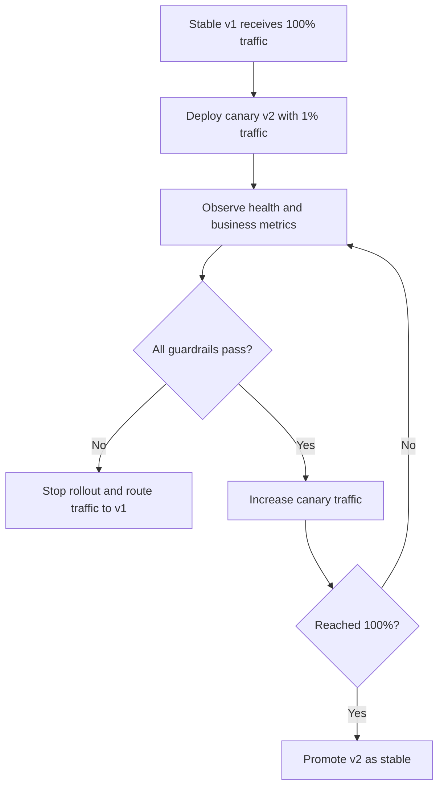
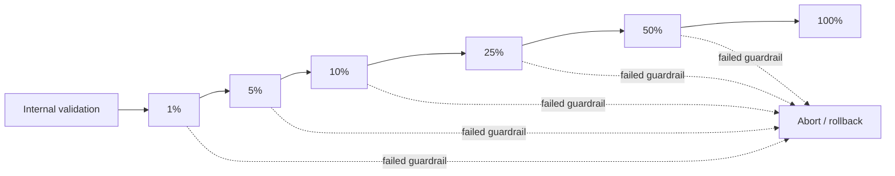

# Understanding Canary Deployment and Gradually Expanding Blast Radius

Deploying a new version to all users at once can allow an incident to spread before the team notices. A minor bug in pricing logic, a database query, or connection configuration can affect thousands of requests as soon as all traffic shifts to the new version.

Canary deployment reduces risk by directing the new version to a small slice of traffic or a subset of users first. The team observes real behavior, compares it against a baseline, and expands only when key metrics remain within allowed thresholds. If negative signals appear, the rollout is halted or traffic is routed back to the stable version.

**Canary is a way to validate a new version under production conditions with a bounded blast radius.** Gradually increasing traffic must be paired with measurement criteria, observation windows, automated or owner-backed decisions, and a prepared recovery plan. Increasing traffic percentages over time without evaluating system health does not constitute a safe canary.

## 1. What is canary deployment?

Canary deployment is a release strategy where the new version (the canary) receives only a fraction of traffic or a single user cohort initially. The currently stable version continues handling the remaining traffic. Once sufficient evidence shows the new version behaves well, the team gradually expands its share until the rollout completes.

The name canary originates from using canaries to detect toxic gas in coal mines: an early warning signal that identifies danger before many people are affected. In software deployment, a small subset of users or traffic serves to catch issues in a new version early.

For example, a service runs version `v1` receiving 100% of traffic. The team deploys `v2` and shifts 1% of traffic to `v2`. If error rate, latency, and business metrics remain stable over the observation window, the team increases traffic to 5%, 10%, 25%, 50%, and finally 100%. If `v2` exhibits errors exceeding thresholds, the system stops increasing traffic and shifts traffic back to `v1`.



Canary is commonly grouped under progressive delivery. It focuses on incrementally exposing traffic to a new version and using observability to decide each next step.

## 2. Distinguishing deploy, rollout, and promotion

These terms often appear together, though they are not identical:

- **Deploy:** placing a new version or new resources into an environment, such as creating pods, VMs, or a new release.
- **Rollout:** the process of gradually replacing the old version with the new version, potentially including instance startup, readiness checks, and traffic adjustments.
- **Traffic shifting:** changing the proportion of requests routed to each version.
- **Promotion:** deciding that the canary version qualifies to become the primary version or receive all traffic.
- **Rollback:** reverting to a previous version or state when the new version fails criteria.
- **Roll forward:** fixing the bug and deploying a newer version to bring the system to a healthy state.

A canary can be deployed without yet receiving traffic. Traffic is then shifted gradually. Upon reaching 100%, the new version is promoted. Separating these steps lets the team start and verify instances before exposing them to users.

## 3. How does canary differ from rolling, blue-green, and feature flags?

| Strategy | How it works | How impact is limited | Key considerations |
|---|---|---|---|
| Rolling deployment | Replaces old instances with new ones in batches | A subset of instances runs the new version during transition | Does not necessarily cap the exact request ratio reaching the new version |
| Blue-green | Maintains two environments and switches traffic from blue to green | Can switch traffic all at once or by weight if the router supports it | Requires maintaining two environments and synchronizing data state |
| Canary | Serves a portion of traffic/cohort with the new version and scales up gradually | Traffic share or user cohort is explicitly controlled | Requires strong metrics, guardrails, and clear decision processes |
| Feature flag | Enables/disables a feature within a version or across versions | Users or requests are selected by rules | Does not replace deployment, compatibility checks, or artifact rollback |

Strategies can be combined. For instance, you can deploy a canary via a rolling update to create new instances, use a service mesh to split traffic, and use a feature flag to enable new functionality only for a small cohort. Blue-green can also underpin a canary if the router supports weighted traffic splitting.

What matters is identifying the exact mechanism limiting risk. If you run only 1 new pod yet the load balancer still sends nearly all traffic to it, your canary configuration has missed its goal.

## 4. When should canary be used?

Canary is useful when a new version carries significant operational or business risk and the system has observability, traffic routing, and fast recovery capabilities.

Suitable scenarios:

- Changes to APIs or business logic with high request volumes.
- Changes to pricing, classification, recommendation, or transaction-processing algorithms.
- Upgrades to runtimes, frameworks, or critical dependencies.
- Changes to cache, connection pool, timeout, or concurrency configuration.
- Changes to authentication, authorization, or sensitive data flows.
- Services running multiple instances that support version-aware traffic routing.
- Evaluating performance or stability under a slice of real production traffic.

Canary is less suitable if requests cannot be distinguished by version, telemetry is unreliable, traffic cannot be returned to the old version, or changes cause irreversible side effects. For one-off batch jobs, data-destructive migrations, or workloads without continuous traffic, other control strategies are needed.

### Prerequisites

Before choosing canary, verify:

1. At least one stable version exists to serve unshifted traffic.
2. The router, ingress, load balancer, or service mesh can steer traffic by version.
3. Each version is distinguishable in metrics, logs, and traces.
4. A baseline or evaluation criteria exist for the new version.
5. Appropriate health checks and business metrics are in place.
6. Mechanisms exist to halt the rollout and return traffic to the stable version.
7. Database, message, and cache changes are compatible while both versions run concurrently.

## 5. Choosing canary scope: traffic, cohort, or instance

Canary exposure can be constrained in several ways. The right choice depends on architecture, user types, and routing capabilities.

### 5.1. Splitting by traffic percentage

The router sends a fixed percentage of requests to the new version, such as 1%, 5%, or 10%. This is easy to understand and fits stateless APIs/services.

However, 1% of requests does not necessarily equal 1% of users. One user may generate many requests; a heavy request may consume far more resources than an average one. Define the allocation unit clearly and monitor both request counts and actual resource load.

### 5.2. Splitting by user cohort

The team can select a specific user group, tenant, internal accounts, or geographic region to receive the new version. Cohorts should be selected stably with explicit criteria.

The advantage is ease of controlling the test group and tracking end-to-end experience. The risk is that the cohort may not represent the entire user base. For example, internal employees often behave differently from real customers; large tenants generate different load than small ones.

### 5.3. Splitting by instance or zone

You can deploy the new version to a few instances or a single availability zone first. This lets you observe infrastructure impact and load handling, though traffic is not guaranteed to split evenly if routing algorithms or user distributions vary.

### 5.4. Sticky routing and sessions

For stateful session applications, a user may need to stay routed to the same version over a session window to avoid losing state. Sticky routing stabilizes user experience, though it can cause actual traffic ratios to diverge from configured weights.

If old and new versions do not share compatible session formats or cache schemas, shifting requests between versions can trigger errors. Design sessions and caches for compatibility during the rollout period.

## 6. Designing gradual rollout stages

A canary rollout is typically divided into stages with specific exposure levels and observation windows. No single standard progression fits every system.

Example ramp schedule:

| Stage | Canary traffic | Objective |
|---|---:|---|
| Internal | 0% public traffic; internal group tests first | Verify startup and core workflows |
| Small canary | 1% | Catch severe errors early |
| Expanded canary | 5% | Verify behavior under higher live load |
| Early rollout | 10% | Test broader cohorts and request distributions |
| Mid rollout | 25% | Observe clearer impact on load and business metrics |
| Late rollout | 50% | Final validation before shifting the majority of traffic |
| Complete | 100% | Promote the new version to stable |



Each stage should define:

- Target traffic percentage or cohort.
- Minimum duration to gather sufficient data.
- Minimum number of requests or transactions.
- Metrics and acceptance thresholds.
- The person or controller deciding the next step.
- Conditions to halt, hold current weight, or roll back.

Ramping from 1% to 100% in just a few minutes may be too fast if the system has hourly load cycles or batch workloads. Conversely, holding at 1% too long under very low traffic may fail to gather enough samples to evaluate.

## 7. Selecting metrics and guardrails for canary

A canary is meaningful only if the team can tell whether the new version is better, equivalent, or worse than the stable version.

### 7.1. Technical metrics

- Request success rate and error rate by version.
- HTTP 5xx, timeouts, and connection errors.
- p50, p95, p99 latency.
- CPU, memory, garbage collection, and thread saturation.
- Queue depth, consumer lag, and retry rate.
- Database connections, query latency, lock waits, and deadlocks.
- Restart counts, crash loops, and readiness failures.

### 7.2. Business metrics

- Order creation success rate.
- Payment acceptance rate.
- Login success rate.
- Workflow completion or conversion rate.
- Duplicate, rejected, or canceled transaction rates.
- Data corruption or lost event rates.

Business metrics are critical because a version can have healthy CPU and latency yet produce wrong results. For example, if an API returns HTTP 200 while miscalculating shipping fees, the canary is still causing damage.

### 7.3. Guardrails

Guardrails are bounding conditions that determine whether a rollout may proceed. Examples:

| Metric | Illustrative guardrail example | Action if breached |
|---|---|---|
| 5xx rate | Increase no more than 0.5 percentage points over baseline in a sufficient sample window | Stop increasing traffic, investigate, or roll back |
| p95 latency | Increase no more than 15% over stable | Hold weight or halt rollout |
| Crash/restart | No new crash loops or abnormal restart spikes | Halt rollout and inspect |
| Business success rate | Drop no more than the business-defined threshold | Halt rollout, verify data and behavior |
| Queue lag | Stay within backlog recoverable under SLO | Hold weight or roll back |

These numbers are examples only. Actual thresholds must reflect product SLOs, baselines, load, and risk appetite. Avoid copying a single generic threshold across all services.

### 7.4. Comparing canary against stable

Comparing both versions over the same time window removes confounding effects from shared traffic shifts or external events. Tag metrics and traces with version labels, and compare requests with comparable characteristics.

If the canary receives mostly simple requests while stable handles mostly complex ones, raw latency comparisons can mislead. Segment comparisons by endpoint, tenant, region, transaction type, or request complexity.

## 8. Observation windows and statistical significance

A handful of successful requests does not prove a new version is stable. A canary needs enough time and sample size to detect failures with appropriate confidence.

Factors to weigh:

- Average and peak traffic volumes.
- Batch cycles, cron jobs, and background tasks.
- Minimum requests per stage.
- Rare error frequency and failure severity.
- Seasonality or events altering user behavior.
- Metric pipeline and telemetry latency.

If a service sees only a few requests per minute, 1% traffic may yield too few samples. Expand the internal cohort, run synthetic tests, or extend the stage duration. Do not increase traffic simply because the timer expired if minimum sample counts have not been met.

### Avoiding conclusions from a single metric

One metric can fluctuate from noise. For example, CPU rises slightly on a cold cache while request success and latency remain healthy. Conversely, error rates might stay flat while business failure rates climb due to incorrect responses.

Combine:

1. Technical metrics reflecting service health.
2. Business metrics reflecting user outcomes.
3. Infrastructure metrics reflecting resource pressure.
4. Logs and traces to explain anomalies.

For automated decisions, specify minimum data completeness and how to handle missing telemetry. Missing data must never be interpreted as healthy metrics.

## 9. Automating rollout analysis and decisions

A progressive delivery controller can evaluate metrics automatically at each stage. However, decisions must follow transparent, traceable rules.

An automated flow typically includes:

1. Create the canary workload and attach version labels.
2. Configure the initial traffic weight.
3. Wait for readiness and smoke checks.
4. Collect metrics over the observation window.
5. Evaluate guardrails and sample counts.
6. If passing, increase traffic to the next step.
7. If failing or lacking data, abort or hold the rollout per policy.
8. Upon reaching 100%, confirm the stable revision and store release evidence.

### Decision pseudocode

```python
def evaluate_stage(metrics, sample_count, policy):
    if metrics.telemetry_missing:
        return "HOLD"

    if sample_count < policy.minimum_samples:
        return "HOLD"

    if metrics.critical_error_detected:
        return "ABORT"

    if metrics.error_rate > policy.max_error_rate:
        return "ABORT"

    if metrics.p95_latency > policy.max_p95_latency:
        return "HOLD"

    if metrics.business_success_rate < policy.minimum_business_success:
        return "ABORT"

    return "PROMOTE"
```

This is illustrative pseudocode. Real systems must clearly define metrics, baselines, rate calculations, time windows, severity tiers, and missing-data behavior. `HOLD` keeps traffic at the current level to collect more data; `ABORT` halts the rollout and triggers recovery; `PROMOTE` allows advancing the traffic weight.

### Manual approval or automated analysis?

Automation fits quantitative metrics and explicit policies well. Human operators should intervene for high-risk changes, conflicting signals, hard-to-explain anomalies, or residual risk acceptance. Both can be combined: the controller evaluates metrics and assembles evidence while an authorized approver confirms at 50% or prior to 100% per policy.

## 10. Implementing canary on Kubernetes and service meshes

Canary requires version-aware traffic routing. Kubernetes Deployments can manage multiple ReplicaSets, but a standard Service selects pods by label and does not natively provide fine-grained traffic percentages between two revisions. Weighted traffic splitting typically requires an ingress controller, gateway, service mesh, or progressive delivery controller.

### 10.1. Separating stable and canary workloads

Illustrative example of two Deployments serving one service:

```yaml
apiVersion: apps/v1
kind: Deployment
metadata:
  name: orders-api-stable
spec:
  replicas: 8
  selector:
    matchLabels:
      app: orders-api
      track: stable
  template:
    metadata:
      labels:
        app: orders-api
        track: stable
        version: v1
    spec:
      containers:
        - name: app
          image: registry.example.test/orders-api@sha256:STABLE_DIGEST
          ports:
            - containerPort: 8080
---
apiVersion: apps/v1
kind: Deployment
metadata:
  name: orders-api-canary
spec:
  replicas: 1
  selector:
    matchLabels:
      app: orders-api
      track: canary
  template:
    metadata:
      labels:
        app: orders-api
        track: canary
        version: v2
    spec:
      containers:
        - name: app
          image: registry.example.test/orders-api@sha256:CANARY_DIGEST
          ports:
            - containerPort: 8080
```

This manifest illustrates separate labels and workloads, not a complete traffic-splitting configuration. Configure the Service/gateway appropriately to route traffic as intended. Do not assume a single canary pod receives exactly 1/9 of traffic merely because it is one of nine pods; actual distribution depends on connections, load balancing, keep-alive, and router behavior.

### 10.2. Traffic routing

An ingress, gateway, or service mesh can route by weight, header, cookie, or identity. Verify actual traffic weights and uniform enforcement across gateways/regions.

With header-based canary, only users or tests carrying a valid header reach the new version. This fits internal validation before opening public traffic percentages, though headers must be protected so end users cannot arbitrarily opt themselves in when unintended.

### 10.3. Progressive delivery controllers

Controllers like Argo Rollouts or Flagger can orchestrate canaries, adjust traffic weights, run analysis, and automatically promote/abort based on metrics. Pin controller versions, restrict controller permissions, and test policies before production use.

## 11. Managing shared state while two versions run concurrently

During a canary, old and new versions typically operate side by side. This imposes compatibility requirements across databases, caches, sessions, messages, and APIs.

### 11.1. Database schema

Do not deploy a schema change that breaks the old version while the canary still needs the option to roll back to it. Use the expand–migrate–contract pattern:

1. Add new columns or structures in a way the old version continues working with.
2. Deploy the new version able to read/write the new schema.
3. Migrate data or perform controlled dual-writes if necessary.
4. Wait until all old instances stop using the old schema.
5. Remove old structures in a separate release after the rollback window closes.

Destructive migrations usually cannot be rolled back simply by switching traffic to the old image. Maintain backups, restore plans, or roll-forward migrations.

### 11.2. Caches and sessions

Both versions must understand the same cache and session formats during transition. If the new version changes keys or serialization, use versioned keys or support reading both old and new formats during rollout.

### 11.3. Message and event schemas

Old consumers may receive events emitted by new producers. Schemas must be backward-compatible or versioned; avoid removing required fields or altering semantics while both versions run together.

### 11.4. External side effects

Canaries may send emails, trigger payments, update inventory, or emit events. Do not duplicate side effects simply because requests are retried or rerouted. Require idempotency keys, deduplication, and explicit ownership rules.

## 12. Rollback, abort, and roll forward

When a canary violates guardrails, the first step is usually halting further traffic increases. Next, decide whether to shift traffic back to stable, scale down the canary, disable a feature flag, or deploy a fix.

### Abort

Abort stops the ongoing rollout. It may keep the canary alive for debugging or scale it down depending on policy. If the new version already produced side effects, aborting does not automatically undo persisted data or completed transactions.

### Rollback

Rollback shifts traffic or workloads back to the previous stable version. Ensure the old artifact remains available, configuration is compatible, and the database schema does not break the old version.

### Roll forward

Roll forward deploys a newer patched version that fixes the bug. This fits situations where data or schema changes make rollback unsafe, or the old binary is no longer compatible with current state.

### Recovery criteria

- Error rate breaches critical threshold.
- Latency or saturation breaches SLO for the defined duration.
- Business metrics show incorrect, failed, or duplicated transactions.
- Signs of data loss, authorization bypass, or security incidents appear.
- Essential telemetry fails, preventing safe evaluation.

Do not wait out every observation window once a critical signal fires. For minor errors or possible noise, you can hold traffic at the current percentage and gather more evidence.

## 13. Securing and auditing canaries

A canary is a production deployment and must satisfy the same security requirements as standard rollouts.

- Canary artifacts must be built from reviewed commits with immutable digests and provenance.
- Do not grant broader permissions to a canary simply because it is experimental.
- Secrets and workload identities must be scoped properly to the service and environment.
- Traffic splitting must not expose internal endpoints or bypass authentication.
- Test cohorts must comply with privacy and data governance policies.
- Canaries should not write divergent production data without a compatibility plan.
- Logs, metrics, and traces must include release ID, version, and deployment ID.
- Every traffic increment, hold, abort, promote, and rollback must be audited.

If using headers or cookies to select cohorts, never treat spoofable values as authorization grants. Routing only selects the version; authorization must still be enforced inside the application.

## 14. Canaries across different system types

### 14.1. APIs and microservices

This is the most common case. Gateways or service meshes split traffic by weight; metrics distinguish stable vs. canary; controllers automatically advance weights as guardrails pass.

### 14.2. Web frontends

Serve the new bundle to a cohort or percentage of users. Keep old assets available and ensure backend APIs remain compatible with both old and new frontends during rollout.

### 14.3. Mobile applications

Binaries installed on user devices cannot be recalled like server workloads. Use staged rollouts on app stores, track crashes/ANRs and per-version error rates, and expand release percentages incrementally. Feature flags and server-side kill switches let you disable risky functionality without waiting for users to reinstall.

### 14.4. Batch jobs and workers

For workers, gradually increase new worker counts, partition assignments, or queue consumer groups. Avoid having two versions process the same message and cause duplicate side effects. Idempotency and partition/lease ownership are essential.

### 14.5. Data pipelines and ML models

Run the new version on a copy of data or shadow traffic before letting it write outputs. Shadow mode compares outputs without causing side effects. Once a canary model receives live traffic, track prediction quality, bias, drift, and business metrics—not just latency.

## 15. How do shadow traffic and canary differ?

Shadow traffic mirrors requests to the new version to observe outputs without returning those outputs to users. Canary actually serves real responses from the new version to a portion of users or requests.

| Criterion | Shadow traffic | Canary |
|---|---|---|
| Users receive responses | From the stable version | From the canary version for the selected cohort |
| Goal | Compare outputs and load before live serving | Validate real-world behavior with bounded blast radius |
| Side effects | Must be blocked or simulated | Can occur for real within controlled limits |
| Risk | Added load and side-effect risk if poorly isolated | Directly impacts a subset of users |
| Best fit | Complex logic, model, or query changes | Service releases with clear metrics and rollback |

Shadowing does not completely replace canary. It provides pre-validation, but does not prove users will have a good experience once the new version's outputs are actively consumed.

## 16. Example progressive rollout configuration

The YAML below illustrates a conceptual policy. Exact syntax depends on the controller and gateway in use:

```yaml
canary:
  stable_version: orders-api-v1
  candidate_version: orders-api-v2
  artifact_digest: sha256:REPLACE_WITH_REAL_DIGEST

  traffic_steps:
    - weight: 1
      min_duration: 10m
      min_requests: 500
    - weight: 5
      min_duration: 10m
      min_requests: 1000
    - weight: 10
      min_duration: 15m
      min_requests: 2000
    - weight: 25
      min_duration: 20m
      min_requests: 5000
    - weight: 50
      min_duration: 20m
      min_requests: 10000
    - weight: 100
      require_final_approval: true

  analysis:
    compare_with: stable_version
    metrics:
      - name: http_5xx_rate
        max_relative_increase: 0.10
      - name: p95_latency_ms
        max_relative_increase: 0.15
      - name: order_success_rate
        min_absolute_value: 0.995

  on_insufficient_data: hold
  on_critical_failure: abort_and_restore_stable_traffic
  on_pass: advance_to_next_step
```

Values only illustrate structure. `max_relative_increase` and `min_absolute_value` require explicitly defined units, baselines, and formulas. Real systems should record the policy version alongside the release to explain why the controller promoted or aborted.

## 17. End-to-end example: canary for orders-api

Suppose `orders-api` runs version `v1` across eight replicas. Version `v2` changes shipping fee calculations and adds a field to the response.

**Preparation:** the pipeline builds `v2` once, runs unit, integration, and contract tests, scans the artifact, and saves the digest. Database migrations use expand–migrate–contract so `v1` and `v2` operate together.

**Deploy canary:** create a separate `v2` instance group and run readiness and smoke tests. The gateway still sends 100% of user traffic to `v1` during internal verification.

**Open 1%:** a small cohort receives responses from `v2`. Metrics carry version labels; the team tracks 5xx rates, p95 latency, database query latency, and order creation success rate.

**Open 5% and 10%:** after hitting sufficient request counts and observation windows, the controller increases traffic. The team checks request distribution by region, order type, and tenant to ensure the canary isn't receiving only trivial requests.

**Detect anomaly:** at 25%, the rate of orders with incorrect shipping fees rises even though HTTP success rates look normal. The business guardrail fails; the controller halts the rollout and routes traffic back to `v1`. The team retains logs/traces tagged by release ID and isolates the bug to fee-rounding rules.

**Remediation:** the team fixes the logic, produces artifact `v2.1`, re-runs tests, and starts a fresh canary. They do not continue rolling out `v2` merely because infrastructure metrics stayed green.

**Completion:** once `v2.1` passes every stage, reaches 100% traffic, and telemetry stabilizes, the team promotes the new version to stable. The deployment record captures digest, policy, metric windows, traffic increments, and final decision.

This example shows a canary must observe business outcomes, not just process health. A version can look technically healthy while producing corrupted business data.

## 18. Common anti-patterns

| Anti-pattern | Consequence | Improvement |
|---|---|---|
| Creating one new pod and calling it a canary | Traffic may not split at the intended ratio | Use a weighted router and verify actual traffic distribution |
| Increasing traffic on a fixed schedule without metric analysis | Errors spread even when guardrails fail | Promote only with sufficient data and all guardrails passing |
| Watching only CPU and HTTP status | Misses business logic discrepancies | Monitor both technical and business metrics |
| Observation windows too short | Insufficient samples or missed load cycles | Set min duration and min samples based on traffic/SLO |
| Unrepresentative cohort | Looks good in test group but breaks for other users | Stratify by tenant, region, request type, and load |
| Omitting version labels from telemetry | Cannot distinguish stable from canary | Add release/version/deployment labels and trace context |
| Incompatible schemas while running two versions | Rollback or old instances fail | Expand–migrate–contract and contract testing |
| Duplicated side effects | Duplicate transactions, emails, or events | Idempotency, deduplication, and replay controls |
| Rolling back traffic without handling data | System remains in an inconsistent state | Prepare data recovery or roll-forward plans |
| Not retaining stable artifacts | Cannot recover quickly | Retain immutable artifacts and deployment metadata |
| Over-privileged canary permissions and secrets | Expanded security risk during testing | Apply least privilege identical to stable workloads |
| Failing to halt when telemetry is missing | Promotes without evidence | Hold or abort per policy when metrics are unavailable |

## 19. Safe canary design checklist

Before starting a rollout, the team can review:

- [ ] A stable version is serving and the old artifact is ready for recovery.
- [ ] The canary artifact was built once with an immutable digest and provenance.
- [ ] The router/gateway/service mesh supports version-based traffic splitting.
- [ ] Actual traffic ratios are verified, not just configured ratios.
- [ ] The cohort or traffic split is suitably representative.
- [ ] Stable and canary can coexist with current schemas, sessions, caches, and message formats.
- [ ] Side effects have idempotency or duplicate-prevention mechanisms.
- [ ] Technical and business metrics are tagged with version/release ID.
- [ ] Baselines, guardrails, observation windows, and minimum samples are defined.
- [ ] Missing telemetry or insufficient samples trigger explicit hold/abort behavior.
- [ ] Immediate halt triggers exist for critical errors or data corruption signals.
- [ ] Promotion decisions can be automated or have a clear owner/approver.
- [ ] Rollback/roll-forward and database migration handling are prepared.
- [ ] Canary secrets, identities, and permissions follow least privilege.
- [ ] Every traffic increment, hold, abort, promote, and rollback is audited.
- [ ] A deployment record links commit, digest, policy, metrics, and environment.

## 20. Conclusion

Canary deployment validates a new version on a slice of traffic or cohort before expanding to all users. Its value comes from bounding the blast radius, observing real-world behavior, comparing against the stable version, and expanding only with sufficient evidence.

A reliable canary requires accurate traffic routing, gradual stages, technical and business metrics, sufficient observation windows, explicit guardrails, and abort/rollback/roll-forward plans. Meanwhile, both versions must stay compatible across databases, sessions, caches, and messages while running concurrently. When decisions are automated safely with full auditability, teams can release more frequently while keeping risk to users and systems contained.
