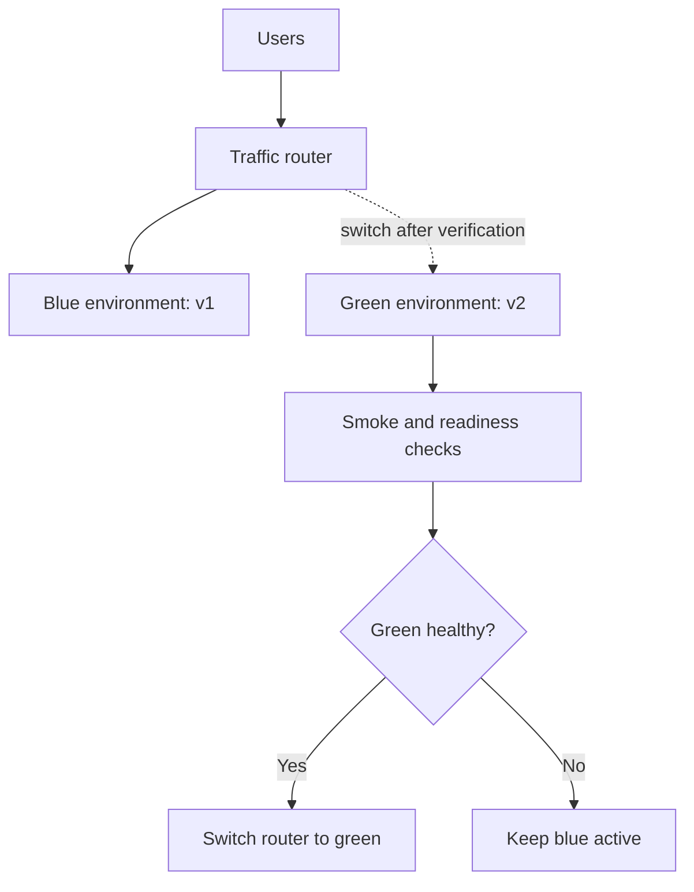
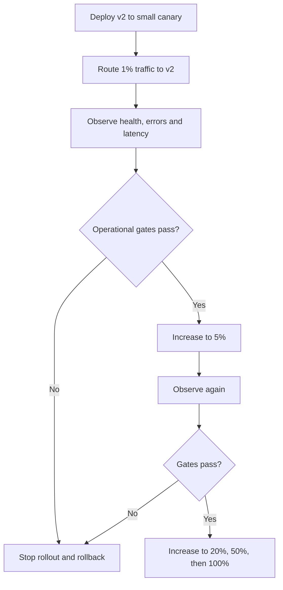
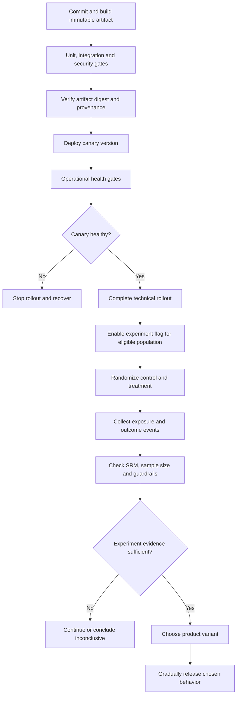

# Distinguishing Deployment Strategies from A/B Testing

A team may release a new version to production using rolling, blue-green, or canary; at the same time, the product team may run an A/B test to compare two experiences. These two activities often appear together in a release process, yet they answer two different questions.

A **deployment strategy** decides how a new version or configuration enters the runtime environment, bounds the blast radius, and verifies whether the system continues operating stably. An **A/B test** decides how to assign users or experimental units to variants to measure whether a change improves product outcomes. A deployment strategy manages operational risk; an A/B test generates evidence for product decisions.

If a team treats a 5% canary as an A/B test, it may wrongly conclude one version is better simply from low error rates during the first few minutes. If a team uses an A/B test as a substitute for a safe rollout, it may expose a buggy version to an entire experimental cohort without blast-radius controls. Design the two mechanisms separately, then combine them when goals require both.

## 1. Two concepts, two goals

| Perspective | Deployment strategy | A/B testing |
|---|---|---|
| Core question | How do we introduce the new version into the system and with what operational risk? | Which variant produces better product outcomes under the stated hypothesis? |
| Unit of control | Instance, pod, node, region, traffic, or deployment group | User, account, session, store, or randomized unit |
| Objective | Availability, correctness, capacity, latency, and recoverability | Causal effect on conversion, retention, revenue, engagement, or product outcomes |
| Common mechanisms | Rolling, recreate, blue-green, canary, ring, shadow | Control/treatment, random assignment, sticky bucketing, feature variants |
| Decision signals | Health checks, error rate, latency, saturation, logs, and rollout status | Primary metric, guardrail metrics, sample size, confidence intervals, and experiment policy |
| Outcome | Continue, pause, roll back, or roll forward | Select variant, keep control, continue running, or conclude insufficient evidence |
| Timeframe | Seconds to hours, depending on rollout and risk | Usually needs sufficient samples and time to observe behavior, often days or longer |

Both activities may use traffic splitting or feature flags. The distinction lies in purpose, grouping, metrics, and conclusion criteria—not simply the traffic percentage.

## 2. Deployment strategies manage the version lifecycle

A deployment strategy describes how a new version replaces or runs alongside the currently serving version. It must answer:

- Do old and new versions run concurrently or replace each other?
- How many instances or how much traffic moves to the new version at each step?
- Can the rollout halt immediately if errors appear?
- Which health checks confirm a new instance is ready?
- Which metrics gate continuation or rollback?
- What compatibility is required for databases, message schemas, and clients during transition?
- How long is the old version retained for recovery?

Strategies differ in speed, resource needs, complexity, and blast radius. No single strategy is best for every service. A stateless app can use a rolling update easily; a payment processor or complex database migration may require canary stages, approval gates, and deeper verification.

## 3. Recreate deployment

Recreate stops old version instances before starting the new version. It is simple, easy to understand, and can fit workloads that do not require continuous availability, development environments, or services with clear maintenance mechanisms.

```text
Before:  v1 v1 v1 v1  -> serving traffic
Step 1:  stop v1 v1 v1 v1
Step 2:  start v2 v2 v2 v2
After:   v2 v2 v2 v2  -> serving traffic
```

The advantage is not having to run two versions simultaneously and minimal routing complexity. The drawback is potential downtime during the stop-and-start window. If the new version fails to start, the system needs a procedure to restore the old version.

Recreate is not an A/B test: there are no control and treatment groups assigned to measure product impact. It is solely a way to replace the running version.

## 4. Rolling deployment

Rolling deployment replaces old instances incrementally. During rollout, some instances run the old version while others run the new version. The orchestrator increases new instances, waits for readiness, and scales down old instances step by step.

Example Kubernetes Deployment configuration:

```yaml
apiVersion: apps/v1
kind: Deployment
metadata:
  name: order-service
spec:
  replicas: 6
  strategy:
    type: RollingUpdate
    rollingUpdate:
      maxSurge: 2
      maxUnavailable: 1
  selector:
    matchLabels:
      app: order-service
  template:
    metadata:
      labels:
        app: order-service
    spec:
      containers:
        - name: app
          image: registry.example/order-service@sha256:REPLACE_WITH_DIGEST
          readinessProbe:
            httpGet:
              path: /ready
              port: 8080
            periodSeconds: 5
```

The digest in the example is a placeholder. `maxSurge` caps how many pods may exceed the desired replica count during updates; `maxUnavailable` caps how many pods may be unavailable. Readiness probes tell Kubernetes to add only qualified pods to service endpoints.

Rolling suits stateless services or services supporting concurrent versions. The team must ensure `v1` and `v2` remain compatible throughout the rollout: APIs, sessions, caches, messages, and database schemas cannot assume all instances switch versions simultaneously.

Rolling is not automatically a canary. If the orchestrator replaces pods on a schedule without evaluating metrics before advancing, the rollout can sweep across the entire fleet rapidly. To achieve canary behavior, constrain the cohort/traffic and gate progression on defined signals.

## 5. Blue-green deployment

Blue-green maintains two equivalent environments. Blue serves traffic; green is provisioned with the new version and verified beforehand. Once green meets criteria, the router/load balancer switches traffic to green. Blue can be retained for a period to support reverting.



Advantages:

- Allows verifying the new version before switching user traffic.
- Switches traffic rapidly once the new environment is ready.
- Keeps a path back to the old environment if issues arise and data remains compatible.

Disadvantages include needing resources for two environments, keeping configuration and data synchronized, and the fact that switching traffic does not resolve compatibility-breaking migrations. If `v2` writes data under a schema `v1` cannot read, reverting to blue can fail even while blue is still running.

Blue-green is a version-switching technique. If after switching traffic the team wants to compare two experiences using random assignment and product metrics, a separate A/B testing layer is required.

## 6. Canary deployment

Canary exposes the new version to a small share of traffic or a small instance group first, monitors operational signals, and gradually expands scope. For example: rolling out 1%, 5%, 20%, 50%, 100%, with observation windows and promotion criteria at each step.



Canary focuses on the question: does the new version operate safely under representative live traffic? Typical metrics include:

- HTTP 5xx or business errors.
- p95/p99 latency and timeouts.
- CPU, memory, connection pools, queue depth, and saturation.
- Crashes/restarts, readiness, and failed requests.
- Business indicators usable as guardrails, such as failed transaction rate.

Canary requires a representative cohort and enough traffic to surface issues. Routing 1% of traffic for a few seconds may yield too few samples for a low-traffic service. Thresholds and observation durations must fit traffic volume, risk level, and error manifestation speed.

Canary is not inherently an A/B test. Sending 5% of requests to `v2` to check errors and latency does not prove `v2` increases conversion or revenue. To draw product conclusions, you need proper experimental design, a randomization unit, a control group, a primary metric, and statistical analysis.

## 7. Ring deployment and progressive exposure

Ring deployment releases across user or environment rings of increasing blast radius. Example:

1. Ring 0: internal development team and test accounts.
2. Ring 1: internal employees or opt-in customers.
3. Ring 2: a small group of tenants/regions.
4. Ring 3: the majority of users.
5. General availability: all eligible users.

Rings typically rely on predefined groups such as regions, tenants, internal cohorts, or hardware tiers. The goal is catching problems in a small scope and progressively widening the blast radius.

Ring rollouts may use feature flags or routing policies, yet group selection is not necessarily randomized and does not necessarily include a control group. To measure product impact, add proper A/B experimental design. Never treat results from internal employees as causal conclusions for all customers if that group differs in behavior and usage environment.

## 8. Shadow deployment and traffic mirroring

Shadow deployment sends a copy of requests to the new version while only the official version returns responses to users. The shadow version processes requests so the team can compare outputs, latency, errors, or resource usage without altering live responses.

Shadowing is useful when:

- Query or calculation logic changes require output comparison.
- Migrating to a new service or database.
- Benchmarking processing capacity under real traffic.
- Checking compatibility before shifting live traffic.

Side effects must be controlled. Mirrored requests must not create real transactions, send emails, charge money, emit duplicate events, or write unintended production data. Use read-only modes, sandboxed dependencies, or strip write operations.

Shadowing is not a standard A/B test because users are not split into two experiences receiving different outcomes. Nor does it show how user behavior changes upon seeing the new response; it only measures the shadow version's processing behavior.

## 9. Feature flags: decoupling deploy from release

Feature flags allow enabling/disabling a feature or choosing behavior at runtime without necessarily redeploying an artifact. This lets teams deploy code to production while exposing a feature only to a targeted group or to no one yet.

Feature flags are commonly used for:

- Quickly turning off a buggy feature without rolling back the whole artifact.
- Enabling a feature by tenant, region, or user segment.
- Running A/B tests between control and treatment.
- Gradually rolling out a feature after code is already in production.
- Hiding incomplete functionality via release toggles.

Pseudocode example:

```java
CheckoutResult result;

if (featureFlags.isEnabled("new-checkout", userContext)) {
    result = newCheckoutService.checkout(request);
} else {
    result = legacyCheckoutService.checkout(request);
}
```

This is an illustrative example. Real systems must specify flag sources, caching/refresh behavior, fallback behavior when the flag service is unreachable, and safe defaults. Flags governing payments or access control must fail safe per business requirements.

Feature flags do not automatically create a valid experiment. If a team turns a feature on for all users and compares before vs. after, results can be confounded by seasonality, campaigns, traffic shifts, or external factors. A/B testing requires a concurrent control group and controlled allocation.

## 10. What is A/B testing?

A/B testing is an experimental method comparing at least two variants. The control group (A) receives the current or baseline experience; the treatment group (B) receives the change under evaluation. Users or experimental units are assigned via a defined rule—typically random assignment—to reduce selection bias.

For example: the team wants to know if a new checkout button increases checkout completion rate. Eligible users are stably assigned to A or B. A displays the current button; B displays the new button. The team measures conversion under an agreed definition and tracks guardrails like payment errors, completion time, and cancellation rate.

An A/B test requires:

- A testable hypothesis.
- An eligible population and randomization unit.
- Clearly defined control and treatment variants.
- An assignment mechanism that keeps assignment stable.
- A primary metric, guardrail metrics, and event definitions.
- Sample size, statistical power, acceptable error rates, and run duration.
- Stopping rules, analysis plan, and post-experiment decision criteria.

Without these components, splitting traffic 50/50 is just request distribution; it is not an experiment capable of producing reliable conclusions.

## 11. Randomization unit and sticky assignment

The randomization unit must match the hypothesis and how users interact. It could be user ID, account/tenant ID, household, device, or session. Choosing the wrong unit can expose one person to both variants or split members of the same organization across different groups.

| Unit | When suitable | Risks to consider |
|---|---|---|
| User ID | Logged-in users where behavior ties to an account | One person may own multiple accounts or devices |
| Account/tenant | B2B, user groups sharing data or workflows | Fewer tenants, requiring cluster-level sample sizing |
| Device ID | Apps not requiring login | One user across multiple devices may enter multiple groups |
| Session ID | Short experiments within a single session | One user may experience different variants across sessions |
| Household/organization | Interactions or spillover exist among members | Must define group boundaries and analyze by cluster |

Sticky assignment keeps a unit in the same variant throughout the experiment. A common approach hashes a stable identifier with the experiment ID and a salt to determine the bucket. Do not randomize per request, because the same user could see A then B in a single journey, polluting the data.

If a user is anonymous and logs in later, the system needs identity-merging and exposure-handling rules. Changing assignment after identity linkage can introduce contamination. Rules must be defined upfront and documented in the experiment design.

## 12. Hypothesis, control, treatment, and exposure

A strong hypothesis describes the change, affected group, and expected outcome. Example:

> For new web users, displaying step-by-step checkout progress will increase order completion rate because users clearly see how many steps remain, without increasing payment error rates.

From this hypothesis, specify:

- **Population:** which new web users meet eligibility criteria?
- **Control:** the current checkout UI.
- **Treatment:** the UI with a progress indicator.
- **Assignment:** randomize by user ID and keep it sticky.
- **Exposure:** the moment a user actually sees the component, not merely when assigned to the bucket.
- **Primary metric:** checkout completion rate under a concrete formula.
- **Guardrails:** payment error rate, latency, refund/cancel rate, and other protected metrics.

Distinguishing assignment from exposure is crucial. A user might be assigned to treatment yet never open the checkout page. Analyzing only users who saw the feature while ignoring the original randomization rule can introduce selection bias. Decide upfront whether analysis follows assignment (intention-to-treat) or exposure, and document the limitations of each.

## 13. Product metrics and guardrail metrics

The primary metric measures the main outcome of the hypothesis. Guardrail metrics detect unintended side effects. Do not pick metrics after viewing results, as that increases the risk of cherry-picking an apparent positive result driven by chance.

Example for checkout:

| Metric category | Example | Role |
|---|---|---|
| Primary | Checkout completion rate | Evaluates the main hypothesis |
| Secondary | Time from cart to order, drop-off step counts | Explains mechanism and behavior |
| Guardrail | Payment failure rate, duplicate orders, refund rate | Protects transaction quality and safety |
| Operational | p95 latency, 5xx, CPU, queue lag | Detects technical impact |

Metrics require explicit denominators, time windows, and missing-data handling. For example, conversion might be users completing checkout divided by randomized eligible users; using sessions as the denominator answers a different measurement question.

Guardrails are not limited to technical metrics. A variant might lift clicks while also increasing order cancellations or complaints. Define which outcomes must not degrade past thresholds before starting the experiment.

## 14. Statistics: sample size, power, and practical significance

An A/B test needs enough data to distinguish a true effect from random noise. Before running, determine:

- Baseline rate or current metric distribution.
- Minimum Detectable Effect (MDE): the smallest change worth detecting.
- Statistical power, typically set by analytics policy.
- Significance level or false-positive control method.
- Estimated sample size per group.
- Time needed to reach sample size and span behavioral cycles.

No single traffic percentage or fixed day count fits every experiment. Low conversion rates require larger samples. Weekly metric cycles mean a few hours of data are unrepresentative. When randomizing by tenant, tenant count matters more than raw request count.

Do not continuously peek at p-values and stop as soon as significance appears unless the analysis method supports sequential testing. Repeated peeking and optional stopping inflate false positives. Sequential methods can be used, provided error control is defined upfront.

Statistical significance does not equal business significance. A tiny lift can be statistically significant with a massive sample yet not justify deployment cost. Conversely, a practically valuable effect falling short of statistical significance may need more data or a better design. Report effect sizes and confidence intervals, not just a `significant` label.

## 15. Sample Ratio Mismatch and assignment quality

Sample Ratio Mismatch (SRM) occurs when observed allocation differs significantly from expected allocation—for instance, a 50/50 design yielding 60/40 in recorded data. This is a warning requiring investigation before interpreting outcomes.

Possible causes include:

- One variant loads slowly or errors out, preventing exposure events from firing.
- Inconsistent assignment services between client and server.
- Users filtered out of analysis based on post-randomization conditions.
- Dropped or duplicated tracking events.
- Identity mapping counting one user multiple times.
- Caches or feature flags serving different buckets across requests.

Check SRM over the defined population and window. If an unexplained mismatch is detected, do not interpret results as a valid A/B test. Investigate assignment, exposure logging, and the data pipeline first.

## 16. A/B testing is not before-and-after comparison

Comparing conversion from the week before a release to the week after is not a randomized A/B test. Two time periods can differ in seasonality, marketing campaigns, pricing, traffic sources, holidays, or user behavior.

A team might deploy a new version on Monday and see conversion rise on Tuesday. You cannot attribute that lift to the change without controlling for confounding factors. Running control and treatment concurrently in an A/B test mitigates time-based variance, provided randomization and instrumentation are valid.

When randomization is impossible, quasi-experimental methods such as difference-in-differences or matched cohorts may apply. However, those methods carry their own assumptions and are not equivalent to a randomized controlled experiment. Clearly state inference limitations.

## 17. Canary vs. A/B testing: direct comparison

| Criterion | Canary rollout | A/B test |
|---|---|---|
| Goal | Verify the new version does not break operations | Measure the causal impact of a change on outcomes |
| Comparison group | Traffic/instances running the old version serve as operational baseline | Control and treatment assigned by experimental design |
| Allocation | Can be by traffic percentage, region, tenant, or instance | Typically randomized on the chosen experimental unit |
| Priority metrics | Errors, latency, saturation, health, transaction failures | Primary/secondary product metrics and guardrails |
| Duration | Governed by rollout window and fault-detection speed | Governed by sample size, power, and behavioral cycles |
| Decision | Increase traffic, pause, or roll back | Pick variant, retain control, or declare inconclusive |
| Question it cannot answer | Does this feature improve product behavior? | Is this version safe to scale across the entire fleet? |

A canary may use random traffic splitting, but random splitting alone does not make it an A/B test. An A/B test can detect conversion shifts, yet it does not replace rollout health gates. A variant that lifts revenue while pushing error rates past thresholds still should not be broadly released.

## 18. Combining deployment strategies with A/B testing

Both mechanisms can be layered together:

1. Use a deployment strategy to safely introduce new code to production, such as a 5% instance or traffic canary.
2. Once the new version stabilizes, use feature flags to randomize users into control/treatment.
3. Collect product metrics and guardrails tagged by experiment ID, variant, and user/account assignment.
4. When the experiment concludes, decide whether to keep treatment, iterate, or disable the flag.
5. Once the feature is accepted, ramp the flag per rollout policy and clean up old code/flags on schedule.

Another option is running the A/B test on the same binary version, with a feature flag selecting between two behaviors. This reduces infrastructure differences between groups, though you must verify the two variants differ strictly on the tested factor.

Avoid changing multiple unrelated factors simultaneously between control and treatment. If treatment uses new code, a new database, a new cache, and a new UI all at once, outcomes may differ without revealing which component caused the difference.

## 19. CI/CD flow with both canary and A/B testing

Illustrative flow:



Steps may be orchestrated across multiple systems: CI/CD manages artifacts and rollouts; feature management handles flags/assignment; analytics pipelines process events; experimentation platforms run statistical checks. Share experiment IDs, release IDs, and artifact digests for traceability while keeping each system's purpose distinct.

## 20. Rollout metrics and experiment metrics must stay separate

In a canary, metrics typically compare the new version against baseline to catch operational regressions—for example, whether `v2` error rates exceed `v1`, p99 latency breaches thresholds, or CPU saturates.

In an A/B test, metrics compare outcomes across randomized groups—for example, checkout completion rate of B vs. A with confidence intervals and guardrails.

Some metrics appear in both places, such as payment failure rate. Yet their usage differs:

- In a canary, it serves as an operational guardrail to halt rollout immediately as failures spike.
- In an A/B test, it serves as a product guardrail ensuring treatment does not degrade transaction quality.

Maintain two dashboards or clearly separated sections. The rollout dashboard displays version, digest, traffic share, health, and operational thresholds. The experiment dashboard displays experiment ID, allocation, exposure, sample size, effect size, confidence intervals, and guardrails.

## 21. Halt conditions, rollback, and stopping experiments

When a canary fails, the team can pause rollout, route traffic back to the old version, or roll back per runbook. Halt conditions should have explicit thresholds, such as 5xx exceeding baseline over a sustained window, p99 latency breaching SLO, or rising readiness failures.

When an A/B test performs poorly, the team typically disables the treatment flag or ends the experiment per policy. Rolling back the entire artifact is unnecessary if the code is already deployed and the feature sits safely behind a disabled flag. However, if the bug stems from the binary, migration, or shared dependencies, address it at the deployment level.

Distinguish the actions:

- **Pause rollout:** stop increasing the new version's share to investigate.
- **Rollback deployment:** revert traffic or workloads to the previous artifact.
- **Disable feature flag:** turn off the new runtime behavior if the flag controls it safely.
- **Stop experiment:** halt experiment collection/evaluation per protocol; preserve data and reasoning.
- **Roll forward:** deploy a new fix when rollback is unsafe or does not resolve the root cause.

Never use stopping an A/B test as a substitute for incident response. If treatment causes severe failures, prioritize protecting users and data before running statistical analyses.

## 22. Databases and backward compatibility during rollout

During rolling, canary, or blue-green deployments, old and new versions may run together. Therefore, database schemas, message schemas, and APIs must stay compatible throughout the transition.

A common pattern is expand-contract:

1. Add new fields/tables/indexes without breaking the old version.
2. Deploy code able to read/write compatibly with both old and new schemas.
3. Backfill data and verify.
4. Shift traffic or enable the new feature once criteria are met.
5. Remove old fields/schemas only when no version depends on them.

Application rollback does not automatically reverse migrations. If `v2` writes data `v1` cannot read, reverting to `v1` can cause errors. Verify data compatibility, maintain backup/restore or roll-forward plans, and avoid destructive migrations in hard-to-recover rollout steps.

A/B tests also require stable schemas and event tracking. If two variants emit events with differing structures that the analytics pipeline mishandles, experiment results can be skewed even while the app runs normally.

## 23. Observability and tagging for traceability

To separate rollout incidents from experiment outcomes, logs, metrics, and traces should carry appropriate attributes:

- `service.name` and `service.version`.
- Artifact digest or image digest.
- Deployment/release ID and rollout step.
- Environment, region, and instance/pod identity.
- Experiment ID and variant when a request belongs to an experiment.
- Cohort/assignment metadata in a form that exposes no personal data.
- Correlation/trace ID to link requests across services.

Do not place emails, phone numbers, or personal data directly in metric labels due to privacy risks and excessive cardinality. Use pseudonymous IDs or policy-compliant cohort labels, restricting access and retention of experiment data.

Segment metrics carefully. Looking only at service-wide totals can mask errors in a 5% canary beneath 95% legacy traffic. Looking at a single variant alone can introduce noise from region or platform differences. Segment by version, rollout cohort, variant, and eligible group while avoiding unbounded cardinality.

## 24. Common design mistakes

| Mistake | Why it is dangerous | Improvement |
|---|---|---|
| Calling a 5% canary an A/B test | Draws product conclusions without randomization or statistical design | Name by intent; follow an experiment protocol for A/B |
| Using A/B tests instead of health gates | Treatment can cause operational failures for the cohort | Always enforce readiness, SLOs, and rollout guardrails |
| Splitting traffic 50/50 without sticky assignment | One user sees multiple variants | Randomize on a stable unit and preserve assignment |
| Comparing before/after only | Confounded by seasonality and traffic shifts | Use concurrent controls or suitable causal methods |
| Stopping an experiment as soon as p-value crosses threshold | Inflates false positives due to peeking | Predefine sample size/stopping rules or valid sequential methods |
| Choosing metrics after viewing data | Increases cherry-picking risk | Register primary/guardrail metrics before running |
| Ignoring SRM | Assignment or tracking may be broken | Check group ratios and investigate mismatches |
| Not measuring exposure | Assigns buckets without knowing who saw the variant | Define and log exposure events |
| Changing multiple factors in treatment | Cannot isolate what caused the effect | Limit changes or use a proper factorial design |
| Failing to maintain v1/v2 compatibility | Rolling updates or rollbacks corrupt or break on data | Use expand-contract and compatibility tests |
| Using system-wide metrics for a small canary | Canary errors get hidden by legacy traffic | Segment by version/cohort |
| Never cleaning up feature flags | Increases code branches and complexity | Assign owners, expiration dates, and removal plans |

## 25. Practical example: releasing a new checkout

Suppose the team wants to redesign the checkout flow to reduce steps and increase order completion rate. The change involves new code in `order-service`, frontend UI updates, and a `new-checkout` feature flag.

**Deployment phase:**

1. Build an immutable artifact, recording commit SHA and digest.
2. Run unit, integration, contract, and security tests.
3. Deploy backend/frontend via rolling or a small canary.
4. Monitor 5xx, payment failures, p99 latency, queue lag, and duplicate orders.
5. If guardrails fail, halt rollout and roll back/roll forward per runbook.
6. Once the version stabilizes, complete the technical rollout while keeping the feature flag off or restricted.

**A/B testing phase:**

1. Define the population as new web users eligible for checkout.
2. Randomize by user ID with sticky assignment.
3. Group A uses the old checkout; group B uses the new checkout.
4. Log assignment, exposure, and outcome with the experiment ID.
5. Primary metric is checkout completion rate; guardrails include payment failures, duplicate orders, and p95 latency.
6. Calculate sample size and duration before starting; monitor SRM and event quality.
7. Once sufficient evidence accumulates, evaluate effect size, confidence intervals, and guardrails.
8. If treatment helps without violating guardrails, ramp the flag per rollout policy; otherwise keep control or redesign.

In this example, canary protects the system from a buggy release; A/B testing evaluates whether the new experience improves product outcomes. Both share the artifact digest and release ID for traceability while keeping separate cohorts, metrics, and decisions.

## 26. How to choose the right strategy

Start by classifying the question you need to answer:

| Need | Suitable mechanism |
|---|---|
| Simple version swap, downtime acceptable | Recreate |
| Incremental instance replacement, version-compatible service | Rolling |
| Provision a new environment and switch traffic rapidly | Blue-green |
| Limit blast radius and observe the new version in steps | Canary |
| Release by environment/tenant/region groups | Ring deployment |
| Compare new version processing without returning new responses to users | Shadow/traffic mirroring |
| Toggle runtime behavior or restrict features | Feature flag |
| Measure causal impact of two experiences | A/B test |

Before deciding, evaluate:

- Required availability and acceptable downtime.
- Ability to run old/new versions concurrently.
- Compatibility of databases, APIs, events, and sessions.
- Ability to route traffic by instance, request, tenant, or user.
- Representativeness of the canary cohort.
- Observability quality and fault-detection speed.
- Resource cost and operational complexity.
- Rollback, roll-forward, and data recovery capabilities.
- Whether the goal is protecting operations or measuring product outcomes.

If goals include both operational safety and product effectiveness, design two layers: progressive deployment first, followed by or paired with controlled experimentation.

## 27. Pre-rollout checklist

- [ ] Artifact is built, verified, and identified by an immutable digest.
- [ ] Deployment strategy matches availability and blast-radius requirements.
- [ ] Readiness/liveness/health checks reflect true serving capability.
- [ ] Metrics and thresholds cover errors, latency, saturation, and business errors.
- [ ] Pause/rollback/roll-forward procedures and on-call owners are in place.
- [ ] Old and new versions are compatible while running concurrently.
- [ ] Database migrations follow expand-contract or an equivalent plan.
- [ ] Canary cohort is representative and carries enough traffic to assess health.
- [ ] Dashboards are segmented by version and rollout step.
- [ ] Post-deploy runtime is verified against the expected digest.

## 28. Pre-A/B test checklist

- [ ] Hypothesis and primary outcome are predefined.
- [ ] Control and treatment differ strictly on the tested factor.
- [ ] Eligible population and exclusion rules are defined.
- [ ] Randomization unit fits user behavior without major spillover.
- [ ] Assignment stays sticky across visits.
- [ ] Exposure events are defined and reliably logged.
- [ ] Primary, secondary, and guardrail metrics have explicit formulas.
- [ ] Baseline, MDE, sample size, power, and stopping rules are calculated upfront.
- [ ] Checks exist for SRM, event loss, duplicates, and identity mapping.
- [ ] No arbitrary early stopping after repeated peeks unless supported by the method.
- [ ] Plans exist to analyze effect size, confidence intervals, and practical significance.
- [ ] Decision owner, experiment duration, and flag cleanup plan are assigned.

## 29. Conclusion

Deployment strategies determine how a new version enters runtime environments and how teams bound operational risk. Recreate, rolling, blue-green, canary, ring, and shadow address different rollout needs. Feature flags separate code deployment from exposing behavior to users.

A/B testing is an experimental method for measuring product variant impact through control, treatment, random assignment, metrics, and statistical analysis. A 5% canary is not automatically an A/B test; a 50/50 traffic split is insufficient without a hypothesis, sticky assignment, exposure tracking, and conclusion standards.

When both are needed, use a deployment strategy to protect the system and A/B testing to learn from user behavior. Keep artifact digests, release IDs, rollout cohorts, and experiment IDs linked together while tracking operational guardrails independently from product metrics. This structure lets teams release smoothly with control while making product decisions backed by reliable evidence.
