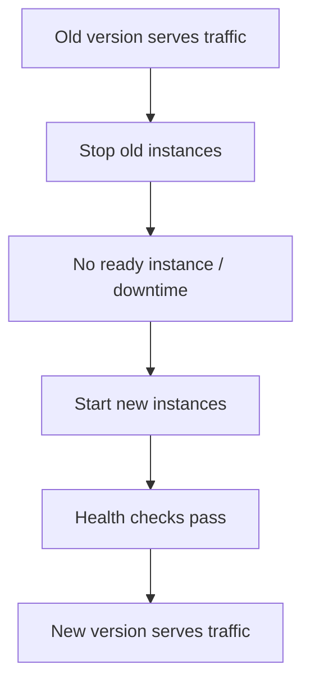
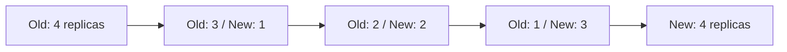
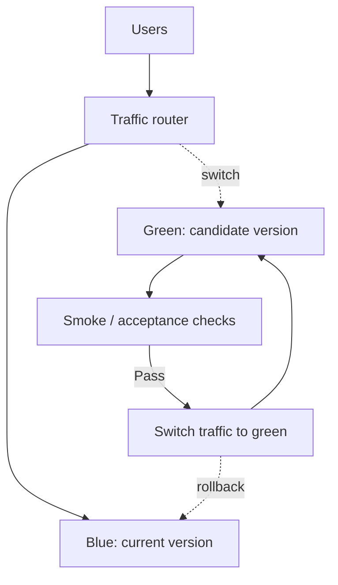
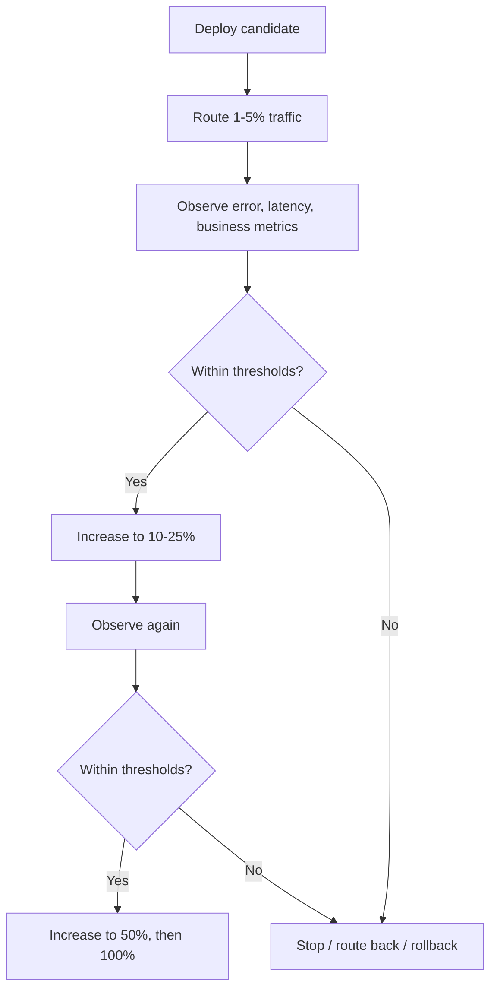

# Evaluating Infrastructure Costs and Risk Levels of Each Strategy

Choosing a deployment strategy is not merely choosing how to update an application version. Each deployment approach produces a different cost structure and risk exposure: some require minimal resources but accept downtime; some keep two versions running simultaneously for fast traffic switching at higher compute cost; some route only a slice of traffic to the new version to limit blast radius while demanding strong observability and orchestration.

A sound decision must answer two questions: **how much extra cost is incurred during release, and if the new version has a bug, how wide and severe can the impact be?** Do not compare machine or pod counts alone. Include load balancers, networking, storage, data layers, monitoring, parallel environment retention duration, operational effort, recovery time, and service interruption costs.

## 1. Cost categories to include in the evaluation

The cost of a deployment strategy comprises direct infrastructure costs and operational costs induced by how deployment works.

| Cost category | Common components | Questions to ask |
|---|---|---|
| Compute | VMs, nodes, pods, CPU, RAM, autoscaling capacity | Do old and new versions need to run concurrently? What is the peak surge capacity? |
| Storage | Volumes, snapshots, image layers, logs, temporary data | Must two datasets or snapshots be retained during rollout? |
| Network | Load balancers, ingress, service mesh, cross-zone traffic, egress | Does it incur mirrored traffic, cross-zone transfers, or extra hops? |
| Data services | Database replicas, caches, queues, search clusters | Must dependencies scale to handle two versions or shadow traffic? |
| Observability | Metrics, logs, traces, synthetic checks, alerting | Do we need higher sampling or detailed telemetry during a canary? |
| Automation | Deployment controllers, traffic routers, policy engines, test environments | Are additional tools or platforms needed to orchestrate and gate rollouts? |
| Operational effort | Pipeline design, runbooks, on-call coverage, rollback rehearsals | How much effort is required to operate safely and investigate failures? |
| Downtime/business impact | Failed transactions, user unavailability, SLA/SLO breaches | What is the cost or consequence of one minute of outage? |

Not all costs scale linearly with instance counts. For example, Blue-Green can nearly double compute while both environments coexist, yet shorten cutover time and potentially reduce recovery time. Canary may need only a small group of instances, yet telemetry and traffic-splitting engineering costs can be substantial. Recreate uses little compute during transition, yet downtime can incur business costs exceeding the compute savings.

## 2. Modeling cost and risk

### Direct deployment cost

Infrastructure cost during a release can be approximated by:

**C_release = C_base + C_surge + C_duplicate + C_data + C_network + C_observability**

Where:

- **C_base:** baseline production resource cost over the rollout window.
- **C_surge:** extra capacity cost to run new replicas concurrently or absorb extra load.
- **C_duplicate:** cost of duplicated environments or workloads, such as a green environment.
- **C_data:** additional storage, database, cache, or queue capacity.
- **C_network:** load balancers, traffic replication, egress, and cross-zone transfers.
- **C_observability:** additional logs, metrics, traces, and checks during rollout.

When billed hourly on cloud infrastructure, a compute component can be approximated by:

**C_compute = N_instance * H_running * R_hour**

With container orchestration, substitute instance counts with total requested CPU/RAM or actual billed resources. Apply the provider's true billing model: some platforms bill per node, vCPU/GB-hour, requested resources, or provisioned capacity.

### Expected cost from risk

Deployment strategy also affects incident probability, blast radius, and detection/recovery time. A simple model for discussion is:

**E_loss = P_incident * Impact_incident**

In practice, impact can be broken down into:

**Impact = C_outage + C_data + C_recovery + C_compliance + C_reputation**

This is a decision model, not an exact forecasting formula. Incident probability is hard to estimate without historical data; impact also depends on the service, timing, and number of affected users. Even so, this framing reminds teams that the cheapest strategy on compute is not necessarily the cheapest in total cost.

### Evaluating risk across multiple dimensions

Do not collapse risk into a single score without inspecting the underlying components. For each strategy, evaluate:

| Risk dimension | Meaning |
|---|---|
| Blast radius | How many users, requests, tenants, or regions can hit a faulty version? |
| Detection time | How long does it take to detect failures after traffic reaches the new version? |
| Rollback time | How long does it take to return to a stable version? |
| Data compatibility | Can both versions read/write the same data and schema together? |
| Control complexity | Can we orchestrate, observe, and halt the rollout in time? |
| Partial-state risk | Can a half-old/half-new state exist and cause errors? |
| Dependency risk | Can databases, queues, caches, or downstream services tolerate the transition model? |

## 3. Recreate: stop the old version then create the new version

Recreate stops old instances first, then starts the new version. For a period, the service may have zero ready instances.

### Infrastructure cost

- Typically avoids running two instance groups concurrently during transition.
- Minimal surge capacity required and no second environment needed.
- May require temporary resources for migrations, warm-up, or post-startup checks.
- Direct compute cost is usually lowest among strategies compared to overlapping ones.

### Risk

- Downtime is a standard characteristic; duration depends on stop, startup, warm-up, and verification times.
- If the new version fails to start, the service stays down until fixed or restored to the old version.
- Rollback can be slow because the new version must stop and the old version must restart.
- If database migrations are not backward-compatible, reverting the binary alone may not recover service.

### When appropriate

Recreate can suit internal applications, dev/test environments, workloads stoppable during maintenance windows, or services without high availability demands. Do not choose it merely to save pods if downtime costs exceed resource savings.

## 4. Rolling update: incremental replacement

Rolling update replaces old instances with new ones in waves. During rollout, both versions may serve traffic concurrently.

### Infrastructure cost

- Requires temporary capacity depending on `maxSurge` or how the orchestrator replaces instances.
- Allowing `maxUnavailable` greater than 0 reduces surge capacity at the expense of fewer available instances during rollout.
- Avoids maintaining an entire second production environment like Blue-Green.
- Load balancers/service discovery and health checks must update in step with instance lifecycles.

For example, a deployment with 4 replicas and `maxSurge: 25%` typically permits at most 1 extra replica during rollout (depending on platform rounding rules). With `maxUnavailable: 0`, the system keeps all desired replicas available while creating new ones; thus capacity is needed for at least one extra pod, and nodes must have matching free CPU/RAM.

### Risk

- Old and new versions coexist, requiring compatibility across APIs, message schemas, sessions, and database schemas.
- If the new version has bugs while readiness probes still pass, traffic can route to faulty instances.
- If the rollout stalls midway, the system may stay in a mixed-version state longer than expected.
- Rollback is a reverse rollout, not necessarily instant; data written by the new version may break compatibility with the old version.

### When appropriate

Rolling update suits stateless services or services engineered for backward compatibility, equipped with solid health/readiness checks, and seeking a balance between cost and availability. It is often a sensible default for containerized workloads when complex weighted traffic shifting is unnecessary.

## 5. Blue-Green: maintaining two environments and switching traffic

Blue-Green maintains the currently serving environment (blue) alongside a new environment (green). The new version is deployed and verified on green before the load balancer, ingress, or router switches traffic to it.

### Infrastructure cost

- May require nearly double the service compute while blue and green coexist.
- May duplicate load balancer targets, caches, workers, or dependencies if not shared.
- Requires extra network capacity and may incur data costs if green needs cloned datasets or storage.
- Overlap time can be shortened by provisioning green close to release and retiring blue after verification, trading off against rollback duration.

### Risk

- Traffic cutover can be fast, but it does not automatically solve database migrations or side effects.
- If both blue and green write to the database, schemas and logic must remain compatible.
- If green runs background tasks or queue consumers alongside blue, duplicate message processing or double side effects can occur.
- Keeping blue for too short a window removes fast rollback if bugs surface late.
- Verify sessions, sticky routing, caches, connection draining, and background jobs before switching.

### When appropriate

Blue-Green fits when downtime must be minimal, two environments can be sustained, and a clean traffic cutover point is desired. It is especially useful when a candidate needs full validation before users access it. The added cost is easier to justify for critical services where fast recovery carries high value.

## 6. Canary: gradually increasing traffic to the new version

Canary exposes the new version to a small fraction of traffic or a user cohort, observes results, and raises traffic in steps. If metrics breach thresholds, the rollout halts or shifts traffic back to the old version.

Percentages such as 1%, 5%, 10%, 25%, or 50% are examples only. Actual schedules must fit the service's traffic, measurability, and risk profile.

### Infrastructure cost

- Usually runs a small canary group alongside the stable version; compute cost grows by the candidate group's capacity.
- Never assume 5% of traffic needs only 5% of resources. Requests may distribute unevenly; certain user segments or transactions may consume far more CPU/DB.
- Requires a traffic router/service mesh/ingress supporting weighted routing or an equivalent mechanism.
- Increases observability cost: metrics segmented by version, cohort, region, or route to compare canary against control.
- Longer rollouts extend the time both versions run and increase monitoring costs.

### Risk

- If selected traffic is unrepresentative, the canary may never trigger the buggy path.
- If metrics are not separated by version, canary errors can be masked by larger stable traffic.
- Samples too small yield weak statistical signal; samples too large widen the blast radius.
- Side effects like sending emails, charging payments, or processing messages cause real impact even at small percentages.
- Explicit automated halt criteria are essential; slow manual decisions let a faulty canary continue causing damage.

### When appropriate

Canary fits services with substantial traffic, traffic-splitting capability, and trustworthy metrics. It is particularly helpful when bounding blast radius and testing real behavior under live user load. With low traffic or poor version distinguishability, canary can create a false sense of safety.

## 7. Shadow deployment: mirroring requests to test without returning new responses

Shadow deployment (traffic mirroring) sends copies of production requests to the new version while responses from the old version continue going back to users. The shadow version does not directly determine user-facing responses.

### Infrastructure cost

- May process nearly all or a sampled fraction of mirrored requests, potentially increasing backend compute significantly.
- Database reads, caches, networks, and downstream services absorb extra load.
- Requires filtering or disabling side effects so shadow does not execute payments, emails, messages, or real data writes.
- Requires storage/observability to compare responses and traces between stable and shadow.

### Risk

- Mirrored requests may contain sensitive data; enforce access controls, retention, and masking.
- If shadow writes to databases or calls side-effecting APIs, duplicate transactions can happen.
- Mirrored load can degrade live production if rates and capacity are uncapped.
- Differing responses do not always indicate bugs; comparison rules must ignore non-deterministic fields like timestamps, IDs, or irrelevant ordering.

### When appropriate

Shadow fits checking compatibility or comparing logic on live requests before switching live traffic. Because compute and network costs are often high, start with sampling or mirror only critical request classes. Read-only modes or side-effect sandboxing must be engineered explicitly.

## 8. A/B testing and how it differs from canary

A/B testing splits users into groups to compare behavior or product outcomes across variants. Canary primarily evaluates operational safety and stability of a new version before broad rollout. Both may use traffic splitting, yet their goals differ.

| Criterion | Canary | A/B testing |
|---|---|---|
| Goal | Reduce release risk and detect regressions | Measure variant impact on user/business outcomes |
| Metrics | Error rate, latency, saturation, crashes, SLOs | Conversion, retention, revenue, or product metrics |
| Duration | Follows rollout stages and observation windows | May require long runtimes to reach statistical significance |
| Decision | Proceed, halt, or roll back | Select variant, adjust, or conclude experiment |
| Cost | Candidate capacity and observability | Multiple variants, bucketing, analytics, and runtime duration |

Never treat an A/B test as a complete deployment safety mechanism. A variant may improve conversion while still carrying reliability or security bugs. Operational and security quality gates must still apply.

## 9. Comparing cost and risk across strategies

The table below provides a relative assessment. Actual levels depend on topology, traffic, platform, overlap duration, and data handling.

| Strategy | Temporary compute cost | Operational complexity | Potential downtime | Blast radius on early detection | Rollback speed |
|---|---|---|---|---|---|
| Recreate | Low | Low–medium | Higher; has an unavailable window | Can hit the whole service during version switch | Usually slower due to restart time |
| Rolling | Low–medium, depending on surge/unavailable | Medium | Low if well-configured | Grows with new instances; mixed versions possible | Medium; reverse rollout |
| Blue-Green | High, up to ~2x compute during overlap | Medium–high | Low with good switch and health checks | Bounded before switch; after switch depends on reverting | Fast if old environment remains intact and data compatible |
| Canary | Low–medium, depending on candidate capacity | High | Low while stable serves remaining traffic | Typically smaller when traffic is properly capped | Fast when router returns traffic to stable |
| Shadow | Medium–high; can nearly double mirrored request work | High | Does not directly cause user downtime | No user response impact if side effects blocked; load/data risk remains | Fast to stop mirroring; not a standard runtime rollback |
| A/B testing | Medium–high depending on variants and duration | High | Low with proper routing | Cohort-scoped; can span the whole experiment | Switch cohort to old variant, plus analytics/data handling |

One strategy may carry low compute cost yet high outage risk. Another may raise cost for a few hours while slashing recovery time or affected user counts. Evaluate total cost and risk against service objectives rather than ranking strategies in absolute terms.

## 10. Quantitative example: estimating surge capacity

Suppose a service runs 10 instances, each consuming one compute unit per hour. A rollout window lasts 2 hours. Ignore data, network, and observability costs to focus on comparing compute.

Baseline cost during this window:

**C_base = 10 * 2 = 20 units**

| Strategy | Illustrative assumption | Extra compute over 2 hours | Total compute in window |
|---|---|---:|---:|
| Recreate | Stop 10 old instances then start 10 new instances; no overlap | Approx. 0 over baseline under simple accounting | Approx. 20 units, excluding downtime cost |
| Rolling | `maxSurge` equals 3 extra instances across 2 hours | (3 * 2 = 6) | 26 units |
| Blue-Green | 10 green instances run alongside 10 blue instances for 2 hours | (10 * 2 = 20) | 40 units |
| Canary | 1 extra candidate instance over 2 hours | (1 * 2 = 2) | 22 units |
| Shadow | Assume mirrored workload needs capacity equal to 7 instances over 2 hours | (7 * 2 = 14) | 34 units |

These numbers only illustrate the calculation. In Recreate, hourly bills might not drop if underlying nodes remain billed while pods stop; in Canary, one instance may be insufficient if candidate traffic is CPU-heavy; in Shadow, extra load depends on sampling and request cost. Blue-Green might also avoid duplicating an entire database if both versions share a data store, though schema compatibility and side effects must then be solved.

Takeaway: budget against resources actually provisioned and billed, not just pod counts visible in manifests. Then add network, storage, telemetry, and operational effort for a realistic total cost.

## 11. Hidden costs often overlooked

### Databases and migrations

Blue-Green or Rolling often requires two versions accessing a single schema together. If a migration breaks compatibility, teams may have to maintain two schemas, run dual-writes, or add data-transformation steps. That cost can exceed extra compute.

The expand-and-contract pattern usually reduces risk:

1. Add new schema structures compatibly with old code.
2. Deploy code capable of transitional read/write behavior.
3. Backfill data and verify.
4. Shift all traffic/consumers to the new logic.
5. Wait until the safe rollback window expires.
6. Drop old schema structures in a separate release.

Never drop columns or make incompatible type changes in the same deployment while still expecting a simple binary rollback.

### Queues and background workers

If both versions consume from a queue, verify message schemas, idempotency, ordering, and duplicate handling. Shadow traffic must never trigger real side effects. You may need separate consumer groups, paused workers, or versioned message contracts.

### Caches and sessions

Changing cache keys or session formats can prevent the old version from reading data written by the new version. Version cache keys, support transitional formats, or plan proactive cache invalidation.

### Observability and analytics data

Canary requires metrics labeled by version and traffic cohort; Shadow requires trace correlation to compare requests; A/B testing requires analytics and cohort state storage. Ingestion and retention costs can climb noticeably during testing.

### Operational effort

Complex strategies demand runbooks, rehearsals, dashboards, alerts, and trained on-call responders. If a team lacks the operational maturity for Canary yet forces it anyway, misconfiguration or missed signals can create greater risk than theoretical gains.

## 12. Assessing risk by system characteristics

Select strategies based on application and dependency traits:

| Characteristic | Primary risk | Strategies to consider |
|---|---|---|
| Stateless web/API with good health checks | Availability during instance replacement | Rolling; Canary if traffic and metrics support it |
| High-availability critical service | Downtime and recovery duration | Blue-Green or Canary; verify data compatibility |
| High traffic, diverse user cohorts | Missing regressions in a small segment | Canary with representative cohorts; A/B if product-focused |
| Major runtime/compiler upgrade | Subtle compatibility bugs missed in synthetic tests | Shadow or closely monitored Canary |
| Complex database migration | Non-backward-compatible schema and data | Expand-and-contract; phased rollout; separate approvals |
| Message-processing background workers | Duplicates, ordering, and mixed-version messages | Rolling with compatible contracts; separate consumer rollout |
| Internal app with maintenance window | Overhead of maintaining parallel environments | Recreate or Rolling with suitable `maxUnavailable` |
| System lacking strong telemetry | Slow fault detection | Improve observability before adopting automated Canary |

If you cannot identify which version caused an error or cannot automatically halt a rollout, traffic-splitting strategies will not work as intended. Add version labels, correlation IDs, SLOs, and dashboards first.

## 13. Choosing a strategy based on budget and risk tolerance

A decision process can follow these steps:

1. Define the service's SLOs, maximum downtime, and Recovery Time Objective (RTO).
2. Define acceptable blast radius: whole service, one region, one cohort, or a traffic percentage.
3. Check whether the app can run two versions concurrently and whether databases, caches, queues, and sessions stay compatible.
4. Estimate compute surge, duplicated environments, storage, network, observability, and retention durations.
5. Assess fault-detection capability: health checks, smoke tests, versioned metrics, business metrics, and alerts.
6. Determine whether rollback works via traffic switching, reverse rollout, or requires data restoration.
7. Evaluate operational capability and current automation maturity.
8. Pick the option meeting acceptable risk at reasonable total cost; document assumptions and prerequisites.

### Reference decision matrix

| Top priority | Platform prerequisites | First option to consider |
|---|---|---|
| Low compute cost, downtime acceptable | Maintenance window and viable rollback | Recreate |
| Cost/availability balance for stateless services | Solid health/readiness, supports parallel runs | Rolling |
| Fast version cutover, full candidate environment | Spare capacity and data compatibility | Blue-Green |
| Bound blast radius and observe live traffic | Sufficient traffic, weighted router, versioned metrics | Canary |
| Compare new logic on real requests before cutover | Safe mirroring, side effects blocked | Shadow |
| Measure variant impact on product metrics | Reliable cohorting and analytics | A/B testing |

This is a starting point for discussion, not a rigid rule. A service may use Rolling for routine releases and switch to Canary for high-risk changes; or use Blue-Green for the API tier and Rolling for workers. Strategies can vary across components within the same system.

## 14. Example: choosing a strategy for a payment API

Suppose a payment API processes transactions continuously with high availability requirements. The system has 12 replicas, a shared database, a queue for async work, and dashboards tracking error rate, p95 latency, and transaction success rate.

### Recreate

Extra compute is low, yet stopping all 12 replicas creates an outage window. For a payment API, failed requests or timeouts can prompt users to retry and create duplicate transactions if idempotency is weak. This option is unsuitable without a maintenance window and safe transaction intake controls.

### Rolling

Can replace replicas incrementally while keeping the service online. However, concurrently running versions must stay compatible across database schemas, message formats, and internal APIs. When migrations use expand-and-contract and transactions are idempotent, Rolling can balance cost and availability.

### Blue-Green

Can provision green with 12 replicas, run smoke tests, and switch traffic. Compute temporarily nearly doubles for the API during overlap. However, both environments sharing the database and queue must be engineered never to process the same transaction twice. If migrations are incompatible, a fast traffic switch will not enable safe rollback.

### Canary

Can start with 5% traffic, tracking transaction success rate, error rate, and p95 latency by version. If metrics pass thresholds across the observation window, ramp to 20%, 50%, and 100%. Ensure the 5% slice represents key payment methods and cohorts. If one payment provider serves only a small niche, random 5% traffic may miss that code path.

### Shadow

Can mirror a fraction of requests to the new version to compare responses or fee calculations. However, shadow must never call real payment providers, record real transactions, or publish real messages. Use sandboxes/mocks for side effects and compare deterministic output fields only.

Under these assumptions, a sensible choice is Rolling for backward-compatible changes and Canary for high-risk payment logic changes—once versioned metrics and automated halts are in place. Blue-Green fits when full candidate testing is needed and capacity budgets permit. The final decision hinges on SLOs, traffic, data design, and rehearsed recovery capability.

## 15. Post-deployment measurement to refine cost and risk assumptions

After each release, capture actual metrics to calibrate future decisions:

- Peak CPU/RAM and surge capacity duration.
- Total extra compute hours and parallel environment retention time.
- Incremental storage, network egress, and telemetry volume.
- Time from rollout start to completion.
- Count of halted rollouts, rollbacks, or manual interventions.
- Mean Time to Detect (MTTD) and Mean Time to Recover (MTTR).
- Number of affected users/requests and severity of impact.
- Outage cost or SLO error budget burned, if measurable.
- Schema, cache, queue, or session compatibility incidents.

Compare results across similar releases. If Canary repeatedly misses bugs due to unrepresentative samples, adjust cohorts or add targeted tests. If Blue-Green retains old environments too long, define when blue can retire once the rollback window closes. If Rolling repeatedly hits capacity shortages, tune node headroom or surge limits using real data instead of guesses.

## 16. Common anti-patterns

- **Choosing based on lowest pod count:** ignores downtime, incident cost, and recovery duration.
- **Assuming 10% traffic equals 10% compute:** requests may skew unevenly or vary in processing cost.
- **Blue-Green without checking database compatibility:** fast cutover, yet binary rollback fails to recover data.
- **Canary without versioned metrics:** cannot separate candidate errors from stable traffic.
- **Shadow allowing real side effects:** triggers duplicate transactions, messages, or emails.
- **Using A/B tests as quality gates:** measures conversion while ignoring reliability and security.
- **Keeping duplicate environments indefinitely:** compute/storage bills persist long after rollback windows close.
- **Ignoring network, log, and trace costs:** actual expenses exceed estimates.
- **Skipping node capacity checks before rollout:** `maxSurge` is configured, yet pods remain unschedulable due to CPU/RAM shortages.
- **Rollback tested only on paper:** during an incident, old artifacts, configs, or permissions are missing.
- **Auto-ramping traffic without halt conditions:** bugs spread before on-call responders react.
- **Not recording actual costs and outcomes:** subsequent releases repeat flawed assumptions.

## 17. Pre-selection evaluation checklist

Before an important release, check:

1. Are SLOs, maximum downtime, RTO, and acceptable blast radius clearly defined?
2. How much peak compute surge or duplicated environment capacity does the strategy demand?
3. Do nodes/clusters have enough capacity to schedule new replicas without degrading other workloads?
4. Have storage, databases, caches, queues, load balancers, networking, and observability been budgeted?
5. Can two versions run concurrently while keeping APIs, schemas, messages, caches, and sessions compatible?
6. Are there any migrations that cannot be rolled back by reverting to the old binary?
7. Can health checks, smoke tests, and metrics distinguish candidate from stable?
8. Is the canary cohort or shadow traffic representative and safely bounded?
9. Are halt conditions and decision owners explicitly defined?
10. Are the rollback target, artifact digest, config revision, and runbook ready?
11. Are parallel environment retention times and cleanup criteria defined?
12. Will actual cost, MTTD, MTTR, and blast radius be measured post-release?

A strong deployment strategy balances resource cost against the level of risk a service can tolerate. Recreate saves compute at the price of potential downtime; Rolling often balances cost and availability; Blue-Green buys fast cutover using spare capacity; Canary limits blast radius through observed rollouts; Shadow and A/B add evaluation capabilities while demanding control over load, data, and side effects. Accounting for direct costs, operational effort, and expected incident impact lets teams choose strategies based on data and service goals rather than habit.
