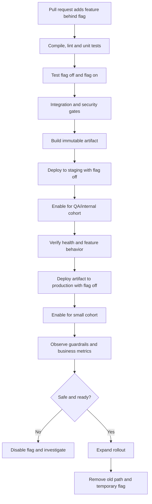

# Introduction to Feature Flags and Hiding Incomplete Changes

In CI/CD, teams often want to integrate code frequently into the main branch even when a feature is not yet complete. Having to maintain a long-lived branch for each feature causes branches to diverge easily, increases merge conflicts, and delays the discovery of integration bugs. Yet if code is not ready to be turned on immediately for all users, deploying it directly can expose unfinished UI, trigger unverified flows, or cause unintended side effects.

A **feature flag** (also called a feature toggle) lets the application decide at runtime whether to execute a given behavior. Teams can deploy new code to a live environment while keeping that behavioral branch turned off, and then turn it on for internal users, a small cohort, or all users when ready. This approach decouples the moment code enters the environment from the moment the feature is released to users.

Feature flags are especially useful for hiding incomplete changes, reducing rollout risk, and quickly disabling a problematic feature. However, flags introduce extra conditional branches and runtime configuration; without an owner, expiration date, and cleanup plan, they become technical debt.

## 1. What is a feature flag?

A feature flag is a condition evaluated at application runtime to select behavior. A flag typically has a stable key, a state or rules, a default value, and an evaluation context.

Simple example:

```java
if (featureFlags.isEnabled("new-checkout", userContext)) {
    return newCheckoutService.checkout(request);
}

return legacyCheckoutService.checkout(request);
```

When `new-checkout` is off, the application continues using the legacy flow. When the flag is on for a selected group, that group uses the new flow. The code for both branches is already deployed in the same artifact; the flag configuration determines which branch executes.

A feature flag system typically consists of:

- **Flag definition:** name, type, description, owner, default state, and expiration.
- **Evaluation context:** user ID, tenant, region, application version, or other necessary attributes.
- **Rules/targeting:** conditions to enable for specific groups or a percentage of users.
- **SDK/evaluation engine:** an in-app library or service that evaluates rules.
- **Configuration distribution:** how flag updates are pushed to instances, SDKs, or clients.
- **Audit history:** who changed a flag, when, and why.
- **Fallback behavior:** how the application behaves when configuration cannot be read.

Flags can be stored in configuration files, databases, a feature flag management platform, or an internal service. Storage matters less than ensuring values are governed, auditable, and backed by safe defaults.

## 2. Decoupling deploy from release

Deploy means placing an application version or artifact into an environment. Release means making a feature effective for target users or systems. These two events can occur at different times.

| State | Code in artifact | Flag | What users see |
|---|---|---|---|
| Not deployed | No new code | Not applicable | Legacy behavior only |
| Deployed, flag off | Contains new code | Off | Legacy behavior continues working |
| Deployed, internal on | Contains new code | On for internal group | Internal group sees new behavior |
| Partial rollout | Contains new code | On by cohort/rule | Only selected group sees new behavior |
| Broad release | Contains new code | On for all eligible targets | New behavior becomes the default |

Decoupling deploy from release lets teams integrate code frequently, verify artifacts in staging and production, and choose when to expose features based on product needs. If a feature malfunctions while the artifact remains stable, the flag can be turned off to revert to legacy behavior without redeploying the entire application.

Flags do not replace deployment strategies. Rolling, blue-green, or canary strategies still govern how artifacts are replaced and infrastructure health is checked. Feature flags govern which behaviors are enabled inside an already-deployed artifact.

## 3. Hiding incomplete code with release toggles

A release toggle is a type of flag used to keep an incomplete feature turned off until both code and experience are ready. This is a common way to integrate pieces of a large change into the main branch.

For example, a team is building a new checkout page involving multiple parts: fee calculation API, UI, payment confirmation, and event emission. These parts can be integrated incrementally while keeping `new-checkout` off for real users. Once the entire flow is verified, the team turns it on for internal employees and then expands cohort by cohort.

A release toggle should have:

- A default value of off for unauthorized audiences.
- The legacy branch kept working and tested during the transition period.
- No side effects from the new branch while the flag is off.
- Required dependencies and schemas deployed in a compatible order.
- A clear owner and criteria for enabling or removing the flag.

Flags only hide behavior at runtime; they do not make incomplete code disappear from the artifact. The code must still compile, pass static analysis, and avoid leaking secrets. Do not put dangerous functionality behind a flag and assume turning off the flag eliminates all risk.

## 4. Common types of feature flags

Not every flag shares the same lifecycle or operational model. Categorizing flags helps choose the right defaults, lifespans, and controls.

| Flag type | Purpose | Typical lifecycle |
|---|---|---|
| Release toggle | Hide in-development or unreleased features | Temporary; remove after stable release |
| Experiment toggle | Assign control/treatment in A/B tests | Exists for the duration of experimentation and analysis |
| Operational toggle | Toggle operational behavior like maintenance mode or load shedding | Can live longer; needs an operational owner |
| Kill switch | Quickly turn off a feature during an incident | Can be long-term; requires testing the off-path and recovery process |
| Permission/access rule | Decide who has permission to do what | A security/authorization policy; requires a dedicated authorization system |

Permission rules are sometimes listed alongside feature flags in certain platforms, but UI flags or release toggles should not be used as resource protection mechanisms. Access permissions must be enforced on the server via authorization policies. Users can modify JavaScript or call APIs directly; hiding a button in the UI does not prevent unauthorized access.

## 5. Release toggles and incomplete code branches

When multiple developers collaborate on a feature, flags allow merging small increments into mainline. For example:

1. Add new models and interfaces without calling them from user flows.
2. Add the new service behind a flag that defaults to off.
3. Integrate APIs and UI across separate pull requests.
4. Write tests for both flag-off and flag-on states.
5. Complete telemetry, error handling, and fallbacks.
6. Enable the flag in test environments or for internal accounts.
7. Expand gradually after passing quality gates.
8. Remove the legacy branch and flag once the feature is stable.

Example:

```java
public CheckoutResult checkout(
        CheckoutRequest request,
        UserContext userContext) {

    if (!flags.isEnabled("new-checkout", userContext)) {
        return legacyCheckout.checkout(request);
    }

    return newCheckout.checkout(request);
}
```

The new branch must be deployed in a way that allows it to exist safely even when disabled. If the `newCheckout` constructor connects to an unavailable dependency or runs a migration on startup, keeping the flag off can still crash the application. Defer invoking new dependencies until the branch is actually selected, and ensure application startup does not depend on the hidden feature.

## 6. Branch by Abstraction

Branch by Abstraction is a technique for replacing part of a large system by introducing a stable abstraction first, then switching implementations gradually. A feature flag can select either the old or new implementation behind that abstraction.

For example, if the system currently uses `LegacyPricingService` and the team wants to migrate to a new pricing engine:

```java
public interface PricingService {
    Price calculate(Order order);
}

public final class PricingRouter implements PricingService {
    private final PricingService legacy;
    private final PricingService next;
    private final FeatureFlags flags;

    public PricingRouter(
            PricingService legacy,
            PricingService next,
            FeatureFlags flags) {
        this.legacy = legacy;
        this.next = next;
        this.flags = flags;
    }

    @Override
    public Price calculate(Order order) {
        UserContext context = UserContext.forTenant(order.tenantId());
        return flags.isEnabled("new-pricing", context)
                ? next.calculate(order)
                : legacy.calculate(order);
    }
}
```

This is an illustrative example; data types and context construction depend on the application. The abstraction shields callers from knowing which implementation is selected. Once the new implementation completely replaces the old one, the router, flag, and legacy code can be deleted in a separate change.

Do not create an abstraction just to wrap a simple `if` statement if it adds unnecessary design complexity. This technique fits large implementation changes, situations with many callers, or migrations spanning multiple releases.

## 7. Targeting: enabling flags for the right audience

Flags can be enabled based on various criteria:

- Environment: development, staging, or production.
- Allowlists of internal accounts or tenants.
- Region, country, or deployment cluster.
- Application version or client capabilities.
- Assigned user groups.
- Percentage of users or requests.
- Business attributes such as subscription tier or account status.

Illustrative rule example:

```yaml
flags:
  new-checkout:
    enabled: true
    default: false
    targeting:
      environments:
        - staging
      users:
        - qa-user-01
        - internal-reviewer-02
      percentage: 0
```

This is an illustrative configuration, not a schema for a specific platform. Precedence among environment, allowlist, percentage, and default must be defined. If rules conflict, the system must have clear semantics and tests.

In production, do not enable flags solely based on email or self-reported client attributes. Targeting context should come from authenticated identity or trusted data sources. Do not include sensitive personal information in rules unless necessary.

## 8. Percentage rollout and deterministic bucketing

Percentage rollouts enable a feature for a proportion of a cohort, such as 1%, 5%, 10%, 25%, 50%, and then 100%. To prevent users from flipping states across requests, systems typically use deterministic bucketing: hashing a stable identifier together with the flag/experiment key and mapping the result into a bucket.

Pseudocode:

```text
bucket = hash(flagKey + stableSubjectId) modulo 10000
enabled = bucket < rolloutPercentage * 100
```

For example, `rolloutPercentage = 5` corresponds to 500 buckets out of 10,000. The actual hash algorithm must be defined consistently across services/SDKs if they need to yield the same result for a given user.

The subject identifier must fit the goal. For B2B applications, a tenant ID may be more appropriate than a user ID so members of the same organization share the same experience. For individual user journeys, a user ID may be better than a session ID. If no stable identifier exists, a clear fallback rule is needed.

Do not generate a new random draw on every request if the goal is a cohort rollout. Per-request randomness can show two different behaviors to the same user, corrupting data and complicating debugging.

## 9. Dark launch: running code without exposing results

Dark launch is the practice of introducing a new capability into production without displaying or acting on its results for users yet. The new logic can run in shadow mode, record metrics, or compare outputs against the legacy system.

For example, a team wants to replace a search engine. Live requests are served by the old engine to return responses; the new engine also receives copies of requests in read-only mode to measure latency and compare results. Once the new engine is stable enough, the team can shift a portion of traffic to the new results using a flag.

Dark launches must control side effects:

- Do not send duplicate emails, push notifications, or webhooks.
- Do not create real orders, payments, or state mutations.
- Do not write production data outside permitted scopes.
- Cap CPU, memory, and network usage so shadow workloads do not degrade the primary system.
- Avoid logging sensitive payloads or unnecessary personal data.

Dark launch differs from merely hiding UI. New code may actually execute in the background, so its permissions and impact must be bounded.

## 10. Safe defaults and fallbacks when the flag service fails

Flags can be evaluated from local config, caches, or a remote service. If the configuration source becomes unreachable, the application needs predetermined behavior.

Common options:

- **Default off:** the new branch is disabled if the flag cannot be evaluated. Suits release toggles hiding incomplete code.
- **Last known good:** uses the most recent valid configuration received and verified. Suits cases where continuing current behavior is safer than an abrupt shift.
- **Default on:** suitable only when the new branch is already the stable behavior and policy permits it; never use as a default for incomplete features.
- **Fail closed:** rejects an operation if a mandatory condition cannot be verified. Avoid confusing this with functional fallback; this is a risk-driven decision.

No single default fits all flags. For instance, a kill switch preventing transaction processing when a dependency fails may need a fail-safe default; a release toggle hiding incomplete code should usually default to off. Document the fallback right in the flag definition and test SDK timeouts, invalid configs, and cache expiration.

Applications should not call the flag service synchronously on every request if doing so introduces a critical network dependency and adds latency. SDKs can receive configuration in the background, cache results, and evaluate locally. However, caches need a TTL, refresh mechanism, and defined behavior when configuration becomes too stale.

## 11. Consistent flag evaluation within a single request

If the same request evaluates a flag multiple times while configuration is updating, two parts of the code could receive different results. This easily creates a half-old, half-new state—such as the UI showing a new checkout step while the API processes the legacy flow.

Ways to mitigate this:

- Evaluate the flag once at the request or use-case boundary and pass the result down to relevant layers.
- Use an immutable evaluation context throughout the request.
- Record the flag key, variant, and config version in traces/logs per policy.
- For long-running workflows or background jobs, persist the variant decision if consistent behavior is needed across the entire job.
- If multiple services must coordinate, pass explicit capability/version metadata rather than letting each service randomize independently.

Do not expose the entire flag configuration over public APIs if it contains internal rules or sensitive data. Pass only the required result/capability and validate it on the server.

## 12. Feature flags on the backend and frontend

Backend flags can select service implementations, algorithms, or business workflows. Frontend flags can show/hide components, alter navigation, or change the user experience.

Key considerations:

- Frontend flags can be inspected or altered by users via devtools; never store secrets or internal details in them.
- Hiding a button does not replace API authorization.
- The server must verify permissions and business state before executing any action.
- If a new UI requires a new API, the server must support compatible versions/capabilities during the rollout window.
- SSR and browser SDKs must stay consistent to avoid mismatched renders or UI flickering.
- Caches/CDNs may retain stale HTML or flag configs; enforce safe cache invalidation and targeting rules.

Do not send unnecessary personal data to a flag vendor solely for rule evaluation. Use pseudonymous IDs or minimal attributes in accordance with privacy policies.

## 13. Flags are not a security mechanism

Feature flags are commonly used to control visibility or rollouts, but they must not serve as the sole authorization layer. If an API only checks an `admin-feature` flag without verifying that the user has admin privileges, a user can call the endpoint directly or tamper with the request.

Separate the two decisions:

- **Feature availability:** is the feature enabled for the current environment/cohort?
- **Authorization:** does the current principal have permission to perform the action on this resource?

An operation should proceed only when both conditions are satisfied. Authorization must be enforced on the server on every request or via a trusted policy mechanism. Flags must not be used to hide sensitive data from the client if that data has already been sent to the browser.

Flag targeting also does not replace tenant isolation. Tenant selection rules only govern the experience; queries and services must still enforce tenant ownership to prevent cross-tenant data access.

## 14. Flags and database/API changes

Turning off a flag does not undo a schema migration or reverse written data. If the new branch requires new columns, tables, events, or endpoints, prepare those changes compatibly before enabling the flag.

A safe sequence looks like:

1. Expand the schema or add the API/event without breaking the old version.
2. Deploy code that runs with the flag off and works with both old and new schemas.
3. Test both the off and on branches.
4. Backfill data if needed and verify.
5. Enable the flag for an internal group.
6. Expand cohorts once health and business guardrails pass.
7. Keep the legacy path during the rollback window.
8. Once the feature is stable and rolling back to old code is no longer needed, contract the schema/API and remove the flag.

If new code writes data that old code cannot read, turning off the flag after an incident still may not restore compatibility. Test rollback of both the application and the data, not just the flag state.

## 15. Testing both states of a flag

Every important flag must be tested in both enabled and disabled states. Tests that only exercise the new branch will miss failures in fallback paths or default production configs.

Example:

```java
@Test
void usesLegacyCheckoutWhenFlagIsOff() {
    when(flags.isEnabled(eq("new-checkout"), any()))
            .thenReturn(false);

    CheckoutResult result = checkoutFacade.checkout(request, user);

    verify(legacyCheckout).checkout(request);
    verifyNoInteractions(newCheckout);
}

@Test
void usesNewCheckoutWhenFlagIsOn() {
    when(flags.isEnabled(eq("new-checkout"), any()))
            .thenReturn(true);

    checkoutFacade.checkout(request, user);

    verify(newCheckout).checkout(request);
    verifyNoInteractions(legacyCheckout);
}
```

This example uses Mockito and hypothetical dependencies. In real tests, also verify business outcomes, errors from the new implementation, fallback behavior when the flag provider fails, and the absence of side effects when the flag is off.

Useful test layers:

- Unit tests for rules and code branches.
- Component tests for how flags are injected and evaluated.
- Integration tests for the config provider/cache/refresh.
- Contract tests for APIs used by the new branch.
- E2E tests for both enabled and non-enabled cohorts.
- Concurrency tests if configuration can change while requests are in flight.

## 16. Controlling the number of flag combinations

When an application has many flags, the number of combinations grows rapidly. With 10 independent boolean flags, there are theoretically (2^{10}=1024) combinations. Not every combination is valid or needs testing, but flags must not depend on each other in undocumented ways.

Management practices:

- Identify which flags can be enabled together and which are mutually exclusive.
- Use configuration validation to catch invalid combinations.
- Test key states: defaults, rollout, fallback, and kill switch.
- Prioritize testing by risk and dependencies instead of mechanically testing every combination.
- Record flag/version state in test reports to aid bug reproduction.
- Keep the number of concurrent live flags manageable.

A new flag should never silently alter the semantics of an older flag. If dependencies exist, express them explicitly through rules or a named composite capability with an owner.

## 17. Rolling out flags step by step

Once code is deployed and verified in the off state, flags can be enabled along a progression:

1. **Internal only:** enable for developers, QA, or internal accounts.
2. **Small cohort:** open to a small predefined group.
3. **Percentage rollout:** step up 1%, 5%, 10%, 25%, 50%, or other appropriate increments.
4. **Broader targeting:** open by region, tenant, or eligible group.
5. **General availability:** enable for the entire target audience.
6. **Cleanup:** remove the legacy branch and flag after stabilization.

Each step requires clear metrics and thresholds—for example, error rate, p95 latency, failed transaction rate, crash rate, or a business guardrail. If thresholds are breached, pause expansion and turn off the flag or roll back per the runbook.

Do not increase percentages solely based on elapsed time. Sufficient traffic and an adequate observation window are needed to gather meaningful signals. Low-traffic services may require synthetic tests or controlled canary groups.

## 18. Combining feature flags with canary deployments

Canary deployments and feature flags work well together, but they control two different layers:

- Canary controls the artifact version or traffic routed to new instances.
- Feature flags control behavior inside the artifact by user/tenant/context.

For example, v2 is deployed to 10% of instances. Among requests hitting v2, the `new-checkout` flag initially stays off. Once v2 is healthy, the team turns on the flag for internal staff, then expands gradually by cohort. If v2 has infrastructure issues, roll back the deployment. If only the new checkout feature misbehaves and the legacy path remains safe, turn off the flag.

Do not use flags to hide startup failures or dependency errors occurring before the flag is evaluated. Canaries still require health/readiness probes and operational gates. Conversely, rolling back an artifact may affect many unrelated features; flags let you disable a narrower behavior when appropriate.

## 19. Kill switches and limiting blast radius during incidents

A kill switch is a flag allowing rapid disablement of high-impact functionality, such as recommendations processing, notification delivery, partner integrations, or a new write path.

A kill switch requires:

- A clear owner and runbook.
- Fast toggling capability, audit logging, and restricted access.
- Testing in both enabled and disabled states.
- Safe fallback when the flag provider is unavailable.
- Protection against leaving the application in an inconsistent state when toggled.
- Metrics confirming the behavior has actually stopped.

A kill switch should not replace circuit breakers or overload protection when the root issue is dependency or network failure. It can complement resilience mechanisms, as each addresses a different failure mode.

For functions with side effects, define whether in-flight requests when the flag switches off should complete, cancel, or compensate. Turning off a flag does not automatically cancel already-enqueued jobs or transactions.

## 20. Naming, ownership, and metadata for flags

Flag names should reflect the behavior they control, not just a ticket ID or creator name. A solid definition typically includes:

| Metadata | Example |
|---|---|
| Key | `new-checkout` |
| Type | `release` |
| Description | Select the new checkout flow for eligible users |
| Owner | `team-checkout` |
| Default | `false` |
| Created | Creation date |
| Expiry/review date | Date to review or remove |
| Rollout plan | Internal → 5% → 25% → 100% |
| Fallback | Use legacy checkout |
| Related change | Pull request or release record |

Key names should be stable, searchable, and free of personal information. Avoid vague keys like `new-feature`, `temp-flag`, `test1`, or keys tied to a developer who might leave the project.

Metadata helps teams know which flags are still needed, who can change them, and when they must be deleted. If the flag platform supports owner/expiry fields, enforce them; otherwise, maintain an inventory in the repository or change management system.

## 21. Flag lifecycle and cleanup

Feature flags should be treated as resources with a lifecycle, not permanent conditionals embedded in code.

Typical release toggle lifecycle:

1. **Proposed:** create the flag, document its goal, owner, and fallback.
2. **Development:** integrate code while the flag defaults to off.
3. **Validation:** test both branches and enable in test environments.
4. **Internal release:** open to internal groups.
5. **Progressive rollout:** expand cohorts based on metrics.
6. **Fully released:** new behavior becomes the default.
7. **Cleanup:** delete the flag, legacy branch, config rules, and obsolete tests.

Do not simply set a flag to 100% and leave all code branches intact. Each review should decide whether a flag is kept intentionally, converted into long-term configuration, or deleted.

Operational toggles or kill switches may outlive release toggles, but they still need owners, testing, and periodic reviews. Experiment flags should be cleaned up once analysis finishes and experiment results are archived.

## 22. Technical debt from long-lived flags

Stale flags increase logical branches, test combinations, and debugging difficulty. Risks include:

- Developers unsure which branches are still active.
- Legacy code lacking tests yet still capable of being re-enabled.
- Interdependent flags creating incomprehensible combinations.
- Old config rules accidentally activating for new cohorts.
- SDK evaluation and remote config adding latency or complexity.
- Hard-to-investigate incidents because flag values at request time are unknown.
- Incomplete cleanup accidentally removing a rollback or fallback path.

To curb debt:

- Attach expiry/review dates to release and experiment toggles.
- File a cleanup ticket when the flag is created.
- Track stale or un-evaluated flags.
- Remove legacy code once the rollback window closes.
- Delete associated rules, targeting, and test fixtures.
- Preserve audit history for investigations without keeping unnecessary legacy code branches.

## 23. Security and permissions for changing flags

Anyone authorized to toggle a production flag can change system behavior without deploying a new artifact. Therefore, flag management is a sensitive operational privilege.

Apply the following controls:

- RBAC scoped by project, environment, and flag type.
- Separate permissions for viewing, editing rules, enabling in production, and administering the system.
- Audit logs for every change, capturing actor, timestamp, before/after values, and reason.
- Approvals for flags impacting payments, data, or critical workflows.
- Targeting guardrails to prevent accidentally exposing to all tenants or regions.
- Protect API tokens/SDK keys and rotate them as needed.
- Never put secrets or personal data in descriptions, rules, or logs.
- Use isolated environments to test configurations before applying them to production.

Client-side SDK keys are typically designed to be public in frontend apps and only allow reading filtered flags; still verify the provider's exact security model. Server-side credentials with admin or write access to flags must remain secret and never be shipped to browsers.

## 24. Observing and investigating behavior by flag

When a request follows a new branch, teams need to know which flag was evaluated, which variant was selected, and which configuration was active. Useful attributes to record include:

- Flag key and variant (`control`, `treatment`, `on`, `off`).
- Environment and config version.
- Release ID and artifact digest.
- Experiment ID or rollout cohort if applicable.
- Evaluation reason or rule ID at a level that does not leak sensitive data.

Do not log the entire evaluation context if it contains emails, phone numbers, or personal attributes. Use pseudonymous IDs and restrict access to logs/traces.

Dashboards should show the proportion of requests/users hitting each branch, error rates, latency, and business outcomes per variant. If a flag is set to 10% yet metrics show 40% of requests entering the new branch, inspect assignment logic, caching, SDK behavior, and exposure counting.

For critical flags, alert on config load failures, overly stale configs, rising evaluation errors, or skewed allocation ratios.

## 25. Impact on caches, sessions, and background jobs

Flags can change while a user is mid-journey or a job is executing. If a flag is re-evaluated at each step, a workflow might start on the legacy flow and finish on the new flow.

Mitigations:

- For short requests, snapshot flag results into the request context.
- For long workflows, persist the variant or behavior version with the job if reproducibility is required.
- For multi-request sessions, decide whether sticky assignment is necessary.
- For caches, include the variant/config version in cache keys when outputs differ.
- When turning a flag off, process already-enqueued jobs using the schema/behavior under which they were created.
- If config refreshes asynchronously across instances, ensure both branches stay compatible during the transition window.

Do not assume turning a flag off recalls every request that already entered the new branch. In-flight jobs, emitted events, and committed transactions require dedicated handling.

## 26. Example configuration and CI checks

A simple inventory file can document flags and their lifecycles:

```yaml
flags:
  new-checkout:
    type: release
    owner: team-checkout
    default: false
    fallback: legacy-checkout
    expires: 2026-12-15
    description: Enable the new checkout flow for approved cohorts.
```

This is an illustrative structure; actual formats depend on the flag platform or internal schema. Do not store secrets in this file. If the config is consumed directly at runtime, validate its schema and restrict change permissions.

CI can verify:

- Flag keys are unique and follow naming conventions.
- Every flag defines type, owner, default, and review/expiry date.
- Release toggles default to off in initial production configs.
- No secrets or personal data appear in rules.
- Code includes tests for both on and off branches.
- Expired or stale flags raise warnings or tickets.
- Production flag changes have required approvals and audit records per policy.

Avoid validating complex configurations solely with regex. Use a schema validator or the flag system's SDK/parser to verify semantics.

## 27. Example CI/CD workflow with feature flags

A reference flow:



Steps may span multiple pipelines and systems. What matters is that built and tested artifacts carry immutable identifiers; flag configuration is managed separately; production flag changes have proper authorization and auditing; and once a release stabilizes, legacy code paths and temporary flags are cleaned up.

## 28. Common anti-patterns

| Anti-pattern | Consequence | How to improve |
|---|---|---|
| Using flags instead of authorization | Users can invoke APIs directly | Enforce permissions on the server with dedicated policies |
| Defaulting flags to on for incomplete code | Users may hit unfinished flows on config failure | Default to off with an explicit fallback |
| Testing only the on branch | Legacy/fallback branch may break | Test on, off, and provider failure states |
| Making the flag service a synchronous dependency on every request | Increases latency and creates a central point of failure | Use local SDK evaluation, caching, and proper timeouts |
| Randomizing per request | Same user sees mixed behaviors within a journey | Use deterministic bucketing and sticky assignment |
| Using flags to hide breaking schemas | Turning off the flag does not fix altered data/schemas | Use expand-migrate-contract and compatibility tests |
| Enabling a flag globally by hand without audit | Hard to trace and prone to accidental exposure | Enforce RBAC, approvals, auditing, and staged rollouts |
| Keeping release flags indefinitely | Bloats logic branches and testing cost | Assign owners, expiry dates, and cleanup tickets |
| Creating deeply interdependent flags | Runtime combinations become incomprehensible | Minimize flag count, document dependencies, and validate |
| Logging full user context | Privacy risks and bloated logs | Log minimal metadata and pseudonymize |
| Hiding UI without backend checks | Endpoints can still be called directly | Enforce server-side authorization and validation |
| Turning off a flag without tracking running jobs | Side effects may continue after disablement | Handle queues, jobs, and transactions explicitly |

## 29. Pre-creation checklist for feature flags

- [ ] Flag goal and controlled behavior are clearly documented.
- [ ] Appropriate flag type chosen: release, experiment, operational, or kill switch.
- [ ] Responsible owner assigned.
- [ ] Safe default and fallback defined when config is unreachable.
- [ ] Flag is not used in place of authorization or tenant isolation.
- [ ] New code produces no side effects when the flag is off.
- [ ] New dependencies do not break the app even when the flag branch is unselected.
- [ ] Database/API/event changes remain compatible with prior versions.
- [ ] Targeting relies on trusted context and minimal data.
- [ ] Percentage rollouts use stable assignment where needed.
- [ ] Tests cover on, off, and evaluation failure states.
- [ ] Metrics/logs/traces capture the actual variant evaluated.
- [ ] Production flag toggling permissions are restricted and audited.
- [ ] Expiry/review date and cleanup plan are set.

## 30. Release and flag cleanup checklist

- [ ] Artifact is built, tested, and deployed by verified digest.
- [ ] Flag stays off on initial production deploy if not yet ready.
- [ ] QA/internal cohort has verified the new behavior.
- [ ] Canary/deployment health gates pass before expanding the feature.
- [ ] Cohorts and percentages are increased according to plan.
- [ ] Guardrails and business metrics are actively monitored.
- [ ] Flag can be disabled rapidly and fallback behavior verified.
- [ ] Running jobs, events, caches, and transactions are accounted for when flag state changes.
- [ ] Once stable, legacy code and temporary flags are scheduled for removal.
- [ ] Related tests, config rules, dashboards, and docs are updated.
- [ ] Remaining operational toggles/kill switches have owners and runbooks.

## 31. Conclusion

Feature flags let teams integrate incomplete code into the main branch while maintaining control over when and to whom features are exposed. Release toggles hide new behavior; percentage targeting and deterministic bucketing enable cohort rollouts; dark launches let teams validate execution before exposing results; and kill switches quickly disable failing capabilities during incidents.

To use them safely, every flag needs a clear type, owner, default, fallback, targeting rules, and lifecycle. Test both on and off states, keep APIs and data compatible across transitions, separate flags from authorization, restrict production change permissions, and observe actual evaluated variants. Once a feature stabilizes, remove temporary flags alongside legacy code branches to prevent technical debt from accumulating.
