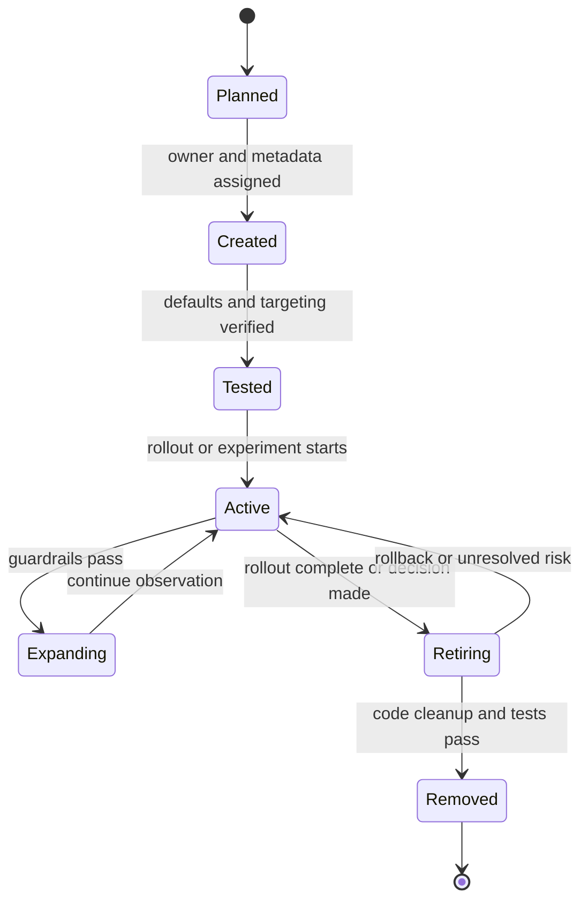

# Defining Ownership, Lifecycle, and When to Remove Flags

Feature flags separate deploying code from the moment a feature is enabled for users. An application version can already be deployed to production while the new feature remains off, enabled only for internal employees, a specific group of customers, or a small percentage of traffic. This approach supports gradual rollouts, experimentation, quickly disabling malfunctioning capabilities, and coordinating releases across multiple services.

However, every flag introduces another behavioral branch and configuration state to manage. Without an accountable owner, review date, and removal plan, temporary flags can linger for years—making code hard to understand, bloating the test matrix, and leaving production behavior dependent on configurations no one remembers why they exist.

**A feature flag needs an owner, purpose, lifecycle, and exit criteria from the moment it is created.** The owner must know who is allowed to change the flag, which state is enabled in each environment, which signals to monitor, and when the flag and legacy branch can be deleted. Removing a flag is a code change requiring tests and review, not merely deleting a configuration line.

## 1. What problem do feature flags solve?

A feature flag is a configuration condition that decides which behavior an application executes at runtime or during request processing. The source code holds both the guarded behavior path and the alternative path; the flag value determines which branch runs.

Example:

```java
if (featureFlags.isEnabled("new-checkout", customerContext)) {
    return newCheckoutService.checkout(request);
}

return legacyCheckoutService.checkout(request);
```

When `new-checkout` is off, the application continues using the legacy flow. When enabled for a group of customers, only that group goes through the new flow. Teams can expand scope without rebuilding the artifact if the flag system supports runtime configuration updates.

Feature flags are commonly used to:

- Deploy code early, enable the feature later.
- Roll out by percentage, tenant, region, or user group.
- Run A/B experiments with control and treatment cohorts.
- Quickly disable a failing function via a kill switch.
- Coordinate changes across multiple services during a transition period.
- Hide unfinished features from end users while letting internal teams test them.

Flags do not replace testing, authorization, deployment strategies, or rollback. A flag only selects a behavioral branch; it does not by itself guarantee the new branch is safe, compatible, or recoverable.

## 2. Classifying flags before creation

Different flag types have different purposes and lifespans. Classifying a flag upfront helps select the right owner, expiration, and removal approach.

| Flag type | Goal | Typical lifecycle | How it ends |
|---|---|---|---|
| Release flag | Hide a new feature during development and rollout | Short-term, tied to a release | After rollout completes and legacy code is no longer needed |
| Experiment flag | Split control/treatment groups to measure impact | Duration of the experiment | Once concluded, keep the winning variant or drop the losing one |
| Operational flag | Adjust operational behavior, load, or auxiliary features | Can be long-term | Keep if backed by a runbook and owner; review periodically |
| Kill switch | Quickly disable a function during an incident | Can be long-term | Remove only when replacement safeguards and incident plans are confirmed |
| Permission/entitlement flag | Control features by service tier or customer entitlement | Can be long-term | Migrate to a formal entitlement/authorization model when appropriate |
| Migration flag | Coordinate reads/writes between old and new schemas or systems | Short to medium term | After migration and data verification complete |

Do not enforce a few-day expiration across all flags. Release flags generally need prompt removal after launch; operational or entitlement flags may serve as long-term configurations, provided they have clear owners and operational docs.

### Do not confuse feature flags with access permissions

A flag can hide a button or UI route, yet it is not a data protection mechanism. If an API only checks a flag without verifying the caller's identity and permissions, users can call the endpoint directly to bypass the UI.

Authorization must be enforced server-side based on identity, resource, and policy. Feature flags only govern feature availability or rollout within permissions already granted.

## 3. Every flag needs a clear owner

Without an owner, nobody is accountable for deciding when to enable, disable, extend, or remove a flag. A flag record should distinguish between the business owner and the technical owner when needed.

### Common roles

| Role | Responsibility |
|---|---|
| Product owner or feature owner | Defines goal, target audience, success criteria, and rollout completion timing |
| Technical owner/service owner | Ensures code, default values, tests, fallbacks, and proper technical cleanup |
| Release manager | Coordinates rollout, release windows, and promotion criteria when process requires |
| Experiment owner/analyst | Designs hypotheses, control/treatment groups, metrics, and experiment conclusion |
| Operations/on-call | Knows kill switches, emergency toggle permissions, runbooks, and post-disable verification |
| Platform/flag administrator | Manages the platform, access controls, auditing, and system-wide policies |

In smaller teams, one person may wear multiple hats, yet accountability must still be recorded explicitly. A flag should never be created with a generic name like `temporary-feature-1` without a service, owner, or goal.

### What must the owner do?

The owner is responsible for:

- Confirming the flag has a valid purpose and appropriate flag type.
- Setting safe defaults for every environment.
- Defining who can modify it and under what conditions.
- Monitoring the rollout or experiment with chosen metrics.
- Reviewing the flag prior to its expiration date.
- Deciding whether to keep, convert into long-term config, or remove it.
- Ensuring code and tests are cleaned up once the flag is no longer needed.

An owner may delegate operational actions, but ultimate accountability must still rest with a reachable team or individual.

## 4. Minimum metadata for a feature flag

Flags should be registered with metadata so they can be searched, audited, and lifecycle-managed.

| Field | Content |
|---|---|
| Key | Stable identifier, unique within the application or project scope |
| Description | Description of the behavior the flag controls |
| Type | Release, experiment, operational, kill switch, entitlement, or migration |
| Owner | Responsible team/individual and contact channel |
| Service/component | Component containing code that evaluates the flag |
| Created date | Creation date |
| Review/expiry date | Date requiring review or planned removal |
| Default | Value used when configuration fails to load or the flag service is unavailable |
| Environments | Values and rules across dev, test, staging, and production |
| Targeting | Cohorts, tenants, regions, or applicability rules |
| Success/stop criteria | Metrics and thresholds governing rollout/experimentation |
| Removal plan | Conditions and steps to remove the flag and its code branch |
| Change history | Who changed the state, when, why, and the outcome |

Never store personal data or secrets in flag names, descriptions, or targeting rules. Use appropriate reference identifiers and restrict sensitive details recorded in audit logs.

### Naming conventions

Flag names should describe behavior or purpose, for example:

- `checkout.new-flow`
- `orders.async-confirmation`
- `billing.invoice-v2`
- `search.rank-experiment`
- `payments.provider-fallback`

Avoid names tied to dates or individuals like `john-test-2026` unless they reflect purpose. For temporary flags, put ticket IDs or release references in metadata instead of bloating the key name.

## 5. Lifecycle of a feature flag

A clear lifecycle prevents flags from being forgotten after a feature ships.



### States

1. **Planned:** goal, owner, flag type, and exit plan are defined.
2. **Created:** flag is declared in code or the flag platform; defaults and targeting are configured.
3. **Tested:** enabled, disabled, and config-unavailable fallback states are verified.
4. **Active:** flag is actively governing rollout, experimentation, or operations.
5. **Expanding:** enabled scope is growing based on criteria and guardrails.
6. **Retiring:** temporary purpose has ended; the team is transitioning config and cleaning up code.
7. **Removed:** runtime code, config, and metadata no longer reference the flag.

A flag can return to `Active` if the rollout must pause or revert to legacy behavior. However, do not leave a flag in `Retiring` indefinitely without an owner and completion deadline.

## 6. Setting expiration and review dates at creation

An expiration date is not necessarily a date when the system auto-deletes the flag. Rather, it is a mandatory checkpoint requiring the owner to revisit the flag's purpose and decide next steps. For release flags, set a planned removal date after rollout stabilizes. For operational flags, use periodic review dates instead of automatic expiry if they must remain long-term.

A reference policy:

| Flag type | Suggested review milestone | Exit criteria |
|---|---|---|
| Release flag | Within a few days or one sprint after 100% rollout | New behavior is default and legacy code can be deleted |
| Experiment flag | Upon reaching sample size and end of experiment window | Decision made to keep, drop, or redesign variants |
| Migration flag | After all consumers and data have migrated | Zero reads/writes remaining on legacy path |
| Operational flag | Quarterly or operational-cycle review | May stay if runbook, owner, and controls are still needed |
| Kill switch | Periodic review and after every activation | Remove only when replacement protection is verified and rehearsed |
| Entitlement flag | Review alongside product/permission model changes | Transition to formal entitlement system or manage as long-term config |

These timeframes are guidelines, not rigid standards. Flag risk, release velocity, and recovery capabilities determine the right cadence.

### Expiration dates must trigger action

When a review date arrives, the system should:

- Notify the owner ahead of the deadline.
- Display where the flag is referenced and its state in each environment.
- Require the owner to choose keep, extend with justification, or begin removal.
- Create a cleanup task if a temporary flag has fulfilled its purpose.
- Warn or block creating new flags if an owner holds too many overdue flags, per policy.

Never automatically delete a flag controlling production behavior solely because its date expired. Deleting config without deleting code or understanding targeting can drop the system into an unintended default.

## 7. Deciding when rollout is complete

Once a release flag reaches 100%, the team must decide whether maintaining two behavioral branches is still necessary.

Typically, a release flag can be removed when:

- The new version has been deployed across the entire intended scope.
- Technical and business metrics have remained stable across a sufficiently long observation window.
- No cohort or tenant still needs the legacy behavior.
- The rollback window has closed or another recovery plan is in place.
- No consumer or service depends on the legacy branch.
- Both product owner and technical owner agree to make the new behavior the default.

If rapid disablement is still needed post-release, consider converting the flag into an operational kill switch with its own owner, runbook, and review date. Never keep a release flag indefinitely just out of fear of needing a rollback.

### Rollback window and removal decisions

Removing a flag too early sacrifices a quick way back to legacy behavior. Keeping it too long increases complexity. Distinguish among:

- Artifact rollback: deploying the previous application version.
- Toggle rollback: turning off the flag to return to legacy behavior within the same artifact.
- Operational kill switch: disabling functionality during an incident.

If an artifact rollback still relies on the legacy code branch, retain the flag until the rollback-eligible version no longer needs it. If the release process uses immutable artifacts and rolls back to a prior build, the flag can be removed in a follow-up release once the rollback window closes.

## 8. Safe release flag removal workflow

Removing a flag is both a code and configuration change. Follow concrete steps:

1. Confirm with the owner that the temporary purpose has ended.
2. Inspect flag values across all environments and any remaining targeting rules.
3. Identify which branch is the retained behavior.
4. Remove the unneeded branch and invoke the retained implementation directly.
5. Delete tests specific only to the removed branch; keep tests verifying core behavior.
6. Remove the flag declaration from code, config, SDK registry, or flag service as appropriate.
7. Run relevant unit, integration, contract, and E2E tests.
8. Verify zero remaining references to the flag key or flag API.
9. Deploy and verify default behavior in target environments.
10. Mark metadata as `Removed`, retain audit logs, and close the cleanup task.

### Before and after removal example

Before removal:

```java
public CheckoutResult checkout(CheckoutRequest request) {
    if (flags.isEnabled("checkout.new-flow", request.customer())) {
        return newCheckout.checkout(request);
    }
    return legacyCheckout.checkout(request);
}
```

After confirming the new flow is the default and flag-based rollback is no longer required:

```java
public CheckoutResult checkout(CheckoutRequest request) {
    return newCheckout.checkout(request);
}
```

Deleting the legacy branch must include tests and code review. Do not simply flip the flag value to `true` on a dashboard and call it removed; the codebase and metadata still carry both branches.

## 9. Distinguishing flag removal from deleting operational controls

Some flags control capabilities vital during production incidents. Deleting a kill switch after rollout could strip teams of their way to shed load or shut off a failing integration.

Operational flags and kill switches can be kept long-term if they have:

- An accountable owner/on-call rotation.
- Documented scenarios describing when to toggle on/off.
- Clear runbooks and change permissions.
- Metrics to confirm impact after toggling.
- Safe defaults when the flag service is unavailable.
- Periodic testing of both enabled and disabled states.
- Audit logs and change alerts.

If a kill switch is no longer needed, prove that a replacement mechanism meets the same safety goal. Removing a flag must never strip away protections the system still relies on.

## 10. Designing defaults and behavior on flag service failure

An application may lose connectivity to the flag service due to network faults, timeouts, or auth errors. Define how it behaves when flag values cannot be fetched.

| Flag type | Default to consider | Rationale |
|---|---|---|
| Unreleased release flag | Off | Avoid exposing unfinished features unexpectedly |
| Experiment flag | Control/default behavior | Avoid shifting experiment cohorts when config fails |
| Kill switch | Fail-safe design per protection goal | Determine whether disabling or keeping the function avoids greater harm |
| Operational capacity flag | Tested stable value | Avoid abrupt resource-limit shifts |
| Entitlement flag | Never rely on flags as sole permission source | Authorization must rely on trusted policies/permissions |
| Migration flag | Defined safe compatible state | Avoid reading/writing from the wrong data source |

No single `false` or `true` default fits every flag. For kill switches, naming and semantics must be unambiguous: `disable-payment-provider` might default to `false`, whereas `payment-provider-enabled` might default to `true`. Both express the same operational control yet are easily inverted without clear naming conventions.

Test scenarios where the flag service times out, caches expire, configs are malformed, or the SDK is uninitialized. If a flag controls sensitive behavior, the application needs a risk-assessed fallback rather than guessing.

## 11. Flag change permissions and production governance

Not everyone allowed to view a dashboard should be allowed to modify production flags. A single flag change can expose untested features, spike load, alter costs, or impact data.

A reference permission model:

| Action | Appropriate permission |
|---|---|
| View flags and metadata | Team members with project/service read access |
| Create flags in development | Developers or service owners |
| Edit targeting in test environments | Developers/QA following test procedures |
| Enable small cohort in production | Feature owner or release operator per policy |
| Expand to 100% | Release owner or rollout controller once guardrails pass |
| Toggle kill switch during incident | On-call responder with emergency privileges and auditing |
| Delete flag from registry | Technical owner after code cleanup review |

Separate permissions by environment and action. Do not share one global admin API key across all services. Prefer SSO, role-based access, workload identities for automation, and tamper-evident audit logs that flag editors cannot delete.

### Production flag changes must record

- Actor or workload identity.
- Flag key and environment.
- Previous/new values or targeting rules.
- Reason for change and ticket/release reference if applicable.
- Timestamp and application outcome.
- Approver if required by policy.

## 12. Targeting, cohorts, and privacy

Flags may target by traffic percentage, tenant, region, account tier, or user attributes. Design targeting so it neither leaks personal data nor creates unintended access behavior.

Principles:

- Use only attributes strictly required for the rollout decision.
- Prefer segments or pseudonymous IDs over direct personal identifiers.
- Never place emails, phone numbers, access tokens, or sensitive data into flag keys or logs.
- Restrict who can create or edit targeting rules.
- Validate tenant and data-region rules to avoid exposing unintended cohorts.
- Use stable assignment whenever a user must stay in the same group across requests.
- Provide ways to exclude internal teams or test accounts from product metrics where needed.

Targeting is not authorization. Users outside a cohort might not see the feature in the UI, yet APIs must still verify permissions if they call endpoints directly.

## 13. Testing feature flag states

Every flag introduces states that must be tested. For a Boolean flag, test at least on and off; with targeting, test included and excluded cohorts; if the flag service fails, test the fallback.

| State | What to verify |
|---|---|
| Flag off | Legacy or default behavior works properly |
| Flag on | New behavior works properly |
| Targeted cohort | Correct group receives the feature |
| Non-targeted cohort | Feature is not unintentionally enabled |
| Flag service unavailable | Application falls back safely |
| Invalid configuration | Alert triggers and system avoids unsafe state |
| Transition off to on | Does not drop sessions or trigger duplicate side effects |
| Transition on to off | Behavior reverts as expected without corrupting data |

Do not generate every combination of dozens of flags unnecessarily. Test individual flags in code, test interacting pairs/combinations, and run representative end-to-end flows. Flags impacting payments, permissions, or migrations warrant deeper risk-based testing.

### Avoid tests depending on live dashboard state

Unit tests should set flag values via test fixtures or fake providers for repeatability. Integration tests can verify SDKs and configuration distribution. Never let unit test outcomes depend on current production flag state in a live dashboard.

## 14. Observing flag impact

When enabling a flag, observe what the change actually produces. Logging only that a flag is on without measuring behavior gives teams no way to judge rollout success.

Signals to monitor:

- Request or user counts per branch.
- Error rates and latency broken down by flag state.
- Business metrics such as checkout success, payment success, or conversion.
- Retry rates, timeouts, queue lag, and resource utilization.
- Frequency of flag changes, who changed them, and in which environments.
- Rate of unevaluated requests due to missing context or SDK failures.

Attach flag key/version or variant to telemetry in a cardinality-bounded way. Never put raw user IDs or personal data into metric labels. In logs/traces, use pseudonymous identifiers and appropriate sampling.

### Success criteria and stop criteria

Every release or experiment flag needs success criteria and stop conditions. For example, a new checkout flow must keep order completion rates within acceptable range of baseline, avoid raising payment errors, and keep latency within SLO.

When guardrails fail, the owner must know whether to turn off the flag, hold the current percentage, halt rollout, or roll back the artifact. Never automatically revert to the legacy branch if schemas or side effects are no longer compatible.

## 15. Removing experiment flags after experimentation ends

Experiment flags may govern multiple variants and control/treatment cohorts. Once an experiment hits target sample size or reaches its end date, the owner/analyst should:

1. Verify group allocation quality and exposure data.
2. Validate primary metrics, guardrails, and confidence intervals per plan.
3. Decide whether to ship, discard, or iterate on the experiment.
4. Select the default variant according to the recorded decision.
5. Stop assigning new users to the experiment.
6. Switch code to the winning variant and delete unused branches.
7. Remove the flag from config and the SDK registry.
8. Archive experiment results and audit records.

Do not end an experiment prematurely simply because one short-term metric looks positive. Account for sample size, duration, segments, guardrails, and secondary impacts. If results are inconclusive, continue or redesign the experiment with a new review date and clear rationale.

## 16. Removing migration flags and cross-service flags

Migration flags often span data transitions or traffic cutovers between old and new systems. Removing them too early can eliminate reconciliation or rollback capabilities.

Before removal:

- Confirm every producer/consumer uses the new schema or endpoint.
- Verify data backfill and reconciliation are complete.
- Confirm zero traffic or jobs still hit the legacy path.
- Check backups, restore paths, and the rollback window.
- Stop dual-writes or compatibility paths once safe.
- Delete legacy code in a reviewed change.
- Monitor metrics after removing the migration branch.

Across multiple services, coordinate ordering and owners for each consumer. A flag in `orders-api` may depend on `inventory-api`, event consumers, and reporting jobs. Do not remove it simply because a single service finished migrating.

## 17. Automatically detecting overdue flags and unused references

As flag counts grow, manual reviews fall short. Build reports or automation to detect:

- Flags past their review or expiration date.
- Flags with no owner or an inactive owner.
- Flags permanently on/off across all environments that still have code branches.
- Flags with zero evaluation events or no remaining code references.
- Flags with redundant targeting rules or empty cohorts.
- Flags at 100% rollout without a pending removal PR.
- Production flag changes made out-of-process or lacking audit trails.

Surface these findings as actionable tasks for owners rather than auto-deleting immediately. A flag with zero evaluation events might be a rarely triggered kill switch that remains vital during incidents. Always verify purpose and code references before deleting.

### Flag debt reporting

A flag governance dashboard can track:

| Metric | Meaning |
|---|---|
| Active flags by type | Number of flags per category |
| Overdue flags | Flags past review/expiry date |
| Flags without owner | Flags lacking an accountable owner |
| Flags with no code references | Flags potentially orphaned and unused |
| Flags fully rolled out | Release flags enabled for 100% of scope |
| Average flag age | Average lifespan by flag type |
| Removal lead time | Time from retirement decision until code deletion |
| Production changes without ticket | Flag changes lacking policy-required reason or reference |

Do not optimize purely by deleting as many flags as possible. The goal is removing temporary flags that have outlived their purpose while retaining long-term operational controls with clear owners and governance.

## 18. Example metadata and CI/CD workflow

The following YAML is a conceptual registry example, not a schema for any specific flag vendor:

```yaml
feature_flags:
  - key: checkout.new-flow
    type: release
    description: "New checkout flow rollout"
    owner:
      team: checkout
      contact: checkout-oncall
    service: storefront
    created_at: 2026-11-01
    review_at: 2026-11-25
    expires_at: 2026-12-02
    default: false
    environments:
      development: true
      test: true
      staging: true
      production: false
    rollout:
      success_metric: checkout_success_rate
      stop_metric: payment_error_rate
      target: internal_then_percentage
    removal:
      condition: "100 percent rollout and rollback window closed"
      owner: checkout
      tracking_issue: CHECKOUT-482

  - key: payments.provider-fallback
    type: kill_switch
    description: "Disable provider integration during incident"
    owner:
      team: payments
      contact: payments-oncall
    service: payment-api
    review_at: 2027-02-01
    default: false
    environments:
      development: false
      test: false
      staging: false
      production: false
    runbook: payments-provider-incident
```

A pipeline can validate metadata when a pull request creates or modifies a flag:

```yaml
jobs:
  validate_feature_flags:
    steps:
      - check_unique_flag_keys
      - require_flag_type_and_owner
      - require_review_or_expiry_date
      - validate_environment_defaults
      - verify_targeting_rules
      - detect_expired_flags
      - publish_flag_inventory_report

  release:
    needs: [validate_feature_flags, required_tests]
    steps:
      - deploy_immutable_artifact
      - verify_flag_configuration
      - record_flag_revision

  cleanup:
    trigger: scheduled
    steps:
      - find_overdue_temporary_flags
      - notify_owners
      - create_cleanup_tasks
```

These steps illustrate logic only. In real systems, `cleanup` should generate alerts or review tasks, never auto-delete production flags simply because an expiry date arrived.

## 19. End-to-end example: releasing a new checkout

Suppose a team builds a new checkout flow for `storefront`. The release flag `checkout.new-flow` is created before code merges, owned by the checkout team, with a review date set within the same sprint.

**Development:** the flag is enabled for developers to test the new flow. Unit tests exercise both new and legacy branches. Tests verify the default when the flag service is unreachable.

**Test/QA:** the flag is enabled in the test environment. QA runs integration tests with a payment sandbox, contract tests with `orders-api`, and E2E checkout tests. Each test uses isolated data.

**Staging:** the flag is enabled for internal staff. Smoke tests and synthetic journeys verify the system. The release owner sets checkout completion rate as the success metric, with payment error rate and p95 latency as guardrails.

**Production rollout:** the owner enables 1% of the cohort, then increases to 5%, 10%, 25%, 50%, and 100% as evidence accumulates. Every change is audited. If payment error rate breaches thresholds, on-call follows the runbook to disable the flag or halt rollout based on version compatibility.

**Retiring:** once the new feature serves all users and the rollback window closes, the product owner confirms the new flow as default. The technical owner opens a pull request removing the legacy branch, updating tests, and removing the flag from the registry.

**Removed:** the pipeline runs relevant unit/integration/E2E suites, verifies zero remaining code references, and deploys the new artifact. The flag is marked `Removed`; dashboards stop counting it toward active flag debt.

If the team still needs the ability to disable the new checkout if a payment provider fails, they create or keep a dedicated operational kill switch with its own runbook and owner. Do not prolong a release flag simply to substitute for a long-term operational control.

## 20. Common anti-patterns

| Anti-pattern | Consequence | How to improve |
|---|---|---|
| Creating flags without owners | Nobody decides when to enable, extend, or remove | Require owner and team in registry |
| No expiry/review date | Temporary flags live indefinitely | Set review milestones at creation and alert ahead of time |
| Keeping release flags after 100% rollout | Bloated code and test matrix | Remove after rollback window and compatibility verification |
| Deleting kill switches without replacements | Loss of incident mitigation capability | Verify replacement runbooks/controls before removal |
| Using feature flags as authorization | APIs can be called directly to bypass UI | Enforce permissions server-side via independent policies |
| Reusing one flag for multiple goals | Unclear owner, metrics, and exit timing | Separate flags by purpose and lifecycle |
| Only toggling on dashboard without code cleanup | Dead branches persist and build technical debt | Open removal PRs and verify zero remaining references |
| Skipping off-state tests | Fallback breaks when rollback is needed | Test on, off, and flag service unavailable states |
| Putting personal data in targeting | Privacy risks and data leakage | Use segments/pseudonymous IDs and restrict logs |
| Granting everyone production flag write access | Unplanned feature exposure | Enforce RBAC, risk-based approvals, and audits |
| Auto-deleting expired flags | Application may fall into unsafe defaults | Create review tasks; delete only after owner confirmation |
| Not tracking flag debt | Unknown overdue or orphaned flags | Build inventory dashboards and cleanup metrics |

## 21. Checklist for managing ownership, lifecycle, and flag removal

Before shipping a flag, teams can review:

- [ ] Flag has a clear key, description, type, and goal.
- [ ] Both product/feature owner and technical/service owner are assigned.
- [ ] Creation date and appropriate review or expiry date are set for the flag type.
- [ ] Defaults are defined per environment and for flag service failures.
- [ ] Targeting rules avoid unnecessary sensitive data.
- [ ] Read/write permissions are separated by environment and role.
- [ ] Production changes capture audit trail, actor, reason, and release/ticket reference.
- [ ] Tests cover enabled, disabled, targeting, and fallback states.
- [ ] Success metrics, stop criteria, and runbooks exist if the flag impacts operations.
- [ ] Rollout completion has sign-off and a scheduled retirement start date.
- [ ] Release/experiment/migration flags have explicit removal criteria.
- [ ] Flag removal covers code, tests, config, and registry—not just flipping runtime values.
- [ ] Zero remaining consumers or code references verified before deletion.
- [ ] Long-term kill switches have owners, runbooks, and periodic drills.
- [ ] Overdue flags trigger alerts and tracking until resolved.
- [ ] Waivers/extensions record justification, approver, and a new review date.
- [ ] Dashboards track active, overdue, ownerless, and removed flags.

## 22. Conclusion

Feature flags let teams control when and to whom features are enabled independently of code deployment. Those benefits only stay sustainable when every flag has a clear purpose, owner, change permissions, default, metrics, and lifecycle.

Release flags and experiment flags typically need removal once rollouts or experiments conclude; migration flags are deleted once data and consumers finish transitioning; operational flags and kill switches may remain long-term with owners, runbooks, and periodic reviews. Removing a flag requires cleaning up code branches, tests, configurations, and metadata after confirming zero dependencies remain. When pipelines validate metadata, send expiration reminders, and record cleanup evidence, feature flags become a disciplined release control rather than a lasting source of technical debt.
