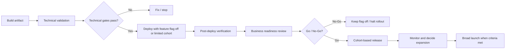
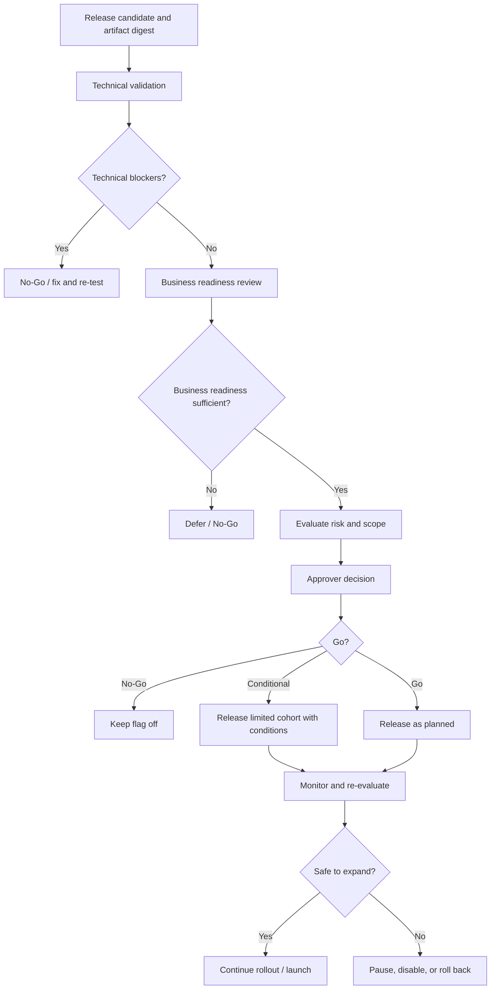

# Distinguishing Business Release Decisions from Technical Validation

A pipeline may build cleanly, pass every test, scan the image, and prepare a ready deployment—yet the feature still should not be opened to customers. Perhaps support teams have not been briefed, pricing terms have not been approved, data has not finished migrating, a partner is not ready, or the release timing clashes with a major business event. Conversely, launch pressure cannot turn a broken artifact, a critical vulnerability, or an unrecoverable system into a safe release.

Therefore, **technical validation** must be distinguished from a **business release decision**. Technical validation provides evidence regarding software quality, safety, and operability. Business decisions weigh value, customers, timing, organizational readiness, and residual risk to determine whether to expose a feature to users. The two complement each other; neither replaces the other.

## 1. Three concepts to keep separate: deploy, release, and launch

In everyday conversation, teams often use "deploy", "release", and "launch" interchangeably. When designing CI/CD, however, distinguish them clearly:

- **Deploy:** moving an artifact or software version to a target environment, updating services, configurations, or infrastructure so that version can run.
- **Release:** deciding to allow a version or feature to become supported or usable under product policy. A release can occur after deployment, such as flipping a feature flag or opening access to a user cohort.
- **Launch:** bringing a product or feature to market or announcing it broadly, potentially encompassing communications, documentation, support, pricing, and go-to-market plans.

An artifact can be deployed to production while its feature flag stays off. In that state, the code is present in production, yet the feature has not been released to users. Likewise, a feature can be released incrementally to small cohorts before a broad launch.

| Activity | Core question | Example |
|---|---|---|
| Build | Can an artifact be produced from the specified source? | Build image `orders@sha256:...` |
| Technical validation | Do the artifact and system meet technical criteria? | Tests, security scans, performance, compatibility |
| Deploy | Which environment has the artifact reached? | Deploy image to production with flag off |
| Business release decision | Should this user group be allowed to use the feature? | Enable feature for 5% of eligible customers |
| Launch | Is the organization ready to announce and support broadly? | Open to all customers and issue official announcement |

## 2. What questions does technical validation answer?

Technical validation checks predefined technical properties. Outcomes can be pass, fail, warning, or insufficient evidence. These checks typically live in CI, pre-deploy, mid-deploy, and post-deploy stages.

### 2.1. Build and artifact integrity

- Built from a specific commit SHA using a controlled toolchain.
- Dependencies installed via lockfiles; build inputs are traceable.
- Artifact has a version/digest stored in a controlled registry.
- Provenance, signatures, and SBOMs are generated/verified per policy.
- The tested artifact is the exact artifact promoted to the next environment.

### 2.2. Code quality and testing

- Unit, integration, contract, and end-to-end tests pass within required scope.
- Static analysis, linting, type checking, and coverage meet thresholds.
- Zero critical regressions in core business flows.
- Migrations and compatibility between old and new versions are verified.
- Flaky, quarantined, or skipped tests are recorded and governed by policy.

### 2.3. Security and technical compliance

- Dependencies, container images, and source code are scanned per policy.
- Secrets are never embedded in artifacts, logs, or repositories.
- Pipeline permissions and workload identities follow least privilege.
- Vulnerabilities, licenses, and policy violations are triaged by severity.
- Artifacts and deployments carry provenance, signatures, or attestations where required.

### 2.4. Operability

- Health/readiness/liveness checks work properly.
- Capacity, latency, error rate, and resource saturation remain within thresholds.
- Logging, metrics, tracing, and alerts are ready.
- Runbooks, rollback/roll-forward plans, and on-call responders exist.
- Databases, queues, caches, APIs, and dependent services are compatible with the new version.

### 2.5. Post-deployment verification

After deployment, the pipeline or operations system must verify:

- The runtime actually executes the approved artifact digest.
- Instances/pods are Ready and traffic is routed properly.
- Smoke tests, synthetic checks, and health endpoints pass.
- Metrics do not breach error, latency, or saturation thresholds.
- Critical business flows work in the live environment.
- No migration errors, queue backlogs, or anomalous logs appear.

Technical checks only mean as much as what they measure. Passing tests does not prove customers want the feature; a clean security scan does not prove support staff are trained; green health checks do not prove pricing and contract terms are approved.

## 3. What questions does a business release decision answer?

A business release decision weighs whether the organization should deliver a feature to users at a specific time, scope, and manner. It incorporates technical evidence alongside context outside CI's reach.

### 3.1. Product value and goals

- What problem does the feature solve, and does it align with product goals?
- Are target customers, use cases, and expected outcomes defined?
- Does the release scope match product commitments and the roadmap?
- Is a limited trial needed to validate hypotheses before expanding?

### 3.2. Customer readiness

- Are user guides, FAQs, and help center articles updated?
- Have customer support, sales, account teams, and operations been briefed?
- Is there a workflow when customers hit bugs or request disabling the feature?
- Do existing customers need advance notice, migration steps, or transition guides?

### 3.3. Pricing, contracts, and policy

- Have pricing, billing, entitlements, and terms of use been approved?
- Does it affect contracts, SLAs, personal data, or partner obligations?
- Are there legal, regional, industry, or internal policy requirements to satisfy?
- Do marketing claims and feature statements accurately match actual behavior?

### 3.4. Timing and organizational capacity

- Is there an active change freeze, financial close period, or major event?
- Do support and operations have enough staffing to monitor the release window?
- Are partners, vendors, and dependent teams ready?
- Are other concurrent changes happening that could complicate incident attribution?

### 3.5. Risk and risk tolerance

- What is the impact if the feature fails: revenue loss, data loss, degraded UX, or SLA breach?
- Which user segments could be affected and how severely?
- Can cohorts, regions, tenants, or transaction values be capped?
- Does residual risk have an accountable acceptor and a remediation deadline?

A business decision is not about ignoring engineering to hit a launch date. It decides whether to accept residual risk after mandatory technical checks are satisfied.

## 4. Comparing technical gates and business gates

| Topic | Technical validation | Business readiness/decision |
|---|---|---|
| Quality | Tests, static analysis, regressions | Feature meets customer needs and committed scope |
| Security | Vulnerability scans, IAM, secret handling | Customer, contractual, and policy risks accepted |
| Performance | Load tests, latency, capacity | Sufficient support and operational capacity during release |
| Data | Migrations, schema compatibility, backup tests | Data usage rights, notifications, and customer impact |
| Operations | Monitoring, alerts, runbooks, rollback | Owners, on-call support, escalation, and comms ready |
| Artifact | Digest, signature, provenance | Version/feature authorized for release per product plan |
| Scope | Deployment target, flag targeting, access control | Cohort/segment/region aligned with commercial strategy |
| Outcome | Pass/fail against technical criteria | Go/No-Go/Conditional Go by authorized decision-maker |

Both gate types can share an approval system, but their results and accountable owners must be stored separately. For example, CI automatically confirms the security scan passed; the Product Owner decides to enable the feature for the first customer cohort; the Release Manager coordinates the deployment window; Security/Compliance retains veto power when mandatory policies are violated.

## 5. A technical pass does not equal a business Go

A green pipeline only states that configured checks passed for a specific revision/artifact and environment. It does not answer questions about business value, customer readiness, timing, or organizational capacity.

Examples:

- All tests pass, yet the pricing page is not updated and customers would see wrong prices.
- The image is scanned, yet support has not been trained on handling cancellations or refunds.
- Staging deployment is stable, yet the payment partner has not enabled production configuration.
- Health checks are green, yet contract terms prohibit enabling the feature in a particular region.
- The feature works well, yet the release falls on month-end financial close with no on-call coverage.

In these cases, engineering may be ready while the business decision remains No-Go or delays launch scope. Waiting is not a CI/CD failure; it is release governance informed by full context.

## 6. Go, No-Go, and Conditional Go

A release decision should carry an explicit status, defined scope, and supporting evidence.

| Decision | Meaning | Typical conditions |
|---|---|---|
| Go | Authorize release within approved scope | Technical gates pass; business readiness met; owners and support ready |
| No-Go | Do not release at current time/scope | Technical blocker exists, business readiness lacking, or risk exceeds tolerance |
| Conditional Go | Authorize limited scope under specific conditions | Residual risk assessed; limits, owner, expiry, and stop criteria defined |
| Defer | Postpone decision pending more evidence or readiness | Missing data, external dependency unready, or unfavorable timing |

Conditional Go must never become a euphemism for "ship it and hope for the best." Conditions must be verifiable: for example, internal employees only, one pilot tenant, capped transaction volume, auto-disabling flag on threshold breach, or deploying only during staffed hours.

Certain conditions cannot be overridden by a business decision, depending on organizational policy: blocking vulnerabilities, legal violations, inability to protect data, unverifiable artifact provenance, or missing mandatory controls. If an exception is needed, it must go through a formal risk acceptance workflow with an authorized approver and expiration—never by altering a test status to pass.

## 7. Who has decision authority?

Never assume one person owns every dimension. Decision authority should be distributed by risk type and organizational policy.

| Role | Primary responsibility |
|---|---|
| Product Owner/Product Manager | Confirms goals, scope, target customers, and release value decision |
| Engineering Lead/Tech Lead | Confirms technical changes, compatibility, operability, and recovery plan |
| QA/Test Lead | Reports test coverage, evidence quality, open bugs, and testing limitations |
| Security/Compliance | Evaluates security, access, data risks, and mandatory compliance controls |
| Operations/SRE | Confirms monitoring, capacity, runbooks, on-call, and incident response readiness |
| Customer Support/Success | Confirms docs, training, support playbooks, and customer communications |
| Release Manager | Coordinates schedule, checklists, approvals, status, and release window comms |
| Business owner/Executive sponsor | Accepts business risk within authority and sets priorities |

Small teams may combine roles, yet clarity must remain over who supplies evidence, who advises, who approves, and who holds final accountability. Someone authorized to deploy is not automatically authorized to decide whether a feature is fit to sell or expose to customers.

### 7.1. Separating business approval from technical approval

Technical approval confirms criteria like tests, scans, provenance, and rollout plans pass. Business approval confirms value, scope, timing, and organizational readiness. Both approvals can live in the same release record, but never collapse them into a single ambiguous "Approved" checkbox.

### 7.2. Separation of duties

For high-risk releases, the person who modified policies or built the artifact should not be the sole production approver. Require independent reviewers, environment owners, and business approvers. The degree of separation scales with risk; the goal is preventing a single individual from authoring, verifying, and self-approving a production release without oversight.

## 8. Evidence-based Go/No-Go workflow

An effective release review does not require reading every raw log. It needs a concise release dossier linking to primary evidence and highlighting exceptions.

### Step 1: Identify the release target

Record feature name, version, commit SHA, artifact digest, environment, user cohort, region/tenant, and planned timing. If using feature flags, record flag keys, default state, and target cohorts.

### Step 2: Summarize technical evidence

Aggregate build/test status, security scans, artifact provenance, compatibility, performance, migrations, monitoring, runbooks, and rollback readiness. Explicitly note any unrun, skipped, flaky, or exempted tests.

### Step 3: Summarize business readiness

Confirm goals, customer impact, pricing/contracts, documentation, support training, partners, communications, timing, and on-call staffing. If an item is not applicable, state why rather than leaving it blank.

### Step 4: Assess residual risk

List open issues, impact severity, likelihood, affected cohort scope, mitigations, owners, and due dates. Separate mandatory blockers from conditionally acceptable risks.

### Step 5: Decide and record

Authorized decision-makers record Go/No-Go/Conditional Go/Defer, permitted scope, conditions, deadlines, and rationale. Approvals must bind to a specific artifact digest and release scope.

### Step 6: Execute per plan

Deploy or enable the feature for approved cohorts/regions/tenants. Do not expand scope automatically just because the initial step succeeded; each expansion must satisfy predefined criteria.

### Step 7: Verify and update the decision

Monitor technical metrics and business signals. If conditions stop holding, pause rollout, disable the flag, or revert to a safe state. Record outcomes and subsequent decisions.

## 9. Release dossier: minimum contents

A release dossier can be a release page, change record, or summary inside a release management tool. Contents should let approvers understand precisely what will change.

| Section | Required information |
|---|---|
| Identification | Feature, release version, commit SHA, artifact digest, workflow run |
| Scope | Environment, region, tenant/cohort, traffic percentage, flag key |
| Technical evidence | Test summary, scans, compatibility, performance, migrations, provenance |
| Operational readiness | Dashboards, alerts, runbooks, on-call, capacity, rollback/disable plan |
| Business readiness | Goals, customer impact, pricing, contracts, support, docs, communications |
| Risk | Open issues, severity, mitigation, owner, deadline, and risk acceptance |
| Decision | Go/No-Go/Conditional/Defer, approver, timestamp, conditions, and rationale |
| Post-release | Metrics, business outcomes, incidents, rollout progress, and expansion decisions |

### 9.1. Approvals must bind to the exact artifact and scope

If the artifact digest changes, prior approvals do not automatically carry over to the new artifact. If scope changes from internal to customers, one region to global, or 5% to 100%, re-evaluate readiness and risk conditions. Similarly, if configurations or migrations change materially after approval, update the release dossier and obtain re-approval if required.

## 10. Combining technical gates with business gates in CI/CD

CI/CD can automate evidence collection and policy enforcement, yet it should not reduce every business decision to a shell script or an ownerless checkbox.

A pipeline can be organized into layers:

1. **CI gates:** build, unit/integration tests, static analysis, and security checks.
2. **Artifact gates:** digest, provenance, signature, SBOM, vulnerability/license policies.
3. **Pre-deploy gates:** compatibility, migration readiness, environment config, capacity, and technical approval.
4. **Post-deploy gates:** health, smoke, synthetic, metrics, and business transaction checks.
5. **Business release gate:** approval covering goals, cohorts, timing, and organizational readiness.
6. **Expansion gate:** decision to enlarge cohorts or broaden launch based on live outcomes.

### 10.1. Machines check conditions; humans decide trade-offs

Clearly measurable conditions should be automated: test passes, scan thresholds, artifact digests, deployment health, error rates, or capacity. Contextual trade-offs such as commercial timing, contractual impact, or customer prioritization require accountable human owners.

Do not use manual approvals to replace repeatable automated tests. Likewise, do not assume a green pipeline can autonomously judge business value or accept risks the organization has not authorized.

### 10.2. Never let business approval bypass mandatory technical blockers

If policy designates critical vulnerabilities, data-loss risks, unverified artifacts, or unrun mandatory tests as blockers, business approvers must not have a "Go" button that silently overrides them. Exceptions must pass through a dedicated risk acceptance process with an accountable owner, expiration date, and mitigations. Some legal or safety constraints may allow no exceptions at all.

## 11. Conditional Go and risk acceptance

Conditional Go permits a bounded release when residual risk is understood and controlled. Examples:

- Enable only for internal employees or a small pilot group of customers.
- Restrict region, tenant, transaction count, or transaction value.
- Keep the feature flag off by default and enable only for designated cohorts.
- Deploy only during windows staffed by operations.
- Auto-halt when error rates or business metrics breach thresholds.
- Accept a low-severity issue with a named owner and concrete deadline.

A risk acceptance record should contain:

- The risk and its root cause.
- Affected assets or customers.
- Likelihood, impact severity, and blast radius.
- Mitigations and detection signals.
- Authorized risk acceptor.
- Remediation owner, due date, and expiration date.
- Conditions triggering automatic halt or revocation.

Risk acceptance is not a way to turn a failure into a pass. Technical check results stay recorded as-is; the risk acceptance decision is stored separately for auditability.

## 12. Staged release: expanding based on evidence

When a feature can be toggled by cohort, treat the release as a sequence of decisions rather than a single global switch.

Example stages:

| Stage | Scope | Goal and expansion criteria |
|---|---|---|
| Internal | Employees and test accounts | Verify core flows, support readiness, and telemetry |
| Pilot | Opted-in tenants/customers | Validate real-world behavior, feedback, and support playbooks |
| Limited | Small cohort or traffic percentage | Monitor errors/latency, adoption, and business guardrails |
| Broad | Incrementally expand cohorts/regions | Expand when metrics stabilize and owners approve |
| General availability | Broad target customer base | Docs, support, pricing, and operations are fully ready |

Each stage requires an observation period, metrics, stop thresholds, and a decision-maker. Never jump automatically from 5% to 100% simply because an interval passed with zero alerts; sufficient transaction volume or coverage of edge cases may still be needed.

## 13. Example: releasing a delivery time-slot selection feature

An e-commerce product wants to let customers choose delivery time slots. The feature brings clear business value by reducing failed deliveries and increasing order completion, yet depends on warehouse capacity, carrier partners, and fee calculation systems.

### 13.1. Technical validation

- Unit/integration tests verify slot availability checks, timezones, capacity, and schedule conflicts.
- Contract tests verify APIs across checkout, inventory, and delivery partners.
- Load tests verify peak hours and concurrent requests.
- Security/privacy checks verify access controls around customer addresses and details.
- Migration tests verify slot data and legacy orders remain compatible.
- Staging smoke tests verify placing orders, rescheduling, and cancellations.
- Monitoring tracks slot availability, booking failures, partner timeouts, and queue lag.
- Rollback/flag disablement is tested and verified to preserve the legacy checkout flow.

### 13.2. Business readiness

- Delivery zones and carrier partners have confirmed capacity.
- Surcharges and refund terms are approved.
- Checkout copy, FAQs, and confirmation emails are updated.
- Customer support is trained on handling full slots or carrier delays.
- Sales/marketing are aligned on messaging and target customer groups.
- Operational staffing is scheduled during the pilot and expansion window.

### 13.3. Decision

All technical gates pass, yet the carrier partner has only confirmed capacity in two cities. The Product Owner proposes a Conditional Go: enable the flag for internal staff and a pilot group of customers in those two cities, while hiding the feature in all other regions. Operations monitors booking failures and partner timeouts; Support uses the prepared FAQ.

After an observation window, the team evaluates both technical and business signals: slot booking success rate, on-time delivery, support ticket volume, conversion rate, and customer feedback. If criteria are met, the business owner approves expanding to additional regions. If the partner fails to meet capacity, the flag is turned off or held at pilot scope.

This example illustrates that a technical pass is an essential prerequisite to begin, while actual release scope and timing depend on business and operational readiness.

## 14. Emergency releases and urgent changes

Production incidents may require shipping a fix faster than standard workflows. An emergency process should shorten wait times while preserving minimum safeguards:

- Identify the incident, impact scope, and mitigation objective.
- Designate the authorized decision-maker and deployment executor.
- Retain mandatory technical checks proportional to risk; never skip checks that catch data-loss bugs or incident-amplifying defects.
- Record artifact digest, source revision, and deployment scope.
- Have a rollback/roll-forward plan and active on-call monitoring.
- Record why standard steps were bypassed, who approved, and the deadline for retroactive review.
- Conduct a post-incident review and complete the audit record once stable.

Emergency does not mean skipping audits or using unrestricted personal accounts. If an approval occurs retroactively due to urgency, explicitly document the exception and complete post-hoc review per policy.

## 15. Common anti-patterns

| Anti-pattern | Consequence | Better practice |
|---|---|---|
| Green pipeline automatically means ship | Ignores pricing, customers, support, and timing | Separate technical gates from business decisions |
| Product approval overrides security/test blockers | Technical risks get hidden | Enforce mandatory blockers and separate risk acceptance |
| Single vague "Approved" checkbox | Unclear who decided what | Record approval type, approver, scope, and evidence |
| Approval unbound to artifact digest | Different artifact ships under old approval | Bind approvals to digest, environment, and cohort |
| Treating deploy as launch | Features leak before support/pricing are ready | Separate deploy, release, and launch |
| Opening 100% right after a short pilot | Insufficient behavior and load data | Expand cohorts by criteria and observation windows |
| Risk acceptance with no owner or expiry | Exceptions become permanent | Require owner, expiry, mitigation, and review |
| Watching only technical metrics | Misses adoption, conversion, or support spikes | Track business outcomes alongside operational metrics |
| Emergency releases without post-hoc review | Lost audit trail and control debt | Log exceptions and complete post-incident reviews |

## 16. Go/No-Go checklist

### Technical readiness

- [ ] Artifact is identified by version/digest and traced back to commit/build run.
- [ ] Mandatory tests, scans, and quality gates pass; exceptions are recorded separately.
- [ ] APIs, databases, messages, and dependencies are compatible with the existing system.
- [ ] Configurations, secrets, and deployment permissions match the target environment.
- [ ] Monitoring, alerts, dashboards, and runbooks are ready.
- [ ] Rollback/disable/roll-forward plans are evaluated with an assigned owner.
- [ ] Post-deploy verification has clear criteria and stop thresholds.

### Business readiness

- [ ] Goals, scope, and customer cohorts are confirmed.
- [ ] Pricing, contracts, entitlements, and relevant policies are approved.
- [ ] Documentation, FAQs, support, and account teams are ready.
- [ ] Partners and dependent teams confirmed service readiness.
- [ ] Release timing and on-call staffing are appropriate.
- [ ] Customer impact risks and communication plans are evaluated.
- [ ] Cohorts, regions, rollout limits, and expansion criteria are defined.

### Decision record

- [ ] Explicit Go/No-Go/Conditional Go/Defer decision recorded.
- [ ] Authorized decision-maker and approval type documented.
- [ ] Decision bound to artifact digest, environment, cohort, and timing.
- [ ] Risk acceptance records owner, mitigation, and expiry where applicable.
- [ ] Pause, disable, rollback, or expansion criteria defined.
- [ ] Post-release results will be reviewed and documented.

Business release decisions and technical validation are two distinct control layers. Technical validation proves the artifact and system meet defined engineering standards; business release decisions confirm to whom, when, and in what scope the organization should expose the feature. When both layers have clear owners, evidence, and decision authority, pipelines can automate repeatable checks while preserving human accountability for the value, customers, and risks of every release.
