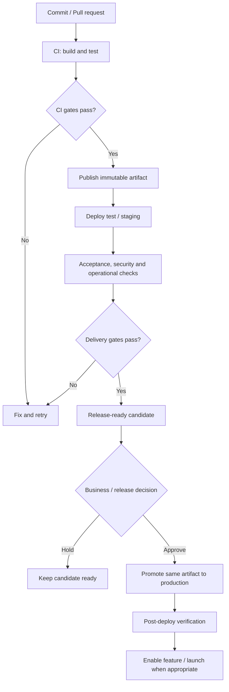
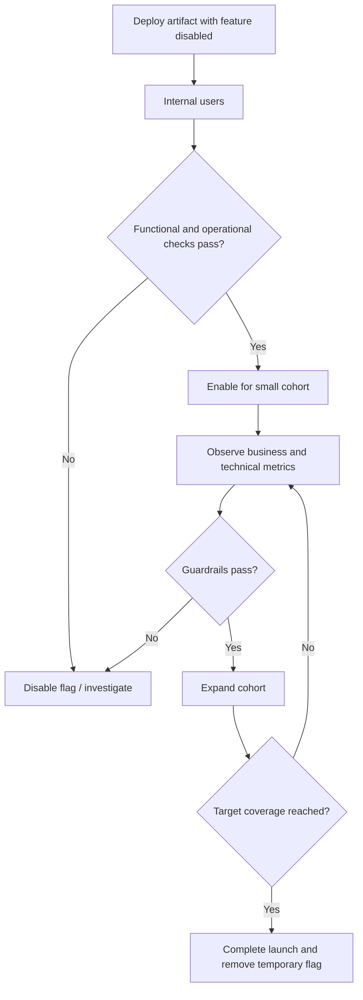

# Identifying When to Practice Continuous Delivery Without Continuous Deployment

## 1. Continuous delivery does not mean automatically releasing every change

In CI/CD, a core goal is keeping software in an always-releasable state. Every integrated change should be built, tested, and packaged through an automated workflow so the team can release whenever an appropriate decision is made. This practice is called **Continuous Delivery**.

Continuous Delivery does not require every change to roll out to production automatically the instant a pipeline turns green. Teams can retain a decision point prior to production release—such as sign-off from an accountable owner, business timing selection, regulatory verification, or coordination across multiple systems.

**Continuous Deployment** goes one step further: every change that passes all defined checks and policies is automatically deployed to production without a manual release decision per change. If the pipeline fails a gate, the change is blocked; if it passes, the flow proceeds automatically.

Thus, an organization can practice strong Continuous Delivery without yet adopting Continuous Deployment. Software is still integrated frequently, artifacts remain ready, pre-production environments update automatically, and releases can execute rapidly. The decision to expose features to users is governed separately based on risk and business need.

## 2. Distinguishing Continuous Integration, Continuous Delivery, and Continuous Deployment

These three related terms describe different levels of automation:

| Practice | Focus | Does production automatically receive every gate-passing change? |
|---|---|---|
| Continuous Integration (CI) | Integrate changes frequently and automate build/test to detect bugs early | Not a direct goal of CI |
| Continuous Delivery | Keep software always releasable; build, test, packaging, and release prep are automated | Not required; may involve an intentional release decision or trigger |
| Continuous Deployment | Automatically deploy every change passing all gates to production | Yes, according to established automated policy |

A typical Continuous Delivery pipeline might automatically run CI, publish artifacts, deploy to staging, run acceptance tests, and prepare a release record. Afterward, an authorized owner or release policy decides when to promote the verified artifact to production.

A Continuous Deployment pipeline automates that entire chain. The prerequisite is that automated checks, post-deploy observability, rollout halting, and recovery capabilities are trustworthy enough to operate without per-change approvals.

Terminology varies across organizations. When discussing practices, describe exact behavior: how far the pipeline automates, what blocks production, who decides on release, and when users receive the feature.

## 3. Distinguishing build, deploy, release, and launch

A common source of confusion is treating build, deploy, release, and launch as one and the same action. In practice, they can happen at distinct times.

| Concept | Meaning | Example |
|---|---|---|
| Build | Transform a source revision and inputs into an artifact | Build `orders-api` image from commit `abc123` |
| Deploy | Place an artifact into an environment or update workloads | Deploy image to production cluster without enabling the new feature yet |
| Release | Allow a version or change to be used under product policy | Promote an approved release or enable a feature for a user cohort |
| Launch | Moment or activity delivering the feature to target users | Turn on feature flag for all customers alongside announcement |

These concepts may coincide in simple systems. However, when release timing requires control, teams should separate them. A new binary may already be deployed to production while the new feature stays disabled behind a feature flag. Conversely, a feature may be enabled incrementally for a small cohort after the artifact was deployed earlier.

Separating deploy from release lets organizations preserve high engineering velocity while intentionally controlling customer impact.

## 4. Continuous Delivery flow with a separate release decision

A common model:



In this model, repeatable technical steps are automated. The pre-production decision point can represent an approval, release calendar, legal condition, customer support readiness, or downstream system state.

Crucially, the "release-ready" state must carry verifiable evidence: artifact digest, source commit, test/scan results, config revision, release notes, and deployment plan. Once the release decision is made, the pipeline promotes the exact verified artifact rather than rebuilding a new package.

## 5. When to practice Continuous Delivery without Continuous Deployment?

Several valid scenarios warrant keeping a separate production release decision:

### 5.1. Regulatory, compliance, or change-control requirements

Some systems require an accountable person to sign off before changes touch regulated data, finances, access controls, or services. Processes may mandate test evidence, risk assessments, independent approvals, or archived release records.

Even here, CI/CD can still automate building, testing, scanning, generating SBOMs, signing artifacts, and deploying to staging. Approvals belong only where human accountability or attestation is required. Do not turn every step into manual sign-off if checks can be automated.

### 5.2. Release timing tied to business activities

A feature may need to coincide with a marketing campaign, customer announcement, contract effective date, sales promotion, or support training schedule. The artifact can be ready ahead of launch day, while the launch occurs at the exact target time.

Continuous Delivery keeps the release prepared. Release managers can choose when to turn on the feature or open traffic without waiting to rebuild and retest from scratch.

### 5.3. Cross-system or multi-team coordination required

A change may depend on another service's API, database schema, mobile app, partner system, or operational workflow. Deploying one component too early could leave the overall system in an incompatible state.

Teams can still integrate and deploy components into staging or pre-production environments while holding release until dependencies are satisfied. API contracts, version compatibility, and expand-and-contract patterns reduce synchronization wait times.

### 5.4. High-risk or hard-to-reverse changes

Data modifications, major migrations, billing algorithm updates, authorization changes, or transaction-processing logic may need extra review before opening to users. Automated deployment does not mean automatically enabling the feature for 100% of traffic.

Teams can deploy code with the feature flag off, run shadow traffic, or test with internal groups first. Expansion decisions follow after reviewing evidence and risk levels.

### 5.5. Maintenance windows or support staffing constraints

Certain services may only change during maintenance windows, outside peak hours, or when on-call responders are actively available. Pipelines can produce release candidates at any time while executing production rollouts only inside permitted windows.

### 5.6. User-facing content or experience sign-off needed

For products involving content, UI, pricing, policies, or business workflows, teams may require confirmation from product owners, legal, operations, or customer success. Automating technical checks remains valuable; release decisions grounded in product criteria may require domain roles.

## 6. Do not use approvals to compensate for a weak pipeline

Keeping an approval step does not mean approvers should manually do the pipeline's verification work. Approvers cannot re-read every line of code, manually execute tests, or inspect every dependency on every release.

Prior to approval, the pipeline should automatically provide:

- Built artifact identified by digest.
- Unit, integration, acceptance, and regression test results within scope.
- SAST, dependency scan, secret scan, and image scan results per policy.
- SBOM, provenance, and signatures where required by workflow.
- Release notes, change list, and linked tickets.
- Deployment plan, target configuration, and migration impact.
- Staging results, smoke tests, and operational status.
- Rollout plan, stop conditions, and rollback/roll-forward plan.

Approvals should answer questions requiring human judgment: Is the timing right? Is residual risk acceptable? Are relevant teams ready? Are any business or compliance prerequisites incomplete?

If mandatory tests or scans fail, never allow a generic approval button to turn that failure into a pass. Exceptions must go through an explicit waiver specifying scope, rationale, approver, expiration, and mitigations.

## 7. Keeping artifacts always ready to release

Continuous Delivery only works if teams can release a previously verified artifact without rebuilding from scratch at the last minute.

A release candidate should bind to:

- Source commit and repository.
- Artifact name, version, and immutable digest.
- Build environment, toolchain, and dependency metadata.
- Test/scan evidence tied to that exact digest.
- Expected config schema or config bundle.
- SBOM, provenance, and signatures per policy.
- Release notes and deployment manifest.

When the release is approved, the pipeline promotes that exact artifact from the internal repository to the target channel or environment. If a rebuild is required because an artifact expired, inputs changed, or a package was replaced, it constitutes a new build/release candidate requiring re-execution of relevant checks.

## 8. Feature flags help separate deploy and launch

Feature flags let code be deployed while enabling new behavior only for a specific cohort or under specific conditions. This is a key technique for delivering continuously while controlling launch timing.

Example:

```java
if (featureFlags.isEnabled("new-checkout", userContext)) {
    return newCheckoutService.checkout(request);
}

return legacyCheckoutService.checkout(request);
```

The new code is already inside the production artifact, yet only users permitted by the flag enter the new flow. Teams can enable it for internal employees, a pilot tenant, a percentage of traffic, or all users when ready.

Feature flags support:

- Deploying code first, launching later.
- Decoupling user cohorts and activation timing.
- Controlled trials or cohort-based rollouts.
- Rapidly disabling a malfunctioning feature without rebuilding, provided the fallback path remains safe.
- Aligning launches with announcements, support, or business conditions.

Flags do not replace testing. Both enabled and disabled branches must be verified. If a flag guards critical logic, test meaningful combinations and verify behavior when the flag service is unavailable.

## 9. Choosing the right type of feature flag

Not all flags share the same lifecycle. Categorize them:

| Flag type | Purpose | Expected lifecycle |
|---|---|---|
| Release flag | Hide unready features or decouple deploy from launch | Temporary; delete after feature stabilizes |
| Experiment flag | Split cohorts to test user experience or outcomes | Duration of experiment and analysis |
| Operational flag | Toggle behavior to shed load or respond to incidents | May live longer; requires owner and runbook |
| Permission/entitlement flag | Determine user/tenant feature access | Aligned with product entitlement model; requires access controls |

Do not treat a flag system as an ad-hoc configuration dumping ground. Flags need meaningful names, owners, purposes, default values, user scopes, expiration or removal conditions, and audit logs for sensitive changes.

Release flags should normally be cleaned up after launch completes. Leaving old flags behind multiplies code branches and state combinations, complicating tests and maintenance. Operational flags may need longer lifespans, but must have an accountable owner and state verification checks.

## 10. Release on demand and release calendars

Continuous Delivery enables release on demand: teams can release whenever needed once artifacts and evidence are ready. It does not mean every release must happen instantaneously or at arbitrary times.

An organization can choose:

- **Release immediately upon approval:** suits small changes and flexible schedules.
- **Scheduled releases:** batch ready changes into an announced release window.
- **Coordinated releases:** synchronize with mobile apps, partner APIs, databases, or operations teams.
- **Conditional releases:** ship only once a dependency, business event, or operational state meets criteria.
- **Cohort releases:** enable gradually across user groups or tenants.

A release calendar should serve as a coordination tool, not an excuse to keep changes on unintegrated branches. Teams should still merge frequently, test continuously, and keep artifacts releasable. Grouping launch timing should never turn into long-lived release branches accumulating unverified changes together.

## 11. Meaningful and auditable release approvals

Manual approvals only add value when approvers have the information needed to decide and clear accountability.

An approval request should surface:

- Release ID, artifact digest, and source commit.
- Summary of changes and affected user groups.
- Technical gate results and residual risks.
- Target environment, planned timing, and rollout scope.
- Whether dependencies are ready.
- Migration/data impact and backup status if applicable.
- Halt, rollback, or roll-forward plan.
- Operational owner and incident response channel.

Approval records must capture the approving person or identity, timestamp, specific release/artifact, policy version, and decision. If the artifact or configuration changes after approval, re-evaluate per policy. Never reuse an old approval for a different release candidate simply because version strings match.

## 12. Avoiding turning approvals into bottlenecks

Requiring a manual gate on every commit creates massive queues and negates the benefits of continuous delivery. Distinguish decisions that truly require human judgment from checks that can be automated.

Improve flow by:

- Automating all technical checks prior to requesting approval.
- Requiring approval only at points carrying clear impact or accountability.
- Using risk-tiered approval policies instead of demanding the same reviewer count for every release.
- Allowing small, low-risk releases through fast paths where policy allows.
- Sending automated reminders to authorized approvers and setting approval SLAs.
- Presenting clear evidence and change summaries to cut review time.
- Tracking wait times, approval rates, and delay reasons.

If approvers merely click approve without reviewing evidence, approvals deliver zero real governance. Design the step around a concrete decision backed by an accountable owner and supporting data.

## 13. Progressive delivery: controlled deployment and expansion

Continuous Delivery pairs naturally with progressive delivery. Rather than switching all users onto a new feature at release time, teams expand step by step and evaluate signals at each step.

An example flow:



Related techniques:

- User, tenant, or cohort-based feature flags.
- Canary rollouts handling a fraction of traffic.
- Blue-green deployments with controlled traffic shifting.
- Shadow traffic to compare outputs without serving new responses to users.
- A/B testing to evaluate product impact.

These techniques can combine, though they are not synonymous. Canary primarily tests the technical safety of a version on a slice of traffic; A/B testing compares user experience or business outcomes across groups. Feature flags control behavior execution and do not by themselves provide statistical analysis.

## 14. Stop conditions and rollback when a release underperforms

When releases are governed separately, teams need ways to halt a launch without necessarily rolling back the entire artifact.

Options include:

- Turning off the feature flag to revert to the legacy flow if old code stays compatible.
- Pausing cohort or canary expansion and holding the current percentage while investigating.
- Shifting traffic back to the prior stable version.
- Rolling forward with a fix if migrations or written data make rollback unsafe.
- Pausing new releases while leaving the deployed artifact in place with the feature off.

Before relying on a feature flag as a rollback switch, verify that the fallback branch still works and remains compatible with schemas, APIs, caches, events, and data generated by the new feature. Turning off a flag does not undo data or transactions that already happened.

Guardrails should include technical and business metrics: error rate, latency, timeouts, transaction success rate, processing errors, queue lag, or feature-specific metrics. If data is insufficient, hold the rollout rather than expanding automatically.

## 15. Data compatibility when deploying first and releasing later

Deploying code before enabling a feature creates an interval where the new artifact runs even though the feature is unused. During that interval, new code may still initialize connections, register routes, read schemas, or execute background tasks.

Therefore, ensure:

- New code runs safely while the flag is off.
- Both old and new code remain compatible with database schemas during the transition.
- APIs and event contracts stay compatible when services update at staggered times.
- Background workers do not process new-format data before the system is ready.
- Cache keys and serialization formats support coexisting old/new versions.
- Data created by the new feature will not crash the old version if rollback is needed.

The expand-and-contract strategy applies schema changes in stages: expand with backward-compatible structures, deploy code supporting both formats, migrate data, enable the feature, and remove old structures only once no consumers rely on them.

## 16. Example: preparing a new payment feature for a scheduled launch

Suppose a team develops a new payment flow. The feature requires integrating a payment provider, training customer support, and aligning a marketing announcement on a set date.

The workflow might proceed as follows:

1. Developers merge changes frequently into the main branch; CI builds and tests every change.
2. The pipeline produces an immutable artifact, scans dependencies/images, and publishes provenance.
3. The artifact deploys to staging; the team runs integration tests against the provider's sandbox.
4. The artifact deploys to production while the `new-payment-flow` feature flag stays off.
5. Internal teams enable the flag to run end-to-end checks with test accounts.
6. Product, operations, and support confirm documentation, dashboards, runbooks, and announcement schedules.
7. At release time, the flag is enabled for a small cohort while monitoring payment success rate, latency, and errors.
8. If guardrails pass, the cohort expands gradually; otherwise, the flag is disabled and investigated.
9. Once stable, the feature is enabled for the full target audience and temporary flag cleanup is scheduled.

In this example, code is delivered and deployed automatically. Launch is governed by schedule and product decisions. The team does not rebuild the artifact on launch day; they simply update release/flag state through a controlled workflow.

## 17. Example Continuous Delivery pipeline with pre-production approval

A conceptual configuration:

```yaml
stages:
  - build_test
  - publish
  - staging
  - release_ready
  - production

build_test:
  script:
    - ./gradlew clean test
    - ./gradlew bootJar

publish:
  needs: [build_test]
  script:
    - publish-artifact --input build/libs/service.jar
    - record-artifact-digest

staging:
  needs: [publish]
  script:
    - deploy-by-digest --environment staging
    - run-acceptance-tests

release_ready:
  needs: [staging]
  script:
    - generate-release-evidence
    - mark-release-ready

production:
  needs: [release_ready]
  when: manual
  script:
    - promote-approved-artifact --environment production
    - verify-deployment
```

This is pseudocode illustrating the flow, not syntax runnable verbatim across every CI platform. In a real implementation, the production job must pull the artifact by the digest recorded in the publish job, verify approval tied to the specific release ID, scope production credentials strictly to that job, and run post-deploy verification. Never let the production job rebuild from source.

If an organization adopts Continuous Deployment, `when: manual` can be replaced by an automated policy once all gates pass. That choice is only appropriate when automated checks, observability, and recovery are sufficiently reliable.

## 18. Release trains and scheduled batching of changes

Some organizations ship via release trains: changes integrate frequently, yet are bundled into scheduled release windows. This suits cases requiring coordination with customers, vendors, hardware devices, mobile apps, or multi-site rollouts.

Release trains must not mean creating long-lived branches and delaying integration. To retain Continuous Delivery benefits:

- Merge early and often into the main branch.
- Use feature flags to hold unlaunched features.
- Cut release candidates from a well-defined revision.
- Automatically verify artifacts and dependencies ahead of release day.
- Admit only changes meeting release-ready criteria onto the train.
- Freeze the artifact and release notes once the candidate is cut.
- Have a procedure to pull a defective change without delaying the entire train when feasible.

If a release train spawns a branch accumulating unintegrated changes, merge conflicts and integration failures spike. Use trains to coordinate release timing, not to replace CI.

## 19. Measuring Continuous Delivery when production is not automated

Do not judge maturity solely by the presence or absence of manual approvals. Examine the full flow from change to release-ready, and from release-ready to users.

Metrics to track:

- **Deployment frequency:** how often deployments hit environments, distinguishing staging from production.
- **Lead time for changes:** time from commit until changes are ready or reach production; define measurement boundaries consistently.
- **Release-ready lead time:** time from commit until the artifact and evidence satisfy release criteria.
- **Approval wait time:** time spent waiting on human decisions.
- **Change failure rate:** percentage of production changes causing degradation or requiring remediation.
- **Failed deployment recovery time:** time to recover after a faulty deployment.
- **Release hold duration:** time an artifact sits ready waiting on business conditions or release schedules.
- **Feature exposure time:** time from code deployment until the feature activates for target users.

These metrics pinpoint whether bottlenecks lie in testing, environments, approvals, dependencies, or business calendars. Never try to cut approval wait time by stripping out mandatory controls; instead, automate evidence gathering and triage decisions so manual steps stay only where truly needed.

## 20. Roadmap from Continuous Delivery to Continuous Deployment

Continuous Deployment can be a natural next step once an organization has evidence that automated gates are dependable. There is no need to pursue automated production deployment at any cost.

A practical roadmap:

1. Standardize CI and integrate frequently on the main branch.
2. Automate build, testing, scanning, packaging, and provenance.
3. Keep artifacts immutable and auto-deploy to pre-production environments.
4. Build risk-based acceptance tests, smoke tests, and quality gates.
5. Automate deployment, health checks, canaries, and post-deploy verification.
6. Decouple deploy from launch using feature flags and progressive delivery.
7. Measure change failure rate, recovery time, false positives, and approval wait time.
8. Automate decisions backed by objective criteria and complete data.
9. Retain approvals for changes carrying legal, business, or special coordination accountability.
10. Pilot Continuous Deployment on services/scopes with appropriate risk profiles first, then expand based on outcomes.

If an approval exists only because the pipeline lacks tests or observability, fix the engineering gaps before considering removing the approval. If an approval reflects genuine business accountability or mandatory regulation, keeping it is the right choice even in a highly automated pipeline.

## 21. Common anti-patterns

| Anti-pattern | Consequence | How to improve |
|---|---|---|
| Equating Continuous Delivery with Continuous Deployment | Sets mismatched production automation goals | Clearly state where automation ends and decisions sit |
| Keeping manual approvals on every commit | Creates queues and rubber-stamp approvals | Keep approvals only for clearly accountable decisions |
| Using approvals to replace tests/scans | Approvers bear work machines can verify | Automate evidence and technical gates |
| Rebuilding after approval | Production artifact may differ from tested artifact | Promote the exact approved digest |
| Treating deploy as launch | Features reach users before teams are ready | Use feature flags/cohorts to separate timing |
| Using feature flags without owners/expiry | Accumulates code branches and test combinations | Assign owners, purpose, expiry dates, and cleanup |
| Treating flag disablement as complete rollback | Already-written data or transactions persist | Verify data compatibility and recovery runbooks |
| Release trains slowing integration | Long-lived branches and rising merge conflicts | Merge often; control launch with flags |
| Removing approvals without observability | Production bugs become hard to detect and recover | Build guardrails, canaries, alerts, and rollback first |
| Measuring deploy count without impact | Higher frequency may mask declining quality | Track change failure rate and recovery time together |

## 22. Checklist for identifying the right model

When deciding whether to automate production deploys or keep Continuous Delivery with a separate release decision, verify:

- [ ] CI runs frequently and changes integrate into the main branch with low merge risk.
- [ ] Artifacts are built, tested, identified, and stored immutably.
- [ ] Tests/scans/quality gates have fresh evidence tied to the exact commit and artifact digest.
- [ ] Staging or equivalent environments update automatically and run acceptance tests.
- [ ] Environment configs and secrets are managed and traced separately.
- [ ] Health checks, metrics, logs, traces, and post-deploy verification exist.
- [ ] Rollout halting, rollback, or roll-forward capabilities have been verified.
- [ ] Changes can be deployed early and launched later when needed.
- [ ] Clear justification exists for approvals or release schedules: legal, business, dependencies, operations, or risk.
- [ ] Approvers receive evidence and hold accountability for concrete decisions.
- [ ] Approvals cannot bypass mandatory technical gates.
- [ ] Wait time and impact of the release decision step are measured.
- [ ] Objective decisions can be automated without sacrificing necessary controls.

## 23. Core operational principles

1. Continuous Delivery keeps software always releasable; Continuous Deployment automatically pushes every gate-passing change to production.
2. Separate build, deploy, release, and launch to control timing and blast radius.
3. Automate technical checks and keep artifacts immutable while awaiting release decisions.
4. Retain approvals where real legal, business, operational, or dependency coordination accountability exists.
5. Never use approvals to compensate for missing tests, scans, provenance, or observability.
6. Use feature flags and progressive delivery to deploy early and enable features by schedule or cohort.
7. Verify both on/off branches, data compatibility, and recoverability before relying on flags.
8. Bind approvals to the exact release ID, artifact digest, and verified evidence.
9. Measure release-ready lead time, approval wait time, change failure rate, and recovery time.
10. Move to Continuous Deployment only when automated gates, observability, and recovery are trustworthy; keep manual controls wherever clearly justified.

Practicing Continuous Delivery without Continuous Deployment is an intentional model: teams automate integration, testing, packaging, and release preparation while retaining authority over when or to whom features are exposed. When artifacts remain ready, evidence is complete, and release decisions are scoped strictly to where needed, organizations sustain high engineering speed while satisfying business, operational, and risk-control requirements.
