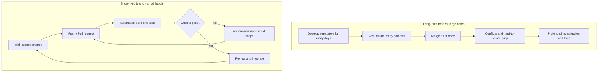
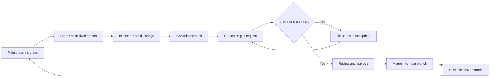

# Integrating Small and Frequent Changes

## 1. Principle and Goal

In CI/CD, integrating small and frequent changes means bringing source code changes with a clear scope into the shared branch on a short cadence, while running automated checks right after each integration or each pull request update. The team does not let weeks of work accumulate into a single large merge.

"Small" here refers to the scope and risk of a unit of change, not the absolute number of lines of code. A small change typically addresses a single purpose that can be explained, reviewed, tested, and—if necessary—reverted independently. "Frequent" refers to the time interval from starting a change to integrating it and receiving feedback from the shared branch. The exact cadence depends on the project, but the goal is to reduce branch lifespan and reduce change batch size.

This principle is the foundation of Continuous Integration (CI). When every change is integrated regularly and verified through builds, tests, and appropriate quality gates, the team can detect conflicts and defects close to when they are introduced. This is one of the key ways to build a repeatable, traceable, and safe-to-release CI/CD flow.

## 2. Why Does Change Batch Size Affect Quality?

Suppose two developers are working on a feature together. If each person keeps a separate branch for a long time, the code on both branches will gradually diverge from the main branch and from each other. When merging, Git may report text conflicts, but harder problems are semantic conflicts: two separate changes may compile successfully yet fail to work properly when combined.

The larger the change batch size, the more interactions must be examined. When a failure occurs after a large merge, the team has to investigate many commits, many files, and many assumptions at the same time. If a small change is integrated and tested right away, the scope for finding the root cause is usually much narrower.

You can visualize the difference as follows:



Frequent integration brings key benefits:

- **Reduced branch divergence:** new changes are continuously synced with the shared branch, reducing the amount of diff that must be merged.
- **Early defect detection:** build, test, or compatibility errors are caught while the change is still fresh and easy to understand.
- **Easier reviews:** reviewers can focus on one objective, understand the reason for the change, and evaluate its impact clearly.
- **Faster incident isolation:** when a pipeline fails, the number of related changes is usually smaller.
- **Increased predictability:** the main branch is verified frequently, giving artifact creation and release steps a more stable input.
- **Reduced hidden work-in-progress:** progress is visible through small integrated changes rather than long-lived branches that are hard to evaluate.

The benefits do not come from merging frequently alone. Each integration must be accompanied by meaningful feedback and accountability for handling failures. If a team merges frequently but ignores failing tests or leaves the main branch in a broken state, the principle is not being practiced properly.

## 3. Choosing a Reasonable Change Size

A change should be small enough for someone else to understand in a single review, yet complete enough to deliver verifiable technical value. You should not split work mechanically to the point where each pull request contains only a few meaningless lines or depends on a chain of unintegrated pull requests.

For example, when adding an order filtering feature, you can divide the work into meaningful slices:

1. Add parameter normalization and validation functions, along with unit tests.
2. Add the filtering query at the repository layer, along with appropriate integration tests.
3. Wire the parameters into the endpoint and add API tests.
4. Update API documentation and required telemetry.

Each slice must keep the system in a buildable state and must not break existing behavior. If part of a feature is not ready for users yet, the team can use a feature flag to control enabling the feature. Feature flags allow code integration before releasing functionality, but they need an owner, a review deadline, and a plan to remove temporary flags.

Several criteria help identify a reasonably scoped change:

- Has one primary purpose that can be described in the pull request title.
- Can be reviewed without needing to understand a large amount of unrelated work.
- Has a way to test or verify appropriate to the changed behavior.
- Can be merged without leaving the main branch in an unusable state.
- If a rollback is needed, the impact and recovery approach can be determined.
- Does not bundle bulk formatting changes, wide renames, or unrelated dependency updates into a functional change if they make review harder.

There is no single line-count limit that applies to every project. A 20-line change can be complex if it modifies a security protocol; a 300-line change can be reasonable if it is a self-contained component with clear tests. Evaluate based on complexity, coupling, and verifiability.

## 4. Keeping Branches Short-Lived and Integrating on a Steady Cadence

A common practice is working on short-lived branches or using trunk-based development. Developers branch off the main branch, implement a small objective, push frequently, open a pull request early, and merge as soon as review and required checks pass.

Typical workflow:



Practices that support a short integration cadence:

1. **Sync with the main branch frequently:** update the working branch to catch interacting changes early. Use merge or rebase according to project conventions; what matters is not letting differences accumulate for too long.
2. **Open pull requests early:** mark them as draft while still in progress to get feedback on the approach and reduce the risk of discovering major issues at the end.
3. **Keep pull requests focused:** separate independent refactors from functional changes when doing so makes review and testing clearer.
4. **Automate required checks:** build, unit tests, lint, and appropriate checks must run against the exact commit intended to be merged.
5. **Address feedback quickly:** the author monitors CI and review results and fixes issues while context is fresh.
6. **Protect the main branch:** require mandatory checks, policy-compliant reviews, and restrict direct pushes if the project requires change control.

Some teams use very short-lived branches and integrate directly into trunk multiple times a day. Other teams use pull requests and short-lived feature branches. Both approaches can support CI as long as changes are integrated frequently, the shared branch is always verified, and the process does not create a long review queue.

## 5. CI Must Provide Fast and Reliable Feedback

Small and frequent integration is only effective when each update receives feedback quickly enough that the author still clearly remembers the change just made. The pipeline should organize checks into appropriate tiers:

| Check Tier | Examples | Appropriate Timing |
|---|---|---|
| Fast checks | Formatting, linting, type checking, critical unit tests | On every push or pull request update |
| Integration checks | Integration tests, database or dependent service checks | Pull request or pre-merge, depending on runtime |
| Extended checks | End-to-end tests, performance tests, deep scans, or compatibility checks | Pre-release, scheduled, or on relevant branches |

It is not necessary to run the entire longest test suite on every commit if the cost is too high. However, the checks required to protect the main branch must be clearly defined, produce reliable results, and have a clear failure-handling mechanism. Extended checks can run in parallel or on a schedule, but the risks they guard against must be reviewed before release.

The pipeline must also avoid "flaky tests"—where the same source code sometimes passes and sometimes fails due to timing, shared data, network dependencies, or unstable environments. Flaky tests erode team trust and can lead to a habit of re-running until green. They should be logged, prioritized for fixing, and if temporarily quarantined, assigned an owner and a resolution deadline; never silently ignore failures.

If a pipeline is too slow, consider safe dependency caching, running jobs in parallel, reducing duplication, optimizing fixtures, and tiering tests. The goal is to shorten feedback time while keeping critical protective checks in place.

## 6. Keeping the Main Branch Always Integrable

The main branch (mainline or trunk) is the convergence point for changes. The team should maintain a rule that this branch always builds and passes required checks. When an integration breaks the main branch, restoring it must be treated as a priority.

Procedure when the main branch is broken:

1. Announce the failure status and identify the commit or integration that caused the problem.
2. Pause subsequent changes that risk making isolation harder.
3. Fix immediately if the cause is clear and the fix is small and safe.
4. If a quick fix is not possible or the impact is uncertain, revert the offending change to restore the main branch.
5. Re-run relevant checks, confirm the main branch is green, and only then resume integrating.
6. Conduct root cause analysis to improve tests, reviews, pipeline configuration, or how changes are sliced.

An example command to revert an integrated commit might be:

```bash
git revert <commit-sha>
git push origin main
```

`git revert` creates a new commit that reverses the changes of the specified commit, which is appropriate for a shared branch. Follow the project's branch protection policies and review process; do not use `git reset --hard` followed by force-push on a shared branch to handle incidents without an approved procedure. For an unmerged pull request, the author can fix the commit on their branch or close the pull request per team conventions.

## 7. Practical Example: Adding a Data Field to an API

A team needs to add a `deliveryNote` field to the order creation API. If a developer modifies the database, domain model, API, UI, migration, and documentation simultaneously in a branch lasting several weeks, other parts of the system may continue changing during that time. By merge time, compatibility errors and conflicts become hard to separate.

The team can split the work in a backward-compatible sequence:

| Step | Small Change | Verification |
|---|---|---|
| 1 | Add the database column for `delivery_note`, nullable or with a safe default value. | Migration runs cleanly on the current schema; migration tests pass. |
| 2 | Add the optional field to the model and mapping. | Unit tests for mapping with and without the value. |
| 3 | API accepts and returns the optional field. | API tests verify legacy requests still work. |
| 4 | Update the client or UI to send the new field. | Integration tests and business flow tests pass. |
| 5 | Enable the feature via feature flag if controlled rollout is needed. | Smoke tests and error monitoring after enabling. |

Each step can be reviewed, integrated, and tested independently. During the transition period, the old version continues to work because the new field is optional. Only after all components are ready and data is verified can the team apply stricter constraints if business requirements demand them.

This example shows that small integration is not just splitting files or commits. It requires designing changes to be compatible across steps so the system keeps working while multiple component versions coexist.

## 8. When Are Feature Flags and Compatibility Techniques Needed?

Some features cannot be completed in a single small change. A feature may span multiple layers or require coordination across multiple teams. In this case, the team can integrate incomplete code while keeping it hidden from users using a feature flag or an equivalent configuration mechanism.

Feature flags should be used with discipline:

- Default to off if the feature is not ready or needs to be limited to a subset of users.
- Do not let incomplete code paths break existing flows when the flag is off.
- Test both enabled and disabled states if the two states behave differently.
- Restrict who has permission to turn flags on in production.
- Record a review date, an owner, and criteria for removing the flag.

For API, database, or message schema changes, consider the expand-and-contract pattern: first expand the schema in a way compatible with the old version, deploy applications that can read/write in the transitional format, migrate data if needed, and only then remove the old structure after verifying no dependent components remain. That way, incremental deployment does not force every component to change at the exact same time.

Feature flags and compatible migrations support frequent integration, but they increase configuration and the number of states to test. Avoid keeping too many long-lived flags or creating hard-to-understand behavioral branches.

## 9. Practices That Cause the Principle to Fail

| Practice | Consequence | How to Improve |
|---|---|---|
| Keeping feature branches for weeks | Divergence from the main branch accumulates; conflicts and integration errors rise. | Slice features into integrable pieces; sync and push frequently. |
| Oversized pull requests | Superficial reviews, unclear purpose, and hard-to-isolate bugs. | Split by goal and dependency; use feature flags when needed. |
| Merging despite failing CI | The main branch loses its reliable state. | Protect branches and require mandatory checks to pass. |
| Ignoring flaky tests | Team loses trust in the pipeline; real bugs may be overlooked. | Investigate root causes, quarantine with a deadline, and track an owner. |
| Review backlogs | Branches live long even when code is ready; wait times grow. | Share review responsibility, limit work in progress, and prioritize small pull requests. |
| Bundling large refactors with business changes | Hard to tell whether a bug comes from structural changes or logic. | Separate independent refactors and verify behavior before/after. |
| Integrating frequently without checks | Bugs enter the shared branch faster without being caught. | Tie every integration to builds, tests, and appropriate quality gates. |
| Unmanaged feature flags | Stale flags accumulate, increasing state combinations and risk of accidental toggles. | Assign owners, expiration dates, and a cleanup plan. |

## 10. Measuring Integration Cadence

Teams can use several signals to see how well this principle is being practiced:

- **Branch lifespan:** time from creating a branch or starting a change to integration. Longer-lived branches typically accumulate more divergence.
- **Pull request size:** number of files, changed lines, or review complexity. This metric must be read in context; low line count does not automatically mean low risk.
- **Review wait time:** time from when a pull request is ready until feedback and a decision arrive. Long queues can erase the benefits of short-lived branches.
- **CI feedback time:** time from a push until required check results return. The slower the feedback, the harder it is to fix errors in the original context.
- **Integration frequency:** number of changes merged into the shared branch over a period of time. This metric must be paired with the quality and value of the changes.
- **Main branch failure or revert rate:** reflects process reliability, but requires analyzing root causes rather than optimizing the raw number alone.

Do not set rigid targets like "every pull request under 100 lines" or "must merge 10 times a day" for every team. Metrics are a tool to spot bottlenecks and spark improvement discussions, not a reason for artificial splitting or lowering review quality.

## 11. Team Adoption Checklist

Before integrating a change, the team can self-check:

- [ ] The change has one primary objective and an easily explainable scope.
- [ ] The working branch is updated with the main branch on an appropriate cadence.
- [ ] The pull request describes the reason, impact, and how it was tested.
- [ ] The build and required checks ran on the latest commit.
- [ ] Test results are accessible and not arbitrarily skipped.
- [ ] Reviewers understand the change and its key risks.
- [ ] The change does not break the main branch's ability to build or run tests.
- [ ] If the feature is not ready for users, control mechanisms such as feature flags have been verified.
- [ ] The commit is traceable and a mitigation plan exists if the change causes an incident.

After integration, the team continues monitoring the main branch pipeline status and acts promptly if any failure occurs. Integration does not end at the merge action; it ends when the change has been verified in the context of the shared branch.

## 12. Core Practical Principles

1. Break work into changes with a clear goal, small enough to review and test independently.
2. Keep branches short-lived, push, and sync with the main branch frequently.
3. Open pull requests early, and address review and CI feedback while context is fresh.
4. Keep the main branch in a buildable state that passes required checks.
5. Use feature flags and compatible designs to integrate parts of large features incrementally.
6. Restore the main branch quickly when it breaks, then address the root cause.
7. Measure wait times, change sizes, and pipeline reliability to identify bottlenecks.

Integrating small and frequent changes creates a tight feedback loop between the developer, the CI system, and the shared branch. When this feedback loop is reliable, the team reduces integration risk, catches defects early, and establishes a stable foundation for subsequent packaging, deployment, and release steps in CI/CD.
