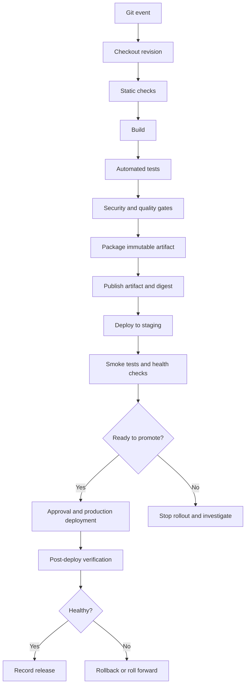

# Automating Repeatable Workflows

A CI/CD workflow is only reliable when the team can re-run it and understand why the current result is the same as or different from the previous run. If releasing depends on one person's memory, a few manual commands, or configuration that exists only on a personal laptop, the team will struggle to control quality and investigate incidents.

Automating repeatable workflows is the principle of designing every step—from when source code changes to when a version is deployed—in a clear, verifiable, traceable, and re-executable way. The goal is not to automate every single action at any cost. The goal is to turn frequent, rule-based, verifiable steps into a consistent workflow while keeping human intervention at decisions that truly require judgment or approval.

In CI/CD, this principle reduces manual errors, shortens feedback loops, increases release reliability, and produces evidence so the team knows exactly which code was tested, packaged, and deployed.

## 1. Understanding Repeatability Correctly

A workflow is repeatable when the same workflow definition, the same inputs, and the same execution conditions yield equivalent results. Inputs must be clearly identified, such as:

- Source code version or commit hash.
- Runtime, compiler, build tool, and dependency versions.
- Build configuration, test parameters, and environment variables.
- Input artifacts, test data, and dependent services.
- Access permissions, credentials, and target environment.

Three related concepts should be distinguished:

| Concept | Meaning | Example |
|---|---|---|
| Automation | Machines execute a step according to defined rules | Pipeline automatically runs unit tests when a pull request is opened |
| Repeatability | Can re-run the same workflow with equivalent inputs and conditions to get equivalent outcomes | Same commit and toolchain produce the same test suite results and same artifact type |
| Reproducibility | Can strictly recreate results from recorded inputs; in strict builds, artifacts can be byte-for-byte identical | Two independent builds produce artifacts with the exact same digest |

A repeatable workflow does not automatically guarantee every output is byte-for-byte identical. For example, an artifact may contain timestamps, signatures, or metadata that vary by run. Even so, the workflow can still be reliable if those differences are understood and controlled. When verifying provenance or investigating software supply chains, reproducibility and digest verification become especially important.

Repeatability also does not mean running a pipeline repeatedly until it passes. If a run fails due to unstable dependencies, time-dependent tests, or drifted environment configuration, re-running may merely mask the root cause. A sound workflow must make inputs, execution conditions, outcomes, and failure causes explicit.

## 2. Putting the Workflow into Source Code

The CI/CD workflow should be described in versioned configuration files and stored alongside the repository or in a pipeline governance repository. This practice is commonly known as pipeline as code.

When the workflow lives in source code:

- Pipeline changes can be reviewed just like application changes.
- The team can inspect the history of who modified which step and why.
- Each branch or version can be paired with its corresponding pipeline definition.
- Pipeline syntax, policies, and configuration can be validated automatically.
- New team members can understand how to build, test, and release without relying on word-of-mouth instructions.

Critical operations should not merely be written in a wiki guide and left for operators to remember. Documentation is still necessary to explain intent and exception-handling procedures, but steps that machines can execute consistently should be expressed in pipelines or scripts managed under version control.

For instance, rather than requiring every developer to remember to run the formatter, linter, unit tests, and build sequentially, the repository can provide a standard verification command. Both the pipeline and developer machines invoke that same command. This prevents verification standards from fragmenting into multiple variants.

Pipelines also require review. A small change—such as widening token permissions, removing a quality gate, or changing a dependency download source—can affect the entire release chain. Reviews should inspect logic, permissions, input sources, and how failures in a step are handled.

## 3. Declaring Inputs and Pinning Execution Environments

A pipeline is hard to repeat if its components shift silently. For example, using the latest tool version, fetching unpinned dependencies, or building on an image whose tag changes over time can cause the same commit to yield different results.

To control inputs:

1. Lock dependencies using lockfiles or equivalent mechanisms; review dependency changes like code changes.
2. Specify explicit versions for runtimes, compilers, package managers, and build tools.
3. Use container images or build environments with fixed versions; for strict control requirements, reference images by digest.
4. Record build parameters, configuration, and variables that affect output.
5. Limit reliance on unstable external resources; if unavoidable, control versions, checksums, or upstream sources.
6. Separate test data from production data and make test data re-initializable.

Not every value should be hardcoded as a constant in the pipeline. Values that vary by environment—such as service URLs, cluster names, or resource limits—should be managed via environment configuration. What matters is knowing which values affect the build, which affect only deployment, and which sources are authorized to modify them.

A trustworthy build needs to record enough information to explain its outcome—for instance, commit SHA, toolchain versions, lockfile, build parameters, and build image digest. Without this information, the team may know a pipeline ran, but cannot be sure under what conditions it ran.

## 4. Designing Pipelines into Steps with Clear Contracts

Every automated step should have clear inputs, outputs, execution conditions, and failure reporting. Steps should be small enough to understand and diagnose, yet not fragmented to the point where the pipeline becomes unmanageable.

A basic CI/CD flow typically consists of the following stages:

1. **Event reception:** accept pull requests, commits to the main branch, release tags, or authorized deployment requests.
2. **Source retrieval:** check out the exact revision and record the commit SHA.
3. **Fast checks:** validate formatting, syntax, lint, types, and static rules.
4. **Build:** install dependencies from the lockfile and produce build outputs from source.
5. **Testing:** run unit tests, integration tests, and risk-appropriate checks.
6. **Packaging:** produce an artifact with a unique identifier and compute its digest.
7. **Quality and security evaluation:** check vulnerabilities, licenses, configuration, exposed secrets, and release policies.
8. **Storage and publishing:** push the artifact to a controlled registry or artifact repository.
9. **Deployment:** retrieve the exact approved artifact and deploy it to the target environment.
10. **Verification:** check service health, smoke tests, operational metrics, and rollout status.
11. **Completion or rollback:** record results, emit appropriate operational notifications, and trigger rollback if failure conditions are met.

The diagram below shows a typical flow. Some steps can run in parallel, but deployment steps must depend on the artifact and corresponding quality gates.



Steps do not have to run strictly sequentially. Linting, dependency checks, and certain test groups can run in parallel after checkout. Parallelism shortens feedback time, while keeping a consolidated condition: the pipeline advances to the next stage only when all mandatory checks pass.

Distinguish between change-verification pipelines and release pipelines. Pull requests usually need fast feedback and should not have production deployment permissions. Once a commit is merged into a release branch, the pipeline can produce an official artifact. Deployment permissions and conditions should be scoped by event, branch, environment, and policy.

## 5. Using Quality Gates to Control Stage Transitions

A quality gate is a mandatory condition that must be met before a pipeline advances to a higher-risk step. Gates can verify:

- Mandatory unit and integration tests passed.
- Coverage or quality thresholds meet project policy.
- No severity-level vulnerabilities blocked from release exist.
- Dependencies and licenses comply with policy.
- The artifact was built from an identified, verifiable revision.
- Authorized personnel or systems approved deployment when required.

Gates must reflect real risk. If every minor warning blocks a release, teams may look for ways to bypass gates. If gates are purely ceremonial, they fail to protect quality. Each condition should have an owner, clear thresholds, a rationale, and an exception-handling process.

Do not make an unstable check a mandatory gate without fixing the source of noise. Flaky tests that pass and fail inconsistently for the same commit erode confidence in the pipeline. Log unstable tests, determine root causes, and set remediation deadlines; any temporary bypass must have a defined scope and approval trail.

Humans still have a role in CI/CD. Production approvals, reviewing high-impact changes, and incident response decisions are valid control points. However, once approved, the deployment and verification steps themselves should execute through a defined process to minimize variance across releases.

## 6. Build Once, Deploy the Same Artifact Across Environments

A key principle is building an artifact once for a release revision, then promoting that exact artifact across environments such as development, staging, and production.

If each environment rebuilds from source code, environments may receive different artifacts due to changing dependencies, tools, or build timing. When staging tested one build while production receives a fresh build, test evidence is no longer firmly tied to what gets released.

The flow should be organized as follows:

- The build produces an immutable artifact.
- The artifact is stored in a controlled registry or repository.
- Each deployment references the artifact by version and/or digest.
- Environment configuration is injected at deployment time.
- Promotion changes only approval status or target environment, never the artifact content.

Environment configuration and artifacts have different lifecycles. For example, the same application image can run in staging and production while receiving different service URLs, resource limits, and connection details. These configurations must be validated and managed separately; secrets must be retrieved from a secret manager or secure provisioning mechanism.

Database changes must be factored into deployment strategy. Incompatible migrations can make application rollback unsafe. A common approach is expanding the schema first, deploying an application version compatible with both old and new schemas, migrating data, and removing the old structure in a later release. This keeps application rollback viable throughout the transition window.

## 7. Making Operations Safe When Re-run

Pipelines can be re-run due to runner disconnects, timeouts, operator-triggered retries, or orchestration systems missing a final acknowledgment. Operations must therefore be designed to handle retries safely.

An idempotent operation is one where executing it multiple times with the same input state does not alter the final outcome beyond the first execution. For instance, declaring the desired state of a deployment and letting the orchestrator converge to that state is generally safer than creating a brand-new deployment on every retry.

Not every step can be fully idempotent. Sending emails, creating invoices, or running migrations with side effects need dedicated safeguards, such as:

- Using idempotency keys or unique transaction IDs.
- Checking current state before creating resources.
- Recording operation outcomes so retries can resume from the right point.
- Using transactions or compensating actions when an operation spans multiple steps.
- Distinguishing timeouts from true failures; a timeout does not prove the operation did not occur on the target system.

Retries should have limits, exponential backoff, and stop conditions. Retry only transient, recoverable errors such as brief network glitches or overloaded downstream services. Logic errors, misconfigurations, failing tests, or missing permissions must be fixed at the root rather than retried endlessly.

Pay close attention to cleanup steps. A command that deletes shared resources or matches overly broad patterns can break an environment on retry. Scope resources by pipeline ID, revision, or environment, and require separate permissions for destructive actions.

## 8. Protecting Secrets and Limiting Pipeline Permissions

Pipelines are part of the software supply chain and often hold permissions to read source code, fetch dependencies, publish artifacts, or deploy services. If an overly broad token leaks, an attacker can leverage the pipeline to reach other systems.

Core rules include:

- Never store passwords, tokens, private keys, or credentials in repositories, logs, or artifacts.
- Fetch secrets from a secret manager or secret store provided by the CI/CD platform.
- Grant least privilege per job; test jobs do not need production deployment permissions.
- Prefer short-lived credentials and workload identity/OIDC mechanisms where supported by the platform.
- Restrict registry write, release creation, and deployment permissions by branch, environment, or workflow.
- Do not print secrets to logs; inspect tool outputs that might inadvertently echo tokens.
- Be cautious with pull requests from forks or untrusted code; do not expose release secrets to jobs running that code.

Separating jobs also limits blast radius. For example, a test job can run without access to production secrets. Only the deployment job—after gates and approval conditions pass—receives the necessary credentials for the shortest possible duration.

## 9. Traceability from Commit to Deployment

When a post-release failure occurs, the team must quickly answer: which version is running, which commit built it, which dependencies were used, who or what system approved it, what is the artifact digest, which pipeline produced it, and which checks passed?

To answer these questions, every build and deployment should record a linked set of metadata:

| Information | Purpose |
|---|---|
| Repository and commit SHA | Identifies the exact source code |
| Pipeline run ID and timestamp | Identifies the execution that produced the result |
| Toolchain and dependency versions | Explains build conditions |
| Artifact version and digest | Verifies the exact package stored and deployed |
| Test and quality gate results | Provides quality evidence at release time |
| Environment, configuration revision | Identifies deployment conditions |
| Approving person or system identity | Traces decisions and execution authority |
| Deployment and post-deploy verification results | Confirms actual service state |

This metadata can live in pipeline logs, release manifests, provenance records, or release management systems. Do not rely solely on mutable tags like `latest`. Digests verify artifact contents, while manifests link artifacts to source code, pipelines, and verification results.

Logs need enough detail for investigation without containing sensitive secrets. Retain logs and metadata for periods aligned with operational, audit, and recovery requirements.

## 10. Post-Deployment Verification and Rollback Readiness

A green deploy step in the pipeline only proves the deployment command finished as reported by the tool. It does not prove users can use the service normally.

After deployment, verify at minimum:

- Workloads are ready and replica counts match expectations.
- Health endpoints or readiness checks pass.
- Key business flows pass smoke tests.
- Error rates, latency, and resource utilization stay within normal bounds.
- Logs show no critical startup, connectivity, or configuration errors.

For high-traffic systems, use canary or blue-green deployments to bound blast radius. Canary routes a small slice of traffic to the new version first, observes metrics, and then expands. Blue-green maintains two equivalent environments and switches traffic once the new environment is ready. The choice depends on architecture, cost, and data state transitions.

Rollback must be a pre-planned part of the release workflow. The team must know where the previous artifact lives, how to shift traffic back to the older version, which migrations are reversible, and what conditions trigger a rollback. For irreversible data changes, rolling forward with a follow-up fix may be safer than rolling back the application.

Verification and rollback procedures also need logs, permissions, and audit trails like any other release step. After an incident, use pipeline data to pinpoint the failure and update the workflow to prevent recurrence.

## 11. Example of a Pipeline Contract

The YAML snippet below is a conceptual model, not tied to any specific CI/CD provider syntax. It illustrates the inputs, processing steps, and stage-transition conditions a real pipeline should declare.

```yaml
pipeline:
  name: application-ci-cd

  triggers:
    - pull_request
    - push_to_main
    - release_tag

  inputs:
    source_revision: required
    toolchain_version: pinned
    dependency_lockfile: required
    build_configuration: versioned

  jobs:
    validate:
      permissions:
        source_read: true
        production_deploy: false
      steps:
        - checkout: source_revision
        - install_dependencies: dependency_lockfile
        - run_static_checks: required
        - run_unit_tests: required

    build_and_verify:
      needs: [validate]
      steps:
        - build: source_revision
        - run_integration_tests: required
        - scan_dependencies: required
        - create_immutable_artifact: true
        - calculate_artifact_digest: true

    publish:
      needs: [build_and_verify]
      condition: trusted_release_event
      steps:
        - publish_artifact: immutable
        - record_provenance: true

    deploy_staging:
      needs: [publish]
      environment: staging
      steps:
        - fetch_artifact_by_digest: recorded_digest
        - deploy: staging
        - run_smoke_tests: required
        - evaluate_health_metrics: required

    deploy_production:
      needs: [deploy_staging]
      environment: production
      approval: required
      steps:
        - verify_approval: true
        - fetch_artifact_by_digest: recorded_digest
        - deploy: production
        - verify_release_health: required
        - record_deployment: true
```

When translating this model into real configuration, replace conceptual steps with concrete actions or commands of the platform in use. Validate syntax, per-job permissions, trigger conditions, how artifacts pass between jobs, and how digests are preserved across environments. Do not copy sample configurations directly into production without checking them against your platform and project architecture.

## 12. Applying the Principle to a Project

You can adopt this incrementally so the team sees early value and avoids creating a monolithic, hard-to-operate pipeline:

1. **Document the current process:** list actions from commit to deployment, who performs them, inputs, outputs, and common failures.
2. **Pick a standard flow:** start with code checks, unit tests, and builds on pull requests.
3. **Put commands into the repository:** group reusable steps into standard scripts or targets; pipelines and developer machines invoke the same commands.
4. **Lock inputs:** add lockfiles, pin toolchains, and define build environments.
5. **Produce immutable artifacts:** version them, compute digests, and store them in controlled repositories.
6. **Add quality gates:** select checks meaningful to the application's risk profile.
7. **Automate staging deployment:** deploy the exact built artifact and run smoke tests.
8. **Establish production promotion:** restrict permissions, add required approvals, and reuse the verified artifact.
9. **Attach traceability and observability:** link commits, pipeline runs, artifacts, environments, and verification results.
10. **Rehearse retries and rollbacks:** test scenarios like runner disconnects, partial deployments, health check failures, and rolling back to a prior version.

Measure effectiveness with metrics tied to operational goals—such as time from commit to CI feedback, infrastructure-induced pipeline failure rate, release duration, change failure rate, and recovery time. Metrics help spot slow or unstable steps; they should never become targets that tempt teams to cut tests or bypass controls.

## 13. Signs That a Workflow Is Not Truly Repeatable

| Sign | Risk | Remediation |
|---|---|---|
| Only one person knows how to release | Process depends on an individual | Move steps into the pipeline and document exception handling |
| Builds only succeed on personal machines | Build environment is uncontrolled | Standardize toolchains, dependencies, and build environments |
| Each environment rebuilds from source | Artifacts may differ across environments | Build once, promote the same digest |
| Using overwritable artifact tags | Cannot verify what content was deployed | Use immutable versions and digests |
| Retries create duplicate resources or side effects | Re-running can cause double failures | Design for idempotency, state checks, and transaction keys |
| Tests pass and fail intermittently | Gates become untrustworthy | Isolate tests, control test data, and fix flaky tests |
| Deployment tokens present in every job | Larger blast radius if compromised | Scope permissions per job, use short-lived credentials |
| Pipeline reports success while service fails | Missing post-deployment verification | Add health checks, smoke tests, and rollback thresholds |
| Cannot trace running build back to commit | Slow investigation and recovery | Store manifests, digests, and deployment records |

## 14. Evaluation Checklist

Before considering a CI/CD flow reliable, the team can review these checks:

- [ ] Workflow is stored in version control and peer-reviewed.
- [ ] Triggers and input revisions are explicitly defined.
- [ ] Toolchains and dependencies are appropriately version-locked.
- [ ] Steps have clear inputs, outputs, and failure conditions.
- [ ] Automated checks provide early feedback and quality gates have owners.
- [ ] Artifacts have immutable identifiers and digests for verification.
- [ ] The exact same artifact is promoted across environments.
- [ ] Environment configuration is managed separately and secrets never live in code or logs.
- [ ] Pipeline permissions follow the principle of least privilege.
- [ ] Retries do not cause unintended side effects.
- [ ] End-to-end traceability exists from commit to pipeline run, artifact, and deployment.
- [ ] Post-deployment checks and rollback or roll-forward plans are in place.
- [ ] The team can re-run the workflow without relying on any single person's memory.

## Conclusion

Automating repeatable workflows is the foundation for CI/CD to deliver trustworthy results. Workflows must be expressed as code, inputs and environments must be controlled, artifacts must be immutable, quality gates must be meaningful, access must be restricted, and every deployment must leave an audit trail with verification steps.

When these principles are applied consistently, the team can clearly answer which code was tested, which artifact was deployed, under what conditions it was deployed, and what to do when a release hits an issue. That is the basis for releasing frequently while maintaining control and recoverability.
