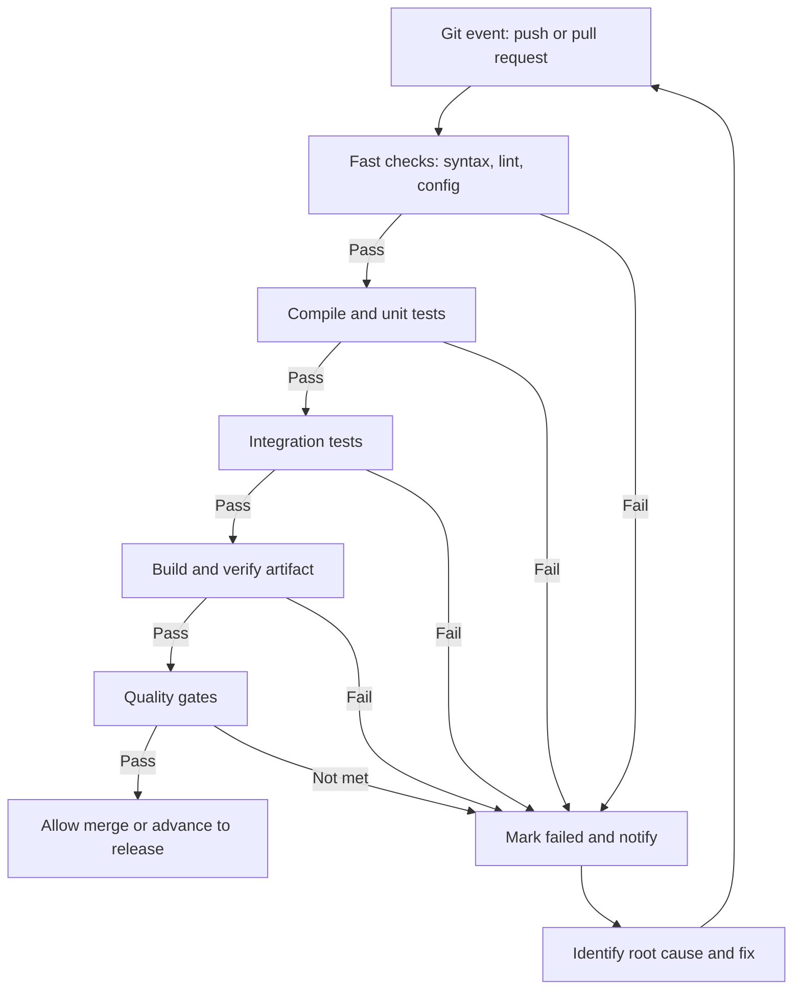

# Detecting Failures Early and Prioritizing Fixing Broken Integration Flows

In CI/CD, a change is only truly ready to move forward once the system has verified the required quality conditions. Therefore, the pipeline must detect failures immediately after a change is pushed to Git, provide enough evidence to find the root cause, and help the team restore the integration flow quickly.

The core principle is **reducing the time from when a defect appears to when it is detected, and then reducing the time from detection to recovery**. When the main branch or a mandatory check breaks, the team must prioritize fixing the cause of the integration disruption before continuing to push more changes into that flow. A pipeline that always shows green by skipping tests or hiding failures is not a trustworthy pipeline.

This principle is especially important in CI/CD because the release flow consists of many interdependent parts: Git events, pipeline code, build environments, dependencies, tests, artifacts, deployment configuration, and quality gates. A small failure early in the flow can skew results in later steps or leave multiple teams waiting.

## 1. Why Detect Failures as Early as Possible?

A defect caught immediately during a pull request CI run is still tied to one small change, one author, and one specific set of logs. If the defect slips through multiple merges, multiple builds, or all the way to staging, the search space widens: the team may have to inspect many commits, changed dependencies, environment configurations, and generated artifacts.

Early detection delivers four practical benefits:

- **Lower fix cost:** the author still remembers the intent and scope of the change; the team rarely needs to trace back through many commits.
- **Prevent error propagation:** failing checks can block merges or releases before defective code becomes the foundation for subsequent changes.
- **Keep feedback reliable:** CI results reflect the state of the exact revision under review, rather than a stale state or an unrelated run.
- **Reduce team-wide wait times:** a clearly reported failure, assigned to the right owner and resolved early, avoids holding up downstream pull requests or release trains.

Feedback time also affects feedback quality. If a pull request waits hours for results, the author may have moved on to another task. When a failure arrives, they must reload context and reproduce the issue. A fast, stable pipeline enables fixing bugs while context is still fresh.

Not every check needs to run at the same moment. Cheap checks with high defect-detection power should run early; time-consuming checks or those requiring specialized environments can run at a later stage. The goal is detecting early enough while keeping feedback meaningful.

## 2. Where in the CI/CD Flow Should Failures Be Detected?

A CI flow typically starts from a Git event such as a push, opening or updating a pull request, creating a tag, or merging into the main branch. From that event, the pipeline executes verification steps in an order declared as code.

Common check layers include:

| Checkpoint | Defects Detectable | Appropriate Timing |
|---|---|---|
| Structure and syntax checks | Invalid YAML, missing config, invalid formatting, lint errors | Immediately upon receiving the change |
| Static analysis and dependency checks | Code rule violations, vulnerable dependencies, or non-compliant licenses | Early in the pull request |
| Compilation and unit tests | Type errors, incompatible APIs, logic bugs in small units | Every pull request or commit to integrate |
| Integration tests | Components failing to interoperate, broken API contracts, database or message broker access errors | After fast checks pass |
| Build and artifact checks | Packaging failures, missing files, wrong metadata, or unusable artifacts | Before storing the artifact |
| Near-production environment tests | Configuration errors, migrations, service connectivity, and runtime behavior | Before release or broad rollout |
| Post-deployment smoke tests | Application fails to start, key endpoints fail, wrong runtime config | Immediately after deployment |

A pipeline can be visualized as follows:



This diagram shows one common layout, not a mandatory sequence for every project. Independent checks can run in parallel to shorten duration, but a quality gate only passes once all of its mandatory conditions have valid results.

### Fast Feedback vs. Deep Feedback

Checks should be divided into two groups to balance speed and coverage:

- **Fast feedback:** syntax checks, linting, compilation, unit tests, and configuration rules. This group should run frequently, finish quickly, and point clearly to failures.
- **Deep feedback:** integration tests, performance tests, deep security scans, or verification in an integrated environment. This group may take longer, but must complete before the corresponding release gate.

Never use grouping to skip a mandatory check. If a security scan or integration test is a release condition, the pipeline must make that condition explicit and keep the status unfulfilled until results arrive.

## 3. What Constitutes a Broken Integration Flow?

A single failed CI run does not necessarily mean the main branch is broken. For example, an individual's pull request can fail while the main branch remains green. However, if a merged change causes the main branch's mandatory pipeline to fail to complete, the team has a broken integration flow.

Common signs include:

- The build on the main branch fails to compile or fails to produce an artifact.
- Mandatory unit tests or integration tests fail after a merge.
- The pipeline fails to start due to misconfiguration, missing permissions, or unavailable runners.
- Dependencies or test services are unavailable, making results untrustworthy.
- Quality gates fail to receive required reports or reports are attached to the wrong revision.
- An artifact is created but cannot be verified, downloaded, or consumed by the next step.

Teams must distinguish **product failures**, **pipeline failures**, and **environment failures**. Product failures stem from application code or contracts between components. Pipeline failures stem from configuration, scripts, permissions, or job orchestration logic. Environment failures can stem from runners, networks, registries, test databases, or external services. All three can halt the integration flow, but their remediations differ.

A failure caused by transient infrastructure still needs to be logged and addressed. Never automatically assume every non-code failure can be ignored. Without proper triage, the team may mistakenly edit application code while a runner is broken, or keep retrying a test that is actually catching a real regression.

## 4. Which Failures Should Be Fixed First?

When multiple failures occur simultaneously, handling order should be based on impact to integration and releasability. The first question is: **which failure is blocking the most people or preventing the main branch from producing a trustworthy result?**

| Priority | Situation | Appropriate Action |
|---|---|---|
| Critical | Mandatory main branch pipeline is broken; cannot build or test new revisions | Halt further merges to the affected flow, identify the offending commit or change, and restore the pipeline |
| Very High | Failure blocks multiple pull requests, release gates, or flags a severe security risk | Assign a clear owner, resolve within the current cycle, and assess blast radius |
| High | A critical test or integration service is unstable, making CI results untrustworthy | Restore stability, find the root cause, and ensure the test can still catch regressions |
| Medium | Failure affects only one branch or a non-blocking check | Assign an owner, set a deadline, and track before it becomes a blocker |
| Low | Quality warning that does not violate agreed thresholds and does not affect current integrability | Place in the backlog with an owner and review date |

The ordering above is a decision guide, not a substitute for risk assessment. A security alert may demand urgent priority even while the pipeline is green. Conversely, a failure occurring only on a personal experimental branch may wait if it causes no impact to the team.

When assessing priority, consider simultaneously:

1. **Blast radius:** one person, one team, the entire main branch, or all release environments?
2. **Blocking severity:** does it prevent merging, building, testing, packaging artifacts, or deploying?
3. **Risk of continuing:** could the defect enter production, corrupt data, leak secrets, or make rollback harder?
4. **Recoverability:** can it be fixed directly, by reverting the offending commit, restoring the runner, or rolling back to a known-good config?
5. **Evidence reliability:** does the failure reproduce consistently on the exact revision, or is it a single unexplained timeout?

### Main Branch Protection Rules

The main branch should always stay in an integrable state: code compiles, required checks can run, and results are bound to specific commits. If the main pipeline turns red, the team should pause non-urgent merges into that flow until recovery. This limits the number of new commits that could complicate root-cause analysis.

If urgent work must proceed, the team must record the exception, blast radius, approver, and expiration time. Never make bypassing checks the default path. Quality gates only matter when every exception is transparent and traceable.

## 5. Procedure for Handling a Broken Pipeline

A short, consistent procedure keeps the team from having multiple people try different fixes without sharing evidence.

### Step 1: Identify the Exact Run and Revision

Record the repository, branch, commit SHA, pull request, workflow, job, and the first failing step. Check the start time, runner, environment, and recently integrated changes. Do not look only at the aggregated red badge; open the logs of the first step with an actual error.

If multiple jobs depend on one another, downstream jobs may be marked skipped or cancelled. That is often just a cascade from a root failure in an earlier job. Prioritize finding the first error with concrete evidence rather than patching downstream states affected by the chain.

### Step 2: Classify the Root Cause

Match the error message against the type of work:

- Compile or assertion errors usually point to source code, dependencies, or test expectations.
- Authentication errors, permission denied, or artifact download failures usually point to permissions, tokens, registries, or connection configuration.
- Timeouts, dropped connections, or unavailable runners usually point to the environment; verify whether it reproduces independently.
- A test passing and failing on the same revision usually indicates flaky tests, shared state, or time dependencies.

Classification is an initial hypothesis. Verify it using logs, comparing with the last successful run, and attempting a controlled reproduction.

### Step 3: Choose the Lowest-Risk Recovery Path

If a recent commit introduced a regression and no dependent changes have landed yet, reverting may restore the main branch faster than a complex fix. If the bug is in the workflow, fix the pipeline code and verify on an appropriate branch. If a runner or external service had an outage, restore the service and re-run the exact revision.

Never pick a fix solely to make the status indicator turn green. For example, deleting a failing test may hide a regression. Disabling a quality gate may let a broken artifact advance. A proper recovery solution returns the system to a state backed by reliable evidence.

### Step 4: Assign Ownership and Communicate Status

Every failure needs one person or group accountable for coordination. Notifications should include links to the run, commit, failing step, impact level, owner, and next update. Avoid sending generic messages like "CI is red" without actionable data.

If the cause lies in a shared service, bring the service owner in early. If the cause is in a pull request, ensure the author receives the logs and reproduction steps. The coordinator continues tracking overall status until the main branch is restored.

### Step 5: Verify on the Exact Revision and Close the Incident

After fixing, re-run relevant checks and all mandatory gates. Verify that results attach to the new commit, the artifact is built properly, and the next step can consume that artifact. If a revert was performed, also confirm the post-revert revision's pipeline passes.

Once the integration flow is operational again, document the root cause, how it was detected, how it was recovered, and preventive actions. If the incident was resolved only with a workaround, clearly document its limitations and remaining follow-up work.

## 6. Designing Pipelines for Fast and Reliable Feedback

### Run Fast Checks First

Place steps with short runtimes and high defect-catching ability at the beginning of the flow. For example, validate workflow structure and lint before running a large integration test suite. Independent checks can run in parallel, while keeping dependencies clear so readers know why a job is allowed to start.

Parallelism is not always faster. If multiple jobs contend for a single test database or constrained runners, total runtime can increase and results can become unstable. Measure runner queue wait times, execution times, and actual resource utilization to tune accordingly.

### Keep Tests Stable

A test is only valuable when its results are trustworthy. Isolate data, clean up state after each run, avoid test-order dependencies, control clocks, and use test doubles when appropriate. For integration tests, provision isolated environments or namespaces so concurrent runs do not overwrite each other's data.

If a flaky test cannot be fixed immediately, mark it clearly and create a remediation task with an owner and deadline. Only quarantine a test from blocking gates once the team has assessed the risk, put alternative controls in place, and scheduled when the test returns. Bounded retries can help distinguish transient infrastructure errors, but must never be used to turn an unstable test into a false green state.

### Keep Pipelines as Code

Workflows should be peer-reviewed and versioned alongside source code. Pipeline changes should have syntax validation, least privilege, and change history. Use controlled action or image versions; for high-assurance environments, pin actions by commit SHA and update them via a review process.

The example below illustrates a minimal GitHub Actions workflow for a Gradle project. The workflow runs checks on pull requests or pushes to `main`, then creates and stores an artifact once all checks succeed:

```yaml
name: CI

on:
  pull_request:
  push:
    branches: [main]

permissions:
  contents: read

jobs:
  verify:
    runs-on: ubuntu-latest
    timeout-minutes: 20
    steps:
      - name: Checkout source
        uses: actions/checkout@v4

      - name: Set up Java
        uses: actions/setup-java@v4
        with:
          distribution: temurin
          java-version: '21'

      - name: Set up Gradle
        uses: gradle/actions/setup-gradle@v4

      - name: Verify and package
        run: ./gradlew --no-daemon clean check assemble

      - name: Store build artifact
        if: success()
        uses: actions/upload-artifact@v4
        with:
          name: application-${{ github.sha }}
          path: build/libs/*.jar
          if-no-files-found: error
          retention-days: 14
```

In this example, `check` executes the verification tasks configured in the Gradle project; `assemble` produces the packaged outputs. Both tasks run within a single Gradle invocation so intermediate outputs can be shared in the same task graph. The upload step runs only after the verify-and-package command succeeds. The artifact name includes the commit SHA to easily trace back to the revision that produced it.

This is a foundational example, not a complete configuration for every application. Projects must add appropriate checks, permissions, Java versions, artifact paths, and retention policies. If the artifact moves through staging and then production, preserve the verified artifact and promote that exact artifact across environments; do not rebuild a separate package for each environment.

### Use Quality Gates and Branch Protection

Configure mandatory status checks in branch protection policies. Pull requests may merge only when agreed checks complete on the appropriate revision. Use stable check names and ensure workflows actually trigger on relevant change types; a check that fails to trigger can leave a PR stuck waiting indefinitely or make branch protection rules confusing.

Conditions should be clearly distinguished:

- **Mandatory conditions:** must pass before merging or releasing.
- **Warnings:** provide information for the team to monitor without blocking the flow.
- **Controlled exceptions:** applied only with an accountable person, rationale, scope, and expiration.

Do not turn every warning into a blocking gate. Too many irrelevant warnings distract people and make it easy to overlook critical signals. Conversely, mandatory conditions must be enforced consistently at the right control points.

### Protect Secrets and Maintain Traceability

Logs must be detailed enough for diagnosis without printing tokens, passwords, private keys, or sensitive data. Grant least privilege per job, use an appropriate secret store, and scope secrets by environment or workflow. If a secret is suspected to have appeared in logs, treat it as a secret exposure incident: revoke or rotate credentials and audit access scope.

Every run should be linkable to a commit SHA, triggering actor or event, workflow version, environment, and produced artifact. This traceability lets the team pinpoint exactly which run created the package being tested or deployed.

## 7. Avoiding Workarounds That Suppress Failure Signals

Some habits appear to turn pipelines green quickly while degrading integration quality:

- **Merging while required checks are red:** lets defects enter the main branch and makes later commits harder to debug.
- **Disabling tests or quality gates to clear a queue:** removes vital evidence and can let regressions advance.
- **Infinite retries:** lengthens feedback times, wastes runners, and masks unstable tests.
- **Checking only the aggregated status:** misses the root error in the first failing step and leads to fixing downstream cascade jobs by mistake.
- **Using artifacts untied to a revision:** leaves the team unsure which package was tested and which is being released.
- **No clear owner:** failures persist across many runs because everyone assumes someone else is handling it.
- **Noisy alerts lacking context:** creates alert fatigue without helping recipients decide the next action.

If a workaround must be used to restore service, explicitly document the workaround, approver, expiration date, and verification steps required to close it. Once the root cause is fixed, restore any tests or quality gates that were temporarily modified.

## 8. Measuring Failure Detection and Recovery Effectiveness

Do not measure only pipeline success rate. A high green rate can result from solid testing, or from the team disabling tests that fail often. Combine multiple metrics:

| Metric | Meaning | How to Use |
|---|---|---|
| Time from commit to CI result | Feedback speed for change authors | Separate runner queue wait time from execution time to locate bottlenecks |
| Pipeline failure rate by cause | Stability of code, workflows, and environments | Categorize failures instead of looking only at an aggregate rate |
| Flaky test rate | Reliability of the test suite | Track recurring tests and prioritize fixing noisy ones |
| Main branch recovery time | Time from mainline breakage until integration returns to normal | Assess responsiveness and incident-handling workflow quality |
| Merges with unmet required gates | Compliance with integration policy | Spot uncontrolled exceptions |
| Defect escape rate per gate | Detection capability of check layers | Add checks where defects can be caught earlier |

Read metrics as trends and by project type. A pipeline with additional integration tests may take longer to run while reducing defects escaping to later environments. The goal is not minimizing every CI minute; the goal is providing feedback fast and accurate enough to reduce total wait time and risk.

## 9. Example: A Commit Breaks the Main Branch

Suppose a team merges a pull request that changes how order data is processed. After merging, the unit test job on `main` fails; packaging and artifact verification jobs are skipped because they depend on the test job.

The team responds in sequence:

1. Open the CI run tied to the merge commit and locate the first failing assertion.
2. Compare the newly merged change with the last successful run; reproduce the test on that exact revision.
3. Confirm the failure stems from changed order state-transition logic, not from the runner.
4. Pause non-urgent merges into `main`; assign the author and module owner to resolve it together.
5. If the fix is small and quickly verifiable, create a bug-fix commit. If a safe fix is not immediate, revert the offending commit to restore mainline.
6. Re-run all mandatory gates on the new revision, confirming the build and artifact succeed.
7. Document the root cause and add test cases to prevent similar regressions from recurring.

The key point is that the team fixes the failure where it occurred, uses the exact revision as evidence, and verifies the full flow after fixing. Merely seeing a green run after a retry without understanding why the prior run failed is not enough to conclude the incident is resolved.

## 10. Operational Checklist

When designing or reviewing a CI/CD flow, check the following questions:

- [ ] Every significant push or pull request triggers the right workflow.
- [ ] Fast checks run early with logs clear enough to pinpoint the failing step.
- [ ] Mandatory checks are declared explicitly as status checks or quality gates.
- [ ] The main branch blocks merges when mandatory gates are not met.
- [ ] The team distinguishes source code errors, pipeline errors, environment errors, and flaky tests.
- [ ] Every flow-blocking failure has an owner and status updates.
- [ ] Retries are bounded and do not mask regressions.
- [ ] Artifacts are tied to a commit SHA and traceable across environments.
- [ ] Logs do not expose secrets; job permissions are scoped appropriately.
- [ ] After a fix or revert, all mandatory checks are verified on the new revision.
- [ ] Temporary exceptions have a rationale, approver, and restoration deadline.
- [ ] The team tracks feedback times, test stability, and mainline recovery time.

Detecting failures early only works when results lead to concrete action. A good pipeline reports failures fast, surfaces evidence, blocks at the right checkpoints, and helps the team restore the integration flow under control. When the main branch is kept in a buildable, testable state, downstream artifact management, environment management, release, and rollback steps also stand on a much more reliable foundation.
