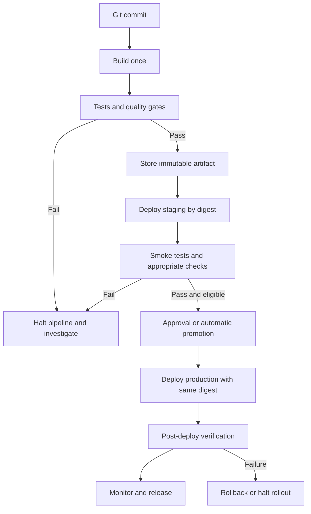

# Build Once and Promote the Same Artifact Across Environments

A key principle in CI/CD design is **build once, then promote the same artifact across environments**. This means the pipeline produces a software artifact from a source revision, stores it with an immutable identifier, and moves that exact artifact through testing and deployment steps in development, staging, production, or equivalent environments.

This principle creates a verifiable link between what was tested and what is running. If staging verified an image with digest `sha256:...`, production must also deploy the image with that exact digest. The team does not have to guess whether a production build produced a slightly different binary from the one that was tested.

In the CI/CD module, this principle connects pipeline-as-code, automated builds and tests, artifact management, environment configuration, quality gates, secret protection, and release workflows. The goal is not merely reducing build time; the goal is ensuring consistency, traceability, and reliability in the pipeline delivering software to users.

## 1. The Artifact Is the Unit of Promotion

Source code is the input to the build process. An artifact is the concrete output produced and stored for downstream steps to consume. Depending on the architecture, an artifact may be:

- A Java application's JAR or WAR file.
- A container image stored in a container registry.
- A library package, distribution package, or compiled binary.
- A frontend bundle, installer package, or a packaged set of assets.

An artifact must have an identifier precise enough to distinguish its contents from other builds. For container images, a digest is the appropriate content identifier. For packages or binary files, a checksum such as SHA-256 can be used. Version tags like `1.4.0` are helpful for humans, but tags in some registries can be moved or overwritten; therefore tags cannot replace digests or checksums when exact content identification is needed.

An artifact can be accompanied by metadata and evidence such as:

| Information | Purpose |
|---|---|
| Commit SHA | Identifies the source revision that produced the artifact |
| Version and pipeline run | Looks up build context and execution history |
| Digest or checksum | Verifies artifact contents have not changed |
| Build provenance | Records the source, workflow, and tools that produced the artifact |
| SBOM | Lists components and dependencies included in the artifact |
| Signatures and attestations | Supports verifying origin, integrity, and check claims |

This information should be stored alongside the artifact or linked by a clear identifier in the artifact repository. During an investigation, the team can trace from the running version back to the digest, pipeline run, and corresponding source commit.

## 2. What Does "Build Once" Mean?

For a given revision and a defined set of build inputs, the pipeline creates the artifact once within that release flow. Controlled inputs include source code, dependencies, compiler or build tool versions, base images, and packaging tools. The result is stored in an artifact repository with appropriate access controls and retention policies.

Once stored, environments reuse the saved artifact. Deployment steps may change manifests, runtime parameters, network settings, or replica counts per environment; those changes must never silently alter the built application content. When staging and production reference the same digest, you have evidence that they run the same image content.

Example with a Java service:

1. Commit `4f2a9c1` is checked out by the pipeline.
2. Gradle compiles and packages the application into `orders-service.jar`.
3. The pipeline runs checks, packages the JAR into an image, and pushes the image to the registry.
4. The registry returns the image digest. The pipeline records the digest alongside the commit and test results.
5. Staging deploys the image by that digest and runs smoke tests.
6. After passing quality gates and required approvals, production deploys that exact same digest.

If production needs a different version, that is a new change: build a new artifact, test the new artifact, and record the relationship between the old and new versions. Never manually patch a tested artifact and continue calling it the same product.

## 3. Why Not Rebuild in Each Environment?

Suppose a pipeline builds once for staging and then runs the build command again when deploying to production. Even though the commit has not changed, the output can still differ because:

- Dependencies were downloaded from a repository with dynamic versions or updated contents.
- JDK, Gradle, compiler, plugin, or base image versions differed.
- Build scripts depended on timestamps, external data, or runner machine state.
- Caches, build-time environment variables, or packaging flags changed the output.
- An image tag may have moved to point to new content after the earlier build finished.

In that case, staging results are no longer direct evidence for the production binary. If production encounters a bug, the team has to investigate both code changes and differences between the two builds.

| Approach | What Is Controlled | Primary Risk |
|---|---|---|
| Build per environment | Each environment creates its own output from source | Outputs may differ even for the same commit |
| Build once, promote artifact | Environments receive the same identified artifact | Requires strict management of artifacts, config, and promotion permissions |

Building once does not automatically make a build reproducible. **Reproducible build** is the ability to recreate identical content from identical controlled inputs. **Build once, promote** is an operational rule: reuse the built artifact rather than creating a new artifact in each environment. The two principles complement each other. A workflow can promote the same artifact even without full reproducible builds; at the same time, reproducible builds remain valuable for independently verifying provenance when needed.

## 4. Promotion Flow Across Environments

A reference flow can be structured as follows:



Each environment transition is a decision to promote an existing artifact, backed by matching conditions and evidence. For example, staging receives the artifact only when unit tests and security scans pass. Production receives the artifact only when staging smoke tests pass, approvals are complete if policy requires them, and signatures or provenance have been verified.

Pipeline-as-code helps express these dependencies clearly. The snippet below is provider-agnostic pseudocode:

```yaml
pipeline:
  build_and_verify:
    trigger: commit
    steps:
      - checkout_exact_commit
      - resolve_locked_dependencies
      - build_application
      - run_unit_and_static_checks
      - package_application
      - create_digest_signature_and_provenance
      - publish_immutable_artifact

  staging:
    needs: build_and_verify
    artifact: published_artifact_digest
    steps:
      - deploy_artifact_by_digest
      - run_smoke_and_integration_checks
      - record_test_evidence

  production:
    needs: staging
    artifact: published_artifact_digest
    steps:
      - verify_signature_and_provenance
      - require_approval_when_policy_demands
      - deploy_artifact_by_the_same_digest
      - verify_health_and_observe_metrics
```

The core point of this example is that `staging` and `production` both receive `published_artifact_digest`. The pipeline does not invoke a build again in those two deployment jobs. Deployment manifests for staging and production may differ, yet both reference the exact same application artifact.

## 5. Separating Artifacts from Environment Configuration

To use the same artifact across multiple environments, configuration must be supplied outside the build output. Values that commonly differ across development, staging, and production include:

- URLs or addresses of databases, message brokers, and supporting services.
- Domain names, integration endpoints, and routing rules.
- Replica counts, CPU/memory limits, and autoscaling policies.
- Log levels, alert thresholds, and operational parameters.
- Credentials or service access tokens.

Applications can receive configuration through environment variables, mounted configuration files, ConfigMaps, or configuration management systems. Secrets such as database passwords, private keys, and tokens should be injected from a secret manager or platform identity mechanism at deployment or runtime. Never embed secrets in source code, images, artifacts, public manifests, or pipeline logs.

Distinguishing **build-time configuration** from **runtime configuration** is critical. Build-time configuration is baked into the output during packaging; if a production URL is hardcoded into a frontend bundle, that same bundle can hardly be reused unmodified in staging. Runtime configuration is read when the application runs or deploys, enabling the same artifact to receive environment-appropriate values.

Not every setting can be moved to runtime. Some frontend frameworks or code generation systems require values at build time. In such cases, design the output to support externalized configuration if you want to promote the same artifact; if not possible, clearly treat each variant as a separate artifact, built, tested, and traced as its own product. Never create hidden differences while claiming environments run the same artifact.

For example, the same image `orders-service@sha256:abc...` can run in staging with `DB_URL` pointing to the staging database and in production with `DB_URL` pointing to the production database. The image contains no hardcoded passwords or URLs. Deployment manifests for the two environments supply the corresponding configuration and secrets.

## 6. Managing Immutable Artifacts and Traceability

An artifact repository or container registry stores verified outputs. To support safe promotion, enforce the following rules:

1. **Do not overwrite published content:** enable immutable tags or equivalent policies if the registry supports them; when a new build occurs, create a new version.
2. **Deploy by content identifier:** use the recorded digest or checksum rather than relying solely on mutable tags.
3. **Store metadata with the artifact:** record commit, pipeline run, toolchain, dependency lock, and necessary build details.
4. **Keep verification evidence:** link test reports, scan reports, SBOMs, signatures, and attestations to the exact digest.
5. **Manage lifecycle:** set retention policies so artifacts remain available long enough for deployment, investigation, and rollback; restrict deletion or replacement permissions.

During deployment, the system can record the actual digest pulled or running in the runtime. Comparing the desired digest in the manifest against the actual digest helps catch cases where an environment runs the wrong version, a tag moved, or an update did not finish.

Traceability must also work in reverse. From a commit, the team should be able to find the produced artifact, promotions, environments that received it, check results, and who approved production actions. From a running instance, the team should be able to trace back to the digest, commit, and build run. This is essential for auditing, incident analysis, and blast-radius assessment when a dependency vulnerability is disclosed.

## 7. Protecting the Supply Chain and Promotion Permissions

Because artifacts flow across multiple environments, protecting artifact integrity and its promotion path is vital.

- Only the build pipeline or build identity should have permission to publish artifacts to the repository.
- Deployment jobs should have read-only access to required artifacts; never grant arbitrary overwrite permissions.
- Use short-lived credentials or workload identity where supported by the platform; avoid storing long-lived tokens in repositories.
- Sign artifacts or generate signatures/attestations bound to the digest; verify them before deploying to sensitive environments.
- Inspect dependencies, images, and SBOMs against established security policies.
- Restrict production promotion permissions, require approvals where necessary, and log the actor or workflow executing them.
- Keep sensitive secrets out of logs, artifacts, or widely shared build evidence.

Signatures only matter when the deployment side verifies the signature and trusts the right signing identity. Similarly, provenance is only useful when its contents are validated against policy rather than sitting idle as an attachment. These checks reduce the risk of an artifact being swapped between build and deploy.

## 8. Testing Artifacts Across Environments

Not every check needs to wait until an artifact is deployed. Unit tests, formatters, and static analysis typically run early on source code. After building, the pipeline can inspect packages, scan dependencies, and verify metadata. When deploying to staging, the team tests the artifact in an environment closer to production.

Post-deploy checks can include:

- Smoke tests to confirm the process starts and essential endpoints respond.
- Integration or contract tests with supporting services and related systems.
- Migration, schema compatibility, and old/new version coexistence checks.
- Load or performance tests when changes carry resource risks.
- Monitoring metrics, logs, traces, and alerts during an observation window.

Test results must be tied to the tested digest. If staging tests `sha256:abc...` while production deploys `sha256:def...`, staging test evidence does not validate the production artifact. That is why the artifact identifier must be passed through the pipeline rather than re-resolved via a shared tag.

## 9. Handling Exceptions and Rollbacks

The build-once, promote principle does not mean a single artifact fits every OS and CPU architecture. If separate binaries must be built per operating system, CPU architecture, or product variant, each output is a distinct artifact with its own identifier. Each artifact must be verified and promoted along its own flow. For multi-architecture images, preserve the manifest list identifier and verify the target runtime receives the expected variant.

Changes such as patches, dependency upgrades, or build config edits alter the product's contents. In those cases, build a new artifact and re-run relevant checks; never modify an old artifact in place. If only runtime configuration or replica counts change, you can update deployment configuration without rebuilding the application, provided that change does not alter the artifact.

Rollback typically means re-promoting the previous stable artifact using its saved digest. Before rolling back, evaluate database compatibility and data state. Compatibility-breaking migrations can prevent the old version from running; expand-and-contract strategies and controlled data transitions preserve rollback viability. With canary or blue-green deployments, traffic can shift back to the stable version group if health checks, error rates, or metrics breach stop thresholds.

After a rollback, record the faulty artifact, stable digest, related commits, environment, timestamp, approver, and observed signals. This evidence helps the team reproduce the issue and add appropriate quality gates.

## 10. Principle Adoption Checklist

Before putting a CI/CD flow into production use, verify these questions:

- [ ] Pipeline builds the artifact from a specific commit and locks required dependency/toolchain versions.
- [ ] Artifact is stored in an access-controlled repository or registry with lifecycle policies.
- [ ] Every artifact has a digest/checksum, commit SHA, and pipeline run for traceability.
- [ ] Environments reference the exact same digest when promoting the same product.
- [ ] Staging tests the exact artifact intended for production and records results against its digest.
- [ ] Environment configuration and secrets are injected outside the artifact with least privilege.
- [ ] Signatures, provenance, and quality gates are verified per policy.
- [ ] Production has approval gates, post-deployment verification, and monitoring sufficient to halt rollouts.
- [ ] The previous stable artifact remains available for rollback and databases have a compatibility plan.

When an artifact is built, identified, verified, and stored clearly, environments simply promote that product along with the appropriate configuration. As a result, the team can prove production is running the exact artifact that was tested, trace quickly during incidents, and make release decisions grounded in evidence rather than assumptions.
