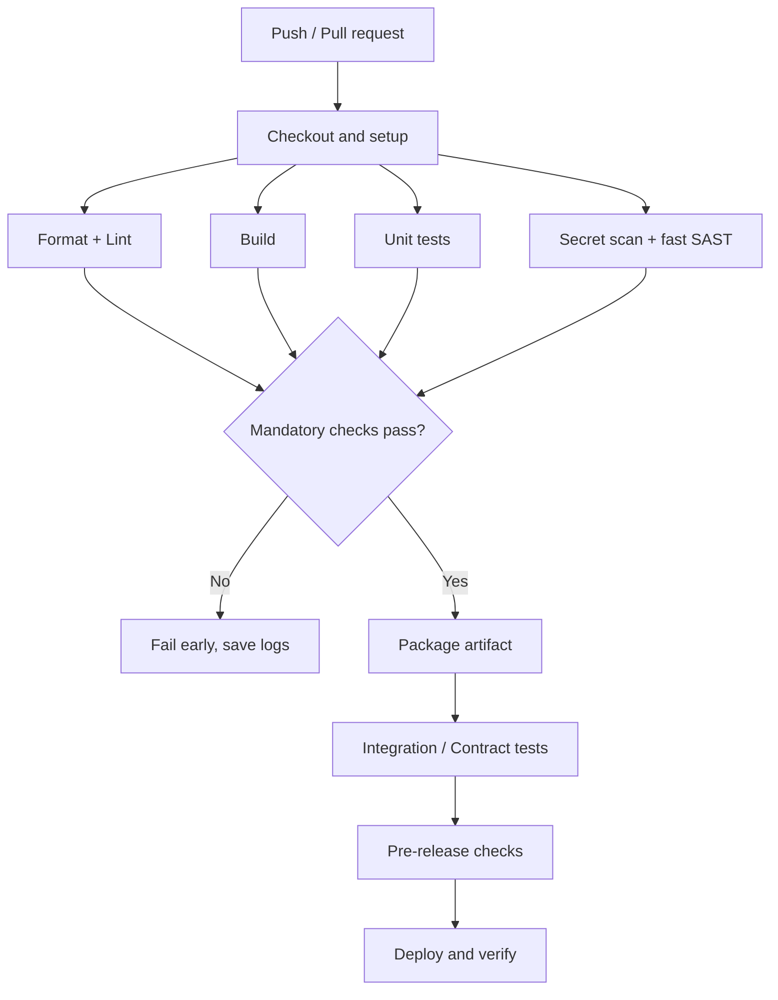

# Designing Tests by Risk and Feedback Time

## 1. Principle: Test the Right Risks, Deliver Results on Time

A CI/CD pipeline needs sufficient checks to catch defects that could affect users, data, or operations. However, pipeline runtime is also part of workflow quality. If every change must wait tens of minutes for results from unrelated tests, developers lose context, review queues grow longer, and integration velocity drops.

Designing tests by risk and feedback time is the practice of organizing the test suite so that:

- Every change is verified by tests matched to its scope and impact level.
- High-severity, likely defects are detected as early as possible.
- Fast checks protect daily feedback loops; deeper checks run at appropriate stages.
- Failing results can be understood, traced, and acted upon rather than returning just a red X.
- Execution cost, queue wait time, and test reliability are measured for continuous improvement.

This principle is especially important in CI/CD because pipelines are triggered frequently by Git events. A small change on a pull request needs fast feedback so the author can fix it right away; a change affecting data schemas, authentication, or financial calculations needs deeper verification before release. Running the exact same test suite at every moment both wastes time on low-risk changes and misses specialized checks on high-risk changes.

## 2. Assess Risk Before Choosing Tests

The risk of a software change can be examined through two questions: if a defect occurs, how severe are the consequences, and how likely is the defect to occur or slip past the current process? This is a qualitative assessment to guide testing, not an exact formula predicting bug counts.

Factors commonly evaluated include:

| Factor | Question to Ask | High-Risk Examples |
|---|---|---|
| Business impact | If behavior is wrong, what harm do users or the organization suffer? | Miscalculating monetary amounts, misrecording orders, losing access. |
| Blast radius | How many services, users, or business flows depend on the change? | Shared libraries, public APIs, login flows. |
| Data | Does the change write, delete, transform, or expose data? | Schema migrations, personal data handling, data synchronization. |
| Security | Does the change affect identity, permissions, secrets, or trust boundaries? | Authentication, authorization, token handling, input validation. |
| Compatibility | Can old and new versions coexist? | API changes, event schemas, storage formats. |
| Complexity | Does the logic involve many branches, dependencies, or edge states? | Multi-rule pricing, concurrency, retries. |
| Detectability | If a bug happens, can current tests catch it before production? | Bugs appearing only under high load or when an external service is slow. |
| Recoverability | Can data be rolled back or repaired safely? | Destructive data migrations or incompatible schema changes. |

A qualitative matrix can be used to align prioritization:

| Consequence if Failure Occurs | Low Likelihood | Medium Likelihood | High Likelihood |
|---|---|---|---|
| Low | Baseline checks | Targeted checks | Targeted checks and root-cause review |
| Medium | Targeted checks | Multi-layer checks | Multi-layer checks; consider extended testing |
| High | Mandatory specialized checks | Specialized and integration checks | Highest priority, deep testing, and release/recovery plan |

This matrix helps the team discuss consistently, not replace engineering judgment. A change with few lines of code can still carry high risk if it touches authorization or data migrations. Conversely, a large documentation change may have low functional risk. Never use lines of code or pull request size as the sole proxy for risk.

## 3. Match Risks with Check Types

No single type of test catches every bug. Each check type differs in scope, cost, and speed. Choose tests based on the defect to prevent and where that defect can be observed.

| Check Type | Strong At Detecting | Relative Cost/Time | Usage Examples |
|---|---|---|---|
| Format, lint, type check | Code style rules, syntax errors, or common type issues | Low | Every push or pull request |
| Unit test | Logic errors in isolated functions or classes | Low to medium | Calculation rules, validation, data transformation |
| Component/service test | Behavior of a component with controlled dependencies | Medium | Business service with mocked database or test container |
| Contract test | Incompatibilities between API/event providers and consumers | Low to medium | Request/response schemas, message contracts |
| Integration test | Interaction errors across multiple real components | Medium to high | Repository with database, service with message broker |
| End-to-end test | Business flows spanning multiple system layers | High | Creating an order from API through persisted state |
| Security test | Vulnerabilities, misconfigured permissions, weak config, exploitable dependencies | Depends on tool and scope | SAST, dependency scan, secret scan, DAST |
| Performance/load test | Latency, throughput, resource limits, and degradation under load | High | Pricing API or high-traffic queries |
| Resilience/failure test | Fault tolerance, timeouts, retries, and recovery | High | Downstream service disconnect, slow broker |
| Migration/compatibility test | Schema compatibility and data upgrades | Medium to high | Database version or event schema upgrades |

A common structure puts many fast unit tests at the base, a moderate number of component and integration tests in the middle layer, and a small number of end-to-end tests representing critical flows at the top. This is a guideline on cost and scope, not a rigid ratio. A project with heavy external integrations may need more contract tests; a data-processing system may need dedicated migration tests.

For example, changing a display label may only need lint, build, and a few related unit tests. Changing how refund permissions are determined requires unit tests for the rules, integration tests with the authorization mechanism, contract/API tests, security tests, and business-flow verification. Selecting tests by risk concentrates effort where failures carry major consequences.

## 4. Tier Checks by Feedback Timing

A practical way to balance speed and coverage is organizing the pipeline into tiers. Cheap checks that catch common bugs run first; expensive checks or those requiring specialized environments run later, in parallel, or on a schedule.

| Tier | Timing | Typical Checks | Decision Supported |
|---|---|---|---|
| Developer machine | Pre-commit or pre-push | Format, lint, fast unit tests | Should this change be sent to CI? |
| Pull request | Every push/PR update | Build, lint, type check, unit tests, relevant tests, fast security checks | Is it ready for review and merge? |
| Post-merge | On the main branch | Integration suite, contract tests, artifact build, metadata checks | Are the main branch and artifact trustworthy? |
| Pre-release | On the artifact slated for deployment | End-to-end, migration, deep security scans, performance, or risk-based acceptance tests | Is it eligible to advance to the next environment? |
| Post-deployment | In the target environment | Smoke tests, health checks, canary analysis, operational metric checks | Continue rollout or halt/rollback? |
| Scheduled or event-driven | Nightly, weekends, or when dependencies change | Full regression, deep scans, load tests, resilience tests | Are there background risks to fix before the next release? |

Tiers can overlap. For instance, a fast security scan runs on pull requests while a deeper scan runs pre-release or on a schedule. What matters is that the team knows which checks are mandatory prerequisites for which decisions. Post-merge tests must never be treated as a full replacement for checks needed to protect the main branch.

## 5. Set a Feedback Time Budget

Feedback time is the interval from when a change is submitted until the author receives actionable results. It includes runner queue wait time, environment setup time, test execution time, and report aggregation time.

A pipeline can have a good average runtime yet still feel frustrating if occasional runs wait far too long. Track percentiles such as p50 and p95 instead of looking only at averages. p50 reflects the typical experience; p95 reveals the long waits the team regularly runs into.

Illustrative internal budget example (teams should adjust for tech stack, runners, and risk level):

| Check Group | Illustrative Feedback Target | Meaning |
|---|---:|---|
| Format, lint, type check | 1–3 minutes | Catch basic issues almost immediately |
| Critical unit tests | 2–5 minutes | Verify changed logic before review |
| Pull request check suite | 5–10 minutes | Keep the review loop moving quickly |
| Integration tests | 10–20 minutes | Verify interactions within acceptable time |
| End-to-end or deep checks | Per separate schedule | Run at an appropriate tier without blocking every low-risk change |

These numbers are not universal standards. A mobile app, embedded system, or large monorepo has different characteristics. Set targets based on how long pipeline users can wait, software risk, and infrastructure capacity. If an essential test cannot fit within the pull request budget, consider optimizing, splitting, parallelizing, or redesigning how it tests; do not automatically delete it just because it is slow.

## 6. Design Pipelines for Fail-Fast and Parallel Execution

Fail-fast means running fast checks with high defect-detection power before spending resources on costlier steps. Independent jobs can run in parallel to reduce total duration, while dependent steps wait for the right outputs.

Example of how a pipeline can be structured:

To apply this effectively:

1. Run independent checks in parallel—for example, lint, unit tests, and secret scans.
2. Put shared setup steps like checkout or dependency restoration into reusable components when the platform supports it.
3. Do not run integration tests if the build already failed and those tests depend on the build artifact.
4. Stop early once a mandatory condition fails, while still saving enough logs for diagnosis.
5. Avoid creating so many tiny jobs that runner startup overhead exceeds actual check time.
6. Monitor runner queues; optimizing execution time helps little if most time is spent waiting for a machine.

Caching dependencies and build outputs can shorten pipelines, but caches must be keyed by tool versions, dependencies, and relevant inputs. Incorrect or unsafe shared caches can cause pipelines to reuse stale outputs, produce non-reproducible results, or leak data across jobs. When suspecting cache interference, have a clean-run option to verify.

## 7. Select Tests by Change Scope and Dependency Graph

In large repositories, running the full test suite on every change can be very expensive. Teams can use changed files, affected modules, and the dependency graph to select a targeted test set. For example, a change in a date-formatting module can trigger unit tests for that module and its direct dependents.

However, selecting tests purely by changed files can miss bugs if dependencies are not fully declared or if a change alters behavior via configuration, reflection, schemas, or shared contracts. Therefore:

- Maintain a baseline check suite that always runs on pull requests, including the build and core quality checks.
- Run targeted tests by module or dependency when impact can be reliably determined.
- For changes in shared libraries, APIs, schemas, authentication, or system-wide configuration, expand the test set to affected consumers.
- Run full regression on a schedule or before appropriate release milestones.
- Log why a test was selected or skipped so results remain explainable.
- Periodically compare selected tests against real production bugs to spot gaps in selection rules.

For example, modifying an address normalization function can affect checkout, shipping, and tax calculation even if those modules reside in different directories. If tests run solely by file path, the pipeline may miss those interactions. Dependency graphs, contract tests, and representative business-flow tests help catch cross-module risks.

## 8. Ensure Reliable Tests and Repeatable Environments

A fast but unstable test can slow down the entire team more than a slower but trustworthy test. A flaky test is one that produces different outcomes with unchanged inputs and code, typically due to timing, execution order, shared data, network dependencies, or environment resources.

When a test fails, the pipeline must help answer: which test failed, which commit was tested, which environment was used, where are the logs and reports, and is the failure reproducible? Key practices:

- Use isolated test data with clear creation and cleanup rules.
- Avoid tests depending on execution order or leftover state from previous runs.
- Control runtime, build tool, and dependency versions.
- Use fake clocks or time-control mechanisms when testing time-dependent logic.
- Minimize unnecessary network dependencies; for real integrations, use stable test environments with timeouts.
- Collect logs, stack traces, test reports, and environment details on failure.
- Never auto-retry endlessly until green. If retrying to detect flakiness, log the initial failure and track it separately.

Test environments should mirror the target environment closely enough on attributes that affect results—such as database version, runtime, TLS config, or broker type. You do not have to clone all of production for every test; you need to understand which differences could skew test results.

## 9. Design Quality Gates by Risk Level

A quality gate is a condition that determines whether a pipeline may advance to the next step. A good gate states its conditions, data sources, scope of application, and who is authorized to handle exceptions.

Example of tiered gates:

| Level | Example Conditions | Action on Failure |
|---|---|---|
| Pull request baseline | Build, lint, mandatory unit tests, and secret scan pass | Block merge until fixed or handled per policy |
| Component level | Contract/integration tests for the module and related consumers pass | Block changes breaking contracts or interactions |
| Pre-release | Policy-compliant security checks, migrations, acceptance tests, and valid artifact | Do not promote artifact to the next environment |
| Production rollout | Health checks, smoke tests, and canary metrics within thresholds | Halt rollout, investigate, or roll back per runbook |

Not every warning should block the pipeline. Distinguish mandatory failures to fix, warnings to review, and informational signals. For example, a policy-defined high-severity vulnerability may block release; a low-severity warning may be logged with a remediation SLA. Decisions should be consistent and have clear ownership.

If an emergency exception is required, the exception must specify a rationale, approver, scope, and expiration. Never silently skip tests or alter gate thresholds just to turn the pipeline green. Every test bypass must be auditable and reviewed during post-incident or process retrospectives.

## 10. Measure Testing Effectiveness

To know whether your design strikes the right balance, measure both speed and defect detection. Useful metrics include:

| Metric | Meaning | How to Use |
|---|---|---|
| Time to first feedback | Time from push to first actionable check result | Locate delays in queues or setup steps |
| Pipeline duration p50/p95 | Typical runtimes and long-tail waits | Set budgets and spot variance |
| Queue time | Time jobs spend waiting for runners | Decide on scaling runners, tuning concurrency, or scheduling |
| Per-job duration | Cost of each check type | Optimize slow or low-value jobs |
| Flaky test rate | Rate of unstable test failures | Prioritize fixing tests that erode trust |
| Escaped defect rate | Bugs found after passing gates | Identify gaps in testing strategy |
| Meaningful detection rate | Extent to which tests catch real regressions or bugs | Review redundant or low-value tests |
| Post-release rollback/hotfix rate | Signal of release quality and risk control | Combine with root-cause analysis rather than blaming tests alone |

Code coverage helps spot code never executed by tests, but high coverage does not automatically prove tests verify correct behavior. A test that steps through every line without meaningful assertions yields flattering coverage with low value. Combine coverage with strong assertions, mutation testing where appropriate, test reviews, and real defect data.

Never optimize a single metric in isolation. Cutting a pipeline from 20 minutes to 5 minutes by deleting critical tests can increase production bugs. Conversely, running every test on every pull request can stall integration. Evaluate speed, reliability, risk coverage, and operational cost together.

## 11. Example: Changing Order Discount Calculation Rules

Suppose a team changes how discount codes apply to orders. A bug could overcharge or undercharge customers, misrecord revenue, or allow unauthorized discount abuse. This is a high business and data risk change even if only a few conditional lines are edited.

The team can design a verification plan as follows:

| Risk to Control | Appropriate Check | Timing |
|---|---|---|
| Wrong formula or monetary boundary | Unit tests for each rule, boundary values, rounding, and stacked promotions | Every pull request |
| Unauthorized user applies promotion | Authorization unit tests and security/API tests | Pull request |
| API change breaks clients | Contract tests with affected consumers | Pull request or post-merge |
| Stored total differs from returned total | Integration tests across service and database | Pull request or post-merge depending on runtime |
| Checkout flow fails to complete | End-to-end tests for critical flow | Pre-release |
| Performance degrades from new query | Performance tests on representative data | Pre-release or scheduled if query change carries risk |
| Release causes spike in invalid orders | Canary, reconciliation metrics, and alerts | Post-deployment |

On pull requests, the team runs formula unit tests, authorization checks, build, and contract tests. After merge, the pipeline runs integration tests and packages the artifact. Before production, the team verifies the checkout flow along with any migrations. During rollout, they monitor error rates, reconciliation totals, and business metrics. If signals cross thresholds, halt the rollout and trigger recovery.

This plan prioritizes fast feedback for critical logic while reserving costly checks for when artifacts and suitable environments are available. The team can shift test placement based on actual runtimes, without losing coverage over core risks.

## 12. Common Mistakes

| Mistake | Why It Hurts | How to Fix |
|---|---|---|
| Running all tests on every commit | Creates long wait times, wastes runners, and slows feedback | Tier by cost, risk, and supported decision |
| Running only fast tests | Interaction, migration, performance, or security bugs can slip through | Add specialized checks at appropriate tiers |
| Selecting tests only by changed files | Misses cross-module impacts or config/contract changes | Combine dependency graphs, baseline tests, and periodic full regression |
| Re-running tests until they pass | Masks flaky tests and real defects | Record the first failure, triage, and fix root cause |
| Using coverage as the sole metric | High coverage can still lack meaningful assertions | Evaluate assertion quality, mutation testing, and escaped bugs |
| Gates showing only red/green without logs | Fixers cannot see where it failed or how to reproduce | Save reports, logs, commits, environments, and job links |
| Bypassing gates without expiration | Temporary exceptions become permanent habits | Record rationale, approver, deadline, and review schedule |
| Optimizing time by dropping high-risk checks | Fast pipeline fails to protect the product | Track speed alongside escaped bugs; optimize execution instead of removing vital checks |

## 13. Test Strategy Design Checklist

Before adding a test suite to the pipeline, the team can answer these questions:

- [ ] What specific risk or defect class is this test meant to catch?
- [ ] Which changes or modules should trigger this test?
- [ ] Should the test run at pull request, post-merge, pre-release, or post-deployment?
- [ ] Are queue wait time and runtime appropriate for the decision it supports?
- [ ] Is there a faster or cheaper check to catch the same defect class?
- [ ] Are test data, environments, and results stable enough to trust?
- [ ] When it fails, do logs and reports help pinpoint the root cause?
- [ ] Are gate conditions and exception handling clearly defined?
- [ ] Are metrics tracked for feedback time, flaky tests, and escaped bugs?
- [ ] Does the selected test set miss cross-module impacts or contract changes?

## 14. Core Practical Principles

1. Assess risk by impact, likelihood, blast radius, data sensitivity, and recoverability.
2. Pair each risk with a check type capable of detecting it effectively.
3. Place fast, critical checks at the front of the feedback loop; schedule deep checks when suitable environments and artifacts exist.
4. Run independent jobs in parallel, manage caches safely, and reduce runner queue wait times.
5. Select tests by change scope while maintaining baseline checks and broader regression suites.
6. Keep tests deterministic, environments repeatable, and reports rich with diagnostic details.
7. Design transparent, traceable quality gates and enforce time-bound exception management.
8. Measure speed alongside defect-detection quality to improve without trading off release safety.

A strong testing strategy is not judged solely by test count or pipeline duration. It must give the team feedback fast enough to act on while catching high-consequence defects before they reach users. That is how automated testing becomes a true quality-control mechanism in CI/CD.
