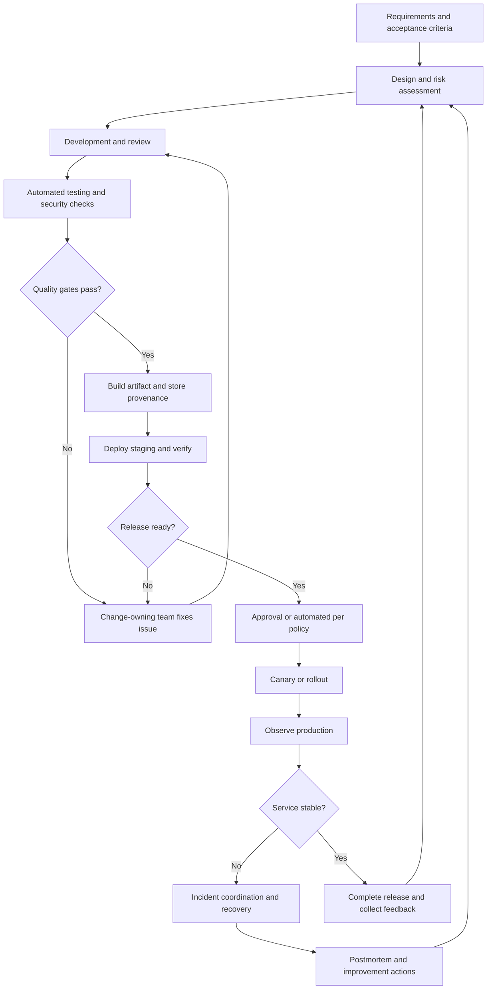

# Sharing Responsibility for Quality, Deployment, and Recovery

A software change passes through many hands before reaching users: developers write code, testers verify behavior, the platform team runs pipelines and infrastructure, security sets policies, and operations monitors production. If each group takes responsibility only for its own slice and hands off to the next group, defects can slip through the boundaries. When production hits an incident, people end up debating who made a mistake instead of working together to restore service.

In CI/CD, **quality, deployment, and recovery are shared responsibilities of everyone who builds, delivers, and operates the product**. Shared responsibility does not mean everyone does every job or that nobody holds final accountability. Every role still needs clear authority and duties; roles coordinate around the same goals, the same standards, and the same information across the entire software lifecycle.

This principle helps teams avoid the "throw it over the wall" habit between development and operations. Change authors need to care about how a change is tested, deployed, and observed. Platform builders need to provide a safe, usable path to production. Operators need to feed production data back so the team can improve the product. Product managers need to clarify risk appetite and desired outcomes. Everyone shares responsibility for getting valuable changes to users safely and recoverably.

## 1. What Does Shared Responsibility Mean?

Shared responsibility is a working agreement in which teams jointly own the end-to-end outcome while each role understands its contribution and decision authority. Instead of measuring success by tickets closed or handoffs completed, the team focuses on whether a change meets needs, is releasable, runs properly in production, and can recover when it fails.

This principle has three layers:

1. **Outcome ownership:** teams collectively care about service quality, user experience, release speed, and stability.
2. **Role-based accountability:** each person or team has specific duties, decision-makers, and clear boundaries of authority.
3. **End-to-end traceability:** information, evidence, and feedback connect requirements, commits, tests, artifacts, deployments, production behavior, and recovery actions.

For example, when an API returns errors after deployment, developers can investigate code changes; the platform team checks runners, configuration, and infrastructure; operations inspects telemetry and service impact; product identifies affected business flows. An incident commander owns unifying the recovery decision. Activities proceed in parallel by role rather than waiting for one group to prove the fault belongs to another.

### Shared Responsibility Does Not Blur Individual Accountability

A common misconception is that "everyone is responsible" means nobody needs to be assigned ownership. In reality, when decision authority is unclear, work stalls. Every change needs an owner; every service needs an accountable team; every quality gate needs a policy owner; every release needs an authorized person or mechanism to execute it.

Three concepts can be distinguished:

- **Shared ownership:** multiple roles contribute to the outcome and proactively support one another.
- **Single-point accountability:** one clearly identified person or role makes the final call within a defined scope.
- **Operational participation:** the author of a change participates in handling and learning from its real-world impact.

For instance, the service team is accountable for the service's quality and operability; the release lead has authority to continue or halt a rollout per policy; security owns security standards; the CI/CD platform provides mechanisms to enforce those standards. Roles align toward the outcome without replacing one another's authority.

## 2. Why Share Responsibility in CI/CD?

CI/CD shortens the time from a Git change to production. As deployment frequency rises, how often technical decisions directly impact users also increases. If only a testing or operations team is tasked with catching every risk at the end of the pipeline, that team becomes a bottleneck and cannot grasp the full context of every change.

Shared responsibility solves several classic problems:

| Problem When Working in Silos | Consequence | How Shared Responsibility Helps |
|---|---|---|
| Developers only care that code runs locally | Missing config, logging, or checks needed in live runtime | Developers consider behavior in deployment and production environments |
| QA treated as solely responsible for quality | Design flaws and ambiguous requirements caught late | Quality is built in from requirements, design, and code review through testing |
| Operations receives the package only on release day | Insufficient time to review, prepare, or give feedback | Operations engages early and co-defines readiness criteria |
| Platform team only supplies raw tools | Each team builds pipelines differently, hard to govern | Platform provides paved roads with guardrails and clear docs |
| Security checks only at the end of the cycle | Issues found late, costly fixes, and delayed releases | Security policies are embedded into design, pipeline, and runtime |
| Incidents turn into blame hunts | Wasted time arguing, reduced information sharing | All roles collaborate on recovery, systemic root-cause analysis, and improvements |

Shared responsibility also optimizes the full value stream. A team might boost merge speed by skipping reviews, but if production breaks frequently, the overall outcome is poor. An operations team might preserve stability by rejecting all changes, yet the product cannot move forward. Speed of change and reliability must be balanced using data, policy, and deliberate decisions.

## 3. Quality Is Built by the Whole Team

Quality cannot be "tested into" a product through one final QA pass. It starts with how the team understands requirements, defines acceptance criteria, designs solutions, writes code, verifies behavior, and monitors post-deployment behavior.

### 3.1. From Requirements to Verifiable Criteria

Product, developers, QA, and operations should clarify requirements before implementation. A sound requirement describes expected behavior, edge cases, error conditions, and user impact. Acceptance criteria need concrete ways to verify them.

For example, saying "the order API must be fast" is not enough to build a quality gate. The team must define request types, expected load, test environment, and acceptance thresholds. A concrete criterion could be: "Under a test load of 300 requests/second in the standard environment, p95 latency of the order creation API must not exceed 400 ms over the agreed measurement window." The numbers here are illustrative; real thresholds must be grounded in SLOs and service characteristics.

QA helps uncover edge cases and risks; developers assess feasibility and testability; operations highlights environment limits; product confirms whether criteria reflect user needs. Aligning early prevents different groups from building against different interpretations of a requirement.

### 3.2. Quality in Design and Code Review

Developers are responsible for producing changes that are readable, testable, and operable. Code reviews inspect logic, complexity, error handling, backward compatibility, logging, configuration, access permissions, and performance impact. Reviews should never focus purely on code style.

For high-risk changes, the team can require reviewers knowledgeable in the business domain, data, or security. Database schema changes must examine compatibility with currently running versions. API or event changes need a versioning plan and a transition window for consumers.

### 3.3. Testing Is the Change Author's Responsibility

Developers write and maintain appropriate unit tests, integration tests, or contract tests. QA supports test strategy, validates user flows, explores hard-to-predict scenarios, and evaluates risk. The platform team provides stable test environments and tooling. Never offload all responsibility for test data creation, test maintenance, or failure triage to a separate QA team.

When a test fails, the team must distinguish product bugs, test bugs, and environment errors. The code or service owner should join the investigation instead of merely reassigning a ticket to QA. For flaky tests, the team tracks root causes, assesses impact, and sets a resolution deadline if temporary quarantine is required.

### 3.4. Risk-Based Quality Definition

Not every change carries the same risk. A copy update may need rendering checks; an authentication change needs security review and permission tests; a large data migration needs a compatibility plan, backups, and recovery drills.

Teams should establish a mandatory baseline check suite for all changes, then layer additional checks by impact type. This avoids two extremes: testing too little so risks slip through, or forcing every change through the same heavy suite that slows feedback without meaningfully increasing safety.

## 4. Sharing Responsibility for Deployment

Deployment is the moment source code, artifacts, configuration, infrastructure, and access permissions converge into a live runtime state. Deployment responsibility therefore cannot belong solely to the person pressing the release button.

### 4.1. Developers Own the Deployability of Their Changes

Change authors must provide enough information for pipelines and operators to deploy safely: new configuration, environment variables, dependencies, migrations, API contract changes, feature flags, resource requirements, and verification steps. If a change requires a manual step, that step must be explicitly documented, assigned to an executor, and verifiable.

Changes should remain compatible while old and new versions coexist. For multi-instance services, never assume all instances update simultaneously. APIs and data schemas must allow rolling or canary updates without breaking older instances.

### 4.2. The Platform Team Owns the Safe Path to Production

The platform or DevOps team provides pipeline templates, runners, registries, secret integration, deployment environments, and observability hooks. The platform should make doing the right thing easy for product teams: least-privilege defaults, immutable artifacts, traceable logs, mandatory checks, and standardized rollback mechanisms.

The platform team should not become responsible for understanding the business internals of every service. Service teams supply health checks, smoke tests, dashboards, and business thresholds; the platform supplies the mechanism to integrate those signals into the shared workflow.

### 4.3. Operations Engages Before Release

Operators contribute insight into capacity, dependencies, backups, maintenance windows, observability, network limits, and production constraints. They help review rollout plans, validate runbooks, and define stop conditions.

If a change requires approval, approvers need prepared evidence upfront: test reports, scan results, release notes, artifact digests, deployment plans, and recovery plans. Approval must never become rubber-stamping without evidence to evaluate.

### 4.4. Use Guardrails Instead of Relying on Memory

Guardrails are technical or procedural mechanisms that prevent actions from exceeding agreed policy. Examples:

- Only artifacts built by trusted pipelines can be deployed.
- Test jobs have no write permissions to production.
- Production requires environment protection or risk-tiered approvals.
- Pipelines verify artifact signatures and digests before deploying.
- Rollouts halt automatically when health checks or telemetry thresholds fail.
- High-impact infrastructure changes require peer review and a rollback plan.

Guardrails need owners and transparent exception handling. Exceptions must include a rationale, approver, scope, expiration, and audit trail. An emergency exception must never silently become standard practice.

## 5. Recovery Is Part of Release Responsibility

No testing process eliminates all production defects. A mature delivery system assumes incidents will happen and prepares to detect them, limit impact, restore service, and learn from them.

### 5.1. Change Authors Participate in Operations

When a change causes a failure, the people who understand the code and design decisions can usually identify the root cause fastest. The service-owning team must therefore participate directly in release monitoring, investigation, and remediation. Participation models vary by organization size and on-call structure, but there should never be an accountability gap once an artifact is handed off.

The "you build it, you run it" principle highlights the link between software creators and operational outcomes. Not every developer has to carry 24/7 production pager duty. An organization may have a dedicated SRE or Operations team for coordination and infrastructure; development teams still own service behavior, provide domain support, and fix root causes in code.

### 5.2. Clear Incident Roles

During an incident, separate coordination roles from hands-on technical execution. A simple model can include:

| Incident Role | Primary Responsibility |
|---|---|
| Incident commander | Assesses severity, coordinates resources, aligns priorities, and decides action milestones |
| Technical lead | Leads technical investigation, proposes mitigations, and verifies recovery |
| Communications lead | Updates stakeholders and users per policy |
| Service owner | Provides business context, source code, dependencies, and service fix decisions |
| Platform/operations | Inspects infrastructure, traffic, deployments, resources, and operational tooling |

In small teams, one person may wear multiple hats. What matters is that everyone knows who is coordinating and where updates live. The coordinator must prevent multiple people from executing conflicting production state changes simultaneously.

### 5.3. Prioritize Service Restoration and Blast Radius Containment

During an incident, the first priority is protecting users and restoring essential functionality. Teams can halt a rollout, reduce traffic share to the new version, disable a feature flag, shift traffic back to a stable version, or roll forward with a fix.

The decision depends on the failure type. If the new version spikes HTTP errors without altering stored data, rolling back the application may fit. If a migration already transformed data incompatibly, redeploying the old image may not solve it. The team must then evaluate backups, compensating jobs, or rolling forward with a fix.

Mitigation actions should have documented guides and drills. Runbooks must specify trigger conditions, exact commands or actions, required permissions, how to verify outcomes, and how to reverse the mitigation if it causes side effects.

### 5.4. Blameless, Yet Action-Oriented Remediation

A blameless postmortem focuses on the conditions and mechanisms that allowed an incident to occur: what information was missing, which guardrails did not exist, which signals went undetected, and which decisions seemed reasonable given available data at the time yet led to bad outcomes.

Blameless does not mean ignoring accountability or tolerating deliberate policy violations. It means analyzing the system before blaming individuals so the organization learns how to prevent recurrence. A post-incident report should capture:

- User impact and duration of impact.
- Timeline of events, detection signals, and decisions made.
- Direct root cause alongside contributing factors.
- What helped limit impact and what slowed recovery.
- Improvement actions, owners, deadlines, and verification methods.

A postmortem creates no value if action items have no owners and are never tracked to completion. Prioritize fixing causes likely to recur or cause major harm rather than creating a long, unprioritized list of minor tasks.

## 6. Responsibility Boundaries Across Roles

Shared responsibility must be translated into concrete agreements. The table below provides a reference example for a product group with development, QA, platform, security, operations, and product roles. Organizations may combine or split roles depending on scale.

| Activity | Lead Person/Team | Collaborating Parties |
|---|---|---|
| Defining requirements and acceptance criteria | Product owner | Development, QA, Operations, Security when relevant |
| Technical design and risk assessment | Service owner or technical lead | Platform, Security, QA, Operations |
| Code review and unit testing | Development | QA or domain experts when needed |
| Test strategy and automation | Development and QA | Platform, Product, Operations |
| Pipeline templates and runners | Platform engineering | Development, Security, Operations |
| Security policy and exceptions | Security | Service owner, Platform, approvers |
| Artifacts and provenance | Pipeline/platform owner | Development, Security |
| Rollout plan and release readiness | Service owner or release owner | Operations, Platform, QA, Product |
| Production monitoring | Service owner and Operations/SRE | Platform, Product, Security on related incidents |
| Incident coordination | Incident commander | Service owner, Platform, Operations, Communications |
| Postmortem and improvement actions | Service owner or incident lead | All relevant roles |

To avoid ambiguity, teams can use a RACI matrix for key decisions:

- **R — Responsible:** those who directly execute the work.
- **A — Accountable:** the one ultimately answerable with decision authority in that scope.
- **C — Consulted:** those whose input is sought before a decision.
- **I — Informed:** those notified of results or changes.

Each activity should have one clear **A**. Multiple people can be R, C, or I. RACI does not replace daily communication; it clarifies decision authority where gaps or conflicts easily arise.

For example, in a production rollout, the service owner might be **A** for service readiness, the release operator **R** for executing the deployment, Operations and Security **C** based on risk level, and Product **I** on release timing. If an organization uses full automation, policy may delegate the decision to quality gates; in that case, clearly define the policy owner and exception handler.

## 7. Building a Collaborative Culture Through Daily Practices

Shared responsibility does not emerge merely because an organization redraws an org chart or declares it has adopted DevOps. It forms through how teams plan together, inspect the same data, and solve problems together.

### 7.1. Co-Define "Done" and "Release Ready"

Definition of Done describes the conditions for a work item to be considered complete. Depending on the product, conditions may include code review, tests, documentation, logging, security checks, and API contract updates.

Release Ready describes the conditions for a version to be permitted for release. It can include an immutable artifact, test results, scan reports, configuration, approvals, runbooks, dashboards, and recovery plans. These two concepts are related yet distinct: a story may be Done within development scope while the release still awaits overall version readiness checks.

Criteria must be agreed upon by relevant groups, testable, and updated as product risk evolves. If a checklist grows so long nobody uses it, review its necessity and automate whatever checks machines can verify.

### 7.2. Joint Review Before High-Risk Changes

Changes involving authentication, authorization, sensitive data, database migrations, network policies, or critical dependencies warrant a brief discussion among relevant roles. The goal is aligning on risks, test approaches, rollout plans, and recovery paths before deployment.

There is no need to hold a meeting for every commit. For small, low-risk changes, code review and quality gates suffice. Let risk level determine coordination depth.

### 7.3. Share Dashboards and Release Information

Key details should be easily accessible to responsible parties: running version, commit SHA, artifact digest, deployment history, test results, rollout status, error rate, latency, and SLOs. When everyone views the same data source, discussions rely far less on screenshots or manual reports.

Release notes should describe user-facing changes, technical impact, configuration changes, migrations, feature flags, and items to watch. If known limitations or risks exist, state them explicitly so on-call operators can recognize them early.

### 7.4. Create Short Feedback Loops

Teams can hold post-release reviews, inspect pipeline failures, analyze flaky tests, and conduct periodic incident reviews. Discussions should answer concrete questions: which stage slows the flow, which bugs repeat, which quality gates caught issues, which signals alerted too late, and what actions reduce risk.

Production feedback must flow back into the development backlog. An operational incident can lead to better logging, added regression tests, adjusted timeouts, bounded retries, updated runbooks, or architectural fixes. If production data stays locked inside operations, development teams will continue repeating wrong assumptions.

## 8. Automating Responsibility with Pipelines and Policies

People collaborate to make decisions, while pipelines enforce repeatable rules consistently. A well-designed pipeline turns team agreements into verifiable steps.

For example, a release workflow might require:

1. Pull requests must have peer reviews and pass mandatory checks.
2. The pipeline builds an artifact from an accepted revision and records its digest.
3. Test results, scans, and provenance attach to the artifact.
4. The artifact deploys to staging; acceptance tests and smoke tests run automatically.
5. The release owner reviews evidence and approves if policy requires.
6. The pipeline deploys a canary, observes telemetry, and increases traffic only when thresholds pass.
7. If thresholds fail, the rollout halts automatically and executes pre-authorized mitigation actions.
8. Deployment records capture the artifact, commit, approver, configuration, and verification results.

A pipeline cannot decide every business question on its own. It needs criteria and policies agreed upon by humans, while supplying clear evidence so authorized people can make decisions. Never turn approval into a context-free button click or allow one person to bypass every guardrail without an audit trail.

## 9. Practical Example: A Release Causes Post-Deployment Errors

Suppose the `orders-api` team deploys a version that adds inventory checks. The pipeline ran unit tests, integration tests, and smoke tests. After the canary receives 10% of traffic, dashboards show timeout rates rising and confirmed order counts dropping.

**Detection and coordination:** alerting triggers on agreed thresholds. The incident commander confirms severity, opens an incident channel, and assigns the technical lead to investigate. The release owner halts traffic expansion to limit blast radius.

**Parallel investigation:** the service team inspects the new calls to the inventory service; Operations checks latency and connection pools; Platform verifies deployment config and runner health; Product identifies affected order flows and business priority. Everyone shares evidence on a single shared timeline.

**Mitigation:** the team discovers the new version issues more inventory check requests than expected. If a feature flag can be safely disabled, the team turns off the flag and verifies error rates drop. If not, the release owner and technical lead decide to shift traffic back to the prior artifact or deploy a hotfix. Before rolling back, the team verifies migrations and data remain compatible with the old version.

**Recovery verification:** after mitigation, the team monitors timeouts, error rates, and order confirmation rates. Only when metrics return to acceptable thresholds and business flows operate normally does the incident commander close the emergency phase.

**Learning from the incident:** the postmortem reveals integration tests did not simulate concurrent inventory service load, dashboards lacked an order confirmation rate metric, and the feature flag lacked an assigned owner. The team assigns concrete actions: add load tests, add business metrics, update the release checklist, and assign a flag owner. Those items enter the backlog and are verified in the next release.

No single role could resolve this incident alone. Developers understood logic, Operations understood production state, Platform understood deployment mechanics, Product understood impact, and the coordinator connected decisions. Shared responsibility combines those capabilities into a controlled recovery process.

## 10. Anti-Patterns That Undermine Shared Responsibility

| Anti-Pattern | Symptom | Consequence | Correction |
|---|---|---|---|
| Throwing over the wall | "Code is done, QA test it"; "Deployed, Operations handle it" | Context loss and prolonged investigation | Change-owning team tracks outcomes through production and supports recovery |
| QA as sole gatekeeper | Only QA writes tests and certifies quality | Design and logic flaws caught late | Development and QA co-own test strategy |
| Operations as handoff receiver | Runbooks and dashboards created only right before release | Lack of prep time and change understanding | Operations joins operability design from the start |
| Platform as pipeline do-it-all | Every workflow edit waits on a central team | Creates bottlenecks and erodes service team ownership | Platform provides self-service and reusable guardrails |
| Rubber-stamp approvals | Approvers lack test reports or release plans | Decisions not grounded in evidence | Surface artifacts, risks, checks, and recovery plans before approval |
| No service owner | Nobody knows who decides when failures hit | Slow response and responsibility disputes | Assign an owner, support channel, and escalation path per service |
| Local metrics optimization | Teams optimize ticket count or deploy count in isolation | Local optimization harms global outcomes | Track lead time, change failure rate, reliability, and user impact together |
| Blame-seeking postmortems | Reports focus on individual mistakes | Hurts transparency and skips systemic fixes | Analyze conditions, guardrails, signals, and decisions in real context |
| Unowned post-incident actions | Improvement list has no owners or deadlines | Same incidents repeat despite retrospectives | Assign an owner, priority, and verification method to each action |

## 11. Measuring Shared Responsibility Maturity

No single metric measures collaborative culture. Teams must combine delivery flow data, reliability, response quality, and improvement completion rates.

| Perspective | Metric or Evidence | Question to Examine |
|---|---|---|
| Quality | Production defect escape rate, regressions, flaky test rate | Does the team catch defects early and maintain trustworthy test signals? |
| Flow speed | Lead time for changes, pipeline duration, release queue time | Is the bottleneck in testing, handoffs, approvals, or environments? |
| Stability | Change failure rate, time to restore service, SLOs | Can the team release frequently while still recovering fast? |
| Coordination | Time to locate the right owner, time to mobilize support | When issues arise, can relevant parties act quickly together? |
| Traceability | Share of releases with commit, digest, test report, and deploy record | Can incidents be traced back to changes and release evidence? |
| Learning | Postmortem action completion rate and repeat incidents | Does the team convert lessons into real changes? |
| Operational ownership | Services with owners, dashboards, alerts, and runbooks | Does someone understand and own production behavior? |

Never use these metrics to rank individuals or create pressure to hide failures. The goal is finding weaknesses in the system of work. For example, high time-to-restore may result from missing rollback permissions, unavailable prior artifacts, unclear runbooks, or an undefined incident commander; solutions must target the real cause.

## 12. Practical Checklist for CI/CD Teams

Teams can use this checklist to verify whether shared responsibility has been turned into concrete practices:

- [ ] Every service has an owner, support channel, and decision-maker for releases and incidents.
- [ ] Product, Development, QA, and Operations align on acceptance criteria for significant-risk changes.
- [ ] Developers take ownership of tests, configurability, logging, and operability of their changes.
- [ ] QA contributes to test strategy and risk discovery rather than acting as the sole final gate.
- [ ] Platform provides self-service pipelines, artifact registries, and environments with clear guardrails.
- [ ] Security participates from design, and policies are enforced automatically at appropriate steps.
- [ ] Release Ready has explicit criteria, evidence, and approvers.
- [ ] On-call operators have dashboards, alerts, runbooks, and artifact details before release.
- [ ] Rollouts have tested stop thresholds, mitigations, and recovery plans.
- [ ] Incident coordination, technical, and communications roles are defined.
- [ ] Service-owning teams join post-incident investigation and root-cause fixes.
- [ ] Postmortems focus on systemic conditions with assigned actions, owners, and deadlines.
- [ ] Production data and post-release lessons feed back into the development backlog.
- [ ] Metrics are used to improve flow and reliability, never for blame or local vanity targets.

## 13. Conclusion

Sharing responsibility for quality, deployment, and recovery is the foundation for sustainable CI/CD. Quality is built from requirements through code and testing; deployment requires coordination across service owners, platform, security, and operations; recovery requires clear coordination roles alongside people who understand the product and system.

When each role has clear duties yet jointly owns the end-to-end outcome, teams can release more often while keeping risk under control. Every deployment becomes an opportunity to validate assumptions; every incident becomes data to improve pipelines, products, and collaboration. Shared responsibility is thus demonstrated through actions, evidence, and concrete changes in how teams build, deliver, and operate software.
