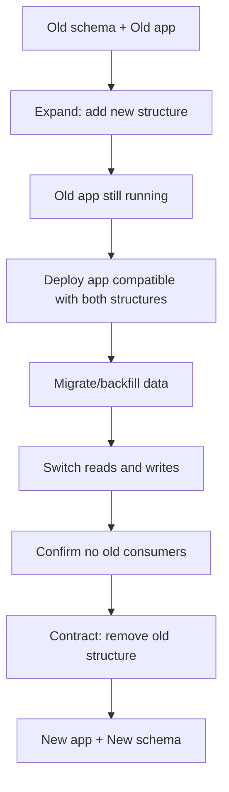

# Coordinating Application Versions with Schema Versions

A release often does more than just change application code. It may add columns, change data types, create tables, alter indexes, or shift how information is stored. If the new application and the database schema are incompatible during deployment, the service can fail even when both the build and tests succeeded.

Risk increases when using rolling deployments or blue-green deployments. During a rollout, multiple application versions may run concurrently and access the same database. The older version may still read or write using the old structure while the new version has already started using the new structure. Therefore, application changes and schema changes must be coordinated in an intentional sequence.

The core principle is to design database changes so that application versions that need to coexist can still operate. Schema changes are typically split into expand, migrate/switch, and contract steps. The application is deployed between those steps, while removing old structures only takes place after no version or consumer needs them anymore.

## 1. Applications and schemas have different lifecycles

Application versions are typically released per commit or release. Schema versions are modified via ordered migrations and stored in the database. The two version types are related but do not necessarily increment at the same time.

For example:

- Application 2.8.0 may run on schema version 41.
- Application 2.9.0 may require schema version 42.
- A migration that only adds an index may not require an application version change.
- A single application release may include multiple small migrations.
- A new schema may need to support two application versions concurrently during rollout.

Do not assume every application version maps to exactly one schema version. Instead, explicitly define which schema versions each application version supports.

This relationship can be represented with a compatibility matrix:

| Application | Schema 41 | Schema 42 | Schema 43 |
|---|---|---|---|
| App 2.8 | Supported | Supported if expand-only compatible | Undefined if old structure was contracted |
| App 2.9 | Supported if code remains compatible with old schema | Supported | Supported if changes are compatible |
| App 3.0 | May not be supported | Supported if contract migration has not run | Supported |

The actual matrix must be based on the behavior of the specific application and migrations. Do not infer compatibility solely from version numbers.

## 2. Why do rolling deployments make this harder?

In a rolling deployment, the system replaces instances in batches rather than stopping the entire service. For a period of time, old and new instances operate concurrently.

Suppose the old application reads the `customer_name` column, while the new application wants to use the `display_name` column. If the migration drops `customer_name` before old instances terminate, requests handled by old instances will fail. If the new application starts reading `display_name` before the column is created, new instances will also fail.

A safe sequence must account for concurrent states:

1. Old schema and old app are running.
2. Schema is expanded while old app is still running.
3. New app and old app run concurrently on the expanded schema.
4. Backfill transfers data to the new structure.
5. New app switches fully to the new structure.
6. Only after no old consumers remain is the new schema allowed to drop the old structure.

Blue-green deployments may also keep two application groups active in parallel while shifting traffic. Therefore, they also require schema compatibility. Merely switching traffic from blue to green does not mean the database can immediately drop structures that blue still needs if a rollback is triggered.

## 3. Backward compatibility and forward compatibility

These two concepts describe the ability of one component to keep working when the other component changes.

**Backward compatibility of the schema**: the new schema still supports the old application. For example, adding a nullable column that the old code is unaware of generally does not break the old code.

**Forward compatibility of the application**: the new application can operate with the old schema or old data state within a designed scope. For example, the new app reads the new column if populated, while temporarily falling back to the old column.

During a rollout, both directions may be necessary:

- The schema is expanded first so the old app does not fail.
- The new app is designed to tolerate transitional schema and data states.
- Both new and old apps write during periods requiring dual-write.
- The schema is only contracted after the old app is no longer running and rolling back to the old app is no longer permitted.

Not every change can be bidirectionally compatible. If a change breaks the old structure, split it across multiple releases or use a migration procedure with controlled downtime.

## 4. The expand-migrate-switch-contract model

A common approach to coordinating application and schema changes is splitting the change into four phases.


- **Expand:** add new structures without removing or altering how old structures behave.
- **Migrate:** move data from the old structure to the new structure, typically in resumable batches.
- **Switch:** update the application to read/write using the new structure, potentially using feature flags or dual-read during transition.
- **Contract:** remove the old structure after all applications and consumers have stopped using it.

Diagram:



Separating these phases keeps the blast radius of each deployment smaller. If an error occurs during expand or the compatible-app phase, you can halt before deleting old data or structures.

Contract should usually be a separate release or an approved step after sufficient observation time. Do not combine expand and contract into a single migration when application versions must coexist.

## 5. Example: renaming a column without service disruption

Suppose the `customers` table has a `customer_name` column. The product wants to switch to `display_name`. A direct rename migration can break the old app the moment the migration runs.

A safer approach:

**Phase 1 — Expand:** add a nullable `display_name` column. The old app continues reading and writing `customer_name`.

```sql
ALTER TABLE customers
ADD COLUMN display_name VARCHAR(160);
```

**Phase 2 — Deploy compatible app:** the new version can read `display_name` if present, otherwise falling back to `customer_name`. During transition, the app can write to both columns so new data stays in sync.

Illustrative logic example:

```java
String effectiveName(Customer row) {
    if (row.getDisplayName() != null) {
        return row.getDisplayName();
    }
    return row.getCustomerName();
}
```

Dual-write must be designed carefully. If both columns are updated by multiple application versions or multiple writers, establish the authoritative source of truth and rules for handling conflicting values. Do not allow two columns to freely overwrite each other without rules.

**Phase 3 — Migrate:** backfill `display_name` from `customer_name` for existing records. Execute in batches, with checkpoints, and make it re-runnable.

**Phase 4 — Switch:** once data has been migrated, the application reads and writes `display_name`. Dual-write may be kept during an observation period or rollback window.

**Phase 5 — Contract:** only after all old instances have stopped, old consumers have been updated, and rolling back to old code is no longer planned, drop `customer_name` in a separate migration.

Do not treat column renames as trivial operations when applications roll out instance by instance. In systems where multiple services share a database, inventory every consumer before contracting.

## 6. Migrations must be ordered and managed as source code

Migrations describe schema changes and sometimes data changes. They must be stored in version control, reviewed like code, and executed in a deterministic order.

With Flyway, versioned migrations are commonly named using the pattern `V001__description.sql`. For example:

```text
src/main/resources/db/migration/
├── V041__create_customers.sql
├── V042__add_display_name.sql
└── V043__add_customer_display_name_index.sql
```

Once a versioned migration has been applied in a shared environment, do not edit the old file to alter history. Tools like Flyway store checksums to detect migrations modified after execution. If logic needs fixing, create a new migration with a higher version.

Liquibase also manages changesets and checksums. Keep ID/author/path stable and avoid editing deployed changesets in ways that alter execution history. Handling legacy changesets depends on the tool and project policy.

Migrations should have a narrow scope, clear descriptive names, and be verifiable after execution. Avoid bundling dozens of unrelated changes into one migration, as it becomes hard to pinpoint what caused a failure.

## 7. Choosing when to run migrations

There are multiple ways to execute migrations, but a clear responsible owner must be chosen.

**Dedicated migration job in the pipeline** is usually easiest to control. The pipeline obtains a dedicated migration credential, verifies the target, runs the migration, and only deploys the application if conditions are met.

**Application running migrations on startup** may suit small apps or simple environments, though multiple replicas starting concurrently may attempt to modify the schema simultaneously. Migration locks and concurrency behavior guaranteed by the tool are required. You must also distinguish application runtime privileges from database schema modification privileges.

**Manually operated migrations** may be needed for high-risk changes or large data volumes, yet they should still be defined as versioned migrations, reviewed, and have results recorded.

A common flow:

1. Determine the current schema version.
2. Check pending migrations and compatibility conditions.
3. Back up or verify a recovery plan appropriate for the risk level.
4. Run the expand migration.
5. Verify the new schema.
6. Deploy the compatible application.
7. Run a separate backfill if needed.
8. Observe and confirm no old consumers remain.
9. Run the contract migration in a later release.

Do not let every application instance run DDL on its own using high-privilege database credentials. Separating the migration identity from the runtime identity limits the privileges of the running application.

## 8. Migration locks and concurrent deployments

If two pipelines run migrations concurrently, they can contend on the schema history table or modify the same database object simultaneously. Some migration tools have built-in locking mechanisms, but teams still need to understand their scope and limits.

Ensure that:

- Only one migration runner is allowed to run against a database or schema at a time.
- Locks have a timeout and are released upon completion or error.
- Other pipelines know a migration is in progress and do not deploy code depending on an unready schema.
- There is a way to inspect stuck migrations or lingering locks.
- Migrations run against the intended database, schema, and tenant.

Do not manually delete lock records or edit schema history just to let a pipeline proceed. First determine whether the migration is currently running, partially committed, or already finished. Some databases support transactional DDL, while some DDL operations cannot be rolled back in the usual way. Know the behavior of your database engine and migration tool.

## 9. Separating schema migrations from long data backfills

Structural changes and moving millions of rows are two different classes of work. Combining them into a single long-running transaction can hold locks for extended periods, generate massive WAL or transaction logs, increase replication lag, and impact live traffic.

A safer workflow:

- The expand migration only creates the required structure and finishes quickly.
- The backfill runs as a separate job in small batches.
- Each batch can track progress and be re-run safely.
- Rate limiting prevents overloading the database.
- Execution can be paused/resumed when system load is high.
- The contract migration only runs after backfill and data verification complete.

For example, an ID-based backfill in PostgreSQL can use small batches:

```sql
WITH batch AS (
    SELECT id
    FROM customers
    WHERE display_name IS NULL
      AND customer_name IS NOT NULL
    ORDER BY id
    LIMIT 500
)
UPDATE customers AS c
SET display_name = c.customer_name
FROM batch
WHERE c.id = batch.id;
```

This illustrates a single batch; the worker must loop until no remaining records need migration. Real implementations must handle nullable `customer_name`, concurrently updated rows, and checkpoint persistence. Measure impact on locks, indexes, WAL, and replication lag before choosing a batch size.

## 10. Backfills must be idempotent and resumable

A backfill job can be interrupted mid-way due to timeouts, canceled runners, or database issues. When restarted, it must resume without corrupting already-migrated data.

Good design practices:

- Each batch covers a deterministic range of records.
- Only update records not yet meeting the target condition or use saved checkpoints.
- Re-running the same batch produces no unintended side effects.
- Track counts of rows read, updated, and failed.
- Provide a way to detect skipped records.
- Support pausing/resuming based on load conditions.
- Enforce retry limits and handle failed records separately.

Do not rely solely on offset pagination over a changing dataset where inserts or deletes shift row positions. Cursor pagination over a stable key like ID is usually easier to control. For large tables, ensure appropriate indexes exist for filter predicates and ordering.

If source data continues changing during backfill, dual-write or change data capture must keep target data current. After backfill, run reconciliation to verify zero discrepancies before switching completely.

## 11. Dual-write and dual-read need boundaries

Dual-write means the application writes the same change to both old and new structures. Dual-read means the application can read from either structure during transition.

These techniques enable compatible rollouts but add complexity:

- Two writes can partially succeed if not inside the same transaction.
- Two values can diverge if another writer exists.
- Fallback logic can mask new data that was not backfilled.
- Removing old code paths can be forgotten after migration completes.
- Tests must cover old data, new data, and cases where one is missing.

If both columns reside in the same database transaction, both can be written atomically. If data spans two systems, direct dual-write easily leads to inconsistency; consider an outbox, events, or proper reconciliation processes.

Define exit criteria for dual-write. For instance, once backfill finishes, all writers have switched to the new schema, and reconciliation shows zero drift over an observation window, stop writing to the old structure. Do not maintain dual-write indefinitely.

## 12. Using feature flags to switch read/write behavior

Feature flags decouple code deployment timing from enabling new behavior. This is useful when the new app is deployed but the team wants to observe before shifting all traffic or reading from the new column.

For example:

1. Deploy the app with code supporting both old and new schemas.
2. Keep the flag reading from the old column or using fallback.
3. Run the backfill and verify data.
4. Enable the flag for a portion of traffic or a single tenant.
5. Monitor errors, latency, and data discrepancies.
6. Expand flag rollout once criteria are met.
7. Remove old code and configuration in a later release.

Feature flags do not replace migrations. If a column does not exist yet, flipping a flag to read that column will still fail. Expand must complete before enabling behavior that depends on the new structure.

Flags also need an owner, default state, kill switch plan, and removal deadline. Schema transition flags should be treated as temporary migration tools, not permanent code branches.

## 13. Evaluating compatibility at each stage

A state table can define which application versions are permitted to run with which schema versions.

| Stage | Schema | Old App | New App | Condition |
|---|---|---|---|---|
| Initial | Old | Allowed | Not deployed | Current system |
| After expand | Old + new structure | Allowed | Can deploy if compatible with new schema | Additive changes only |
| Rolling deploy | Expanded schema | Temporarily allowed | Allowed | Both versions run safely together |
| After backfill | Expanded schema + migrated data | May still be running | Allowed | Data verification passes |
| After switch | New schema, old structure still present | No longer targeted for long-term support | Allowed | All instances/consumers switched |
| After contract | New structure only | Must not roll back to old app | Allowed | Old rollback window closed |

This table highlights an essential principle: contract is the point that alters rollback capability. Before contract, rolling back to the old app remains viable while the schema preserves old structures. After contract, the old app may no longer run.

## 14. Application rollback is not schema rollback

When an application release has a bug, standard recovery is redeploying the previous application version. However, the schema may have already been expanded or data migrated. Reversing a migration is not always possible or advisable.

Some changes can be rolled back relatively safely:

- Adding an unused nullable column.
- Adding an index that did not alter data.
- Creating a new table with no dependent consumers yet.

Some changes may lose data or break compatibility with the old app:

- Dropping columns or tables.
- Data type conversions that lose precision.
- Merging multiple values into one field and deleting source data.
- Changing data semantics.
- Removing enum values or statuses that the old app might still write.

Therefore, a rollback plan must separate two questions:

1. Can we revert to the previous application version?
2. Are the current schema and data still compatible with the previous application version?

If the schema cannot be rolled back safely, prefer a forward-fix or a controlled compensating migration. Do not run automatic downgrades simply because a deployment job failed.

## 15. Placing contract after the rollback window

Once the new app runs stably, teams may want to delete old columns or tables. Doing so too early risks discovering a new bug that forces redeploying the old app when the schema no longer supports it.

Define the rollback window based on risk and operational procedures. During that window:

- Retain the old structures.
- Keep fallback or dual-write code if still needed for rollback.
- Monitor errors and data inconsistencies.
- Confirm no old instances or external consumers remain.
- Ensure backups and recovery capabilities are appropriate.

When the rollback window closes, make an explicit decision that reverting to the old app is no longer supported. Only then execute the contract migration. If the contract carries high risk, require separate approval and a maintenance window.

## 16. Data type changes and complex structural changes

Changing a column type directly can cause locks, table rewrites, or data loss depending on the database. For large tables or systems under continuous traffic, consider adding a new column instead.

For example, migrating `total_amount` from string to numeric:

1. Add a nullable `total_amount_numeric` column.
2. Deploy a compatible app capable of reading the old column and writing the new column under clear rules.
3. Backfill and log values that fail conversion.
4. Reconcile record counts and totals.
5. Switch the read path to the new column.
6. Stop writing to the old column once all writers have switched.
7. Contract by dropping the old column in a later release.

Define exact conversion rules: decimal formatting, currency units, rounding, null handling, and malformed data. Avoid implicit casts if they might alter values.

For enums or statuses, the old app might not recognize new values. Add values or update consumers before producers start emitting them. If a consumer processes an enum with an exhaustive switch, a new value can cause logic or deserialization errors.

## 17. Indexes and changes on large tables

Creating indexes or modifying constraints can affect performance and locking. Syntax and lock severity depend on the database engine and version.

In PostgreSQL, `CREATE INDEX CONCURRENTLY` can reduce write blocking compared to regular index creation, though it carries specific constraints such as not running inside a standard transaction block. Consult documentation for your exact database version and migration tool before putting it into a migration.

Steps to evaluate:

- Table size and data growth rate.
- Estimated index build time.
- Lock mode and impact on reads/writes.
- Temporary disk space.
- Replication lag.
- Ability to cancel and resume if the operation fails.
- Validating the index/constraint after creation.

Do not run heavy migrations during peak hours without load evaluation. For long-running changes, a dedicated operational job and rate limiting may be necessary.

## 18. Testing compatibility in CI

CI should test not only the new app against the new schema, but also the combinations that must coexist during rollout and the rollback window.

Useful checks:

- Initialize a database from an empty schema and run all migrations.
- Upgrade from the latest supported prior schema version.
- Run the previous app version against the post-expand schema.
- Run the new app against the pre-migration schema if the design claims support.
- Run old and new apps concurrently against the transitional schema.
- Test dual-write, fallback, and null/legacy data.
- Run backfill on a representative dataset and verify reconciliation.
- Test migration locking and behavior when two runners request migrations concurrently.
- Check query plans and migration duration on realistically sized data.
- Verify contract only runs when no old consumers remain.

Not every combination needs to run on every pull request. Tests can be grouped into fast checks and deep checks, but critical compatibility checks must gate releases.

## 19. Example pipeline coordinating migrations and applications

A pipeline can be organized in the following sequence:

```yaml
jobs:
  validate:
    steps:
      - validate migration naming and checksums
      - start disposable database
      - apply all migrations
      - run schema and application tests

  expand:
    needs: [validate]
    steps:
      - obtain migration identity
      - verify target database
      - apply expand migrations
      - verify schema version

  deploy-compatible-app:
    needs: [expand]
    steps:
      - deploy application that supports old and new schema
      - verify rollout and health

  backfill:
    needs: [deploy-compatible-app]
    steps:
      - run resumable data migration in batches
      - reconcile old and new data

  switch:
    needs: [backfill]
    steps:
      - enable new read path
      - monitor errors and data consistency

  contract:
    needs: [switch]
    steps:
      - require separate approval
      - confirm no old application or consumer remains
      - apply contract migration
```

Step names are conceptual descriptions and should be replaced with your CI platform's tasks and actions. Contract should generally belong to a separate release or change, not auto-triggered right after switch if the rollback window has not closed.

Pipelines must also handle cases where a job is canceled after expand but before deployment. The expanded schema state can be preserved safely; the next run should check schema history and resume rather than re-running operations destructively.

## 20. Managing migrations in multi-service environments

A single database may be shared across multiple services or application versions. In that case, schema ownership must be clearly defined.

Questions to answer:

- Which service owns the table or schema?
- Which service is permitted to modify the structure?
- Can other consumers read that table directly?
- Is there an API or event contract replacing direct database access?
- Who confirms no old consumers remain before contract?
- Does the migration affect other tenants or schemas?

If multiple services modify a schema without ownership, one team may drop a column another team still uses. Maintain a catalog or documentation of ownership and dependencies, along with a notification process for breaking changes.

In service architectures, prefer each service owning its own data while others access it via APIs/events. If a database remains shared, manage contracts and version compatibility like a public interface.

## 21. Observing post-migration and post-deployment

SQL-level migration success does not suffice to prove data correctness. Monitor both the data migration process and application behavior.

Key signals:

- Migration duration and lock waits.
- Backfill record counts succeeded/failed.
- Count of records still missing new values.
- Discrepancies between old and new columns or tables.
- Database CPU, disk, WAL, and replication lag.
- Query latency and error rates of old/new apps.
- Number of instances still running the old version.
- Serialization errors or unrecognized enum values.
- Percentage of requests traversing the new read path.
- Fallback counts to the old structure.

Set stop thresholds before starting. If replication lag exceeds thresholds or database errors spike, the backfill may need to pause. If data discrepancies do not converge to zero, do not switch the read path merely to finish the release.

Evidence should tie together schema version, application version, migration run ID, and target database. This aids investigation if an issue emerges after rollout completes.

## 22. Practical scenario: new app requires a mandatory column

A new version wants to use an `email_normalized` column for user lookups. The old app still writes emails to the `email` column. If the new app is deployed immediately after adding the column, older records lacking `email_normalized` might not be found.

A safe sequence:

1. Add nullable `email_normalized` and an appropriate index.
2. Deploy an app supporting both `email` and `email_normalized`.
3. Keep writing the old `email` while simultaneously writing the normalized value under a consistent rule.
4. Backfill existing records in batches.
5. Reconcile to verify all valid records have normalized values.
6. Enable the new read path via feature flag.
7. Monitor search results and errors during the rollback window.
8. Stop writing the old column once all writers have switched.
9. Drop the old column in a contract release once no consumers remain.

If null or invalid email records exist, define explicit handling rules. Do not enforce `NOT NULL` until data has been cleaned and every writer guarantees supplying a value.

## 23. Common anti-patterns

| Poor practice | Consequence | Improvement |
|---|---|---|
| Renaming or dropping a column in the same release as the new app | Old app fails during rolling deployment | Expand first, contract later |
| Testing only new app with new schema | Misses errors when old and new apps run together | Test compatibility matrix |
| Every app instance running DDL with admin privileges | Multiple replicas contend over migrations | Use a dedicated migration job and identity |
| Modifying a migration already run in a shared environment | Inconsistent history and checksums | Create a new migration |
| Backfilling an entire table in one long transaction | Increased locks, logs, and database load | Run batched backfill with checkpoints |
| Enabling new read path before backfill completes | Old records are missed | Reconcile before switching |
| Dual-writing without an authoritative source of truth | Two structures diverge | Define write ownership and reconciliation |
| Contracting immediately after deploy | Loses ability to roll back old app | Wait for rollback window and confirm consumers |
| Auto-downgrading on deploy failure | Risk of data loss or incompatible schema | Prefer forward-fix or compensating migration |
| Packing unrelated changes into one schema version | Hard to isolate errors and state | Small, ordered, single-purpose migrations |
| Ignoring other consumers | Other services still rely on old structure | Manage ownership and dependencies |
| Not monitoring replication lag during backfill | Slow replicas impact the application | Bound batch size and monitor load |

## 24. Adoption roadmap for a project

App and schema coordination can be standardized in the following steps:

1. **Inventory consumers:** identify every application, job, report, and integration reading/writing the data.
2. **Describe the change:** define old structure, new structure, data to migrate, and compatibility profile.
3. **Build a compatibility matrix:** list app/schema versions allowed to run together during rollout and rollback windows.
4. **Design expand:** add new structures without breaking the current app.
5. **Deploy compatible app:** support both old and new data during transition.
6. **Backfill:** migrate data in batches with checkpoints and rate limits.
7. **Reconcile:** verify completeness and consistency of data.
8. **Switch:** flip read/write paths via release or feature flag.
9. **Observe:** monitor errors, latency, data drift, and old instances.
10. **Close rollback window:** confirm no old consumers remain and decide against rolling back to the old app.
11. **Contract:** remove old structures in a separate migration with review and approval.
12. **Store evidence:** record schema version, app version, migration run, and verification results.

For small changes with obvious compatibility, the process can be simpler. For large tables, multiple consumers, or critical data, separate backfill and contract into independent operational steps.

## 25. Pre-release checklist for schema changes

- [ ] Current application version and schema version are identified.
- [ ] Every consumer reading/writing the affected structure is listed.
- [ ] A compatibility matrix exists for coexisting versions.
- [ ] Expand migration does not break the current application.
- [ ] Migration versions, ordering, and checksums are managed.
- [ ] Migrations were tested on the matching database type and version.
- [ ] Migration privileges are separated from runtime identity where needed.
- [ ] Mechanisms prevent two migration runners from modifying the schema concurrently.
- [ ] Backfills have clear batching, checkpoints, retries, and cleanup.
- [ ] Handling is defined for null, invalid, or concurrently updated rows.
- [ ] Reconciliation is performed before switching the read path.
- [ ] Old and new apps can coexist during rollout.
- [ ] Feature flags have enable/disable criteria and a removal plan.
- [ ] Application rollback does not rely on risky schema downgrades.
- [ ] Contract waits for the rollback window to close and old consumers to disappear.
- [ ] Breaking or data-deleting migrations have separate approvals.
- [ ] Locks, latency, replication lag, and data consistency are monitored.
- [ ] Evidence records app version, schema version, migration, and target.

## Conclusion

Coordinating application versions with schema versions is a compatibility challenge throughout the release lifecycle, especially when multiple application versions run simultaneously during rolling or blue-green deployments. It is not enough to verify that a migration executes successfully and the new app starts; every active version must be able to work with the schema at each stage.

Using expand-migrate-switch-contract, clearly versioned and ordered migrations, resumable backfills, compatibility matrices, testing old/new apps, and contracting after the rollback window makes data changes safer. By separating migration privileges, coordinating runners, and monitoring data consistency, pipelines can ship application updates alongside schema changes without forcing full system downtime.
