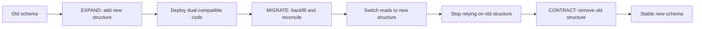
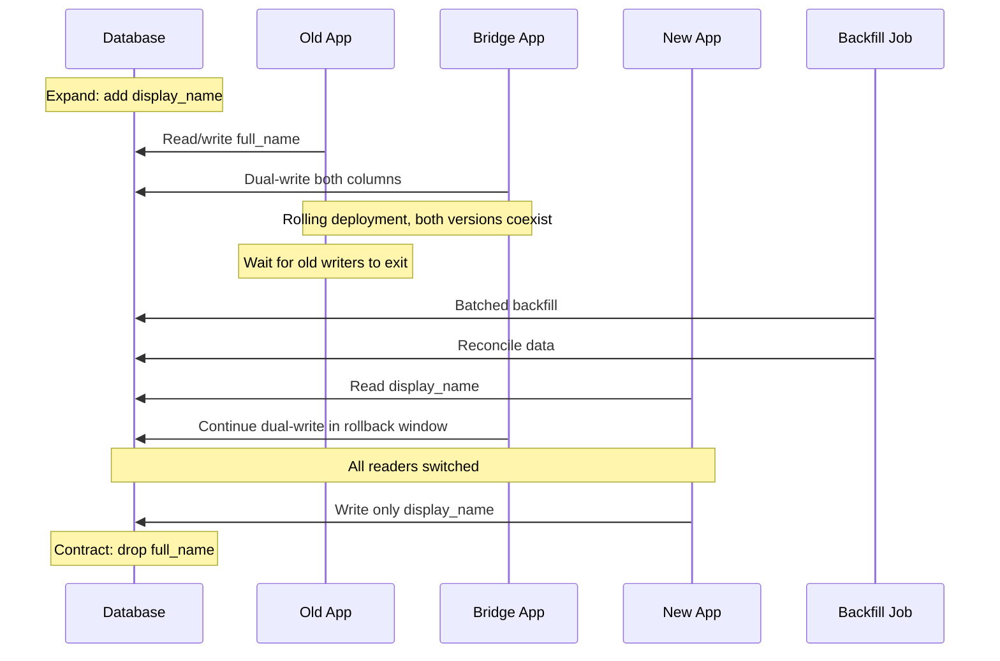

# Introduction to Expanding, Migrating, and Contracting Schemas

Changing database structure while an application continues serving users is a difficult part of CI/CD. A single release may have multiple application versions coexisting: old instances not yet replaced, new instances starting up, background workers still running, or a scheduled job using the previous schema. If a migration renames or drops a column immediately at deploy time, one of those versions can fail right away.

The **Expand – Migrate – Contract** pattern solves this problem by breaking a large change into small steps, each remaining compatible with the running application versions. You expand the schema first, deploy code capable of working with both old and new structures, migrate the data, switch read/write paths, and only contract the old structure after nothing depends on it anymore.

The goal is not to keep the old schema forever. The goal is to create a controlled transition window so deployment, backfilling, verification, and rollback can happen without forcing every instance to switch at the exact same moment.

## 1. Why do direct schema changes easily cause failures?

Suppose the `customers` table currently has a `full_name` column. The current application reads and writes that column. A new requirement wants to rename it to `display_name`.

If a migration runs immediately:

```sql
ALTER TABLE customers RENAME COLUMN full_name TO display_name;
```

The old application version continues executing `SELECT full_name ...` and starts failing. In a rolling deployment, this is normal: not all instances are replaced at the exact same instant. Workers, consumers, or batch jobs may continue running old code even longer than web servers.

Dropping a column carries a similar risk. A dashboard, report, operational script, or scheduled task might still read the old column even after the main application code has switched.

Changes that risk breaking compatibility include:

- Renaming or dropping columns/tables still used by old code.
- Changing data types such that old values can no longer be read or written.
- Adding `NOT NULL` when existing data contains NULLs or the old version sends no value.
- Adding constraints or foreign keys that reject previously valid writes.
- Changing enums or message schemas so old consumers do not understand new values.
- Moving data to a new structure while the old version still writes to the old structure.
- Creating indexes or running large backfills that lock tables, increase replication lag, or exhaust resources.

### Two versions may access the database concurrently

During a rollout, the database may be accessed by:

| Component | Example | Why it must be accounted for |
|---|---|---|
| Old web/API instances | Version serving traffic prior to deployment | May continue reading/writing the old schema |
| New web/API instances | Newly rolled-out version | May require the new schema or dual-write |
| Background workers | Queue consumers, schedulers, batch jobs | Have a different deployment lifecycle than web instances |
| Operational tooling | Reports, ETL, BI, admin scripts | Not always deployed alongside the application |
| Replicas or downstream systems | Read replicas, CDC, data warehouses | May receive changes with lag or depend on old column names |

A safe migration must account for all consumers of the schema, not just the primary service.

## 2. The Expand – Migrate – Contract pattern

The workflow has three major phases, with the data and code transition phase often broken into smaller steps.



**Expand** adds new structures in a way that does not break older versions. For example, adding nullable columns, new tables, indexes, or constraints in an unvalidated state.

**Migrate** deploys compatible code, copies/backfills legacy data into the new structure, verifies consistency, and gradually shifts reads. During this phase, dual-write or shadow-read may be required.

**Contract** removes the old structure after all applications, workers, reports, and tools have stopped using it. This is typically the step most likely to break compatibility and hardest to roll back, so it must happen last.

### Compatibility matrix to maintain

For example, when transitioning from `full_name` to `display_name`:

| Application | Old schema | Expanded schema | Contracted schema |
|---|---:|---:|---:|
| Old version knowing only `full_name` | Works | Must continue working | Incompatible |
| Dual-write bridge version | Should not deploy before expand | Works | May be incompatible if still writing `full_name` |
| New version using only `display_name` | Incompatible | Works | Works |

The critical requirement is that **the expanded schema must support both old code and bridge code**. Only after all old code has been replaced and data is ready should you proceed to contract.

## 3. Preparing before changing the database

Before writing a migration, understand the data scale and every consumer using the schema.

### Mapping dependencies

Locate everywhere the column or table to be changed is read or written:

- Repositories, ORM mappings, stored procedures, triggers, and views.
- APIs, workers, schedulers, consumers, and batch jobs.
- Reports, BI, ETL, CDC, and data warehouses.
- Admin scripts, internal dashboards, and customer support tooling.
- Applications or older versions that may be rolled back to during release.

Searching source code is the first step; cross-check against query logs, database catalogs, audits, or telemetry if available. A monthly script might not show up in the test suite yet still depend on the schema.

### Assessing migration characteristics

Document explicitly:

- Specific database engine and version.
- Row counts, table sizes, indexes, and data growth rate.
- Related locks, constraints, triggers, and critical queries.
- Engine capabilities for online/concurrent index creation.
- Maximum acceptable lock duration.
- Replication topology, CDC, and tolerable lag.
- Backup capabilities, point-in-time recovery, and recovery time.
- Plan for executing the migration, backfill, verification, and emergency stop.

DDL behavior differs across PostgreSQL, MySQL, SQL Server, and their versions. Never assume an `ALTER TABLE` statement is always metadata-only or always runs online. Check documentation for the exact engine/version and test on production-scale data.

### Migrations must have an execution owner

Do not let every application replica run migrations on startup. Multiple instances can contend for locks or execute the same change simultaneously. Use a controlled migration job, a migration tool with lock/version tracking, or a single-leader mechanism.

Migrations should be reviewed code stored in Git alongside the release. The migration job holds dedicated DDL privileges; the runtime application user holds only privileges required for business queries. Separating privileges reduces the risk of an application accidentally altering the schema.

## 4. Expand phase: adding new structures compatibly

The expand phase generally favors additive operations so that older versions can keep running.

For example, adding a new column:

```sql
ALTER TABLE customers
ADD COLUMN display_name text;
```

The new column allows NULLs, so the old version is not required to supply a value. The old version keeps reading/writing `full_name`; new code can be prepared to use `display_name`.

Common expand operations:

- Adding nullable columns or columns with compatible defaults.
- Creating a new table alongside the old table.
- Adding indexes without blocking writes for too long, if supported by the engine.
- Adding constraints in an unvalidated state and validating them separately.
- Adding fields to messages/APIs in a way old consumers can ignore.

### Do not add `NOT NULL` too early

If the old version is unaware of the new column, adding a `NOT NULL` column without a default can cause writes from old code to fail. Even with a default, DDL behavior and cost depend on the engine and version.

A safer approach is adding a nullable column, deploying code that writes values, backfilling legacy data, verifying no missing values remain, and only then adding the mandatory constraint.

In PostgreSQL, you can add a check constraint marked `NOT VALID`, then validate it once data meets the condition:

```sql
ALTER TABLE customers
ADD CONSTRAINT customers_display_name_present
CHECK (display_name IS NOT NULL) NOT VALID;

ALTER TABLE customers
VALIDATE CONSTRAINT customers_display_name_present;
```

A `NOT VALID` constraint still enforces rules on newly inserted or updated rows according to PostgreSQL semantics, while scanning existing data is deferred to the validate step. Evaluate actual locks and impact for your PostgreSQL version. Once validated, setting `NOT NULL` can be considered; do not copy this exact pattern blindly to other engines.

### Creating indexes without unnecessary disruption

In PostgreSQL, `CREATE INDEX CONCURRENTLY` allows index creation while writes continue, though it still incurs I/O, CPU cost, and certain wait phases. This statement cannot run inside a transaction block:

```sql
CREATE INDEX CONCURRENTLY idx_customers_display_name
ON customers (display_name);
```

The migration tool must be configured to run this step outside a transaction if the tool wraps entire migrations in transactions by default. If concurrent index creation fails, it can leave behind an invalid index; inspect the catalog and clean it up before retrying. On large tables, monitor duration, disk usage, and replication lag.

## 5. Deploying a compatible bridge version

Once the new schema exists, deploy the bridge version of the application. This version must work with the expanded schema and run concurrently with the old version during rollout.

In the column-rename example, the bridge version can:

- Continue reading `full_name` so user-facing behavior does not change yet.
- Write the same value to both `full_name` and `display_name` in a single transaction.
- Avoid requiring the new column in code paths not yet transitioned.
- Include a feature flag to switch reads to the new column once backfill and reconciliation complete.

Example SQL writing both columns simultaneously:

```sql
UPDATE customers
SET full_name = :name,
    display_name = :name
WHERE id = :customer_id;
```

Updating both columns in a single statement provides atomic updates in the database. If the application executes two separate statements, proper transactions and error handling are required so only one column is not updated alone.

### Dual-write needs a time limit

Dual-write keeps both structures synchronized during transition, but increases complexity:

- Every write path must update both places, including admin tools and workers.
- If a write partially succeeds, data can diverge.
- When writing to two independent systems, a local transaction cannot cover both.
- Concurrent backfills and write requests need rules to handle race conditions.

If both structures reside in the same database, prefer a single transaction. If writing across two different systems, consider a transactional outbox, CDC, or a sync pipeline with retries/idempotency; do not issue two independent writes and treat them as atomic.

A database trigger can synchronize old and new columns during transition, though triggers introduce hidden logic. If used, manage triggers as code, test across all write paths, and plan their removal in the contract phase.

### Wait for all old versions to stop writing

During a rolling deployment, there is a period where old and bridge versions coexist. The old version only writes `full_name`, so a backfill run before old instances terminate can miss recent updates.

Wait until every web instance, worker, scheduler, and job capable of writing the old column has moved to the bridge version. Only then run the final backfill pass and reconciliation. If you cannot guarantee identifying every writer, add a controlled, observable synchronization mechanism such as a trigger or CDC.

## 6. Migrate phase: backfilling data in batches

Once bridge code is deployed and all old writers have been replaced, copy existing data from the old column to the new column.

Avoid updating millions of rows in a single transaction whenever possible. An oversized transaction can:

- Hold row locks for long durations and block business requests.
- Generate huge WAL/undo logs and lag replicas.
- Increase bloat, I/O pressure, and vacuum/cleanup time.
- Be hard to pause or resume if interrupted mid-way.
- Create a massive, hard-to-control data rollback window.

Instead, divide the backfill into small, independently committed, re-runnable batches.

### Batched backfill example on PostgreSQL

The example below assumes `full_name` is the old source, `display_name` starts as NULL, and the bridge app is already dual-writing. A worker can claim a batch as follows:

```sql
BEGIN;

WITH batch AS (
    SELECT id
    FROM customers
    WHERE display_name IS NULL
      AND full_name IS NOT NULL
    ORDER BY id
    LIMIT 500
    FOR UPDATE SKIP LOCKED
)
UPDATE customers AS c
SET display_name = c.full_name
FROM batch
WHERE c.id = batch.id;

COMMIT;
```

Repeat the transaction until no matching rows remain. `SKIP LOCKED` is helpful when running multiple backfill workers to avoid waiting on the same rows; with multiple workers, repeat the scan pass because a batch may skip rows locked by another transaction. Finally, run a full reconciliation query to confirm no missing or mismatched data remains.

If running a single worker, omit `SKIP LOCKED` and process sequential batches. Tune batch size based on transaction duration, lock waits, WAL, replication lag, and production load; 500 is purely illustrative.

### Backfills must be idempotent

Re-running a batch must not corrupt data or create duplicate side effects. The `display_name IS NULL` predicate ensures only unpopulated rows are filled. For complex transformations, clearly define the source of truth and update conditions so new values written by the application are not overwritten.

For instance, if `display_name` is normalized from multiple fields, make the transformation expression deterministic and version the rule. Do not allow identical inputs to produce different outputs depending on execution time or worker locale.

### Checkpointed and rate-limited backfills

For very large tables, track progress by primary key or partition. Each batch should log:

- Migration ID and batch/checkpoint.
- ID range or partition processed.
- Counts of rows read, updated, skipped, and failed.
- Transaction duration and lock wait time.
- Replication lag, WAL generation, and database load.

Throttle or pause execution when database load is high. Avoid large `OFFSET` pagination across a full table when keyset pagination by primary key or filtering unconverted rows is possible. With multiple workers, partition ranges clearly and ensure checkpoints never cause rows to be skipped.

### Handling failed rows or invalid data

Do not force every row into a default value just to make the migration finish. If certain rows cannot be converted, record the ID and reason in an error table or restricted-access report. Classify failures:

- Missing data that is valid under business rules.
- Legacy malformed data needing cleanup.
- Out-of-bounds or unmappable values.
- Transient errors due to locks, timeouts, or dependencies.

Transient errors can be retried with limits. Invalid data requires business decisions or a separate remediation workflow. Avoid logging full personal data if IDs and error codes suffice for investigation.

## 7. Reconciling before switching reads

Backfill completion does not guarantee data correctness. Verify completeness and consistency before routing read traffic to the new column.

In the column-rename example, you can check:

```sql
-- Any rows with old source still missing backfill?
SELECT count(*) AS missing_rows
FROM customers
WHERE full_name IS NOT NULL
  AND display_name IS NULL;

-- Do the two columns differ? Use when the transformation rule is direct copy.
SELECT count(*) AS mismatched_rows
FROM customers
WHERE display_name IS DISTINCT FROM full_name;
```

`IS DISTINCT FROM` is PostgreSQL syntax for NULL-safe comparison. If `display_name` is normalized or transformed, compare against the expected transformation expression instead of comparing the two columns directly.

Beyond counts, inspect data samples, length distributions, special characters, encoding, boundary values, and foreign key relationships. On large tables, reconcile by partition or ID range, ensuring full dataset coverage before official cutover.

### Shadow-reads to compare results

After backfill, the application can read the new column alongside the old column while returning only results from the old column. Reads from the new column are compared in shadow mode, emitting metrics on mismatch counts and types.

Do not log full records containing sensitive data. Log non-sensitive IDs, error category codes, and mismatch counts. Shadow-reads must be rate-limited or sampled so doubling queries does not overload the database.

Switch reads only when:

- Backfill is complete with a final checkpoint.
- Zero missing rows or unexplained mismatches remain.
- Dual-write is active across all write paths.
- Shadow-reads are stable over a sufficient observation window.
- Database and application metrics remain within thresholds.

## 8. Switching reads using feature flags

You do not have to shift every request to the new structure at once. Feature flags can enable the new read path for a small group, a tenant, or a percentage of traffic, then ramp up gradually.

A common sequence:

1. Read old column and shadow-read new column.
2. Enable reading the new column for internal users or a canary group.
3. Compare errors, latency, and business outcomes.
4. Ramp up the percentage of new reads as metrics pass.
5. Switch all readers to the new column.
6. Retain dual-write while application rollback remains necessary.

If falling back from the new column to the old column, emit metrics so fallbacks are visible. Fallbacks prevent immediate errors but can hide incomplete backfills or bugs in new code. Do not leave silent fallbacks in place indefinitely.

### Ensuring every reader has switched

Before dropping the old column, check:

- All versions of APIs and workers.
- Scheduled jobs, batches, data exports, and reports.
- Database views, stored procedures, triggers, and functions.
- Dashboards/BI, ETL, CDC connectors, and replica consumers.
- Operational scripts, support tools, and external integrations.

Query logs or database activity monitoring can spot queries still referencing the old column, though short observation windows cannot prove no monthly or quarterly job still depends on it. Inventory consumers and confirm with system owners.

## 9. Stopping dual-write and preparing for Contract

Once all readers use the new structure, plan to stop writing to the old structure. However, do not stop dual-writing immediately after enabling new reads if the old version remains a rollback target.

A typical safe sequence:

1. All code reads `display_name`.
2. Code keeps writing both `full_name` and `display_name` during the rollback window.
3. Rollback window ends and confirmation shows no old versions/jobs need `full_name`.
4. Deploy code that writes only `display_name`.
5. Monitor to verify no reads or writes hit `full_name`.
6. Execute contract in a separate migration.

Define the rollback window based on release processes—such as post-deploy observation time, job schedules, and recovery capabilities. Do not pick an arbitrary duration that overlooks infrequent batch jobs or paused consumers.

## 10. Contract phase: removing the old structure

Contract is the final step and usually the hardest to reverse. Execute it only after confirming:

- No application version reads or writes the old structure.
- Workers, schedulers, consumers, and batch jobs are updated.
- Reports, ETL, views, triggers, and downstream integrations no longer depend on it.
- Backfill and reconciliation passed.
- The rollback window relying on the old schema has closed.
- Verified backups/PITR and a tested recovery plan exist.
- The DDL has been tested on the matching database version and comparable data scale.

In our example, the contract migration drops the old column:

```sql
ALTER TABLE customers
DROP COLUMN full_name;
```

Run this command only after all dependencies are removed. `DROP COLUMN` may require metadata locks with impacts depending on engine/version; dropping a column does not necessarily reclaim disk space immediately. Evaluate lock timeouts, runtime, and replica impact before executing.

To drop an old index in PostgreSQL while minimizing write blocking, use `DROP INDEX CONCURRENTLY` where appropriate. This command has its own restrictions and cannot run inside a transaction block. Check index dependencies before dropping.

### Contract can span multiple releases

You do not have to delete everything in one migration. You can:

- Stop referencing the old column in code.
- Remove synchronization triggers after dual-write stops.
- Drop indexes or constraints no longer needed.
- Drop the old column in a subsequent release.
- Drop the old table after data and downstream consumers have fully transitioned.

Breaking contract into steps gives each action a clearer blast radius and recovery plan.

## 11. End-to-end example: renaming `full_name` to `display_name`

Suppose the current table is:

```sql
CREATE TABLE customers (
    id bigint PRIMARY KEY,
    full_name text NOT NULL,
    created_at timestamptz NOT NULL DEFAULT now()
);
```

The end goal is for code and schema to use only `display_name`. Rollout can be split across the following releases.

### Release A — Expand schema

Add the new column while preserving the old one:

```sql
ALTER TABLE customers
ADD COLUMN display_name text;
```

The old application keeps running because `full_name` still exists and `display_name` allows NULLs.

### Release B — Deploy bridge code

New code still reads `full_name`, while all writes update both columns in the same transaction. During rolling deployment, old instances may still exist and only write `full_name`; therefore, data cannot yet be considered fully synchronized.

Wait for all old instances, workers, and jobs to finish. Confirm no old writers remain before proceeding to the final backfill step.

### Job C — Backfill and verify

Run batched updates for rows missing `display_name`. Enforce rate limits, record checkpoints, and watch locks and replication lag. Run verification queries for `missing_rows` and `mismatched_rows` across the entire table.

If failed rows occur, resolve them according to data rules before switching reads. Do not ignore mismatches simply because the percentage is small if the data is business-critical.

### Release D — Switch reads

Turn on the feature flag to read `display_name` for a canary group. Monitor errors, latency, fallbacks, and shadow comparison results. Ramp up to 100% traffic when criteria pass. Keep dual-writing during the rollback window so old code can be restored without losing recent updates.

### Release E — Stop old writes

After the rollback window closes and all readers/writers have switched, deploy code that writes only `display_name`. Monitor query logs, jobs, and reports to confirm `full_name` is no longer accessed.

### Release F — Contract schema

Remove old triggers or sync logic if any, then drop `full_name` in a separate migration. Verify applications, workers, and reports after the migration. From this point forward, rolling back to code that only knows `full_name` is no longer safe without restoring the corresponding schema and data.



The example above illustrates a column rename. For data type changes, table splits, primary key changes, or cross-database migrations, the steps may be more intricate, yet the principle of staged compatibility remains identical.

## 12. Controlling locks, transactions, and database load

A migration can be logically sound yet still cause an outage due to locking or resource contention. Always check how both DDL and backfills interact with real workloads.

### Bounding lock wait times

In PostgreSQL, set `lock_timeout` and `statement_timeout` for the migration session:

```sql
SET lock_timeout = '3s';
SET statement_timeout = '15min';
```

If a lock cannot be acquired quickly, the migration fails fast and can be retried later instead of queuing and blocking incoming requests. Tune timeouts to the specific operation; do not apply one blanket value to every migration.

### Avoiding long-running transactions

Keeping transactions open holds locks, accumulates dead row versions, and hinders vacuuming. Backfills should commit per batch, save checkpoints after successful commits, and support resuming after failures.

Do not alter large columns/indexes during peak traffic without impact evaluation. Monitor CPU, I/O, lock waits, connection pools, WAL, and replication lag throughout execution.

### Migrations and backfills are different workloads

DDL modifies structure; backfills transform data. You do not need to run an entire backfill inside the same migration file or the same transaction as DDL. Separating them ensures:

- Schema migrations complete quickly with clear state.
- Backfills can be paused/resumed and rate-limited.
- Progress can be observed and failed rows handled.
- DDL transactions are not held open while moving millions of rows.

A migration tool can manage schema versions while the backfill runs as a separate checkpointed job. Explicitly declare dependencies: the job only runs after schema expand and bridge code are ready.

## 13. Integrating Expand–Migrate–Contract into CI/CD

Pipelines should model migrations explicitly as part of the release with clear dependency ordering. Do not bundle everything into a single deploy command with no intermediate states.

A typical workflow:

1. **Pull request:** lint migration scripts, run migration tests against an ephemeral database, and verify code compatibility with the expanded schema.
2. **Pre-deploy:** verify backup/PITR, schema version, capacity, and lock risks.
3. **Expand job:** execute additive DDL once using a dedicated migration identity.
4. **Application rollout:** deploy bridge code via rolling/canary rollout; track remaining old instances.
5. **Backfill job:** run with batching, checkpoints, rate limits, and metrics.
6. **Verification gate:** verify zero missing/mismatched rows, shadow-read health, and consumer inventory.
7. **Read switch:** enable the feature flag for canary traffic and ramp up.
8. **Rollback window:** retain dual-write and old structures for the defined duration.
9. **Stop old writes:** deploy code using only the new schema once old rollback is no longer needed.
10. **Contract job:** execute DDL removing old structures in a separate release.

### Matrix compatibility testing

Migration tests should check not only the final schema, but also intermediate states:

| Database state | Version to test | Expected result |
|---|---|---|
| Old schema | Old app | Existing behavior continues passing |
| Expanded schema | Old app | No errors when new columns/tables exist |
| Expanded schema | Bridge app | Dual-write and old-path reads work |
| Migrated schema | Bridge app | New data is complete and synchronized |
| Migrated schema | New app reading new structure | Equivalent business outcomes |
| Contracted schema | New app | Zero references to old structure remain |

Beyond unit tests, include integration tests running real migrations on the exact database engine/version. Testing on H2 does not prove PostgreSQL or MySQL DDL is safe because DDL semantics, locking, and data types differ.

### Running migrations once with dedicated privileges

In CI/CD, create a dedicated migration job with concurrency control or migration locks. Never let every replica run DDL on startup. Migration job credentials need DDL privileges; runtime credentials should omit `ALTER`, `DROP`, or `CREATE` unless required.

Jobs should record migration ID, release ID, before/after schema versions, timestamp, triggering user/identity, outcome, and backfill checkpoints. Never log sensitive data.

## 14. Rollback and data recovery

Expand–Migrate–Contract makes early-phase rollbacks easier because old structures remain intact. Still, rollbacks must distinguish code, schema, and data.

### Before switching reads

If bridge code has a bug, you can revert to the old app while keeping the newly added column. The expanded schema can usually stay in place because the new column does not break old code. There is no need to immediately drop the new column just to roll back the application.

### After switching reads while dual-write is active

You can flip the feature flag back to read the old column if old data has stayed synchronized. This is why dual-write is kept through the rollback window. Before rolling back, verify the old column is still complete and compatible with the version being restored.

### After stopping writes to the old structure

If the app only writes `display_name`, the `full_name` column may already be stale. Rolling back to the old app risks reading outdated data. In this scenario, perform a controlled reverse backfill or deploy a forward fix; do not assume toggling a feature flag suffices.

### After contract

Once the old column is dropped, rolling back to old code is no longer safe. Going back may require recreating the structure, restoring data from backup/PITR, or running a verified reverse migration. For deleted or irreversibly transformed data, a dedicated recovery procedure is mandatory.

For this reason, contract is typically decoupled from the transition release and executed only after the rollback window expires. Backups/PITR must be restore-tested; an existing backup that has never been test-restored is not reliable recovery evidence.

## 15. Changes requiring special attention

### Renaming columns or tables

Do not rename directly while old code remains live. Add the new column/table, dual-write or sync, backfill, switch readers, and drop the old structure last.

### Changing data types

When converting `integer` to `bigint`, or text to a normalized type, evaluate value ranges and readability by older versions. For complex conversions, add a new column of the target type, write in parallel, backfill, and validate before switching.

### Adding enum values

An older application version may fail to handle a new enum value. Before writing new values, deploy consumers/providers capable of ignoring or handling unknown values per contract. In polyglot or multi-client systems, check both parsers and serializers.

### Adding `NOT NULL` or foreign keys

First clean/backfill data and ensure all writers supply valid values, then add the constraint. On PostgreSQL, `NOT VALID` and `VALIDATE CONSTRAINT` can be used for certain constraints to decouple legacy data validation from constraint creation. Check engine/version limitations.

### Splitting or merging tables

This is a larger change than renaming a column. Define the source of truth, data synchronization, concurrent writes, foreign key relationships, uniqueness, and reader/writer cutover order. You may need outbox/CDC or a dual-read phase for reconciliation. Copying existing rows is insufficient if new transactions still write to the old table.

## 16. Practices that easily cause incidents

| Practice | Risk | Improvement |
|---|---|---|
| Renaming/dropping columns in the same release as new code | Old instances fail immediately in rolling deployment | Expand first, contract later |
| Adding a `NOT NULL` column before old app writes it | Requests from old version fail | Add nullable, deploy bridge, backfill, then constrain |
| Backfilling an entire table in one transaction | Long locks, huge WAL, hard to resume | Small batches, checkpoints, and rate limits |
| Backfilling while old writers run without sync | New updates are missed or drift | Wait for old writers to exit or use controlled sync |
| Switching reads right after starting backfill | App reads NULLs or stale data | Reconcile and shadow-read before switching |
| Stopping dual-write as soon as canary passes | Rollback to old app reads stale data | Retain dual-write during rollback window |
| Contracting immediately after deploy | Legacy jobs or reports may still depend on it | Inventory consumers and wait across operational cycles |
| Letting each replica run migrations on startup | DDL contention and inconsistent state | Single migration job with lock/version tracking |
| Using H2 to prove production DDL is safe | Engine and locking differences are masked | Test on the exact engine/version |
| Assuming reverse migrations always restore data | Data transformations may be irreversible | Backups/PITR, forward fixes, and explicit rollback plans |

## 17. Checklist for a safe schema change

Before deploying:

- [ ] Identified all apps, workers, jobs, reports, and downstream systems using the old schema.
- [ ] Checked database engine/version, table size, and lock risks.
- [ ] Verified backups/PITR and tested restore procedures.
- [ ] Versioned, reviewed, and scheduled migrations via a dedicated job with concurrency control.
- [ ] Expand phase adds only structures compatible with old code.
- [ ] Bridge code can run concurrently with the previous version.
- [ ] Dual-write uses atomic transactions or proper sync mechanisms and has an end date.
- [ ] Backfill uses batching, checkpoints, idempotency, rate limits, and resume support.
- [ ] Monitored locks, WAL, replication lag, CPU, I/O, and batch errors.
- [ ] Reconciled completeness and consistency across the entire dataset.
- [ ] Shadow-reads or canary validated new results before switching all readers.
- [ ] Rollback window defined; dual-write kept long enough if rollback is needed.
- [ ] Confirmed zero remaining old readers/writers before contract.
- [ ] Contract runs in a separate migration with lock/rollback handling planned.
- [ ] Tested migrations on the exact database engine/version and representative data scale.
- [ ] Traceability evidence links schema, application version, and release ID.

Expand–Migrate–Contract allows databases and applications to evolve at their own pace while staying compatible during transition. When the new schema is added first, bridge code keeps both structures synchronized, backfills are reconciled, and old structures are removed only after all dependencies vanish, CI/CD can ship data changes in small, observable steps with clear recovery paths.
