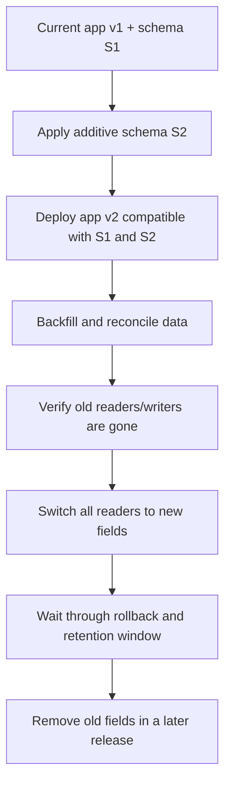
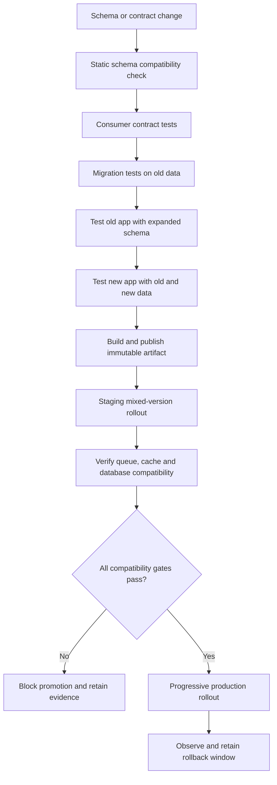

# Maintaining Compatibility When Multiple Application Versions Run Concurrently

During a release, old and new versions often coexist for a period of time. With rolling deployments, some pods already run the new version while others still run the old version. With blue-green, two environments may both operate before and after shifting traffic. With canary, a slice of requests is handled by the new version while the remainder still goes to the current version. In addition, queues may hold older messages, mobile clients may not have updated yet, workers may process jobs created days earlier, and a rollback may revert the application back to the previous version.

Therefore, data changes and communication contracts must be designed so that versions can safely operate side by side. **Multi-version compatibility** is the ability to keep producers, consumers, services, databases, and clients exchanging data accurately throughout a transition period. This is a critical prerequisite for CI/CD to roll out progressively, pause a rollout, or roll back without corrupting data.

## 1. Why do multiple versions coexist?

In real-world environments, there is no single instant when every component switches to a new version. Common scenarios include:

- Rolling updates replacing pods or instances in batches.
- Canary routing only a fraction of traffic to the new version.
- Blue-green keeping the old environment alive while validating the new environment.
- Autoscaling launching new instances while older instances still serve requests.
- Jobs or messages created by a previous version being processed by a newer worker version.
- Consumers deploying slower than producers, or vice versa.
- Mobile apps, desktop clients, or external partners updating on their own schedules.
- Rollbacks reverting application code to an older version after the database has been expanded or new data has been written.

Even when a rollout only takes minutes, queue backlogs, caches, sessions, and older clients can extend the compatibility window to hours, days, or months. Consequently, you cannot assume "once deployed, only one version remains."

## 2. Compatibility is a contract between producer and consumer

A component generating data is called a producer; a component reading or processing that data is a consumer. A system can act as both producer and consumer. Database schemas, API requests/responses, events, messages, cache entries, sessions, and files are all data contracts.

For example:

```text
order-service v1 ----writes----> orders table
      |                              ^
      +----publishes event----------> billing-service v1

During rollout:
order-service v1 and v2 may both write/read
billing-service v1 and v2 may consume queued events
```

A change is only safe when participating parties interpret data compatibly during the transition period. You must identify who writes, who reads, how long old data persists, and which components can be rolled back independently.

Do not test only the new application against the new schema. Also test critical pairs such as old application against new schema, new application against old data, and old producer against new consumer.

## 3. Backward compatibility and forward compatibility

These two terms are frequently confused. Always specify the producer/consumer perspective when using them:

- **Backward compatible change:** the new version continues supporting contracts or data that older consumers/producers use. For example, a new API server still accepts requests in the old format.
- **Forward-compatible consumer:** the current consumer can process data generated by a newer producer, even if the data contains additional fields or enum values the consumer does not yet recognize, following designed rules.
- **Breaking change:** one side no longer understands or accepts the contract sent by the other side; the change can cause request failures, data misinterpretation, or dead-lettered messages.

API example: adding an optional response field is often backward compatible with old clients if clients ignore unknown fields. Renaming a required field or changing a data type is typically a breaking change. Event example: a new consumer reading an old event is one direction of compatibility; whether an old consumer can handle a new event is the opposite direction.

There is no role-independent definition of "backward." In review documents, state explicitly: "server v2 continues accepting v1 requests," "consumer v1 ignores new fields," or "application v1 can read the database schema after the expand step."

## 4. The version matrix to test

Suppose the current release is N and the upcoming release is N+1. During rollout, the team should examine these combinations:

| Producer/writer | Consumer/reader | Question to answer |
|---|---|---|
| N | N | Does the current system continue working with existing data? |
| N+1 | N | Can the old component read data produced by the new one? |
| N | N+1 | Can the new component read data created by the old version? |
| N+1 | N+1 | Do both new components adhere to the new contract? |
| N+1 | rolled back to N | Is written data still readable after rolling back? |

Not every system must support every combination indefinitely. At minimum, however, identify combinations that can occur during rollout, queue retention, client support windows, and rollback windows. If a combination is unsupported, the pipeline or rollout controller must prevent it from happening.

With many services, the matrix can grow large. Start from the dependency graph and critical data flows: which service writes to which table, who reads the table, who publishes events, who consumes events, and which clients call the API.

## 5. Principle of expanding before breaking

A safe approach is executing changes in compatible steps:

1. **Expand:** add new structures or capabilities while keeping old paths operational.
2. **Migrate:** update applications, migrate data, and gradually shift consumers to the new structure.
3. **Verify:** confirm no component still depends on the old structure.
4. **Contract:** remove the old structure in a later release once no consumer needs it.

This pattern is commonly known as *expand-migrate-contract* or *expand-contract*. The key idea is decoupling breaking operations from the initial application rollout. While v1 and v2 run concurrently, both can work against the expanded schema.

Do not bundle adding a new column, migrating all data, dropping the old column, and deploying new code in a single migration if the old application is still running. Separating phases creates safe stopping points and preserves application rollback capability.

## 6. Expand-migrate-contract example for a database

Suppose the `customers` table currently has a `full_name` column. The team wants to split it into `given_name` and `family_name`.

**Phase 1 — Expand:** add the two new columns while keeping `full_name`:

```sql
ALTER TABLE customers
    ADD COLUMN given_name VARCHAR(100),
    ADD COLUMN family_name VARCHAR(100);
```

At this step, old code continues reading/writing `full_name`. New code must be designed to read legacy data when the two new columns have not yet been backfilled.

**Phase 2 — Deploy compatible code:**

- New code reads `given_name` and `family_name` when populated.
- If legacy data has not been converted yet, code clearly falls back to `full_name`.
- During the dual-write phase, every name change updates both old and new representations inside a designed transaction or consistency mechanism.
- Old code continues working because the `full_name` column has not been dropped.

Dual-write can cause drift if the two writes are not atomic or if one writer fails to comply. If multiple services write the same data, designate an owner for the conversion, use a transaction/outbox, or implement proper reconciliation. Do not enable dual-write arbitrarily across every consumer.

**Phase 3 — Migrate:** backfill in batches with checkpoints and load throttling:

```sql
UPDATE customers
SET given_name = split_part(full_name, ' ', 1),
    family_name = NULLIF(
        substring(full_name from length(split_part(full_name, ' ', 1)) + 2),
        ''
    )
WHERE given_name IS NULL
  AND full_name IS NOT NULL;
```

This is purely a PostgreSQL illustration assuming a naive name-splitting rule. Real personal names can have multiple components, spaces, and locale rules; use a validated business rule. On large tables, do not run one massive update if it causes excessive locks, WAL, or replication lag. Partition into batches by a stable key and monitor progress.

**Phase 4 — Cutover:** after backfilling and data verification, switch code to read/write the new structure. Keep the old column throughout the rollback window and while any consumers still need it.

**Phase 5 — Contract:** in a separate release, after proving no dependent writers/readers remain, stop dual-writing and drop `full_name`.

## 7. Release sequence for database changes

A reference sequence for schema changes:



Migrations typically run before deploying code that requires the new schema, yet must remain compatible with the currently running code. Some changes may run after deploy depending on how the application handles missing fields; what matters is verifying the sequence in staging.

Never run destructive migrations before all old instances have stopped. In systems with multiple regions or workers, verify that all consumers have upgraded and older queued items have been processed.

## 8. Adding columns, changing types, and dropping columns

Not all DDL carries the same risk. Consider the database engine, version, table size, lock mode, and how the migration executes.

| Change | Risk | Safer approach |
|---|---|---|
| Add nullable column | Old code can usually ignore it, though DDL can still lock | Add first, deploy compatible code, then write data |
| Add `NOT NULL` column | May require default/backfill and validation against legacy rows | Add nullable, backfill, verify, then add constraint using engine-appropriate steps |
| Rename column | Old or new code may fail to find the other name | Add new column, dual-read/write, migrate, then drop old column later |
| Change data type | May cause table rewrite, data loss, or long locks | Add new column, convert in batches, and verify |
| Drop column/table | Old version may still read/write it | Verify zero remaining dependencies, then contract in a later release |
| Add index | May impact load and locks | Use online/concurrent index creation if supported by engine and check restrictions |

For instance, PostgreSQL supports `CREATE INDEX CONCURRENTLY` in certain cases to reduce write locks, though this command has specific restrictions and cannot execute inside a normal transaction block. Configure your migration tool appropriately, clean up invalid indexes if the command fails, and verify query plans afterward.

Never assume a DDL statement is "fast" merely because it is short. Test against production-scale data and measure lock duration, replication lag, and workload impact.

## 9. Evolving APIs compatibly

API servers and clients are rarely deployed simultaneously. Web clients may be cached, mobile apps can remain in the wild for months, and external partners upgrade on independent schedules.

Changes that are generally safe to roll out when the contract allows:

- Adding optional response fields that old clients ignore.
- Adding new endpoints while preserving old endpoints.
- Adding optional request fields with sensible defaults.
- Relaxing limits in ways that do not change the meaning of existing data.
- Adding new capabilities with explicit feature negotiation or versioning.

Changes that risk breaking compatibility:

- Removing or renaming fields actively used by clients.
- Changing data types or measurement units without transition.
- Changing the semantics of a field while keeping the same name.
- Turning an optional field into a required one.
- Adding enum values when old clients handle enums in a fail-fast manner.
- Changing status codes or error semantics that clients rely upon.
- Tightening validation so previously valid requests are rejected.

Adding a field is not always safe. Clients may deserialize using strict schemas, rely on exhaustive enum switches, or reject unknown properties. Verify actual client behavior and run contract tests rather than assuming every JSON parser ignores unfamiliar fields.

## 10. Deprecating and removing old APIs

When an API must be replaced, follow a deprecation process with a transition period:

1. Announce the new API/fields and migration guide.
2. Maintain the old API through the defined support window.
3. Add telemetry to track which clients still invoke the old API.
4. Emit warnings or deprecation/sunset headers if supported by the protocol and ecosystem.
5. Support consumers migrating to the new API and validate via contract tests.
6. Remove the old API only when usage and support commitments allow.

Do not rely on low request counts over a few days to conclude no old clients remain. Mobile clients may return after being offline; partners may call APIs in weekly batches. Define a clear support window and policy for expired clients.

If a breaking change must ship, create a new API version or a time-bound migration plan, communicate clearly, and potentially run both contracts in parallel during transition.

## 11. Event and message schemas in asynchronous systems

Message queues lengthen compatibility timelines because events can sit in backlogs or be replayed. An event published today might be processed tomorrow after the consumer has been updated.

Example `OrderCreated` event:

```json
{
  "eventType": "OrderCreated",
  "schemaVersion": 1,
  "orderId": "ord-1042",
  "totalAmount": "520000.00",
  "currency": "VND"
}
```

A later version may add an optional field:

```json
{
  "eventType": "OrderCreated",
  "schemaVersion": 2,
  "orderId": "ord-1042",
  "totalAmount": "520000.00",
  "currency": "VND",
  "salesChannel": "web"
}
```

An old consumer can continue processing if it ignores unknown fields and the new field does not alter the semantics of existing fields. A new consumer needs a default or compatibility logic when receiving a v1 event lacking `salesChannel`.

Before modifying a schema, check:

- Which consumers read the topic/queue and which versions they run.
- How long retention, retry queues, and dead-letter queues can retain older events.
- Whether replays/backfills from an event store occur.
- What compatibility mode is configured on the schema registry.
- How consumers handle unknown fields, unknown enums, and unsupported versions.
- Whether events are processed idempotently during retries or replays.

## 12. Compatibility rules for events

Changes are typically safer when following these rules:

- Add optional fields with clear defaults or semantics.
- Preserve names, types, and meanings of previously published fields.
- Do not change units or calculation rules of a field without changing the contract.
- Consumers ignore unknown fields where format and libraries permit.
- Consumers handle unrecognized enums via safe fallbacks or route messages into controlled error paths.
- Keep historical events readable throughout replay/retention windows.
- Explicitly version schemas and run compatibility checks in CI.

Changing `totalAmount` from a decimal string to integer minor units is breaking if consumers are unprepared. You can introduce a new `totalAmountMinor` field during transition, update new consumers to read both, and drop the old field only after old consumers vanish.

Never reuse the same event type for two different business meanings. If semantics change substantially, create a new event type/version and define a clear consumer migration path.

## 13. Schema registries and contract testing

A schema registry stores schemas alongside versions and can enforce compatibility rules before producers publish new schemas. Depending on the platform, common modes include:

- **Backward:** the new schema can read data written under the prior schema.
- **Forward:** the old schema can read data written under the new schema.
- **Full:** both directions are supported as defined by the registry.
- **Transitive:** checks against multiple prior versions, not solely the immediately preceding version.

Exact names and definitions depend on the schema format and registry. For example, Avro, Protobuf, and JSON Schema have different rules for defaults, optionality, field numbers, and unknown fields. Do not enable a mode based on name alone; read the tool's exact semantics and test against real consumers.

Contract tests verify that providers still satisfy consumer expectations. In CI, when changing schemas, run compatibility checks against supported versions and consumer contract tests for critical consumers. If a new schema is only compatible with N-1 while N-2 clients remain within the support window, test N-2 as well.

## 14. Caches and sessions are also data contracts

Caches are often overlooked during compatibility reviews. Yet old and new versions can read/write the same keys in Redis or distributed caches simultaneously. If serialization formats or semantics change, one version may fail to deserialize data written by the other.

Ways to reduce risk:

- Use versioned key namespaces or prefixes when formats change incompatibly.
- Have new readers support the old format during transition.
- Avoid exposing old readers to new payloads without a fallback.
- Use appropriate TTLs and support safely invalidating cache entries reconstructed from the primary store.
- Never treat cache as the sole source of truth without a recovery mechanism.
- Verify session serialization during rolling updates across versions.

For example, key `cart:user:123` can change to `cart:v2:user:123`. However, if requests route randomly between v1 and v2, dual-read or transition logic is needed. Changing prefixes does not automatically migrate data; the team must define which version reads which key and when old entries expire.

Session cookies or tokens are also contracts. When modifying claims, signing keys, or encryption formats, support key rotation and honor existing valid tokens. Never revoke old keys immediately at deploy time if valid sessions remain active without a transition workflow.

## 15. Configuration and feature flag compatibility

New code may require a new config key while old instances know nothing about it. Conversely, a config service might push new values to old instances.

Best practices:

- Add config keys with safe defaults before new code mandates them.
- Deploy code that works even if the key does not exist yet if rollout must support v1.
- Never alter the type or meaning of an actively used config key.
- Validate configuration schemas prior to rollout.
- Scope feature flags by version/capability if two versions handle behavior differently.
- Keep fallbacks until all eligible instances have updated.
- Remove old config keys once no consumers remain and the rollback window closes.

Feature flags can assist data migrations: enable new readers first, then new writers by cohort. Still, flags do not replace compatibility testing. If a new writer produces data an old reader cannot understand, flipping the flag while v1 still runs can trigger errors.

## 16. Mobile clients and external consumers

Servers can deploy multiple times a day, whereas mobile apps or partner software cannot update simultaneously. An API server needs a support window matching active clients.

Useful practices:

- Design additive APIs and tolerant readers.
- Include client version or capability metadata when compatibility policies require it.
- Never require clients to send new fields the moment the server deploys.
- Maintain deprecated endpoints for the published support duration.
- Measure usage by client version without collecting unnecessary personal data.
- Provide mechanisms to signal deprecation and sunsetting.
- Test against supported older client versions.

Do not blindly trust self-reported `User-Agent` or client version headers for authorization. Version metadata is only for compatibility/telemetry; authentication and authorization must rely on dedicated security controls.

## 17. Compatibility between background workers and old jobs

Workers may receive jobs created by earlier application versions. Job payloads need schemas/versions or sufficiently stable contracts so new workers can process older items.

For example, a `GenerateInvoice` job created by v1 carries `customerName`; worker v2 must keep reading that field while supporting newer payloads carrying `customerId`. You can:

1. Add the new field to the payload while retaining the old field.
2. Deploy workers capable of reading both shapes.
3. Switch producers to emit the new payload.
4. Monitor legacy queues, retries, and dead-letter queues.
5. Remove the old field only after queue retention, retry windows, and replay policies allow.

Do not delete or alter message schemas simply because the active queue appears empty. Delayed jobs, scheduled tasks, dead-letter queues, or event archives may still be replayed later.

## 18. Rolling deployments require compatibility at every moment

During a rolling update, multiple instance combinations can exist. For instance, with 6 replicas rolling out pod by pod, v1 and v2 serve requests together for several minutes. A load balancer may route a user's consecutive requests to different instances.

Therefore:

- Never store user session state solely in one instance's memory if requests can hit other instances.
- Session/cache formats must be compatible between v1 and v2.
- Database schemas must support both versions.
- Internal service-to-service APIs must be compatible with deployment ordering.
- Message producers/consumers must handle old/new schemas.
- Health checks must distinguish process liveness from readiness to serve requests properly.

If v2 only works once every pod has switched, rolling updates can fail mid-flight. Test mixed-version setups before production and define pause/rollback procedures if a version loses compatibility.

## 19. Blue-green and rollback compatibility

Blue-green deployments appear easy to roll back because the old environment stays intact. Yet switching traffic back to blue is only safe if shared state remains compatible:

- The database has not been altered in a way blue cannot read.
- Events published by green do not crash blue consumers.
- Caches/sessions do not contain new payloads blue cannot parse.
- File/object storage has not been converted to a new format unreadable by blue.
- External side effects are not duplicated when traffic shifts back and forth.

Keeping the v1 binary intact does not preserve system state from before deployment. Blue may revert to old code while still interacting with databases, queues, and caches modified by green. Thus, rollback plans must account for state and side effects, not just traffic routing.

## 20. Deployment ordering of producers and consumers

In multi-service systems, deployment order can determine compatibility. A common rule for event or API changes is deploying tolerant consumers first, then switching producers to emit new data.

Example event schema change:

1. Deploy consumer v2 capable of reading both v1 and v2 events.
2. Verify consumer v2 runs cleanly and drains v1 backlogs.
3. Deploy producer v2 capable of emitting v1-compatible or v2 events.
4. Switch producers to the new format according to policy.
5. Monitor consumer lag, errors, and dead-letter queues.
6. Retire the old format only after all consumers and replay paths have migrated.

If old consumers cannot understand new events, producers must not emit new events until all old consumers are updated or routing/versioning separates streams. In some systems, you can introduce a new topic and migrate consumers incrementally.

## 21. Dual-read, dual-write, and data synchronization

Dual-read means readers can read both old and new formats. Dual-write means writers update both representations during transition. Both techniques help, yet increase complexity.

Risks of dual-read:

- Both fields exist with differing values.
- Fallbacks hide incomplete backfills.
- Readers pick the wrong source with stale freshness.
- Missing metrics showing how many records still use the old format.

Risks of dual-write:

- One write succeeds while the other fails.
- Different writers update both formats in different orders.
- Retries create duplicates or overwrite newer data.
- A single transaction cannot span both a database and a message broker.

If dual-write is necessary, establish the authoritative source of truth, conflict resolution rules, atomicity, retries/idempotency, and reconciliation. For large datasets, consider an outbox or change data capture for observable synchronization. Never keep dual-write longer than necessary.

## 22. Backfills and migrations on large datasets

Backfilling populates or transforms legacy data into the new structure. On large tables, avoid sudden load spikes or prolonged locks.

A backfill job should include:

- Clear data scope and filter conditions.
- Bounded, tunable batch sizes.
- Checkpoints/cursors to resume after process interruption.
- Idempotency so re-runs do not corrupt data.
- Retries for transient errors and separate handling for invalid data errors.
- Rate limits to avoid exhausting connection pools or impacting primary traffic.
- Metrics for processed counts, errors, duration, and replication lag.
- Reconciliation comparing counts/checksums or business invariants.

Pseudocode example:

```text
lastId = loadCheckpoint()

while true:
    rows = fetchNextBatch(afterId = lastId, limit = 500)
    if rows is empty:
        break

    for row in rows:
        transformed = convert(row)
        upsertNewRepresentation(transformed)

    lastId = rows.last.id
    saveCheckpoint(lastId)
    emitProgress(rows.count, lastId)
```

This is pseudocode. In real implementations, checkpoints must commit safely alongside data progress or operations must be idempotent so stopping mid-batch does not introduce drift upon restart. Cursors should use a stable key, avoiding offset pagination over rapidly mutating datasets where rows can be skipped.

Backfills must not overwrite newer updates made by the active application. Use version/timestamp predicates or merge rules to prevent fresh data from being replaced by stale snapshots.

## 23. Concurrency and simultaneous migration runs

Multiple replicas or multiple pipelines may start up together and attempt to run migrations. If migrations lack locking or idempotency, duplicate index creation, concurrent schema edits, or conflicting backfills can happen.

Safeguards:

- Use a migration tool with proper schema history and locking.
- Designate a single migration job authorized to execute schema changes.
- Prevent every replica from running destructive migrations at startup.
- Use locks, leader election, or appropriate database-native mechanisms.
- Record migration version and completion status.
- Provide timeouts, logs, and recovery procedures if a migration fails mid-way.
- Test migration re-runs and execution over existing data.

Never delete locks manually merely because a migration is taking a long time. First verify the session/process holding the lock, transaction status, and impact of re-running.

## 24. Contract tests for version combinations

Contract tests should verify agreements across supported versions, not just between new code and mocks written by the same team. Useful tests include:

- Consumer-driven contract tests for APIs and events.
- Schema compatibility checks against prior versions.
- Testing new consumers reading old fixtures/events.
- Testing old consumers reading new payloads when forward compatibility is required.
- Database migration tests on historical schema/data snapshots.
- Testing the old application running against the expanded schema.
- Testing the new application running against partially backfilled data.
- Testing application rollback after new data has been written.
- Testing queue replay and dead-letter recovery.

Fixtures should be versioned or stored alongside contracts for regression checking. Never fabricate old fixtures by running new code and pretending they represent historical payloads; fixtures must reflect formats actually shipped.

## 25. Organizing compatibility gates in CI/CD

Pipelines can stage checks as follows:



Not every change needs the entire matrix. Tests can be scoped by change type: database DDL triggers migration tests; event schemas trigger consumer contract tests; API fields trigger client compatibility tests; cache serialization triggers mixed-version cache tests. However, shared changes or uncertain scopes must fall back to broader coverage.

Gates should record schema version, commit SHA, artifact digest, test suite version, and tested version combinations. When a gate is skipped, require an explicit reason and policy; never treat skipped checks as passing by default.

## 26. Deploying and observing during mixed-version phases

Once rollout begins, metrics should distinguish application versions and schema/data states. Signals to monitor:

- Request errors and latency segmented by version.
- API and message deserialization/validation error rates.
- Consumer lag, retry counts, and dead-letter rates.
- Database lock waits, query latency, connection usage, and replication lag.
- Percentage of records still missing new fields or unbackfilled.
- Cache misses, deserialization failures, and session invalidations.
- Instance counts by version and duration old instances remain alive.
- Request/client distribution by API version.

Do not watch health endpoints alone. A service can report healthy while continuously rejecting new events or returning malformed responses to old clients. Place metrics at data boundaries and include schema/version metadata in logs.

Attach release ID, application version, schema version, and artifact digest to logs/traces/metrics without exposing personal data. Avoid using high-cardinality labels like user IDs or order IDs on metrics; keep those inside access-controlled traces/logs.

## 27. Rolling back when the schema has moved forward

Rolling back an application does not automatically roll back the entire system. Schema migrations may have executed, new data may have been written, and new events may have been published.

Before releasing, clarify:

- Can binaries roll back to N after the schema moved to S2?
- Can N read data written by N+1?
- Can N process v2 events sitting in queues?
- Must dual-write or compatibility views remain active?
- If rollback is impossible, is a roll-forward fix ready?
- Is backup restoration or data repair required?

Some migrations cannot be safely reversed. For example, merging two columns into a single string destroys field boundaries; deleting data or changing units may be unrecoverable unless originals were retained. In these cases, rollback must be a data-driven decision backed by runbooks, not blindly invoking `undo migration`.

Retain old structures and old read paths throughout the rollback window. Contract only after rollback support expires and evidence confirms no consumers depend on them.

## 28. Common mistakes

| Mistake | Consequence | Remedy |
|---|---|---|
| Renaming/dropping columns simultaneously with new code | Old instances crash while still serving | Expand first, contract in a later release |
| Assuming rolling updates are atomic | v1 and v2 serve requests concurrently | Test mixed-version runs and maintain compatible contracts |
| Testing new schema only with new app | Misses old app failing on new schema | Test all version pairs in rollout/rollback windows |
| Adding enum values with strict consumers | Old consumers crash or reject messages | Tolerant enum handling and compatibility tests |
| Changing semantics while keeping the same field name | Data is silently misinterpreted without parse errors | Introduce a new field/version and explicit migration |
| Dual-writing without reconciliation | Both representations diverge | Define source of truth, atomicity, and repair process |
| Running one-shot backfill without checkpoints | Hard to resume after failure, easy to miss rows | Batch, checkpoint, idempotency, and progress metrics |
| Running migrations from every replica | Multiple processes contend for locks or alter schema concurrently | Dedicated migration job with clear ownership |
| Removing old event handling when active queue is empty | Replays or DLQs may hold old payloads | Account for retention, retry, and replay windows |
| Rolling back only by swapping image tags | Databases/caches/events may be incompatible | Evaluate full state and maintain a roll-forward plan |
| Not measuring client versions | Unknown who still calls old APIs | Version telemetry and deprecation windows |
| Keeping compatibility code indefinitely | Accumulates complexity and branching | Assign owner, deadline, and contract exit criteria |

## 29. Practical example: changing order statuses

Suppose the system currently uses `orders.status` with values `NEW`, `PAID`, `SHIPPED`. The team wants to add `READY_FOR_PICKUP` and move part of the logic to the fulfillment service.

A compatible plan could be:

1. **Expand schema:** verify the `status` column can store the new value; check constraints, enum types, or lookup tables permit adding the state.
2. **Prepare consumers:** update billing, fulfillment, reporting, and notifications to handle unknown statuses safely.
3. **Deploy tolerant readers:** new versions understand old and new statuses, without emitting the new status yet.
4. **Deploy producer:** fulfillment service begins emitting `READY_FOR_PICKUP` behind a feature flag or cohort.
5. **Monitor:** measure deserialization/validation errors, event lag, dead-letters, and drift between database state and events.
6. **Ramp up:** enable the new status for all eligible orders once consumers are ready.
7. **Contract:** remove old compatibility logic or legacy constraints only in a release after rollback/replay windows expire.

If an old consumer cannot handle the new status, route new events through a separate topic/version or hold off the producer. Never emit new statuses hoping old consumers ignore them; consumers may have exhaustive switches or strict constraints.

## 30. Checklist for maintaining multi-version compatibility

Before deploying data or contract changes, verify:

- [ ] Identified producers, consumers, and all readers/writers of affected data.
- [ ] Built the N/N+1 version matrix for rollout and rollback windows.
- [ ] Backward/forward compatibility is specified from exact producer/consumer perspectives.
- [ ] Database changes follow expand-migrate-contract where required.
- [ ] Old code runs cleanly against the expanded schema.
- [ ] New code reads old data and partially migrated data.
- [ ] Backfills include batching, checkpoints, idempotency, and reconciliation.
- [ ] DDL has been evaluated for locks, rewrites, replication, and duration.
- [ ] APIs define deprecation/support windows for older clients.
- [ ] Events/messages have schema versions and compatibility policies.
- [ ] Consumers handle unknown fields/enums safely.
- [ ] Queues, retries, DLQs, and replay windows are accounted for.
- [ ] Caches, sessions, tokens, and configs are compatible across versions.
- [ ] Migrations cannot execute concurrently from multiple replicas or pipelines.
- [ ] CI runs contract tests and mixed-version compatibility tests.
- [ ] Staging simulates accurate deployment ordering and transitional data states.
- [ ] Observability distinguishes app version, schema version, and data errors.
- [ ] Rollback plans evaluate databases, events, caches, and side effects, not just binaries.
- [ ] Clear criteria exist to end the compatibility window and contract old structures.

## 31. Conclusion

Multiple application versions running concurrently is the normal state of modern CI/CD. Rolling updates, canary rollouts, blue-green environments, queue backlogs, older clients, and rollbacks all create intervals where producers and consumers run different versions. Therefore, every schema or contract change must be evaluated across the version combinations that can actually occur.

Designing for expand-first, checkpointed migrations, ordered reader/writer cutovers, and contracting only after dependencies vanish keeps systems operational throughout releases. Always test old apps on new schemas, new apps on old data, consumers on old/new events, and rollbacks after new data has been written. When compatibility is treated as part of the release contract, teams can roll out progressively, pause deployments, or recover with controlled data risk.
