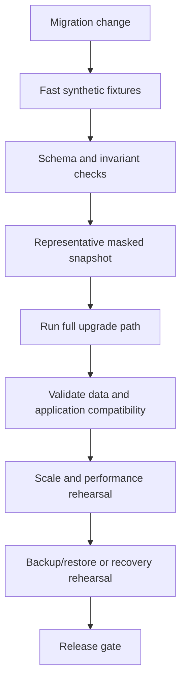

# Testing Upgrades with Representative Data Before Deployment

Database changes usually carry greater risk than changing an application file. A migration might pass on a handful of test rows yet fail when hitting a table with millions of rows, null values, legacy data violating new conventions, missing foreign keys, or duplicate values accumulated over years. It may also succeed yet slow down queries, hold locks too long, or break an older application version during a rolling deployment.

Therefore, before promoting data changes to production, **rehearse the upgrade process on a representative dataset**. The dataset must adequately reflect the structure, distribution, scale, and edge cases of the real environment while being prepared in ways that protect sensitive data. The goal is proving the migration can upgrade from supported source states to the target state, preserve business invariants, meet time/resource limits, and have a recovery plan on failure.

In CI/CD, this testing links schema changes, data, application code, artifacts, and deployment plans. A migration passing on an empty database proves only a tiny case; it is insufficient evidence for a production upgrade.

## 1. Why use representative data?

A schema describes data types and relationships, not the full reality of existing data. Two databases sharing an identical schema can behave very differently:

- One database holds a few hundred rows while another holds hundreds of millions.
- Fresh data is clean, while historical data contains nulls, empty strings, legacy formats, or unexpected values.
- A field stays unique in test environments yet contains duplicates in production.
- Skewed data distribution: one tenant owns most rows, or one status dominates counts.
- Table relationships include orphaned records from legacy imports or older workflows.
- Some records contain Unicode text, time zones, decimals, large blobs, or boundary dates.

A migration may succeed on clean data yet fail when adding a unique constraint, changing types, normalizing strings, or building an index on a large table. Representative data surfaces those failures before changes reach users.

For instance, a migration normalizing emails with `lower(trim(email))` runs fine if all emails are distinct. Yet when `Alice@example.com`, `alice@example.com`, and ` alice@example.com ` coexist, creating a unique index post-normalization fails. Testing with representative data exposes this collision and forces the team to define resolution rules prior to deployment.

## 2. Identifying data characteristics to represent

You do not need to copy every production row. Understand which characteristics affect the migration and assemble datasets covering them.

| Characteristic | Examples to include in test set | Risks uncovered |
|---|---|---|
| Scale | Small, medium, and near-production table sizes | Runtime, memory, disk, locks |
| Distribution | Large tenants, small tenants, common/rare statuses | Skew, slow queries, unbalanced batches |
| Missing values | NULLs, empty strings, optional fields | Conversion or constraint errors |
| Duplicates | Repeated emails, external codes, business keys | Unique constraints and merge rules |
| Historical data | Legacy formats, retired enums, older versions | Migrations missing legacy data cases |
| Type boundaries | Negative numbers, huge integers, decimals, boundary dates | Overflow, rounding, conversion |
| Text | Unicode, Vietnamese diacritics, escape characters, long strings | Collation, encoding, truncation |
| Time | UTC, mixed time zones, DST transitions | Timestamp or business date shifts |
| Relationships | Parent/child, orphans, cascades, deep hierarchies | Foreign keys and migration order |
| Large payloads | JSON, binary data, long payloads | I/O, memory, transaction logs |

Characteristics to test must derive from schema, business rules, data history, and application query patterns. One table may have few columns yet huge field payloads; another may have complex constraints and relations despite low row counts.

## 3. Choosing data sources and protecting sensitive information

There are three common ways to construct an upgrade dataset:

1. **Synthetic data:** generate artificial data matching known schemas, distributions, and business rules.
2. **Masked/anonymized snapshot:** take a consistent snapshot from the real environment and replace or strip sensitive information.
3. **Hybrid dataset:** combine synthetic data with safely sanitized samples to retain relationships and rare edge cases hard to model.

Never place raw production copies onto laptops, CI runners, or standard test environments. Data may contain personal information, tokens, addresses, transactions, payment details, or trade secrets. Data masking must occur before any dataset leaves authorized boundaries.

When masking:

- Replace direct identifiers such as names, emails, phone numbers, addresses, and customer IDs.
- Strip tokens, sessions, credentials, private keys, and secret fields.
- Preserve referential relationships when testing foreign keys or business flows.
- Preserve distributions and key statistics, such as orders per customer or status ratios.
- Retain edge cases without revealing real identities.
- Audit masking output to verify zero sensitive fields linger in secondary columns, logs, JSON, or blobs.

Masking must avoid distorting properties under test. For instance, replacing every email with a unique random string accidentally eliminates post-normalization duplicates, rendering the dataset unable to test a new unique constraint. Use deterministic tokenization or synthetic rules that intentionally preserve relationships and collisions without preserving real emails.

Synthetic data must also include "bad" records that legitimately exist or arose historically. Do not generate only pristine rows passing current validation, because migrations often process rows written by older versions.

## 4. Building multiple data profiles

A single dataset rarely satisfies both CI speed and pre-release confidence. Split into profiles:

| Profile | Scale and contents | When to run |
|---|---|---|
| Fast fixture | Small; covers nulls, duplicates, boundaries, and core relations | Every pull request |
| Representative integration | Realistic distribution and relations with legacy data | Every migration change |
| Scale/performance | Near-production scale, skew, and large tables | Nightly, pre-release, or risky changes |
| Upgrade compatibility | Snapshots across supported source schema versions | Major releases or compatibility changes |
| Recovery rehearsal | Restorable snapshot with backup/PITR tests | Scheduled and before high-risk migrations |

Small profiles yield fast feedback yet cannot replace large-scale profiles. Large profiles need not run on every pull request if too expensive. Pipelines must clearly record which profile ran and which gates rely on which results.

### Verifying representativeness

Periodically compare test profiles against aggregated production metrics:

- Row counts per table and per tenant.
- Rates of NULLs, empty strings, duplicates, and rare values.
- Distributions by status, creation date, and record type.
- Median, p95, and maximum payload field sizes.
- Depth and breadth of parent/child relationships.
- Proportion of records created by older application versions.

No personal data needs to be retained for comparison. Aggregate statistics and distributions usually suffice to catch test dataset drift from reality.

## 5. Starting from realistic source states

A migration typically upgrades a database from a specific schema version. Testing solely against the latest database can miss errors when customers or environments sit on older versions.

Before running migrations, determine:

- Which schema versions remain supported for direct upgrades.
- Whether multiple migrations must run sequentially.
- Which application versions run in each environment.
- Whether records created by older code must still be accepted by the current schema.
- Whether custom extensions, collations, encodings, or database configs must be replicated.

For instance, production might sit on schema version 12 while integration environments already sit on version 15. If a release only tests upgrading from 15 to 16, the team has no proof that migrations 13, 14, and 15 run cleanly in sequence over version 12 legacy data.

Initialize the test database from a consistent snapshot or fixture matching the exact source schema. Then execute the full supported migration chain in real order. Never hand-edit the test schema to resemble the target before running migrations.

## 6. Testing migrations on isolated clones

Upgrade rehearsals should run on an isolated database without affecting serving environments:

1. Provision a test database or instance from the prepared snapshot/fixture.
2. Verify engine, major version, extensions, collation, and settings match the target.
3. Record baseline schema version, row counts, and initial invariants.
4. Run migrations using the exact artifact, tool, and commands planned for deployment.
5. Capture duration, locks, disk usage, transaction logs, and errors.
6. Run schema, data, and application query checks.
7. Test old/new application versions if coexistence is required.
8. Save the report alongside commit, migration version, and dataset profile.

Never share one database across parallel jobs that alter schemas or data. Every test run needs an isolated, reproducible environment. When using snapshots, document source, capture timestamp, masking procedure, and dataset checksum.

Database engine and version matter too. PostgreSQL, MySQL, and different versions vary in DDL semantics, locking, collations, indexes, and transactions. Passing a migration on SQLite in CI does not prove a PostgreSQL migration behaves identically if production runs PostgreSQL.

## 7. Verifying correctness after migration

Syntactically succeeding migrations do not prove data transformed accurately. Define invariants beforehand to compare before and after states.

Common verification categories:

- **Schema:** columns, data types, defaults, constraints, indexes, triggers, and sequences match expectations.
- **Row counts:** before/after record counts align with transformation rules.
- **Referential integrity:** no unexpected orphans or broken relationships.
- **Uniqueness:** business keys and unique constraints suffer zero collisions.
- **Completeness:** mandatory fields are not dropped or turned into unintended NULLs.
- **Value invariants:** monetary totals, quantities, statuses, or aggregates remain conserved by rules.
- **Format:** migrated values conform to required formatting, timezone, encoding, and precision.
- **Application behavior:** target application version reads and writes post-migration data properly.

Example queries checking counts and missing values:

```sql
SELECT COUNT(*) AS total_customers
FROM customers;

SELECT COUNT(*) AS missing_normalized_email
FROM customers
WHERE normalized_email IS NULL;
```

Example query checking post-normalization duplicates:

```sql
SELECT lower(trim(email)) AS normalized_value, COUNT(*) AS occurrences
FROM customers
WHERE email IS NOT NULL
GROUP BY lower(trim(email))
HAVING COUNT(*) > 1;
```

Queries are illustrative; NULL filters and normalization logic must match actual business rules. If duplicates are valid per business rules, never arbitrarily delete or merge rows just to pass a migration gate. Define resolution rules, data owners, and exception workflows before enforcing constraints.

On large tables, comparing every row in a single query is not always necessary. Use partition checksums, grouped aggregates, stratified sampling, or batched reconciliation. Sampling must be sensitive enough to catch anomalies and paired with global invariants.

## 8. Testing migrations on historical data and edge cases

Migrations must handle values that could exist prior to enforcing new rules:

- NULLs, empty strings, and whitespace-only strings.
- Case- or whitespace-variant duplicates.
- Legacy enum values removed from new code.
- Timestamps lacking time zones or stored under legacy conventions.
- Decimals exceeding new precision.
- Strings longer than new column limits.
- Records missing parents or referencing archived data.
- JSON containing unknown fields or changed data types.
- Data with Unicode, escape sequences, or legacy encodings.

Classify each case into: auto-convert, preserve as-is, quarantine, manual remediation, or block release. Avoid applying one blanket default value to all invalid records, as that destroys business meaning.

If data cleanup is needed prior to migration, create a preflight step to count and report violations. Whenever possible, run preflight ahead of the deployment window to shrink lock times and give teams time to remediate anomalies.

## 9. Assessing runtime, locks, and resources

A logically correct migration can still be unfit for production if it locks tables too long or exhausts resources.

On large-scale profiles, measure:

- Total migration duration and per-step duration.
- Lock wait time and lock hold duration.
- CPU, memory, disk I/O, and temporary storage.
- Transaction/WAL/binlog volume and replication lag.
- Duration of index creation, constraint validation, and backfills.
- Impact on query latency and application connection pools.
- Resumability when the job is interrupted.

Be especially cautious with DDL taking strong locks on large tables. Online/concurrent index builds and constraint additions differ by engine. Never extrapolate that an operation running fast on a few thousand rows will finish similarly in production.

If a migration backfills millions of rows, split into batches by a stable key, rate-limit execution, and record checkpoints. Each batch needs explicit progress markers and must not cause duplicate side effects on retry. Measure replication lag to avoid replicas falling dangerously behind.

Never tune solely by raising timeouts. If a migration takes hours or holds prolonged locks, revisit transformation design, phasing, indexing, and online capabilities.

## 10. Designing resumable and retry-safe migrations

CI jobs or database connections can drop mid-migration. Migrations need predictable behavior on retries:

- If a transaction rolls back completely, verify no partial side effects leaked outside the transaction.
- If batched, persist checkpoints and process only unfinished ranges.
- Use conditional updates to avoid overwriting already-migrated rows.
- Emit zero duplicate events or side effects on retry.
- Record migration version and status clearly.
- Detect when a migration actually succeeded before the job recorded the result.

Not all DDL is transactional across all databases. For instance, certain index operations cannot run inside transaction blocks. Understand your engine and migration tool semantics rather than assuming rollbacks always restore exact prior state.

Well-crafted migrations include preconditions and postconditions. Preconditions confirm source schema/data validity; postconditions confirm target schema/data satisfy invariants. If preconditions fail, abort with a clear report instead of transforming misunderstood data.

## 11. Testing compatibility between old and new applications

During rolling deployments, multiple application versions run concurrently for a window. Migrations must support that coexistence period.

A standard strategy is **expand-and-contract**:

1. Expand: add new columns/tables/indexes without breaking old code.
2. Deploy compatible code: new code reads/writes transitionally; old code keeps working.
3. Backfill: migrate data in batches and track progress.
4. Switch: move reads/writes to the new structure after verification.
5. Contract: drop old columns/tables only after all instances and consumers stop using them and the rollback window closes.

For example, adding `display_name` instead of immediately renaming `name`. Add the new column, let new code read it while falling back to the old column during transition, backfill data, and drop the old column in a subsequent release.

Tests to execute:

- Old application against the expanded schema.
- New application against the expanded schema before backfill finishes.
- New application against backfilled data.
- Both versions running simultaneously during rolling updates if supported by architecture.
- Rolling back the application to the old version while the schema stays expanded.

Never drop columns or alter field semantics in the same initial release if the old version may still be started or rolled back to. Contract is a separate step after proving zero dependent consumers remain.

## 12. Testing data recovery and rollback

Application rollback is not database rollback. Transformed, newly written, or deleted data may not be reversible via reverse migrations.

Before deployment, establish recovery strategies:

- **Forward fix:** repair migrations or data via a new migration restoring valid state.
- **Restore/PITR:** restore backups or run point-in-time recovery on severe data loss.
- **Compensating migration:** apply a controlled reverse conversion if proven lossless.
- **Roll-forward application:** retain the new schema and deploy a compatible patched application version.

Test backup/restore in an isolated environment. Verify backup restorability, restore duration, consistency between the database and object storage/event logs, and application functionality post-restore.

Document RPO (acceptable data loss) and RTO (target recovery time) per system policy. A backup sitting untested in storage is not valid proof of recoverability.

If a migration includes irreversible actions—such as merging records or deleting data—secure appropriate backups/snapshots, approvals, and a recovery plan before running. Never author a down migration pretending it can recover discarded data.

## 13. PostgreSQL upgrade testing example

Suppose the system needs a normalized email column. Before adding a unique constraint, verify whether legacy data contains collisions.

A staged migration can begin by adding a nullable column:

```sql
ALTER TABLE customers
ADD COLUMN normalized_email text;
```

Backfill in the test environment:

```sql
UPDATE customers
SET normalized_email = lower(trim(email))
WHERE normalized_email IS NULL
  AND email IS NOT NULL;
```

Check remaining unmigrated rows:

```sql
SELECT COUNT(*) AS rows_without_normalized_email
FROM customers
WHERE email IS NOT NULL
  AND normalized_email IS NULL;
```

Check collisions before considering a unique constraint:

```sql
SELECT normalized_email, COUNT(*) AS occurrences
FROM customers
WHERE normalized_email IS NOT NULL
GROUP BY normalized_email
HAVING COUNT(*) > 1;
```

This is an illustrative example, not a complete production-ready migration. A single-statement backfill can hold locks and generate massive WAL on large tables; real deployments require batching, resource monitoring, and retry control. Before enforcing `NOT NULL` or unique constraints, resolve missing/duplicate cases per approved business rules. When creating indexes concurrently in PostgreSQL, respect transaction restrictions and how your migration tool manages transactions.

### Pre- and post-check suite

A rehearsal run should:

1. Restore the dataset profile matching the source schema.
2. Run preflight checks counting null, empty, and post-normalization colliding emails.
3. Run migrations using the exact migration artifact version.
4. Run backfill using the planned mechanism and record duration.
5. Verify row counts, nulls, collisions, and schema state.
6. Run old/new application compatibility tests across transition phases.
7. Measure locks, WAL, I/O, and replication lag if replicas exist.
8. Test interruption and resume if the migration supports resuming.
9. Archive the report, migration version, dataset profile, and commit.

If preflight detects collisions, the test must fail or branch to the defined data-remediation workflow. Never arbitrarily delete one row simply to let a migration pass the gate.

## 14. Integrating rehearsals into CI/CD

An upgrade pipeline can be tiered by execution cost:



Conceptual job example:

```yaml
jobs:
  migration_fast:
    steps:
      - name: Start isolated database
        run: ./scripts/start-test-database.sh
      - name: Apply migrations to synthetic fixtures
        run: ./gradlew migrationTest
      - name: Verify invariants
        run: ./scripts/check-migration-invariants.sh

  migration_representative:
    needs: migration_fast
    steps:
      - name: Provision masked snapshot
        run: ./scripts/restore-masked-dataset.sh
      - name: Run supported upgrade path
        run: ./scripts/rehearse-upgrade.sh
      - name: Validate and publish evidence
        run: ./scripts/validate-upgrade-and-report.sh
```

Scripts and tasks are placeholders to implement according to your project's CI platform, database, and migration tool. Datasets must be delivered over secure channels with versioning/checksums and restricted access. Never pull unmasked production snapshots onto CI runners.

The fast profile can run on every pull request; the representative profile runs when migrations change; scale and recovery rehearsals run periodically or ahead of high-risk releases. Gates must explicitly record which profile ran, which revision was tested, and whether results remain valid for the release candidate artifact.

## 15. Recording evidence and acceptance criteria

A valuable rehearsal report must document:

- Database engine, version, extensions, and key configuration.
- Dataset profile, origin, snapshot timestamp, masking version, and checksum.
- Source and target schema versions.
- Migration artifact/version, commit SHA, and pipeline run.
- Per-migration duration and total elapsed time.
- Row counts, invariants, duplicates, orphans, and constraint outcomes.
- Lock waits, resource usage, and WAL/replication lag where measured.
- Old/new application and compatibility test results.
- Backup/restore or recovery rehearsal outcomes.
- Errors, approved exceptions, and accountable owners.

Define acceptance criteria before running. For example: zero unexpected record loss; zero new orphans; zero duplicates on unique keys; migration finishes within time budgets; locks remain within thresholds; older app versions keep working during rolling phases; and recovery procedures are tested.

Never store just a line saying `migration succeeded`. A pass lacking dataset profile, schema version, and invariant report is difficult to evaluate or reproduce.

## 16. Common mistakes

| Mistake | Consequence | Remedy |
|---|---|---|
| Testing only on empty databases | Misses historical data and collisions | Use representative profiles containing legacy data |
| Using raw production data in CI | Leaks personal data and secrets | Mask/anonymize or synthesize data |
| Testing only from the latest schema | Misses upgrade paths from older versions | Test every supported source version |
| Checking only migration exit codes | Data may be corrupt despite migration completion | Check invariants, row counts, and app behavior |
| Drawing production performance conclusions from tiny data | Misses locks, I/O, and backfill duration | Run near-production scale rehearsals |
| Adding unique constraints without preflight | Migration fails on collisions | Detect and resolve duplicate data beforehand |
| Running backfill in one giant transaction | Long locks, huge WAL, costly rollbacks | Batch, checkpoint, and rate-limit |
| Assuming down migrations are always safe | Data loss or irreversible schemas | Design forward fixes, restore/PITR, and test recovery |
| Dropping old columns in the first release | Old code breaks on rollback | Use expand-and-contract |
| Omitting dataset and migration version records | Impossible to reproduce outcomes | Persist full metadata and reports |

## 17. Checklist for upgrade testing with representative data

- [ ] Identified source schema versions and all supported upgrade paths.
- [ ] Prepared appropriate fast, representative, scale, and recovery profiles.
- [ ] Datasets cover scale, distribution, NULLs, duplicates, legacy formats, boundaries, and relationships.
- [ ] Sensitive data is synthesized or masked before entering test environments.
- [ ] Datasets have traceable versions, checksums, origins, and generation procedures.
- [ ] Test databases match target engine, version, extensions, and collation.
- [ ] Ran full migration sequences on isolated clones.
- [ ] Verified schema, row counts, referential integrity, uniqueness, and business invariants.
- [ ] Measured duration, locks, CPU, memory, disk, WAL, and replication lag where applicable.
- [ ] Tested retries/resumes, transaction semantics, and interrupted migrations.
- [ ] Tested old and new applications coexisting during rolling phases.
- [ ] Tested backup/restore or recovery plans prior to destructive changes.
- [ ] Archived reports linked to commit, migration version, dataset profile, and artifact.
- [ ] Assigned owners for exceptions and clear release gate criteria before deploying.

Testing upgrades with representative data uncovers issues that empty databases cannot reveal: anomalous legacy records, collisions, intricate relationships, lock durations, and resource limits. When datasets are prepared safely, migrations run on isolated clones, invariants are verified, and recovery plans are rehearsed, teams gain solid evidence to decide on deploying data changes.
