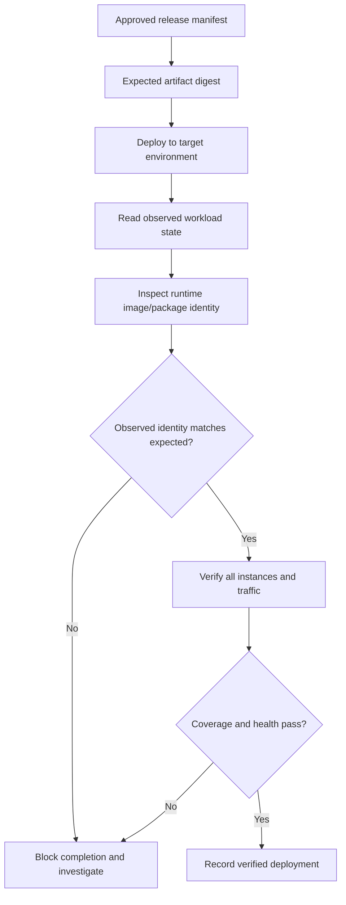

# Confirming the Right Version Is Running on the Target Environment

## 1. Why Verify the Version After Deployment?

A pipeline reporting a successful deploy only indicates that the deployment operations finished according to how the tool reports them. That does not prove every serving instance is running the exact approved artifact. Some Pods may still be using an old image, a VM may not have been updated, a load balancer may still be routing to old instances, or a new rollout may have only updated partially.

In CI/CD, the goal is not only to send the right deploy command, but also to verify the actual state on the target environment. The team needs to be able to answer:

- Which artifact was approved and expected to be deployed?
- Did the target environment receive that exact artifact digest?
- Are all required instances running the new version?
- Is actual traffic going to instances on the right version?
- Which compatible configuration and schema are being applied?
- Does the application start, become ready, and execute critical flows?
- Is there fresh enough evidence to conclude the rollout is complete?

For example, a pipeline deploys `order-service:2.4.1` to Kubernetes and `kubectl rollout status` returns success. However, if the Deployment uses a mutable tag, or the Service still has endpoints from another workload, that command does not prove actual requests only reach the tested image. You need to reconcile the declared image, the running container's image ID, Pod status, endpoints, and the deployment record.

Post-deployment version verification is part of the release gate. If the evidence does not match, the pipeline must stay incomplete, alert, and trigger an investigation or recovery procedure.

## 2. Distinguishing Deploy Command, Desired State, and Observed State

These three states answer different questions:

| Concept | Meaning | Example |
|---|---|---|
| Deploy command/result | The tool sent a change request and reported the operation result | Manifest apply command exits with code 0 |
| Desired state | The version and configuration the system is asked to run | Deployment declares image digest `sha256:abc...`, replicas 3 |
| Observed state | The actual state observed by the platform/runtime | Three Pods ready, container imageID matches expected digest |

A successful deploy command may only confirm that the API server received the manifest. The controller still needs time to reconcile; Pods may not be running yet, readiness may fail, or a node may fail to pull the image.

Desired state also does not self-prove that observed state matches. You must read the state from the runtime or control plane source and compare it against the release manifest. With GitOps systems, the merged commit represents the desired state; `Synced`/`Ready` or equivalent status must be verified separately.

## 3. Identifying a Version by Multiple Attributes

Human-readable version names are useful for people, but are often insufficient to pinpoint the exact content running. A deployment should be identified by a set of linkable attributes:

| Attribute | Role |
|---|---|
| Service/application name | Identifies the deployed component |
| Release ID | Identifies a single release |
| Source commit SHA | Identifies the built source code revision |
| Artifact version/tag | Human-readable version name |
| Artifact digest | Pinpoints the exact artifact/image content |
| Build/pipeline run ID | Traces back to the build that produced the artifact |
| Config revision/digest | Identifies the applied environment configuration |
| Environment/cluster/namespace | Identifies where the version is running |
| Deployment revision/rollout ID | Identifies the workload update |
| Timestamp | Identifies start, completion, and observation times |

In production, the artifact digest is usually the most important identifier for confirming the payload. Commit SHA traces back to source code; release ID links evidence and decisions; config revision helps reproduce the execution environment.

You should not rely solely on `2.4.1`, `latest`, a branch name, or an image tag name. Tags can move if the registry allows overwrites. Two images with the same tag at two different times can contain different contents.

## 4. Reconciling Expected Artifact with Actual Artifact

Before deploying, the pipeline should record the tested artifact reference and digest. After deploying, it must fetch information from the target environment and verify the actual content.

General verification flow:



For containers, deploy by image digest when supported by the platform, for example `registry.example.com/order-service@sha256:...`. Then read the image declared in the workload and the image ID/runtime digest of each running container.

For packages on VMs, check the version, the checksum of the installed file, and the actual executable/process path. For serverless applications, compare the deployment's revision/version ID against the revision receiving traffic.

If an artifact is copied between registries, verify the digest at the destination. Some manifest conversion operations can alter the digest; in such cases you need a content verification process and a recorded source-destination relationship rather than assuming the two references are the same artifact.

## 5. Verifying All Instances, Not Just One Instance

In systems with multiple replicas or multiple hosts, checking one healthy instance does not prove the entire service is updated. A rollout can be in a mixed state: some instances run the new version while others still run the old version.

Items to verify:

- Desired instance count and actual instance count.
- Number of instances created, ready, and receiving traffic.
- Version/digest on every instance.
- Whether old instances remain in service discovery or the load balancer.
- Whether any instances are stuck in terminating, pending, or crash loop states.
- Whether all regions/zones/node pools have been fully updated.
- Whether auxiliary workloads such as workers, schedulers, or consumers remain un-updated.

If there are 10 replicas and only 9 run the new digest, the release is not complete unless policy explicitly permits that state. With canary or progressive delivery rollouts, multiple versions coexisting may be intentional; in that case you must verify the planned traffic ratios and cohorts.

## 6. Verifying the Version Actually Receiving Traffic

Workloads may be updated while traffic still goes to old instances because a load balancer, ingress, service discovery, DNS cache, or routing rule has not converged yet.

Distinguish between:

- **Workload state:** which instances are running.
- **Endpoint state:** which instances the service/proxy considers valid backends.
- **Traffic state:** which backends actual requests are routed to.

Verification steps can include:

1. Verify that the endpoint/backend pool has no unplanned old instances remaining.
2. Send test requests through the exact public/internal route that users use.
3. Collect response metadata or traces to see which backend handled the request.
4. Check across multiple requests and multiple regions if the system is distributed.
5. Compare traffic proportions by version in metrics or telemetry.

A `/version` endpoint can return the version of the process handling the request, but a single request does not represent the entire backend pool. Sample multiple times or use telemetry tying version to instance/pod to evaluate coverage. If responses are cached at a CDN/proxy, understand cache behavior before drawing conclusions.

Do not expose commit SHAs, internal information, or sensitive build details through a version endpoint to all users. You can provide minimal metadata through an authenticated internal endpoint, or use metric labels/trace resource attributes in the observability system.

## 7. Checking Health, Readiness, and Business Behavior

The right version does not automatically mean the application works properly. Post-deployment validation needs multiple layers:

| Check layer | Purpose | Example |
|---|---|---|
| Process/startup | Process starts up | Service active, startup probe passes |
| Readiness | Instance can receive traffic | Required dependencies connected, readiness endpoint returns healthy |
| Liveness | Process is not hung needing restart | Liveness probe or watchdog |
| Smoke test | Core flows work at a basic level | Health API, read query, test transaction creation |
| Integration/synthetic test | Interaction with dependencies and user flows | Login, create test order, read data via API |
| Operational verification | No abnormal degradation after deploy | Error rate, latency, queue lag, saturation |

Liveness and readiness serve different purposes. Liveness answers whether the process needs a restart; readiness answers whether the instance can accept traffic. A process can be alive yet not ready because it has not connected to the database or loaded configuration.

Smoke tests must be safe and repeatable. If testing writes, use test accounts, data, and namespaces that can be cleaned up; avoid creating real transactions or sending unintended real notifications.

## 8. Verifying Configuration Accompanying the Version

An application can run the right artifact with the wrong configuration. The deployment record should link the artifact digest with the config revision/digest and environment.

Items to verify:

- Config bundle/revision matches the release manifest.
- Effective configuration after merging files, environment variables, and config service matches expectations.
- Secret references/versions are properly provisioned, valid, and not leaked.
- Configuration schema is compatible with the application version.
- All instances have loaded the same revision, or any difference is permitted by policy.
- Feature flags and routing rules are in the state planned for the release.

Do not store secret values in deployment records or logs. You can store secret manager reference/version IDs and provisioning status. With dynamic configuration, record the revision each instance has loaded; the config service returning success does not prove all instances have reloaded.

## 9. Kubernetes Example: Checking Rollout and Image Identity

With a Kubernetes Deployment, you can check multiple layers using `kubectl`.

First, check the rollout status:

```bash
kubectl rollout status deployment/order-service -n production --timeout=180s
```

This command waits for the rollout to finish according to Deployment conditions. It does not by itself prove the image digest on every container matches the release manifest, so further checks are needed.

View the image declared in the Pod template:

```bash
kubectl get deployment order-service -n production \
  -o jsonpath='{.spec.template.spec.containers[?(@.name=="app")].image}{"\n"}'
```

List Pods, their status, and the actual image ID of the container:

```bash
kubectl get pods -n production -l app=order-service \
  -o jsonpath='{range .items[*]}{.metadata.name}{"\t"}{.status.phase}{"\t"}{.status.containerStatuses[?(@.name=="app")].ready}{"\t"}{.status.containerStatuses[?(@.name=="app")].imageID}{"\n"}{end}'
```

Compare the output against the expected digest. `imageID` is the image identifier reported by the container runtime; its format can vary by runtime. For multi-architecture images, the OCI index digest and the per-platform manifest digest can differ. You need to know which digest is pinned by the release manifest and how the runtime reports the resolved digest for the corresponding node architecture.

Check replica counts and Deployment status:

```bash
kubectl get deployment order-service -n production
kubectl get rs -n production -l app=order-service
kubectl get endpointslice -n production -l kubernetes.io/service-name=order-service
```

These commands show desired/available replicas, ReplicaSets, and endpoint slices. EndpointSlice shows the backends published by the service, but confirming actual traffic still requires requests/telemetry through the route.

If using a multi-version rollout intentionally such as canary, verify selectors, services, and routing policies to know which version receives which percentage of traffic. Do not apply a "every Pod must have the same digest" condition to a canary stage designed to have multiple digests; instead check the expected cohorts and ratios.

## 10. VM/systemd Example: Verifying the Running Package

For applications running on VMs, a pipeline may install each release into a separate directory and use a `current` symlink pointing to the active release. After deploy, verify the symlink, file checksum, and actual process.

Example package check:

```bash
readlink -f /opt/order-service/current
sha256sum /opt/order-service/current/order-service.jar
systemctl is-active order-service
systemctl show order-service -p MainPID
```

After retrieving `MainPID`, you can inspect the command line or executable according to the machine's permission policy. For Java, a process might be launched via a wrapper script or symlink; therefore verify the actual JAR path in the command line, not just the file at `current`.

A stronger approach is for the service to log the release ID and artifact digest on startup or include them in telemetry resource attributes. The monitoring system can aggregate by host/instance. That metadata should be generated from a trusted deployment manifest, not merely from arbitrary environment variables that the process could set itself.

Do not rely solely on `systemctl is-active`: a unit can be active while the process uses an old file, fails to bind the right port, or fails to serve business requests. Check endpoints and telemetry after verifying file/process identity.

## 11. Checking via Version or Build Info Endpoint

An application can expose an internal endpoint such as `/version`, `/info`, or `/actuator/info` to report release ID, commit, and build metadata.

Minimal example response:

```json
{
  "service": "order-service",
  "release": "R-105",
  "version": "2.4.1",
  "commit": "8d3f2a1c",
  "artifactDigest": "sha256:abc..."
}
```

This endpoint is useful for checking which process answers a request, but it has limitations:

- It may return build-time values that do not reflect the file actually running if deployed incorrectly.
- It may be cached at a proxy/CDN.
- A single request only checks one backend at a time.
- If the endpoint is unprotected, metadata may leak internal information.
- Returned values can be misconfigured or spoofed if not tied to a trusted deployment source.

Therefore, combine the version endpoint with image/package identity, deployment controller state, and telemetry. The endpoint is one useful piece of evidence about the responding process, not the sole proof.

## 12. Verifying Rollouts by Strategy Type

Verification conditions depend on the deployment strategy:

| Strategy | What to verify |
|---|---|
| Recreate | No old instances remain serving; new instances run the right digest and pass readiness |
| Rolling update | New/ready replica count meets target; old instances removed per policy; no wrong-version endpoints |
| Blue-Green | New environment has right digest and is healthy; traffic switched to new color; old environment receives no unplanned traffic |
| Canary | Canary cohort runs right digest; traffic ratio is right; guardrail metrics pass before increasing traffic |
| Serverless revision | New revision/version created and traffic allocation points to the right split |

In multi-stage rollouts, "deployed" status can differ from "rollout complete". Release records should track statuses such as deploying, partially rolled out, verified, failed, or rolled back rather than just a single boolean flag.

## 13. Verifying Versions Across Multiple Regions and Clusters

Large systems may deploy across multiple clusters, regions, or data centers. One cluster updating successfully does not mean the entire system has updated.

Create a deployment matrix containing:

- Service and workload.
- Region/cluster/namespace.
- Expected artifact digest.
- Expected config revision.
- Desired/ready/observed instance counts.
- Traffic share.
- Rollout status and verification timestamp.

Example:

| Region | Cluster | Expected digest | Ready instances | Traffic | Result |
|---|---|---|---:|---:|---|
| ap-southeast-1a | cluster-a | `sha256:abc...` | 6/6 | 50% | Verified |
| ap-southeast-1b | cluster-b | `sha256:abc...` | 6/6 | 50% | Verified |
| ap-southeast-1c | cluster-c | `sha256:abc...` | 4/6 | 0% | In progress |

This table is an illustrative example. If cluster-c is not ready yet, the global release is not complete even if traffic is not currently routed there. Policy must define which regions are mandatory, which can be deferred, and how to handle a region that fails to update.

## 14. Verifying Workers, Schedulers, and Background Components

An application often has more workloads than just the web/API deployment. There may be queue workers, cron jobs, schedulers, stream consumers, migration jobs, or sidecars. If you only check the API deployment, the team may miss workers still running an old version.

Checklist by component:

- API/web workload: image/package digest, replicas, readiness, and routes.
- Worker: version/digest, queue subscription, concurrency, and job processing state.
- Scheduler/cron: new schedule is active, no duplicate runs or missed jobs.
- Migration job: revision executed, completion status, and schema verification results.
- Sidecar/agent: version compatible with application and platform.
- Consumer: group membership, lag, offset/ack, and message schema compatibility.

For one-off jobs, `Completed` status must be linked to the image digest and input revision. For long-running workers, verify all processes have been replaced and no old consumer continues receiving messages unexpectedly.

## 15. Checking Data, Schema, and Compatibility After Deploy

A version may run the right digest yet still fail because the database schema or data is incompatible. Post-deployment validation must verify relevant data conditions:

- Migrations ran the right revision and are not left in a partial state.
- The new application can connect to the database and execute required queries.
- Current schema version is within the set supported by the application.
- Consumers/producers are compatible with the message schema in use.
- Background jobs do not unintentionally reprocess data.
- Critical counts or business invariants are not violated.
- Backup/restore point or roll-forward plan is ready according to risk level.

Do not validate production data with test writes that can create real transactions. Use read-only queries, marked synthetic records that are safely cleaned up, or appropriate test environments. For financial, order, or access-permission changes, verify business invariants rather than just health endpoints.

## 16. Verifying with Metrics, Logs, and Traces

Version metadata should be attached to telemetry so you know which version produces errors or latency. Fields usable as resource attributes or labels include:

- `service.name`
- `service.version`
- `deployment.environment`
- `release.id`
- `service.instance.id`
- `artifact.digest` or a shortened digest identifier per internal convention
- `config.revision`

Do not put high-cardinality digests, commits, or release IDs into every metric label if the metrics system is impacted by series count. Place detailed information in logs/traces/resource metadata and use bounded labels for the version/release being tracked.

After deploy, compare signals:

- Error rate and error types by version.
- Latency p50/p95/p99.
- Request success rate and business conversion.
- CPU, memory, restart count, and saturation.
- Queue lag, retries, and dead-letter count.
- Dependency errors and timeouts.
- Instance count by version/config revision.

A deployment should only be marked verified when mandatory checks pass over a sufficiently representative observation window. If traffic is too low, metrics have not updated, or telemetry is missing, status should be pending/insufficient evidence rather than automatically passing.

## 17. Deployment Records and Audit Evidence

After verification, the pipeline should create an immutable deployment record or one with a clear modification history. The record bridges CI, CD, the environment, and the observability system.

Fields to include:

| Group | Data |
|---|---|
| Release | Release ID, service, version, source commit |
| Artifact | Repository/reference, digest, provenance link |
| Config | Config revision/digest, schema version, secret references/version IDs |
| Target | Environment, cluster, region, namespace, workload |
| Execution | Pipeline run, deploy job, identity, start/end timestamps |
| Observed state | Runtime image/package identity, replica/instance coverage, traffic allocation |
| Validation | Health, smoke, acceptance, metric guardrails, and results |
| Decision | Verified, partial, failed, rolled back; deciding person/policy |
| Recovery | Previous artifact/config, rollback/roll-forward event if any |

Records should not contain secret values or unnecessary user data. Links to logs/reports must have appropriate access controls and corresponding retention.

## 18. Handling Mismatches Between Expected and Actual Versions

When observed state does not match the release manifest, do not mark the deploy successful just because some other checks pass.

An investigation procedure:

1. Mark the deployment as `mismatch` or `verification_failed` and stop the next promotion step.
2. Identify which workload/instance has a different digest, package version, or config revision.
3. Inspect the controller, rollout, node pull cache, registry reference, deployment job, and workload write permissions.
4. Determine whether the wrong-version instance is receiving traffic.
5. If safe, remove the wrong instance from traffic and finish rolling out the right artifact; otherwise, stop the rollout and execute the recovery plan.
6. Verify the actual artifact/config, provenance, deployment audit, and out-of-band changes outside the pipeline.
7. Re-verify all instances and traffic after remediation.
8. Log an incident or deployment exception and update evidence.

Possible causes include an overwritten tag, an old manifest reconciled by a controller, a deploy job targeting the wrong environment, a node failing to pull the new image, an undrained instance, a manual hotfix outside the pipeline, or another job updating the same workload.

If the origin of the running artifact cannot be determined, treat it as an integrity issue and keep the release flow blocked until trustworthy evidence is obtained.

## 19. Conditions for Rollback or Roll-Forward

Not every mismatch requires a full rollback. The decision depends on impact and the ability to fix in place.

| Situation | Potentially appropriate action |
|---|---|
| An old instance remains but receives no traffic | Finish rollout, verify, and remove the old instance |
| Wrong-digest instance is receiving traffic | Drain/remove from traffic, redeploy the right artifact, and verify requests |
| Right artifact but wrong config revision | Restore compatible config revision or roll forward config after validation |
| Unverifiable digest or untrusted source | Stop rollout, isolate workload, and redeploy from verified artifact |
| Right new version but health/metrics degrade | Halt expansion, roll back or roll forward per runbook |
| Migration incompatible with old version | Evaluate roll-forward/repair; do not automatically roll back the application |

Rollback must use a known artifact digest and config revision, not just an old tag. After rollback, re-run version, health, and traffic verification. A successful rollback command does not replace post-rollback verification.

## 20. Post-Deployment Verification States

Use more granular states than a boolean value:

| State | Meaning | Transition condition |
|---|---|---|
| Requested | Deploy request submitted | Pipeline starts execution |
| Deploying | Updating workload | Controller completes operation |
| Partially deployed | Subset of instances updated | Finish remaining instances or handle exception |
| Deployed | Platform reports workload applied | Start verifying runtime identity and health |
| Verifying | Reconciling digest, config, endpoints, and metrics | Evidence sufficient and passing, or failure detected |
| Verified | Right version, sufficient coverage, and mandatory checks passed | Eligible to promote/close release |
| Verification failed | Wrong version, missing evidence, or failing health | Investigate, controlled retry, or recovery |
| Rolled back | Previous version restored | Needs post-rollback state re-verification |

`Deployed` and `Verified` should not be used interchangeably. A deployment controller may complete an update while the application has not passed health checks or proven all instances run the right digest.

## 21. Example Post-Deployment Validation Policy

A hypothetical policy can express the required conditions:

```yaml
postDeploymentValidation:
  target:
    environment: production
    service: order-service
  expected:
    releaseId: R-105
    artifactDigest: sha256:abc123...
    configRevision: cfg-32
  workload:
    desiredReplicas: 6
    readyReplicas: 6
    allRuntimeDigestsMatch: true
    oldInstancesServingTraffic: 0
  application:
    readiness: healthy
    smokeTests: passed
    configRevisionObserved: cfg-32
  traffic:
    routingVerified: true
    unexpectedVersionTraffic: 0
  operations:
    errorRateWithinGuardrail: true
    latencyWithinGuardrail: true
    observationWindowComplete: true
  decision: verified
```

This is an illustrative structure, not the schema of a specific tool. Boolean values should be computed from reliable runtime data and telemetry. If a field has no data, the policy should define `pending` or `failed`; do not default missing fields to `true`.

In a canary rollout, the policy needs to describe the digest and traffic allocation per cohort rather than requiring every instance to share the same digest. Success criteria must reflect the actual deployment strategy.

## 22. Checklist for Confirming the Right Version on the Target Environment

Before marking a release verified, check:

- [ ] Release manifest specifies the service, environment, source commit, and expected artifact digest.
- [ ] Desired workload image/package reference matches the release manifest.
- [ ] Runtime identity/image ID/checksum on each instance is reconciled.
- [ ] Ready instance count meets requirements and no unplanned old instances remain.
- [ ] Endpoints/service discovery/load balancer point to the right backends.
- [ ] Actual requests or telemetry confirm the version is receiving traffic.
- [ ] Config revision/schema and secret references match the artifact.
- [ ] Workers, schedulers, consumers, and migration jobs are also verified.
- [ ] Startup/readiness and mandatory smoke/integration tests pass.
- [ ] Metrics/logs/traces in the observation window do not violate guardrails.
- [ ] Deployment record stores artifact digest, config revision, target, and check results.
- [ ] Mismatches or missing evidence block the release and have a recovery procedure.
- [ ] After rollback, actual version and traffic are re-verified.

## 23. Core Practical Principles

1. Do not treat a successful deploy command as proof the application is running the right version.
2. Reconcile the approved artifact digest against both desired state and actual runtime identity.
3. Verify all instances, auxiliary workloads, and deployment regions per policy.
4. Check endpoints and actual traffic, not just Pod status or service processes.
5. Verify configuration, secret references, and schema compatibility accompanying the artifact.
6. Combine process, readiness, smoke tests, metrics, logs, and traces to assess behavior.
7. Distinguish deployed, partially deployed, verifying, verified, and rolled back.
8. Write a deployment record linking release, artifact, config, environment, identity, and evidence.
9. Block further promotion when digests or evidence mismatch; investigate and recover in a controlled manner.
10. After rollback or roll-forward, re-run all necessary version and traffic checks.

Confirming the right version is running on the target environment bridges release intent and the actual state of the system. When artifact digest, configuration, instances, traffic, and operational evidence are reconciled together, the team can prove a release was deployed accurately, detect partial rollouts, and respond quickly when the running environment diverges from the approved version.
