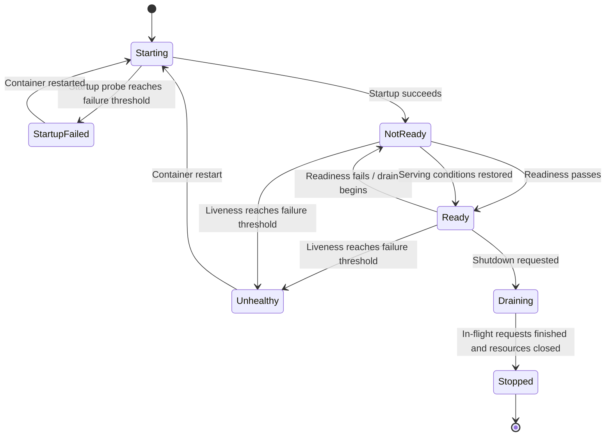
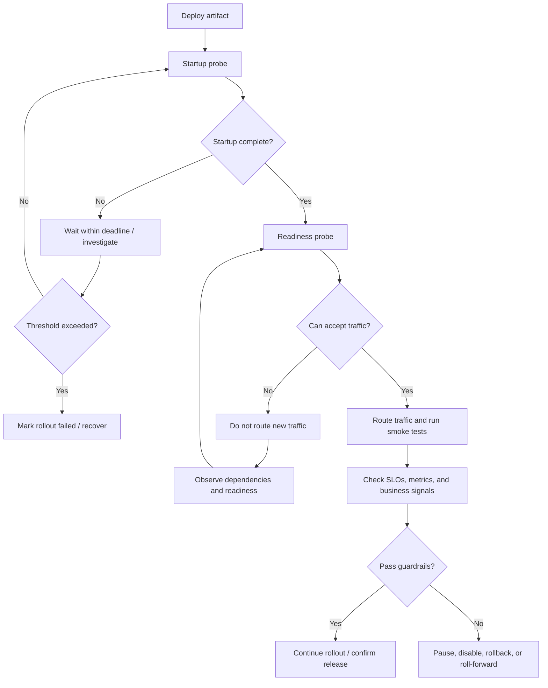

# Distinguishing a Live Process from a Service Ready to Accept Traffic

A container may be running while the application inside is hung, unable to process requests, or not yet finished connecting to the database. Conversely, an application may be functioning normally yet temporarily ineligible to accept additional traffic because it is starting up, draining to shut down, or an essential dependency is not ready. If you only check whether the process exists, the system may keep sending traffic to an unserviceable instance. If you use one deep health check for every purpose, an outage in a shared dependency can cause every instance to restart at once.

In operations, you must distinguish at least three states: **liveness** indicates whether the process is still functioning in a way that can continue on its own; **readiness** indicates whether the instance can accept and handle new traffic; **startup** indicates whether the application has finished its initial startup phase. These three signals serve different decisions made by the orchestrator.

## 1. A Live Process Does Not Mean a Ready Service

A process is considered live when the operating system or container runtime still observes that the process has not exited. That only confirms the process exists. It does not prove the event loop is still processing, the thread pool is not deadlocked, the HTTP server has bound its port, configuration is fully loaded, or dependencies are ready.

A service ready to accept traffic must satisfy its defined serving contract. Depending on the application, those conditions may include:

- The HTTP/gRPC server has initialized and can accept requests.
- Required configuration has been loaded and validated.
- Connection pools to essential databases or brokers are in a usable state.
- Critical internal components are not failing or overloaded to the point of being unable to serve.
- The instance is not in maintenance, draining, or shutting down.
- Sufficient capacity exists to accept additional traffic under the capacity policy.

Not every dependency is required for every request. A service may continue serving read functionality when the email-sending system is failing. If readiness checks the email provider as well and returns false, all traffic could be routed away from the instance even though most functionality still works. Readiness must accurately reflect the scope of functionality the instance commits to serving.

| State | Question | Typical action |
|---|---|---|
| Process alive | Does the process still exist? | Runtime can continue tracking the process |
| Liveness healthy | Can the application still recover on its own and handle its lifecycle? | Keep the container running; if failing consecutively, restart the container |
| Readiness healthy | Can the instance accept new requests right now? | Allow adding the instance to traffic-serving endpoints |
| Startup complete | Has the application passed initial initialization? | Begin applying liveness/readiness per configuration |

## 2. Liveness Probe: Checking Whether the Application Is Still Functioning

A liveness probe answers the question: is the process in a state where it can continue operating, or has it fallen into a hung/broken state from which it cannot recover on its own?

Examples of failures liveness can detect:

- A deadlock preventing request-serving threads from making progress.
- A blocked event loop not processing callbacks.
- A critical internal worker hung while the process still exists.
- The application entering an unrecoverable internal state under normal operation.
- The internal HTTP server no longer responding due to a severe process error.

When liveness fails enough consecutive times per configuration, the orchestration platform may restart the container or process. A restart is only useful if the application can start back up and recover from that state. If the root cause is a database outage, mass restarts will not make the database healthy; they may subject the system to extra reconnect load and create a crash loop.

### 2.1. What Should Liveness Check?

A good liveness check is usually shallow and fast:

- The process or internal server responds to a very lightweight operation.
- The event loop/dispatcher or core coordination component is still making progress.
- The application is not in a known fatal state.
- The check does not call a long chain of external dependencies or run expensive queries.

Liveness should not check every external dependency. If the database temporarily loses connectivity, many instances marking liveness failed and restarting together will create a thundering herd: all starting at once, opening connections simultaneously, and further overloading the struggling dependency.

### 2.2. When Should You Not Restart?

If the application can keep serving partial functionality or reconnect to dependencies on its own, restarting can do more harm than good. For example, during a few minutes of database maintenance, the application keeps running, returns controlled errors for database-dependent features, and continues serving health/status endpoints. This is typically a situation where readiness can be false while liveness remains true.

Only fail liveness when there is evidence the application cannot self-recover or has violated a defined viability condition. Do not use liveness as a "restart whenever anything looks bad" button.

## 3. Readiness Probe: Checking the Ability to Accept New Traffic

A readiness probe answers the question: if the router sends a new request to the instance right now, can the instance handle that request according to its committed contract?

When readiness fails, the standard orchestrator behavior is to mark the instance not ready and stop including it in the endpoint list receiving new traffic. The process keeps running; the container is not restarted merely because readiness is false. When readiness succeeds again, the instance can be placed back into serving endpoints.

Readiness can be false in situations such as:

- The application is warming up, loading models, caches, or initialization data.
- The connection pool to an essential database is not yet ready.
- The instance is overloaded and policy permits temporarily halting new requests.
- The application is draining for shutdown or role transition.
- A dependency required for all requests is unavailable.
- Required configuration is invalid or the service has not completed initialization.

### 3.1. Readiness Is Tied to Serving Capability, Not Just Connectivity

An open TCP port only indicates a process is listening. An HTTP endpoint returning 200 only indicates the health handler responded. You need to verify whether that endpoint checks the conditions actually required to accept traffic.

For example, an order-processing service needs a database to read/write orders. If the connection pool has not established any connections yet, readiness should be false. However, if the email-sending service is unavailable and email is only an asynchronous side task, readiness can remain true while metrics/alerts report email queue errors.

### 3.2. Readiness Is Not End-to-End Testing

Readiness is called frequently and must be fast, stable, and free of side effects. You should not execute a real payment flow, create new data, or call multiple external systems on every probe. End-to-end/synthetic transaction testing should be a separate post-deployment validation step with test data and an appropriate cadence.

## 4. Startup Probe: Protecting Applications with Long Startup Times

A startup probe answers the question: has the application completed its initial startup phase? It is especially useful for applications that must decrypt configuration, load models, warm caches, run initialization, or recover data before they can serve.

In Kubernetes, when a container has a startup probe, kubelet does not execute liveness and readiness probes for that container until the startup probe succeeds. If the startup probe fails consecutively up to `failureThreshold`, the container is restarted according to policy. Once startup succeeds, liveness and readiness begin operating according to their configuration.

Do not set `initialDelaySeconds` excessively long just to guess startup duration when a startup probe can check completion directly. The probe gives the application a bounded, observable startup window.

## 5. Comparing Liveness, Readiness, and Startup

| Attribute | Startup | Liveness | Readiness |
|---|---|---|---|
| Purpose | Determine initial initialization is complete | Detect unrecoverable broken states | Determine whether new traffic can be accepted |
| On consecutive failures | May restart container | May restart container | Mark not ready, stop routing new traffic |
| Impact on routing | Indirect: not Ready while startup is incomplete | Does not directly decide traffic endpoints | Directly affects endpoint/service routing |
| External dependencies | Check only dependencies truly needed to finish startup | Should minimize external dependencies | Can check dependencies essential for requests |
| Frequency | During startup phase | Throughout container lifecycle after startup | Throughout container lifecycle |
| Example | Model loaded, schema/config loaded | Event loop no longer progressing | Database pool ready, instance not draining |

An application can use all three probes. Not every application needs a startup probe; very fast, simple applications may only need liveness/readiness. The decision should be based on startup behavior and self-recovery capability, not on adding all three endpoints just for tidy configuration.

## 6. Instance Lifecycle States



This diagram illustrates conceptual states. The `Ready` state can transition back to `NotReady` without a restart; this is critical behavior so the application can pause receiving traffic while keeping the process alive. On shutdown, the application should proactively switch readiness to false before exiting so the router has time to stop sending new requests.

## 7. Designing Meaningful Health Endpoints

Some applications expose separate endpoints, for example:

| Endpoint | Goal | Suggested checks |
|---|---|---|
| `/health/startup` | Initialization complete | Required config, internal migration/initialization, required models/caches |
| `/health/live` | Process can continue operating | Server/event loop and core internal state |
| `/health/ready` | Can accept new requests | Required components for core functionality, drain/overload state |
| `/health` or `/status` | Status summary for operators | Can aggregate multiple dependencies, not necessarily used as a probe |

Separating endpoints gives each probe distinct semantics. Do not use a single `/health` endpoint aggregating all dependencies for both liveness and readiness if that makes liveness depend on the database, email, analytics, payment gateway, and every auxiliary service.

### 7.1. HTTP Status Codes

For HTTP probes in Kubernetes, response statuses in the 200–399 range are considered successful. If an endpoint redirects to a login page or returns 302, the probe may be treated as successful even when the application is not ready. Use an internal endpoint that requires no interactive authentication and returns clear statuses; avoid redirects or returning 200 for every state.

### 7.2. Selective Dependency Checking

Readiness should check essential dependencies according to the serving contract. They can be categorized as:

- **Critical dependency:** core requests cannot be processed without it, such as the primary database of a transaction service.
- **Degraded dependency:** some features degrade while the service can still serve the rest, such as asynchronous email or analytics.
- **Optional integration:** should not take an instance out of all traffic when this integration fails.

If readiness calls every dependency, a failure in an auxiliary system can remove the entire service from the load balancer. If readiness checks no essential dependencies at all, traffic can pour into instances guaranteed to return errors. Choose based on actual request behavior and degraded-mode design.

### 7.3. Probes Must Be Fast and Side-Effect-Free

Probes are called repeatedly across many instances. They should:

- Have short response times and bounded timeouts.
- Not create data, send emails, charge money, or mutate business state.
- Not run heavy queries or full-data scans.
- Not call deep chains of external systems across multiple tiers.
- Emit enough logs/metrics for diagnosis without logging secrets or sensitive payloads.
- Handle timeouts and exceptions explicitly.

## 8. Configuring Probes in Kubernetes

Kubernetes supports probe types such as `httpGet`, `tcpSocket`, `exec`, and `grpc` (with appropriate configuration). Each type has trade-offs:

| Probe type | How it works | When suitable | Limitations |
|---|---|---|---|
| HTTP GET | Calls endpoint and checks status | Web services with health endpoints | Endpoint may return 200 with wrong semantics or redirect |
| TCP socket | Checks whether a connection can be opened to a port | Services without an HTTP health endpoint | An open port does not prove the app handles requests properly |
| Exec | Runs a command inside the container and checks exit code | Specialized internal checks | Spawns subprocesses, incurs overhead, and may depend on shell/tools |
| gRPC | Calls the gRPC Health Checking Protocol | gRPC services implementing the standard health service | Requires port/service config and protocol implementation |

Example Deployment with separate startup, liveness, and readiness probes:

```yaml
apiVersion: apps/v1
kind: Deployment
metadata:
  name: orders
spec:
  replicas: 3
  selector:
    matchLabels:
      app: orders
  template:
    metadata:
      labels:
        app: orders
    spec:
      terminationGracePeriodSeconds: 45
      containers:
        - name: orders
          image: registry.example.com/orders@sha256:0123456789abcdef...
          ports:
            - name: http
              containerPort: 8080
          startupProbe:
            httpGet:
              path: /health/startup
              port: http
            periodSeconds: 5
            timeoutSeconds: 2
            failureThreshold: 30
          livenessProbe:
            httpGet:
              path: /health/live
              port: http
            periodSeconds: 10
            timeoutSeconds: 2
            failureThreshold: 3
          readinessProbe:
            httpGet:
              path: /health/ready
              port: http
            periodSeconds: 5
            timeoutSeconds: 2
            failureThreshold: 2
            successThreshold: 1
```

The image digest in this example is a placeholder. The endpoints must be implemented by the application with the right semantics. `failureThreshold: 30` with a 5-second period for startup creates an approximate 150-second startup attempt window (also depending on start timing and timeouts). If startup does not succeed within the limit, kubelet restarts the container per policy.

### 8.1. Key Parameters

- `initialDelaySeconds`: seconds to wait before starting probes. May be unnecessary when using an appropriate startup probe.
- `periodSeconds`: interval between probes.
- `timeoutSeconds`: maximum time to wait for a single probe; Kubernetes defaults to 1 second if unspecified.
- `failureThreshold`: consecutive failures before the probe is considered failed.
- `successThreshold`: consecutive successes to transition back to successful; must be 1 for liveness and startup, while readiness can use a higher value.
- `terminationGracePeriodSeconds`: time allowed for graceful container termination; can be configured per probe when supported by the Kubernetes version.

Parameters must be chosen based on startup time, endpoint latency, and system sensitivity. If the timeout is too short, CPU throttling or transient load can produce false negatives. If period and failure threshold are too long, failure detection will be slow. Calculate the approximate total detection time and test under realistic load conditions.

### 8.2. How Readiness Affects Service and EndpointSlice

When a Pod's readiness is false, the Pod is normally not considered a ready endpoint for a Service to send new traffic. This removes an unserviceable instance from the endpoint set without stopping the container. When readiness becomes true again, the endpoint can be returned to service.

Updating EndpointSlice, kube-proxy, ingress, or service mesh has convergence latency. Do not assume traffic disappears instantaneously the moment readiness changes state. The application must still handle in-flight requests and graceful shutdown.

### 8.3. Readiness and Rolling Updates

The Deployment controller uses Pod availability status to coordinate rollouts. `minReadySeconds` can require a Pod to stay Ready for a duration before being counted as available. If readiness is not met, the rollout may stall and eventually exceed `progressDeadlineSeconds`. That deadline marks the Deployment's progress as failed; it does not automatically roll back to the previous revision.

With rolling updates, proper readiness prevents sending traffic to new Pods too early and prevents removing old Pods before new Pods are truly ready. However, you must also account for `maxSurge`, `maxUnavailable`, capacity, PodDisruptionBudget, and drain time; probes do not replace these rollout policies.

## 9. Graceful Shutdown and Draining State

Upon receiving SIGTERM or a stop signal, the application should transition to a state that refuses new requests before the process exits:

1. Mark the instance as draining and return false for readiness.
2. Stop accepting new work from the HTTP server, queue consumer, or scheduler.
3. Wait for endpoints/service discovery and load balancers to stop routing new traffic according to the needed convergence time.
4. Finish in-flight requests within the allowed deadline.
5. Ack or nack/requeue messages according to broker semantics; do not lose in-progress work.
6. Close connection pools, threads, files, and other resources.
7. Exit the process before the grace period expires; if exceeded, the runtime may forcefully kill it.

Readiness false is a signal to stop accepting new traffic, but it does not guarantee every routing system has updated immediately. A `preStop` hook or platform-specific drain wait time may be needed, though do not use arbitrary sleep in place of a controlled shutdown mechanism.

## 10. Health Endpoint Example in a Java Application

A Spring Boot service can expose separate health indicators for liveness and readiness via Spring Boot Actuator. When probe groups are enabled, the framework can create liveness/readiness endpoints according to the corresponding configuration.

Example configuration:

```yaml
management:
  endpoint:
    health:
      probes:
        enabled: true
      group:
        liveness:
          include: livenessState
        readiness:
          include: readinessState,db
  endpoints:
    web:
      exposure:
        include: health
```

This example illustrates health groups; verify the `db` indicator name, readiness states, and Spring Boot version in the actual application. Do not include every integration in the readiness group by default. If the database is an essential dependency for primary requests, it can be included; if the service has a degraded mode when an auxiliary database fails, design a more appropriate indicator.

The application can manage readiness state across its lifecycle:

- When shutdown begins, transition readiness state to refusing traffic.
- When initialization finishes, transition readiness to accepting traffic.
- When an unserviceable state is detected, set readiness to false and emit explanatory metrics/logs.
- Only set liveness to false when the process needs a restart to recover.

Do not expose detailed health endpoints to the Internet if they reveal hostnames, versions, connection strings, dependencies, or sensitive information. You can use an internal endpoint for kubelet and a filtered summary endpoint for operators.

## 11. Application Example: Database Outage While Process Remains Alive

An `orders` service has three replicas. The primary database temporarily loses connectivity for 30 seconds:

**If one deep health check is used for both liveness and readiness:** all three replicas return unhealthy; kubelet restarts them. When the database recovers, all three replicas start simultaneously, open connection pools at once, and create a spike in reconnect load. Some replicas keep restarting because the database is not yet stable.

**If semantics are properly separated:** liveness stays true because the process, event loop, and internal server are working; readiness becomes false because order create/read requests require the database. The Service temporarily stops routing requests to unserviceable replicas. The application continues attempting reconnects with backoff and can still serve database-independent endpoints or features if designed to do so. When the connection pool recovers, readiness turns true and traffic returns.

This scenario does not mean readiness must always be false when the database fails. If the application has a cache or degraded mode serving a specific subset of requests, it can continue serving that subset. What matters is that readiness matches the contract the load balancer relies on: it only selects instances for the types of traffic the instance can handle safely.

## 12. Common Probe Design Mistakes

| Design mistake | Consequence | Fix |
|---|---|---|
| Using the same deep endpoint for liveness and readiness | Dependency outage causes mass restarts | Separate endpoints and semantics |
| Checking only process/port | Hung or unready processes still receive traffic | Readiness checks actual ability to serve |
| Readiness calls every external service | One auxiliary integration failure removes the whole service from traffic | Check only essential dependencies, support degraded mode |
| Liveness checks the database | Database outage causes restart loops | Keep liveness shallow, use readiness for required dependencies |
| Probe runs heavy queries | Health checks add load when the system is already weak | Use lightweight checks, short timeouts, and bounded frequency |
| Endpoint always returns 200 | Orchestrator receives false signals | Return status reflecting true state and test the endpoint |
| Redirecting to a login page | HTTP probe may treat a redirect as success | Internal endpoint with no redirects and no interactive auth |
| Timeout too short | False negatives during CPU throttling or load spikes | Measure latency and set realistic timeouts |
| Startup not separated | Liveness restarts slow-starting applications | Use a startup probe or reasonable timing config |
| Shutdown does not flip readiness false | New requests arrive at stopping instances | Draining, readiness transition, and graceful shutdown |
| Probe has side effects | Repeatedly creates data or runs business actions | Probes only read state and cause no side effects |

## 13. Validating Health Checks in CI/CD

Health endpoints are part of the operational contract and must be tested before deploy.

### 13.1. Unit and Component Tests

- While initialization is incomplete, startup does not succeed.
- When the process is in a fatal state, liveness reports failure as designed.
- When an essential database is unavailable, readiness reflects the serving policy accurately.
- When an auxiliary dependency fails while degraded mode can still serve, readiness is not dropped erroneously.
- Upon receiving a shutdown signal, readiness turns false and workers stop accepting new work.
- Probes do not write data or cause side effects.

### 13.2. Integration Tests

- Run the application with database/broker/service containers and test state transitions.
- Disconnect dependencies, observing readiness and liveness separately.
- Restore dependencies, verifying readiness returns without unnecessary restarts.
- Test timeouts, retry/backoff, and behavior when dependencies respond slowly.
- Verify endpoints do not leak secrets or sensitive metadata.

### 13.3. Deployment Rehearsal

On staging, test:

- Deploying a new version and measuring startup/readiness duration.
- Inducing a controlled probe failure and confirming traffic stops routing to that instance.
- Initiating shutdown and confirming in-flight requests drain cleanly.
- Simulating a dependency outage to verify there is no restart storm.
- Observing Deployment rollout status, EndpointSlice, Pod events, and metrics.
- Verifying rollback or roll-forward when readiness fails.

## 14. Monitoring Health After Deployment

Probes are only one part of post-deployment validation. Combine them with:

- **Instance health:** Ready Pod/instance count, restart count, startup duration, readiness transitions.
- **Traffic health:** request rate, 4xx/5xx, timeouts, connection resets, and p95/p99 latency.
- **Dependency health:** database pool, broker lag, downstream errors, and retry rate.
- **Resource health:** CPU throttling, memory pressure, OOM, disk, and connection saturation.
- **Business health:** transaction success rate, orders created, completed payments, or tasks processed correctly.

A system with all Pods Ready whose payment success rate drops still cannot be considered healthy. Conversely, an auxiliary dependency failing while primary flows still meet SLOs may be a degraded state warranting an alert without necessarily pulling every instance out of traffic.

### 14.1. Alerting on State and Trends

Useful alerts can include:

- Insufficient Ready replicas over a period of time.
- Readiness repeatedly flipping true/false (flapping).
- Startup duration exceeding baseline or startup probe failures.
- Sharp spikes in liveness failures/restart count.
- Rollout making no progress or exceeding its deadline.
- Post-deploy increase in 5xx rate/latency.
- Prolonged dependency unavailability or queue lag exceeding thresholds.

Avoid alerting on a single isolated probe failure. Use time windows, impact scope, and SLOs to reduce noise while still catching severe incidents quickly enough.

## 15. Post-Deployment Validation Flow with Health Checks

A post-deploy flow may include:

1. Verify the deployment controller received the right artifact digest and revision.
2. Monitor the startup probe until the instance completes startup.
3. Confirm readiness passes and endpoint routing has updated.
4. Verify liveness does not trigger abnormal restarts.
5. Run smoke/synthetic transactions from appropriate observation vantage points.
6. Check error rates, latency, saturation, dependencies, and business metrics.
7. Compare against pre-deploy baselines and SLO/guardrail thresholds.
8. If passing, continue the rollout or expand traffic as planned.
9. If failing, pause the rollout, preserve evidence, and choose disable, rollback, or roll-forward.
10. Write a release record containing artifact digest, environment, timestamps, results, and decision.



## 16. Checklist for Distinguishing Liveness and Readiness

- [ ] Liveness only checks unrecoverable application states; it does not depend on every external service.
- [ ] Readiness reflects the ability to accept new requests per the actual serving contract.
- [ ] Startup probe is used when the application has a long startup phase or special initialization.
- [ ] Readiness failures are not confused with a request to restart the container.
- [ ] Probe endpoints are fast, side-effect-free, and have reasonable timeouts.
- [ ] Dependencies are classified as critical, degraded, and optional.
- [ ] HTTP/TCP/exec/gRPC probes are selected according to capabilities and appropriate semantics.
- [ ] Period, timeout, failure threshold, and success threshold parameters have been calculated/tested.
- [ ] Readiness transitions are observed alongside Service/EndpointSlice/load balancer behavior.
- [ ] Graceful shutdown sets readiness false, drains traffic, and finishes in-flight work.
- [ ] Rolling updates have appropriate capacity, `maxSurge`, `maxUnavailable`, `minReadySeconds`, and deadlines.
- [ ] CI tests health state transitions, dependency outages, and shutdown behavior.
- [ ] Post-deploy validation combines probes with smoke tests, metrics, SLOs, and business signals.
- [ ] Mechanisms exist to pause rollout and recover when startup/readiness or guardrails fail.

Liveness and readiness are not two different names for the same health check. Liveness decides when a process needs to be restarted; readiness decides when an instance should accept new traffic; startup protects the initialization phase before the other two mechanisms begin. When endpoints accurately reflect state, dependencies are checked selectively, shutdown includes draining, and CI/CD tests these state transitions, the system can avoid unnecessary restarts, avoid routing traffic to unready instances, and validate deployments based on real behavior.
