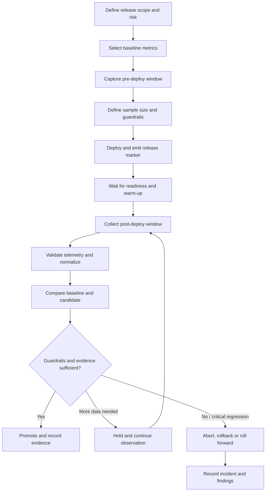

# Comparing Against Pre-Deployment Baselines

A deployment may complete without CI/CD tool errors, yet that does not prove the new version performs well in production. Once traffic begins hitting the new version, latency can climb, transaction success rates can drop, queues can back up, or a user segment may hit errors that health checks miss.

To know whether a change improved or degraded the system, the team must compare post-deployment state against a reliable **baseline** recorded prior to the change. Baselines provide a reference point for technical and business metrics. Comparisons must account for traffic volume, time of day, user cohorts, configuration, seasonality, and concurrent changes.

**Baseline comparison is not just glancing at a dashboard before and after deployment.** The team must define beforehand which metrics matter, which time windows are comparable, whether data has enough samples, which thresholds require halting the rollout, and what evidence permits a conclusion. Without a suitable baseline or complete telemetry, the proper state is insufficient data to confirm—never assuming everything is fine by default.

## 1. What Is a Baseline and What Is It Used For?

A baseline is a reference set of values describing the normal or accepted behavior of a system prior to deploying a change. A baseline may include averages, percentiles, rates, fluctuation ranges, hourly distributions, or business metrics over a time window.

For example, before releasing a new version of `orders-api`, the team records:

- HTTP 5xx rate during peak hours.
- p95 and p99 latency by endpoint.
- Order creation success rate.
- Queue processing time and message backlog.
- Database connection usage and query latency.
- Payment failure rate.

After deployment, the team measures the same metrics under equivalent conditions and checks whether the delta exceeds acceptable limits.

Baselines help:

1. Catch regressions that simple health checks miss.
2. Separate normal fluctuations from abnormal shifts.
3. Assess a release's impact on performance and business outcomes.
4. Decide whether to continue rollout, hold the ratio, halt, or recover.
5. Preserve evidence explaining why a deployment was deemed successful.

A baseline is not always a single number. A service with different load between peak hours and nighttime needs baselines segmented by time of day or traffic type. A read endpoint may have different latency than a transaction-creation endpoint; averaging them together can hide a regression in one group.

## 2. Distinguishing Baseline, Target, SLO, and Guardrail

These concepts often appear together yet play different roles.

| Concept | Meaning | Example |
|---|---|---|
| Baseline | Reference behavior before a change or of the stable version | Current p95 latency is 180 ms during peak hours |
| Target | Desired outcome level | Target p95 latency under 200 ms |
| SLI | Metric measuring service quality | Request success rate |
| SLO | Quality objective over a time window | 99.9% successful requests over 30 days |
| Guardrail | Boundary that must not be breached during rollout or experiment | Do not let payment success rate drop more than 0.3 percentage points |
| Alert threshold | Threshold triggering operator alerts | 5xx exceeds 2% for 10 minutes |

Baseline tells you how the system is currently behaving; SLO tells you what quality level must be maintained; guardrail determines what magnitude of change is acceptable during the release. A baseline might already be worse than the SLO. In that case, do not treat the old state as a good standard merely because it existed for a long time.

For example, if current p95 latency is 450 ms while the internal SLO requires under 400 ms, a release reducing latency to 420 ms improves on the baseline yet still misses the target. Reports must reflect both facts.

## 3. Choosing a Reliable Baseline

Conclusion quality depends heavily on choosing the right baseline. If the pre-deployment window had an incident, unusual traffic, or a major campaign, the comparison can mislead.

### Baseline Sources

| Source | When suitable | Limitations |
|---|---|---|
| Stable version right before release | Direct comparison of new change against current serving state | May be skewed by anomalous events in the most recent window |
| Corresponding historical window | Systems with daily/weekly cycles or seasonality | Requires choosing equivalent days and conditions |
| Concurrent control cohort | Canaries or experiments with a control group | Requires fair splitting and sufficient samples |
| Long-term SLO/SLI baseline | Evaluating overall quality | Not necessarily sensitive to short-term impact of one release |
| Fixed synthetic tests | Comparing endpoint behavior and business flows under control | Does not fully represent live traffic |

In many cases, combine the latest stable baseline with a historical baseline from the same time slot. A concurrent control cohort adds confidence when a canary allows old and new versions to run side by side.

### Baselines Must Be Captured Before Deployment

Record the baseline before starting rollout and store alongside it:

- Window start/end timestamps.
- Running version, commit, or artifact digest.
- Environment, region, and relevant configuration.
- Traffic volume, request count, and request-type distribution.
- Incidents, maintenance, or special campaigns during the window.
- Metrics, units, queries, and calculation formulas.

Do not create a baseline after deploying and use new data as the reference for that same deployment. If a baseline was missed, use the most recent stable data or a control cohort, clearly noting the source and confidence level.

## 4. Selecting Pre- and Post-Deployment Time Windows

A baseline window and a post-deployment window are only comparable when they represent similar conditions.

Factors to consider:

- Same time of day or day of week if traffic is cyclical.
- Same region, endpoint, user type, or transaction group.
- Traffic volume and request mix do not diverge drastically, or are normalized.
- Maintenance, incidents, or anomalous batches excluded if outside evaluation scope.
- Sufficient time allowed for release effects to materialize.
- Warm-up duration, cache cold starts, and background jobs accounted for.

For instance, comparing the first 15 minutes after a 2:00 AM deployment against 15 minutes of midday peak traffic is not a fair comparison. If the system follows a weekly cycle, a baseline from the same day of week and time slot from the previous week can be more useful than the immediately preceding window.

### Windows Too Short vs. Too Long

- Too short: small sample size, high random noise, and may miss scheduled jobs.
- Too long: many external factors shift, making it hard to isolate deployment impact.

Choose the window based on traffic rate, transaction frequency, SLOs, and risk. An API handling millions of requests per minute can be evaluated sooner than a batch job running once an hour.

## 5. Measuring Change: Absolute and Relative

For clear comparisons, distinguish absolute difference from relative change.

Absolute difference:

\[
\Delta = X_{after} - X_{baseline}
\]

Relative change when baseline is non-zero:

\[
\text{Change\%} = \frac{X_{after} - X_{baseline}}{X_{baseline}} \times 100\%
\]

For example, if p95 latency rises from 200 ms to 230 ms:

- Absolute difference: +30 ms.
- Relative change: +15%.

For rates, distinguish **percentage points** from **percent change**. If error rate rises from 1% to 1.5%, the increase is 0.5 percentage points, which is a 50% relative increase. The two expressions are not interchangeable.

Do not compute percent change when the baseline is 0 or too small without choosing another interpretation. In that case, report event counts, denominators, and confidence intervals instead of producing an unstable ratio.

## 6. Normalizing by Traffic and Request Mix

Absolute error counts can rise simply because traffic grew, even if per-request quality did not change. Conversely, fewer errors when traffic drops does not prove the new version is better.

Example:

| Phase | Requests | Failed requests | Error rate |
|---|---:|---:|---:|
| Baseline | 100,000 | 500 | 0.50% |
| Post-deploy | 200,000 | 800 | 0.40% |

Error count rose from 500 to 800 while error rate dropped from 0.50% to 0.40%. Examine both absolute counts and rates to understand load and quality.

### Normalizing by Business Unit

For transaction-processing systems, you can track:

- Errors per 1,000 requests.
- Processing time per order.
- Infrastructure cost per successful transaction.
- Retry rate per received message.
- Invalid records out of total processed records.

### Analyzing Traffic Mix

A release might receive simpler requests or fewer large tenants than the baseline. Aggregate metrics can look better even while a critical segment suffers a regression.

Segment along meaningful dimensions such as endpoint, region, tenant tier, transaction type, client version, or workload class. Avoid over-segmenting in ways that explode metric cardinality or expose personal data.

## 7. Comparing Technical Metrics

Technical metrics reflect system health and serving capacity. A common metric set covers the four golden signals: latency, traffic, errors, and saturation.

| Group | Metrics | What to compare |
|---|---|---|
| Latency | p50, p95, p99 by endpoint | Did percentiles climb abnormally; did tail latency worsen |
| Traffic | Request rate, throughput, concurrent sessions | Is load comparable or normalized |
| Errors | 4xx/5xx, timeouts, exceptions, retries | Did error rate and error types change |
| Saturation | CPU, memory, thread pools, connection pools, disk, queues | Are resources approaching limits |

Do not rely solely on average latency. A handful of very slow requests can hide in the mean yet stand out clearly at p95 or p99. Also ensure percentiles have sufficient samples and consistent computation across both windows.

### Comparing by Version

Attaching version or release ID labels to metrics separates stable and candidate. Illustrative PromQL example:

```promql
sum(rate(http_requests_total{version="candidate",status=~"5.."}[5m]))
/
sum(rate(http_requests_total{version="candidate"}[5m]))
```

This query computes the 5xx error rate of the candidate version over a 5-minute window. You can write an analogous query for stable and compare over the same interval. Exact labels depend on instrumentation and your metrics system.

If you only compare service-wide metrics, errors in a small canary get diluted by stable serving most of the traffic. Conversely, per-version metrics require enough samples and consideration of each version's actual load.

## 8. Comparing Business Metrics

Green technical metrics do not guarantee users receive correct outcomes. An API can return HTTP 200 yet miscalculate totals, duplicate orders, or fail to emit required events.

Business metrics must be chosen according to the service's purpose:

| Business domain | Reference metrics |
|---|---|
| E-commerce | Order creation rate, checkout completion, cancelled orders, fee miscalculations |
| Payment | Authorization success, duplicate charges, refund failures, reconciliation mismatches |
| Authentication | Login success, token refresh failures, lockout rate, unauthorized access |
| Messaging | Messages processed, duplicates, dead-letter count, consumer lag |
| Data pipeline | Records accepted/rejected, freshness, completeness, reconciliation differences |
| Search | Zero-result rate, relevance feedback, query success, latency |

Business metrics need stable definitions. For example, "successful order" must define which statuses count, which order types are excluded, and whether the denominator is checkout requests or confirmed orders.

For operations with side effects, verify data integrity such as duplicate transactions, mismatched totals, dropped messages, or orphaned records. These checks sometimes run asynchronously after deployment because reconciliation outcomes do not appear immediately.

## 9. Selecting Metrics Based on the Release Change

Not every release needs the exact same metric set. Beyond the service's general baseline, select metrics directly tied to the changed code paths or resources.

| Change type | Priority metrics |
|---|---|
| API handler change | Error rate, p95/p99, timeouts, response schema |
| Database query change | Query latency, lock waits, connection usage, slow queries, DB CPU |
| Cache change | Hit ratio, miss rate, evictions, backend request rate, stale data |
| Queue consumer change | Lag, processing time, retries, dead-letter count, duplicate handling |
| Authentication change | Login/token success, 401/403, refresh failures, suspicious access |
| Payment change | Authorization success, duplicate charges, reconciliation, refund errors |
| Frontend change | JS errors, page load, interaction latency, conversion by client version |
| Infrastructure change | Availability, saturation, network errors, capacity, and failover |

If a relevant metric lacks instrumentation, add it before or alongside the release. You cannot conclude a change is safe merely because existing unrelated metrics stay flat.

## 10. Checking Measurement Data Quality

Comparisons are meaningful only if pre- and post-deploy data are collected under the same definitions and calculations.

Before concluding, check:

- Does the metric appear in both windows?
- Are units, labels, and aggregations consistent?
- Did instrumentation or sampling change at the same time?
- Are clocks, timestamps, and timezones aligned?
- Were there telemetry losses, scrape failures, or log drops?
- Is the denominator zero or too small?
- Did duplicate or delayed events skew the numbers?
- Did retention or query filters change between measurements?

If a deployment simultaneously changes metric names or sampling, map old and new data or cross-check with another independent metric. Never compare two series with different definitions as if they were equivalent.

### Missing Telemetry

A metric with no data does not mean no errors occurred. If a mandatory metric is missing, the quality gate should return `unknown` or `insufficient_data`, holding or halting rollout according to risk. For critical production gates, never auto-promote when safety conditions cannot be observed.

## 11. Small Samples, Variance, and Statistical Significance

When request counts are low, a few errors can swing rates dramatically. Conversely, a small regression can hide behind short-window averages.

Example:

| Phase | Requests | Errors | Error rate |
|---|---:|---:|---:|
| Small baseline | 100 | 1 | 1.0% |
| Small post-deploy | 100 | 3 | 3.0% |
| Large baseline | 100,000 | 1,000 | 1.0% |
| Large post-deploy | 100,000 | 1,100 | 1.1% |

Both cases show rate changes, yet their confidence and operational meaning differ. Examine sample size, confidence intervals, impact magnitude, and failure consequences.

### Principles

- Require a minimum number of requests/transactions before evaluating.
- Use windows long enough to cover load cycles and key tasks.
- Track both error count and error rate.
- For rates, consider confidence intervals rather than just a point estimate.
- Do not stare continuously at dashboards and stop the instant results look favorable.
- With multiple metrics, pre-define primary metrics and guardrails to avoid cherry-picking after observing.

Statistical significance does not replace impact assessment. A tiny error increase may be statistically significant yet negligible to users; a rare bug causing financial loss or data exposure may require halting immediately even before reaching statistical sample thresholds.

## 12. Static Baselines, Dynamic Baselines, and Control Cohorts

### Static Baselines

A static baseline is a snapshot or reference range fixed prior to the release. It is easy to explain and well suited for evaluating changes within a specific release.

The limitation is that systems evolve naturally over time. Last month's baseline may no longer represent current load after user volume doubles.

### Dynamic Baselines

A dynamic baseline updates with recent data, such as the median of the same time slot across multiple days or a rolling window. It reflects recent trends, yet can be "poisoned" by a regression itself if post-deploy data feeds into the baseline too early.

During release evaluation, freeze the reference baseline or exclude candidate data from baseline updates. Update the baseline only after the new version is accepted and behavior stabilizes.

### Control Cohorts

When a stable cohort can run concurrently, it controls for shared factors like traffic, weather, or marketing events. Comparing canary against stable in the same window is usually better than comparing two distant time points.

However, cohorts must be sufficiently comparable. If the canary only receives internal users or tiny tenants, you cannot assume that behavior represents all customers.

## 13. Distinguishing Correlation from Causation

If error rate climbs right after deployment, the release may be the cause, yet consider concurrent changes:

- Sudden traffic spike from a campaign.
- An external dependency experiencing an outage.
- Database maintenance or network degradation.
- Changes to other configurations, secrets, or feature flags.
- Another deployment in the same service or upstream/downstream.
- Instrumentation changes altering how metrics are recorded.

Deployment markers pinpoint when a change happened. Correlation IDs, traces, version labels, and changelogs tie metrics to specific requests and versions.

With canary/stable running side by side, concurrent comparison reduces noise. If both stable and candidate degrade at once, the culprit may be a shared dependency or traffic surge. If only candidate degrades, release involvement is far more likely.

Do not assert causation solely because two events occurred close in time. Reports should distinguish "correlated", "supporting evidence of involvement", and "confirmed root cause".

## 14. Building Guardrails and Action Thresholds

A good threshold ties to SLOs, baselines, severity, and recoverability. Overly sensitive thresholds cause false alarms; overly loose thresholds let regressions spread.

Illustrative guardrail examples:

| Metric | Reference condition | Action |
|---|---|---|
| 5xx rate | Increases by more than 0.5 percentage points over stable with sufficient samples | Halt rollout expansion, investigate |
| p95 latency | Increases more than 15% over baseline and breaches SLO threshold | Hold or roll back depending on severity |
| Payment success | Drops beyond agreed business threshold | Halt rollout immediately and inspect transactions |
| Queue lag | Grows continuously and exceeds allowable processing delay | Hold ratio, inspect consumers and capacity |
| Data reconciliation | Discrepancy exceeds tolerance | Halt rollout or disable write path |
| Telemetry availability | Mandatory metric lacks data | Hold or abort per policy |

These numbers are only examples. Production thresholds must be built around SLOs, baselines, and failure consequences. For payment data or access permissions, a severe incident may require halting immediately without waiting for a statistical window to finish.

### Distinguishing Actions

- `PROMOTE`: sufficient samples, guardrails pass, traffic may expand.
- `HOLD`: maintain current ratio to gather more data or investigate unclear signals.
- `ABORT`: stop rollout due to guardrail violation or severe defect detected.
- `ROLLBACK`: return traffic/workload to the stable version when conditions permit.
- `ROLL_FORWARD`: deploy a new fix when rollback is unsafe or cannot resolve data state.

Do not conflate `HOLD` and `ABORT`. Minor noise may warrant more data; data loss or corrupted transactions require urgent action.

## 15. Post-Deployment Baseline Comparison Workflow

A practical workflow can be broken into steps:

1. **Define release objective:** state affected components, scope, and change type.
2. **Select metrics:** choose directly relevant technical, business, and security metrics.
3. **Capture baseline:** record window, version, traffic, configuration, and data quality prior to deploy.
4. **Set guardrails:** define thresholds, sample counts, observation windows, and corresponding actions.
5. **Mark deployment:** record release ID, commit SHA, artifact digest, timestamp, and environment.
6. **Wait for warm-up:** let new instances become ready, caches stabilize, and telemetry flow completely.
7. **Collect post-deploy data:** measure the same metrics with the same definitions over an appropriate window.
8. **Normalize and segment:** compute rates, percentiles, and per-business-unit metrics; slice by version/region/endpoint if needed.
9. **Compare:** calculate absolute deltas, relative changes, sample counts, and uncertainty.
10. **Decide:** promote, hold, abort, roll back, or roll forward.
11. **Archive evidence:** store report, dashboard snapshot/metric queries, deployment record, and decision actor.



## 16. Distinguishing Immediate Checks from Long-Term Monitoring

Some effects surface the moment traffic shifts; others emerge hours later or when scheduled cycles run.

| Phase | Goal | Typical checks |
|---|---|---|
| Immediately post-deploy | Confirm instances and dependencies are ready | Readiness, smoke tests, error rate, startup logs |
| After warm-up | Confirm initial live-traffic behavior | Latency, 5xx, resource saturation, business success |
| Rollout window | Decide on traffic expansion | Baseline comparison, cohort metrics, guardrails |
| After rollout completes | Catch delayed bugs and side effects | Queue lag, reconciliation, scheduled jobs, support tickets |
| Long-term monitoring | Evaluate SLOs and cumulative regressions | Error budget, trends, cost per transaction, data quality |

Do not close validation merely because smoke tests passed. Smoke tests verify a few primary paths work at run time; they do not prove the system holds up when load climbs or batch jobs fire.

## 17. Tying Baselines to Canary and Progressive Delivery

Canary is an especially useful case of baseline comparison because stable and candidate versions run concurrently.

At each stage:

- Compare candidate metrics against stable within the same window.
- Ensure both cohorts receive traffic with comparable or stratified characteristics.
- Set minimum sample counts per version.
- Keep the reference baseline unchanged throughout the release.
- Never promote if candidate telemetry is missing.
- Record traffic ratios and change timestamps to explain metric shifts.

For example, if a canary receives 5% traffic yet only sees 20 requests in a 10-minute window, do not treat a low error rate as sufficient proof. Hold the ratio, extend observation time, or add synthetic checks.

For rollouts without concurrent stable instances, historical baselines must be chosen more carefully and account for time, traffic, and external changes.

## 18. Automating Baselines and Reporting in CI/CD

Pipelines can automatically gather baselines, emit deployment markers, wait through observation windows, compute metrics, and generate reports. However, protect queries, policies, and data sources so results cannot be tampered with or attributed to the wrong release.

Conceptual YAML example:

```yaml
post_deployment_validation:
  release:
    id: "${RELEASE_ID}"
    artifact_digest: "${ARTIFACT_DIGEST}"
    environment: production

  baseline:
    source: stable_revision
    window: 30m
    capture_before_deploy: true
    metrics:
      - http_5xx_rate
      - request_latency_p95
      - order_success_rate
      - queue_lag

  observation:
    warmup: 5m
    window: 20m
    minimum_requests: 5000
    compare_by: [version, region, endpoint]

  decisions:
    insufficient_data: HOLD
    guardrail_failure: ABORT
    all_checks_pass: PROMOTE

  evidence:
    include:
      - baseline_window
      - post_deploy_window
      - metric_deltas
      - sample_counts
      - deployment_marker
      - decision_and_actor
```

These values are examples and must be tailored per service. In real systems, baselines may come from a metrics backend, log analytics, or observability platform. Save query versions and label filters so results can be reproduced later.

### Example Comparison Report

| Metric | Baseline | Post-deploy | Delta | Assessment |
|---|---:|---:|---:|---|
| 5xx rate | 0.40% | 0.35% | -0.05 pp | Slight improvement |
| p95 latency | 210 ms | 245 ms | +16.7% | Check guardrail |
| Order success | 99.6% | 99.7% | +0.1 pp | Stable/improved |
| Queue lag | 12 s | 28 s | +16 s | Inspect consumer |

You cannot declare a release successful just because two metrics improved. p95 latency and queue lag are worsening; inspect SLOs, sample counts, segments, and business impact before promoting.

## 19. End-to-End Example: Baseline Comparison for orders-api

Suppose a team releases a new version of `orders-api` to reduce order confirmation time. Changes include optimizing a database query and offloading one processing step to a queue.

**Before deploy:** the team selects a 30-minute baseline from the same time slot over recent days, excluding a window that had a database incident. The baseline is saved alongside the stable artifact digest, request volume, region, and metric queries. The primary metric is order confirmation p95 latency; guardrails include 5xx rate, order success rate, queue lag, and database connection usage.

**After deploy:** the pipeline emits a deployment marker, waits for readiness and cache warm-up, then collects metrics over the defined window. Candidate carries a version label for separate comparison against stable. Minimum request count must be reached before deciding.

**Result:** p95 dropped 12% and 5xx showed no notable change, yet queue lag doubled and orders in one specific region were confirmed slowly. System-wide aggregates looked healthy, but slicing by region revealed a regression.

**Decision:** hold rollout ratio, do not promote. Traces showed consumers in that region processed messages slowly due to a constrained connection pool. The team adjusted configuration, released a fix, and repeated validation against the recorded baseline.

**Completion:** once queue lag and p95 stabilized within a window with sufficient samples, the team expanded traffic and promoted. The report stored baseline, post-deploy values, segments, sample counts, query versions, release digest, and decision.

This example shows aggregate metrics can mask an impacted cohort. Comparisons need both a system-wide view and breakdowns for segments tied to the change.

## 20. Common Anti-Patterns

| Anti-pattern | Consequence | How to improve |
|---|---|---|
| Not capturing a baseline before deploy | No reliable reference point | Record baseline before rollout and link to release ID |
| Comparing two different time slots | Seasonality skews conclusions | Choose equivalent windows or normalize by traffic |
| Looking only at absolute counts | Traffic growth increases error count even when rate drops | Examine count, rate, and denominator together |
| Looking only at average latency | Tail latency stays hidden | Track p50/p95/p99 and distributions |
| Aggregating all endpoints/regions | Segment regressions get diluted | Segment along meaningful dimensions |
| Using metrics with mismatched definitions | Invalid data comparisons | Version queries, schemas, and metric definitions |
| Treating missing telemetry as no errors | Promoting without sufficient evidence | Return `unknown/insufficient_data`, hold, or abort |
| Inferring causation from correlation | Blaming the deployment mistakenly | Use deployment markers, stable cohorts, and traces to investigate |
| Setting too many thresholds without owners | Alert fatigue and inconsistent decisions | Choose primary metrics, guardrails, and clear owners |
| Stopping when one metric looks good | Misses business or infrastructure impacts | Evaluate the full pre-defined metric suite and stop conditions |
| Not saving query/baseline metadata | Conclusions cannot be reproduced | Store window, query version, labels, and artifact digest |

## 21. Pre-Deployment Baseline Comparison Checklist

Before confirming a deployment meets requirements, review:

- [ ] Baseline was recorded before deployment started.
- [ ] Baseline is tied to a specific stable version/artifact and environment.
- [ ] Pre/post windows share equivalent timing and load conditions.
- [ ] Metrics have consistent definitions, units, queries, and labels.
- [ ] Both technical and business metrics relevant to the change are included.
- [ ] Percentile latency, error rate, traffic, and saturation are tracked appropriately.
- [ ] Denominators and sample counts are included for rate metrics.
- [ ] Normalized per request/transaction or segmented as needed.
- [ ] Telemetry completeness, sampling, and data quality checked.
- [ ] Sample counts and observation windows meet minimum criteria.
- [ ] Guardrails, thresholds, and promote/hold/abort actions are pre-defined.
- [ ] Candidate is compared against stable or an appropriate historical baseline.
- [ ] Concurrent changes and confounding factors are documented.
- [ ] Missing data is never treated as pass.
- [ ] Post-rollout monitoring covers queues, batches, reconciliation, and delayed side effects.
- [ ] Report stores baseline, metric deltas, sample counts, release ID, and artifact digest.
- [ ] Decisions and accountable owners are recorded.

## 22. Conclusion

Comparing against pre-deployment baselines helps teams determine whether a new version changes service quality and business outcomes. Baselines must be drawn from trustworthy data, captured before deployment, matched with equivalent windows, and tied to clear version, environment, and metric calculation definitions.

A sound process combines technical metrics, business metrics, traffic normalization, segmentation by endpoint/region/cohort, data quality checks, and sample-size evaluation. Guardrails must pre-define promote, hold, or abort actions; missing telemetry must be treated as insufficient evidence. When pipelines record baselines, deployment markers, metric deltas, and decisions alongside the artifact digest, post-deployment validation becomes consistent, reproducible, and valuable for both operations and future release improvements.
