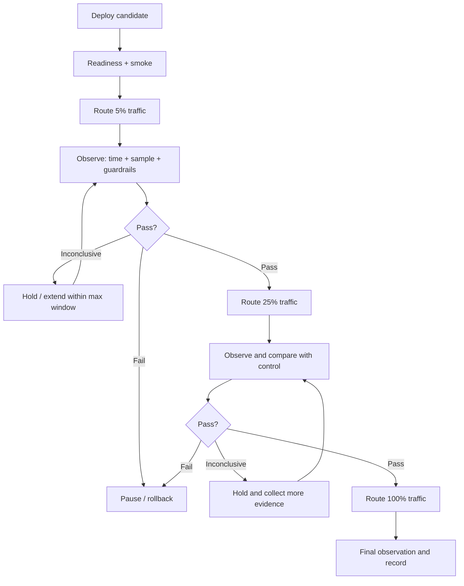

# Choosing Observation Windows and Acceptance Criteria

Deployment completion only indicates the system has received the new version. It does not prove that version performs well with real traffic, data, and dependencies. After each deploy, CI/CD needs an observation window to collect operational signals, compare against baselines, and decide whether to continue the rollout, pause, or roll back.

Too short an observation window can miss bugs that only appear after enough requests, when a batch runs, or when caches expire. Too long an observation window leaves the rollout waiting, prolonging exposure to an unverified version. Therefore, duration should be based on change type, traffic volume, error emergence latency, business cycles, and observability data quality. Acceptance criteria must be defined before deployment, have measurable thresholds, and be tied to the exact running revision.

## 1. Purpose of Post-Deployment Observation

Post-deployment observation is the phase of verifying a new version in the target environment after rollout begins or completes. It combines active checks such as health checks and smoke tests with passive signals from metrics, logs, traces, and business data.

Goals include:

- Confirming the workload started, is ready, and received the right artifact/configuration.
- Detecting functional bugs that only manifest in the live environment.
- Detecting regressions in latency, throughput, error rate, or resource utilization.
- Confirming critical business flows still produce accurate outcomes.
- Detecting integration errors, queue backlogs, retry storms, or dependency timeouts.
- Checking whether the change affects SLOs, error budgets, security, or data integrity.
- Providing evidence to decide whether to expand rollout, hold ratio, halt, or roll back.

A deployment can have a `succeeded` status at the deployment-tool level yet still fail at the service level. For example, Kubernetes may have updated all replicas, yet the payment endpoint returns errors, p99 latency spikes, or consumers fail to process messages. Hence, separate **deployment completion** from **post-deployment acceptance**.

## 2. Identify Signals to Observe Before Choosing Duration

Do not pick "observe for 10 minutes" first and look for matching metrics afterward. Start from the change's risk and identify which signals prove the system still works properly.

| Signal group | Must answer | Example |
|---|---|---|
| Availability/readiness | Are instances ready to accept traffic? | Readiness probe, healthy target count, request success rate |
| Functional correctness | Do business flows produce right results? | Smoke tests, synthetic transactions, contract checks, invariants |
| Reliability | Are errors, timeouts, or retries spiking abnormally? | 5xx rate, timeout rate, retry count, queue failures |
| Performance | Does the system meet time and load targets? | p50/p95/p99 latency, throughput, saturation |
| Dependency | Are connections to databases, caches, brokers, and external APIs stable? | Connection pools, query latency, consumer lag, dependency errors |
| Business outcome | Do business operations keep succeeding properly? | Completed orders, successful payments, conversion rate |
| Data integrity | Is data lost, duplicated, or in a wrong state? | Reconciliation, duplicate counts, migration validation |
| Security | Are there abnormal access behaviors or security errors? | Auth failures, denied access, policy violations, audit events |

Not every service weighs every signal equally. A content-reading API may prioritize availability and latency; a payment system also needs transaction reconciliation, duplicate checks, and data integrity; background workers must track queue lag, message age, and processing success rate.

### Choosing Metrics by Change

Tie each change to a corresponding hypothesis and guardrail:

- Database query changes: monitor query latency, connection pools, lock waits, timeouts, and error rates.
- Cache changes: monitor hit ratios, miss rates, evictions, backend load, and returned data.
- Consumer changes: monitor lag, processing rate, retries, dead-letter queues, and duplicates.
- Authentication changes: monitor login success/failure, token validation, authorization denials, and identity provider latency.
- Schema changes: monitor migration results, read/write errors across old and new versions, constraint violations, and reconciliation.
- Algorithm or business-flow changes: monitor outcomes, completion rates, output values, and business invariants.

Metrics must carry labels sufficient to distinguish the new revision from the stable version, such as `service`, `environment`, `version`, `revision`, `deployment_id`, or `release_id`. If you only look at service-wide totals, canary errors can be masked by the old version.

## 3. Choosing Observation Windows Based on Error Emergence Time

The observation window must be long enough for critical signals to have a chance to appear and be collected. Some errors surface immediately when the process starts; others only appear after a few hundred requests, once caches warm up, when a batch runs, or when traffic peaks.

Deciding factors:

1. **Startup and warm-up time:** how long do the app, JIT, caches, connection pools, or autoscaler take to stabilize?
2. **Traffic volume:** how many requests or transactions are needed for metrics to be meaningful?
3. **Telemetry lag:** how long after an event are metrics/logs/traces updated?
4. **Business cycles:** which per-minute, hourly, daily, or reconciliation jobs must run through?
5. **Failure nature:** do errors appear immediately, under load, over time, or on specific data?
6. **Blast radius:** if an error slips through, how many users or records are impacted?
7. **Recoverability:** can you roll back quickly, or must you stop to verify data first?

### Reference Observation Milestones

| Phase | Reference duration | What is checked |
|---|---:|---|
| Startup/rollout | Seconds to minutes | Pod/instance ready, crash loops, startup errors, dependency connections |
| Smoke verification | ~1–5 minutes after ready | Critical read/write flows, health endpoints, contracts, and synthetic transactions |
| Short canary hold | ~5–15 minutes for high-traffic, stable services | Error rate, latency percentiles, throughput, saturation, and business guardrails |
| Longer canary hold | ~30–60 minutes or longer for low/variable traffic | Sufficient samples, multiple traffic cycles, retry/queue behavior, and dependencies |
| Soak/long-running validation | Several hours to 24 hours or per business cycle | Memory/resource leaks, backlogs, scheduled jobs, cache expiry, and degradation over time |
| Data reconciliation | Per volume and processing cycle; may take hours or days | Record reconciliation, duplicates, missing data, and post-migration consistency |

These milestones are starting points for planning, not universal SLAs. A very high-traffic service can gather enough samples in minutes; a low-traffic internal service may take hours or require synthetic traffic. A monthly payroll system must verify the relevant business cycle—it cannot conclude after just 10 minutes.

### Combining Time with Sample Count

Using duration alone can mislead. For instance, a canary running 10 minutes that receives only 12 requests with a 0% error rate does not prove reliability. Conversely, millions of requests in a few seconds may reveal load bugs yet fail to test hourly batch jobs.

Define simultaneously:

- Minimum and maximum observation duration.
- Minimum requests/transactions per metric group.
- Number or percentage of users/traffic exposed to the new version.
- Number of business cycles that must pass.
- Maximum tolerable telemetry lag.

If maximum duration expires without enough samples, the result should be `inconclusive` or require an accountable decision per policy; do not treat it as passed automatically.

## 4. Establishing Baselines to Know What Is Abnormal

Post-deploy metrics are meaningful only with a comparison point. A baseline may be the stable version right before deployment, the service's SLO, the same historical time slot, or a concurrent canary/control cohort.

Comparison methods:

- **Absolute threshold:** value must not cross a fixed limit, e.g., error rate below 1% or p95 below 500 ms.
- **Relative change:** shift compared to baseline, e.g., p95 increases no more than 10% over stable.
- **SLO/error budget:** impact on reliability objectives and error budget burn rate.
- **Canary vs. control:** compare new revision against old revision over the same interval and under similar load.
- **Business invariant:** verify relationships that must always hold, e.g., debits equal corresponding credits.

Do not rely solely on relative thresholds. If the baseline was already poor, "no more than 5% worse" may still be unacceptable. Nor should you rely solely on absolute thresholds if traffic fluctuates by season or time of day. Usually you must combine absolute SLOs, relative changes, and business guardrails.

### Fair Comparisons

When comparing against a baseline, consider:

- Same endpoint, request type, region, and data distribution.
- Same time slot or adjustment for seasonality/weekday/weekend.
- Same cache warm-up and autoscaling state.
- Same histogram/percentile calculation and window length.
- Not mixing new-revision traffic with old-revision traffic when evaluating a canary.
- Documenting external changes outside the deployment that could affect results, such as dependency outages or traffic campaigns.

## 5. Setting Measurable Acceptance Criteria

Acceptance criteria must state the conditions for expanding a rollout or marking a deployment verified. Each criterion must specify the metric, measurement method, threshold, evaluation window, minimum sample count, and action on failure.

Example guardrail set for an API:

| Signal | Illustrative pass condition | Action if not met |
|---|---|---|
| Readiness | All target replicas ready within rollout deadline | Halt rollout, inspect startup/config/dependencies |
| 5xx/error rate | Below 1% and no more than 0.5 percentage points above control over a 5-minute window | Pause; if sustained past confirmation window, roll back |
| p95 latency | Below 500 ms SLO and no more than 10% above baseline | Hold canary ratio, investigate queries/resources, or roll back by severity |
| p99 latency | Does not breach defined critical threshold | Halt rollout if critical flows are impacted |
| Saturation | CPU/RAM/connection pools do not stay in danger zone | Pause or roll back if resource exhaustion threatens |
| Functional smoke | 100% of mandatory flows pass | Halt rollout; do not ignore critical business failures |
| Business outcome | Completion rate does not drop past allowed margin; no invariant violated | Halt, inspect data and business logic |
| Data integrity | No missing/duplicate/corrupted records beyond tolerance | Halt writes or trigger data recovery procedure |

These numbers are examples only. Real thresholds must come from service SLOs, baselines, and risk tolerance. For financial transactions, a single data error may demand a threshold of 0 even when overall error rate remains low.

### Classifying Pass, Fail, and Inconclusive

There should be at least three outcomes:

- **Pass:** sufficient time, sufficient samples, valid telemetry, and all mandatory guardrails met.
- **Fail:** a critical guardrail breached, severe functional failure occurred, or data integrity/security issue detected.
- **Inconclusive:** insufficient samples, interrupted telemetry, invalid baseline, or required business cycle not yet elapsed.

`Inconclusive` does not mean `pass`. The pipeline may hold rollout percentage and extend observation within bounds, request synthetic tests, or escalate to an on-call decision maker. When reliable evidence cannot be collected, never auto-expand traffic.

## 6. Using SLIs, SLOs, and Error Budgets as Guardrails

An SLI (Service Level Indicator) measures service quality, such as request success rate or latency. An SLO (Service Level Objective) is the target set for an SLI over a period. Error budget is the permitted deviation before the SLO is breached.

Example:

- Availability SLI: proportion of valid requests served successfully.
- SLO: 99.9% successful requests over a 30-day window.
- Error budget: the failing requests corresponding to 0.1% within that window.

After deployment, track error rate and burn rate to see if the new version consumes error budget abnormally fast. Do not judge a 30-day SLO solely from a 10-minute observation window; short windows catch regressions quickly, while long-term SLOs reflect reliability against committed targets.

A release gate can use:

- Fast threshold: severe errors or high burn rate in a short window halt rollout.
- Slow threshold: longer-trend monitoring to avoid rolling back on brief noise.
- Remaining error budget: restrict high-risk releases when the service has nearly exhausted its budget.

Thresholds and windows must be defined per service SLO. Do not apply the same latency or availability threshold to every endpoint.

## 7. Observing by Rollout Strategy

Duration and criteria must fit the rollout method.

### Rolling Deployment

The new version gradually replaces old instances. Observe readiness and errors per batch, ensure healthy instance count never drops below minimum, and monitor service-wide metrics. While old and new instances run concurrently, APIs/schemas must remain compatible during the transition.

### Canary Deployment

Only a small percentage of traffic hits the new version first. Each traffic increment should have its own hold period and guardrails. For example, 5% → 25% → 50% → 100%; advance only when enough time, samples, and passing metrics accumulate. If traffic is low, extend the hold or generate representative synthetic traffic.

### Blue-Green Deployment

A green environment is stood up in parallel, then traffic shifts from blue to green. Before full cutover, verify green via smoke tests, synthetic transactions, and dependency checks. After shifting traffic, keep observing because bugs may only appear with live data or real users. Keep blue alive long enough and retain the ability to switch back if rollback is supported.

### Feature Flag / Progressive Delivery

The artifact may already be deployed while the new feature is enabled only for a subset of users. Distinguish deployment observation from feature observation: track code revision alongside flag state, user cohorts, exposure ratio, and business metrics. Toggling a flag off can be a fast mitigation, though it does not replace fixing bugs or rolling back when underlying code poses risks.

## 8. Technical Observation and Business Verification

System metrics cannot prove all business behavior is right. A service with low CPU, good latency, and zero 5xxs can still miscalculate fees or create duplicate orders.

Combine three layers:

1. **Technical health:** processes, pods, dependencies, latency, errors, resources, and queues.
2. **Functional probes:** invoke critical flows with controlled test accounts/data; verify responses and side effects.
3. **Business validation:** reconcile counts, states, and invariants from a business perspective.

Example for an order service:

- Technical: orders API ready, database connections stable, consumer lag within bounds.
- Functional: create a test order, read it back, cancel it through a valid flow.
- Business: created order count matches completed order count, zero duplicate charges, totals and reconciliation states match.

Synthetic transactions must use dedicated data and accounts that are clearly identifiable and cleaned up. Never create fake transactions on a live payment system without a sandbox mechanism or approved process.

## 9. Handling Delayed, Missing, or Noisy Telemetry

Rollout decisions depend on data quality. An observation window can be skewed if metrics arrive late, logs drop samples, trace sampling changes, or dashboards accidentally merge revisions.

Measures:

- Measure telemetry lag and evaluate completed windows only after a buffer grace period.
- Attach deployment ID/revision to metrics, logs, and traces.
- Check minimum sample count before computing percentiles or rates.
- Never treat a metric with no data as zero or healthy.
- Monitor errors in the monitoring/collector system itself.
- Use identical metric definitions and histogram buckets when comparing against baselines.
- Define how outliers and anomalous traffic are handled before rollout.

If observation data is missing during a critical window, the status must be `inconclusive`. If losing telemetry means losing the ability to detect faults in a high-risk environment, you may need to pause rollout until observability is restored.

### Avoiding Conclusions from Tiny Samples

A 0% error rate across 10 requests does not carry the same meaning as 0% across 100,000 requests. For rare failure rates, require sufficient samples or appropriate confidence intervals. When traffic is insufficient, extend duration, apply controlled synthetic load, or wait for the next business cycle. Do not ramp up traffic just to reach sample size if doing so increases user risk.

## 10. Defining Actions When Criteria Are Violated

Acceptance criteria are useful only when tied to clear actions. They can be divided into three tiers:

| Tier | Example condition | Action |
|---|---|---|
| Warning | Metric degrades slightly yet stays within SLO and is brief | Hold rollout ratio, alert on-call, and keep observing |
| Pause/hold | Metric nears threshold, samples insufficient, or telemetry unstable | Do not increase traffic; inspect logs/traces, dependencies, and data |
| Abort/rollback | Severe failure, sustained SLO guardrail breach, security/data integrity failure | Halt rollout, roll back or disable feature per runbook; declare incident |

Certain conditions demand immediate action without waiting for the observation window to finish:

- Data loss, corrupt writes, or duplicate transactions with real impact.
- Secret leaks, authorization bypasses, or cross-tenant data exposure.
- Widespread crash loops or availability dropping below critical thresholds.
- Uncontrolled queue backlog growth leading to processing outage.
- Error rate/latency breaching defined emergency thresholds.

For non-critical errors, require a sustained violation duration (`for` duration) or consecutive windows to avoid rolling back on a brief spike. Never apply a waiting period to incidents risking data loss or severe security breaches.

## 11. Example Acceptance Policy Configuration

A structured policy aligns pipelines and operators on the same criteria. The YAML example below merely illustrates representation; schemas and evaluators must be implemented by the project.

```yaml
postDeployment:
  service: orders
  environment: production
  revision: "sha256:abc123..."
  observation:
    minimumDuration: 15m
    maximumDuration: 45m
    telemetryGracePeriod: 2m
    minimumRequests: 5000
    minimumCanaryTrafficPercent: 5
  acceptance:
    readiness:
      allReplicasReady: true
      rolloutDeadline: 5m
    errors:
      max5xxRate: 0.01
      maxIncreaseVsControl: 0.005
      evaluationWindow: 5m
      consecutiveWindows: 2
    latency:
      p95MaxMs: 500
      maxIncreaseVsControlPercent: 10
      evaluationWindow: 5m
    business:
      criticalSmokeTests: all_pass
      duplicatePaymentCount: 0
    dataIntegrity:
      corruptionCount: 0
  onInconclusive: hold
  onCriticalFailure: abort_and_rollback
```

In this example, the system must observe for at least 15 minutes, no more than 45 minutes, accumulate at least 5,000 requests, and wait an extra 2 minutes for telemetry. Two consecutive failing windows trigger escalation for ordinary 5xx errors; duplicate payments or corruption are critical conditions. Numbers must be tuned to service SLOs, traffic, and risk levels.

## 12. Example Prometheus Queries for Canary Monitoring

Assume metrics carry `service`, `environment`, and `revision` labels. You can query the 5xx rate and p95 latency of the new revision:

```promql
sum(rate(http_requests_total{
  service="orders",
  environment="production",
  revision="candidate",
  status=~"5.."
}[5m]))
/
clamp_min(sum(rate(http_requests_total{
  service="orders",
  environment="production",
  revision="candidate"
}[5m])), 1e-9)
```

```promql
histogram_quantile(
  0.95,
  sum by (le) (rate(http_request_duration_seconds_bucket{
    service="orders",
    environment="production",
    revision="candidate"
  }[5m]))
)
```

This example assumes the metrics and labels exist as shown. The denominator uses `1e-9` to prevent division by zero when traffic is zero; if there are no requests in the window, the result still lacks sample evidence and must be treated as missing data. Verify counter/histogram types, label cardinality, and application instrumentation. The p95 query returns seconds, so 500 ms corresponds to 0.5 seconds. Also query the control revision separately to compare over the same window.

## 13. Example Canary Rollout with Hold Steps

A progressive delivery workflow can split traffic and evaluate after each step:



Each traffic step requires its own hold period. As traffic rises, sample counts and potential impact grow; you may require re-verifying guardrails after every split change. Do not use a pass at 5% to automatically skip observation after reaching 100%.

## 14. Recording Observation Results in the Deployment Record

Post-deployment outcomes must be tied to the exact deployment for future investigation and release comparison. Record:

- Deployment ID, release ID, service, and environment.
- Artifact digest, commit SHA, and configuration revision.
- Rollout strategy, traffic milestones, and timestamps for each step.
- Observation start/end, timezone, and telemetry grace period.
- Baseline/control revision and comparison configuration.
- Metrics, thresholds, sample counts, percentiles, and per-window outcomes.
- Smoke/synthetic test results and business validation.
- `pass`, `fail`, or `inconclusive` status along with rationale.
- Action taken: continue, hold, pause, rollback, or feature disable.
- On-call/approver and incident links if applicable.

Do not save only dashboard screenshots. Save structured results and links to metric/log/trace sources so checks can be re-verified. Records must avoid containing secrets or personal data.

## 15. Common Mistakes

- **Choosing a fixed duration for every service:** ignores traffic, batch cycles, and error characteristics.
- **Relying only on readiness probes:** ready instances do not prove business logic is right.
- **Using only average latency:** hides p95/p99 and slow request cohorts.
- **Evaluating error rates on tiny samples:** easily yields wrong conclusions during low traffic.
- **Not separating revisions:** old-version metrics mask canary failures.
- **No baseline:** impossible to tell whether metric rises stem from deployment or normal variation.
- **Treating missing telemetry as healthy:** observability is lost yet the pipeline keeps expanding rollout.
- **Not tracking business invariants:** API returns 200 while data or transactions are wrong.
- **Rolling back over a brief non-critical spike:** adds churn from overly sensitive reactions.
- **Waiting out the window despite critical errors:** prolongs impact of data or security failures.
- **Not re-observing after increasing traffic:** misses bugs that appear only at high load.
- **Not storing policy and results per deployment:** cannot explain why a release proceeded.

## 16. Checklist for Choosing Observation Windows and Acceptance Criteria

Before deploying, determine:

1. Which error types could the change introduce, and how soon might they appear?
2. Which technical, functional, business, data, and security signals must be observed?
3. Which baseline/control revision is used for comparison?
4. What are the minimum duration, maximum duration, and telemetry grace period?
5. How many minimum requests/transactions or business cycles are required?
6. Are warm-up, synthetic traffic, batch runs, or soak tests needed?
7. Which absolute, relative, SLO, and business invariant thresholds are mandatory?
8. Are metrics tagged with revision/deployment ID to separate candidate from control?
9. Are `pass`, `fail`, and `inconclusive` outcomes clearly defined?
10. Which conditions only alert, which pause, and which trigger immediate rollback?
11. Who receives alerts and who is authorized to decide when data is insufficient?
12. After each traffic increase, is observation repeated over a fresh window?
13. Does the deployment record store digest, config revision, samples, metrics, thresholds, and decision?
14. Are recovery runbooks and post-rollback verification steps in place?

Choosing an observation window means choosing the duration and amount of evidence needed to surface a change's risks. Acceptance criteria must be measurable, tied to the exact revision, and reflect both technical quality and business outcomes. When data is missing, hold the rollout in an inconclusive state; when severe errors strike, act immediately per runbook. In doing so, release decisions rest on real evidence rather than merely on whether the deploy command exited cleanly.
