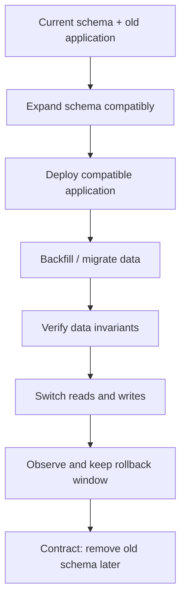

# Defining Rollback Conditions Before Deployment

## 1. Why Must Rollback Conditions Be Decided Before Release?

Rollback is the act of returning a system to a known stable state after a change causes errors or fails to meet release criteria. In CI/CD, rollback is often talked about as a single button pressed after a failed deployment. However, if a team only starts thinking about rollback once production is already experiencing an incident, they may discover that the old artifact is gone, the old configuration is incompatible, the migration is irreversible, or no one has the authority to decide to stop the rollout.

Rollback conditions need to be defined before deployment so everyone knows:

- Which signals indicate that the new release is introducing risk.
- Which thresholds require stopping the rollout or restoring the previous state.
- What observation window and minimum data volume are required to make a decision.
- Who has the authority to trigger a rollback and who is responsible for coordination.
- Which states can be recovered via rollback and which require roll-forward or data repair.
- Which artifacts, configurations, secrets, and data must be retained for recovery.
- After rolling back, what must be verified before reopening traffic.

A good rollback plan reduces decision-making time during an incident, limits user impact, and prevents uncontrolled emergency actions. It also helps the team evaluate upfront whether a change is truly reversible.

## 2. Distinguishing Rollback, Roll-Forward, Abort, and Recovery

These terms are related but do not represent the same action:

| Concept | Meaning | Example |
|---|---|---|
| Abort rollout | Stopping an in-progress deployment before completion | Stopping traffic increases to a canary when the error rate exceeds the threshold |
| Rollback | Restoring a previous version or state known to be stable | Reverting the workload to the image digest of the previous release |
| Roll-forward | Deploying a subsequent fix to bring the system to a correct state | Releasing a compatible patch when a migration cannot be reversed |
| Recovery | A set of activities to return services/data to an acceptable operating state | Restoring backups, replaying events, repairing data, and redeploying |

Rollback is often part of recovery, but recovery may require more steps than switching the image back to an older version. For example, if the new release has already written data using a new schema, rolling back only the application may prevent the old version from reading the data. In that case, you need to roll forward, transform the data, or restore from a backup according to a pre-evaluated plan.

Aborting a rollout is also not synonymous with a complete rollback. Stopping canary expansion may leave a portion of traffic on the new version. If that version is still causing errors, you must shift traffic or restore the workload according to the runbook.

## 3. Defining Recovery Objectives and Acceptable Impact Levels

Before setting rollback thresholds, you need to understand service objectives and failure impact. These questions should be answered together with the product owner, operations, and the team owning the system:

- Which failures directly affect users or business operations?
- How many failed requests or erroneous transactions are unacceptable?
- What is the maximum downtime the service can tolerate during recovery?
- Can any data be lost or re-entered?
- Is a temporary degraded state acceptable, or is full restoration required?
- Which dependent systems will be affected if a rollback occurs?
- What level of impact requires an incident notification or paging the on-call engineer?

Two concepts are commonly used to set recovery objectives:

- **RTO (Recovery Time Objective):** the target duration to restore a service after an incident.
- **RPO (Recovery Point Objective):** the maximum acceptable data loss, usually expressed as a time interval of data.

RTO/RPO are objectives for the overall recovery operation, not a default time that a single rollback command will achieve. If the RTO is 15 minutes, the team must account for detection, decision-making, execution, verification, and reopening traffic. If the RPO is 0 for confirmed transactions, rolling back the application must not lose committed transaction data.

## 4. Identifying Signals That Trigger Rollback

Rollback should be based on measurable signals tied to impact that can be collected during rollout. It should not rely solely on a gut feeling that "the application seems slow."

Common signal categories:

| Category | Example signals | Risk to detect |
|---|---|---|
| Availability | Health/readiness failures, rising 5xx request rate | Service cannot serve requests |
| Reliability | Increased timeouts, retries, connection failures | Requests do not complete or dependencies are unstable |
| Performance | Latency p95/p99 exceeding guardrails | Degraded experience or system overload |
| Business | Drop in payment/order creation success rate | Business behavior is broken even when technical health is green |
| Data integrity | Balance discrepancies, duplicate records, invariant violations | Corrupted data or erroneous transactions |
| Security | Unexpectedly broadened access permissions, leaked secrets, policy violations | Security or compliance risk |
| Capacity | CPU/memory saturation, rapidly growing queue lag | Unable to handle load or backlog accumulating |
| Deployment | Pod crash loops, instances with wrong digest, rollout stalled | Release is not applied properly or is unstable |

Not every alert requires a rollback. A brief spike may be noise, or errors may come from an external dependency or a traffic surge unrelated to the release. The policy should specify severity, duration, minimum sample count, and how to compare against the baseline before making a decision.

## 5. Setting Thresholds and Observation Windows

A rollback condition needs to define at least four elements:

1. **Metric or signal:** what is measured and from which source.
2. **Threshold:** what value is considered out of bounds.
3. **Observation window:** how long or across how many samples the condition must persist.
4. **Scope:** which cohort, endpoint, region, tenant, or entire service is affected.

Example hypothetical policy:

| Signal | Stop/rollback trigger condition | Notes |
|---|---|---|
| HTTP 5xx | Error rate higher than baseline by 2 percentage points for 5 minutes with sufficient requests | Exclude unrelated upstream errors if evidence exists |
| Latency p95 | Exceeds defined SLO continuously for 10 minutes | Evaluate by critical endpoint and actual traffic |
| Payment success | Payment success rate drops beyond approved business threshold | May trigger immediate stop due to financial impact |
| Crash loop | Instance restart rate exceeds limit within a short window | Check configuration and dependencies |
| Data invariant | Confirmed critical data discrepancy detected | May require stopping writes before deciding on rollback |

The numbers in this example are not universal standards. Actual thresholds must be based on SLOs, baselines, load levels, business sensitivity, and accepted risk levels. For critical signals such as unauthorized access or writing incorrect financial data, the policy may require stopping the rollout immediately without waiting for the normal window to finish.

If traffic is too low, metrics may lack sufficient samples to draw a conclusion. In that case, the status should be `insufficient_evidence` or `hold`, rather than automatically treating it as passing. You can supplement with synthetic tests or observe longer according to the plan.

## 6. Distinguishing Rollout Stop Conditions from Rollback Conditions

These two decisions are often combined, but they need to be distinguished:

- **Stop/hold:** stop expanding the new version and keep the rollout at its current level for investigation.
- **Rollback:** shift traffic or workloads back to the previous version.
- **Roll-forward:** deploy a subsequent fix.

For example, a canary is receiving 5% of traffic and p95 latency increases slightly. If samples are insufficient, the team can hold at 5% to gather more data. If the error rate rises sharply and is linked to the new code, the team can stop the rollout and then shift traffic back to the stable version. If the bug only lies in a configuration that can be safely fixed, rolling forward the configuration may be more appropriate.

Stop conditions need to be fast and low-risk. Rollback conditions must consider data, schema, and dependency compatibility. Rollback is not always the first or safest action.

## 7. Checking Reversibility Before Deployment

Before releasing, evaluate each change for its rollback capability:

| Changed component | Questions to answer |
|---|---|
| Application artifact | Is the old artifact still stored, retrievable, and redeployable? |
| Runtime configuration | Does a previous revision exist and is it compatible with the old artifact? |
| Database schema | Can the migration be safely reversed? Will new data break the old version? |
| Persistent data | Is there a backup/restore, replay, or repair procedure? |
| Message/event schema | Can old consumers read new messages? Does backward compatibility need to be maintained? |
| Secret/certificate | Are old credentials still valid or have they been revoked? Can they be safely reissued? |
| Infrastructure | Can network, IAM, storage, or resource changes be restored? |
| External integration | Have partners or external systems received side effects that cannot be undone? |

A change should only be called reversible when the prior state, rollback procedure, data boundaries, and verification method are clearly defined. If any component is irreversible, document it explicitly and design an alternative roll-forward or repair plan.

## 8. Application Rollback Does Not Automatically Roll Back Data

Switching the image from the new version back to the old version only changes the running code. It does not automatically undo:

- Records that have been created or updated.
- Payment transactions or notifications already sent.
- Events published to a message broker.
- Files written to object storage.
- Database schemas or indexes that have changed.
- Data that has been transformed or deleted.

For example, the new release starts writing a new `discount_amount` field and publishing events using a new schema. If you roll back the application to an old version that does not understand that field or event, consumers may fail or miscalculate data. Compatibility must be maintained during the transition period, or a data handling plan must be in place.

For external side effects such as payments, sending emails, or creating shipping orders, you cannot assume a rollback will "erase" actions that already occurred. You must use idempotency, compensating transactions, or business workflows to handle them. Those compensating actions must be reviewed and tested separately.

## 9. Database Migrations and the Expand-and-Contract Strategy

Migrations are one of the key factors determining whether a rollback is safe. Migrations that only add nullable columns or new tables are generally easier to keep compatible than dropping/renaming columns, changing data types, or performing destructive data transformations.

The expand-and-contract strategy splits a change into multiple phases:

1. **Expand:** add the new structure while keeping the old structure so the currently running version continues to work.
2. **Compatible application:** deploy code that can read/write in both formats or supports the transition.
3. **Migrate data:** convert data in a controlled manner, monitoring progress and checking invariants.
4. **Switch usage:** switch read/write flows to the new structure.
5. **Contract:** remove the old structure only after no version or consumer still needs it.



If the release fails before the contract step, the team has more options to revert to the old application because the old schema still exists. Once the contract step has removed structures or performed irreversible data transformations, rolling back to the old application may no longer be safe.

Do not run down-migrations automatically just because a deployment job failed. You must understand what data was written during that window and verify that the down script does not delete valid data.

## 10. Preparing Artifacts and Configuration for Rollback

A rollback plan must specify the exact artifact and config revision to be used. Do not simply write "revert to previous version."

Before deployment, you need to:

- Keep the previous stable artifact in the registry with an immutable digest.
- Verify that the old artifact can still be pulled and has appropriate provenance.
- Save the previous config revision and corresponding schema version.
- Record the current deployment manifest.
- Verify that old secret references/versions are still valid or have a reissuance plan.
- Save release notes and migration state.
- Define the command or automation to select the old artifact/config.
- Test redeploying the old artifact in an appropriate environment.

Rollback should not rely on mutable tags like `latest` or `stable` if the tag might have been overwritten. Use recorded digests or release IDs. If the old artifact is gone, the team may have to rebuild a new release from old source code and retest it, which usually takes longer and does not guarantee producing the exact same payload.

## 11. Configuration and Secrets During Rollback

The old artifact may require a different config schema or secrets than the new version. Before release, identify compatible pairs:

| Release | Artifact | Config revision | Secret reference/version | Rollback capability |
|---|---|---|---|---|
| R-104 | `service@sha256:aaa...` | `cfg-31` | `payment-api:v8` | Previous stable version |
| R-105 | `service@sha256:bbb...` | `cfg-32` | `payment-api:v9` | Version being deployed |

If secret v8 has been revoked for security reasons, do not automatically restore that secret just to run the old artifact. Determine how to issue new credentials compatible with the old application or choose to roll forward.

With dynamic configuration, record the revision each instance is using. If you roll back the artifact while the config service still returns the new configuration, the old application may fail. The deployment manifest should link the artifact digest and config revision within the same release record.

## 12. Defining the Rollback Window and When Rollback Capability Ends

The rollback window is the period during which reverting to the previous state is still considered safe and executable according to the runbook. This window may close when:

- A contract migration has dropped the old schema.
- New data is no longer compatible with the old application.
- Old secrets/certificates have been revoked.
- New events or message schemas have been widely published and old consumers cannot process them.
- External side effects have occurred and cannot be easily compensated.
- Old artifacts/configs have passed retention or are no longer supported.

A rollback window is not always a fixed number of hours. It depends on the specific data and changes. For a release that only changes CSS, the ability to revert can last as long as the old artifact remains available. For a data migration, the window may close as soon as a contract step or incompatible data writes begin.

The release plan must state when or under what conditions the rollback window closes, who confirms it, and the fallback plan after that point. If rollback is impossible after a given step, a roll-forward/repair plan must be prepared before executing that step.

## 13. Setting Rollback Conditions by Deployment Strategy

Different rollout strategies produce different states and decisions:

| Strategy | Stop/rollback conditions to define |
|---|---|
| Recreate | New version fails startup/readiness; maintenance window exceeded; whether restoring the previous artifact/config is safe |
| Rolling update | Percentage of new instances failing; rollout stalled; remaining capacity insufficient; how to pause and bring old instances back |
| Blue-Green | Green health check fails; traffic switching conditions; how to route back to blue; whether shared data is compatible |
| Canary | Metrics exceed guardrails in cohort; conditions to hold, reduce, or shift traffic back to stable; minimum sample count |
| Feature flag | Which signals trigger turning off the flag; whether the fallback is compatible with data and side effects |
| Serverless revision | Which revision receives traffic; traffic percentage to revert to previous revision; whether event/data state is affected |

With Canary or Blue-Green, rollback can be as simple as shifting traffic back to the stable version while keeping the new workload up for investigation. However, if the new version has already written incompatible data, shifting traffic back to old code can still cause errors. Both the traffic plane and the data plane must be considered.

## 14. Defining Decision Authority and Trigger Procedures

During an incident, multiple roles may be involved: on-call engineer, service owner, release manager, incident commander, database owner, and security team. Responsibilities must be assigned beforehand to avoid debates over authority while the system is degraded.

A reference responsibility matrix:

| Role | Responsibility |
|---|---|
| On-call engineer | Detect signals, perform initial verification, execute pre-authorized emergency actions |
| Service owner | Assess application impact, compatibility, and choose between rollback and roll-forward |
| Incident commander | Coordinate decisions, communication, and recovery priorities during major incidents |
| Release manager | Track release state, artifacts, approvals, and deployment records |
| Database/data owner | Evaluate migrations, backups, restores, and data integrity |
| Security owner | Assess security incidents, credentials, containment, and notification requirements |

Not every rollback requires an approval meeting. Under pre-defined and tested automated conditions, the system can automatically stop the rollout or roll back. For destructive or wide-impact data operations, authorization must be required according to the runbook.

The trigger procedure must define notification channels, recipients, permitted commands/automation, escalation conditions, and how decisions are recorded. Never allow arbitrary input from a pull request to trigger a production rollback.

## 15. Automating Rollback with Guardrails

Automated rollback can reduce response time, but it should only be applied when signals are clear, actions are reversible, and the system knows the exact previous state.

Required guardrails:

- Only roll back to a release ID/digest identified as a stable version.
- Verify that the target artifact and config exist before starting.
- Check compatibility with the current schema/database and secrets.
- Stop the rollout or lock competing deployments.
- Do not automatically roll back migrations/data without a dedicated policy.
- Enforce timeouts, retry limits, and clear failure states.
- Log an audit record, reason, triggering metric, and actor (system or human).
- After rollback, run post-deployment verification before concluding.
- Escalate to the on-call engineer if rollback fails or the state is indeterminate.

Automation should not loop rollbacks indefinitely if health checks keep failing. The old version might also be affected by an external dependency or changed data. When the state is unclear, prioritize keeping traffic safe and escalate to the incident process.

## 16. Example Pre-Release Rollback Policy

An illustrative policy can describe triggers and actions:

```yaml
rollbackPolicy:
  service: order-service
  release: R-105
  targetEnvironment: production
  expected:
    artifactDigest: sha256:bbb...
    configRevision: cfg-32
  stablePrevious:
    release: R-104
    artifactDigest: sha256:aaa...
    configRevision: cfg-31
  triggers:
    - metric: http_5xx_ratio
      operator: greater_than
      threshold: 0.03
      window: 5m
      minimumSamples: 1000
    - metric: payment_success_ratio
      operator: less_than
      threshold: 0.97
      window: 3m
      minimumSamples: 200
  actions:
    onTrigger: stop_rollout
    automaticRollback: true
    requireDataCompatibilityCheck: true
    verifyAfterRollback: true
  ownership:
    serviceOwner: order-platform
    onCall: payments-oncall
```

This is a conceptual structure, not a schema for any specific platform. The thresholds are only examples and must be derived from actual SLOs/baselines. `minimumSamples` and `window` prevent drawing conclusions from too little data; critical conditions such as data discrepancies may require separate triggers. `automaticRollback` is only safe if compatibility checks and recovery actions have been tested.

Policies must be reviewed and versioned. When thresholds change, you must know which releases are governed by the new policy and how to handle in-flight rollouts.

## 17. Example: Rollback Decision for an Order Processing Service

Suppose release `R-105` changes discount calculation logic and is deployed as a canary with 10% traffic. Before the release, the team defined:

- Stop expanding if the error rate exceeds the guardrail for 5 minutes with sufficient requests.
- Roll back traffic if the order creation success rate drops significantly compared to baseline.
- Stop immediately if incorrect order totals or transaction data are detected.
- If a database migration has written new fields, roll back code only if the old version remains compatible.
- The service owner and on-call engineer have authority to stop the rollout; the incident commander coordinates if impact is widespread.

During observation, the error rate rises slightly, but request volume is still low. The team holds the canary at 10% to gather more data. Shortly after, synthetic tests and business metrics confirm that order totals are being miscalculated for a subset of orders. The critical data condition is triggered: stop the rollout immediately, turn off the feature flag or shift traffic back to the stable version per the runbook, pause processing of affected transactions if needed, and start data reconciliation.

If bad data has already been written, rolling back code does not fix orders that were already created. The team needs a controlled repair/compensation process and must verify amounts before resuming processing. This is why rollback conditions must include data and business metrics, not just health endpoints.

## 18. Preparing Backups and Verifying Restore Capability

Backups are only useful if they can be restored within an acceptable time and data-loss limit. Before a data-risky change, verify:

- The backup was taken before the change point that needs protection.
- The backup has appropriate scope and consistency (database, object storage, metadata, encryption keys if needed).
- Access permissions and decryption keys are available when a restore is needed.
- A restore has been tested in a representative environment.
- Restore time meets the RTO.
- Potential data loss meets the RPO.
- A data verification procedure exists after restore.
- A clear decision exists regarding new writes during restore and how to reconcile them.

Do not treat a backup job reporting success as proof that a restore will succeed. Conduct periodic restore drills and record durations and results. For distributed systems, consider ordering and consistency across databases, object storage, queues, and related services.

## 19. What Should a Rollback Runbook Contain?

A runbook is the operational guide used when rollback conditions are triggered. A useful runbook should include:

1. Service name, environment, owner, and severity level.
2. Triggers/metrics, dashboards, and observation windows.
3. How to stop the rollout or stop receiving traffic.
4. Previous stable artifact digest and config revision.
5. Compatibility checks for database, message schemas, secrets, and external side effects.
6. Permitted rollback/roll-forward steps and required permissions.
7. Timeouts, retry limits, and escalation conditions.
8. Smoke tests, health checks, and metrics to achieve after recovery.
9. How to handle data/transactions generated during the failure window.
10. How to log the incident, update deployment records, and notify stakeholders.

The runbook must be tested during drills or in staging. A document that merely says "redeploy previous version" is insufficient if it does not specify which digest the previous version is, which config it uses, and how to verify state afterward.

## 20. Rollback Drills and Recovery Readiness Checks

Rollback should be tested before production needs it. Drills help uncover missing permissions, expired artifact retention, incompatible configs, or missing steps in the runbook.

Types of drills:

- Roll back a release in staging using the exact old artifact digest.
- Simulate readiness failure and verify the pipeline stops the rollout.
- Test shifting traffic back to stable in canary/blue-green setups.
- Test restoring a backup and measure actual duration.
- Test migrations/roll-forward on an appropriate copy of data.
- Simulate secret rotation to verify the old artifact still has a secure authentication path.
- Test recovery when the registry or config service is temporarily unavailable.
- Run a game day involving on-call engineers, the incident commander, and dependent teams.

You do not need to test every destructive scenario in production. You can use staging, test data, and controlled fault injection. The goal is to prove that procedures, permissions, and evidence work within safe boundaries.

## 21. Common Anti-Patterns

| Anti-pattern | Consequence | Improvement |
|---|---|---|
| Thinking about rollback only after production fails | Missing artifacts, permissions, and agreed decisions | Define triggers, owners, and recovery plans before release |
| Using only health checks as triggers | Misses business and data errors | Combine technical SLIs, business metrics, and data invariants |
| Rolling back application while ignoring migrations | Old version cannot read new schema/data | Evaluate compatibility and use expand-and-contract |
| Using the `latest` tag as the previous stable version | Tag may have been overwritten | Store release IDs and immutable digests |
| Unbounded automatic rollback | Can create loops or worsen the state | Add timeouts, retry limits, guardrails, and escalation |
| Treating a successful backup as restore readiness | May fail to decrypt/restore or exceed RTO | Run restore drills and measure RTO/RPO |
| Treating feature flag disablement as data recovery | Side effects that already occurred still remain | Establish reconciliation/compensation procedures |
| Not documenting the rollback window | Rolling back after migration/contract can be dangerous | Define conditions that end rollback capability |
| Skipping post-rollback verification | Old version may still fail or traffic may not have shifted | Re-run version, health, data, and traffic verification |
| Runbook containing only a redeploy command | Lacks decision criteria, compatibility checks, and verification | Document triggers, owners, artifacts/configs, and post-checks |

## 22. Pre-Deployment Rollback Readiness Checklist

Before opening the release window, check:

- [ ] RTO/RPO objectives and business impact are understood.
- [ ] Rollback triggers have clear metrics, thresholds, windows, and scope.
- [ ] Rollout stop conditions are distinguished from rollback conditions.
- [ ] Baselines and minimum sample counts exist to evaluate signals.
- [ ] The previous stable artifact still exists, has a digest, and can be pulled.
- [ ] The previous config revision and compatible schema have been identified.
- [ ] Old secrets/certificates are still valid or have a safe reissuance plan.
- [ ] Migrations, data, events, and external side effects have been assessed for reversibility.
- [ ] The rollback window and closing conditions have been documented.
- [ ] Backups are consistent and restore has been tested when data changes require it.
- [ ] Personnel authorized to stop, roll back, roll forward, and escalate are assigned.
- [ ] Automation has timeouts, retry limits, guardrails, and audit records.
- [ ] The runbook specifies commands/actions, artifacts/configs, checks, and exit criteria.
- [ ] Rollback or recovery has been rehearsed in a representative environment.
- [ ] Post-rollback verification and incident communication details are ready.

## 23. Core Practice Principles

1. Define rollback triggers, thresholds, and decision makers before starting deployment.
2. Use technical metrics, business signals, and data invariants; do not rely solely on process status.
3. Distinguish between abort, hold, rollback, roll-forward, and recovery.
4. Assess the reversibility of artifacts, configs, schemas, data, secrets, and external side effects.
5. Store stable artifacts/configs using immutable identifiers and verify retrievability.
6. Define the rollback window; prepare roll-forward/repair plans when safe rollback is no longer possible.
7. Set RTO/RPO according to service requirements and include detection, decision, execution, and verification time.
8. Constrain rollback automation with compatibility checks, timeouts, retry limits, and escalation.
9. Rehearse rollback, restore, and post-recovery verification before needing them in an incident.
10. After recovery, re-verify version, config, traffic, health, and data; record results in deployment/incident records.

Rollback conditions are part of release design, not an improvised decision after an error occurs. When triggers, artifacts, configurations, data, authority, and verification methods are defined upfront, teams can respond faster while avoiding a rollback that causes a second incident.
