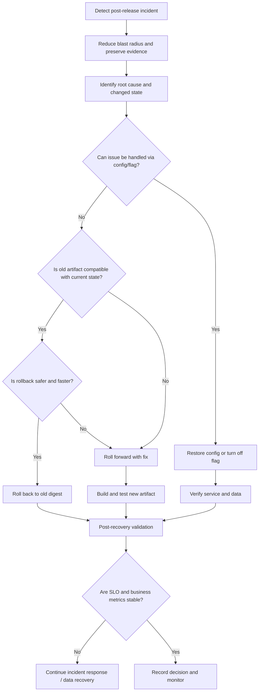

# Choosing to Revert to an Old Artifact or Roll Forward to a New Version

When a release causes a production failure, the team needs to decide how to return the service to a safe state. Two common approaches are **rollback** to an artifact known to work well and **roll-forward** with a new version that fixes the root cause. Rollback can restore service quickly if the old version remains compatible with the current data, schema, messages, and configuration. Roll-forward is more appropriate when the system state has changed in a way the old version cannot handle, or when a new fix is safer and faster than reversing the change.

Do not choose the approach based solely on whether the latest deployment failed. You must determine whether the fault lies in the artifact, configuration, infrastructure, or data; the scope of impact; what state has changed; reversibility; and the time needed to bring the system to a stable state. Rolling back an artifact does not automatically undo database migrations, published messages, executed transactions, or changes in external systems.

## 1. Distinguishing Rollback, Roll-Forward, and Recovery

These three terms often appear together but do not share the same meaning:

- **Rollback:** reverting to a previously defined version, configuration, or state. In CI/CD, this usually means redeploying an old artifact by its stored digest/version.
- **Roll-forward:** building and deploying a new version that fixes the bug or is compatible with the current state. This approach moves forward rather than restoring the old binary.
- **Recovery:** restoring services or data after an incident. Recovery can include application rollback, roll-forward, backup restore, point-in-time recovery (PITR), event replay, index rebuilding, or controlled manual intervention.

For example: version `v2` causes an API to return 500 errors. If the schema is still compatible with `v1`, you can roll back the application to `v1`. If `v2` has written data in a format that `v1` cannot read, rolling back the binary may worsen the failure; in that case, you need to roll forward a `v2.0.1` release that can read both old and new data, or perform data recovery before reverting to the old version.

| Approach | Primary change | When appropriate | Questions to answer |
|---|---|---|---|
| Artifact rollback | Switch application back to old artifact | New artifact causes failure and current state remains compatible with the old artifact | Can the old version run safely with the current schema, data, messages, and config? |
| Config/flag rollback | Restore configuration or turn off feature | Failure is due to config, routing, or a feature that can be disabled independently | Can impact be reduced without changing the artifact? |
| Roll-forward | Build/deploy a new artifact fixing the issue | Old artifact is incompatible or a new fix reduces risk faster | Is the fix small enough, tested, and compatible with the current state? |
| Data recovery | Restore or repair data | Data is lost, corrupted, or written incorrectly | What point in time must be restored and how does it affect subsequent valid transactions? |



## 2. First Reduce Impact and Assess the Situation

When a problematic release is detected, the first step is usually to limit impact while investigating. You do not need to wait for a complete root-cause analysis before reducing the blast radius if there are signs that users or data are being affected.

Initial actions may include:

- Pause the rollout or stop increasing the traffic percentage routed to the new version.
- Turn off the problematic feature flag if it can be done safely.
- Restrict the affected cohort, tenant, region, or transaction type.
- Stop background jobs or consumers writing incorrect data, provided stopping them does not drop messages.
- Preserve logs, traces, metrics, deployment manifests, artifact digests, and audit events.
- Notify the incident commander, service owner, and dependent teams per procedure.
- Determine whether new transactions must be blocked to prevent further data corruption.

Do not rush to delete related Pods, runners, queues, or artifacts before preserving necessary evidence. At the same time, do not let a workload suspected of compromise retain access to sensitive resources; containment and evidence preservation must be coordinated.

### 2.1. Identify What Actually Changed

Collect at minimum:

- Release ID, commit SHA, artifact digest, and deployment timestamp.
- The version immediately preceding the release and the recoverable artifact digest.
- Changes in configuration, feature flags, secret references/versions, and environment variables.
- Database migrations, data backfills, and schema state.
- Published messages/events, queue backlog, consumer version, and dead-letter count.
- External APIs or systems that received side effects.
- Error rate, latency, throughput, saturation, and business metrics before/after deploy.
- The user/workload principal that performed the deployment and associated approvals.

Comparing only the commit SHA is not enough. You must verify the running digest and the target rollback digest; rebuilding from the same commit can produce a different artifact.

## 3. Criteria for Choosing to Roll Back to an Old Artifact

Rollback is usually a good choice when all of the following critical conditions are met:

1. **Reliable old artifact exists:** the artifact is still in the registry, its digest/checksum is verifiable, its signature/provenance is valid, and it previously ran stably.
2. **Compatible with current state:** the old version can read the current schema, data, messages, sessions, cache, and configuration.
3. **Creates no new side effects:** reverting does not duplicate transactions, resend duplicate messages, issue erroneous refunds, or run destructive migrations.
4. **Rollback reduces risk quickly:** the time to bring the system to a stable state is shorter and less risky than a forward fix.
5. **Verifiable:** the exact digest, configuration, environment, and post-rollback checks are known.

Indicators that typically favor rollback:

- Errors started immediately after deployment and are clearly tied to new code.
- Schema and data have no incompatible changes.
- The old version remains compatible with current dependencies and external APIs.
- Recovery can be performed quickly using a stored digest without rebuilding.
- A new fix lacks sufficient testing time, whereas rollback has been rehearsed.

Rollback does not necessarily mean reverting the entire system across every component. You can roll back a single service, a single region, a single cohort, or a single configuration if compatibility boundaries allow.

## 4. Criteria for Choosing to Roll Forward with a New Version

Roll-forward is usually more appropriate when:

- The old version cannot read data or schemas created by the new version.
- A migration has executed a step that cannot be safely reversed.
- New messages have been published that old consumers cannot process.
- External systems have received transactions or state that rollback cannot retract.
- The bug resides in the old artifact or an old dependency found to have a vulnerability.
- The fix is small, the cause is clear, and it can be tested faster than a recovery procedure.
- Rolling back would lose valid data generated after the deployment.

Roll-forward does not mean skipping tests. The new artifact must have its own commit, version/digest, build provenance, and test evidence. Testing scope may be streamlined under an emergency release process, but necessary checks must not be skipped at the risk of expanding the incident.

### 4.1. Minimal Fix

During an incident, prioritize a small, easily reviewable fix that changes only what is necessary. Avoid bundling refactors, unrelated dependency upgrades, or major architectural changes into a hotfix. The fix should include:

- A regression test reproducing the bug.
- Compatibility verification against the current data state.
- Analysis of side effects and retry behavior.
- A new artifact with its own distinct digest.
- A plan to halt rollout and revert if the hotfix fails.

## 5. Rollback vs. Roll-Forward Decision Matrix

| Scenario | Typically appropriate approach | Rationale and conditions |
|---|---|---|
| UI or new logic bug, no schema/data change | Roll back artifact or disable flag | Old version is usually still compatible; verify digest and traffic |
| Misconfiguration, binary is still good | Roll back config | Avoid unnecessary artifact changes; check config version and secret references |
| New version writes data in a new format | Roll forward or perform controlled data recovery | Old version may fail to read the written data |
| Migration adds nullable column, keeps old structures | App rollback may be possible | Only if old app is compatible with the expanded schema and data |
| Migration dropped/transformed data irreversibly | Usually roll forward | Requires code compatible with current state or separate data recovery |
| New messages already in queue, old consumer doesn't understand them | Roll forward consumer or transform messages | Do not deploy old consumer against a queue containing incompatible payloads |
| External payment/email/partner received side effect | Roll forward / compensating action | Rolling back code cannot retract actions already taken in external systems |
| New artifact contains critical vulnerability, old artifact is safe and compatible | Fast rollback, then release patch | Check both dependencies and changed data |
| Old artifact also has vulnerability or is no longer supported | Roll forward | Do not restore a state with known risk |
| Root cause unclear and risk of data loss exists | Pause/contain first, then choose recovery | Do not mutate state further before preserving evidence |

This matrix is only a guide. Actual decisions must be based on specific data and architecture; the same type of error may require different approaches depending on migrations, side effects, and compatibility levels.

## 6. Compatibility Is the Decisive Condition

Rolling back an application is only safe if the old version can operate with the current state of every related component. Consider:

| Component | Questions before rollback |
|---|---|
| Database schema | Are columns, tables, indexes, constraints, and data types still compatible with the old code? |
| Database data | Has new data been written in a format or invariant that the old code does not understand? |
| Event/message | Does the queue still hold new messages that old consumers cannot parse or process properly? |
| Cache | Have key/value structures or serialization formats changed? |
| Session/cookie/token | Can the old version verify/read new sessions and tokens? |
| File/object storage | Have file formats, metadata, or encryption keys changed? |
| External API | Have partners or clients already switched to the new contract? |
| Configuration | Are keys, defaults, feature flags, or secret versions compatible? |
| Background job | Have new jobs updated state or data that old workers do not understand? |

### 6.1. Expand-and-Contract Preserves the Rollback Path

For database migrations, the expand-and-contract strategy creates a compatibility window between old and new versions:

1. Expand the schema by adding new structures while retaining old structures.
2. Deploy code compatible with both structures.
3. Backfill data and verify.
4. Gradually switch reads/writes to the new structure.
5. Contract and remove old structures only after the rollback window has closed and no old consumers remain.

If you are in the expand or compatible-deployment phases, application rollback may be feasible. After contract, reverting to the old binary may no longer be safe. Do not run down-migrations automatically just because an application rollback occurs.

### 6.2. New Data Already Written

An old binary might run on a new schema and still fail to understand new data. For example, the new version writes an order status `AWAITING_COURIER`, whereas the old version only knows `CREATED`, `PAID`, and `SHIPPED`. When reading the new value, the old code may crash or misprocess business logic.

Before rolling back, determine:

- How many records carry the new value/format?
- Does the old version ignore or safely handle that value?
- Can it be converted back without losing business meaning?
- Can the new records be isolated so the old version serves the remainder?

Without answers to these questions, do not assume rollback is safe just because the schema migration was additive.

## 7. Application Rollback Is Not Data Rollback

Applications, schemas, and data have different lifecycles. Restoring an old image does not return the database to its old state. A database restore can erase valid transactions created after the backup timestamp. Therefore, distinguish between:

- **Application rollback:** deploying the old artifact.
- **Schema rollback:** reversing database structural changes if possible and safe.
- **Data correction:** fixing erroneous records with a controlled migration/compensating script.
- **Data restore:** restoring from a backup or PITR to a specific point in time.
- **Event replay:** replaying stored events to reconstruct state in the target system.

Do not bundle these operations into a single generic rollback command. Each operation has its own scope, risk, permissions, and evidence.

### 7.1. When Is Restore or PITR Needed?

If a release causes incorrect data writes or data deletion, data recovery may be required. Before restoring, evaluate:

- When data began becoming corrupted and the latest timestamp verified to be accurate.
- Recovery Point Objective (RPO): the maximum acceptable data loss.
- Recovery Time Objective (RTO): the target time to restore the service.
- How valid transactions generated after the restore point will be handled.
- Whether it is possible to restore into a new database, verify, and then switch traffic.
- Whether events need to be replayed or transactions reconciled after the restore.

Restoring an entire production database can lose valid data after the backup point. When possible, consider restoring to a separate environment, selective data recovery, or PITR according to an approved plan.

## 8. External Side Effects and Compensating Actions

Some actions cannot be undone by deploying an old artifact:

- Payments already accepted by a payment gateway.
- Emails/SMS already sent to customers.
- Webhooks already processed by partners.
- Goods already shipped from a warehouse or handed to a carrier.
- Files already shared or data sent to another system.
- Messages already processed by consumers that triggered downstream actions.

For these situations, compensating actions are needed according to business rules: issuing refunds, canceling shipments, sending correction notices, creating adjustment records, or requesting partners to resynchronize. A compensating action does not erase the history of the event that occurred; it creates a new action to bring the business state to an acceptable outcome.

Side-effect design should support:

- Idempotency keys so retries do not create duplicate transactions.
- Outbox/inbox or event ledgers to know which events were published and processed.
- Correlation IDs linking requests, events, and external transactions.
- Clear processing states: pending, succeeded, failed, compensated.
- Reconciliation procedures and bounded retries.

## 9. Controlled Artifact Rollback Procedure

Once rollback is confirmed safe, execute it in an auditable sequence:

1. **Pause rollout:** stop increasing traffic and prevent deployment jobs from continuing automatically.
2. **Select the latest good release:** retrieve the verified release record, commit, and digest.
3. **Check compatibility:** schema, data, messages, cache, sessions, config, and external dependencies.
4. **Verify artifact:** check registry availability, digest, signature/provenance, and access permissions.
5. **Determine scope:** entire service, a single region, a single cohort, or only one component.
6. **Redeploy old digest:** use the standard deployment pipeline; do not rebuild from old source if the goal is to restore the exact artifact that previously ran.
7. **Verify runtime:** confirm instances are actually running the target digest and the rollout is complete.
8. **Post-rollback validation:** smoke tests, health checks, metrics, business transactions, and dependencies.
9. **Monitor:** maintain heightened monitoring during the stabilization window and confirm no recurring errors.
10. **Record release/incident record:** reason, approver, before/after digests, config, timestamps, and outcome.

### 9.1. Kubernetes Example

You can inspect rollout history and Deployment status:

```bash
kubectl rollout history deployment/orders
kubectl rollout status deployment/orders --timeout=10m
kubectl get deployment orders -o wide
```

If the previous revision has been identified and is compatible, Kubernetes supports rolling back to a previous revision:

```bash
kubectl rollout undo deployment/orders --to-revision=12
kubectl rollout status deployment/orders --timeout=10m
```

Revision `12` is only an example. In systems using GitOps or Helm, perform rollback through the canonical release source to prevent the controller from reconciling back. With GitOps, revert the config commit to the old digest and let the controller reconcile; with Helm, use release history and roll back to the proper revision per the team's workflow. Regardless of the tool, verify the actual running digest.

Do not use `kubectl rollout undo` as sole proof that everything has recovered. This command only changes the Deployment's Pod template; it does not automatically undo changes to databases, queues, secrets, external services, or any other resources in the release.

## 10. Roll-Forward Procedure via Hotfix

When rollback is unsafe or not the best risk-reduction option:

1. Pause the rollout and limit current impact.
2. Identify the root cause or form a clear enough hypothesis for a controlled fix.
3. Write a regression test that reproduces the bug.
4. Make the smallest possible change; preserve compatibility with existing data state.
5. Build a new artifact from a specific commit SHA, generating a new digest and provenance.
6. Run mandatory checks: build, tests, scans, migration/data compatibility, and smoke tests.
7. Deploy to a canary or small cohort first, observing metrics and business signals.
8. Expand when thresholds are met; if not, stop and reassess.
9. Record the new artifact replacing the faulty artifact and link it to the incident.

Roll-forward can be faster than rollback if the bug is in a small logic branch and data has already moved to a new format. However, if the root cause is not yet understood, consecutive hotfixes can complicate the state further. When evidence is insufficient, prioritize containment, disabling features, or restricting transactions before releasing additional changes.

### 10.1. Hotfix Example

Version `v2.4.0` added the order status `AWAITING_COURIER` while updating the schema. After deployment, an old endpoint fails upon encountering this status. `v2.3.2` does not understand the new status, so rolling back would cause read errors on already-written data. The team creates `v2.4.1` with a parser handling the new status while keeping the schema unchanged. Regression tests are added for both old and new statuses; the new artifact is deployed as a canary and expanded after metrics stabilize.

## 11. Rolling Back Config or Feature Flags Before Changing Artifacts

Not every post-deploy incident requires rolling back the binary. If the cause is a flag or configuration that can be safely turned off, restoring that value typically introduces less change.

Examples:

- Turn off the new feature while keeping the deployed artifact.
- Switch routing back to a stable backend.
- Restore previous timeouts, pool sizes, or rate limits.
- Revoke an unready integration.
- Reduce cohort or traffic percentage.

Before changing config, verify the current config version, blast radius, cache/refresh behavior, and whether instances receive configuration simultaneously. Configurations must also be versioned and audited; do not edit directly without recording a release record.

Feature flags do not replace rollback for every type of bug. If new code breaks startup before the flag is read, turning off the flag at runtime may not be enough. If a migration has already written incompatible data, turning off the flag does not automatically repair the data. You must know exactly which part of the flow the flag controls.

## 12. Canary and Scoped Rollback

With cohort-based rollouts, you can roll back only the portion of traffic shifted to the new version instead of impacting the entire system. However, only do this if shared data and state are compatible across versions.

Options:

- Route the cohort's traffic back to the old backend.
- Turn off the flag for the affected user group.
- Roll back one region or cluster first, keeping other regions if they are unaffected.
- Stop a failing worker pool or consumer version.
- Route read traffic back to the old version while keeping the write path on a pre-designed safe mechanism.

Partial rollback can create a prolonged mixed-version state. Monitor API, schema, cache, event, and session compatibility; do not assume traffic isolation equals data isolation.

## 13. Evidence and Approval Authority During an Incident

Decisions to roll back or roll forward must be documented so others understand why that path was chosen and can continue handling the incident across on-call handoffs.

A decision record should include:

- Incident ID, severity level, and detection timestamp.
- Symptoms, affected customer/region/tenant scope, and business impact.
- Current artifact digest, target digest, and release record.
- Schema/data/message/config state and side effects that already occurred.
- Options considered, risks, and reasons for rejection.
- Chosen path: config rollback, artifact rollback, roll-forward, or data recovery.
- Decision maker, executor, approver, and timestamps.
- Verification steps, success criteria, and stop conditions.
- Post-action outcome and follow-up tasks.

In emergencies, the process may allow some approvals to follow an emergency change mechanism. Exceptions must record the authorized person, justification, scope, expiration, and post-incident review per policy. Never use shared accounts or skip auditing due to time pressure.

## 14. Testing Rollback and Recovery Capabilities Before They Are Needed

A rollback plan is only valuable if it has been rehearsed. CI/CD and staging can verify:

- The previous artifact still exists and can be pulled/deployed by digest.
- Registry retention does not delete releases that must be kept.
- Rolling back the application on an expanded schema works properly.
- Rolling back after new data exists is tested using a representative dataset.
- Old/new messages are processed by their corresponding consumers.
- Feature flags/configs can be reverted to their prior state.
- Backups can be restored; PITR meets target RPO/RTO.
- Event replay and compensating actions do not create duplicate side effects.
- Runbooks have clear commands, permissions, owners, and verification steps.
- Monitoring/alerts detect an unrecovered state.

Do not test only the rollback command. Verify the end result: users can complete transactions, data is consistent, queues are not stuck, and the runtime is actually running the expected artifact/config.

## 15. Common Anti-Patterns

| Anti-pattern | Risk | Better practice |
|---|---|---|
| Always rolling back immediately on any alert | May revert the system to a version incompatible with current data | Assess schema, data, messages, and side effects first |
| Always hotfixing instead of rolling back | Extends failure duration and introduces more changes before root cause is clear | Compare time and risk of both approaches |
| Rebuilding old source to roll back | New artifact may differ from the artifact that ran well | Reuse the stored old digest and verify it |
| Rolling back binary while ignoring migrations | Old application may fail against new schema/data | Design expand-and-contract and separate migrations |
| Running down-migrations automatically | May lose data or destroy valid state | Evaluate migrations and perform separate data recovery |
| Restoring the entire database by gut feeling | Loses valid transactions after the backup point | Define RPO/RTO, PITR, and replay/reconciliation plans |
| Retrying non-idempotent side effects | Payments or messages are executed multiple times | Use idempotency keys and state ledgers |
| Checking only Pod Ready after rollback | Misses business and data errors | Run smoke, synthetic, SLO, and business validation |
| Not keeping release records | Unknown last good digest and accompanying config | Store artifacts, configs, approvals, and deployment history |
| Partial rollback without monitoring mixed versions | Incompatible versions continue exchanging data | Maintain a compatibility matrix and limit overlap duration |

## 16. Rollback/Recovery Decision and Execution Checklist

### Before choosing a path

- [ ] Incident, blast radius, and user/data impact have been identified.
- [ ] Rollout has been stopped or limited to prevent expanding the incident.
- [ ] Logs, metrics, traces, audits, artifact digests, and release records have been preserved.
- [ ] Changed schemas, data, messages, sessions, cache, configs, and side effects have been identified.
- [ ] The old artifact has been verified to still exist with the correct digest and provenance.
- [ ] Whether the old version is compatible with the current state has been evaluated.
- [ ] Time and risk between rollback, config change, roll-forward, and data recovery have been compared.

### When rolling back an artifact

- [ ] Target digest/version and appropriate approvals are in place.
- [ ] No rebuild is performed if the goal is to restore the exact artifact that ran well.
- [ ] Schema/data/messages/config are compatible with the old version.
- [ ] Registry availability, signature/provenance, and deployment permissions are verified.
- [ ] Actual runtime is confirmed to be running the target digest after rollback.
- [ ] Smoke tests, metrics, and business transactions pass.

### When rolling forward or recovering data

- [ ] Root cause/hypothesis and regression test exist.
- [ ] Fix is small, with a new artifact digest and provenance.
- [ ] Migration/data correction has a backup/checkpoint and a safe continuation path.
- [ ] Side effects have idempotency or compensating actions.
- [ ] Restore/PITR has defined RPO/RTO, scope, and a replay/reconciliation plan.
- [ ] Canary/limited rollout and stop criteria are defined.
- [ ] Final outcome is recorded in the incident/release record.

Rollback and roll-forward are two distinct recovery tools, not two opposing automatic reflexes. Rollback is effective when the old artifact remains compatible with the current state and brings the system back to safety faster. Roll-forward is necessary when data, schemas, or side effects have progressed to a state the old version cannot handle. By separating application rollback, config rollback, and data recovery; preserving immutable artifacts; verifying compatibility; and validating both technical and business behavior afterward, teams can choose a recovery path based on evidence rather than guesswork.
