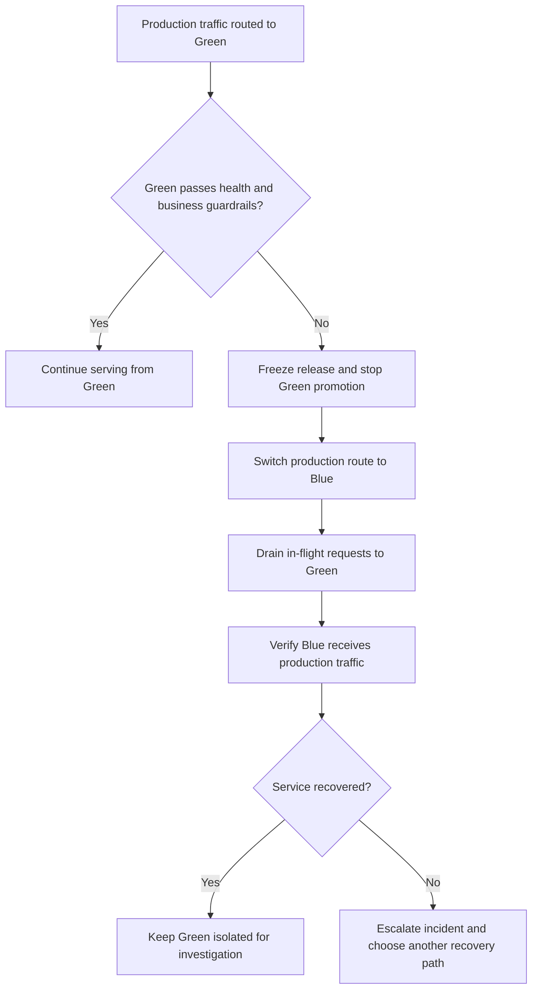

# Traffic Recovery with Blue-Green or Canary Deployments

When a new version causes errors after receiving production traffic, recovery is not just re-running a deploy command. The team must route requests back to a version known to be stable, handle in-flight connections, verify that routers have actually switched traffic, and check transactions generated while the faulty version was active.

With blue-green, two environments or workload groups are maintained in parallel; recovery usually means switching the route from green back to blue. With canary, traffic is split between stable and candidate versions; recovery usually means halting the rollout and setting the candidate weight to 0% so stable receives all traffic again. Both approaches rely on controlling traffic independently from artifact creation.

**Traffic recovery is the act of restoring the request path to a suitable version that can serve safely.** It limits the blast radius of a faulty version, but it does not automatically undo written data, published messages, processed payments, or applied migrations. Therefore, a traffic recovery plan must be paired with checks on data compatibility, side effects, sessions, and observability.

## 1. What Is Traffic Recovery?

Traffic recovery (or traffic failback) is the process of changing routing to move new requests away from a problematic version or environment and back to a destination verified as safe.

Common operations:

- Setting the candidate/canary traffic weight to 0%.
- Switching the production route from green back to blue.
- Removing routing rules pointing to the faulty endpoint.
- Shifting a region or cohort back to a stable pool.
- Stopping the rollout controller so it does not keep increasing traffic.
- Draining open connections and in-flight requests before stopping the faulty workload.

Traffic recovery differs from artifact rollback. A router can shift requests back to the old version without deleting the new version immediately. This is usually faster and preserves the faulty workload for collecting logs or investigating. Once stabilized, the team then decides whether to scale down, roll back the deployment, or roll forward with a fix.

### Objectives to Achieve

1. Prevent new requests from reaching the failing version.
2. Route traffic back to a version capable of serving safely.
3. Minimize dropped requests and duplicate side effects during the transition.
4. Verify that every router, gateway, and region has applied the new route.
5. Identify and handle affected in-flight requests, sessions, and queues.
6. Record evidence of timestamps, traffic ratios, decisions, and recovery outcomes.

## 2. Distinguishing Abort, Traffic Failback, Rollback, and Roll Forward

These actions often follow one another but are not synonymous.

| Action | Meaning | Example |
|---|---|---|
| Abort rollout | Stop the process of expanding release scope | Controller stops advancing from 10% to 25% |
| Traffic failback | Route new requests back to the stable version | Canary weight goes from 10% to 0% |
| Rollback deployment | Restore the previous workload/artifact | Scale down new revision, retain old revision |
| Roll forward | Release a new bug-fix version | Deploy `v2.1` after `v2` fails |
| Data recovery | Restore or repair affected data | Reconcile transactions, restore backup, or run corrective job |

In a canary incident, the sequence is typically abort rollout, fail back traffic, verify, and only then decide between workload rollback or roll forward. Do not delete the canary immediately if logs, traces, or process state are still needed for investigation.

## 3. When Is Traffic Recovery Needed?

Traffic recovery should be triggered when the new version no longer meets safe serving criteria or risks widening an incident.

Common signals:

- Error rate, timeouts, or latency exceed guardrails.
- Health checks or readiness probes fail repeatedly.
- Business transaction success rate drops abnormally.
- Data is created incorrectly, duplicated, or incomplete.
- Queue lag grows rapidly or consumers retry continuously.
- Resource exhaustion, crash loops, or overloaded connection pools.
- Authentication/authorization failures or signs of improper data access.
- New dependencies or configurations prevent the service from processing requests.
- Critical telemetry is missing, preventing the team from confirming the new version is safe.

You do not have to wait for every metric to fail simultaneously. A severe defect such as writing incorrect monetary amounts, leaking data, or bypassing authorization can justify halting traffic immediately even if CPU, latency, and HTTP status codes look normal.

### Choosing Actions by Severity

- **HOLD:** signals are unclear or sample size is insufficient; keep current traffic split and investigate.
- **ABORT:** stop increasing traffic when guardrails fail.
- **FAILBACK:** shift new requests back to the stable version.
- **ROLLBACK/ROLL FORWARD:** remediate the version once traffic is under control.
- **INCIDENT CONTAINMENT:** if security risk exists, isolate endpoints or credentials and follow the incident response procedure.

## 4. Preparing Recovery Readiness Before Release

Fast recovery depends on preparation made before deployment. If you only start looking for the old version, someone with permission to change routes, or router configs during an incident, recovery time will drag out.

Before release, confirm:

- The previous stable version still has an immutable artifact and can be redeployed.
- Blue and green, or stable and canary, have routing configurations managed as code.
- Necessary permissions and tooling exist to change traffic during an incident.
- The rollout controller can be paused to prevent it from automatically ramping traffic back up.
- The old version remains compatible with the current schema, cache, sessions, and messages.
- The stable pool has sufficient capacity to absorb traffic again.
- Health checks and business metrics can be segmented by version.
- A plan exists for handling long-lived connections, queues, and in-flight requests.
- Runbooks, on-call responders, and communication channels are clear.
- Deployment records exist containing commits, digests, route revisions, and related configs.

### Checking Capacity of the Old Version

A stable pool currently serving 90% of traffic might lack resources to immediately handle 100% again. If the old pool was scaled down after rollout, failback can cause overload.

During the rollout window, maintain sufficient capacity or fast scaling capability. With blue-green, keep blue ready until green is accepted and the recovery window closes. With canary, stable must be able to absorb all remaining traffic.

## 5. Traffic Recovery in Blue-Green Deployments

Blue-green maintains two environments or workload groups:

- **Blue:** the currently stable version or pre-deployment version.
- **Green:** the new version being validated or currently serving traffic.

When green fails, traffic is switched back to blue through the load balancer, gateway, ingress, or routing mechanism controlling production.



### Blue-Green Failback Sequence

1. Confirm green has an issue and record the release/deployment ID.
2. Stop any promotions or automation that might continue altering routes.
3. Verify blue is healthy, has sufficient capacity, and is compatible with the current data state.
4. Switch the production route back to blue using the standard traffic control mechanism.
5. Verify routing across all gateways, load balancers, and regions.
6. Stop sending new requests to green; drain active connections and in-flight requests per policy.
7. Run smoke tests through the production path to confirm blue serves properly.
8. Monitor error rates, latency, and business metrics after switching.
9. Keep green isolated if investigation is needed; scale down only after gathering evidence.
10. Record the decision, timestamps, and recovery results.

### Why Not Delete Green Immediately?

Green may hold logs, heap/thread state, traces, or diagnostic data. Deleting it immediately loses evidence of the root cause. Keeping green up does not mean continuing to send traffic to it; you can keep the workload within a restricted network scope and block new requests.

## 6. Traffic Recovery in Canary Deployments

Canary deployments typically run stable and candidate side by side. The router splits requests by weight, cohort, header, or other rules.

When the candidate fails, you must:

1. Abort the rollout so the controller stops increasing weight.
2. Set the candidate weight to 0% or remove the candidate from routing rules.
3. Verify stable receives all new requests.
4. Drain open requests and connections to the candidate.
5. Verify all regions/gateways have applied the new weight.
6. Run smoke tests and check business metrics through stable.
7. Keep the candidate isolated for investigation or roll back the workload per decision.


### Stopping the Controller Before Changing Weight

A common mistake is an operator setting canary weight to 0% while the rollout controller is still running, causing it to overwrite the weight a few seconds later according to its schedule. You must stop, pause, or abort the controller first, then modify the route. Once the incident is contained, verify no other automation manages the same route.

### Cohort-Based Canary

If traffic is split by tenant, cookie, or header, setting general weight to 0% may not suffice if dedicated cohort rules still point to the candidate. Review all routing rules, overrides, and sticky assignments. Do not look only at aggregate percentages.

## 7. Selecting the Traffic Control Mechanism

Recovery can happen at multiple layers. Use the exact layer that managed the rollout to avoid route overwrites or inconsistent state.

| Mechanism | Recovery method | Points to watch |
|---|---|---|
| Load balancer | Switch backend pool or weight back to stable/blue | Check all listeners, regions, and connection persistence |
| Ingress/Gateway | Update route, service target, or traffic weight | Controller may reconcile and overwrite manual changes |
| Service mesh | Change virtual service/destination weight to stable | Verify config propagation to all proxies |
| DNS | Point record back to stable endpoint | Resolver caches and TTL mean switching is not instantaneous |
| Feature flag | Turn off new capability inside the same artifact | Suitable only if old branch remains compatible and flag truly controls side effects |
| CDN/edge routing | Change origin or route rule | Must handle caching, propagation, and all POPs |

### Use a Single Canonical Control Source

If routes are managed via GitOps or a controller, editing directly in the console may be reverted by the controller back to the old declared state. During an incident, know which system owns the route and how to make audited emergency changes.

Never let two systems write weights or destinations without coordination. For example, a pipeline, a service mesh controller, and manual edits modifying the same route concurrently can cause race conditions.

## 8. DNS Is Not Always a Fast Failback Mechanism

Changing a DNS record from green to blue looks simple, yet clients and resolvers can cache results according to TTL or their own policies. Existing open connections continue using old IPs; some resolvers do not strictly honor TTLs.

DNS failback is appropriate when:

- The architecture is designed for DNS switching and tolerates propagation delay.
- TTLs were configured appropriately beforehand, not lowered only when the incident began.
- Health checks and verification span multiple networks/regions.
- Blue/green endpoints have compatible TLS certificates, hostnames, and dependencies.

When fast traffic switching is needed, gateways or load balancers generally provide more direct control than DNS. DNS can be part of a regional or datacenter failover plan, but never assume record changes take effect instantly.

## 9. Handling In-Flight Requests and Connection Draining

Changing routes usually affects only new requests. In-flight requests may continue on the faulty version, and keep-alive connections may be reused after the route changes.

Connection types to consider:

- HTTP keep-alive and connection pools.
- WebSockets and server-sent events.
- gRPC streams and long polling.
- Long file uploads/downloads.
- Requests executing database transactions or write operations.

### Graceful Draining

Draining allows an instance to stop accepting new requests while completing in-flight requests within a bounded period. The procedure typically includes:

1. Marking the backend as no longer accepting new traffic.
2. Stopping the router from opening new connections to the backend.
3. Waiting for in-flight requests to finish within the grace period.
4. Monitoring remaining active connections/in-flight requests.
5. After timeout, terminating hanging connections per policy.

The grace period must match application and protocol timeouts. Too short may cut off valid transactions; too long leaves requests running on the faulty version. For severe security flaws, connections may need to be severed immediately rather than drained.

### Sticky Sessions

Sticky sessions can pin users to the old backend even after route weights change. For a thorough failback, understand affinity mechanisms, cookies, consistent hashing, and session caches. Shifting traffic while losing sessions can log users out or drop shopping cart state.

## 10. Recovery with Queues and Asynchronous Tasks

Shifting API traffic back to stable does not mean old workers have stopped processing messages. If the candidate already enqueued messages, workers may continue processing them after HTTP routing is restored.

The team must verify:

- Which worker version is consuming the queue.
- Which version published the messages.
- Whether event schemas are compatible with stable consumers.
- Whether messages are retrying or sitting in dead-letter queues.
- Whether candidate consumers can be paused without losing leases or causing duplicate processing.
- Whether idempotency keys and deduplication protect side effects.

In some cases, API routing and worker routing must be separated. The stable API can accept new requests while candidate queue consumers are paused, drained, or reverted to a compatible version. Do not purge queues or replay all messages without understanding side effects.

## 11. Data and Side Effects Do Not Automatically Revert with Traffic

This is the most important limitation of traffic recovery. Routing requests back to blue/stable only changes where new requests are processed. It does not reverse actions that green/canary already performed.

Examples:

- A payment has already been sent to a payment provider.
- An order has already been written to the database with incorrect values.
- An email has already been sent.
- An event has already been published to other consumers.
- A migration has dropped or altered data structures.
- A cache key has already been written in a new schema.

### Data Compatibility Needed Before Release

- Use expand–migrate–contract for schema changes.
- Maintain read/write compatibility between old and new versions during the rollout window.
- Use idempotency keys for transactions with side effects.
- Maintain audit trails and correlation IDs to trace transactions processed by the candidate.
- Prepare reconciliation or corrective jobs for erroneous data.
- Never allow a rollback artifact to depend on a schema that was already dropped.

### When Data Recovery Is Needed

Separate the decision of traffic failback from data recovery. Operations can shift traffic immediately to curb new errors while the data/business teams reconcile and repair affected transactions. Never run a full database restore solely because an application version failed if doing so would wipe out valid transactions that occurred after the backup.

## 12. Capacity, Autoscaling, and Warm Pools

After failback, stable can suddenly receive a large surge of traffic. If stable scaled down or its caches went cold, the service can keep failing even though routes switched properly.

Measures to take:

- Maintain minimum replicas/capacity for stable throughout the rollout.
- Ensure autoscaling metrics and quotas can handle the returning load.
- Safely warm caches or connection pools if needed.
- Verify that databases and dependencies can withstand the returning traffic.
- Do not scale down blue/stable before the rollback window closes.
- Monitor saturation immediately after failback.

With blue-green, running two environments concurrently for a period increases cost, yet enables fast switching. Factor warm pool costs into the release plan instead of unexpectedly scaling down stable too early.

## 13. Multi-Region or Multi-Layer Routing Recovery

A service can span multiple layers: global load balancer, regional gateway, ingress, service mesh, and local service. Changing a route at one layer does not guarantee every region has switched.

Multi-region checklist:

- Identify which routing layer is the authoritative source of truth.
- Check route state in every region and every gateway.
- Verify propagation status and config revisions.
- Check DNS/edge caches if present.
- Confirm the stable version exists and has enough capacity in every region required to serve.
- Ensure failover does not route traffic to another region suffering the same failure.
- Monitor metrics per region, not just global aggregates.

If a single region fails in isolation, traffic can be shifted to another region. However, verify data, replication lag, sessions, and capacity in the receiving region before failing over. Global route changes do not replace cross-region data recovery procedures.

## 14. Automating Traffic Recovery

A rollout controller can automatically abort and fail back when metrics exceed guardrails. Automation reduces response time, yet requires safeguards against bad decisions, noisy metrics, and race conditions.

A workflow should include:

1. Receiving a guardrail signal or incident command.
2. Pausing/aborting the controller managing the rollout.
3. Verifying the stable/blue target is healthy and has capacity.
4. Updating the route back to stable/blue.
5. Waiting for propagation and verifying actual routing.
6. Draining the faulty backend per policy.
7. Checking health and business metrics after failback.
8. Recording audit evidence and notifying responsible owners.

### Illustrative YAML

```yaml
traffic_recovery:
  target:
    service: orders-api
    environment: production

  rollout:
    controller: progressive-delivery
    action_before_route_change: abort

  stable:
    revision: orders-api-v1
    minimum_ready_replicas: 8
    required_health_checks:
      - readiness
      - database_connectivity
      - order_read_smoke_test

  candidate:
    revision: orders-api-v2
    traffic_weight_after_failback: 0

  recovery:
    stable_traffic_weight: 100
    wait_for_route_propagation: true
    drain_candidate_connections: true
    keep_candidate_for_diagnostics: true

  verification:
    compare_metrics:
      - http_5xx_rate
      - p95_latency
      - order_success_rate
      - queue_lag
    insufficient_telemetry: hold_and_escalate

  evidence:
    record:
      - incident_id
      - route_revision_before_after
      - actor
      - timestamps
      - stable_health_result
      - post_recovery_metrics
```

This is a conceptual configuration, not a direct schema for a specific tool. In real implementations, explicitly define step ordering, retries, timeouts, permissions, and behavior when a step fails. Do not let a recovery job loop indefinitely or let multiple jobs mutate the same route concurrently.

### Idempotency and Concurrency

A failback command may be issued multiple times by controllers and operators. The operation must be idempotent: setting stable weight to 100% and candidate to 0% must yield the same final state when re-run. Use locks or generation/revision checks to prevent a stale process from overwriting a newer route.

## 15. Post-Traffic Recovery Verification

Do not treat a successful route update command as proof that the service has recovered. Verify from both the client perspective and operational data.

### Routing Verification

- Routers/gateways report the expected revision and weight.
- New requests arrive at stable/blue in the expected ratio.
- No leftover cohort or header rules route requests to the candidate unexpectedly.
- All regions and proxies have received the updated config.
- New connections are no longer opened to the faulty backend.

### Service Health Verification

- Stable readiness and health checks pass.
- Error rates and latency return to baseline or SLO bounds.
- CPU, memory, threads, and connection pools stabilize.
- Queue lag and retry rates stop climbing.
- Critical dependencies connect normally.

### Business and Data Verification

- New transactions complete accurately.
- No duplicate transactions or abnormal side effects occur.
- Data and event reconciliation show no discrepancies outside tolerance.
- User sessions and state remain valid.
- Asynchronous jobs have transitioned back to compatible consumers.

### Comparing Against Baseline

Compare post-failback metrics against the pre-release stable baseline. If routing is correct yet metrics remain degraded, the cause may lie in data, dependencies, capacity, or prior side effects. Do not close an incident merely because stable receives 100% of traffic.

## 16. Traffic Recovery Runbook During an Incident

A runbook should be concise enough for an on-call engineer to follow under pressure, while containing enough verification checkpoints to prevent misrouting traffic.

### Before Taking Action

1. Identify the service, environment, region, and release ID.
2. Confirm the failing version and the target version meant to receive traffic.
3. Check stable/blue health, capacity, and schema compatibility.
4. Identify the controller or system owning the route.
5. Record the incident ID and coordinator.

### Execution

1. Pause/abort the rollout controller.
2. Switch the route to stable/blue or set canary weight to 0.
3. Verify the route revision has been applied across all necessary layers.
4. Drain active connections/requests according to incident severity.
5. Keep candidate/green isolated for investigation.

### Verification

1. Send smoke requests through the production endpoint.
2. Confirm the actual version serving the requests.
3. Monitor error rates, latency, and business metrics.
4. Check queues, sessions, and side effects.
5. Confirm stable has sufficient capacity and no stale routes remain mispointed.

### After Stabilization

1. Communicate status and next decisions.
2. Collect logs, traces, route configs, and metric snapshots.
3. Decide between workload rollback, roll forward, or data recovery.
4. Record detection time, failback time, and recovery time.
5. Update the incident record and action items.

## 17. Access Controls and Auditing in Recovery Operations

Traffic recovery can affect all users, so permissions must be controlled without creating unnecessary queues during an incident.

- Grant failback permissions to on-call responders or automation identities scoped by service/environment.
- Separate permissions to read routes, modify routes, and delete workloads.
- Use short-lived credentials/workload identities where possible.
- Log the actor, incident ID, reason, before/after routes, and timestamps.
- Restrict bypass privileges and require post-action review after emergency operations.
- Protect audit logs from modification by the identity performing failback.
- Never include tokens or secrets in operational commands or logs.

With break-glass access, an on-call engineer may be permitted to execute failback immediately per policy, followed by independent review afterward. The goal is to minimize impact time while preserving traceability and accountability.

## 18. End-to-End Example: Recovering orders-api Using Blue-Green

Suppose `orders-api` is serving from blue (`v1`). The team deploys green (`v2`) and shifts 100% traffic to green after staging passes. A few minutes later, order confirmation success rates drop and queue lag climbs.

**Detection:** alerts tagged with the release ID show green has a lower order success rate than baseline. Some requests return HTTP 200, but confirmation messages fail to be processed properly by consumers.

**Decision:** the incident commander confirms business impact and chooses failback. The team pauses rollout automation, verifies blue is still healthy, and confirms the new schema remains compatible with `v1`.

**Traffic switch:** the gateway routes production traffic from green back to blue. Regions are checked to confirm the route revision updated. Green stops receiving new requests; active connections are drained within an appropriate window.

**Verification:** smoke tests create new orders successfully via blue. Error rate and p95 return to baseline, yet queue lag remains elevated due to messages already published by green. The team keeps candidate workers paused and handles the queue separately.

**Data recovery:** the team reconciles created orders, identifies missing messages, and runs an idempotent corrective job. They do not restore the entire database because other valid transactions occurred after the deployment.

**Closure:** green is kept isolated to collect logs and traces. The incident record documents route changes, release digests, before/after metrics, the count of reconciled transactions, and decision makers. After fixing the bug, the team releases `v2.1` via a fresh canary rollout.

This example shows that traffic recovery and data recovery are two distinct tracks of work. Failback stops new requests from hitting the faulty version; reconciliation resolves impact that already occurred.

## 19. Common Anti-Patterns

| Anti-pattern | Consequence | Improvement |
|---|---|---|
| Rolling back only the image without changing traffic | Requests may still reach the faulty workload | Control routes and verify the actual backend |
| Changing weight without pausing the controller | Automation overwrites the route immediately afterward | Abort/pause the controller before failback |
| Shifting traffic back to blue without health checks | Sends users to an unready pool | Verify readiness, dependencies, and capacity first |
| Deleting green/canary immediately | Loses logs and diagnostic state | Isolate first, clean up after collecting evidence |
| Using DNS as an instant switch | Resolver caches keep sending traffic to the old endpoint | Use gateway/LB for fast switching; factor propagation into DNS plans |
| Not draining connections | Long requests or sessions continue hitting the faulty version | Drain with timeout and verify in-flight requests |
| Switching HTTP traffic while forgetting queue workers | Faulty workers continue creating side effects | Manage API routes and consumer rollouts separately |
| Assuming failback reverts data | Bad transactions, messages, and emails still remain | Run separate reconciliation, corrective jobs, and data recovery |
| Stable lacks capacity | Failback causes a new overload | Maintain a warm pool and check autoscaling/quotas |
| Multiple controllers editing the same route | Race conditions and unstable routing | Single control source, locking/revisions, and idempotency |
| Not checking each region | Some regions continue sending traffic to the candidate | Verify route propagation per region/gateway |
| Closing the incident immediately after route change | Delayed metrics and side effects go unchecked | Enforce a verification window and clear closure criteria |

## 20. Blue-Green/Canary Traffic Recovery Checklist

Before concluding a failback, the team can review:

- [ ] The exact release, service, region, and faulty version are identified.
- [ ] The controller managing the rollout is stopped/paused.
- [ ] Blue/stable is verified healthy, with sufficient capacity and data-state compatibility.
- [ ] Routes are switched to the intended target and checked across every gateway/load balancer/region.
- [ ] Canary weight is 0 or green no longer receives new requests.
- [ ] Cohorts, headers, cookies, and sticky routing no longer steer traffic to the candidate unexpectedly.
- [ ] In-flight requests and connections are drained or severed according to incident severity.
- [ ] Queue workers, scheduled jobs, and consumers are checked separately.
- [ ] Sessions, caches, schemas, and message formats remain compatible.
- [ ] Side effects and transactions generated during the error window are identified.
- [ ] Smoke tests and health checks through the production endpoint pass.
- [ ] Error rate, latency, business metrics, and saturation return to acceptable ranges.
- [ ] Data has been reconciled and abnormal messages/transactions addressed if needed.
- [ ] Candidate/green is kept isolated long enough to gather evidence.
- [ ] Actor, incident ID, route revision, timestamps, and outcomes are audited.
- [ ] Next steps are decided: workload rollback, roll forward, data recovery, or continued investigation.

## 21. Conclusion

Traffic recovery in blue-green or canary deployments limits the impact of a faulty version by routing new requests back to a version that can serve safely. With blue-green, teams switch routes from green to blue; with canary, teams halt the rollout and set candidate weight to 0% so stable receives traffic again.

A reliable failback requires stopping the controller, verifying the receiving target, updating routes across every layer, handling open connections, checking capacity, and re-observing both technical and business metrics. At the same time, teams must account for queues, sessions, caches, database migrations, and side effects because traffic recovery does not automatically revert data. When runbooks, permissions, automation, and audits are prepared beforehand, teams can recover quickly while preserving evidence and root-cause investigation capability.
