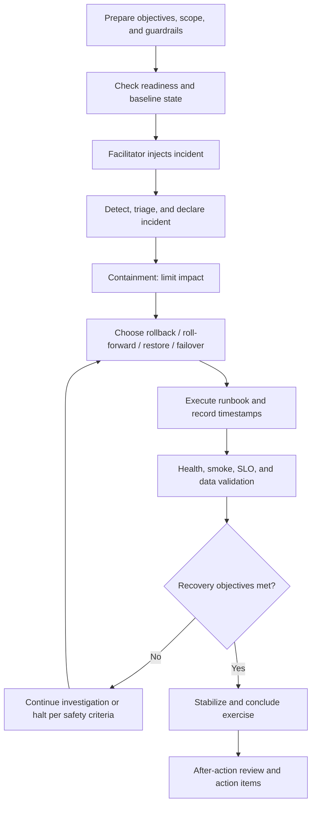

# Rehearsing Recovery Procedures Under Incident Conditions

A rollback or disaster recovery plan is only valuable when the team can execute it under realistic conditions: active alerts, time pressure, incomplete information, multiple people coordinating, and a live impacted system. A runbook may look complete on paper and still fail because credentials expired, backups cannot be restored, the old version is incompatible with the new schema, or nobody knows who has authority to make decisions.

A **recovery exercise** is an activity that simulates or injects a controlled incident scenario to test detection, decision-making, recovery execution, and system verification. An exercise needs measurable objectives, safe scope, assigned owners, stop criteria, and evidence. The purpose is to uncover process weaknesses before a real incident happens, then turn findings into concrete improvements.

In CI/CD, recovery exercises tie directly to release strategy: knowing how to halt a rollout, revert to a stable artifact, restore configurations or data, re-verify SLOs, and preserve a decision trail. Rehearsals do not test only a rollback button in the pipeline; they test all the people, tools, access permissions, data, and dependencies required to restore the service.

## 1. Distinguishing Rollback, Recovery, and Disaster Recovery

Related concepts that are not identical:

| Concept | Objective | Example |
|---|---|---|
| Rollback | Return a component to the version or state prior to the latest change | Redeploy the previous stable container image digest |
| Roll-forward | Fix an error with a new version or subsequent change | Release a hotfix to patch a bug in the current release |
| Recovery | Restore a service or data to an acceptable operational state | Restore a database from backup, replay events, or rebuild workloads |
| Disaster recovery (DR) | Restore operations after a major event affecting infrastructure, region, or datacenter | Fail over to a standby region and restore data there |
| Business continuity | Maintain essential business functions while the primary system is disrupted | Switch to a controlled manual processing procedure |

Rollback is not always the right recovery option. If a migration has dropped or transformed data irreversibly, running the old image again may make the application fail worse. If a secret was leaked, rolling back the application does not revoke the credential. If the primary region is lost, rolling back a version does not restore infrastructure and data. Choose the action based on incident type and data state.

## 2. Defining Recovery Objectives Before Rehearsing

An exercise must test specific targets. Common metrics:

- **RTO (Recovery Time Objective):** the maximum disruption time targeted by the organization to restore the service.
- **RPO (Recovery Point Objective):** the maximum acceptable data loss, usually expressed as a time interval of data.
- **MTTD (Mean Time to Detect):** average time from when an incident begins until it is detected.
- **MTTA (Mean Time to Acknowledge):** time from an alert firing until someone acknowledges it and begins coordinating.
- **MTTR (Mean Time to Restore/Repair):** average time to restore or repair a service; start and end points must be clearly defined when measuring.
- **Service level objective (SLO):** service quality targets after recovery, such as availability and latency.

RTO and RPO are design objectives, not automatically achieved outcomes. Exercises must measure actual elapsed time and recoverable data volume, then compare them against targets.

Example:

| System | Target RTO | Target RPO | Evidence to collect |
|---|---:|---:|---|
| Catalog read API | 30 minutes | 15 minutes | Timestamp when traffic returns, cache/database data reproducible |
| Order service | 15 minutes | 1 minute | API operational, order counts and statuses reconciled |
| Payment ledger | 60 minutes | Near 0 for confirmed transactions | Events/transactions preserved, no loss or duplicate writes |
| Internal reporting system | 8 hours | 24 hours | Reports regenerated and users regain access |

These values are only examples illustrating differences across services. Actual targets must be agreed upon with business, engineering, operations, and legal/compliance stakeholders. Never claim an RPO of 0 unless the replication/backup architecture proves it.

### Exercise Success Criteria

Do not simply record "rollback succeeded." Define upfront:

1. The incident is detected within the target timeframe.
2. Responsible responders are paged and assume coordination authority.
3. The team selects the right runbook and recovery approach.
4. Actions execute within the permitted scope and time window.
5. The service passes health checks, smoke tests, and minimum SLOs again.
6. Data is verified against RPO and business invariants.
7. Recovery operations do not trigger secondary incidents.
8. Logs, decisions, timestamps, and evidence are preserved.
9. Gaps are converted into action items with owners and due dates.

## 3. Types of Recovery Exercises

Not every exercise requires causing a real failure. Choose a simulation level matching maturity, blast radius, and controllability.

| Format | How it is conducted | Suitable when | Limitations |
|---|---|---|---|
| Tabletop exercise | Team walks through a scenario and describes decisions without changing systems | Testing roles, escalation, communication, and decision-making | Does not prove tools, backups, or credentials actually work |
| Runbook walkthrough | Step through documentation or a lab environment, potentially using synthetic data | Checking instructions, permissions, and step ordering | May not reflect real pressure or production dependencies |
| Technical recovery drill | Execute rollback/restore/failover in staging or an isolated environment | Verifying technical procedures and timing | Test environment may differ from production |
| Game day | Inject an approved fault in a controlled environment and observe full response | Testing coordination, detection, and recovery capability | Requires strict blast radius limits and an independent facilitator |
| Chaos experiment | Inject faults with a hypothesis, blast radius, steady-state hypothesis, and stop criteria | Testing resilience of running systems | Does not replace all DR tests; can cause impact if poorly bounded |
| Full DR exercise | Rehearse region failover or restoring services/data on standby infrastructure | Testing end-to-end DR capability | Costly, requires coordination and a plan to fail back to normal |

Progress gradually: tabletop → walkthrough → lab/staging → bounded game day → DR exercise. Expand scope only when earlier stages have supporting evidence and the team clearly understands how to halt and restore the exercise environment.

## 4. Designing Scope and Safe Boundaries

An exercise can cause disruption if faults are injected into live systems. Before starting, clearly document scope and safety conditions:

- In-scope services, clusters, namespaces, regions, tenants, or accounts.
- Permitted environment: lab, staging, pre-production, or production with dedicated approval.
- Components strictly off-limits, such as live payment gateways, customer data, or shared services.
- Fault types simulated and maximum permitted impact.
- Start/end times and change window.
- Facilitator, person authorized to halt, and emergency communication channels.
- Backups/snapshots or baseline state required before starting.
- Immediate abort criteria and the procedure to return the environment to a stable state.

### Mandatory Guardrails

1. Never induce faults outside the authorized scope.
2. Never use personal data or real secrets in a lab unless strictly required.
3. Never delete production data or resources "to test whether backups work."
4. Assign someone to monitor health continuously with authority to stop the experiment immediately.
5. Enforce limits on traffic, instance counts, duration, and affected resources.
6. Maintain a recovery path in case the drill action itself fails.
7. Notify relevant teams and support ahead of time; avoid confusing drill alerts with real incidents.
8. If unexpected impact appears, stop fault injection immediately and transition to real incident response.

For production exercises, conduct a risk assessment and obtain approval under change management policy. Conducting a drill never automatically authorizes breaking systems serving real users.

## 5. Roles and Coordination During an Exercise

An exercise should separate executors from observers. Someone actively running commands should not simultaneously record every timestamp or objectively evaluate exercise quality.

| Role | Responsibility |
|---|---|
| Exercise lead / facilitator | Prepare the scenario, coordinate fault injects, enforce scope, and conclude the exercise |
| Incident commander (IC) | Take ownership of the situation, set severity, assign tasks, and decide to continue/halt recovery |
| Operations lead | Execute the runbook, inspect infrastructure state, and coordinate engineering teams |
| Application/service owner | Verify application behavior, dependencies, feature flags, and business flows |
| Database/data lead | Evaluate backups, replication, consistency, RPO, and data reconciliation |
| Security lead | Assess credential exposure, access boundaries, auditing, and containment when needed |
| Communications lead | Update stakeholders, service status, ETA, and approved messaging |
| Observer/scribe | Record timestamps, decisions, wait times, blockers, and evidence |
| Safety controller | Monitor guardrails and hold authority to halt the exercise if boundaries are exceeded |

In small teams, one person may wear multiple hats, yet the facilitator or safety controller must be able to stop the exercise independently of the executors. Everyone must know the exercise termination signal and how to distinguish a simulated inject from a real incident.

## 6. Preparation Before Starting

### Exercise Brief

Every exercise should have a concise exercise brief:

- Name, objectives, and exercise type.
- Affected service/environment and scope.
- Opening scenario, assumptions, and timed injects.
- RTO/RPO or operational criteria to test.
- List of roles, participants, and observers.
- Runbooks, dashboards, logs, backup/restore procedures, and contacts to use.
- Start conditions, abort conditions, and environment reset steps.
- Required evidence to collect and pass/fail evaluation criteria.

### Readiness Check

Before the exercise, verify:

1. Runbook is the current version, has an owner, and remains accessible if primary systems go down.
2. Emergency credentials are valid, properly scoped, and responders know how to use them.
3. Backups are complete, with timestamps, checksums/metadata, and accessible from the recovery zone.
4. The previous stable artifact still exists in the registry with a recorded digest.
5. Configurations, manifests, and IaC are versioned; responders know how to restore the prior revision.
6. Dashboards, alerts, and logs work; system clocks are synchronized.
7. Out-of-band communication channels remain usable if internal SSO/chat is disrupted.
8. The drill environment has isolated quotas, data, and networking.
9. Someone with authority to approve or halt sensitive actions is available.

A backup job reporting `success` does not prove a restore will work. If the exercise aims to test data recovery, perform an actual restore into an isolated environment and verify the results.

## 7. Building Valuable Incident Scenarios

A scenario should start from a specific hypothesis, observable signals, and an expected outcome. Avoid vague scenarios like "the system broke" that give the team nothing concrete to investigate.

Common scenario categories:

| Scenario | Initial inject or symptom | Recovery capability to test |
|---|---|---|
| Bad release | Canary 5xx rises, p95 exceeds threshold, smoke tests fail | Pause rollout, identify digest, roll back or disable feature flag, re-verify |
| Misconfiguration | Wrong dependency endpoint, wrong feature flag enabled, timeout too low | Restore config revision, check config drift, and re-rollout |
| Incompatible migration | New version writes a schema old version cannot read | Halt rollout, evaluate compatibility, roll forward, or recover data |
| Database unavailable | Connection timeouts, primary unavailable | Fail over or restore per architecture, verify consistency and RPO |
| Message backlog | Consumers stall or slow down, queue lag climbs | Restore consumers, scale safely, handle retries/DLQ and duplicates |
| Credential exposure | Token found in logs or unusual access in secret store | Containment, revoke/rotate, verify permissions, and audit logs |
| Bad artifact or registry outage | Digest mismatch, deleted image, or unreachable registry | Pull artifact from trusted source, verify signature/provenance, and redeploy |
| Region outage | Primary region health checks fail, traffic unserved | Switch regions, verify replication, DNS/routing, and failback |
| Data loss / accidental deletion | Records or objects missing, latest backup has lag | Restore into isolated area, verify RPO, reconcile, and decide cutover |

### Scenarios Must Also Test Dependencies

An application rollback can succeed while the service stays down if the database, queue, secret manager, or network is broken. Every scenario must specify dependencies and recovery ordering. For example, before restarting consumers, ensure the database and broker are ready; before shifting traffic to a standby region, confirm data has replicated within acceptable RPO.

## 8. Exercise Workflow from Detection to Verification

A standard cycle can be broken into phases:



### Step 1: Record Baseline State

Record deployment revision, artifact digest, config revision, database replication lag, queue depth, SLIs/SLOs, and backup status. This serves as the reference baseline to verify how the system changed after the exercise.

### Step 2: Detect and Triage

On-call responders receive the alert or inject, determine scope, and assess severity. Distinguish the drill's simulated incident from any real concurrent incident. If out-of-scope impact occurs, the safety controller halts the exercise and real incident response takes priority.

### Step 3: Containment

Shrink the blast radius before recovering: pause rollout, stop ramping traffic, disable feature flags, isolate credentials, or block faulty flows per runbook. Do not run destructive data operations before determining state and recoverability.

### Step 4: Choose a Course of Action

Choose rollback, roll-forward, restore, or failover based on fault type, data state, compatibility, and recovery time. Record the rationale, decision maker, and criteria for switching to an alternative path.

### Step 5: Execute and Verify

Record timestamps for each action. After recovery, verify not just processes/replicas, but also smoke tests, dependencies, business flows, data integrity, SLOs, and alerts. Never declare completion solely because a rollback/restore command returned exit code zero.

### Step 6: Conclude and Reset

The facilitator announces the end of the exercise, disables fault injection, revokes temporary credentials, cleans up test data, and confirms the environment returned to an approved state. If it was a DR failover, follow a separate failback plan instead of immediately switching back without verifying replication.

## 9. Rehearsing Rollback of a Faulty Release

This scenario ties directly to CI/CD and can be safely executed in staging or an approved canary environment.

### Objectives

- Verify the pipeline halts rollout when guardrails fail.
- Identify the exact running artifact digest and previous stable digest.
- Execute rollback or feature disablement per runbook.
- Verify the old version is compatible with the current schema/config.
- Measure elapsed time from detection until the service returns to an acceptable state.

### Preparation

1. Select a test service and dedicated namespace.
2. Record the stable version digest, candidate digest, and manifest revision.
3. Confirm both artifacts exist in the registry.
4. Use synthetic datasets and avoid connecting to live payment systems.
5. Prepare per-revision dashboards, smoke tests, and reviewed rollback commands.
6. Define stop thresholds, such as error rate exceeding limits across two windows or critical smoke test failures.

### Execution

The facilitator routes a small percentage of test traffic to the candidate in the test environment. Then an inject fires: the new endpoint returns errors or latency breaches guardrails. On-call responders receive the alert, pause the rollout, identify the faulty revision, and match digests against the release record. The deployer reverts the workload to the stable digest per runbook.

Example commands used solely for observing state inside the drill namespace:

```bash
kubectl -n recovery-drill get deployment orders
kubectl -n recovery-drill rollout status deployment/orders
kubectl -n recovery-drill get pods -l app=orders -o wide
```

These commands are read-only. Mutating commands such as `kubectl rollout undo` or image updates must come from a reviewed runbook and run only in the approved namespace. Never copy drill commands to production without verifying context, cluster, namespace, digest, and permissions.

### Verification

- Deployment runs the exact stable digest recorded prior to the exercise.
- Replicas are ready with no ongoing crash loops.
- Functional smoke tests pass.
- Error rate, latency, and saturation return within thresholds.
- Queues show no abnormal backlog growth; no duplicate test transactions are written.
- Feature flags, traffic routing, and configurations match expected state.
- Deployment record logs the candidate, rollback target, executor, and timestamps.

### Takeaways

If rollback fails, determine whether the gap is a missing artifact, missing permissions, manifest error, compatibility flaw, or runbook gap. If the old version cannot read the new schema, the exercise uncovered a risk that must be solved via expand-and-contract, roll-forward, or data recovery before real release.

## 10. Rehearsing Database Recovery and Checking RPO

Database recovery differs from application rollback. It must protect consistency and prove how much data can be recovered.

A safe restore drill should run in an isolated environment:

1. Select a backup/snapshot and record its creation timestamp, retention, encryption key reference, and checksum/metadata.
2. Restore into a separate database or account; never overwrite a database serving live users.
3. If using point-in-time recovery, pick a target timestamp and record the logs/WAL/binlogs required for replay.
4. Check schemas, row counts, constraints, indexes, and access permissions.
5. Run reconciliation queries and business invariants on the restored data.
6. Calculate the latest recoverable data point relative to the simulated incident time to measure RPO.
7. Measure duration from restore start until the test application can use the data to measure RTO.
8. Tear down the drill environment and data per retention policy.

Do not merely check that a backup file exists or a snapshot shows `completed`. Only when the restore succeeds and data passes validation do you have recovery evidence. For transactional systems, verify consistency across tables, events, payments, and ledgers; simple row counts are insufficient.

## 11. Rehearsing Failover and Failback

Failover shifts workloads or traffic from a primary component/region to a standby component/region. Failback returns operations to the primary region or architecture once stabilized.

Before rehearsing, determine:

- Replication model: synchronous/asynchronous, replication direction, and lag.
- Criteria for promoting a new primary and preventing split-brain.
- Routing/DNS/load balancer mechanisms and cache/TTL delays.
- State of queues, sessions, caches, and background jobs.
- Access permissions, secrets, certificates, and endpoints in the standby region.
- Actual RPO at cutover time.
- How to validate data before opening traffic.
- Failback conditions and procedure.

A good exercise proves more than just traffic switching. It must verify the standby region has sufficient capacity, workloads have proper configuration, the database has sufficiently fresh data, consumers do not double-process, and observability continues working.

Do not fail back immediately as soon as the primary region recovers. Verify replication has resynchronized, identify the authoritative data source, handle writes generated during failover, and follow a cutover plan that avoids split-brain.

## 12. Rehearsing Credential or Pipeline Compromise Incidents

For secret incidents, rolling back an image is not enough. Exercises should test the ability to:

- Identify compromised credentials/principals and the resources they can access.
- Revoke or disable old credentials.
- Issue new credentials via secret manager/workload identity.
- Update workloads and verify old credentials are no longer used.
- Inspect audit logs for anomalous actions during the exposure window.
- Verify pipelines/runners are no longer compromised or retaining tokens.
- Revoke runner registration tokens, caches, or workspaces if needed.
- Rebuild and re-sign artifacts/signatures if signing keys or build environments were affected.

Drills must use test credentials and sandbox accounts. Never intentionally leak production secrets to test procedures. If a signing key is suspected compromised, evaluate revoking trust, re-signing trusted artifacts, and notifying downstream consumers per supply-chain security policy.

## 13. Integrating Drills into CI/CD and Operational Cadence

Some checks can be automated in pipelines; others require dedicated game day schedules.

| Cadence / Phase | Activity | Evidence |
|---|---|---|
| Every release | Verify rollback target, artifact retention, config revision, and runbook link | Release manifest and pre-deploy checks |
| Daily/Weekly | Check backup jobs, replication lag, alert routing, and emergency permissions | Health reports, backup metadata, and access reviews |
| Monthly/Quarterly | Test restore into an isolated environment | Restore duration, measured RPO, integrity report |
| Quarterly or after major changes | Tabletop/game day for release failure, dependency outage, or credential incident | Timeline, decisions, and action items |
| Per DR schedule | Failover/failback or regional recovery | Actual RTO/RPO, capacity, and data validation |
| After a real incident | Re-rehearse failed steps once remediated | Improvement evidence and updated runbook |

CI can verify that the release manifest includes the prior digest and a runbook URL, but should never automatically break production in standard pipelines. Fault injection requires a separate workflow, an allowlisted target/environment, approval gates, and a safety controller.

Example YAML describing a drill schedule:

```yaml
recoveryExercise:
  id: orders-release-rollback-drill
  service: orders
  environment: staging
  scenario: unhealthy_release
  objectives:
    rtoTarget: 15m
    dataLossAllowed: false
  scope:
    namespace: recovery-drill
    maxTrafficPercent: 5
    useSyntheticData: true
  prerequisites:
    - stableArtifactDigestRecorded
    - candidateArtifactDigestRecorded
    - rollbackRunbookReviewed
    - dashboardsAndAlertsReady
    - safetyControllerAssigned
  abortConditions:
    - trafficEscapesDrillNamespace
    - realCustomerDataDetected
    - sharedDependencyHealthDegrades
  successCriteria:
    - stableDigestRestored
    - criticalSmokeTestsPass
    - errorRateWithinThreshold
    - dataIntegrityChecksPass
  evidence:
    - eventTimeline
    - deploymentRecords
    - metricSnapshots
    - dataValidationReport
    - actionItems
```

This is an illustrative structure, not a standard schema of any CI vendor. The exercise orchestrator must validate scope, target, and abort conditions before permitting any fault injection.

## 14. Measuring and Evaluating Exercise Results

Record a timeline with consistent timestamps:

| Milestone | Meaning |
|---|---|
| T0 | Simulated incident begins |
| T1 | Monitoring detects/alerts |
| T2 | On-call responder acknowledges |
| T3 | Incident commander takes coordination |
| T4 | Containment/recovery decision made |
| T5 | Rollback/restore/failover begins |
| T6 | Technical component reports completion |
| T7 | Functional/business/data validation passes |
| T8 | Service returns to acceptable operational state |

From the timeline, compute:

- MTTD = T1 − T0.
- MTTA = T2 − T1.
- Decision time = T4 − T2.
- Execution time = T6 − T5.
- Validation time = T8 − T6.
- Actual recovery time = T8 − T0.

Compare actual recovery time against RTO; compare the latest recovered data point against RPO. Beyond timing, evaluate missteps, unnecessary escalations, missing runbook steps, unusable credentials, undelivered alerts, and the quality of data validation.

Never optimize one metric by skipping safety. Fast recovery that drops transactions or grants overly broad admin rights is not a success.

## 15. After-Action Review and Continuous Improvement

After the exercise, hold a review focused on systems and processes rather than blaming individuals. Answer:

1. Were objectives and scope met?
2. What went as expected?
3. Which steps were slow, lacked information, or failed?
4. Did alerts carry enough context to identify service/revision/impact?
5. Was the runbook accurate, easy to locate, and executable with existing permissions?
6. Did measured RTO/RPO meet targets?
7. Did restored data pass business invariants and reconciliation?
8. Was accountability for stop/continue/rollback decisions clear?
9. Were any new risks uncovered outside the initial scenario?
10. Which improvements must be completed before the next release or exercise?

Every finding should become an action item with:

- Problem description and evidence.
- Priority based on impact/risk.
- Accountable owner.
- Due date.
- How remediation will be verified.
- Links to runbooks, pipelines, alerts, or architecture needing updates.

After fixing issues, re-rehearse the failed portion to prove the improvement actually works. Updating documentation without re-running the failed step does not prove the process improved.

## 16. Common Anti-Patterns

- **Only reading the runbook in a meeting:** fails to test permissions, tools, backups, or execution timing.
- **Having backups without testing restores:** unknown whether copies are usable or meet RPO.
- **Drills without scope/abort criteria:** faults can spill into unintended systems or users.
- **Measuring only the rollback command duration:** ignores detection, decision-making, and business validation time.
- **Rolling back the application after a destructive migration:** old version may be incompatible with new data.
- **Not verifying old artifacts still exist:** rollback needs an image/package already purged by registry cleanup.
- **Using production credentials in a lab:** increases risk of secret exposure and accidental production changes.
- **No independent safety controller:** fault injector and recovery responder disagree on when to stop.
- **Not testing failback:** primary region recovers, yet switching back causes data loss or split-brain.
- **Not recording timelines and evidence:** impossible to calculate RTO/RPO or pinpoint bottlenecks.
- **Not tracking action items:** the exact same process failure repeats next time.
- **Rehearsing only for audits:** runbooks and access permissions may have gone stale long ago.

## 17. Checklist for Organizing a Recovery Exercise

Before starting:

1. Are objectives, hypothesis, and scenario clear?
2. Are scope, environment, resources, and data authorized?
3. Are RTO/RPO and success criteria measurable?
4. Are facilitator, incident commander, operator, observer, and safety controller assigned?
5. Are the runbook, stable artifact, config revision, and backups available?
6. Do credentials, access permissions, and emergency communication channels work?
7. Are dashboards, alerts, logs, and time synchronization ready?
8. Are abort conditions and environment reset steps agreed upon?

During the exercise:

9. Are the timeline and decisions recorded in real time?
10. Is containment performed before recovery?
11. Does the rollback/roll-forward/restore/failover choice fit the data state?
12. Is blast radius monitored and halted if guardrails are breached?
13. Are health, smoke tests, SLOs, and data integrity verified afterward?

After concluding:

14. Has the environment been reset, fault injection disabled, and temporary credentials revoked?
15. Have actual RTO/RPO and phase durations been calculated?
16. Have evidence and deployment/recovery records been archived?
17. Do action items have owners, priorities, due dates, and verification methods?
18. Is a follow-up drill scheduled after remediation?

Recovery exercises turn a paper plan into proven capability. When scope is safely bounded, RTO/RPO targets are clear, roles are assigned, runbooks are executed, and data is verified, teams learn not only how to bring services back up, but also which processes need improvement before the next real incident.
