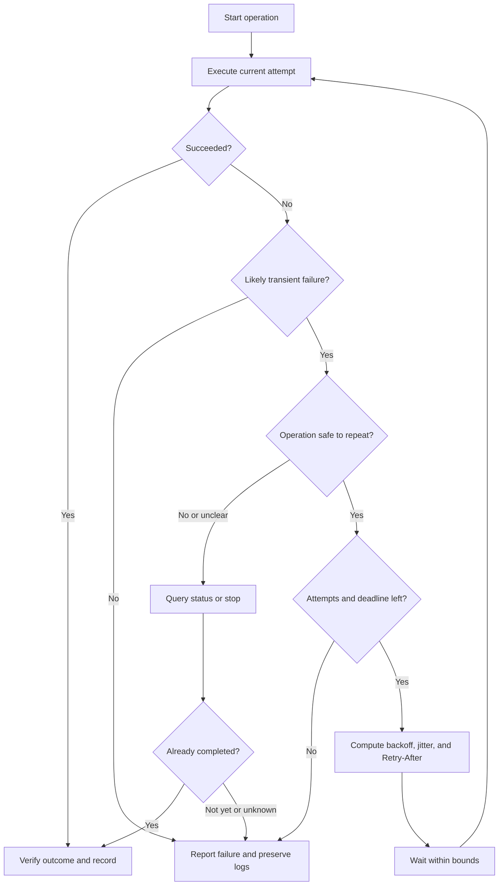

# Only Auto-Retry Transient Failures with Bounded Attempts and Wait Times

In a CI/CD pipeline, an operation can fail even when both source code and configuration are valid. A temporarily unresponsive registry, a dropped connection to a test service, or an API rate-limiting requests for a few seconds can all break a step mid-flight. Re-running that exact operation after the service recovers can allow the pipeline to succeed.

However, not every error goes away when retried. A test catching a wrong result, a build command using invalid syntax, or an expired credential will keep failing. Retrying those failures only slows down the pipeline and obscures the real cause.

The principle of this lesson is: **only automatically retry when there is sound basis to judge the failure transient, the operation is safe to repeat, and the retry policy enforces clear bounds**. Once limits are exhausted, the pipeline must report a failure for operators to handle.

## 1. What is a retry in CI/CD?

A *retry* is re-executing an operation after a prior attempt failed. In CI/CD, that operation might be downloading dependencies, calling a test system API, pulling an image from a container registry, uploading an artifact to storage, or querying deployment status.

The initial attempt and subsequent retries must be counted unambiguously. For instance, `maxAttempts: 4` typically means up to four total executions: one initial attempt and three retries. Some tools configure `maxRetries`; in those tools, `maxRetries: 3` can likewise result in four total executions. Always check how your CI tool defines the number.

Automatic retries differ from a user manually clicking to rerun the entire pipeline. A retry normally scopes to a specific operation or step and follows a defined policy. Re-running a pipeline may re-execute many steps, create extra artifacts, send notifications, or affect environments. Therefore, never use full-pipeline reruns as a substitute for a controlled retry policy.

## 2. Classifying failures before retrying

The first prerequisite is determining whether an error is likely to clear on its own. Rely on error type, response code, service message, operation state, and API contract—never decide simply by grepping for a word like `timeout` in logs.

| Failure group | Common examples | Handling approach |
| --- | --- | --- |
| Transient infrastructure failure | Connection reset, temporary DNS resolution failure, brief disconnect from dependent service | May retry if operation is safe to repeat and retry budget remains |
| Overloaded or rate-limited service | HTTP `429`, `502`, `503`, `504`; registry or API temporarily unavailable | May retry; honor `Retry-After` if provided by the service |
| Timeout | No response received within request deadline | Only retry after evaluating operation state; timeout does not prove the receiver never executed the request |
| Source or quality failure | Build failed due to compile error, lint error, wrong test assertion | Do not auto-retry; fix source code or tests |
| Configuration or permission error | Missing secret, wrong endpoint, HTTP `401` or `403`, missing permissions | Do not retry; fix configuration or granted permissions |
| Invalid data or state | Schema mismatch, bad artifact checksum, unsupported version | Do not retry blindly; investigate data, artifact creation flow, or target state |

HTTP status codes are only an initial signal. `429` usually demands slowing down; `502`, `503`, and `504` often point to temporary gateway or service issues. Yet a `500` response can happen both for transient glitches and for application logic bugs. A `404` right after creating a resource might reflect replication lag, or it might simply be a wrong path. Rely on the service's documentation and committed contract.

In particular, a timeout after a write request leaves an unknown outcome. The client missing a response does not mean the server skipped the operation. Before resubmitting, query status by request ID or release ID, or rely on an idempotency mechanism supported by the service.

## 3. Verifying whether an operation is safe to repeat

An *idempotent* operation is one where executing the same request multiple times produces the same desired state as executing it once. This does not necessarily mean every response is identical; what matters is that the final side effect is not duplicated.

For example, reading status with `GET` is normally safe to retry. Writing a fixed value to the same resource with `PUT` can be idempotent if the API defines it that way. Conversely, a `POST` request that creates a new release, generates an invoice, sends a notification, or starts a deployment can duplicate side effects if resent.

Before enabling retries, answer three questions:

1. If the first attempt was executed by the target system but the response was lost, will resending create an additional side effect?
2. Can the same request be identified by a stable identifier such as `release_id`, `request_id`, or an idempotency key?
3. Can current state be queried to tell whether the operation completed, is still running, or never started?

If the API supports idempotency keys, generate one stable key per logical operation and reuse that key across retries. Never generate a fresh key on each retry, as the server may treat each attempt as an independent request. If the service lacks this mechanism, check state before resending any operation with side effects.

In release pipelines, deploy the exact immutable artifact that was built and verified, identified by digest or checksum. If a deploy command times out, query the status of `release_id` and verify the running version before deciding how to proceed. Never build a brand-new artifact and retry an uncertain release; doing so weakens traceability between commit, artifact, and environment.

## 4. Bounding attempts, duration, and delay

A retry policy needs at least four bounds:

- **Maximum executions:** whether this includes or excludes the initial attempt must be explicit. In this lesson, `maxAttempts` is the total count including the initial attempt.
- **Per-attempt timeout:** prevents a single request from hanging indefinitely.
- **Maximum wait between attempts:** avoids excessively long pauses or tying up CI workers unnecessarily.
- **Total elapsed time for the operation:** sets a deadline so total retries never exceed the pipeline's time budget.

A common way to increase wait duration progressively is *exponential backoff*. Let `k` be the retry index starting at 1. With `baseDelay` as the initial delay and `maxDelay` as the cap:

```text
upperBound(k) = min(maxDelay, baseDelay * 2^(k - 1))
delay(k)      = random(0, upperBound(k))
```

Randomly picking a value between 0 and the upper bound is called *full jitter*. It prevents many pipelines from waking up and resending requests at the exact same instant, avoiding another overload spike on a recovering service.

For example, with `baseDelay = 2 seconds` and `maxDelay = 15 seconds`, the upper bounds for consecutive waits are 2, 4, 8, and then 15 seconds. Actual delays are chosen randomly within each interval. Once the cap is reached, subsequent waits stop growing.

If a response includes a `Retry-After` header, honor the retry time requested by the service. Never shorten the wait below that value just because internal backoff is shorter. If the requested time falls outside your deadline or exceeds the pipeline budget, stop and fail for later handling rather than retrying earlier than instructed.

The example policy below illustrates configuration concepts, not universal syntax across all CI platforms:

```yaml
retry:
  maxAttempts: 4          # Up to 1 initial attempt and 3 retries
  attemptTimeout: 20s     # Limit per call
  maxElapsedTime: 100s    # Overall operation deadline
  backoff:
    type: exponential
    baseDelay: 2s
    maxDelay: 15s
    jitter: full
  retryOn:
    - connection_reset
    - temporary_dns_error
    - request_timeout
    - http_429
    - http_502
    - http_503
    - http_504
```

When mapping this policy to a specific tool, check field names, attempt counting semantics, supported error types, and platform timeout limits. Never copy an illustrative snippet verbatim into a pipeline assuming every CI engine behaves identically.

## 5. Scoping retries appropriately

Retries should wrap the smallest identifiable operation that can execute safely. If uploading an artifact to a registry hits a network error, retry the upload operation. There is no need to re-run the entire build, tests, and already-succeeded steps unrelated to the error.

Retrying an entire job can fit when the job is designed to be safely repeatable and the platform only supports job-level retries. In that case, audit steps preceding the failure point: did they create new tags, send notifications, update deployment status, or write data to external systems? Those steps need idempotency keys, state checks, or deduplication.

Avoid stacking retries across multiple layers without calculating the combined total. For instance, if an HTTP library performs up to four calls and CI retries that step up to four times, one logical operation can trigger up to sixteen calls. Designate which layer owns retries, document the total budget, and ensure layers coordinate. A library may handle socket-level retries while CI handles step restarts, provided total attempts and deadlines stay controlled.

## 6. Preventing retry storms

When a registry, cloud API, or test service is overloaded, many pipelines can fail simultaneously. If all of them retry immediately on the same fixed schedule, the surge of traffic can keep the service overloaded. This is a *retry storm*.

The following measures reduce this risk:

- Use exponential backoff with jitter instead of immediate retries or identical fixed intervals.
- Cap retry counts, total duration, and concurrent jobs calling the dependent service.
- Honor `Retry-After` and published service rate limits.
- Apply a retry budget over a time window or request group so retries never dominate total traffic.
- If a service remains persistently unavailable, pause new requests via a circuit breaker or equivalent operational policy; resume only once recovery can be verified.

Retries are a recovery mechanism for brief glitches, not a way to force pipelines to keep hammering an unhealthy dependency.

## 7. Example: uploading an artifact to a registry

Suppose a pipeline has built and tested an image for commit `a1b2c3d`. The image has digest `sha256:...` and needs to be uploaded to a registry for deployment. The upload policy allows up to four total executions, a 20-second per-attempt timeout, and a 100-second overall deadline.

On the first attempt, the registry returns `503 Service Unavailable`. The pipeline classifies this as likely transient, notes the upload uses the same immutable artifact name and idempotency key, and confirms budget remains before the deadline. The pipeline waits using backoff with jitter and retries. On the next attempt, the registry returns `429`; the pipeline reads `Retry-After` and proceeds only if the requested wait stays within the deadline. Once the registry accepts the artifact, the pipeline verifies the stored digest matches the built digest and records the release outcome.

If the registry returns `401 Unauthorized`, the pipeline stops immediately and reports an authentication failure. Waiting a few seconds will never make an invalid token valid. If an upload times out and it is unclear whether the registry received the image, the pipeline queries the registry by digest or idempotency key before resending. This prevents duplicate records or side effects.

The decision flow can be modeled as follows:



The diagram underscores a key rule: return to execution only after confirming the error is retryable, repetition is safe, and budget remains. Uncertain outcomes must be checked via state queries before resending.

## 8. When retries are exhausted

Once `maxAttempts` is reached, the deadline expires, or a non-retryable error occurs, the operation must terminate with a failed status. The pipeline must retain logs and details sufficient for investigation, such as:

- Pipeline, job, and step name where the error occurred.
- Relevant commit SHA, artifact digest, and environment.
- Attempts executed out of the maximum allowed.
- Classified error code or category, wait durations used, and elapsed time.
- Final outcome and operation state on the target system if queryable.

Notifications should report both the first and final errors when they differ. Never log tokens, passwords, secret contents, or authorization headers. If a manual rerun is needed, the new run must capture who triggered it, the commit, artifact, and rerun reason.

Never mark a pipeline successful just because all attempts finished or a later retry happened to pass. Quality gates—builds, tests, security checks, artifact verification, and release approvals—must still pass as required. If a test assertion fails, retrying the test until green can hide flakiness; distinguish test infrastructure errors from defects caught by the test itself.

For deployments, retrying a deploy command and waiting for application readiness are two separate actions. Use a bounded polling loop to check readiness after deployment. If the application remains unhealthy past the defined verification window, the pipeline must mark the release failed and transition to the designed remediation or rollback workflow. Never loop deploy commands indefinitely hoping state heals itself.

## 9. Logging for traceability

Retry logs must be detailed enough for on-call operators to answer: which operation was retried, why, how many times, how long it waited, and what state the target system ended in. A structured log line might include fields like:

```text
pipeline_run=ci-1842
commit=a1b2c3d
step=publish-image
artifact_digest=sha256:...
attempt=2/4
error_class=temporary_service_unavailable
http_status=503
delay_ms=3170
elapsed_ms=24110
outcome=retry_scheduled
```

The example above uses illustrative data; real values should come from the pipeline and target service. Never place secrets or sensitive data in log fields. When the operation finishes, record the artifact digest, release ID, environment, and verification outcome to trace the path from commit to release.

Track additional metrics such as retry rate, post-retry success rate, average retries per operation, budget exhaustion count, and cumulative wait time. If a dependency requires frequent retries, that signals stability or configuration problems in the dependency; raising retry counts does not fix the root cause.

## 10. Common design mistakes

| Practice | Consequence | Fix |
| --- | --- | --- |
| Retrying every error type | Wastes time and masks code, config, or permission errors | Classify errors and allow only explicit retryable types |
| Retrying immediately | Adds load to an already failing service | Use backoff with jitter and honor `Retry-After` |
| Missing overall deadline | Workers can stay tied up too long or pipelines overrun schedules | Combine attempt caps, per-attempt timeouts, and an overall deadline |
| Retrying unprotected writes | Can create duplicate releases, resources, or notifications | Use idempotency keys, stable identifiers, or state queries before resending |
| Retrying an entire job for one minor error | Repeats unrelated steps and side effects | Narrow retries to the failing operation; if retrying a job, make steps safely repeatable |
| Stacking retries across layers without summing | Actual request volume multiplies exponentially across layers | Designate retry ownership and share a total budget |
| Ignoring errors once a retry succeeds | Hides signs of an unstable dependency | Record retry counts and monitor trends |

## 11. Retry policy design checklist

Before adding retries to a pipeline, confirm:

- [ ] Retryable error types and immediate-stop error types are explicitly defined.
- [ ] Operations are verified idempotent or backed by idempotency keys/state queries.
- [ ] Retry scope is as narrow as possible, and side effects of that step are assessed.
- [ ] Maximum attempt counts clearly specify whether the initial attempt is included.
- [ ] Per-attempt timeout, backoff, jitter, max wait cap, and overall deadline are configured.
- [ ] `Retry-After` headers and dependent service rate limits are respected.
- [ ] Library, script, and CI engine retries are audited together to prevent unintended multiplication.
- [ ] Exhaustion behavior is defined: pipeline fails, full logs retained, quality gates preserved.
- [ ] Logs never expose secrets and still trace commit, artifact, environment, and release outcome.
- [ ] Retry rates are monitored to catch persistently unstable dependencies.

A well-designed retry policy helps pipelines ride out brief disruptions while keeping execution times predictable, release outcomes traceable, and quality gates trustworthy. Whenever you cannot prove an error is transient or an operation is safe to repeat, stop and report the failure for investigation.
