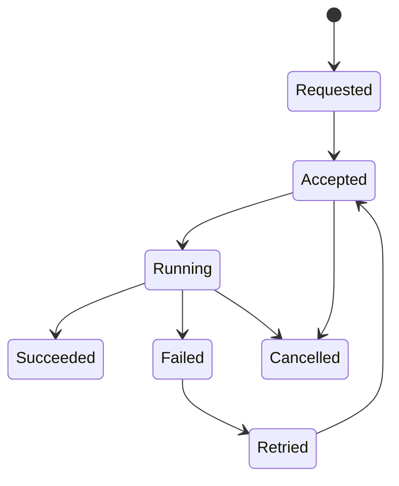

# Handling Timeouts When Target Completion Status Is Unknown

In CI/CD, a job may send a request to another system to deploy, create a release, publish an artifact, or run a migration. The client waits for a response, and the wait timer expires. The connection drops, the runner is terminated, or a proxy returns an error before any outcome arrives. At that moment, the target operation may not have started, may be running, may have completed, or may have failed; the client does not know which state is true.

This is **timeout ambiguity**: the caller did not receive a timely response and therefore cannot conclude that the target operation failed. A timed-out deploy command does not mean the deployment did not happen. A timed-out order creation request does not mean the order was not created. Retrying with a brand-new request risks creating two deployments, two orders, or applying the same mutation multiple times.

The critical rule is: **a timeout represents an unknown caller-side state, not proof that the target operation failed**. Identify operations with stable IDs, query an authoritative state source, enforce idempotency/deduplication, and retry only when safety conditions are met.

## 1. Why timeouts do not reveal the outcome

A request traverses many components: CI runner, DNS, network, load balancer, API gateway, target service, database, or queue. A timeout can strike along any hop.

Example of a job submitting a deployment request:

1. The runner sends an HTTP request to the deployment API.
2. The API accepts the request and records the deployment operation.
3. The controller begins updating the workload.
4. The workload finishes updating and passes health checks.
5. The response is lost on the return path, or the runner hits its deadline before receiving it.

On the runner side, the result is a timeout. On the target side, the deployment may have succeeded. If the runner sends a new deployment request without checking the previous operation, the system may start a second deployment.

Possible scenarios:

| Timing of timeout | Possible state on target | What the client knows |
|---|---|---|
| Before the request reaches the server | No operation created | Received no acknowledgment |
| Server received request, has not processed yet | Queued or recorded | Unknown whether server received it |
| Server is actively processing | Operation in progress | Unknown progress |
| Side effect committed, response lost in transit | Already completed | Final outcome unknown |
| Server failed, but response was lost | Already failed | Specific error unknown |
| Client timed out while server keeps executing | May still be running | Stopping client wait does not cancel target work |

Therefore, never infer target state from client exceptions or exit codes unless the protocol explicitly guarantees that meaning.

## 2. Distinguishing connect timeout, response timeout, and operation timeout

Timeout types indicate how long a client waited during a phase, not always whether side effects occurred.

- **Connect timeout:** the client failed to establish a connection to the endpoint. Normally the request was not sent over that connection, though proxies, retry layers, and intermediary protocols still warrant checking.
- **Response/read timeout:** a connection was established and the client waited too long for response data. The server may have already received and processed the request.
- **Overall deadline:** the entire client-side operation exceeded its total allowed duration. Sub-steps or server work may still be running.
- **Operation timeout:** the target system itself determines the operation ran too long and transitions it to a timed-out/failed state under its own semantics. Read the API contract to learn whether side effects were committed.

Cancelling an HTTP request, closing a socket, or aborting a CI job only stops the client from waiting or sending more bytes. It does not automatically abort running transactions, processes, or workflows on the server. If you need to stop an operation, invoke a dedicated cancellation API and verify state afterward.

## 3. Assigning stable identifiers to an operation

Whenever an operation might be retried, create its identifier before the first transmission and reuse that exact identifier for every status check or retry of the same intent.

Common identifiers:

- **Request ID:** identifies a single HTTP attempt for log tracing.
- **Operation ID:** identifies long-running work accepted by the server.
- **Idempotency key:** identifies the same business intent so the server avoids duplicating side effects.
- **Deployment ID/release ID:** identifies a specific deployment or release.
- **Business key:** a stable domain identifier such as an order ID, invoice ID, or migration version.

Request IDs and idempotency keys serve different purposes. Each HTTP retry can carry a new request ID to trace individual attempts, whereas retries of the same intent must share the same idempotency key. Any server-returned operation ID should be persisted so the client can poll status.

Example:

```text
business_operation: deploy/orders-service/release-2.7.1/production
idempotency_key: 9f82... (stable across retries)
operation_id: op-73184 (issued by the deployment API)
request_id: req-a1, req-a2, req-a3 (per transmission attempt)
```

Never generate a fresh random idempotency key on every retry. Doing so turns every attempt into a brand-new operation and defeats deduplication.

## 4. Idempotency: resending the same intent without repeating side effects

An operation is idempotent when executing it once or multiple times with the same inputs and identifier causes no change in final state beyond the first execution.

Operations commonly designed to be idempotent:

- Setting a deployment's desired replica count to 5.
- Setting a feature flag configuration to OFF.
- Creating or updating a resource keyed by a unique identifier.
- Recording an applied migration version in a migration ledger table with a unique constraint.

Operations typically not naturally idempotent:

- Creating a new order on every API call.
- Charging or capturing a payment.
- Sending an email or notification.
- Incrementing a counter via addition.
- Appending a new event row without a deduplication key.

For non-idempotent operations, attach an idempotency key or business key and persist the result of the first execution. Upon receiving the same key again, the server returns the recorded result instead of executing the side effect a second time.

### Idempotency key contract

A safe API should define:

- Where keys are generated and their uniqueness scope.
- How long keys are retained.
- Which payload/request fingerprint binds to the key.
- Same key + same payload returns the existing result or current operation status.
- Same key + different payload is rejected, typically with a conflict error.
- While a request is in flight, the client receives an operation ID or in-progress status.
- Terminal results are stored long enough that post-timeout retries still receive the same outcome.

Do not cache responses solely in a single instance's memory. Retries may land on another instance, or the server may restart. Deduplication requires durable storage backed by uniqueness constraints.

## 5. Persisting idempotency and side effects consistently

Servers must prevent situations where a side effect commits without saving the idempotency record, or vice versa.

For side effects inside the same database, persist the idempotency record, business mutation, and operation outcome in a single transaction:

```sql
CREATE TABLE idempotency_requests (
    idempotency_key varchar(128) PRIMARY KEY,
    request_hash varchar(128) NOT NULL,
    operation_id varchar(64) NOT NULL,
    status varchar(20) NOT NULL,
    response_json jsonb,
    created_at timestamptz NOT NULL DEFAULT now()
);
```

Conceptual flow:

1. Receive request and idempotency key.
2. Compute a fingerprint over business-meaningful payload fields.
3. Attempt to insert a record under the unique key.
4. If the key already exists, compare fingerprints and return the existing status/result.
5. If the key is new, execute the business change and update the outcome inside the same transaction where possible.
6. Commit before returning a success response.

The schema above is illustrative. Production systems also need an in-progress state, concurrency handling when two requests with the same key arrive simultaneously, unique constraints, retention TTLs, and recovery for stuck records. Never allow two concurrent requests sharing a key to slip past the check and execute side effects twice.

When side effects live outside the database, one SQL transaction cannot span every external service. A transactional outbox can help: write the business change and an outbox event in the same transaction; a worker dispatches the event with a stable event ID; consumers deduplicate by event ID. This achieves safer at-least-once processing rather than guaranteeing every component receives everything strictly once.

## 6. After a timeout, query status before deciding to retry

If the server provides an operation status API, the client should use the operation ID or idempotency key to query current state.

Asynchronous protocol example:

```http
POST /deployments
Idempotency-Key: 9f82...
Content-Type: application/json

{
  "release": "orders-service-2.7.1",
  "target": "production"
}
```

The server may respond:

```http
HTTP/1.1 202 Accepted
Location: /operations/op-73184
```

The client saves `op-73184`. If the response to the initial `POST` is lost, the client resends the same idempotency key or looks up the operation by key. Once it has the operation ID, the client polls the status endpoint:

```http
GET /operations/op-73184
```

Example status payload:

```json
{
  "operation_id": "op-73184",
  "status": "running",
  "progress": 65,
  "updated_at": "2026-11-18T09:15:00Z"
}
```

Terminal states may be `succeeded`, `failed`, or `cancelled`; intermediate states may be `accepted`, `queued`, and `running`. The API must clearly define which states are terminal and how long results remain queryable after completion.

Polling status must never create a new operation. If status is still `running`, keep waiting within deadlines and backoff. If `succeeded`, do not submit another creation call. If `failed`, inspect the error to decide whether retrying the same intent is valid or whether a new operation is needed after fixing the cause.

## 7. Reconciling when no status API exists

Not every system exposes an operation ID or status query endpoint. In those cases, identify an authoritative source of truth to verify side effects.

Examples:

- Deployments: read the deployment record, controller revision, live image digest, and rollout status.
- Artifact publishing: inspect the repository to see if the artifact digest/version exists and matches expected content.
- Database migrations: read the migration ledger/schema version and run postcondition checks.
- Resource provisioning: look up the resource by business key or stable resource name.
- Payments: query the transaction by merchant reference/idempotency key via the provider's API.

Reconciliation must verify the exact object and content, not merely check whether "a resource with the same name exists." A pre-existing resource might carry an older configuration or a different digest.

If no trustworthy status query exists and the operation is not idempotent, do not retry blindly. Hold the state as unknown, stop downstream steps, and hand off to controlled reconciliation or manual handling.

## 8. Distinguishing operation state from client observation state

A common design flaw is recording client timeout directly into business state as though the server failed. Separate these two dimensions:

- **Target operation state:** `accepted`, `running`, `succeeded`, `failed`, `cancelled`.
- **Client observation:** `confirmed`, `pending`, `unknown`, `unreachable`.

When the client times out, the operation may still be `running` or have `succeeded`; the client observation moves to `unknown`. Only once a follow-up query succeeds does the client update its knowledge.

A simple state machine:



`Unknown` is a client-side observation state, not necessarily the server-side operation state. Separating them prevents the client from declaring failure and starting a duplicate run while the first operation is still executing.

## 9. When is it safe to retry?

Retries are appropriate only when the failure is likely transient and the action is protected against duplicate side effects.

| Situation | Handling approach |
|---|---|
| Connect timeout before establishing connection | Bounded retry; still reuse the same operation key if supported |
| Read timeout after request was sent | Query status or retry with the same idempotency key |
| HTTP 429 | Honor `Retry-After`, throttle rate, and spend from retry budget |
| HTTP 502/503/504 | Check API contract; query operation first if request may have been received |
| Validation error/HTTP 400 | Do not retry until input is fixed |
| Unauthorized/HTTP 401/403 | Fix credentials or policy; do not retry repeatedly |
| Conflict from same key with different payload | Stop and investigate; never swap keys to bypass conflict |
| Operation still running | Poll status; do not create another operation |
| Unknown state with no dedup/status API | Stop blind retries and reconcile |

Never apply a single blanket retry policy to every exception. Classify errors by phase, API semantics, and side-effect duplication risk.

## 10. Backoff, jitter, deadlines, and retry budgets

Tight retry loops can worsen load on a struggling system. Many clients retrying on a synchronized cadence can trigger a retry storm.

A standard strategy is exponential backoff with jitter:

`delay = random(0, min(max_delay, base_delay × 2^attempt))`

Illustrative configuration table:

| Attempt | Maximum wait window |
|---|---:|
| 1 | 0–1 seconds |
| 2 | 0–2 seconds |
| 3 | 0–4 seconds |
| 4 | 0–8 seconds |
| 5 | 0–16 seconds |

Cap `max_delay`, retry count, and overall deadline. Real values must match SLAs, dependency processing times, and pipeline deadlines. Never let every layer retry independently without summing total calls: HTTP clients, SDKs, proxies, job runners, and services can multiply request volume dramatically.

A **retry budget** caps total retries within a time window or as a ratio of baseline requests. Once the budget is exhausted, clients stop retrying and fail fast to avoid amplifying an outage. Circuit breakers can pause calls when error rates spike; bulkheads bound concurrent operations so one slow dependency cannot exhaust all capacity.

If the server returns `Retry-After`, honor that value within your deadline and policy. Do not retry past the caller's useful deadline unless a background worker is explicitly responsible for continuing to monitor the operation.

## 11. Deadlines and operation lifecycles

Individual request timeouts must fit within the overall deadline:

- Connect timeout caps connection establishment time.
- Response timeout caps waiting for a single response.
- Operation deadline caps how long the business work is allowed to run.
- Caller deadline caps how long the workflow will wait for a result.

For instance, a job with a 10-minute deadline where each request waits 5 minutes and retries 3 times far exceeds its budget. Propagate deadlines or timeout budgets to downstream steps where supported, and reserve time for reconciliation and evidence capture.

Do not equate the caller deadline with the server operation deadline. A CI job may time out after 10 minutes while the deployment controller continues rolling out. If you need to stop the operation, invoke the cancellation API with the operation ID, then query status to confirm cancellation or discover that it finished before cancelling.

## 12. Handling asynchronous operations and long-running jobs

For deployments, migrations, provisioning, or long builds, APIs should return an operation ID promptly rather than holding an HTTP connection open until all work completes.

Recommended flow:

1. Client submits request with an idempotency key.
2. Server validates, persists the operation record, and returns an operation ID.
3. Worker executes the operation and updates state/progress.
4. Client polls status or receives authenticated callbacks/events.
5. If the client times out, it resumes querying the same operation ID.
6. On reaching a terminal state, the client updates the deployment/release record.

Polling should use backoff and jitter. Callbacks/webhooks can also arrive duplicated or out of order, so consumers must deduplicate by event ID and check state sequence/version numbers. Never assume a callback is delivered strictly once.

Operation records should be retained long enough for clients to recover after runner restarts. If a CI runner dies, a replacement job can resume tracking via the operation ID stored in workflow state or the deployment record instead of starting a new operation.

## 13. Example client handling timeouts safely

The following pseudocode illustrates separating operation submission from operation lookup:

```text
key = stable_key_for_this_release_and_target

try:
    operation = submit_deployment(
        request,
        idempotency_key = key,
        timeout = short_request_timeout
    )
except Timeout:
    operation = find_operation_by_idempotency_key(key)

if operation is not found:
    # Only resend the same key if the server guarantees deduplication.
    operation = submit_deployment(request, idempotency_key = key)

while operation.status is accepted or running:
    wait_with_backoff_and_jitter()
    operation = get_operation(operation.id)

if operation.status is succeeded:
    verify_runtime_digest_and_health()
elif operation.status is failed:
    report_failure(operation.error)
else:
    stop_and_reconcile_without_blind_retry()
```

This is pseudocode, not a ready-made API. `find_operation_by_idempotency_key` works only if the server provides that lookup. Otherwise, rely on an alternative reconciliation source. When the server lacks idempotency key support, resending after a timeout risks duplicating side effects.

## 14. Examples with deployments and migrations in CI/CD

### Deployments

A deployment job should record the deployment ID and release digest before or immediately upon acceptance by the target system. When the runner times out:

1. Do not generate a new deployment ID right away.
2. Use the operation ID or deployment ID to query the controller.
3. Inspect rollout status, desired revision, and observed image digest.
4. If the rollout is still progressing, keep polling.
5. If it succeeded, run post-deployment validation and mark the job successful.
6. If it failed, preserve the error and decide rollback/roll-forward per policy.
7. Only create a new deployment once the prior operation is confirmed terminal and a new intent is approved.

### Database migrations

Migration tools typically store applied versions in a migration ledger. When CI times out:

1. Reconnect to the database and read the migration ledger.
2. Check whether the migration version is marked complete.
3. Run postconditions to verify schema and data state.
4. For batched migrations, read checkpoints to identify the last committed batch.
5. Resume remaining work only when the migration is designed to be resume-safe.
6. If state is partial and indeterminable, halt and escalate to controlled manual recovery.

Do not rely solely on a migration name appearing in the ledger if the tool writes the ledger and runs DDL in separate transactions. Understand the transaction semantics of your database and migration framework.

## 15. When operations cannot be made idempotent

Some external side effects do not support idempotency keys—such as sending email through a legacy provider or calling a partner API with no lookup capability. Mitigate risk by:

- Generating a unique business reference and passing it if the provider supports it.
- Persisting intent state before calling and outcome state upon response.
- Using an outbox so requests are never lost between database transactions and workers.
- Querying or reconciling with the partner before resending.
- Preparing compensating actions when an unintended side effect occurs.
- Routing to manual review when you cannot prove the initial request failed.

Compensation is not a physical rollback. If an email went out, you may send a correction; if a charge posted, you may issue a refund. Compensating actions also require IDs, auditing, and idempotent handling so they do not compound errors.

## 16. Observability and logging for timeout investigation

To support reconciliation, logs and metrics must correlate attempts to the same operation:

- Operation ID and idempotency key (masked/hashed if the key might contain sensitive context).
- Request ID for each individual call.
- Business key, deployment ID, or migration version.
- Target endpoint/service along with connect and response wait durations.
- Attempt number, retry reason, delay, and remaining retry budget.
- HTTP status or exception type.
- Final operation status and verification source.
- Correlation/trace ID across services.

Never log tokens, authorization headers, passwords, or payloads containing sensitive data. For idempotency keys, use random values free of PII and enforce appropriate log access controls.

Useful metrics:

- Timeout rate by dependency and endpoint.
- Share of operations lingering in `unknown`/`pending` state too long.
- Retry attempts per original request.
- Time from submission to terminal state.
- Idempotency conflicts or duplicate requests detected.
- Retry budget exhaustions and circuit breaker openings.

Alerting should focus on operations stuck unknown for too long or retry amplification, not merely isolated individual timeouts.

## 17. Common mistakes

| Mistake | Consequence | Fix |
|---|---|---|
| Treating timeout as failure | Retries create duplicate side effects | Query state before deciding |
| Minting a new key on every retry | Server treats each attempt as a new operation | Keep idempotency keys stable |
| Storing idempotency only in memory | Restarts or other instances process duplicates | Persist deduplication records durably |
| Checking key then mutating outside transaction | Two concurrent requests can both execute | Unique constraints/atomic claims and transactions |
| Retrying every error | Amplifies load and repeats permanent failures | Separate retryable from permanent errors |
| Retrying on fixed intervals | Triggers retry storms | Exponential backoff, jitter, and budgets |
| Cancelling client and assuming server stopped | Operation keeps running unexpectedly | Call cancellation API and verify state |
| Checking only resource name to declare success | Could match stale resource or wrong digest | Verify IDs, fingerprints, and observed state |
| Marking job failed while operation still runs | Subsequent runs may trigger competing operations | Track pending/unknown state and reconcile |
| Assuming end-to-end exactly-once | Ignores redelivery and crash windows | Design at-least-once + idempotency/deduplication |

## 18. Checklist for handling timeouts with uncertain outcomes

- [ ] Distinguished connect timeouts, response timeouts, and operation timeouts.
- [ ] Recognized that client-side timeouts do not prove the server stopped or failed.
- [ ] Generated a stable operation ID/business key prior to initial submission where possible.
- [ ] Reused the exact same idempotency key across all retries of the same intent.
- [ ] Verified server persists deduplication state durably and handles concurrent requests safely.
- [ ] Detected and rejected mismatched payloads reusing an existing key.
- [ ] Confirmed an authoritative status API or reconciliation source exists.
- [ ] Polled existing operations instead of creating new ones while status is `running`.
- [ ] Separated target operation state from client `unknown` observation state.
- [ ] Retried only transient errors on operations protected against duplicate side effects.
- [ ] Enforced deadlines, exponential backoff, jitter, retry budgets, and concurrency caps.
- [ ] Honored `Retry-After` and avoided retrying past useful deadlines.
- [ ] Executed cancellations through dedicated APIs and verified resulting state.
- [ ] Backed migrations/deployments with ledgers, checkpoints, or records to resume after runner restarts.
- [ ] Established reconciliation/manual review workflows for non-idempotent, unqueryable operations.
- [ ] Correlated operation, request, attempt, and outcome in logs/metrics without exposing secrets.

Safe timeout handling begins by acknowledging that the caller may not know what happened on the target side. When operations carry stable identifiers, servers support idempotency, clients query state before retrying, and attempts stay bounded by deadlines and budgets, pipelines can recover from network disruptions without accidentally repeating side effects.
