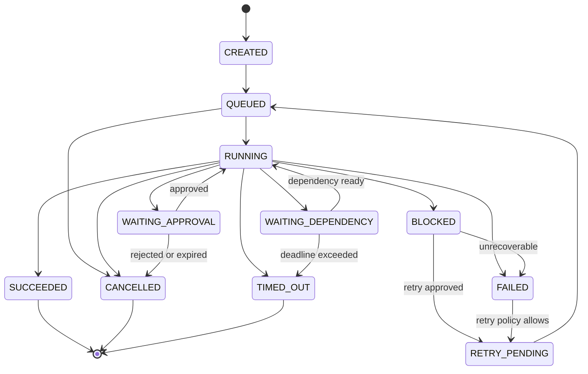

# Assigning Handlers and Clarifying Incomplete Pipeline States

A CI/CD pipeline can remain incomplete for many reasons: a job is still running, a runner has not picked up work yet, production approval is pending, an external dependency has not responded, a step is hung, or the orchestrator lost connectivity and does not know whether the operation finished. If all of these get lumped together as "pipeline failed," the team cannot tell what needs to happen next or who owns it.

Effective handling requires clarifying two independent but connected concerns: **the actual state of the pipeline** and **ownership of the next action**. State tells you where the system sits in its execution lifecycle; ownership tells you who must monitor, decide, investigate, or execute the next step. A run may still sit in `RUNNING` yet already need intervention; a run may be `FAILED` without anyone claiming it; a run in `WAITING_APPROVAL` may be behaving entirely as designed while waiting for the right approver.

In CI/CD, clear state and clear ownership prevent duplicate retries, repeated deployments, forgotten releases, indefinite approval waits, and incomplete handoffs. The goal is for every incomplete pipeline to carry a trustworthy state, a clearly assigned individual or group owner, a handling deadline, and a verifiable next action.

## 1. Distinguishing pipeline state from work ownership

Pipeline state describes the execution progress of a run, job, or step. Work ownership describes who is responsible for resolving an issue or making a decision. Never collapse both concepts into a single `status` field.

| Aspect | Question | Examples |
|---|---|---|
| Execution state | What stage is the pipeline currently in? | `RUNNING`, `QUEUED`, `WAITING_APPROVAL` |
| Outcome | How did the run terminate? | `SUCCEEDED`, `FAILED`, `CANCELLED` |
| Blocker | What is preventing the next step? | Runner offline, missing approval, registry timeout |
| Ownership | Who owns the next action? | Service owner, release manager, platform on-call |
| Acknowledgement | Has the assignee confirmed receipt? | `UNACKNOWLEDGED`, `ACKNOWLEDGED` |
| Next action | What needs to happen next? | Inspect runner, approve, safely retry step |
| Deadline/escalation | When is an update or escalation due? | Response deadline and escalation target |

Example: a pipeline has state `WAITING_APPROVAL`, blocker `PRODUCTION_APPROVAL`, and owner set to the release approvers group. This is not an execution error. If the approval deadline passes, the execution state may stay `WAITING_APPROVAL`, while the work item transitions to overdue and triggers escalation.

Conversely, `RUNNING` does not guarantee progress. A job can sit for hours with no new logs, heartbeats, or state transitions. In that situation, the system should flag it as suspected hung and assign someone to investigate.

## 2. Ownership units: run, job, step, and incident

A pipeline operates across multiple layers. Bind ownership to the exact unit that needs handling:

- **Pipeline/run owner:** holds overall accountability for the outcome of a run or release.
- **Job owner:** owns a group of tasks such as build, integration tests, scanning, or deployment.
- **Step/component owner:** understands the specific tool or dependency causing the failure—such as the package registry, runner pool, or migration tool.
- **Incident owner/coordinator:** coordinates when an outage spans multiple services or environments.
- **Approver:** holds authority to accept a change or authorize environment promotion.

The person who triggered the pipeline is not always the right person to handle failures. Pipelines can be triggered by bots, webhooks, schedules, or other users. Resolve owners from configured service catalogs, repositories, job responsibilities, and on-call policies.

A single run can have one overall owner and multiple action owners. For example, the platform team handles an offline runner, the service team investigates failing tests, and the release approver decides whether deployment proceeds. Maintain a single coordinator to hold the big picture whenever multiple teams are involved.

## 3. DRI: every action needs one Directly Responsible Individual

A DRI (*Directly Responsible Individual*) is the person directly accountable for seeing an action through to completion. Many people can assist, yet each action needs one explicit DRI.

Examples:

| Action | DRI | Supporting parties |
|---|---|---|
| Investigate runner not picking up jobs | Platform on-call | CI platform team |
| Analyze failing integration test | Service owner | QA/feature team |
| Confirm whether migration can rerun | Database owner | Application team |
| Approve production deployment | Release approver | Service owner |
| Coordinate cross-service incident | Incident coordinator | Respective service/platform owners |

Avoid assigning generically to "DevOps team" or "backend team" with no individual claiming the work. A team can serve as the organizational owner, but each action needs a concrete assignee and rotation handoff when that person is unavailable.

Having a DRI does not mean one person must fix everything alone. The DRI is responsible for coordinating, updating status, and verifying completion; subject-matter specialists can execute technical fixes.

## 4. Distinguishing RACI, service owners, and on-call

RACI helps clarify recurring process responsibilities:

- **Responsible:** the person directly doing the work.
- **Accountable:** the person ultimately answerable for the outcome.
- **Consulted:** people whose input is sought.
- **Informed:** people kept updated.

RACI works well for designing repeatable accountability—who approves releases, who operates runners, or who owns migrations. When handling a specific run, the DRI model identifies who acts right now.

The service owner owns the quality and operations of a service. On-call is the person or rotation currently staffed for incident response. The two roles can overlap, but are not identical by default. If service A's pipeline fails because of a shared runner, the service owner still collaborates, while platform on-call may act as the DRI fixing the runner.

Never grant approval authority to someone whose role is strictly monitoring. Approvers need proper authority and full understanding of the change's risk. Likewise, someone authorized to deploy is not automatically authorized to accept security or data risks.

## 5. A state model for incomplete pipelines

A clear state taxonomy helps observers distinguish running, waiting, and terminal states. Depending on your CI platform, you can adopt a model like this:

| State | Meaning | Immediate human action needed? |
|---|---|---|
| `CREATED` | Run was created but not yet enqueued | Usually no; monitor enqueueing |
| `QUEUED` | Waiting for a runner or execution slot | Only if queue threshold is exceeded |
| `SCHEDULED` | Scheduled to execute at a later time | No, unless the schedule is invalid |
| `RUNNING` | A job/step is actively executing | Only if stalled or alerting |
| `WAITING_APPROVAL` | Waiting for authorized approval | Yes; approver owns the decision |
| `WAITING_DEPENDENCY` | Waiting for an artifact, environment, callback, or external system | Monitor dependency and deadline |
| `BLOCKED` | A specific condition prevents progress | Yes; blocker must be resolved |
| `RETRY_PENDING` | Retry decided and awaiting next attempt | Monitor retry policy |
| `UNKNOWN` | Insufficient data to determine actual state | Yes; reconcile against source of truth |
| `SUCCEEDED` | Run finished successfully | No, though evidence must be recorded |
| `FAILED` | Run finished with failure | Yes; classify and assign owner |
| `CANCELLED` | Run cancelled by request or policy | Verify side effects stopped |
| `TIMED_OUT` | Exceeded defined deadline | Yes; identify which job timed out |
| `SUPERSEDED` | Older run replaced by a newer run | Verify no lingering side effects or active deploys |

This is a conceptual model. A platform may use `PENDING`, `IN_PROGRESS`, `ACTION_REQUIRED`, or other labels. When aggregating status, preserve the distinction between `WAITING_APPROVAL`, `QUEUED`, and `RUNNING`.

## 6. Run, job, and step states do not always match

A pipeline run can be `RUNNING` while one job has already `FAILED` and other jobs are cancelling or running cleanup. One job can be `WAITING_APPROVAL` while a scan job has `SUCCEEDED`. Dashboards must therefore display state across multiple levels.

Example:

```text
Pipeline run #1842                 RUNNING
  build                             SUCCEEDED
  unit-tests                        SUCCEEDED
  integration-tests                 FAILED
  security-scan                     SUCCEEDED
  deploy-staging                    NOT_STARTED (blocked by integration-tests)
  notify                            SKIPPED
```

Showing only `RUNNING` hides whether the pipeline is simply progressing or already hit a failure. Showing only `FAILED` can hide that cleanup or sibling jobs are still running.

Roll up overall run state from job/step states and the dependency graph. Explicitly define semantics for `continue-on-error`, optional jobs, skipped jobs, cancellations, and cleanup. A skipped optional job should not fail the run if policy allows it; a skipped mandatory gate must never automatically count as passing.

## 7. State transitions and transition conditions

Every state needs clear entry and exit conditions. Example:



Not every transition is valid in every pipeline. For instance, `FAILED` should not silently jump back to `RUNNING` without creating a new attempt or preserving retry history. `WAITING_APPROVAL` should advance only on an authenticated approver's action. `CANCELLED` should record who requested cancellation and verify that processes and side effects actually stopped.

Emit state transitions as events carrying timestamp, actor, source, and correlation ID. If two webhooks arrive out of order, the aggregator must use sequence/version numbers or query the source before applying updates.

## 8. Pending does not mean hung

`PENDING` or `QUEUED` can be completely normal. A pipeline may be waiting on:

- A runner matching required labels, architecture, or network zone.
- A slot constrained by concurrency limits or quotas.
- Another pipeline releasing a resource lock.
- An artifact from an upstream job.
- Environment protection approval.
- A deployment window or change freeze ending.
- A callback from an external system.

To judge whether a wait is abnormal, inspect queue age, expected wait time, runner capacity, dependency status, and deadlines. A job queued for 30 seconds may be normal during peak hours; a job queued for 45 minutes against a 5-minute queue SLA needs investigation.

Never retry a job just because it is `QUEUED`. Retrying adds no capacity and can worsen queue congestion. Determine whether the blocker is runner scarcity, quota, locks, or dependencies before acting.

## 9. Running without visible progress

A `RUNNING` job may still be healthy without printing new logs—for example, pulling a large image or running a long test suite. Conversely, the process may have deadlocked, the runner may have lost connectivity, or a step may be blocked on a child process that never exits.

To tell them apart, monitor multiple signals:

- Job/step start time and current duration.
- Timestamp of the most recent log line or event.
- Runner heartbeat and agent health.
- CPU, memory, network, or process activity where observable.
- Test, build, or migration progress markers.
- Step-level timeouts and overall job timeout.
- Health of any dependency currently being called.

Do not rely solely on "no logs for X minutes." Some legitimate steps do not stream logs continuously. Define expected durations and heartbeats per job type, and transition to `UNKNOWN` if liveness can no longer be verified.

## 10. Unknown state: uncertainty is not failure

`UNKNOWN` arises when the orchestrator lacks sufficient information to determine the outcome—for example, a runner drops immediately after calling a deploy API, a completion webhook never arrives, an agent restarts, or a job times out while an external command may still be executing.

In this state, do not immediately retry a side-effecting operation. If the deploy command succeeded yet the callback was lost, retrying can deploy twice or create a duplicate resource. If a migration partially committed, blind retrying can corrupt data.

Reconciliation workflow:

1. Record run/job/step ID, attempt number, timestamp, and last known event.
2. Query the authoritative source of truth on the execution or target system.
3. Check whether side effects occurred: published artifact, deployment revision, migration version, resource ID, or external transaction.
4. Compare expected state against observed state.
5. If completed, update the run record with evidence while preserving the missed-callback history.
6. If never executed, verify retry safety and launch a new attempt.
7. If partially completed, follow the appropriate recovery runbook and assign a DRI.
8. If unverifiable, keep `UNKNOWN`, block downstream steps, and escalate.

Never convert `UNKNOWN` to `FAILED` merely so the dashboard shows a terminal status. Uncertainty itself is critical operational signal.

## 11. Classifying blockers before assigning handlers

Blockers should carry a category and actionable details. Common categories include:

| Blocker category | Examples | Typical initial owner |
|---|---|---|
| Source/change | Compile error, lint, merge conflict | Repository/service owner |
| Test | Unit, integration, contract, or E2E failure | Test suite owner and service owner |
| Runner/capacity | Runner offline, out of slots, disk full | CI/platform on-call |
| Dependency | Registry, package mirror, cloud API timeout | Dependency or platform owner |
| Approval/policy | Pending approval, change window, policy denied | Approver or policy owner |
| Artifact | Upload/download failure, digest mismatch | Build/release engineering |
| Environment | Namespace, database, credentials, or quota | Environment/platform owner |
| Deployment | Rollout not ready, health gate failed | Service owner and release coordinator |
| Data/migration | Lock timeout, partial migration, incompatible schema | Database/data owner with service owner |
| External system | Unresponsive webhook, ticketing, or signing service | Integration owner |
| Unknown | Lost runner/callback, uncertain side effects | Run owner/coordinator to reconcile |

Categories are routing hints, not final root-cause conclusions. A test timeout, for instance, could stem from code, an overloaded runner, or a slow dependency. The initial owner should verify before reassigning.

## 12. Resolving owners from metadata rather than guessing

Systems can resolve owners from managed metadata:

- Repository/service catalog owners.
- Organization-approved `CODEOWNERS` or ownership files.
- Job/component owners declared in pipeline definitions.
- Environment owners and approver groups.
- Dependency catalogs and on-call schedules.
- Runbooks mapped to blocker categories.

Never treat the most recent committer as the sole default owner. That author may not operate the underlying infrastructure or may not be on call. Never make whoever clicked "run pipeline" the owner of every downstream failure either.

If metadata is missing or conflicting, assign temporarily to the pipeline/release coordinator to resolve ownership and open an action to update the service catalog. Never pick a random individual automatically and treat it as formal assignment.

## 13. Triage workflow for incomplete pipelines

Apply a structured triage sequence:

1. **Identify scope:** which run, job, step, environment, and release are affected?
2. **Confirm state:** which source is authoritative and when was it last updated?
3. **Classify blocker:** waiting, execution error, timed out, or unknown?
4. **Assess impact:** is it blocking a production release, impacting users, or holding resources?
5. **Assign DRI:** select the right component owner or on-call responder.
6. **Set next action:** inspect logs, approve, reconcile, retry, cancel, or roll back.
7. **Set deadline:** establish timestamps for acknowledgement, updates, and escalation.
8. **Record handoff:** capture evidence and actions already attempted.
9. **Verify completion:** confirm authoritative state, live artifact/deployment, and dependent jobs.
10. **Close work item:** record final outcome, root cause, and any follow-ups.

Do not open with a default retry. First establish where the run stands, which operations may already have run, and whether retrying is safe.

## 14. Handoffs must carry full context

A good handoff lets the recipient pick up immediately without asking basic questions from scratch. Include at minimum:

- Pipeline run ID, job ID, step name, and attempt number.
- Repository, branch/ref, commit SHA, and pull request/release ID.
- Artifact name, version, and digest if already built.
- Target environment/region/namespace.
- Current state, previous state, and timestamp of the last event.
- Blocker category and concise error summary.
- Log links/locations and relevant secret-redacted log excerpts.
- Actions already tried, their outcomes, and retry count.
- Potential side effects already triggered and verification status.
- Recommended next action, safety preconditions, and deadline.
- Current DRI, supporting contacts, and acknowledgement status.

Example handoff:

```text
Run: release-1842 / attempt 1
Job: deploy-production
Commit: 9f4c...e81a
Artifact: order-service@sha256:ab12...89ef
Environment: production / region-a
State: UNKNOWN
Last event: deploy request accepted; runner disconnected before response
Blocker: execution result cannot be confirmed
Side effect: deployment may already be in progress
Actions tried: queried pipeline once; no terminal event received
DRI: platform-on-call
Next action: inspect deployment controller and observed workload digest
Retry safety: do not retry until current rollout is reconciled
Deadline: update within 10 minutes
```

This example is condensed and free of tokens, passwords, or sensitive payloads. Real handoffs should share access-controlled links rather than pasting sensitive logs into tickets or chat.

## 15. Claiming work and ownership handoff rules

Sending a notification does not mean someone has accepted responsibility. Track these statuses separately:

- `UNASSIGNED`: no assignee yet.
- `ASSIGNED`: DRI selected but not yet confirmed.
- `ACKNOWLEDGED`: DRI confirmed acceptance.
- `IN_PROGRESS`: DRI is actively executing the next action.
- `WAITING_EXTERNAL`: DRI requested action from a dependency/other party and is waiting.
- `HANDOFF_REQUESTED`: DRI proposed transferring to another owner.
- `HANDOFF_ACCEPTED`: new assignee confirmed and took over accountability.
- `RESOLVED`: action completed with supporting evidence.
- `CLOSED`: coordinator confirmed the work item can close.

Handoffs require both sender and receiver. The sender supplies context; the receiver confirms understanding of scope, next action, and deadline. Formally transfer DRI only upon acceptance, except under predefined emergency procedures.

If the assignee fails to respond within the SLA, escalate automatically according to on-call policy. Never leave an action sitting in `ASSIGNED` indefinitely.

## 16. One DRI per action, one coordinator for major incidents

A pipeline can hit multiple blockers simultaneously. Create separate action items for each blocker and assign the corresponding DRI. Example:

| Action | DRI | Status |
|---|---|---|
| Inspect runner pool | Platform on-call | `IN_PROGRESS` |
| Verify whether test failure reproduces | Service owner | `ASSIGNED` |
| Confirm production approval | Release approver | `WAITING_EXTERNAL` |

When multiple actions affect the same release, designate one coordinator to synthesize progress and decide whether to proceed or halt. The coordinator does not have to be the one implementing technical fixes. This role prevents multiple teams from retrying, cancelling, or mutating the deployment in conflicting directions.

When an incident spans multiple services, use a structured incident command model: an incident lead coordinates, a technical lead drives investigation, a communications owner updates stakeholders, and individual service owners restore their components.

## 17. Retry ownership and attempt history

A retry is a fresh execution attempt after an earlier attempt failed or stayed incomplete. Preserve relationships across attempts:

```text
Pipeline run 1842
  attempt 1: FAILED (registry timeout)
  attempt 2: FAILED (same digest upload conflict)
  attempt 3: SUCCEEDED
```

Never overwrite old attempt logs or outcomes with newer runs. Each attempt should record an ID, start/end timestamps, trigger, actor, retry reason, and link to the parent run.

Retry ownership depends on failure type:

- Policy-driven automatic retry: the pipeline engine is the executing actor; the run owner remains responsible for monitoring.
- Manual retry: the requester must record a rationale and confirm safety preconditions.
- Side-effecting retry: the component owner must verify idempotency/reconciliation.
- Retry threshold exceeded: escalate to owner/on-call for investigation rather than continuing automatic loops.

Do not let someone click retry simply because the button is enabled. The UI should display current attempt, retry count, cause, and warnings whenever an action may repeat side effects.

## 18. Distinguishing retryable failures from human-decision failures

Retry policies should classify failures clearly:

| Failure group | Examples | Handling approach |
|---|---|---|
| Transient | HTTP 503, network reset, rate limit with `Retry-After` | Bounded retry with backoff |
| Capacity | Runner slot exhaustion, overloaded registry | Wait for capacity or tune queues; do not add load |
| Permanent/configuration | Invalid YAML, missing permission, compile error | Fix cause; retrying same input is futile |
| Policy/approval | Deployment rejected by policy or awaiting approver | Owner/approver decides; do not retry blindly |
| Data/partial side effect | Partial migration, uncertain deploy outcome | Reconcile and runbook before retrying |
| Flaky test | Unstable time-dependent test | Track retries separately, investigate reliability; do not mask chronic failures |

Retry policies need max attempts, exponential backoff, jitter, deadlines, and retry budgets. Against an overloaded dependency, aggressive retries trigger retry storms. For misconfigurations, retries simply repeat failures and burn runner capacity.

## 19. Idempotency and safe retries

An idempotent operation can run repeatedly without producing unintended effects beyond the initial execution. This is vital for automatic retries and resolving unknown states.

Examples:

- Building artifacts under run-ID temp names and checking digests before publishing to avoid redundant uploads.
- Applying deployments with identical desired state when the API/controller supports idempotency.
- Creating tickets or notifications with idempotency keys to avoid duplicates.
- Backing migrations with schema history, locks, and resume logic; not every SQL statement is safe to rerun.
- Provisioning cloud resources with deterministic identifiers and reconciling before recreating.

Example pseudocode:

```text
key = "deploy:" + releaseId + ":" + environment

if operationStore.completed(key):
    return operationStore.result(key)

record = operationStore.beginIfAbsent(key)
result = deploymentController.apply(desiredRevision)
operationStore.complete(key, result)
return result
```

This is pseudocode; `beginIfAbsent` must be atomic, and records must handle in-progress states, timeouts, and crash recovery. If the process crashes after the controller applies changes yet before recording `complete`, a retry still needs to query the controller before calling apply again.

Idempotency keys do not replace reconciliation. They identify the logical operation; the system must still verify real-world side effects.

## 20. Timeouts, cancellations, and still-running processes

Timeouts occur at many layers: HTTP requests, steps, jobs, pipelines, deployment controllers, or external tasks. A client timeout does not mean the server-side operation stopped.

When a timeout occurs:

1. Identify which layer timed out and its original deadline.
2. Check whether the server-side process/operation is still active.
3. If cancellation was issued, confirm the server accepted it and side effects stopped.
4. Inspect affected resources or data state.
5. Retry only after confirming the prior operation terminated or can repeat safely.

Cancellation is not rollback either. Cancelling a deploy job may stop log streaming while the controller finishes the rollout. Cancelling a migration does not automatically undo committed SQL statements. Pipelines need cleanup/`finally` steps and runbooks tailored to each side-effect type.

If cancellation cannot be verified, hold state as `UNKNOWN` or `CANCELLING` per your internal model, assign an owner to reconcile, and block conflicting operations.

## 21. Waiting approval: who owns it and when does it expire?

Approval gates commonly precede production deploys, risky migrations, or high-impact changes. Clarify:

- Who has authority to approve or reject?
- What evidence informs approval: tests, scans, change records, release notes?
- Is the approver prohibited from being the change author?
- Which exact commit/artifact digest does the approval cover?
- Does the approval invalidate if the artifact or plan changes?
- Without a response, does the pipeline keep waiting, expire, or auto-cancel?

Bind approvals to an immutable release or plan identity. If the artifact digest changes after approval, older approvals must not automatically carry over to the new artifact.

The pipeline initiator is not an approver by default. Approvers must review impact, evidence, and target environment. Systems should record actor, timestamp, decision, comment, and policy version.

## 22. Dependency waits and external callbacks

Pipelines may wait on external systems: security scanners, package registries, change management tools, cloud APIs, deployment controllers, or test environment webhooks. When waiting, record the exact dependency rather than leaving a vague `PENDING` status.

Capture details such as:

- Dependency/service name and request/correlation ID.
- Request timestamp, deadline, and `Retry-After` if present.
- Remote request status if queryable.
- Expected callback/webhook and its signature/authentication method.
- Integration owner and target system owner.
- Reconciliation plan if callbacks get lost.

Webhooks can arrive late, duplicated, or out of order. Handlers must verify authenticity, deduplicate by event ID, and never regress from a terminal state back to running due to a stale event.

Do not tie up runner slots for hours while waiting if external polling or callbacks can run outside workers. Separating orchestration state from execution processes uses capacity far more efficiently.

## 23. Escalation and deadlines

Every incomplete work item needs an acknowledgement deadline and a next-update deadline. Base deadlines on impact:

- Blocked production release or user-impacting incident: respond per on-call severity.
- Blocked staging release: align with release schedules and internal SLAs.
- Routine CI pull request: align with developer/team response expectations.
- Non-release background jobs: align with queue age and business deadlines.

An escalation flow may follow:

1. Assign DRI and send notification containing run link, blocker, and next action.
2. If unacknowledged by the deadline, page backup/on-call.
3. If the blocker threatens a release or SLO, escalate to coordinator/incident lead.
4. If a risk decision is needed, escalate to an authorized approver or service owner.
5. Log the escalation and set a new deadline.

Avoid spamming entire channels unconditionally. Notifications should carry an action, owner, and deadline; escalations should trigger on acknowledgement status and impact severity.

## 24. Notifications must enable the recipient to act

An actionable notification answers:

- Which run/job needs attention?
- Why is it blocked or incomplete?
- Who is the recipient and in what role?
- What specific action is required?
- What are the deadline and escalation path?
- Where are logs, evidence, and runbooks linked?

Example notification:

```text
ACTION REQUIRED — Production approval
Service: order-service
Run: release-1842
Artifact: sha256:ab12...89ef
Environment: production
State: WAITING_APPROVAL for 18 minutes
Approver group: release-approvers
Next action: review release evidence and approve/reject
Deadline: 16:30 UTC
Run: <internal pipeline link>
```

This is illustrative; never include tokens, secrets, personal data, or sensitive logs in notifications. Recipients must authenticate and use authorized access before acting.

## 25. Dashboards for incomplete pipelines

Dashboards should show more than red/green badges. Surface fields that aid triage:

| Field | Meaning |
|---|---|
| Run ID / attempt | Identifies execution and retry count |
| Service/repository | Establishes baseline ownership |
| Commit/artifact digest | Identifies exact inputs in flight |
| Environment | Assesses blast radius |
| Run/job/step state | Shows exact layer of progress |
| State age | Duration spent in current state |
| Last event/heartbeat | Shows whether progress is active |
| Blocker category | Classifies cause needing verification |
| DRI/acknowledgement | Shows current accountability |
| Next action/deadline | Clarifies required action and due time |
| Retry count/attempt history | Prevents infinite loops or duplicate actions |
| Side-effect status | Signals whether deploy/publish/migrate may have run |

Essential filters include service, environment, blocker, owner, state age, and severity. Provide dedicated views for "unassigned," "unacknowledged," "unknown," "overdue," and "production blocked" to catch neglected work.

## 26. Machine-readable state records

Structured records let dashboards, automation, and audits share consistent semantics. Illustrative JSON example:

```json
{
  "runId": "release-1842",
  "attempt": 1,
  "service": "order-service",
  "environment": "production",
  "state": "WAITING_APPROVAL",
  "stateUpdatedAt": "2026-11-18T08:20:00Z",
  "lastEvent": "deployment-evidence-ready",
  "blocker": {
    "category": "APPROVAL",
    "code": "PRODUCTION_APPROVAL_REQUIRED"
  },
  "ownership": {
    "dri": "group:release-approvers",
    "acknowledgement": "UNACKNOWLEDGED",
    "nextAction": "Review evidence and approve or reject",
    "dueAt": "2026-11-18T08:40:00Z"
  },
  "retry": {
    "attempts": 0,
    "maxAttempts": 0,
    "allowed": false
  }
}
```

This is a conceptual schema, not a required format for any specific CI platform. Production implementations need schema versions, event sequences, actor identities, audit histories, and appropriate environment/artifact fields. Avoid free-text strings for `dri` when you can reference controlled directory/group IDs.

Separate current state from event history. Current state serves fast queries; event history explains how state evolved and who changed it.

## 27. Example: pipeline awaiting production approval

Scenario: build, tests, and staging deploy all succeeded; the pipeline awaits production approval.

1. The pipeline enters `WAITING_APPROVAL` once the artifact digest and evidence are recorded.
2. The system looks up the approver group from service/environment policy.
3. It creates a work item with a DRI or group owner, wait start time, and deadline.
4. It sends a notification with release summary, test/security evidence, and run link.
5. An approver authenticates, inspects the exact artifact digest, and approves or rejects.
6. If approved, the pipeline proceeds using that exact approved digest.
7. If rejected, the run terminates per policy with rationale recorded; no auto-retry.
8. If expired with no response, escalate or cancel per defined rules.

If the artifact is rebuilt while waiting, prior approvals must be re-evaluated because the content changed. Never apply an approval meant for release A to release B just because version strings match.

## 28. Example: deploy request timeout and unknown state

Scenario: a pipeline calls a deployment API, hits a timeout, and loses runner connectivity. It is unknown whether the deployment was accepted.

Correct handling:

1. Mark the operation `UNKNOWN`, preserving run ID and deployment request ID.
2. Assign DRI to platform/service owner per the ownership map.
3. Query the deployment controller by request ID, release ID, or workload revision.
4. Inspect whether the live workload is rolling out and which digest is running.
5. If the exact digest is already deployed, record completion/reconciliation and run post-deploy validation.
6. If no side effect occurred, confirm the prior request is no longer active before launching a new attempt.
7. If only part of the workload updated, execute recovery or continue rollout per runbook.
8. If unverifiable, hold blocked and escalate; never send duplicate deploy commands.

This example shows why `UNKNOWN` requires human accountability and reconciliation rather than clicking Retry.

## 29. Example: integration test fails while cleanup job still runs

Scenario: `integration-tests` failed, yet jobs tearing down the temporary database and uploading reports are still running.

Do not mark the entire run finished the instant one job fails if cleanup is still active. Model it like:

```text
Run #1843                         RUNNING / FAILURE DETECTED
  build                            SUCCEEDED
  integration-tests                FAILED
  collect-test-report              RUNNING
  destroy-test-environment         RUNNING
  deploy-staging                   BLOCKED
```

The service/test owner analyzes the test failure. The platform/test-environment owner steps in if cleanup hangs. The pipeline coordinator tracks both actions, waits for cleanup or handles timeouts, and only then finalizes the run outcome or permits a retry once the cause is fixed.

Re-running tests before the previous environment finishes tearing down risks database or port collisions across attempts. Cleanup completion is therefore a retry precondition for jobs provisioning ephemeral resources.

## 30. Permissions and action controls

Not every owner should hold permission to execute every action. Separate permissions cleanly:

- View status/logs.
- Acknowledge or claim ownership.
- Retry a job free of dangerous side effects.
- Cancel runs or steps.
- Modify pipeline configuration.
- Approve production deployments.
- Execute rollbacks or recovery actions.
- Modify secrets, permissions, or policies.

Sensitive actions require service/environment authorization, actor auditing, and justification. Someone authorized to retry tests should not automatically hold production deployment rights. An approver should not be able to swap artifacts post-approval without creating a new release identity.

Never include secrets or credentials inside handoffs. Redact logs and point links to access-controlled systems. Ownership systems must also handle staff departures, role changes, and rotating on-call schedules.

## 31. Metrics for evaluating ownership and state hygiene

Track metrics such as:

| Metric | Meaning |
|---|---|
| Time to acknowledge | Elapsed time from action creation until DRI confirmation |
| Time to assign | Duration pipeline blockers sit unassigned |
| Time to resolve | Elapsed time from blocker detection to resolution |
| Unassigned work count | Actions lacking a DRI |
| Unacknowledged age | Age of unclaimed actions |
| Unknown state age | Duration runs remain in unverifiable state |
| Queue age | Time spent waiting for runners or concurrency slots |
| Approval wait time | Time spent awaiting approval |
| Retry rate | Share of runs/jobs needing additional attempts |
| Retry success rate | Share of retries succeeding after an earlier failure |
| Duplicate side-effect rate | Rate of unintended repeated operations |
| Stale ownership count | Actions still assigned to someone off-rotation/unresponsive |

Never use mean resolution time alone to evaluate individuals. Segment metrics by blocker category, impact severity, business hours, dependencies, and complexity. The aim is improving systems and workflows—not incentivizing hiding errors or closing tickets prematurely.

## 32. Common anti-patterns

| Anti-pattern | Consequence | Better approach |
|---|---|---|
| Marking every incomplete state `FAILED` | Blurs queues, approvals, blockers, and unknowns | Use a semantic state model |
| Leaving pipelines `RUNNING` without progress tracking | Hung jobs get forgotten | Track heartbeats, progress, expected durations, and timeouts |
| Assigning errors to an entire team | Nobody takes direct responsibility | Assign one DRI per action |
| Defaulting ownership to whoever triggered the run | Owner may lack context or not be on call | Resolve from service/component ownership |
| Sending alerts without acknowledgement | Unclear if anyone picked up the work | Track `ACKNOWLEDGED` and escalate |
| Handoffs with only an error screenshot | Recipient lacks run ID, digest, and history | Use structured handoff packets |
| Retrying while state is `UNKNOWN` | Risks duplicate deploys, migrations, or transactions | Reconcile side effects before retrying |
| Unlimited retries | Retry storms and masked root causes | Max attempts, backoff, jitter, budgets, and deadlines |
| Retrying tests before cleanup completes | Concurrent attempts collide on resources | Wait for cleanup or isolate resources per attempt |
| Approvals unbound to artifact digests | Risk approving modified content | Bind approvals to immutable release identities |
| Treating cancellation as rollback | Side effects may keep running | Verify processes and target system state |
| Stale webhooks overwriting newer state | Dashboards regress incorrectly | Enforce event IDs, sequences, and transition validation |
| Closing work items before verification | Run marked done while runtime diverges | Verify source of truth and evidence |

## 33. Operational checklist for incomplete pipelines

Whenever a pipeline has not finished, check:

- [ ] Run ID, job ID, step ID, and attempt number are present.
- [ ] State comes from an authoritative source with timestamps.
- [ ] Run, job, and step states are surfaced separately.
- [ ] `QUEUED`, `RUNNING`, `WAITING_APPROVAL`, `BLOCKED`, `UNKNOWN`, and terminal states are distinguished.
- [ ] Blockers include category, code, and actionable description.
- [ ] A service/component owner and a single DRI exist for the current action.
- [ ] The DRI acknowledged ownership, or an escalation deadline is active.
- [ ] Handoffs include commit, artifact digest, environment, log link, and action history.
- [ ] Secrets and sensitive data are stripped from logs and notifications.
- [ ] Retry policies distinguish transient, permanent, and partial-side-effect failures.
- [ ] Retries enforce limits, backoff, jitter, deadlines, and retry budgets.
- [ ] Side effects are reconciled before retrying any `UNKNOWN` operation.
- [ ] Cancellations are verified to have stopped underlying processes/operations.
- [ ] Approvals bind to the right artifact/plan and authenticated approver identity.
- [ ] Webhooks/events are authenticated, deduplicated, and processed in order.
- [ ] Cleanup completes before retrying jobs that provision temporary resources.
- [ ] Next action, owner, and deadline are documented clearly.
- [ ] Final outcomes are backed by evidence and an audit trail.

## 34. Conclusion

Handling incomplete pipelines requires combining a clear state model with an explicit ownership model. State shows whether a run is executing, waiting, blocked, unknown, or finished; ownership clarifies who must claim the work, what action is needed, and when escalation triggers. Separating run/job/step states, blockers, and outcomes keeps teams from treating every unfinished pipeline as a failure.

Every blocker needs one DRI, one next action, and one deadline. Handoffs must retain run ID, attempt, commit, artifact digest, environment, logs, potential side effects, and retry safety. For `UNKNOWN` states, reconcile against the source of truth before retrying; for approvals, verify both the right approver and exact artifact; for retries, enforce bounds and idempotency controls. Only once ownership is acknowledged and target state is verified can a pipeline be closed reliably.
