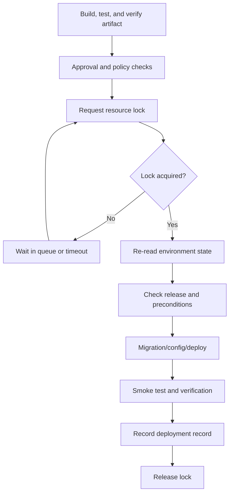
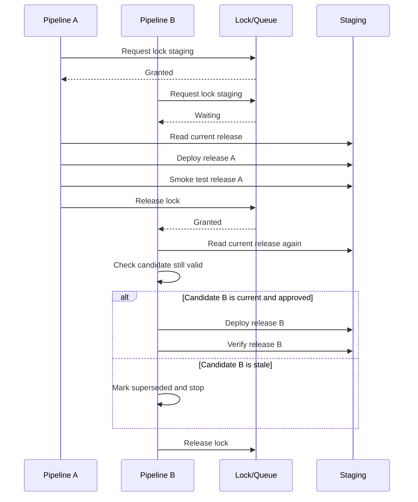

# Serializing Changes to a Shared Environment

In CI/CD, multiple pipelines may simultaneously attempt to deploy to staging, run migrations on an integration database, update cluster configuration, or share a test environment. If those changes occur concurrently, they can overwrite one another's state, apply updates out of order, or run tests against a system currently being modified by another pipeline.

For example, Pipeline A is deploying release `1.8.0` to staging. Before A completes its smoke tests, Pipeline B begins deploying `1.9.0`. B may swap the image while A is still testing, or A may record the older release state after B has already updated it. The final outcome no longer reflects clearly which pipeline owns the environment.

**Serializing changes** is a coordination approach ensuring that at any given time only one actor is permitted to perform a conflicting group of operations on the same resource. Pipelines can still build and test independently in parallel; only the portion modifying the shared environment needs to be queued or locked. For this mechanism to be reliable, you must identify the right protected resource, lock hold duration, handling of dead processes, and how to prevent an old process from continuing to write after ownership has expired.

## 1. Why Coordinate Changes to a Shared Environment?

Shared environments typically hold mutable state that multiple workflows can modify:

- Kubernetes clusters, namespaces, Deployments, Services, ingresses, and ConfigMaps.
- VMs, application servers, load balancers, or instance groups behind an endpoint.
- Integration databases, schemas, migration history, and test data.
- Terraform state or cloud resources managed by multiple pipelines.
- Feature flags, routes, DNS, certificates, and runtime configurations.
- Shared test accounts, queues, buckets, file shares, or mock/stub resources.

If two pipelines modify a resource simultaneously, the outcome can depend on actual execution order rather than the approved release order.

### Typical Scenarios

| Scenario | Potential conflict | Consequence |
|---|---|---|
| Two releases deploying to staging concurrently | The later pipeline swaps images while the earlier one is smoke testing | Test results are attributed to the wrong release; reports become unreliable |
| Two migrations running concurrently | Creating the same index, altering schema, or updating the migration ledger together | Lock contention, DDL errors, or ambiguous migration state |
| Two Terraform applies | Reading and writing state simultaneously or modifying the same cloud resource | State conflict, overwritten changes, or resources left in an intermediate state |
| Deployment and integration tests running together | Tests writing data while deployment restarts services or alters schema | False failures, corrupted test data, or non-reproducible results |
| Two pipelines updating configuration | Modifying replica count, routes, or feature flags at the same time | Final configuration depends on whichever pipeline writes last |
| Two jobs sharing a test account | Changing password, order state, or shopping cart simultaneously | One job's tests interfere with the other's |

Concurrency coordination clarifies who is allowed to modify a resource, when they may modify it, and what state must be verified before proceeding.

## 2. Identifying the Right Scope to Lock

Not every job in a pipeline needs to be serialized. Builds, unit tests, static analysis, and artifact creation can usually run in parallel because they do not mutate the target environment together. The part that needs locking is the critical section: the set of operations that mutate or depend on shared state.

An overly broad lock reduces throughput. For example, locking an entire CI/CD module forces a deployment of Service A to wait on Service B even when they use two independent namespaces and databases. An overly narrow lock fails to protect resources that are genuinely shared.

### Key Locks by Resource, Not Just Pipeline Name

Lock identifiers should reflect the contending resource. Some examples:

| Resource | Suggested lock key | When to use |
|---|---|---|
| Staging for a single service | `deploy:staging:orders-api` | Multiple pipelines can change versions of the same service |
| Entire staging environment | `environment:staging` | Services share configuration or dependencies that cannot change independently |
| Integration database | `database:integration:main-schema` | Shared migrations or data resets |
| Terraform state | `terraform:account-a:region-1:platform` | Multiple jobs apply the same state |
| Test account pool | `test-fixture:shared-account-pool` | Tests mutate the state of shared accounts |
| Registry promotion | `release-promotion:production` | Multiple releases update promotion aliases or metadata |

Lock keys need a stable namespace so different pipelines compute the exact same value for the same resource. If Pipeline A uses `staging` while Pipeline B uses `deploy-stg`, the system treats them as two separate locks and fails to prevent conflicts.

### Identifying Independence Boundaries

Before choosing a granular lock, ask:

1. Do the two operations write to the same resource or the same state?
2. Can one operation alter inputs that the other operation is validating?
3. Are there shared dependencies such as databases, DNS, queues, or accounts?
4. Can isolation be achieved via separate namespaces, tenants, schemas, or datasets?
5. If run in parallel, can you prove the outcome is order-independent?

If two deployments only update two independent services, you can lock per service. If both run migrations against the same schema, they must share a database lock even when deploying two different services. Lock scope must match the deepest conflicting resource.

## 3. The Critical Section in a Deployment Pipeline

A pipeline can usually be split into two regions:

- **Preparation phase:** checkout, build, unit tests, scanning, artifact signing, creating a release manifest, and waiting for approvals. These steps normally do not need to hold an environment lock.
- **Environment mutation phase:** inspecting current state, running coordinated migrations, applying configuration, deploying artifacts, shifting traffic, smoke testing on the shared environment, and recording the outcome. This is the region that must be protected per resource.

Holding a lock from the start of the build forces other pipelines to wait while CPUs are compiling or running isolated tests. Conversely, releasing the lock immediately after the apply command can let another pipeline mutate the environment before smoke tests and release recording finish.

A basic flow:



In practice, if preconditions no longer hold, the pipeline must stop or recompute its plan before applying. For example, the release may already be stale because a newer release was deployed while the pipeline waited for the lock. Do not automatically deploy an obsolete candidate simply because it arrived earlier in the queue, unless policy requires sequentially shipping every release.

### Re-Reading State After Acquiring the Lock

Environment state can change while a pipeline is waiting. After acquiring the lock, re-read:

- Currently running release ID and artifact digest.
- Config revision and feature flag revision.
- Schema version or migration level.
- Status of the previous rollout.
- Desired state and actual state of the resource.
- Whether the candidate is still authorized for deployment or has been superseded/revoked.

Re-reading prevents using a stale snapshot to overwrite newer state. Locks prevent compliant participants from mutating concurrently inside the critical section; preconditions detect changes that occurred before the lock was acquired.

## 4. Distinguishing Concurrency Control, Queues, and Approvals

These three mechanisms solve different problems:

| Mechanism | Purpose | Example |
|---|---|---|
| Concurrency lock | Prevent two conflicting operations from running simultaneously | Only one staging deployment job at a time |
| Queue/process order | Decide which job runs next | Oldest release first or newest release first |
| Approval/protection rule | Confirm a person or policy authorizes the change | On-call operator approves a production deployment |

An environment approval does not guarantee that two pipelines will not modify the same resource concurrently. Conversely, a lock only serializes operations; it does not prove that a release is eligible or that the runner holds production authorization. Systems typically need all three: policy/approval, queue, and lock.

Do not hold a lock while waiting for human approval. Approvals can take hours, blocking all other jobs. Complete approvals first, then acquire the lock, re-verify state, and execute the critical section. If the approval expires or the release state changes while waiting, require re-approval per policy.

## 5. Using Concurrency Groups in GitHub Actions

GitHub Actions provides `concurrency` to restrict workflow runs or jobs sharing a concurrency group. The following example serializes workflows deploying to repository staging:

```yaml
name: Deploy staging

on:
  workflow_dispatch:
  push:
    branches: [main]

permissions:
  contents: read

concurrency:
  group: deploy-${{ github.repository }}-staging
  cancel-in-progress: false

jobs:
  deploy:
    runs-on: ubuntu-latest
    environment: staging
    steps:
      - uses: actions/checkout@v4
      - name: Deploy approved artifact
        run: ./scripts/deploy-staging.sh
      - name: Verify deployment
        run: ./scripts/smoke-test-staging.sh
```

Workflow runs in the same group do not execute concurrently. `cancel-in-progress: false` keeps the currently running workflow going rather than cancelling it when a new run arrives. However, GitHub Actions concurrency groups are not a strict FIFO queue that retains every request: each group allows at most one running run and one pending run; a newer pending run can replace an older pending run. Therefore, if every release must be deployed in order, you need a queue/release controller with matching semantics rather than relying solely on concurrency groups.

### Choosing Stable, Properly Scoped Groups

If a staging environment is shared across multiple repositories, the group may need a unified organizational identifier rather than just `github.repository`. GitHub Actions concurrency groups are scoped per repository, so two separate repositories do not lock each other using the same group string. When multiple repositories or multiple CI systems modify a single environment, a shared lock service or deployment controller is needed.

You can lock at the job level rather than the workflow level so preparation jobs continue running in parallel:

```yaml
jobs:
  build:
    runs-on: ubuntu-latest
    steps:
      - run: ./gradlew --no-daemon clean check

  deploy:
    needs: build
    runs-on: ubuntu-latest
    concurrency:
      group: deploy-${{ github.repository }}-staging
      cancel-in-progress: false
    environment: staging
    steps:
      - run: ./scripts/deploy-staging.sh
      - run: ./scripts/smoke-test-staging.sh
```

Job-level concurrency protects only that job. If migrations or another job also modify the same database, those jobs must participate in the same locking protocol or use a dedicated lock aligned with the database.

### Avoid Cancelling Deployments Mid-Critical Section

Do not set `cancel-in-progress: true` on jobs executing environment mutations if the scripts lack a safe shutdown mechanism. Cancelling a job can leave a rollout half-applied, a migration mid-flight, or state partially updated. If an older release needs to be superseded, let the current deployment finish or run a controlled abort procedure before starting the new release.

## 6. Using Resource Groups in GitLab CI/CD

GitLab supports `resource_group` so jobs sharing a resource group do not run concurrently within a project. For example:

```yaml
deploy_staging:
  stage: deploy
  resource_group: staging-environment
  environment:
    name: staging
  script:
    - ./scripts/deploy-staging.sh
    - ./scripts/smoke-test-staging.sh
```

Jobs in different pipelines of the same project sharing the same resource group are coordinated so they never run concurrently. How the next job is selected depends on the resource group's process mode; configure the appropriate mode if release ordering matters. Do not assume all jobs run strictly FIFO by default.

GitLab resource groups are project-scoped. If multiple projects update the same cluster or database, per-project `resource_group` settings do not create a global lock. Use a shared coordination project or a lock service that all pipelines participate in.

## 7. Using System-Level Locks When Multiple Pipelines Share Resources

When pipelines originate from multiple repositories, multiple CI platforms, or manual operational tools, locking within an individual workflow is insufficient. You need a coordination mechanism closer to the shared resource.

Options include:

- A single deployment controller receiving release requests and applying them sequentially to the environment.
- A lock service with leases, TTLs, renewals, and auditing.
- The IaC backend/state store's locking mechanism.
- Database advisory locks when all actors share a database session and understand its limitations.
- Kubernetes `Lease` or leader election mechanisms when coordinating in-cluster workloads.
- A central CI platform's resource lock if all pipelines flow through the same platform.

Prefer a single shared source of coordination. If each pipeline creates its own local lock file or mutex on a separate runner, they cannot see each other's locks.

### PostgreSQL Advisory Locks for Shared Migrations

PostgreSQL provides advisory locks so cooperating jobs can serialize operations not protected by regular row locks. Example of a session-level lock:

```sql
SELECT pg_try_advisory_lock(2401, 17);
```

A result of `true` means the current session acquired the lock; `false` means another session currently holds it. After the migration completes:

```sql
SELECT pg_advisory_unlock(2401, 17);
```

The two integers are an organization-defined namespace/key pair; all coordinating jobs must use the exact same pair. Advisory locks apply only to clients that actively follow the protocol. They do not automatically block DDL commands or application queries that do not acquire the lock.

Session-level advisory locks are bound to the database session. The job must hold that exact connection throughout the critical section and not return the connection to a pool mid-operation. If the connection closes, the lock is released. For deployments spanning multiple systems or network partitions, losing the connection can release the lock while the old process is still running; thus, advisory locks alone do not replace fencing tokens for writes outside the database.

### Locks Must Be Released Even on Failure

For session-level locks, use a dedicated connection and ensure unlock occurs in a `finally` block or close the session on exit. If the process crashes, the database releases the session lock when the session closes. For lease-based lock services, enforce a TTL so locks are not held indefinitely if a worker dies.

Do not hold a pooled connection indefinitely without tracking its state. Log the lock key, owner ID, acquisition timestamp, hold duration, and release outcome; never log connection credentials.

## 8. Leases, Heartbeats, and Fencing Tokens

Distributed locks typically use leases: an owner is granted permission to hold the lock for a finite period. The owner must renew before the lease expires. If the owner dies or loses connectivity, the lease expires so another owner can proceed.

Leases solve locks being held forever when a process dies, yet introduce a dangerous scenario: an old process can pause longer than the TTL, lose its lease, and then resume running after a new process has acquired the lock.

For example:

1. Pipeline A acquires a lease for staging with a 60-second TTL.
2. A pauses or loses connectivity for 90 seconds.
3. The lease expires; Pipeline B acquires a new lease and deploys release B.
4. A resumes and sends the command to deploy release A.

If the target system cannot distinguish the current owner from the old owner, A can overwrite B despite having lost its lock.

### Fencing Tokens

A fencing token is a monotonically increasing sequence number issued each time an owner acquires the lock. For example, A receives token 41, and B receives token 42. The target resource tracks the highest accepted token and rejects any operation carrying a smaller token.

This prevents an old owner from continuing to write after its lease expires. However, merely issuing a token without the target system validating it provides no fencing. The deployment controller, state store, or resource management API must actively reject requests bearing stale tokens.

If the deployment tool does not support fencing tokens, use a coordination mechanism that enforces single execution ownership, check generation/preconditions on the target API, or design operations to be idempotent with compare-and-swap to prevent overwriting with stale state.

### Lease Renewal and Timeouts

The owner should:

- Choose a TTL larger than expected heartbeat latency, yet not excessively long.
- Renew periodically before expiration.
- Stop issuing mutating commands immediately if it cannot confirm the lease is still valid.
- Never assume ownership simply due to missing responses; verify with the lock service.
- Record lease ID, owner ID, and fencing token in operational logs.
- Enforce an overall timeout for waiting to acquire the lock and a separate timeout for the critical section.

Do not continue deploying when lease renewal fails. If the lease is lost mid-rollout, halt new mutations, inspect environment state, and let the current controller complete or hand over according to an explicit procedure.

## 9. Deadlocks and Multi-Lock Acquisition Ordering

A pipeline may require multiple resources: an environment lock, a database lock, and a Terraform state lock. If two pipelines acquire locks in different orders, a deadlock can occur.

For example:

- Pipeline A holds the staging lock, then waits for the database lock.
- Pipeline B holds the database lock, then waits for the staging lock.
- Neither A nor B can proceed.

### Enforcing a Global Lock Ordering

Define a fixed ordering across lock types and require every pipeline to follow it. For example:

1. Organization/environment coordination lock.
2. Database/schema lock.
3. Terraform state lock.
4. Service-specific deployment lock.

The exact ordering depends on architecture. What matters is that every actor acquiring multiple locks uses the same order. If multiple locks cannot be held for long, consider splitting work into independent phases to reduce lock hold times.

### Bounded Timeouts and Retries

Do not wait indefinitely for a lock. Set a timeout, record the waiting state, and return a handleable error on expiration. Retries should include backoff and jitter so multiple jobs do not wake up simultaneously and contend for the lock at once.

If a job fails to acquire a lock, it can:

- Continue waiting in the queue if the release is still valid.
- Cancel a candidate already superseded per policy.
- Request operator review if a lock is held abnormally long.
- Stop with a clear status so the pipeline can be re-run later.

Do not delete a lock record merely because it looks old without verifying that the owner is dead or the lease has expired. Deleting an active lock can create two concurrent owners.

## 10. Release Ordering and Handling Stale Candidates

Serialization ensures no two critical sections run simultaneously, but it does not automatically decide which release should run first.

Suppose Release A is created at 10:00 and Release B at 10:05. A takes longer to build and only requests the lock at 10:20, while B already finished deploying at 10:15. If A proceeds to deploy, the environment can be rolled back to an older artifact.

### Using Generations or Preconditions

Each release request can carry a generation, sequence number, or expected current release. After acquiring the lock, the pipeline reads environment state and checks:

- Is this candidate the latest approved release?
- Has a newer release already been deployed?
- Is this candidate still within the deployment window?
- Is the approval still valid for the current commit/digest/config?
- Has the candidate been revoked or superseded?

If checks fail, mark the job as stale/superseded and stop before mutating state. In systems supporting compare-and-swap, apply only if the current generation matches the expected value.

### Choosing a Queue Policy Based on Goals

| Policy | Behavior | Suitable when |
|---|---|---|
| FIFO/oldest first | Earlier arrivals run first | Every approved release must be applied sequentially |
| Newest first | Prioritizes the latest candidate | Newer releases replace older waiting releases |
| Newest ready first | Picks the latest candidate that is ready | Builds/approvals complete at uneven speeds |
| Supersede pending | Retains only the newest pending candidate | Staging only needs to test the most current state |
| Manual selection | Operator selects the candidate | Production or incidents requiring explicit release decisions |

Queue policies should be documented so teams understand why a pipeline was skipped or deferred. Do not delete records of superseded candidates; retain audit trails to trace decisions.

## 11. Locks and Idempotent Operations

Locks reduce conflict risk, but they do not guarantee an operation runs only once. A CI runner may retry after a timeout, an operator may manually re-run a job, or a pipeline may lose connectivity after the environment was already updated.

Therefore, deployment and migration operations still need to be idempotent or capable of detecting completed state:

- Use release IDs and digests to identify exact artifacts.
- Check desired state before applying.
- Write deployment records after state is verified.
- Maintain a version table or migration ledger for migrations.
- Use idempotency keys or deterministic resource names for resource creation tasks.
- If a command times out, re-read actual state before retrying.

Never assume a returned error means the operation did not occur. For instance, a deployment API may have updated the cluster before the runner disconnected prior to receiving the response. Blind retries can duplicate side effects.

## 12. Coordinating Migrations and Data Changes

Databases are particularly sensitive shared resources. Two different releases might simultaneously attempt migrations, backfills, or constraint updates. Maintain a single migration runner or a shared lock per database/schema.

A safe migration flow:

1. Build job creates the artifact and migration bundle.
2. Deploy job acquires the database/schema lock.
3. Read the migration ledger and current schema version.
4. Verify the migration has not run yet or can safely resume.
5. Run DDL/migrations with transactions and timeouts appropriate for the engine.
6. Record the migration version after successful commit.
7. Verify schema before allowing application rollout to proceed.
8. Release the database lock.

For long-running backfills, you do not necessarily have to hold an exclusive lock the entire time if batches are designed to be idempotent and compatible with live write traffic. In that case, use a dedicated coordination model: migration state, worker leases, checkpoints, and synchronization rules with application writers. Never allow two backfill jobs to process the same range without partitioning or row claims.

### Schema Locks Differ from Service Deployment Locks

Two services may deploy independently while sharing a database schema. If both run migrations on the same schema, per-service locks are insufficient. Acquire a database/schema lock first; once migrations finish, each service can deploy under its own lock.

## 13. Coordinating Terraform and IaC

Terraform backends can provide state locking to prevent concurrent writes to the same state. Never disable state locking just to make pipelines run faster.

Core principles:

- Use a remote backend with supported locking.
- Hold the lock throughout plan/apply according to backend/tool semantics.
- Avoid sharing a single state file across independent environments if state can be safely split.
- When an apply is interrupted, inspect actual state and resources before re-running.
- Never run `force-unlock` without verifying the lock owner is dead and no operation is still running.
- Use distinct state keys/workspaces so two environments never accidentally share state.

Terraform state locks protect that specific state file; they do not automatically serialize manual console edits or other tools mutating the same cloud resources outside that state. Enforce cloud permissions and change procedures to prevent out-of-band drift.

## 14. Coordinating Tests on Shared Environments

If multiple pipelines use a single staging environment for integration tests, locking deployments alone is insufficient. One pipeline might deploy while another pipeline is executing a long test scenario.

Design options:

- Provision a dedicated namespace/schema/tenant per pipeline.
- Use an environment pool and issue leases per test run.
- Lock both deployments and test sessions if tests require an unchanging environment state.
- Use isolated fixture data and idempotency keys per run.
- Allow environment resets only when no test session holds an active lease.

### Leases for Test Sessions

A test session can register an environment ID, release digest, config revision, and lease expiration. The deployment controller modifies the environment only when no test session holds an active lease, or after sessions are cleanly terminated.

If tests run long, leases require heartbeats. When heartbeats drop, the controller should not immediately wipe test data or mutate the environment without confirming the session has stopped. Use TTLs, grace periods, and cleanup jobs to reclaim orphaned resources.

### Prefer Isolation Whenever Possible

Serialization reduces concurrency. If tests can run in isolated namespaces, database schemas, or containers, isolation generally boosts throughput and cuts wait times. Reserve locks for genuinely unshareable resources; do not use locks to paper over accidentally shared fixtures.

## 15. Observing and Handling Long-Held Locks

A good locking mechanism needs telemetry. If a pipeline waits 40 minutes without knowing who holds the lock, teams cannot tell normal queuing apart from a leaked lock.

Record at minimum:

- Resource key and environment.
- Owner ID, pipeline/run ID, commit, and release ID.
- Request timestamp, acquire timestamp, and release timestamp.
- Wait duration and hold duration.
- Lease expiration, heartbeat status, and fencing token if present.
- Critical section outcome and cause of any release failure.
- Person or system performing force recovery, if any.

Never put lock authentication tokens or credentials into logs. Owner IDs should be non-sensitive run identifiers.

### Alerts and Operational Thresholds

Monitor:

- Queue depth and age of the oldest waiting job.
- Lock wait p50/p95 and timeout counts.
- Lock hold duration by resource type.
- Lease renewal failures and counts of stale owners rejected by fencing.
- Jobs cancelled while holding a resource lock.
- Deployments marked stale/superseded.

If hold durations climb, inspect which step inside the critical section is taking too long. Move builds, scans, or approvals outside the lock; batch migrations; or split independent environments. Never shorten timeouts or force-unlock just to turn dashboards green.

## 16. Handling Cancelled Pipelines or Dead Runners

Pipelines can stop due to timeouts, lost runners, manual cancellations, or system faults. How a lock is released depends on the lock type:

| Mechanism | When owner dies | What to check |
|---|---|---|
| CI concurrency/resource group | Platform manages run/job state | Was the environment partially mutated before the job stopped? |
| Database session advisory lock | Lock releases when session closes | Is the connection still open or hung; did external side effects already happen? |
| Lease lock | Expires after TTL without heartbeat | Could the old owner wake up and send stale commands? |
| IaC backend state lock | Tool/backend manages lock metadata | Is state left partial; is the lock owner truly dead? |
| Host-local file lock | OS may release when process closes file handle | Do runners on other hosts even see the same filesystem semantics? |

### Never Force-Unlock Without Inspection

Force-unlocking can create two concurrent writers if the old owner is still running. Before executing it:

1. Identify the run ID and owner process.
2. Check whether the runner/session is still active.
3. Inspect ongoing operations on the environment or state store.
4. Terminate or fence the old owner if possible.
5. Record an audit entry and release the lock only with evidence the old owner can no longer write.

If you cannot confirm, keep the environment protected and follow incident procedures. A stuck lock is usually far less dangerous than two deployments writing to production simultaneously.

## 17. Example Coordination Sequence for Two Pipelines

Suppose Pipelines A and B both want to deploy to staging. A acquires the lock first; B waits in the queue. Once A completes deployment and smoke tests, A writes the release record and releases the lock. B acquires the lock, re-reads state, and verifies whether its candidate is still the latest.



This diagram assumes both pipelines obey the same lock service and queue policy. If Pipeline A loses its lease, the lock service must issue a new fencing token and the environment must reject A's stale requests before B mutates state.

## 18. Practices Prone to Race Conditions

| Practice | Consequence | Improvement |
|---|---|---|
| Locking by workflow name instead of resource | Two differently named workflows modify the same environment | Lock by a unified resource key |
| Using single-repo concurrency groups for multi-repo environments | Pipelines in other repos are uncoordinated | Use a shared lock service/controller |
| Holding locks from build start through approval | Queue stays blocked for long periods | Build and approve first; lock only the critical section |
| Cancelling an active deployment for a newer run | Environment can be left in partial state | Complete or perform a controlled abort |
| Assuming queues are always FIFO | Releases may execute in an unexpected order | Configure queue policy and validate stale candidates |
| Lease expires while old owner continues writing | Two owners mutate the resource simultaneously | Enforce fencing tokens at the target resource |
| Force-unlocking just because a lock is old | Old owner might still be alive | Verify owner, stop/fence, then unlock |
| Two pipelines acquiring multiple locks in opposite orders | Deadlock | Enforce a global lock acquisition order |
| Not re-reading state after acquiring the lock | Stale candidate overwrites a newer release | Check generations/preconditions inside the critical section |
| Believing a lock makes operations execute-once | Retries can duplicate side effects | Ensure idempotency and read actual state before retrying |
| Locking deployments while letting test sessions run concurrently | Tests observe environment changing mid-run | Lease test sessions or isolate environments |
| Using per-service locks while migrations share a schema | Two migrations still collide | Lock by database/schema |

## 19. Checklist for Serializing Changes to a Shared Environment

Before running multiple pipelines against the same environment, verify:

- [ ] Genuinely shared resources that can conflict have been identified.
- [ ] Resource keys are consistent across all repositories, workflows, and operational tools.
- [ ] Lock scope is narrow enough to preserve concurrency for independent resources.
- [ ] Builds, scans, and approvals sit outside the critical section when they do not require the environment.
- [ ] Pipelines acquire the lock before reading final state and applying mutations.
- [ ] After acquiring the lock, pipelines re-read release, config, schema, and actual state.
- [ ] Stale/superseded candidates are detected before applying changes.
- [ ] Queue policy is explicitly defined: FIFO, newest-first, supersede, or manual.
- [ ] Timeouts exist for both lock acquisition wait and critical section execution.
- [ ] Leases use TTLs/heartbeats; owners halt writes upon losing a lease.
- [ ] Fencing tokens are validated by the target resource when using distributed leases where old owners may revive.
- [ ] Multiple locks are acquired in a consistent global order to prevent deadlocks.
- [ ] Deployments/migrations are idempotent or record state to detect completed operations.
- [ ] Locks are released on the success path and reclaimed safely when runners die.
- [ ] Force-unlocking requires verifying the old owner can no longer write and produces an audit log.
- [ ] Test sessions and deployments are coordinated, or environments are isolated.
- [ ] Migrations lock at the database/schema level when multiple services share data.
- [ ] Terraform state locks remain enabled and are never disabled to bypass contention.
- [ ] Metrics track queue depth, wait time, lock duration, and lease failures.
- [ ] Crashed jobs mid-critical section have been rehearsed and environment recovery verified.

Serializing changes gives a shared environment a clean change history and prevents pipelines from overwriting one another. Choose locks aligned to the right resource, hold locks only during the critical section, re-check state after acquiring the lock, and handle expired owners with fencing or equivalent safeguards. Combined with queue policies, idempotency, and lock observability, CI/CD can preserve consistency while still running independent work in parallel.
