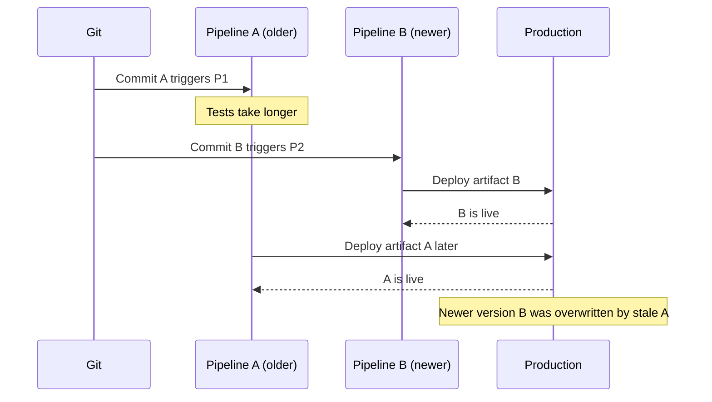
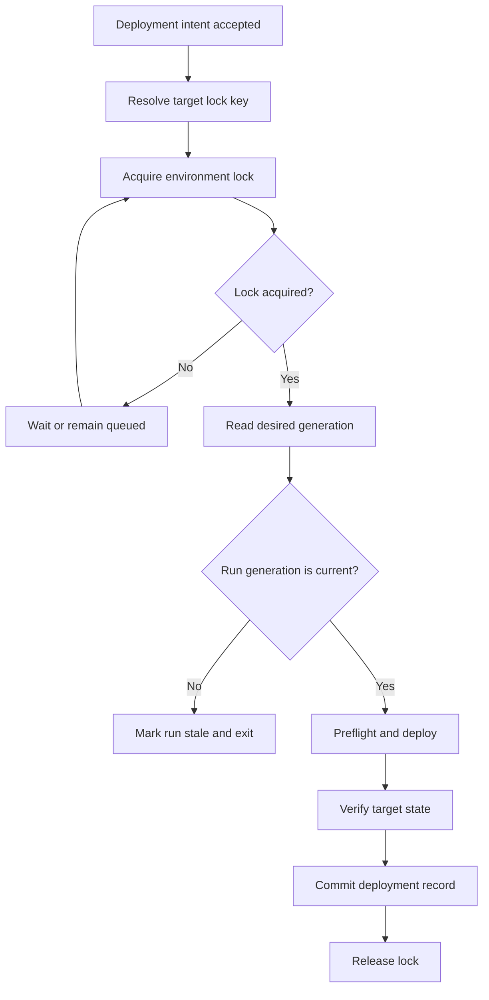

# Preventing Older Pipelines from Overwriting Newer Versions

In CI/CD, multiple pipelines can run concurrently for the same service and environment. A pipeline triggered by an older commit may take longer to run tests, while a pipeline for a newer commit completes faster and deploys first. If the older pipeline still proceeds to deploy when it finishes, it can push a stale artifact back into production, overwrite newer configuration, or shift traffic back to a revision that is no longer accepted.

This is a release-coordination race condition. The order in which pipelines start, the order in which builds finish, and the actual deployment order do not necessarily match. Relying solely on job sequence numbers, start timestamps, or the assumption that "newer pipelines always finish later" is insufficient to protect the environment.

**The goal is to allow only deployment intents that remain valid and current under policy to mutate environment state.** This requires combining serialized mutations per target, freshness checks right before mutation, immutable artifacts, and preventing an old process from continuing to write after its control authority has expired.

## 1. The Problem of Older Pipelines Overwriting Newer Versions

Suppose the `main` branch has two commits:

- Commit `A` is created first and triggers pipeline `P1`.
- Commit `B` is created after `A` and triggers pipeline `P2`.

`P1` spends longer running tests. `P2` finishes sooner and deploys the artifact from `B` to production. Later, `P1` finishes and deploys the artifact from `A`. Production now runs the older version even though pipeline `P2` reported success.



The problem is not necessarily that artifact `A` is defective. The problem is that `P1`'s deployment decision no longer aligns with current state and release intent.

### Common Consequences

- Production runs a commit older than the approved commit.
- Newer configuration is overwritten by an older manifest or Terraform plan.
- Blue-green routes are switched back to an environment past its serving lifetime.
- A canary controller keeps ramping traffic to a superseded candidate.
- A manual rollback is immediately overwritten by a queued pipeline right afterward.
- Two pipelines run migrations or modify shared resources simultaneously.
- Test results and deployment records no longer reflect the version actually running.

## 2. Distinguishing Commit Order, Pipeline Order, and Release Order

These three orderings are not identical:

| Order | Description | Why can they differ? |
|---|---|---|
| Commit order | Historical relationship between commits in Git | Branches involve merges, rebases, cherry-picks, or multiple branches |
| Pipeline order | Order in which runs are created or started | Runner capacity, queues, caches, test durations, and retries |
| Deployment order | Order in which changes are actually applied to the target | Locks, approvals, deployment times, slow APIs, and manual actions |

A commit SHA has no ordinal meaning. You cannot compare two SHAs lexicographically to determine which commit is newer. Commit timestamps are also unreliable because clocks can differ, rebases can rewrite timestamps, and they do not reflect approved release order.

The system needs an explicit concept of **deployment intent**: a request to deliver a specific artifact to a specific target, derived from a revision and satisfying release criteria. The order of valid intents is what determines whether a pipeline still holds authority to deploy.

## 3. Defining Deployment Targets and Coordination Scope

Not every deployment needs to lock the entire system. Identify which resources can be written to concurrently by two pipelines.

Target examples include:

- `production / orders-api`.
- `staging / storefront`.
- `production / region-eu / payment-api`.
- A shared Terraform state or cluster namespace.
- A database schema modified by migrations from multiple services.
- A DNS record or route of a blue-green release.

An overly broad lock reduces parallel release capability. An overly narrow lock may fail to protect shared resources. For example, locking per service is insufficient if two services modify the same database schema or update the same global gateway route.

### Choosing Lock Keys

The lock key should represent the unit of mutation that must be serialized. Examples:

```text
deploy:production:orders-api
deploy:production:orders-api:region-eu
terraform:production:shared-network-state
database:production:orders-schema
route:production:storefront
```

If regions are independent and share no state, deployments can run in parallel per region. If a release requires shifting global traffic simultaneously, a higher-level lock or orchestration covering all involved regions is needed.

## 4. Principles for Protecting the Environment

A reliable mechanism typically combines multiple layers:

1. **Immutable artifact:** build once, attach a digest, and promote the exact tested artifact.
2. **Serialized mutation:** only one actor at a time is allowed to mutate the same deployment target.
3. **Stale-run check:** verify the intent is still valid before starting mutations and before critical operations.
4. **Monotonic generation:** assign an increasing sequence number to accepted intents.
5. **Atomic compare-and-swap:** update state only if the current generation still matches the expected value.
6. **Fencing token:** prevent a process holding an old lock from writing after its lease expires or is replaced.
7. **Audit trail:** record who requested it, which artifact, which generation, and what state the target transitioned to.

Not every system needs a standalone lock service. A deployment controller or platform API can provide serialization and compare-and-swap. What matters is that all state-writing paths follow the same mechanism.

## 5. Using Deployment Generations Instead of Timestamps

A common approach is assigning a monotonically increasing generation to each valid deployment intent for a target.

For example:

| Intent | Source revision | Artifact digest | Generation |
|---|---|---|---:|
| Release 41 | Commit A | `sha256:aaa...` | 41 |
| Release 42 | Commit B | `sha256:bbb...` | 42 |
| Release 43 | Commit C | `sha256:ccc...` | 43 |

Once generation 42 has been accepted as the desired state, a process for generation 41 is not allowed to mutate the target. Even if `P1` finishes later, it remains a stale intent.

### When Should Generations Be Assigned?

A generation should be assigned when a deployment intent qualifies to enter the release queue under policy—for example, after required checks and approvals pass. Do not increment generation merely because a new commit is pushed if that commit has not built, passed gates, or been authorized for release.

The system must define a superseding policy:

- **Latest eligible wins:** a newer eligible intent replaces an older waiting intent.
- **FIFO:** eligible intents are deployed in acceptance order.
- **Release train:** only releases included in a release train batch can modify the target.
- **Manual approval:** a new intent supersedes only after an authorized approver accepts it.

The exact policy depends on organizational process. However, once a new intent is selected as desired state, older intents must be marked stale and blocked from writing to the target.

### Rollback Is Still a New Intent

Do not confuse generation with application version or artifact version numbers. An intentional rollback may redeploy an older artifact, yet it is a brand-new deployment intent with a higher generation.

For example, production is at generation 43 running artifact `v3`. The incident commander decides to roll back to artifact `v2`. The system creates intent `generation 44` pointing to `v2`'s digest. That way, an older pipeline at generation 42 cannot overwrite the new rollback decision.

## 6. Checking for Stale Runs Before Deploying

Before mutating a target, the pipeline must verify its intent is still the authorized intent to deploy.

Common checks:

- The deployment intent has not been superseded or cancelled.
- The run's generation still equals the target's desired generation.
- The source revision remains valid under branch/tag/release policy.
- The artifact digest matches the artifact that passed tests and approval.
- The target has not been modified by another deployment or rollback.
- The environment is in a state that allows mutation.

### Checking Branch Head

For workflows automatically deploying from the main branch, you can check whether the run's commit is still the current head or remains a release-eligible revision. However, a changing branch head does not always mean an active deployment must be cancelled: an organization may want to ship an approved tag even as new commits land on the branch.

Therefore, Git ancestry/head checks are workflow rules, not a replacement for deployment generations. Distinguish continuous branch deployments from immutable tag or approved-manifest releases.

### Re-Checking Immediately Before Write Operations

A stale check at the start of a job can go stale while the job waits for approvals or runs preflight steps. Re-check immediately before critical mutations, such as:

- Applying Terraform or manifests.
- Updating deployment revisions.
- Switching blue-green routes.
- Changing canary weights.
- Running migrations.
- Updating the desired version pointer in the deployment registry.

For multi-step operations, each step must validate fencing/generation or run through a controller maintaining end-to-end coordination authority.

## 7. Serializing with Environment Locks

Locks ensure only one pipeline can mutate the same target at a time. Other runs wait, get cancelled if stale, or enter a queue.



### Locks Must Cover the Right Scope

If two runs both deploy `orders-api` to production, they need the same lock key. If one deploys to staging and another deploys to production, they can use two separate locks provided they share no underlying resources.

If two services modify the same Terraform state, per-service locks do not protect that state. Use a state-level lock or an IaC platform transaction mechanism.

### Do Not Hold Locks Longer Than Necessary

Builds and tests normally do not need to hold a production lock. You can run builds, tests, scans, and approvals in parallel; acquire the lock only when preparing to mutate the target. This reduces wait time while still serializing environment modifications.

However, if preflight checks or migrations depend on target state and can alter it, clearly define when the lock begins and what it covers. Never release a lock in the middle of an incomplete mutation sequence.

## 8. Leases, Heartbeats, and Fencing Tokens

In distributed systems, a lock can be granted via a time-bounded lease. The owner renews the lease via heartbeats. If the owner dies or loses connectivity, the lease expires and another run can acquire the lock.

Relying on leases alone is insufficient. An old process may pause for a long time, its lease expires, a new process acquires the lock and deploys successfully, and then the old process resumes execution. If the old process can still write to the target API, it can overwrite the newer state.

### Fencing Tokens

A lock service can issue an incrementing token on every lock grant:

| Owner | Lease | Fencing token |
|---|---|---:|
| Pipeline P1 | Expired | 104 |
| Pipeline P2 | Active | 105 |

The target or deployment controller records the highest accepted token. When P1 returns and sends a command with token 104, the target rejects it because token 105 has already been used.

Fencing works only if the receiving system actually validates the token. If a cloud API or router does not support fencing, place a deployment controller as the single gateway that validates generation/CAS before issuing mutations, and forbid pipelines from calling alternate write paths directly.

## 9. Compare-and-Swap to Prevent State Overwrites

Compare-and-swap (CAS) is an operation that updates a value only if the current state still equals the value the caller previously read.

For example, the deployment registry stores generation 42 and artifact digest `bbb`. A pipeline wants to write generation 43. It issues an equivalent request:

```text
UPDATE deployment_target
SET generation = 43, artifact_digest = 'ccc'
WHERE target = 'production/orders-api'
  AND generation = 42;
```

If another pipeline has already updated the target to generation 44, the condition `generation = 42` no longer holds and the update affects 0 rows. The generation 43 pipeline must halt because it is stale.

CAS can be implemented via database transactions, APIs with `ETag`/`If-Match`, control-plane `resourceVersion`, or a versioned deployment controller. What matters is that the check and write are atomic; splitting them into two unprotected requests leaves a race condition between reading and writing.

### Example HTTP Conditional Update

An API can return an `ETag` for target state. The pipeline sends `If-Match` with the `ETag` it read. If state changed, the server returns conflict/precondition failed, and the pipeline must re-read, evaluate its intent, and decide whether to stop or retry.

Never automatically retry a stale mutation with the new `ETag` without re-checking generation. Doing so turns an obsolete pipeline into a technically valid overwrite that violates release intent.

## 10. Cancelling Old Runs and Latest-Wins Policies

When a newer intent arrives, the system can cancel older runs to save runner capacity and reduce wait times. This is a helpful optimization, not a sole safety barrier.

Reasons:

- The old run may have already sent a deployment command to an external system.
- Child jobs or async tasks may continue running after the pipeline is cancelled.
- A disconnected runner may never receive the cancel signal.
- A deployment step may not support safe cancellation.
- Rollbacks or manual actions may not go through the same cancellation mechanism.

Therefore, cancellation is an optimization; stale checks, locks, and fencing/CAS are what protect the target from late mutations.

### Choosing a Queue Policy

| Policy | Behavior | Suitable for |
|---|---|---|
| FIFO | Runs every accepted intent in order | Sequential migrations or releases that must all execute |
| Latest-wins | Retains only the newest pending intent; cancels older pending ones | Continuous branch deployments where newer commits supersede prior ones |
| Cancel-in-progress | Cancels even actively deploying runs when a new run appears | Use only if the deployment controller supports safe aborts and recovery |
| Manual promotion | Parallel build/test; authorized humans select artifacts to deploy | Releases with approvals or release windows |

Never blindly enable `cancel-in-progress` for production. Cancelling mid-migration or mid-route-shift can leave the target in a broken half-state. When wanting latest-wins, it is usually safer to cancel pending runs and let an actively mutating run finish or abort under a controlled procedure.

## 11. Build Once and Promote Immutable Artifacts

Even when deployment locks work properly, an old pipeline can still rebuild a different artifact or pull a mutable tag that has been overwritten.

Principles:

- Build from a specific commit and record the commit SHA.
- Tag artifacts with immutable digests rather than relying solely on tags like `latest`.
- Store provenance, SBOM, and test/scan results tied to the digest.
- Bind approvals to the exact digest and deployment intent.
- Promote the exact same artifact across staging/production.
- Never rebuild after entering the deploy queue just to fetch "the latest version."

For example, pipeline `P1` builds digest `sha256:aaa` from commit A and `P2` builds `sha256:bbb` from commit B. The deployment registry must know which digest each intent points to. Do not store only an image name like `orders-api:release`, as that tag can be overwritten.

## 12. Approvals and Artifacts Must Belong to the Same Intent

Another risk is when approval is granted for artifact A, yet the pipeline later deploys artifact B or receives altered inputs after approval.

Approvals must be bound to:

- Target/environment.
- Source repository and commit SHA.
- Artifact digest.
- Deployment generation or intent ID.
- Required test and scan results.
- Configuration/migrations to be applied.
- Approver identity and timestamp.

If the artifact or target intent changes after approval, the prior approval must not automatically carry over to the new intent. Re-run checks or require fresh approval according to policy.

## 13. Per-Environment Pipeline Coordination

Development, test, staging, and production may use different concurrency policies.

| Environment | Typical suitable policy | Rationale |
|---|---|---|
| Development preview | Isolated namespace per pull request; TTL cleanup | Lets multiple branches run concurrently |
| Shared test | Lock by shared test environment or suite | Prevents test runs from overwriting each other's data and config |
| Staging | Serialize per service/release target | Keeps one clear candidate for acceptance testing |
| Production | Target lock, generation/CAS, and policy approvals | Protects user-facing serving state |
| Shared infrastructure | Lock by Terraform state, database, or shared resource | Prevents two services from mutating one resource simultaneously |

You do not need to serialize the entire pipeline from checkout to tests. Independent steps can run in parallel. Only operations writing to the same target or shared state need coordination.

## 14. Database Migrations and Stateful Changes

Migrations are typically riskier than swapping containers because they alter shared state and are hard to reverse.

Two pipelines running migrations simultaneously can:

- Add/drop the same column or index simultaneously.
- Read different schema versions.
- Run concurrent backfills causing duplicates or lock contention.
- Apply migrations in an incompatible order.
- Have an older pipeline run a migration after a newer version already altered the schema.

### Coordination Measures

- Use a migration lock or database advisory locking mechanism.
- Record migration versions in a schema history table.
- Ensure migrations are idempotent or track already-applied state.
- Serialize by database/schema rather than solely by service.
- Verify generation/release intent before running migrations.
- Use expand–migrate–contract so versions coexist safely across transition windows.
- Never automatically rerun a failed migration without knowing how far it committed.

A stale migration must stop before writing. If a migration has already started and cannot be safely cancelled, let the transaction or migration runner complete/abort cleanly before handing over to the next intent.

## 15. Blue-Green, Canary, and Route Updates Also Need Stale-Write Protection

Deployment manifests are not the only things that can be overwritten. Route weights, DNS targets, and traffic splits are also shared state.

For example:

1. Pipeline A provisions a green environment from an older artifact and waits for tests.
2. Pipeline B deploys a newer green environment, verifies it, and switches the production route to the newer green.
3. Pipeline A finishes its tests late and updates the route to the older green.

To prevent this:

- Attach release ID/generation to route intents.
- Allow only the controller owning the route to update it.
- Verify desired generation immediately before route switches.
- Use CAS or resource versions to reject updates built on stale state.
- Record route revisions and traffic weights in deployment records.
- Halt old rollout controllers when an intent is superseded.

With canary rollouts, an older controller might keep increasing weight after a newer pipeline promoted a different candidate. Use a single control plane managing rollout targets with fencing/generation checks on every weight update.

## 16. Manual Rollbacks and In-Flight Pipelines

A rollback is an intentional change to desired state. It must not be treated as an out-of-band operation without a generation.

Suppose a release pipeline at generation 51 is waiting. An incident commander requests rolling back to a known-good artifact. The system should create rollback intent generation 52, recording the old digest and incident reason. Once generation 52 is accepted, pipeline 51 must be marked stale and blocked from writing.

### Safe Rollback Procedure

1. Create an incident/recovery intent for the target.
2. Issue a new generation higher than any existing intent.
3. Pause or abort active pipelines/rollouts controlling the target.
4. Acquire the lock and verify the fencing token.
5. Verify the rollback artifact and schema/config compatibility.
6. Update the target via CAS with the new generation.
7. Check health, routes, and metrics after rollback.
8. Record an audit entry and keep older runs marked `superseded`.

Never roll back simply by re-running an old pipeline or editing the `latest` tag. Doing so leaves no clear audit trail of the decision and risks being overwritten by another run.

## 17. Example Deployment Registry State

A registry can store both desired state and observed state for each target:

```yaml
deployment_target:
  key: production/orders-api
  desired:
    generation: 104
    intent_id: release-2026-11-18-104
    source_revision: 8f31a2c
    artifact_digest: sha256:NEW_DIGEST
    requested_by: release-pipeline
  observed:
    generation: 104
    artifact_digest: sha256:NEW_DIGEST
    route_revision: route-882
    status: healthy
  lock:
    owner: pipeline-run-8821
    fencing_token: 105
    lease_expires_at: "2026-11-18T10:15:00Z"
```

This is a conceptual data model. Lease duration is only one part of a lock; generation and fencing tokens are what determine whether an old owner still has write authority. A real system must update state transactionally or via conditional APIs so the registry itself does not become a race-condition point.

## 18. Example Policy to Prevent Stale Deployments

The following YAML illustrates conceptual policy logic, not the direct schema of a specific CI provider:

```yaml
deployment_policy:
  target: production/orders-api

  concurrency:
    lock_key: deploy:production:orders-api
    max_active_mutations: 1
    queue_policy: latest_eligible_wins
    cancel_superseded_pending: true

  freshness:
    require_current_generation: true
    check_before_mutation: true
    check_before_route_switch: true
    reject_superseded_intent: true

  artifact:
    immutable_digest_required: true
    rebuild_after_approval: false

  write_protection:
    compare_and_swap: true
    fencing_token_required: true

  rollback:
    create_new_intent: true
    increment_generation: true
    preserve_artifact_digest: true

  audit:
    record_intent_id: true
    record_generation: true
    record_actor_and_target: true
    record_before_after_state: true
```

In real systems, `max_active_mutations` must be enforced by a consistent lock manager or deployment controller. A YAML field alone cannot prevent two runners from writing simultaneously without server-side enforcement.

## 19. End-to-End Example: `orders-api` with Two Pipelines Completing Out of Order

Suppose `orders-api` receives two consecutive commits on `main`:

- `A`: old query optimization, pipeline takes 18 minutes.
- `B`: timeout and test fix, pipeline takes 7 minutes.

Pipeline A builds digest `sha256:aaa` and runs tests. Meanwhile, Pipeline B builds digest `sha256:bbb`, passes tests, and is accepted as release intent generation 72.

Pipeline B acquires the `deploy:production:orders-api` lock, reads desired generation 72, verifies the artifact digest, deploys `sha256:bbb`, runs smoke tests, and updates observed state to generation 72. The lock is then released.

Pipeline A finishes tests and attempts to deploy. It reads the deployment registry and sees its intent has generation 71 while desired generation is 72. The stale check fails; A records status `superseded` and stops before mutating anything. Even if A held an old lease, its fencing token is lower than the current token, so the deployment controller rejects its command.

Later, a business incident occurs and on-call decides to revert to digest `sha256:stable`. The system creates rollback intent generation 73. The rollback is not blocked by the stale guard because it is a newly approved intent, even though its artifact digest is older. Pipeline A still cannot write because generation 71 remains obsolete.

Result: production advances strictly along accepted intents, never by the accidental order in which jobs finish.

## 20. Observability, Auditing, and Stale-Run Alerts

To investigate and improve coordination, record the status of every intent and the reason for any rejection.

Fields to store:

- Pipeline run ID and intent ID.
- Source revision and artifact digest.
- Target/lock key.
- Expected generation and actual generation at check time.
- Lock owner, lease, and fencing token.
- Lock acquire/release timestamps.
- Stale check/CAS outcomes.
- Mutations performed and route/resource revisions before/after.
- Actor, approval, and rollback/bypass reasons.

### Useful Metrics

| Metric | Meaning |
|---|---|
| Stale run rejection count | Number of pipelines rejected for being obsolete |
| Lock wait duration | Time pipelines wait for the target lock |
| Lock lease expiration | Count of abnormal lease expirations |
| CAS conflict count | Number of times target changed between read and write |
| Superseded pending runs | Number of pending runs replaced by newer intents |
| Deployment generation lag | Gap between desired and observed generation |
| Concurrent mutation attempts | Number of times multiple actors attempted to write the same target |
| Rollback intent count | Number of new recovery intents created |

Stale rejections are not necessarily errors. They can indicate the system is protecting targets properly. However, an excessively high rate may point to overly slow pipelines, unoptimized builds/tests, or trigger policies generating too many unnecessary releases.

## 21. Common Anti-Patterns

| Anti-pattern | Consequence | Improvement |
|---|---|---|
| Assuming newer pipelines always deploy after older ones | Older runs can finish late and overwrite | Use generations, stale checks, and locks |
| Relying only on timestamps or SHA comparisons | Does not reliably reflect intent order | Use generations issued by a deployment control plane |
| Only cancelling older runs | Async commands or already-sent mutations can still execute | Enforce CAS/fencing at the mutation receiver |
| Locking per service while resources are shared | Two services still mutate the same state concurrently | Lock by actual Terraform state, schema, or route |
| Holding locks across the entire build/test phase | Cuts throughput and creates long queues | Lock only the target mutation phase |
| Expiring leases without fencing | Old owners can continue writing | Use fencing tokens or a single controller checking generations |
| Approvals not bound to digests | Pipeline can deploy a different artifact than approved | Bind approvals to intents and immutable digests |
| Using mutable tags like `latest` | Deployed content can change after scanning | Use immutable digests |
| Older pipeline running migrations after a newer pipeline | Schema or data is altered backward | Use migration locks, version history, and stale guards |
| Rollbacks without creating a new generation | In-flight pipelines can overwrite the rollback | Treat rollbacks as new intents with higher generations |
| Multiple controllers managing the same route | Weights or desired state get overwritten back and forth | Use a single control plane and shared audit trail |
| Retrying CAS conflicts without re-evaluating intent | Older runs can write after reading newer state | Stop or create a new intent per policy |

## 22. Checklist for Preventing Older Pipelines from Overwriting Newer Versions

Before taking concurrency mechanisms to production, teams can review:

- [ ] Targets and lock keys are defined around genuinely shared resources.
- [ ] Mutations to the same target are serialized.
- [ ] Builds/tests run in parallel outside the mutation region.
- [ ] Deployment intents carry IDs and monotonically increasing generations.
- [ ] Generations are issued only to intents eligible under release policy.
- [ ] Pipelines verify generation/stale state before deploying and before critical mutations.
- [ ] Target updates use CAS or atomic conditional APIs.
- [ ] Lease locks use heartbeats/expiry and fencing tokens where needed.
- [ ] Targets/controllers reject commands carrying stale fencing tokens.
- [ ] Cancellation is used as a resource optimization, not the sole safety layer.
- [ ] Queue policy (FIFO/latest-wins/cancel) is explicitly chosen per release type.
- [ ] Artifacts are built once and referenced by immutable digest.
- [ ] Approvals are bound to target, intent, commit, and artifact digest.
- [ ] Migrations, Terraform state, and route updates are locked at the proper scope.
- [ ] Rollbacks create new intents with higher generations and full audit trails.
- [ ] Stale runs are recorded as `superseded`/`rejected` with clear reasons.
- [ ] Metrics track lock wait, stale rejections, CAS conflicts, and generation lag.
- [ ] Scenarios where old pipelines finish after new pipelines and after rollbacks have been rehearsed.

## 23. Conclusion

Older pipelines overwriting newer versions is a race condition caused when job completion order diverges from accepted release order. Cancelling old runs or adding an environment lock reduces risk, yet freshness checks right before mutation and protecting the target from revoked owners remain essential.

A robust mechanism combines immutable artifacts, deployment intents with monotonically increasing generations, per-target locks, stale checks, compare-and-swap, and fencing tokens when using distributed leases. Rollbacks must also be modeled as new intents with higher generations so they cannot be overwritten by in-flight pipelines. When all mutations are coordinated through an audited control plane, production advances strictly according to valid release decisions rather than whichever pipeline happened to finish last.
