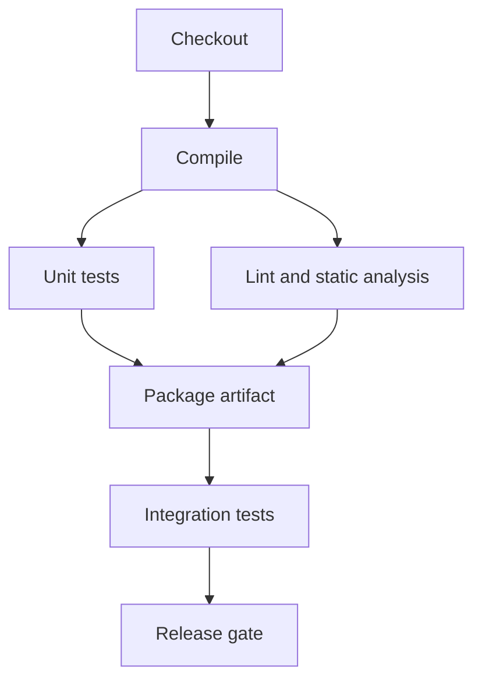
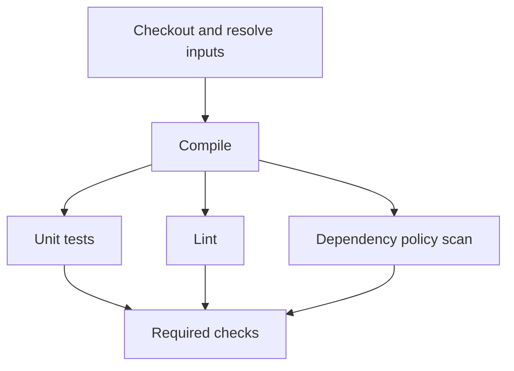
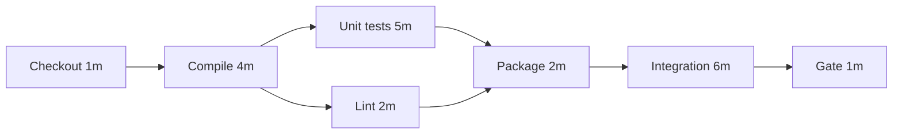

# Optimizing the Longest Dependency Path

A CI/CD pipeline can have dozens of jobs: checkout, toolchain installation, lint, compile, unit tests, security scans, image builds, integration tests, artifact packaging, and test deployments. Even though many jobs can run in parallel, the entire pipeline still has to wait for the tasks along its longest dependency chain to finish. Speeding up a job that does not affect this chain may barely change feedback time at all.

To improve time to results, identify the pipeline's **longest dependency path (critical path)** and optimize the jobs and dependency edges on that path. The goal is to deliver reliable signals about developer changes earlier while keeping the required quality gates intact before merge or release.

In CI/CD, optimizing the critical path is not just about running more jobs at the same time. You need to measure runner wait time, execution time, artifact transfer time, unnecessary sequential steps, and resource contention. After each change, re-measure the pipeline to confirm that feedback time actually drops.

## 1. Understanding a Pipeline as a Dependency Graph

A pipeline is typically modeled as a directed acyclic graph (DAG): each node is a job or task; each edge represents a task that must finish before another can begin.

For example:



In this diagram, lint and unit tests can run in parallel after compile. Package only starts when both finish. Therefore, when package can start depends on the slower of those two branches.

If the durations are:

| Job | Duration |
|---|---:|
| Checkout | 1 minute |
| Compile | 4 minutes |
| Unit tests | 5 minutes |
| Lint/static analysis | 2 minutes |
| Package | 2 minutes |
| Integration tests | 6 minutes |
| Release gate | 1 minute |

The path through unit tests takes 19 minutes. The path through lint takes 16 minutes. The theoretical minimum duration according to the DAG is 19 minutes, excluding queue time, runner contention, and artifact transfer overhead. Optimizing lint from 2 minutes down to 30 seconds does not change the longest path; optimizing unit tests from 5 down to 3 minutes can shorten the entire pipeline by about 2 minutes if no other bottleneck takes over.

## 2. Critical Path and Tasks That Can Wait

With a known DAG and job durations, you can calculate:

- **Earliest start (ES):** the earliest time a job can start once all dependencies complete.
- **Earliest finish (EF):** ES plus job duration.
- **Latest finish (LF):** the latest time a job can finish without delaying the overall completion milestone.
- **Latest start (LS):** LF minus job duration.
- **Slack/float:** the amount of time a job can be delayed without delaying the whole pipeline, typically calculated as LS minus ES.

Jobs with zero slack lie on at least one critical path. If a pipeline has multiple paths tied for longest, optimizing one path can make another path become the new critical path.

Do not treat the critical path as a static property. Job durations vary with cache hits, change size, runner type, system load, test shard count, and queue time. Compute it across multiple representative runs using p50/p90 or appropriate percentiles rather than relying on a single lucky run.

### Dependency Path vs. Queue-Induced Slow Path

A job may run for only 2 minutes yet wait 8 minutes for a runner. In the DAG, the job is still a dependency for downstream steps, but most of the time is spent in the queue rather than runtime. Separate:

- **Queue time:** from when the job is ready until a runner begins executing it.
- **Execution time:** the time the job actually spends running.
- **Transfer/setup time:** checkout, dependency downloads, container initialization, or artifact downloads.
- **Wait time:** waiting for services, locks, shared environments, or manual approvals.

Without breaking these out, a team might spend effort optimizing test code when the real cause is a lack of runners or concurrency limits on a runner group.

## 3. Measure Before Optimizing

Do not start by adding runners or deleting tests. Collect enough data to know where the pipeline spends its time.

Track:

| Metric | Meaning |
|---|---|
| Time to first signal | Time from commit/PR event to the first useful check result |
| Time to required checks | Time until all required checks finish |
| End-to-end pipeline duration | Total time from trigger to final status |
| Queue time by runner group | Reflects capacity shortages or uneven runner allocation |
| Runtime by job | Identifies heavy and variable jobs |
| Cache hit/miss and download volume | Shows dependency/build setup overhead |
| Artifact transfer duration | Detects oversized artifacts or repeated transfers |
| Flaky/retry rate | Time wasted by unstable tests |
| Concurrency and resource utilization | Detects CPU, memory, disk, or database contention |

Measure both p50 and p90. p50 shows the everyday experience; p90 reflects the slow runs developers remember most. You can add p95 for release pipelines or systems with strict SLAs.

Attach metadata such as commit SHA, branch type, runner label, cache state, test count, artifact size, and pipeline type. Compare comparable runs; a pull request modifying one file should not be compared directly against a full monorepo build.

## 4. Optimizing in Order of Critical Path Impact

A practical way to choose what to work on:

1. Find jobs with low slack or on the critical path.
2. Separate queue, setup, execution, and transfer times for each job.
3. Identify what can run in parallel without violating dependencies.
4. Reduce the work required on sequential paths.
5. Optimize the longest job using incremental work, proper caching, sharding, or fixing slow tests.
6. Re-measure; the new critical path may shift to another branch.

Prioritize changes that repeatedly reduce feedback time across many pull requests. A 10-minute job that only runs in a nightly pipeline may matter less than a 4-minute job running on every pull request.

## 5. Parallelizing Independent Tasks

If two jobs do not need each other's outputs, let them run concurrently. For example, lint, unit tests, and config checks can start after checkout or after compile depending on the tooling.



Fan-out creates multiple independent branches; fan-in waits for required branches before proceeding. This can reduce total wait time, but only when runner capacity is sufficient and jobs do not contend for the same constrained resource.

Do not create artificial dependencies such as making lint wait for unit tests if neither needs the other's output. Conversely, never remove real dependencies: tests needing a newly built binary must wait for compile; deployment must wait for a verified artifact.

### GitHub Actions Example with Independent Jobs

```yaml
name: pull-request-checks

on:
  pull_request:

permissions:
  contents: read

jobs:
  compile:
    runs-on: ubuntu-24.04
    steps:
      - uses: actions/checkout@<FULL_COMMIT_SHA>
      - uses: actions/setup-java@<FULL_COMMIT_SHA>
        with:
          distribution: temurin
          java-version: "21"
      - run: ./gradlew --no-daemon compileJava

  lint:
    runs-on: ubuntu-24.04
    steps:
      - uses: actions/checkout@<FULL_COMMIT_SHA>
      - run: ./gradlew --no-daemon checkstyleMain

  unit-tests:
    runs-on: ubuntu-24.04
    steps:
      - uses: actions/checkout@<FULL_COMMIT_SHA>
      - run: ./gradlew --no-daemon test
```

This is a structural example, not an optimal workflow for every project. The SHAs are placeholders that must be replaced with verified full commit SHAs. If compile, lint, and test all perform identical compile/setup work on their own, the workflow may duplicate effort. Use your build tool's task graph or split jobs so outputs can be reused without increasing total cost.

## 6. Removing Unnecessary Sequential Steps

Pipelines often grow long because of historical sequential steps:

- Installing the same toolchain in multiple jobs instead of using a standardized runner image.
- Downloading dependencies repeatedly for each task.
- Rebuilding the same artifact in every stage.
- Running lint after all integration tests even though lint does not depend on those results.
- Uploading and downloading intermediate artifacts multiple times.
- Running long scans at the end of the pipeline when part of the scan could run earlier.
- Waiting for manual approval before generating reports or running checks without side effects.

Review each dependency edge: which output from the previous step does the next step actually need? If it only needs the source revision, it does not need to wait for artifact packaging. If it only needs a test report, collect it right when tests finish. If it needs a built image, pass the exact digest instead of rebuilding.

Do not delete dependencies just to make the DAG look parallel. Any step with side effects, credential requirements, or reliance on verified data must preserve the proper control order.

## 7. Optimizing Compile and Build with Incremental Work

Compile/build often sits on many dependency paths because tests, packaging, and scans all rely on its output. Optimization approaches:

- Use incremental compilation and build caching when supported by the build tool.
- Avoid wiping all outputs/caches without a clear reason.
- Build only affected modules when the dependency graph allows.
- Separate lightweight configuration tasks from heavy compilation tasks.
- Use dependency locking and dependency caching to cut down downloads.
- Avoid running unnecessary annotation processors or plugins on every module.
- Measure configuration phase duration separately from execution phase duration.

In a monorepo, determine affected modules based on the dependency graph and changed files. If a foundational library changes, directly or indirectly dependent modules may need rebuilding. Do not rely on a naive file list if it misses transitive dependencies or generated sources.

Incremental builds require correctness checks. Wrong cache keys or stale build outputs can produce false-green tests. Caches must depend on all inputs affecting the result, such as sources, lockfiles, toolchains, build configurations, and platforms where applicable.

## 8. Caching Properly and Avoiding Cache Poisoning

Caching reduces dependency download times and reuses outputs, but a cache does not replace artifacts with provenance and should not serve as the source of truth for releases.

What to cache:

- Dependency packages keyed by lockfile and toolchain.
- Compiler/build caches keyed by inputs.
- Reproducible data that contains no secrets.

What to avoid:

- Caching directories containing credentials, tokens, or sensitive configuration files.
- Using caches populated by untrusted code for trusted release builds.
- Using overly broad keys where compiler or dependency changes still restore old caches.
- Sharing writable caches across different trust boundaries.

Cache keys can include OS/architecture, toolchain version, lockfile hash, build configuration, and trust-level namespace. Fallback keys can restore closely matching data when appropriate, provided you understand restore precedence and the risk of caches from untrusted branches.

Measure cache hit rates and actual time saved. Caching can actually slow a pipeline down if archives are huge, restores are I/O-heavy, or cache misses happen frequently. Compare end-to-end times before and after adding a cache.

## 9. Splitting and Distributing Test Suites

A long test suite can be divided into shards to run in parallel. For example, 600 independent tests can be split into 4 groups, each running on its own runner.

For effective sharding:

- Split by historical duration or estimated cost, not solely by test count.
- Balance shards so the slowest group does not drag out the entire fan-in.
- Avoid tests sharing data, ports, accounts, or resources that could collide.
- Have each shard create and clean up its own isolated data.
- Merge reports after all shards complete.
- Keep tests with ordering or state dependencies in the same group if they cannot yet be made independent.

If shard 1 takes 2 minutes while shard 4 takes 9 minutes, total duration is still dictated by shard 4. Balancing workload matters more than blindly increasing shard count.

Do not run too many shards when runners are CPU/memory constrained or tests share a database. Running 16 shards on 4 cores can increase context switching, disk I/O, and database contention, making total duration worse.

## 10. Shifting Fast Checks Left While Keeping Quality Gates

Developers need early signals to fix mistakes while context is still fresh. Checks can be ordered by cost and detection capability:

1. Pipeline/configuration validation and formatting.
2. Lint, static checks, and basic secret scanning.
3. Compilation or type-checking.
4. Unit tests.
5. Component/integration tests.
6. Appropriate security, license, and policy scans.
7. Artifact build, artifact verification, and provenance checks.
8. E2E, staging validation, and release gates.

The exact order depends on dependencies and risk. A very fast security scan can run alongside compilation; a scan that only analyzes a container image must wait for the image. Do not defer a required gate to post-merge just to turn PRs green faster.

### Separating the Fast Feedback Lane and Full Validation Lane

Some projects organize checks into two tiers:

- **Fast PR lane:** cheap, reliable, short-duration checks so developers catch errors early.
- **Full validation lane:** full integration, E2E, security, and compatibility checks run before release or according to branch policy.

The fast lane must not create the impression that a change is ready for release if full validation has not finished. Required checks for merging must reflect actual policy: if a check is mandatory before merge, it must remain a required check or be replaced by an approved equivalent gate.

You can run the full lane in parallel when a PR opens or on new commits, but cancel obsolete runs when new commits arrive if old results no longer represent the current revision. Only make decisions using results tied to the exact commit SHA.

## 11. Running Relevant Tests via the Dependency Graph

In a monorepo or multi-module project, running all tests for every change can be expensive. You can determine impact scope:

- Which module do the modified source files belong to?
- Which internal libraries does that module depend on?
- Does an API or schema change affect any consumers?
- Does a build logic/toolchain change require checking the entire repo?
- Which tests need to run for the affected module and its consumers?

Selective testing requires clear rules and a safe fallback. If impact scope cannot be determined, run the full required test suite. Changes to build scripts, dependency catalogs, compiler plugins, shared APIs, or base images usually have broader impact than internal edits within a single module.

Keep periodic full-repo checks or run them on protected branches to catch dependencies missed by impact analysis. Do not treat test selection as sole proof of correctness.

## 12. Reducing Setup and Artifact Transfer Time

Short jobs can spend more time on setup than on actual execution. Measure:

- Runner provisioning and container startup.
- Repository checkout and submodules/LFS.
- Dependency downloads.
- Toolchain and plugin installation.
- Artifact uploads/downloads.
- Service container or test database initialization.

Applicable measures:

- Use runner images pre-built with stable toolchains.
- Use an internal dependency proxy/mirror where appropriate.
- Avoid checking out full Git history when a job only needs the current revision.
- Upload only necessary files instead of packaging the entire workspace.
- Reference artifacts by digest or run ID to avoid fetching the wrong output.
- Reuse built artifacts across stages instead of rebuilding them.
- Place runners close to artifact registries or dependency mirrors to cut network latency.

Do not trade away reproducibility or provenance to save a few seconds. Runner images should be versioned and updated in a controlled manner; reused artifacts must be tied to the exact source commit and build record.

## 13. Managing Flaky Tests and Retry Time

Flaky tests slow down feedback and erode trust in the pipeline. A test that fails and then passes on retry does not prove a change is valid; it may mask a race condition or environment issue.

You should:

- Track flakiness rates by test, module, and runner.
- Capture logs/traces on the first failure.
- Quarantine unstable tests with a clear owner and remediation deadline.
- Avoid unlimited retries or retrying the entire suite after a single test fails.
- Run bounded retries on failed tests for triage, while preserving flaky/failure status in reports.
- Eliminate time dependencies, unseeded randomness, test-order coupling, and shared mutable resources.

Quarantine must not turn into a way to permanently bypass quality gates. If a test protects critical functionality, put compensating controls and a fix deadline in place.

## 14. Balancing Parallelism with Resources

Parallel execution helps when sufficient resources exist. If every job saturates CPU, memory, disk, or database together, each job's duration can spike sharply.

Limits to watch:

- CPU saturation and context switching.
- Memory pressure, swapping, and container throttling.
- Disk I/O, filesystem contention, and cache restoration.
- Database connection pools, locks, and query contention.
- Rate limits on registries, scanner APIs, or external services.
- Runner concurrency quotas and provisioning times.

Set concurrency limits by job type. CPU-bound unit tests may need fewer shards than lightweight lint jobs; integration tests may be constrained by the database; scans may be constrained by licenses or API quotas. Use dedicated queues or concurrency groups for shared resources when needed.

Do not raise concurrency just to increase the number of running jobs. The goal is to reduce critical path completion time and time to signal, not to maximize process count.

## 15. Identifying How to Optimize a Given Job

A simple matrix helps choose the right measure:

| Symptom | Possible Cause | Optimization Direction |
|---|---|---|
| High queue time, low runtime | Insufficient runners or congested runner group | Scale/coordinate capacity, segment runners |
| Compile sits on many paths | Sequential builds or poor incremental behavior | Build cache, module impact analysis, trim task graph |
| One test shard runs very long | Unbalanced shards or slow tests | Rebalance by duration, fix bottleneck tests |
| Multiple jobs download the same dependencies | Repeated setup | Dependency cache/proxy, pre-baked runner image |
| Long artifact transfers | Oversized artifacts or repeated uploads/downloads | Shrink payload, transfer once, store near runners |
| Frequent retries | Flaky tests or unstable dependencies | Fix root cause, bounded timeouts/backoff |
| Parallel jobs slow each other down | Resource contention | Limit concurrency, isolate pools, optimize resources |
| Non-critical-path job is very long | Work not blocking primary signal | Run in background/parallel if policy permits |

## 16. Example of Measuring and Calculating the Longest Path

Suppose a pipeline has the following DAG:



Two main paths:

- Checkout → Compile → Unit tests → Package → Integration → Gate = 19 minutes.
- Checkout → Compile → Lint → Package → Integration → Gate = 16 minutes.

If lint is optimized from 2 down to 1 minute, total DAG time stays 19 minutes. If unit tests are optimized from 5 down to 3 minutes, the longest path drops to 17 minutes; the lint path moves closer to critical, though still 1 minute shorter. If unit tests are further reduced to 2 minutes, both branches tie and the critical path can shift to the lint branch.

This example excludes queuing and contention. In real data, measure durations per job and per run. When multiple jobs share runners, total time can exceed DAG predictions due to resource-constrained scheduling.

## 17. Continuous Improvement Process

You can apply the following loop:

1. Choose the pipeline type to improve: PR, main branch, release, or nightly.
2. Measure a baseline over a representative time window.
3. Construct the DAG and identify the critical path at p50/p90.
4. Separate queue/setup/runtime/transfer and mark true dependencies.
5. Pick one high-impact bottleneck and make a small, focused change.
6. Re-run on comparable commits, comparing both speed and quality.
7. Verify cache correctness, test coverage, and required gates.
8. Record results, owners, and tracking metrics to catch regressions.

Do not optimize too many factors at once without a baseline. When duration drops, you need to know which change caused the effect and whether any gate was accidentally weakened.

## 18. Common Mistakes

| Mistake | Consequence | Fix |
|---|---|---|
| Optimizing the longest job that is not on the critical path | Total duration barely changes | Optimize low-slack jobs on the longest path |
| Adding unbounded parallelism | CPU, memory, database contention | Set concurrency based on resources |
| Re-running the entire build in every stage | Wasted compile and dependency downloads | Build once, reuse verified artifacts |
| Overly broad cache keys | Stale outputs or wrong toolchain used | Key on full inputs and trust boundaries |
| Using selective testing without fallback | Missing impacted consumers | Impact analysis with full-suite fallback |
| Moving required checks to post-merge | Faster feedback at the cost of merge protection | Keep policy gates or replace with equivalent gates |
| Retrying flaky tests until green | Masks bugs and lengthens pipelines | Limit retries, quarantine with owner, fix root cause |
| Measuring only average duration | Misses slow p90 tail experiences | Track percentiles and queue time |
| Drawing conclusions from a single run | Results skewed by cache and load noise | Compare across multiple comparable runs |

## 19. Checklist for Optimizing the Longest Dependency Path

- [ ] Have a DAG showing true dependencies between jobs.
- [ ] Measure queue time, setup, execution, transfer, and wait time separately.
- [ ] Track time to first signal, required checks, and end-to-end duration.
- [ ] Identify critical path and slack using data across multiple runs.
- [ ] Prioritize critical-path jobs with long durations or high variance.
- [ ] Parallelize independent jobs while keeping necessary dependencies intact.
- [ ] Reduce repeated compiles/builds using incremental work and well-keyed caches.
- [ ] Balance test shards by duration and avoid shared-state contention.
- [ ] Select relevant tests via dependency graph with a full-suite fallback.
- [ ] Shift cheap, reliable checks earlier while preserving required quality gates.
- [ ] Separate fast PR feedback from full release validation transparently.
- [ ] Control flaky tests, retries, runner capacity, and resource contention.
- [ ] Reuse verified artifacts instead of rebuilding them in every stage.
- [ ] Re-measure p50/p90 after changes and confirm no drop in coverage or quality.

Optimizing the longest dependency path helps teams focus on the work that actually governs pipeline feedback time. When the DAG reflects true dependencies, queue and runtime are measured separately, independent jobs run in parallel, builds and tests are structured cleanly, and quality gates remain intact, developers receive signals sooner while the release process retains the evidence it needs.
