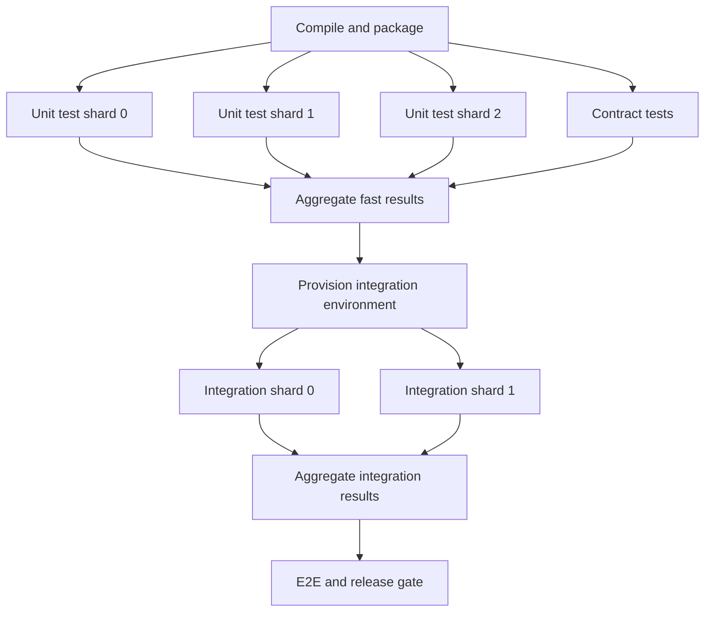

# Running Independent Tests in Parallel and Sharding Test Suites

When a project has hundreds or thousands of tests, running the entire suite sequentially can make every change wait far too long for feedback. Teams often try adding more runners or splitting tests into multiple jobs, but if tests share data, write to the same resources, or depend on execution order, increasing parallelism can introduce intermittent failures and unreliable results.

Optimizing test duration requires solving two problems together: **identifying truly independent tests to run concurrently, and dividing the work so workers have roughly balanced durations**. Simply adding more workers does not guarantee a faster pipeline if a few heavy tests land in the same shard, the database becomes a bottleneck, or tests block one another due to shared state.

The goal is to reduce the time from creating a change to receiving reliable results while preserving the ability to reproduce failures and trace which tests ran against which revision.

## 1. Why Run Tests in Parallel?

In CI/CD, tests are a core part of the feedback loop. As test duration grows, developers wait longer to learn whether a change is safe. That lengthens review cycles, expands pull request queues, and tempts teams to skip or narrow test coverage.

For example, a suite of 600 tests takes 30 minutes sequentially. Split into 6 well-balanced shards, ideal execution time can drop nearly fivefold. In reality, however, there is still runner initialization, dependency downloading, data seeding, database connection setup, report collection, and waiting for the slowest shard.

Running in parallel helps:

- Reduce pull request feedback time.
- Increase the number of changes validated in the same time window.
- Surface failures earlier when tests are organized by priority.
- Better utilize CPU, memory, and runner capacity.
- Separate test groups with different dependencies so they run against appropriate resources.

However, parallelism does not reduce the total amount of work. It only executes multiple pieces of work concurrently. If tests contend for a single database, a single API sandbox, or a shared file, total duration can increase while stability drops.

## 2. Distinguishing Parallelism, Concurrency, and Test Sharding

These three concepts are related but distinct:

| Concept | Meaning | Example |
|---|---|---|
| Concurrency | Multiple tasks have overlapping execution windows; they may interleave or wait on resources | Multiple tests waiting on database connections |
| Parallelism | Multiple tasks genuinely execute simultaneously across multiple CPU cores or workers | Four test processes running on four runners |
| Test sharding | Splitting a suite into smaller groups to run across multiple workers | 1,000 tests divided into 8 shards |

A system can have high concurrency yet low parallelism if many tasks are blocked on I/O or constrained to a single CPU. Sharding is how work is partitioned; actual parallelism depends on runners and available resources.

### Levels of Parallelism

- **Within a single test process:** the framework runs multiple tests or test methods across multiple threads.
- **Multiple processes on one machine:** each process has its own JVM or runtime.
- **Multiple jobs in a pipeline:** CI spawns multiple workers or matrix jobs.
- **Multiple machines/runners:** shards are distributed across independent hosts.
- **Multiple suites:** unit, contract, integration, and E2E suites run concurrently when there are no sequential dependencies.

Do not enable every level at once without measuring resources. For example, 8 runners, each running 8 JVMs, with each JVM spawning 8 threads, create 512 execution threads—far beyond typical CPU, memory, or database limits.

## 3. Classifying Tests Before Parallelizing

Not all tests have the same cost or dependencies. Before choosing a sharding strategy, classify the suite.

| Test Type | Purpose | Parallel Execution Characteristics |
|---|---|---|
| Unit test | Validates small, fast logic | Usually easy to parallelize if no global state is used |
| Component test | Validates a component with mocked/stubbed dependencies | Can run in parallel when each test has its own fixture and port |
| Contract test | Verifies contracts between producer/consumer | Requires separating data and mock/provider state per test |
| Integration test | Validates multiple real components working together | Requires isolated databases, queues, filesystems, or namespaces |
| End-to-end test | Validates user flows across the full system | Resource-heavy, prone to account and data contention |
| Performance/load test | Measures behavior under load | Usually requires a dedicated environment and schedule to avoid noise |

Unit tests are generally good candidates for broad parallelism. E2E tests can run in parallel, but require careful design of test data, accounts, and environments. Performance tests should usually not run alongside other suites on the same environment because those other tests can distort measurements.

## 4. Conditions for an Independent Test

An independent test can run before, after, or concurrently with other tests without its outcome changing beyond controlled factors.

A test is independent when it:

1. Creates or owns the data it needs.
2. Does not rely on a previously executed test to establish state.
3. Does not mutate data currently used by another test.
4. Does not depend on execution order or leftover static/global state.
5. Can be re-run with the same inputs and produce an equivalent result.
6. Cleans up resources afterward or uses scoped resources.
7. Has explicit timeouts and clear error handling.

For example, two tests updating the same `customer_id=100` record will contend if they share a database. You can make them independent by creating a unique customer per test run or per test case.

### Independent Does Not Mean Dependency-Free

An integration test may still require a real PostgreSQL, Redis, or message broker instance. What matters is that the test has its own environment or namespace, its own data, and clear cleanup rules. Independence means not relying on state left behind by another test—not having zero dependencies.

## 5. Finding and Removing Hidden Dependencies Between Tests

Failures often appear only during parallel execution because tests have undeclared dependencies.

Examples:

- Test A creates a default user; Test B assumes that user exists.
- Multiple tests write to the same filename `result.json`.
- Two tests bind to the same hardcoded port.
- A test modifies a process-wide system property or timezone.
- Tests share a singleton cache or mutable static field.
- Tests truncate an entire database table on startup.
- E2E tests share a single account and modify the same shopping cart.
- Tests depend on execution order to wait for a queue or cron job.

### How to Detect Them

- Run tests in randomized order with a recorded seed.
- Run failing tests individually and then again inside the suite.
- Run the suite at varying parallelism levels to expose race conditions.
- Log test ID, worker ID, data IDs, and resource IDs.
- Audit shared files, ports, database rows, and accounts.
- Use static analysis or lint rules to detect mutable global state where applicable.

If a test only passes when run after another test, that is a sign to fix the fixture or dependency—not a reason to preserve an implicit ordering.

## 6. Designing Isolated Test Data and Resources

Shared data and resources are the most common cause of unstable parallel tests.

### 6.1. Uniquely Identified Data

Each test or worker should use its own namespace, tenant, schema, or ID. For example:

```text
test-run-8821-shard-0-customer-001
test-run-8821-shard-1-customer-001
test-run-8821-shard-2-customer-001
```

Names can look similar at the test level, but must be disambiguated by a run/shard namespace. Avoid sharing a fixed production-like account or record across all workers.

### 6.2. Database Isolation

Common options:

- Separate database or schema per worker.
- Separate tenant per shard.
- Transaction rollback for suitable tests.
- Dedicated test containers per suite or worker.
- Run-scoped ID prefixes and cleanup.

Transaction rollback works well for tests running within a single transaction, but it does not isolate external side effects such as published messages, sent emails, sequence increments, or other services reading committed state. Evaluate the entire flow.

### 6.3. Filesystem and Network

- Use a dedicated temporary directory per test ID.
- Allocate dynamic ports instead of hardcoding a shared port.
- Use isolated container networks or namespaces when needed.
- Never write reports or snapshots to the same filename from multiple workers.
- Scope cleanup by run ID so one worker never deletes another worker's resources.

### 6.4. E2E Accounts and Sessions

E2E tests should provision dedicated users or tenants per shard. If the system has a limited account count, lease accounts exclusively from an account pool for the duration of the test. Never let two workers share a session or mutate the same cart state.

## 7. Choosing How to Shard Tests

Sharding splits a suite into groups to run across multiple workers. Sharding quality directly impacts total suite completion time.

A key principle: **total parallel suite duration is dictated by the slowest shard**, plus initialization and result-collection overhead.

If 4 shards take 3, 4, 5, and 18 minutes respectively, the whole suite still waits 18 minutes. Having 4 workers does not mean the suite runs 4 times faster.

### 7.1. Splitting by Test Count

For example, 400 tests split evenly across 4 shards, 100 tests per shard.

Pros:

- Easy to implement.
- Easy to understand and verify.
- Works well when test durations are fairly uniform.

Cons: a single 3-minute E2E test can make its shard far slower than a shard containing only millisecond-long unit tests.

### 7.2. Splitting by Historical Duration

CI records the duration of each test from prior runs. The scheduler assigns the longest tests to the shard with the lowest estimated total duration so far.

Pros:

- Balances runtime better than splitting by test count.
- Uses real-world suite telemetry.

Cons:

- Requires reasonably stable history.
- New tests without duration history must fall back to a default estimate.
- Durations can fluctuate with cache state, load, or dependencies.

### 7.3. Splitting by Stable Hash

You can hash the test ID to assign a test to a shard:

```text
shard_index = stable_hash(test_id) % shard_count
```

This keeps tests mostly on the same shard across runs, which helps caching and debugging. However, hashing does not guarantee balanced durations. If several heavy tests hash to the same shard, combine with duration-based assignment or adjust the manifest.

### 7.4. Splitting by Group or Dependency

Tests can be grouped by component, database, service, or resource type. This lets a worker initialize dependencies once per group, though it risks unbalanced shards if one component has many heavy tests.

### Strategy Comparison

| Strategy | Time Balance | Assignment Stability | Complexity |
|---|---|---|---|
| Test count | Low if durations vary | High if list is fixed | Low |
| Historical duration | Good with sufficient data | Can shift as durations change | Medium |
| Stable hash | Not guaranteed | High | Low |
| By group/dependency | Depends on suite structure | High if groups are stable | Medium |
| Duration bin packing | Good | May reassign shards when suite changes | Higher |

## 8. Balancing Shards by Duration

A simple approach is greedy bin packing:

1. Fetch historical durations for each test.
2. Sort tests in descending order of duration.
3. Assign the next test to the shard with the smallest cumulative duration.
4. Repeat until all tests are assigned.

For example, suppose tests take 10, 8, 7, 6, 5, 4, 3, and 2 minutes, split across 3 shards. After sorting descending and assigning each test to the shard with the lowest running total, we get:

| Shard | Tests | Estimated Total Duration |
|---|---|---:|
| 0 | 10 + 4 | 14 minutes |
| 1 | 8 + 5 + 3 | 16 minutes |
| 2 | 7 + 6 + 2 | 15 minutes |

The largest shard takes about 16 minutes, close to the 15-minute average. The algorithm does not always find the mathematical optimum, but it usually balances far better than splitting evenly by count.

### Pseudocode

```python
def assign_shards(test_durations, shard_count):
    shards = [[] for _ in range(shard_count)]
    totals = [0.0] * shard_count

    tests = sorted(
        test_durations.items(),
        key=lambda item: item[1],
        reverse=True,
    )

    for test_id, duration in tests:
        target = min(range(shard_count), key=lambda i: totals[i])
        shards[target].append(test_id)
        totals[target] += duration

    return shards, totals
```

This is an illustrative example of the allocation algorithm, not production-ready code. Real systems must handle new tests, deleted tests, outlier durations, co-located test groups, and stable assignments across runs.

## 9. Shard Count and Resource Limits

Increasing shard count generally reduces execution time until you hit CPU, memory, I/O, database, or runner capacity limits. Beyond that point, adding workers may not make things faster.

Factors to measure:

- CPU core count and CPU utilization.
- Memory usage and garbage collection.
- Disk I/O and dependency download time.
- Database connection counts and query latency.
- Queues, API sandboxes, and rate limits.
- Runner startup time and container image pulls.
- Report and artifact upload time.
- Runner queuing when multiple pull requests run simultaneously.

For example, if each test process uses 1 GB of RAM and a runner only has 4 GB available, running 8 processes can cause swapping or OOM kills. Four processes can be both faster and more stable than eight.

### Simple Estimation Formula

Approximate completion time can be modeled as:

\[
T_{total} \approx T_{setup} + \max(T_1, T_2, \ldots, T_n) + T_{collect}
\]

Where `T_i` is the duration of the i-th shard, `T_setup` is initialization, and `T_collect` is result aggregation. If shared resources become overloaded, each shard's duration can actually rise as worker count increases.

## 10. Choosing Parallelism Levels in Test Frameworks

You can parallelize within a framework, across processes, or across CI jobs. Each level has trade-offs.

### Within the Same Process

The advantage is lower runtime startup overhead. However, tests can share static state, singletons, system properties, or improperly cleaned thread-locals.

### Multiple Processes

Separate processes isolate memory and static state better, at the cost of higher RAM consumption, startup time, and needing to partition external data and resources.

### Multiple CI Jobs

Independent jobs can run on separate runners, making environment isolation straightforward. In exchange, each job may have to check out code, fetch dependencies, and spin up services separately.

Start from independent tests, measure bottlenecks, and pick the right level. Do not use high parallelism to mask tests with hidden dependencies or global state.

## 11. JUnit 5 Configuration Example

JUnit Jupiter supports parallel execution when properly configured. Example `junit-platform.properties` file:

```properties
junit.jupiter.execution.parallel.enabled = true
junit.jupiter.execution.parallel.mode.default = concurrent
junit.jupiter.execution.parallel.mode.classes.default = concurrent
junit.jupiter.execution.parallel.config.strategy = dynamic
junit.jupiter.execution.parallel.config.dynamic.factor = 0.5
```

`dynamic.factor` calculates concurrency from the number of processors visible to the runtime. Suitable values depend on test type and available resources. For integration tests hitting a database, you may need a lower limit or resource locks.

If a test must run sequentially relative to other tests because it touches a shared resource, use framework locking such as `@ResourceLock` in JUnit Jupiter:

```java
import org.junit.jupiter.api.Test;
import org.junit.jupiter.api.parallel.ResourceAccessMode;
import org.junit.jupiter.api.parallel.ResourceLock;

class SharedConfigurationTest {

    @Test
    @ResourceLock(
        value = "system-properties",
        mode = ResourceAccessMode.READ_WRITE
    )
    void changesSystemProperty() {
        // Arrange, execute and restore the property.
    }
}
```

A resource lock only coordinates tests within the same framework/process using that lock mechanism. It does not replace database locks or distributed coordination across multiple CI runners.

### Keeping Tests with Shared State Sequential When Needed

If tests modify timezone, locale, system properties, or static singletons, annotate them with resource locks or run them in a separate sequential group. A more durable fix, however, is injecting that state as a dependency that can be reset per test.

## 12. Sharding in a CI Pipeline

A pipeline can spin up a matrix job where each job receives a shard index and total shard count. Independent jobs run concurrently, and an aggregation step verifies that every shard completed.

Conceptual YAML example:

```yaml
test_pipeline:
  prepare:
    steps:
      - checkout_exact_commit
      - resolve_test_manifest
      - calculate_shard_assignments
      - publish_shard_manifest

  execute:
    matrix:
      shard: [0, 1, 2, 3]
    steps:
      - checkout_exact_commit
      - download_shard_manifest
      - create_isolated_test_namespace
      - run_assigned_tests
      - upload_junit_and_diagnostics
      - cleanup_test_namespace

  aggregate:
    needs: [execute]
    steps:
      - collect_all_shard_reports
      - verify_expected_test_coverage
      - detect_missing_or_duplicate_tests
      - publish_unified_test_result
```

This is a conceptual structure, not syntax for any specific CI provider. In real implementations, ensure every shard uses the exact same commit, dependency lockfile, test manifest, and equivalent test configuration.

### Avoiding Missing or Duplicate Shards

The aggregate step must check:

- All expected shards produced a report.
- Every test ID was assigned exactly once, unless intentional repetition is configured.
- No shard was skipped due to matrix filtering or bad conditions.
- Reports belong to the exact pipeline run and commit.
- Test failures are not masked by an aggregator job that only checks whether uploads succeeded.

If a shard is cancelled or a runner drops, the pipeline must mark the suite incomplete. Never treat "some reports uploaded" as proof that all tests ran.

## 13. Prioritizing Tests for Early Feedback

Not every test needs to block a pull request right away. You can organize multiple feedback tiers:

| Tier | Content | Goal |
|---|---|---|
| Fast checks | Lint, fast unit tests, config validation | Feedback within minutes |
| PR suite | Unit and component tests, relevant contract tests | Validate changes before merge |
| Integration suite | Database, queue, service integration | Verify real component interactions |
| E2E/regression | Critical user flows across the system | Catch integration and business-logic bugs |
| Nightly/full suite | Broad tests, rare scenarios, compatibility, and migrations | Catch issues outside PR scope |
| Performance/security specialized | Load, stress, fuzz, or deep security testing | Test risks requiring isolated environments |

Tiers can run in parallel if they have no dependencies. For instance, unit tests and contract tests can run concurrently right after the build. E2E can run once the preview environment is ready.

### Change-Based Test Selection

You can select relevant tests based on modified files, modules, or dependency graphs. However, selection must be conservative:

- If impact cannot be determined, run a broader scope.
- Changes to shared libraries must test affected consumers.
- Changes to build scripts, test frameworks, or dependencies may require the full suite.
- Run the full suite periodically to catch missing mappings.
- Never let test selection become an accidental way to bypass critical protective tests.

## 14. Managing Dependent Tests and Execution Order

Some tests have real dependencies—for example, migrations must run before integration tests using the new schema. Declare those dependencies explicitly in a DAG instead of relying on accidental ordering.

For example:



Only steps with real dependencies should wait for one another. Independent tests should launch together to shrink the critical path.

If many tests need the same service setup, provision it once per shard or use a shared environment with separate data namespaces. Balance setup cost against resource contention risk.

## 15. Keeping Test Results Deterministic and Reproducible

Parallel execution exposes non-deterministic tests. A test may pass once and fail another time due to races, timeouts, random seeds, or external data.

To improve reproducibility:

- Log the random seed and test execution order.
- Record test ID, shard ID, worker ID, and commit SHA.
- Pin dependencies and runtime versions.
- Control clocks, timezones, and locales when tests depend on time.
- Use fixed fixtures or seeded data factories.
- Do not rely on unstable external APIs in unit tests.
- Save logs and reports per test/shard.
- Support re-running an exact test ID with the exact same configuration.

### Randomized Test Order

Randomizing test order helps surface hidden dependencies, provided you save the seed to reproduce failures. If the framework does not expose an explicit seed, archive the test order list in a report artifact.

Do not lock into a single permanent order if your goal is catching order dependencies. You can run randomized order in nightly builds or a fraction of CI runs while keeping PR suites deterministic for easier comparison.

## 16. Handling Flaky Tests Without Masking Bugs

A flaky test produces different outcomes across runs on the same revision under equivalent conditions. Parallelism can expose race conditions, while unlimited retries hide real bugs.

A sound policy:

1. Preserve the initial run's outcome and full diagnostics.
2. If policy allows, perform one bounded retry to distinguish transient failures.
3. Keep the flaky/unstable status visible in reports; do not let a passing retry count as proof of test stability.
4. Assign an owner and issue to every flaky test.
5. Track flakiness rates and time-to-fix.
6. Quarantine or isolate tests only with a documented reason, deadline, and narrow scope.

Do not retry an entire shard because one test failed if you can retry that specific test ID. Even then, isolated retries require that the test can run independently on clean data.

## 17. Handling Timeouts, Cancellation, and Cleanup

A shard can hang due to a deadlock, an unresponsive service, or a test waiting on a condition that never happens.

Every test/job needs:

- Timeouts tailored to the test type.
- Timeout diagnostics: thread dumps, container logs, DB activity, or traces where available.
- Time-bounded cleanup that does not delete another worker's resources.
- Distinct statuses for timeout, cancelled, and infrastructure error.
- Namespace cleanup mechanisms if a runner terminates unexpectedly.

Cleanup should key off owner/run ID and TTL so one worker never wipes another run's data. If tests provision cloud resources, tag them with the pipeline run and schedule periodic garbage collection for orphaned resources.

## 18. Avoiding Bottlenecks on Shared Dependencies

As worker counts increase, shared dependencies can become the throughput ceiling.

Examples:

- A database allows 50 connections, yet 100 test processes open connection pools simultaneously.
- An API sandbox throttles at 20 requests/second.
- A message broker shares one queue and tests consume each other's messages.
- A container registry serves simultaneous pulls of a huge image across many runners.
- A staging environment has only one test tenant.

Ways to mitigate:

- Bound parallelism by dependency capacity, not just CPU.
- Configure appropriate connection pools and close connections after tests.
- Spin up per-shard service containers when feasible.
- Use mocks/fakes for tests that do not require a real dependency.
- Partition queues, topics, or namespaces by run ID.
- Cache immutable dependencies while avoiding caching mutable state.
- Measure dependency wait time and saturation.

Do not add workers just because CPU is idle if the database or API sandbox is already saturated.

## 19. Tracking the Effectiveness of Test Parallelization

Measuring total duration alone is not enough. You need to know whether bottlenecks sit in runner queuing, setup, test execution, shard imbalance, or aggregation.

| Metric | Meaning | How to Use |
|---|---|---|
| Feedback time | From pipeline start to required test results | Measure developer experience |
| Queue time | Time waiting for a runner | Spot insufficient runner capacity |
| Setup time | Checkout, dependency downloads, service startup | Optimize caching and images |
| Shard duration p50/p95 | Duration across shards | Detect slow or unbalanced shards |
| Shard imbalance ratio | Longest shard relative to average | Evaluate allocation quality |
| Worker utilization | CPU/memory and active worker time | Choose the right parallelism level |
| Test flake rate | Share of unstable tests | Detect races and state-coupled tests |
| Retry rate | Share of tests/jobs requiring retries | Separate environment errors from product bugs |
| Missing/duplicate test count | Tests skipped or unintentionally run twice | Verify sharding correctness |
| Cost per pipeline | Resources consumed per run | Balance speed against cost |

### Shard Imbalance Ratio

A simple metric:

\[
\text{Imbalance ratio} = \frac{\text{Longest shard duration}}{\text{Average shard duration}}
\]

Values closer to 1 indicate better shard balance. Read this metric alongside setup time and shared bottlenecks; balanced shards do not guarantee the entire suite is optimized.

## 20. Example Test Pipeline Design for orders-api

Suppose `orders-api` has fast unit tests, integration tests using PostgreSQL and Redis, contract tests with `inventory-api`, and an E2E suite verifying order creation.

**Step 1 — Classify:** unit tests run in-process or across multiple processes; contract tests run independently; integration tests require dependency containers; E2E tests use dedicated accounts and tenants.

**Step 2 — Prepare manifest:** every test has a stable ID and historical duration. The scheduler splits unit and integration suites by duration into 4 roughly balanced shards.

**Step 3 — Run in parallel:** unit shards and contract tests run concurrently. Each integration shard gets its own schema or namespace, a capped database connection pool, and a run-ID-prefixed queue. E2E runs once the preview environment is ready.

**Step 4 — Collect:** every shard uploads JUnit XML, logs, and timing reports. The aggregate job verifies that all shards reported, no test IDs are missing, and no duplicate reports exist.

**Step 5 — Handle failures:** if a test times out, the pipeline captures thread dumps and dependency logs. Policy permits retrying that exact test ID once, while keeping the initial failure recorded for flakiness tracking.

**Step 6 — Improve:** the dashboard shows integration shard 3 takes longer due to migration tests. The team moves migration rehearsals to a dedicated suite with database locking, rebalances the remaining shards, and caps parallelism based on connection capacity.

The desired outcome is not just fewer minutes, but also full test coverage, reproducible results, and zero cross-worker interference.

## 21. Common Anti-Patterns

| Anti-Pattern | Consequence | How to Improve |
|---|---|---|
| Adding workers without measuring bottlenecks | Database or runners overload; total duration rises | Measure CPU, memory, I/O, queues, and dependency saturation |
| Splitting evenly by test count | One shard holding heavy tests slows the whole suite | Use historical duration or bin packing |
| Tests sharing mutable data | Race conditions and non-deterministic failures | Isolate namespaces/fixtures per test or shard |
| Order-dependent tests | Pass alone, fail in parallel | Remove shared state and run seeded random order |
| Every worker provisioning heavy dependencies | Setup time and cost spike | Choose isolation level suited to suite/shard |
| Using one E2E account for all workers | Sessions and data overwrite each other | Use an account pool or dedicated tenants |
| Retrying until green | Masks flaky tests and real product bugs | Limit retries, preserve initial failure, assign owner |
| Aggregate only checks report upload status | Missing tests or shards can still show green | Validate manifest, shard coverage, and test IDs |
| Running performance tests inside functional suites | Benchmarks suffer heavy noise | Use dedicated environment and schedule |
| Cleanup deleting shared resources | Other workers fail or lose data | Tag by run ID, namespace, and TTL |
| Dropping the full suite after adding test selection | Missing impact mappings go undetected | Run the full suite periodically and on high-risk changes |

## 22. Checklist for Parallelizing Independent Tests

Before increasing parallelism, review:

- [ ] Tests are classified into unit, component, contract, integration, E2E, and performance.
- [ ] Every test creates or owns the data it needs.
- [ ] There are no implicit dependencies on test execution order.
- [ ] Static/global state and system properties are isolated or properly locked.
- [ ] Databases, queues, filesystems, ports, and accounts are namespaced per test/run/shard.
- [ ] Tests have explicit timeouts, cleanup, and diagnostics.
- [ ] Test IDs are stable and shard manifests are reproducible.
- [ ] Sharding strategy accounts for duration, dependencies, and resources.
- [ ] Worker count fits CPU, memory, database connections, and rate limits.
- [ ] All shards use the exact same commit, dependencies, and configuration.
- [ ] Aggregation verifies all shards reported with no missing or unintended duplicate tests.
- [ ] Reports retain test ID, shard ID, seed, timing, and artifact/revision metadata.
- [ ] Retries are bounded and never hide an initial failure.
- [ ] Test selection has a safe fallback and periodic full-suite runs.
- [ ] Performance/load tests are separated from noisy functional suites.
- [ ] Feedback time, shard imbalance, flake rate, and cost are monitored.

## 23. Conclusion

Running independent tests in parallel and sharding test suites shortens CI/CD feedback loops when tests are designed without state contention and shards are balanced by actual duration. Teams should start by eliminating hidden dependencies, isolating data and resources, and then selecting parallelism levels suited to runners and dependencies.

A reliable parallel pipeline requires stable test IDs, reproducible sharding, complete reporting, coverage-verifying aggregation, bounded retries, and telemetry to spot slow or flaky shards. When these pieces are managed together, adding workers genuinely speeds up feedback without weakening quality gates.
