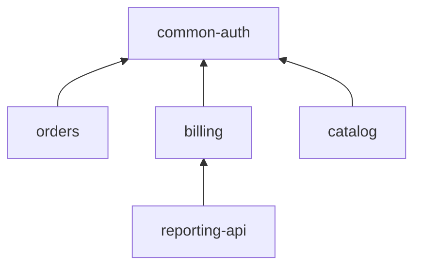

# Reducing Unnecessary Work with Change Impact Analysis

In a large repository, not every change requires re-running the entire build and test suite. A documentation-only edit may not need integration tests for every service; a change in a shared library, on the other hand, can affect many modules even if only one file was edited. If a pipeline always runs everything, feedback slows down and runners are wasted. If test selection is too narrow, bugs in dependent components can slip through.

**Change impact analysis** identifies which parts of the system could be affected by a set of changes and then selects the appropriate builds, tests, and checks. The goal is to eliminate unnecessary work while maintaining sufficient confidence. Selection should be based on dependency relationships, file types, risk, and evidence—not merely on the count of modified files.

In CI/CD, this approach typically combines three layers: detecting changed files, expanding scope through a dependency graph, and applying policies to select checks. Whenever information is incomplete or a change has broad impact, the pipeline must fall back to the full suite of checks.

## 1. Why Is Change Impact Analysis Needed?

A monorepo pipeline can contain dozens of services, libraries, images, manifests, and test suites. Running everything on every pull request has several consequences:

- Wait times for results increase even though most jobs are unrelated.
- Runners and test environment resources are consumed by unnecessary work.
- Long queues slow down feedback across the entire team.
- Many irrelevant results make it harder for developers to locate actionable signals.
- Costs for benchmarks, integration environments, and end-to-end tests rise.

Conversely, running tests only for the edited directory is unsafe. A change in the `common-auth` library can affect every service using it; editing a build convention file can affect the whole repository; changing an API schema can affect producers, consumers, and contract tests.

Change impact analysis helps answer:

1. Which files, modules, or components changed directly?
2. Which components depend on what changed?
3. Which tests/builds verify those impact paths?
4. Are there global or unclassified changes requiring broader checks?
5. What evidence shows the selected test set provides adequate safety?

## 2. Distinguishing Changed Files from Affected Components

**Changed files** are the list of paths that differ between two revisions. **Affected components** are the set of modules, services, or resources that could be impacted by those files. These two sets are not the same.

Example:

```text
Repository
├── services/
│   ├── orders/
│   ├── billing/
│   └── catalog/
├── libs/
│   ├── common-auth/
│   └── common-observability/
├── contracts/
├── infra/
└── build-logic/
```

If `libs/common-auth/src/TokenVerifier.java` is edited, the changed file lives in `common-auth`, yet the affected scope may include `orders`, `billing`, and `catalog` if all three depend on that library. If `build-logic` is edited, the scope may be every module using the convention plugin.

| Concept | Question | Example |
|---|---|---|
| Changed file | Which file differs from the base revision? | `libs/common-auth/src/TokenVerifier.java` |
| Direct owner | Which module owns that file? | `common-auth` |
| Direct dependent | Which components directly depend on the changed module? | `orders`, `billing` |
| Transitive dependent | Which components depend on it indirectly? | `reporting-api` depends on `billing` |
| Selected checks | Which builds/tests need to run? | `common-auth` unit tests, auth integration tests for dependent services |

Looking only at the folder containing changed files misses dependents. You must expand scope by traversing dependency relationships in reverse.

## 3. Using a Dependency Graph to Compute Impact Scope

A dependency graph models relationships among modules, services, packages, APIs, or resources. Suppose an arrow `A → B` means A depends on B. When B changes, consider B and every node with a path to B in the dependency graph.



If `common-auth` changes, the impact scope includes `common-auth`, `orders`, `billing`, `catalog`, and potentially `reporting-api` via `billing`. If only `orders` changes, running `catalog` tests is not necessarily required.

### Direct Dependencies and Reverse Dependencies

- **Direct dependency:** module A declares a dependency on module B.
- **Reverse dependency:** the list of modules that depend on B.
- **Transitive dependency:** multi-hop relationships, such as C depending on A and A depending on B.
- **Impact closure:** the set of nodes to inspect after expanding from changed nodes through reverse dependencies until no new nodes remain.

When modifying a library, computing the reverse dependency closure is usually a safe way to find consumers requiring verification. When modifying an independent service, only its own modules and relevant contracts may need to run.

### Not All Dependencies Are Statically Declared

A dependency graph may fail to capture:

- Reflection, dynamic class loading, or plugin discovery.
- Dependencies selected via environment variables or feature flags.
- Services calling each other via URLs/configuration rather than build-file declarations.
- Schemas/events shared via registries or message brokers.
- Terraform modules, Helm charts, and policies referenced indirectly.
- Generated code or code synthesized from schemas.

For dynamic relationships, supplement the graph with owner-maintained mappings, contract registries, service catalogs, or conservative policies. When impact cannot be determined reliably, choose the broader scope.

## 4. Detecting Changed Files Correctly

Before analyzing impact, the pipeline must compare the right two revisions. Picking the wrong base commit can omit changed files or include unrelated ones.

Key principles:

- For pull requests, compare the head revision against the merge base of the target branch and source branch.
- Use immutable commit SHAs instead of mutable branch names.
- Fetch sufficient history or explicitly fetch the base commit so Git can compute the merge base.
- Include added, modified, deleted, and renamed files; renames should be treated as removing the old path and adding the new path when mapping by directory.
- Distinguish generated files from the source of truth that generates them.
- For merge queues or push events, use the base/head appropriate to the event rather than reusing pull-request-specific logic.

Example Git command for a pull request:

```bash
git diff --no-renames --name-only "$BASE_SHA...$HEAD_SHA"
```

The triple dot tells Git to diff from the merge base to head. `--no-renames` reports moved files as one deleted path and one added path so both old and new directory mappings are covered. `BASE_SHA` and `HEAD_SHA` must be valid commit SHAs present in the local repository.

With shallow clones, the merge base may not exist in local history. The pipeline must fetch enough commits or fetch the base revision before running the diff. If the base commit cannot be retrieved, never guess the list of changed files.

### Handling Special Cases

| Case | Handling |
|---|---|
| New file | Include the file's owning module in the impact set |
| Deleted file | Still run tests for the owning module and potentially affected consumers |
| Renamed/moved file | Consider both the old module and the new module |
| Lockfile/dependency catalog changed | Run checks for modules using those dependencies; often requires broad expansion |
| Build script or shared plugin changed | Run wide builds/tests or the entire repository |
| CI workflow/policy changed | Run pipeline/config validation and verify affected gates |
| Documentation-only change | May run only lint/docs link checks if policy confirms no generated source exists |
| Unable to analyze diff | Fall back to the full check suite |

## 5. Mapping Paths to Modules and Check Types

A repository needs clear rules defining which module owns a file and what checks a change requires. Mappings can live in the build graph, project metadata, or a repository-managed config file.

Conceptual mapping example:

| Path | Component | Direct Checks |
|---|---|---|
| `services/orders/**` | `orders` | Unit, component, API integration |
| `services/billing/**` | `billing` | Unit, payment contract, billing integration |
| `libs/common-auth/**` | `common-auth` | Library unit tests and reverse dependents |
| `contracts/**` | API/event contracts | Schema validation and producer/consumer contract tests |
| `infra/**` | Infrastructure | IaC validation, policy scan, and environment plan |
| `build-logic/**` | Build system | Build logic tests and affected modules or full-repo build |
| `.github/workflows/**` | CI control plane | Workflow lint, policy checks, and affected pipeline checks |

Do not rely on naive `startsWith` rules if folders can hold multiple projects or overlapping module names. Mappings should respect directory boundaries with globs, be reviewed like source code, and include unit tests for critical patterns.

### One File Can Impact Multiple Check Categories

For instance, editing an OpenAPI schema may require:

- Schema lint/compatibility checks.
- Building client/server code generated from the schema.
- Producer contract tests.
- Consumer contract tests.
- Integration tests for critical business flows.

Therefore, mappings should not just be `path → module`; `path → component + impact categories + required checks` is far stronger.

## 6. Selecting Tests by Impact Scope

Once you have the impact set, select checks in tiers. You do not need to run every test of every dependent if a narrower verification exists, but risk boundaries must remain covered.

| Impact Scope | Typically Appropriate Checks |
|---|---|
| Single class/function inside a module | Module unit tests and relevant static analysis |
| Package or component | Unit + component tests, plus direct consumer tests if APIs changed |
| Shared library | Library tests + reverse dependent compile/test + contract tests |
| API/event schema | Schema compatibility + producer/consumer contracts + critical integration |
| Build logic/toolchain | Build logic tests + multi-module or full build |
| Database migration | Migration validation, compatibility tests with relevant app versions, and data checks |
| Infrastructure/network/IAM | IaC validate/plan, policy scan, and dependency connectivity checks |
| Pipeline/security policy | Workflow lint, policy tests, and checks on affected release paths |
| Unknown/global change | Full required suite per policy |

### Separating Required Checks from Expanded Checks

A helpful model:

- **Required fast checks:** run on every PR, including lint, fast unit tests, formatting checks, and baseline policy checks.
- **Affected component checks:** run for affected modules and reverse dependents.
- **Boundary checks:** run contract/integration tests across modified interfaces.
- **Risk-based checks:** run security, migration, performance smoke, or E2E checks when warranted by the change type.
- **Full regression:** run on a schedule, before release, or whenever policy deems impact scope uncertain.

Impact analysis must never skip a mandatory gate like secret scanning or license checks just because the edited file lives in a small module. Some checks are repository-wide and must always run.

## 7. Classifying Risk to Expand Scope

Not all changes touching the same number of files carry the same risk. A one-line edit in authentication policy can matter far more than hundreds of lines of documentation.

Factors to consider:

- Criticality of the module and number of consumers.
- Whether the change sits on a path handling sensitive data or critical transactions.
- Whether public APIs, event schemas, or database schemas changed.
- Whether dependency versions, build plugins, compilers, or runtimes changed.
- Whether pipelines, permissions, secret handling, or deployment policies changed.
- Whether the dependency graph is complete and verified.
- Whether selected tests provide sufficient coverage and reliability.

An example policy:

| Level | Indicators | Check Scope |
|---|---|---|
| Low | Docs-only or isolated change with a clear graph | Docs checks or module checks plus required fast checks |
| Medium | Change in a module with known consumers | Affected module + reverse dependents + boundary tests |
| High | Shared library, API/schema, dependency lock, migration | Expanded consumer set, integration, and compatibility tests |
| Very high | Build logic, CI policy, authentication, IAM, global config, or untrusted graph | Full required suite and specialized checks |

This classification is a reference. Define risk tiers according to your organization's architecture and policies. If you do not know how far a change reaches, never label it low-risk merely because the diff is small.

## 8. Example Change Impact Analysis Script

The Bash snippet below illustrates classifying changes by path in a monorepo. It uses `BASE_SHA` and `HEAD_SHA` supplied by the workflow; when encountering global files or unknown paths, it selects the full suite.

```bash
#!/usr/bin/env bash
set -Eeuo pipefail

: "${BASE_SHA:?BASE_SHA is required}"
: "${HEAD_SHA:?HEAD_SHA is required}"

changed_files="$(git diff --no-renames --name-only "$BASE_SHA...$HEAD_SHA")"

run_orders=false
run_billing=false
run_catalog=false
run_auth=false
run_infra=false
run_docs=false
run_full=false

if [[ -z "$changed_files" ]]; then
  echo "No changed paths detected; verify the comparison range."
  run_full=true
fi

if printf '%s\n' "$changed_files" | grep -qE '^services/orders/'; then run_orders=true; fi
if printf '%s\n' "$changed_files" | grep -qE '^services/billing/'; then run_billing=true; fi
if printf '%s\n' "$changed_files" | grep -qE '^services/catalog/'; then run_catalog=true; fi
if printf '%s\n' "$changed_files" | grep -qE '^libs/common-auth/'; then
  run_auth=true
  run_orders=true
  run_billing=true
  run_catalog=true
fi
if printf '%s\n' "$changed_files" | grep -qE '^infra/'; then run_infra=true; fi
if printf '%s\n' "$changed_files" | grep -qE '^docs/'; then run_docs=true; fi
if printf '%s\n' "$changed_files" | grep -qE '^(build-logic/|gradle/|settings\.gradle\.kts$|build\.gradle\.kts$|\.github/workflows/)'; then
  run_full=true
fi

if printf '%s\n' "$changed_files" | grep -qEv '^(services/(orders|billing|catalog)/|libs/common-auth/|infra/|docs/|build-logic/|gradle/|settings\.gradle\.kts$|build\.gradle\.kts$|\.github/workflows/)'; then
  run_full=true
fi

if [[ "$run_full" == true ]]; then
  run_orders=true
  run_billing=true
  run_catalog=true
  run_auth=true
  run_infra=true
fi

printf 'orders=%s\n' "$run_orders"
printf 'billing=%s\n' "$run_billing"
printf 'catalog=%s\n' "$run_catalog"
printf 'auth=%s\n' "$run_auth"
printf 'infra=%s\n' "$run_infra"
printf 'docs=%s\n' "$run_docs"
printf 'full=%s\n' "$run_full"
```

This is an illustrative mapping; in a real repository, back it with a dependency graph and test categories instead of assuming `common-auth` is used only by those three services. The example uses newline-delimited paths, which suits normal filename conventions; if the repository allows filenames containing newlines, use `git diff -z` with a NUL-delimited parser.

One critical rule: a scope selection script must never silently return "no tests." If the diff is empty due to a bad base/head, missing history, or parsing failure, the pipeline must fail or fall back to the full suite.

## 9. Example GitHub Actions Workflow

A workflow can start with an analysis job that detects changes, followed by test jobs gated on its outputs. The example below targets pull requests and assumes the repository provides `ci/select-scope.sh` from the previous section.

```yaml
name: Selective CI

on:
  pull_request:
    types: [opened, synchronize, reopened]

jobs:
  analyze:
    runs-on: ubuntu-latest
    outputs:
      orders: ${{ steps.scope.outputs.orders }}
      billing: ${{ steps.scope.outputs.billing }}
      catalog: ${{ steps.scope.outputs.catalog }}
      auth: ${{ steps.scope.outputs.auth }}
      infra: ${{ steps.scope.outputs.infra }}
      docs: ${{ steps.scope.outputs.docs }}
      full: ${{ steps.scope.outputs.full }}
    steps:
      - uses: actions/checkout@v4
        with:
          fetch-depth: 0
      - id: scope
        env:
          BASE_SHA: ${{ github.event.pull_request.base.sha }}
          HEAD_SHA: ${{ github.event.pull_request.head.sha }}
        run: |
          ./ci/select-scope.sh > scope.txt
          cat scope.txt >> "$GITHUB_OUTPUT"

  orders-tests:
    needs: analyze
    if: needs.analyze.outputs.orders == 'true' || needs.analyze.outputs.full == 'true'
    runs-on: ubuntu-latest
    steps:
      - uses: actions/checkout@v4
      - run: ./gradlew :services:orders:test --no-daemon

  billing-tests:
    needs: analyze
    if: needs.analyze.outputs.billing == 'true' || needs.analyze.outputs.full == 'true'
    runs-on: ubuntu-latest
    steps:
      - uses: actions/checkout@v4
      - run: ./gradlew :services:billing:test --no-daemon

  catalog-tests:
    needs: analyze
    if: needs.analyze.outputs.catalog == 'true' || needs.analyze.outputs.full == 'true'
    runs-on: ubuntu-latest
    steps:
      - uses: actions/checkout@v4
      - run: ./gradlew :services:catalog:test --no-daemon

  auth-library-tests:
    needs: analyze
    if: needs.analyze.outputs.auth == 'true' || needs.analyze.outputs.full == 'true'
    runs-on: ubuntu-latest
    steps:
      - uses: actions/checkout@v4
      - run: ./gradlew :libs:common-auth:test --no-daemon

  infrastructure-checks:
    needs: analyze
    if: needs.analyze.outputs.infra == 'true' || needs.analyze.outputs.full == 'true'
    runs-on: ubuntu-latest
    steps:
      - uses: actions/checkout@v4
      - run: ./ci/validate-infrastructure.sh

  documentation-checks:
    needs: analyze
    if: needs.analyze.outputs.docs == 'true'
    runs-on: ubuntu-latest
    steps:
      - uses: actions/checkout@v4
      - run: ./ci/validate-docs.sh
```

In this example:

- `fetch-depth: 0` ensures enough history to compare revisions; to optimize fetching, you can fetch only the exact base commit instead of full history.
- The `analyze` job generates outputs consumed by downstream jobs.
- Make `analyze` or an aggregate gate checking analysis results a required repository check; if selection fails, the pull request must not count as passing.
- Test jobs run only when their component is in the impact set or policy demands the full suite.
- Repository-wide required fast checks and security checks should be added as always-run jobs independent of module outputs.

This illustrative workflow does not yet handle merge queues, push events, special renames, or all dynamic dependencies. Add dedicated branches for each event type and test the scope script. If the analysis job fails, required gates must fail or hold; never treat empty output as "no components affected."

## 10. Leveraging the Build Graph Instead of Running Only by Directory

Build tools usually understand project and task relationships better than custom scripts. With Gradle multi-project builds, you can use the project dependency graph to find dependent modules; with the Maven reactor, you can select projects and dependents along the reactor structure; with Bazel, Buck, or Pants, graph queries directly return affected targets.

Gradle example:

```bash
# Run tests for a specific project
./gradlew :services:orders:test --no-daemon

# Preview the task graph before execution to understand dependencies
./gradlew :services:orders:test --dry-run
```

`--dry-run` shows the tasks Gradle plans to execute, though it does not by itself compute full impact from changed files. Determining which projects need testing still requires the build graph, mappings, or supporting plugins. Prefer authoritative metadata from the build system over maintaining duplicate manual dependency graphs.

In large monorepos, build-aware tooling can help:

- Identify direct and transitive dependent targets.
- Build/test only affected targets.
- Cache outputs by input hash.
- Execute independent targets in parallel.
- Query why a given target was selected.

Still, the build graph must declare dependencies accurately. If a task reads files outside the graph or relies on undeclared environment state, selective builds can miss impacts.

## 11. Caching and Change Impact Are Two Different Mechanisms

Caching reuses outputs when inputs have not changed according to a cache key. Change impact analysis decides which tasks need to run. The two complement each other:

- Impact analysis reduces the number of tasks scheduled in the pipeline.
- Caching reduces the runtime of tasks that still need to run.

Never treat a cache hit as proof that a test is unnecessary; likewise, never skip a test just because a cache holds an old result. Cache keys must include all relevant inputs such as sources, dependency locks, compilers/toolchains, build configurations, and test versions.

For security-sensitive artifacts, protect caches from poisoning by untrusted pipelines and never share caches containing secrets or sensitive outputs across trust boundaries.

## 12. Fallback When Scope Cannot Be Determined

Selective testing is only safe when the analysis is trustworthy. Establish clear fallbacks.

Run the full suite or a broader scope when:

- The base commit cannot be fetched or the diff is invalid.
- The dependency graph is missing, broken, or out of date.
- Changed files fall outside known mappings.
- Build logic, compilers, plugins, dependency locks, or toolchains change.
- Authentication, authorization, secret handling, or CI policy changes.
- Shared schemas, migrations, or contracts change.
- Global configuration, generated code, or code generation tools change.
- A mandatory test was missed due to a selection-logic bug.
- Cache/metadata corruption or tampering is suspected.

Fallbacks must be observable and log their reasons. If the full suite is too expensive to run on every PR, keep fast mandatory gates on PRs and run broad regression suites in merge queues, nightly runs, or before release—but never advertise selective results as complete proof covering all risks.

## 13. Managing the Risk of Missed Tests

The biggest risk of change-based selection is a false negative: a change affects a component, yet the relevant tests are not selected.

Mitigations:

1. Maintain a dependency graph with clear owners and update it alongside architectural changes.
2. Add tests covering `path → component → test category` mappings.
3. For shared libraries, always expand through the reverse dependency closure.
4. Run the full suite periodically to catch bugs missed by selective sets.
5. Compare the selected suite against the full suite on a sample of PRs or on a schedule.
6. Log which tests were selected, which were skipped, and why.
7. Track late-discovered bugs tied to components omitted from impact sets.
8. Provide a manual override to expand scope whenever reviewers or owners spot high risk.
9. Regression-test the selection engine itself whenever the graph or selection logic changes.

### Measuring Selection Algorithm Quality

Do not measure pipeline speed alone. Track:

- Time/job savings relative to the full suite.
- Share of changed components mapped successfully.
- Full-suite fallback rate and fallback causes.
- Incident rate caused by missed tests (missed-impact incidents).
- Frequency where the selective suite passed yet the full suite caught a related bug.
- PR feedback latency from push to required results.
- Runner and test-environment costs.

If time savings rise while escaped bugs increase, the policy is too aggressive. Prioritize reliability over maximum savings.

## 14. Combining Impact Analysis with Review and Ownership

`CODEOWNERS` or service ownership identifies who best understands affected components. When a shared library or API contract changes, the system can request reviews from owners of critical consumers.

A practical flow:

1. Detect changed files and commit range.
2. Map files to component owners.
3. Compute the reverse dependency closure.
4. Determine tests, builds, and security checks by change type.
5. Display why each job was selected in the pipeline summary.
6. Request reviews from relevant owners when impact extends beyond the current module.
7. Run required gates and archive the impact report alongside the commit.

Impact analysis supports decision-making; it does not replace code review. Reviewers still need to verify whether the dependency graph and test selection accurately reflect the architecture.

## 15. Common Anti-Patterns

- **Running tests only in the edited directory:** misses reverse dependents and shared consumers.
- **Estimating impact by file or line count:** fails to reflect sensitivity and blast radius.
- **Using path filters for every kind of change:** misses dependencies declared elsewhere or runtime coupling.
- **Diffing against the parent commit instead of the true merge base:** PR diffs may miss target-branch updates or pull in unrelated commits.
- **Insufficient Git history fetch:** `merge-base` fails while the pipeline treats an empty diff as "no changes."
- **Ignoring deleted or renamed files:** old modules or consumers may still be affected.
- **Omitting transitive dependencies:** testing only direct consumers when impact ripples across multiple hops.
- **Trusting the dependency graph blindly:** misses dynamic dependencies or runtime configuration.
- **Treating cache hits as safe skips:** incomplete cache keys can return stale outcomes.
- **Allowing unknown paths to trigger zero jobs:** a newly added file can alter system-wide behavior.
- **Lacking a full-suite fallback:** bugs in the selection engine become blind spots in testing.
- **Not logging why jobs were selected or skipped:** makes investigating false negatives difficult.

## 16. Change Impact Analysis Implementation Checklist

Before rolling out selective builds/tests in CI/CD, verify:

1. Are base/head revisions resolved via commit SHAs and matched to each event type?
2. Does the diff capture added, modified, deleted, and renamed files?
3. Does the pipeline handle shallow clones and missing base commits safely?
4. Can every file be mapped to a component and owner?
5. Does the dependency graph cover direct, reverse, and transitive dependencies?
6. How are dynamic dependencies, API contracts, schemas, and generated code modeled?
7. Does every change category map to the appropriate tests, builds, and security checks?
8. Do shared, global, build, CI, and security changes expand scope properly?
9. Do unknown paths, graph errors, and diff failures trigger a safe fallback?
10. Do required fast checks and repository-wide gates always run?
11. Do cache keys include all relevant inputs and isolate trust boundaries?
12. Does the pipeline explain why each job was selected or skipped?
13. Does the full suite run periodically or on a sample of changes to validate selection?
14. Are time saved, false negatives, and escaped defects tracked?
15. Can owners manually widen scope when they see high risk?

Change impact analysis lets pipelines focus on components likely to be affected, shortening feedback loops and lowering costs. Reliability comes from expanding the dependency graph properly, selecting tests by risk, keeping mandatory gates intact, and falling back whenever uncertain. A good selective CI system can always explain why it ran one set of checks and skipped another.
