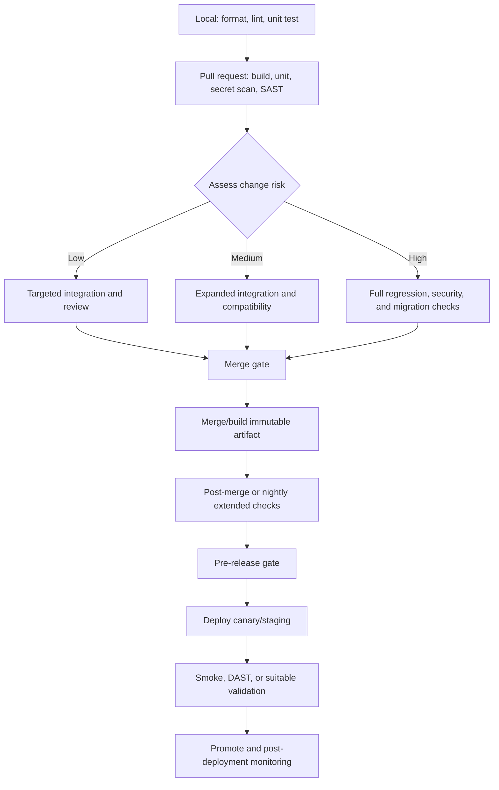

# Shifting Expensive Checks to Risk-Appropriate Stages

CI/CD needs feedback fast enough that developers learn whether a change has issues while it is still easy to fix. However, not every check can finish in a few minutes. Multi-service integration tests, performance testing, DAST, compatibility checks, large-dataset migrations, or recovery drills can take tens of minutes or hours.

The solution is not to drop expensive checks. Instead, place each check in the stage matching its **cost, defect-detection capability, and change risk**. Cheap, fast, high-signal checks should run early. Checks requiring realistic environments or heavy resources can run later, provided they finish before a release crosses the corresponding risk gate. For high-impact changes, deep checks must be pulled forward before merge or before deployment.

A well-designed pipeline creates layered feedback: local, pull request, post-merge, scheduled, pre-release, and post-deployment. These layers share artifacts and verification evidence, backed by clear rules on mandatory gates, asynchronous checks, and handling pending results.

## 1. Why Shouldn't Every Check Run at the Same Time?

If every check runs on every pull request, a minor edit could wait behind the full integration suite, performance tests, DAST, and staging validation. Long wait times slow down bug-fix loops, increase concurrent pipeline runs, and deprive developers of timely feedback while context is still fresh.

Conversely, running only fast checks and pushing all deep verification until after release lets defects reach production before discovery. Fixing defects there costs far more because it triggers incident response, rollbacks, data recovery, or customer notifications.

Both extremes are flawed:

- Running everything immediately on every change slows feedback, wastes runners, and lowers throughput.
- Deferring every slow check until after release raises the odds of defects slipping past quality gates.

What to optimize is **when defects are detected relative to the risk and cost of waiting**. A check should run as early as sufficient context and environment fidelity exist for trustworthy results.

### Examples of Cost and Detection Timing

| Check | Relative Duration | Defects Typically Caught | Suitable Initial Stage |
|---|---|---|---|
| Formatting, lint, static type checks | Very short | Conventions, syntax, data types | Local and pull request |
| Unit tests | Short | Logic within a single unit | Local and pull request |
| Compile/build | Short to medium | Compilation errors, dependencies, packaging | Pull request |
| Diff/working-tree secret scan | Short | Newly committed or staged credentials | Pull request |
| SAST on changed code | Short to medium | Code patterns posing security risks | Pull request |
| Component/integration tests | Medium to long | Interactions between modules or services | Risk-based on PR; merge pipeline |
| Full integration suite | Long | Cross-module regressions and end-to-end flows | Merge, nightly, or pre-release; pulled earlier for high risk |
| DAST against deployed environment | Long | Runtime application vulnerabilities | Staging or pre-release |
| Performance/load tests | Long, requires dedicated infra | Latency, throughput, and saturation regressions | Nightly, pre-release, or when touching hot paths |
| Migration tests on representative data | Long | Locks, DDL duration, compatibility, and backfills | Pre-release; pre-merge for high-risk migrations |
| DR/restore exercises | Very long | Recovery capability | Scheduled and before major infrastructure changes |

Durations in the table are relative. A unit test booting an entire system can be very slow; a well-tuned static check can run quickly. Measure your actual pipeline rather than classifying solely by check name.

## 2. Structuring Feedback Stages

A typical flow can be divided into the following stages:



### Local: Instant Feedback

Put checks that run cleanly on developer machines or inside IDEs:

- Formatters and linters.
- Static type checks.
- Small, fast, deterministic unit tests.
- Structure, schema, or generated-file checks.
- Pre-commit secret scanning where available.

The goal is catching issues before committing or opening a pull request. Local hooks save CI time, though they can be unconfigured or bypassed, so CI must still enforce mandatory gates.

### Pull Request: Mandatory Feedback Before Merge

Pull requests should run high-value checks fast enough that reviewers get results within a short feedback cycle:

- Build/compile and relevant unit tests.
- Lint, formatting, and type checking.
- Diff secret scanning and baseline dependency policy checks.
- SAST or fast security rules.
- Contract tests or small integration tests for affected modules.
- Migration syntax and backward-compatibility checks when schemas change.

Do not drop a critical security gate just to shave off a few minutes. For changes touching authentication, authorization, sensitive data handling, or high-risk dependencies, deep checks must run before merge.

### Post-Merge: Broad Checks on Integrated Commits

After merge, run checks that need the entire repository or the integrated state:

- Full integration suite.
- Cross-module or cross-service tests.
- Packaging and deployment-bundle checks.
- Compatibility tests against integrated dependency versions.
- Building release-candidate artifacts and verifying metadata.

If a post-merge check is mandatory for release, release status must stay `pending` until that check finishes. Never mark a release ready merely because the pull request was green.

### Nightly or Scheduled: Catching Rare Bugs and Long-Term Regressions

Scheduled jobs fit checks such as:

- Full test matrices across multiple JDKs, OSes, or database versions.
- Performance/load/soak tests.
- Fuzzing or comprehensive security scans.
- Deep dependency and license audits.
- Backup restore tests and DR drills.
- Full Git history or container registry scans.

Scheduled jobs catch time-dependent, load-dependent, or rare environment-combination issues. However, if a specific change carries high risk, do not wait for a nightly run to execute checks required for a merge or release decision.

### Pre-Release: Verifying Artifacts and Production-Like Environments

Before promoting, run checks requiring the packaged artifact or a production-equivalent environment:

- Digest, signature, and provenance verification.
- Environment configuration and secret reference checks.
- DAST or smoke tests on the deployment candidate.
- Migration rehearsals on representative data.
- Performance tests for changes impacting capacity or latency.
- Approvals and policy gates.

Checks must bind to the exact artifact digest being deployed. If you rebuild after testing, you have a new artifact that must be re-verified according to policy.

### Post-Deployment: Verifying Real Behavior

Smoke tests, synthetic transactions, metrics, logs, and traces confirm the application behaves properly once traffic shifts. This complements pre-deployment testing; it cannot replace unit, integration, or security tests that should have run earlier.

## 3. Assessing Risk to Select Checks

Not every change in the same repository carries equal risk. Fixing a typo in docs, changing pricing logic, altering a schema, or editing a pipeline with production deploy permissions require very different levels of scrutiny.

A practical model evaluates at least four factors:

1. **Blast radius:** number of services, users, tenants, or data records potentially impacted.
2. **Failure likelihood:** change complexity, technology maturity, bug history, and degree of dependency change.
3. **Detectability:** is a bug easily caught by unit tests/logs/metrics, or does it emerge only under load or rare flows?
4. **Recovery cost:** is rollback simple, is data mutated, and are migrations or external side effects involved?

### Illustrative Risk Matrix

| Risk Level | Examples | Pre-Merge Checks | Additional Checks |
|---|---|---|---|
| Low | Docs, UI text, internal refactors keeping contracts intact | Lint, build, relevant unit tests | Targeted integration if code area has dependencies |
| Medium | Business logic, internal APIs, service configuration | Build, unit, component/integration, contract tests | Full integration post-merge; pre-release smoke tests |
| High | Auth, payments, sensitive data, schema migrations, CI permissions, major dependencies | Relevant full regression, security review/scan, migration tests, contract/compatibility | Performance/DAST, canary, rollback rehearsal, or extra approvals |
| Very high | Irreversible data changes, trust boundaries, signing/deploy identity, production infra | Deep pre-merge gates and owner approval | Representative-environment rehearsal, staged rollout, and extended validation |

This classification is an example, not a universal scoring standard. Teams must explicitly define which change types automatically escalate to high risk, who is authorized to downgrade risk, and what evidence must be retained.

### Changes That Should Automatically Escalate Risk

- Changes to authentication, authorization, sessions, or cryptography.
- Changes to payments, billing, order state, or operations with external side effects.
- Changes to schemas, migrations, backfills, or hard-to-reverse data.
- Changes to CI workflows, runners, secret access, signing, or deployment permissions.
- Major dependency upgrades, base image changes, compiler, runtime, or build tool updates.
- Changes to network policies, ingress, DNS, TLS, or identity federation.
- Changes to shared modules or APIs consumed by many services.
- Changes in areas with prior incident history or flaky tests.

Do not rely solely on labels selected by the PR author. Combine file paths, ownership, dependency graphs, migration types, and repository policies to escalate risk automatically. If the system cannot determine impact scope, choose the broader check path rather than assuming low risk.

## 4. Classifying Checks by Value and Cost

One way to decide when to run a check is to evaluate four attributes:

| Attribute | Question |
|---|---|
| Duration | How long does the check take, and can it be sharded or parallelized? |
| Resources | Does it require dedicated databases, clusters, licenses, hardware, or environments? |
| Signal | When it fails, does output clearly pinpoint the cause and location? |
| Covered risk | Which risk does the check mitigate, and what is the cost of late detection? |

Run high-signal, low-cost checks that catch common bugs early. Place expensive checks protecting major risks ahead of gates with matching consequences. Run change-independent checks on schedules or integration branches.

### Fail Fast in a Sensible Order

Within a stage, independent checks can run in parallel. However, if a cheap step can detect a flaw that renders an expensive step pointless, run the cheap step first or gate the expensive step on it.

Example:

1. Parse YAML and validate workflow syntax.
2. Format, lint, and compile.
3. Unit tests.
4. Component/integration tests.
5. Deep security scans or performance tests.

Not every step must be strictly sequential. If lint and unit tests are independent, run them in parallel to shorten total time. The rule is to avoid spinning up expensive resources for a commit already guaranteed to fail merge due to syntax or compile errors.

### Distinguishing Execution Time from Feedback Time

A 30-minute job does not necessarily force a PR to wait 30 minutes if it is not a gate for that change. Conversely, a 2-minute job waiting 20 minutes for a runner still produces high feedback latency.

Measure all of:

- Queue time: time waiting for a runner or environment.
- Execution time: actual check runtime.
- Feedback latency: from commit/push until useful results appear.
- Gate latency: from PR open until merge eligibility.
- Time to release: from approved commit until deployable.

Optimizing execution time alone while ignoring queue time may fail to improve developer experience.

## 5. Selecting Tests by Change Impact

Running the entire suite on every commit is often expensive. You can use change impact analysis to run relevant tests, provided selection relies on verified dependencies.

For example, editing the `pricing` module might require:

- `pricing` unit tests.
- Tests for the order service calling `pricing`.
- Contract tests between `pricing` and checkout.
- Integration tests for order-creation flows involving price calculation.

Running only tests inside the `pricing` folder can miss defects in consumers. The dependency graph should capture compile-time, runtime, API, and data relationships wherever possible.

### Safety Rules for Test Selection

- Run direct tests of modified modules.
- Run tests of consumers depending on those modules.
- Broaden scope when APIs, schemas, shared libraries, or build logic change.
- Run the full suite when the dependency graph is incomplete, uncertain, or platform-level files change.
- Record the list of selected tests and rationale so decisions can be audited.
- Periodically compare targeted suites against the full suite to measure miss rates.

Do not use simple path filters as proof that other modules are unaffected when cross-directory dependencies or code generation exist.

### Test Selection Does Not Replace Comprehensive Checks

Targeted tests speed up PR feedback. The full suite must still run post-merge, nightly, or pre-release according to risk. If the full suite uncovers an issue that only appears when multiple modules interact, the pipeline should link that failure to the offending commit and block release progression.

## 6. Keeping Quality Gates Clear for Asynchronous Checks

A check can run after the PR while still serving as a mandatory gate before release. The key is representing statuses unambiguously:

- `pending`: not yet run or awaiting results.
- `passed`: ran and succeeded.
- `failed`: ran and failed.
- `skipped`: skipped per policy with documented justification.
- `inconclusive`: insufficient data or infrastructure failure.
- `waived`: exempted with approver, reason, and expiration.

Never treat `pending`, `inconclusive`, or infrastructure errors as `passed`. If a check is a release condition, the release must stay blocked until it passes or receives a valid waiver.

### Separating Required Gates from Advisory Checks

Required gates must complete before the protected action occurs, such as merging to a protected branch or promoting to production. Advisory checks provide visibility without blocking that step; they can run later or on a schedule.

Publish clearly which check belongs to which category. Never let a nightly job share the name of a required check without being bound accurately to the commit or artifact being released.

### Never Let Checks Skip Silently

When gating jobs on paths or risk outputs, include an always-run aggregate gate that verifies:

- Mandatory checks ran or were exempted under policy.
- No mandatory job remains pending.
- Any skipped job has a valid justification.
- Results correspond to the exact commit SHA and artifact digest.

If a job was skipped because the classifier failed or emitted an unknown output, the aggregate gate must fail or demand broader checks. Never allow skip conditions to accidentally disable protections on the main branch.

## 7. Example Pipeline Staged by Risk

The GitHub Actions example below illustrates a pull request workflow with a risk classification step, mandatory fast checks, and matching integration suites. `classify-change.sh` and `run-impacted-tests.sh` are repository scripts that must be implemented and tested separately.

```yaml
name: Pull request quality

on:
  pull_request:
    branches: [main]

permissions:
  contents: read

jobs:
  classify:
    runs-on: ubuntu-latest
    outputs:
      risk: ${{ steps.classify.outputs.risk }}
    steps:
      - uses: actions/checkout@v4
        with:
          fetch-depth: 0
      - id: classify
        run: |
          risk="$(./scripts/classify-change.sh)"
          case "$risk" in
            low|medium|high|critical) ;;
            *) echo "Unknown risk classification" >&2; exit 1 ;;
          esac
          echo "risk=$risk" >> "$GITHUB_OUTPUT"

  fast-checks:
    needs: classify
    runs-on: ubuntu-latest
    steps:
      - uses: actions/checkout@v4
      - uses: actions/setup-java@v4
        with:
          distribution: temurin
          java-version: '21'
      - name: Format and static checks
        run: ./gradlew --no-daemon spotlessCheck checkstyleMain
      - name: Compile and unit tests
        run: ./gradlew --no-daemon test
      - name: Secret scan repository working tree
        run: gitleaks dir --redact .

  targeted-integration:
    needs: [classify, fast-checks]
    if: needs.classify.outputs.risk == 'low' || needs.classify.outputs.risk == 'medium'
    runs-on: ubuntu-latest
    steps:
      - uses: actions/checkout@v4
      - name: Run impacted integration tests
        run: ./scripts/run-impacted-tests.sh

  high-risk-validation:
    needs: [classify, fast-checks]
    if: needs.classify.outputs.risk == 'high' || needs.classify.outputs.risk == 'critical'
    runs-on: ubuntu-latest
    steps:
      - uses: actions/checkout@v4
      - name: Full integration suite
        run: ./gradlew --no-daemon integrationTest
      - name: Security and migration validation
        run: ./scripts/security-and-migration-checks.sh

  pr-gate:
    if: always()
    needs: [classify, fast-checks, targeted-integration, high-risk-validation]
    runs-on: ubuntu-latest
    steps:
      - name: Enforce risk-specific checks
        env:
          CLASSIFY_RESULT: ${{ needs.classify.result }}
          RISK: ${{ needs.classify.outputs.risk }}
          FAST_RESULT: ${{ needs.fast-checks.result }}
          TARGETED_RESULT: ${{ needs.targeted-integration.result }}
          HIGH_RESULT: ${{ needs.high-risk-validation.result }}
        run: |
          test "$CLASSIFY_RESULT" = success
          test "$FAST_RESULT" = success
          case "$RISK" in
            low|medium) test "$TARGETED_RESULT" = success ;;
            high|critical) test "$HIGH_RESULT" = success ;;
            *) exit 1 ;;
          esac
```

This example must be tailored to your repository:

- `classify-change.sh` must classify using reviewed policy rules, never allowing PR authors to self-assign a low level to bypass gates.
- The classifier can normalize the matrix's "very high" tier to `critical`; both `high` and `critical` run the same deep validation group in this example.
- `run-impacted-tests.sh` must rely on the dependency graph; whenever impacted tests cannot be determined, run the broader suite.
- Make the aggregate gate a required status check in branch protection. A stable job name and `always()` ensure clear reporting when child jobs fail or get skipped.
- The illustrative workflow uses separate jobs for targeted and high-risk checks; the unselected job reports as skipped, while the aggregate gate requires only the job matching the classified risk.
- Pin actions to full commit SHAs if supply-chain policy requires it. Ensure the referenced Gradle tasks exist in the actual build.

The critical requirement is keeping risk classification and gating under strict control. If the classifier fails to run, emits an unexpected value, or produces empty output, the PR must fail the gate rather than defaulting to the low-risk path.

## 8. Example Long Checks Run Post-Merge and Pre-Release

Long-running checks can be extracted into separate workflows. The following workflow illustrates nightly regression on the main branch:

```yaml
name: Nightly regression

on:
  schedule:
    - cron: '0 18 * * 1-5'
  workflow_dispatch:

permissions:
  contents: read

jobs:
  full-regression:
    runs-on: ubuntu-latest
    timeout-minutes: 90
    steps:
      - uses: actions/checkout@v4
        with:
          ref: main
      - uses: actions/setup-java@v4
        with:
          distribution: temurin
          java-version: '21'
      - name: Full integration matrix
        run: ./gradlew --no-daemon integrationTest
      - name: Performance baseline
        run: ./scripts/run-performance-baseline.sh
      - name: Upload reports
        if: always()
        uses: actions/upload-artifact@v4
        with:
          name: nightly-${{ github.sha }}
          path: |
            build/reports/
            performance-results/
          if-no-files-found: ignore
          retention-days: 14
```

Nightly reports must bind to the commit SHA and, when testing artifacts, the artifact digest. If a nightly job catches a failure, identify which commit or change introduced it. Never send an alert and let releases proceed anyway without an owner resolving it.

For release candidates, you can add a gate checking the latest full regression result if that result matches the same commit/artifact and falls within the policy freshness window. If the release changed after the nightly run, older results do not automatically validate the new candidate.

### When Must Long Checks Be Pulled Back Before Merge?

- Changes affecting authentication or authorization.
- Migrations risking long locks, data loss, or backward incompatibility.
- Changes to pricing, payment, or financial calculation algorithms.
- Changes to concurrency, queue semantics, or transaction boundaries.
- Changes to compilers, runtimes, base images, or core dependencies.
- Edits to pipelines, secret handling, signing identities, or deploy permissions.
- Recent regressions showing unit/targeted tests are insufficient in that area.

For these changes, full integration, security, or migration rehearsals may serve as required pre-merge gates despite taking longer. Feedback speed is never a reason to accept uncontrolled risk.

## 9. Structuring Expensive Checks Without Wasting Resources

### Run Independent Checks in Parallel

Lint, module A unit tests, and module B unit tests can run concurrently if they do not contend for the same resource. Integration tests needing dedicated databases or clusters may require concurrency limits.

Do not launch dozens of jobs simultaneously if all hit a single small staging database. When the environment becomes the bottleneck, queue times grow and results suffer noise from CPU, connection, or data contention.

### Split Test Suites by Purpose

One way to organize suites:

| Suite | Contents | Trigger |
|---|---|---|
| `unitTest` | Small logic, no external services | Local and every PR |
| `componentTest` | Single service with mocks or isolated containers | PR by module/risk |
| `integrationTest` | Multiple modules/services and real databases | Medium/high-risk PRs, merge |
| `contractTest` | Consumer/provider contracts | PRs changing APIs or schemas |
| `securityTest` | SAST, dependency, secret, and policy scans | Fast checks on PR; full scans by risk/release |
| `performanceTest` | Load, stress, soak, and benchmarks | Nightly or pre-release by risk |
| `migrationTest` | Schema upgrades, backfills, locks, and rollback compatibility | PRs with migrations; pre-release rehearsals |

Task names are merely conventions. What matters is that every suite has a target duration, trigger, owner, and published quality gate.

### Use Caches and Artifacts Properly

Dependency caches reduce download and build times, but never cache test results under overly broad keys that let new commits reuse invalid old outcomes. Keys must incorporate all relevant inputs: lockfiles, runtimes, OSes, build configurations, and tool versions.

Build artifacts once, then test and promote the exact same digest. Never rebuild in staging or production just to save a few minutes, which severs the link between test results and deployed payloads.

### Avoid Unnecessary Matrices

Not every PR needs every JDK/OS/database version. You can run one primary configuration on PRs and the full compatibility matrix nightly or before release. However, if a change directly touches runtime support, build toolchains, or database drivers, run the matching matrix before merge.

## 10. Managing Flaky Checks and Unstable Results

A slow, flaky check creates terrible feedback: developers wait a long time only to get an untrustworthy result. Never move such a check to nightly merely to turn PRs green if the risk it protects still requires pre-merge control.

Classify them:

- **Code-induced flakiness:** race conditions, clocks, randomness, shared data, or bad timeouts. Fix the root cause.
- **Environment-induced flakiness:** overloaded runners, under-provisioned test services, or unstable networks. Fix the environment or cap concurrency.
- **Conditional tests:** apply only when a specific capability or platform is enabled. Declare the condition and verify classifier accuracy.
- **Obsolete tests:** fail to test critical behavior or duplicate coverage. Remove after owner sign-off.

Retries can help distinguish transient errors from deterministic ones, but never turn a green retry into proof of quality. Log the initial run, retry count, and flakiness rate. For security, migration, or critical data gates, treat inconclusive states as not passed until trustworthy results arrive.

If a flaky test must be quarantined, assign an owner, remediation ticket, expiration deadline, and compensating control for the risk it covers. Never quarantine an entire test group just because it slows down the pipeline.

## 11. Measuring the Effectiveness of Your Feedback Strategy

Do not judge success solely by faster PR pipelines. If duration drops because gates were dropped and incidents rise, the strategy has failed.

Track these metrics:

| Metric | Meaning | How to Use |
|---|---|---|
| PR feedback latency p50/p95 | Time to receive useful results | Set targets aligned with developer experience |
| Queue time | Time waiting for runners/environments | Detect capacity shortages or excessive concurrency |
| Failure detection stage | Whether bugs are caught locally, at PR, merge, nightly, or production | Assess whether gates sit at the right stage |
| Escaped defect rate | Bugs slipping past gates into later environments | Check whether risk is being pushed too late |
| Flaky test rate | Rate of non-code-related outcome changes | Prioritize stabilizing tests and environments |
| Cost per successful change | Average CI resources per passing change | Balance speed and cost |
| Change failure rate | Share of releases causing rollbacks/hotfixes/incidents | Evaluate release quality |
| Time to restore | Recovery time when a release fails | Verify rollback/recovery readiness |

Analyze by change type and risk tier. If migration bugs consistently surface only in pre-release, shift migration rehearsals earlier for PRs containing migrations. If formatting errors show up late at merge, put formatters into local/PR checks. If performance regressions appear only under load, keep load tests in appropriately provisioned environments and require them before releasing related code areas.

### Set Objectives by Percentile

Averages can hide PRs that wait much longer. Use p50 and p95 to capture typical and worst-case experiences. For instance, a team might target a p95 under 10 minutes for fast PR gates while full regression runs separately. Pick numbers fitted to project scale rather than arbitrary universal targets.

## 12. Practices That Erode Quality

| Practice | Consequence | Improvement |
|---|---|---|
| Running every long test on every PR | Slow feedback, growing queues, wasted resources | Partition suites by risk and stage |
| Pushing all security/performance tests to nightly | High-risk changes may merge/release before detection | Pull required gates pre-merge/pre-release by risk |
| Running tests only on edited files | Misses consumers or transitive dependencies | Use dependency graph and full-suite fallback |
| Treating `pending` or `skipped` jobs as passed | Releases may advance without evidence | Aggregate gate verifies status and skip reason |
| Rebuilding artifacts after testing | Test results no longer match deployed artifacts | Build once, verify, and promote the same digest |
| Retrying until tests pass | Hides flakiness or race conditions | Record initial failures and fix root causes |
| Using one risk tier for all changes | Sensitive edits under-tested or minor edits over-tested | Classify risk by path, ownership, and change type |
| Optimizing execution time while ignoring queue time | Developers still wait on runners | Measure feedback latency and capacity |
| Quarantining tests indefinitely | Quality gates gradually lose protection | Owner, deadline, and compensating checks |
| Letting nightly failures pass without blocking related releases | Known bugs still ship | Link nightly results to commits/artifacts and release policies |

## 13. Risk-Based Check Design Checklist

Before optimizing a pipeline, verify:

- [ ] Every suite has a stated purpose, owner, target duration, and covered risk.
- [ ] Formatting, lint, compilation, unit tests, and fast secret scans run early.
- [ ] Mandatory PR gates tie results to the exact commit SHA.
- [ ] Changes to auth, payments, schemas, CI permissions, and shared contracts escalate risk automatically.
- [ ] The risk classifier prevents arbitrary downgrades and fails closed on unknown inputs.
- [ ] Targeted tests cover dependencies/consumers, falling back to the full suite when data is missing.
- [ ] Full integration and compatibility matrices run post-merge/nightly or pre-release on schedule.
- [ ] Security, performance, and migration checks are pulled earlier when late detection has severe impact.
- [ ] Aggregate gates never treat `pending`, invalid `skipped`, or `inconclusive` states as `passed`.
- [ ] Approvals and quality gates are separated under explicit policies.
- [ ] Artifacts are built once, verified, and promoted by the same digest.
- [ ] Nightly/pre-release results bind to exact commit, artifact, and config revisions.
- [ ] Flaky tests have owners, metrics, quarantine deadlines, and compensating checks.
- [ ] CI caches use complete input keys and never serve stale results.
- [ ] Queue time, execution time, PR feedback latency, and escaped defects are measured.
- [ ] Periodic reviews evaluate which tests should shift earlier, later, or be retired.

Shifting expensive checks to risk-appropriate stages keeps pipelines fast while preserving essential protection. Cheap, high-signal checks run early; checks needing large environments or heavy load run in specialized stages; and high-risk changes pull critical gates forward before merge or release. When check statuses remain tied to commits and artifacts, teams can optimize wait times without compromising quality control.
