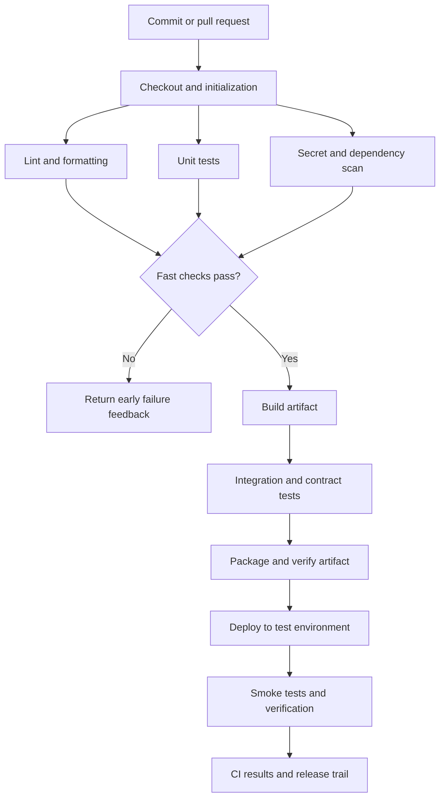

# Balancing Speed, Reliability, and Execution Cost

A well-designed CI/CD pipeline should answer one critical question as early as possible: is this change safe to keep moving through the release process? If feedback arrives too late, developers wait a long time to learn about a compilation, test, or configuration failure. If a pipeline is optimized purely for speed, it may skip essential checks, rely on stale caches, or produce flaky results. If every step runs concurrently on oversized resources, wall-clock duration may drop while runner costs and resource contention climb.

Therefore, CI/CD optimization is a balancing act among three goals: **fast feedback, reliable results, and reasonable execution cost**. No single configuration fits every repository. Teams need to measure actual duration and cost, identify which feedback must arrive fastest, and organize pipelines according to the risk of each change.

## 1. Understanding the Three Goals to Balance

### Feedback Speed

Feedback speed is the time from when a change enters the CI workflow until the author receives actionable results. Those results might be formatting errors, compilation failures, test failures, security findings, or quality gate statuses.

A pipeline with a 15-minute total runtime is not necessarily slow to give feedback. If fast checks catch defects in 40 seconds while deeper checks keep running when needed, developers already have early signal. Conversely, an 8-minute pipeline that only surfaces results after every job completes can deliver a poor feedback experience.

### Reliability

Reliability reflects whether the pipeline catches real defects accurately and produces consistent outcomes. A fast pipeline that misses critical tests, occasionally fails due to unstable environments, or depends on stale caches is untrustworthy.

Reliability also encompasses reproducibility: the same commit, configuration, and tool versions should yield explainable results. Pipelines must preserve agreed-upon quality gates—especially integration tests, security checks, artifact verification, and release approvals.

### Execution Cost

Costs can include runner minutes, CPU and memory, dedicated machines, cache and artifact storage, dependency download bandwidth, and CI platform operational overhead. Billing models vary by platform: some charge per runner-minute, others by machine class, concurrency tier, or storage volume.

Do not confuse developer wait time with total resource consumption. Running four jobs in parallel can cut wall-clock time to a quarter, yet still consume more total runner-minutes than one sequential job. Faster feedback may justify that expense, but the decision should rest on data.

## 2. Measuring Feedback Time and Cost Accurately

Before optimizing, agree on measurement boundaries. Time from push to result typically comprises:

```text
feedback_time = queue_time
              + setup_time
              + execution_time
              + result_publication_time
```

- `queue_time`: time a job waits for a runner or execution slot.
- `setup_time`: checking out source code, initializing the environment, downloading tools and dependencies.
- `execution_time`: time running builds, tests, and checks.
- `result_publication_time`: aggregating outputs, uploading logs, generating reports, and updating statuses on the commit or pull request.

Breaking down these components pinpoints the true bottleneck. If a job runs for 3 minutes yet queues 7 minutes for a runner, optimizing build commands will barely improve feedback time. If tests finish quickly yet coverage report generation takes ages, inspect report export and upload steps.

In pipelines with parallel jobs, overall completion time is typically governed by the longest dependency path, while every job still contributes to total resource consumption. Approximately:

```text
wall_clock_time ~= queue_and_setup + longest_dependency_path
compute_consumption = sum(resource_time_of_all_jobs)
```

This is a mental model. Actual wall-clock duration is also shaped by runner scheduling, concurrency limits, system load, artifact transfers, and inter-job dependencies.

Track at least the following metrics:

| Metric | What to Know | How to Use |
| --- | --- | --- |
| Feedback time p50 | How long a typical run takes | Monitor everyday developer experience |
| Feedback time p95 | How long slow runs typically take | Spot high-variance queues or tests |
| Queue time | How long jobs wait for runners | Decide on runner pool sizing or concurrency caps |
| Per-job duration | Which jobs consume the bulk of time | Focus optimization on the right steps |
| First-pass success rate | How often runs succeed without re-runs | Detect unstable environments or flaky tests |
| Cache hit rate and restore time | Whether caching genuinely cuts setup time | Weigh savings against storage and restore overhead |
| Runner-minutes or cost per run | How many resources one CI run consumes | Evaluate the cost impact of parallelism and machine sizing |
| Retry rate and flaky test rate | Why pipelines frequently require re-runs | Separate infrastructure issues from product bugs |

Do not look at averages alone. p50 captures the typical experience, while p95 exposes the long waits users frequently encounter. Group metrics by branch, change type, job, runner type, and time of day to avoid drawing false conclusions from a single aggregate number.

## 3. Putting Fast Feedback First in the Pipeline

Fast, cheap checks with high defect-detection value should appear early in the flow. A reference ordering:

1. Change structure, formatting, lint, and basic configuration checks.
2. Compilation or type checking.
3. Fast unit tests.
4. Static analysis, dependency checks, and appropriate security scans.
5. Integration tests, contract tests, or tests requiring dependent services.
6. Artifact packaging, checksum or digest verification.
7. Deployment to an appropriate environment, smoke tests, and post-deployment verification.

Exact ordering depends on the project. For instance, a secret scanner can run right after checkout because it is fast and catches severe risks. A check needing a packaged artifact must run after the build. The objective is surfacing problems early while respecting step dependencies.

Independent steps can run in parallel. For example, lint, unit tests, and secret scanning can run simultaneously when targeting the same commit without needing one another's outputs. Artifact builds start only once prerequisite conditions pass. The diagram below illustrates a simple flow:



This diagram does not imply every project must follow this exact sequence. Order steps based on true dependencies, risk levels, and defect-detection capability. Do not let a slow step block independent feedback unnecessarily.

## 4. Selective Parallelization

Parallelization reduces wall-clock time when independent jobs can run on separate runners. However, improvements have limits. If a pipeline has 12 minutes of independent tests and 3 minutes of sequential packaging, splitting tests into four balanced shards can drop test duration to roughly 3 minutes. Total duration drops substantially, while concurrent runner usage and total resource consumption rise.

When deciding to parallelize, consider:

- **Independence:** do jobs write to the same directory, database, test account, or shared resource? If so, isolate data or coordinate access.
- **Shard sizing:** overly large shards make one job a bottleneck; overly small shards add redundant startup, checkout, and dependency download overhead.
- **Balance:** splitting by test count does not guarantee equal runtime. Use historical runtimes to distribute heavy tests evenly.
- **Runner limits:** spawning more jobs does not mean they start immediately. Exceeding concurrency limits spikes queue time and erases gains.
- **Cost:** measure total runner-minutes and actual spend after parallelizing—not wall-clock duration alone.

A practical strategy is prioritizing parallelization for long-running independent steps with reasonable resource profiles. Then re-measure p50, p95, queue time, and cost. If higher job counts drive up queue times sharply, tune concurrency or shard sizes.

## 5. Using Caches and Incremental Builds Properly

Caching eliminates repeated work by reusing downloaded dependencies, build outputs, or intermediate data. Incremental builds re-execute only the work impacted by a change. Both can substantially shorten pipelines for large repositories or heavy dependency trees.

An effective cache requires a key capturing every factor governing data validity, such as:

- Operating system, architecture, and runner type if they affect outputs.
- Runtime, compiler, build tool, and relevant plugin versions.
- Lockfiles or checksums of dependency manifests.
- Build parameters, profiles, or settings capable of changing outputs.

For example, a Java dependency cache can key off the OS, JDK version, Maven or Gradle version, and checksums of lockfiles or dependency declarations. Whenever the key changes, the pipeline populates a fresh cache instead of restoring incompatible data.

```yaml
# Illustrative conceptual example; actual syntax depends on your CI platform.
cache:
  key:
    os: linux
    jdk: "21"
    build_tool: "gradle-8.x"
    dependency_fingerprint: "hash-of-dependency-lockfiles"
  paths:
    - dependency-cache/
```

Never treat a cache as the authoritative source for releases. Artifacts must be built, identified, and stored through an explicit process; caches are strictly accelerators. Pipelines must still build cleanly when caches do not exist. Run periodic clean builds to catch cases where builds only succeed thanks to leftover data.

Caches also carry overhead: creation, compression, upload, download, storage, and eviction. For a short job, restoring a huge cache can take longer than installing dependencies fresh. Measure total duration before and after enabling caches alongside hit rates. Redesign or remove caches with low hit rates or high restore overhead.

Incremental builds require accurate dependency declarations. If the build system overlooks a config file or generated source affecting outputs, it may retain stale outputs and produce a broken build. Verify dependency graph accuracy, preserve clean-build capability, and compare incremental outputs against clean builds in critical scenarios.

## 6. Organizing Tests by Speed and Risk

Not every change requires the exact same suite at the very first stage. However, test selection must rest on explainable dependencies and risk.

| Test Layer | Characteristics | Role in Feedback |
| --- | --- | --- |
| Formatting, lint, type checks | Fast, minimal environment dependencies | Catch basic mistakes early |
| Unit tests | Typically fast, narrow scope | Verify module logic |
| Contract tests | Verify agreements between components | Catch incompatible interface changes |
| Integration tests | Require databases, queues, or dependent services | Verify real interactions |
| End-to-end tests | Simulate user journeys across multiple components | Check system-wide behavior; usually slower |
| Post-deploy smoke tests | Small check suite in the target environment | Confirm the new version boots and serves core flows |

You can run a fast suite on every pull request and expand testing by change type. For instance, docs-only edits may skip full integration suites; database schema or authentication edits must trigger related tests. Skipping tests, however, must rely on maintained, auditable dependency relationships. Whenever impact scope is uncertain, running the broader suite is the safe choice.

Certain end-to-end or exhaustive tests can run post-merge, on schedules, or in dedicated environments. If those outcomes are mandatory before release, the release pipeline must wait for the corresponding gate. Staggering feedback timing never means bypassing quality requirements.

### Handling Unstable Tests

A flaky test can produce different results when source code and input conditions have not changed. Root causes include order dependencies, shared mutable data, race conditions, overly tight timeouts, or unstable environments.

Do not re-run tests until one run turns green and treat the change as valid. Doing so turns instability into false positives and erodes trust in quality gates. When retries are used to gather extra evidence, log the retry attempt clearly, preserve the flaky status, and assign an owner and remediation deadline. Critical tests must still be fixed as quality defects.

## 7. Keeping Execution Environments Consistent

Inconsistent environments inflate both investigation time and re-run counts. Pin runtime, compiler, build tool, dependency, and runner image versions appropriately. Prefer reproducible environments configured as code and updated under controlled rollouts.

Helpful practices:

- Use lockfiles or equivalent dependency-locking mechanisms.
- Identify environment images by immutable tags or digests when exact reproducibility is needed.
- Provision isolated test data per job and clean it up afterward.
- Prevent multiple jobs from mutating the same external resource without isolation.
- Record tool and environment versions in logs or artifact metadata.
- Run clean builds periodically to confirm results do not rely on stale caches.

Consistent environments separate product bugs from infrastructure failures, allowing teams to cut unnecessary retries while keeping results trustworthy.

## 8. Example: Optimizing a Java Service Pipeline

Suppose a Java service initially has an 18-minute pipeline. A week of measurements shows a p50 of 18 minutes and a p95 of 31 minutes. Job analysis shows checkout and dependency downloads take 2 minutes, compilation takes 2 minutes, unit tests take 3 minutes, integration tests take 6 minutes, dependency and security scans take 1 minute, and runner initialization plus report publishing account for the remaining 4 minutes. Part of the elevated p95 comes from jobs queuing for runners.

The team improves it step by step:

1. Group formatting, compilation, and unit tests into a fast-feedback tier, letting independent checks start right after checkout.
2. Enable dependency caching keyed on JDK, build tool, and dependency fingerprint; compare restore times against fresh downloads.
3. Split integration tests into shards balanced by historical runtime, providing isolated data and schemas per shard.
4. Keep security scans and mandatory quality gates in the flow; never drop checks just to shave minutes.
5. Cap concurrent jobs to avoid spiking runner queues during peak hours.
6. Run periodic clean builds and track flaky tests to confirm speedups did not reduce reliability.

After the changes, suppose the team measures initial fast feedback arriving in 2 minutes, overall pipeline p50 dropping to 11 minutes, and p95 dropping to 17 minutes. Runner-minutes per run rise 8% because integration tests were sharded. The team can accept that increase if earlier feedback and shorter wait times fit the budget. If costs exceed budget, they can reduce shard counts on lower-risk branches or right-size runners after re-measuring impact.

These figures illustrate how to evaluate changes. An improvement is only validated when before-and-after metrics are compared on comparable workloads across enough runs while keeping all relevant quality gates intact.

## 9. Making Decisions by Change Type and Risk

You do not always have to choose between running everything immediately and skipping most checks. You can structure check tiers based on change impact:

| Change Type | Early Feedback | Additional Checks |
| --- | --- | --- |
| Docs or comments | Formatting and link checks if applicable | Unrelated builds/tests may be skipped if repository policy permits |
| Single-module logic | Module lint, compile, unit tests | Integration tests for dependent components |
| API or schema | Compile, unit tests, contract tests | Integration tests and backward-compatibility checks |
| Dependencies or toolchain | Build and unit test checks | Security, compatibility, clean build, and affected module checks |
| Deployment config or secret references | Configuration and policy checks | Verify permissions, environment, smoke tests, and required approvals |

Encode classification into rules that can be reviewed, tested, and maintained. Avoid unverified manual labels or overly broad path rules that let sensitive changes slip past tests. For changes spanning many components or with uncertain scope, run the full policy-mandated check suite.

## 10. Controlled Optimization

A practical optimization cycle follows this sequence:

1. **Establish a baseline:** collect p50/p95 feedback times, queue times, per-job durations, first-pass success rates, and costs.
2. **Find the bottleneck:** pinpoint what consumes the most time or causes the widest variance; separate runner wait time from actual execution.
3. **Set constrained goals:** e.g., reduce p95 below a target while keeping first-pass success rate steady and per-run cost within budget.
4. **Test one change:** such as dependency caching, parallelizing one test group, or trimming runner startup time.
5. **Re-measure on comparable workloads:** compare before and after across speed, reliability, and cost.
6. **Keep or revert:** retain a change only when measured benefits justify it without weakening quality gates.

Do not optimize multiple factors simultaneously before knowing which change produced the effect. When workloads vary by hour or season, compare equivalent cohorts over long enough windows to avoid reacting to a single noisy run.

Common decisions:

| Observation | Action to Try | What to Verify |
| --- | --- | --- |
| High queue time, low execution time | Add or rebalance runners, tune concurrency | Cost and runner utilization after the change |
| High setup time, low cache hit rate | Refine cache keys, preinstall tools, or optimize images | Whether caches stay valid and beat clean setup |
| One test shard runs too long | Rebalance by historical duration or split heavy tests | Whether test data is isolated and results stay stable |
| High p95 due to flaky tests | Fix tests, environments, and shared data | Flake rate drops without masking product bugs |
| Runner-minutes spike after parallelization | Trim shard count or choose better-sized runners | Whether p50/p95 still meet targets |
| Clean builds are much slower than cached builds | Audit dependency graph and caching strategy | Whether clean and incremental builds yield identical results |

## 11. Pipeline Balancing Checklist

Before declaring a CI/CD optimization successful, verify:

- [ ] Time from trigger to actionable results is measured.
- [ ] Queue time, setup time, execution time, and result publication time are tracked separately.
- [ ] p50 and p95, per-job durations, and execution costs are monitored.
- [ ] Fast, cheap, high-signal defect checks run early.
- [ ] Jobs run in parallel only after dependencies and shared resources are properly handled.
- [ ] Sharding is based on historical runtime without creating excessive startup overhead.
- [ ] Caches use keys matching environment and dependencies; clean builds still succeed.
- [ ] Incremental builds use accurate dependency graphs and are verified against clean builds.
- [ ] Test scope is selected by dependency and risk while preserving mandatory quality gates.
- [ ] Flaky tests are recorded and fixed at the root cause instead of retried until green.
- [ ] Environments and tool versions are reproducible, and artifacts carry clear identifiers.
- [ ] Optimizations are measured before/after and can be reverted if cost rises or reliability drops.

A well-optimized pipeline delivers critical signals to developers early, keeps the team confident in test results, and stays within resource budgets. Treat speed, reliability, and cost as three metrics that must always be measured together; improving one only counts when the other two still satisfy release requirements.
