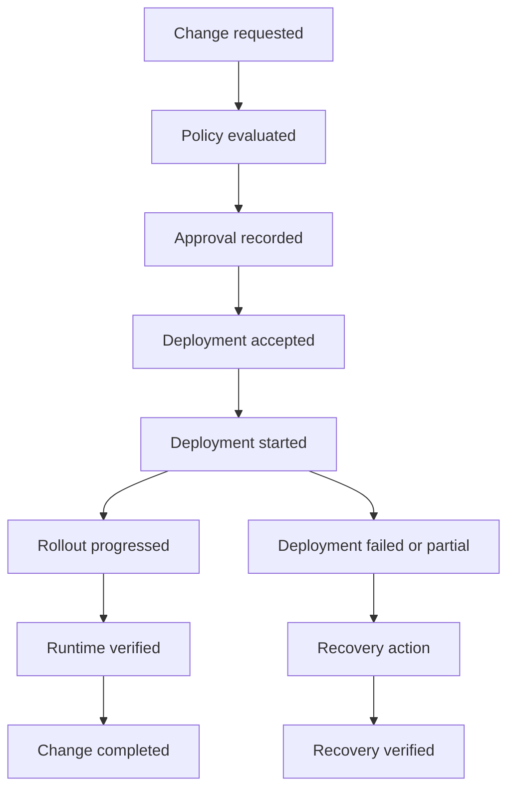

# Recording Change History and Approvals for Critical Environments

A production deployment is more than just a pipeline finishing its run. When an incident occurs, teams need to know which person or workload identity requested the change, what change was applied, which artifact and configuration were deployed, who approved it, which policies were evaluated, and what the actual post-deployment state looked like. If only a few lines exist in CI job logs, that information can vanish when logs expire, runners are destroyed, or workflow history becomes inaccessible.

Therefore, critical environments require **traceable change history and approval evidence**. Every change must be linkable from the initial request to the source revision, build, artifact digest, approval, deployment operation, and verification outcome. This history must be trustworthy enough to support operations, incident investigations, and audits.

In CI/CD, evidence is not just a single log file. It is a collection of events and records with explicit identifiers, timestamps, origins, and relationships. When stored centrally, protected from unauthorized modification or deletion, and tied to a deployment identity, this history accurately answers what changed in a critical environment.

## 1. Distinguishing Change History, Audit Logs, and Telemetry

Three related data types serve distinct purposes:

- **Change history:** describes changes that were requested or applied, such as release versions, configurations, database migrations, infrastructure plans, or feature flags.
- **Audit log:** records control-significant actions, including actor, timestamp, target object, action, outcome, and authorization/approval evidence.
- **Operational telemetry:** logs, metrics, and traces showing how the system behaved before, during, and after a change.

For example, the audit log records that a release was approved and deployed at 09:30 UTC. Change history identifies the new image digest and applied config revision. Metrics show error rates rising after 09:34, while traces reveal which services failing requests traversed.

Do not use application logs as a substitute for an audit trail. Application logs can be sampled, rotated, lack actor identity, or be altered by the very failing application. Audit trails must be recorded by the control plane or a dedicated action-logging system, with write permissions and retention managed independently.

## 2. Defining the Scope of Critical Environments

Not every environment requires the same level of approval. Teams should classify environments by the impact of an erroneous change:

| Environment tier | Examples | Reference controls |
|---|---|---|
| Development | Personal namespaces, sandboxes | Developer permissions, baseline auditing |
| Integration/test | Shared testing environments | Record releases/configs, restrict write access |
| Staging/pre-production | Production-like environments | Team-based approvals, artifact and data checks |
| Production | User-facing systems | Protected environment, required reviewers, policy gates, durable auditing |
| Critical production | Payments, sensitive data, critical control systems | Independent approvals, change windows if needed, full evidence, controlled break-glass |

An environment's name does not create protection on its own. You must configure corresponding access controls, branch/tag restrictions, runner groups, service identities, network policies, and approval rules. If anyone can edit a workflow to bypass an approval step, a `production` label in YAML is insufficient.

## 3. What Must a Change Be Traceable Across?

A change record for a critical environment should link the following elements:

1. **Change request:** rationale, scope, affected systems, and environments.
2. **Source revision:** repository, commit SHA, pull request, and reviews.
3. **Build evidence:** pipeline run, builder, tests, scans, and provenance.
4. **Artifact identity:** image/package digest, version, and registry.
5. **Configuration identity:** manifests, charts, infrastructure code, config revision, and secret references.
6. **Approval evidence:** approver, timestamp, decision, policy, and reviewed contents.
7. **Deployment record:** deployment ID, actor/service identity, target, strategy, and status.
8. **Post-deployment evidence:** observed digest, rollout, health checks, smoke tests, and telemetry window.
9. **Recovery relationship:** previous deployment, rollback/roll-forward, and recovery verification outcome.

These elements may reside across multiple systems. A change management tool stores requests; the Git host stores reviews; CI stores builds; the artifact registry stores digests; the deployment controller stores rollouts; and the observability platform stores metrics. Use a shared set of identifiers to connect them rather than trying to copy all content into one place.

## 4. Designing a Structured Change Record

A record needs stable identifiers and minimal fields to answer who, what, where, when, why, and outcome.

| Group | Reference fields | Purpose |
|---|---|---|
| Identity | change_id, deployment_id, release_id | Distinguish changes and deployment executions |
| Actor | user/service principal, identity provider, workflow | Identify the executing person or workload |
| Action | requested, approved, deployed, rolled_back | Identify the action |
| Target | environment, account/project, region, cluster, namespace | Define blast radius |
| Source | repository, commit SHA, pull request | Trace back to source code and review |
| Artifact | image/package reference, digest | Identify released content |
| Configuration | config revision, manifest/chart, IaC revision | Identify applied configuration |
| Approval | reviewer, decision, timestamp, policy result | Prove approval criteria |
| Timing | requested_at, approved_at, started_at, completed_at | Reconstruct event sequence |
| Outcome | status, error code, verification evidence | Determine result |
| Correlation | request ID, operation ID, trace ID | Link logs and telemetry |

Timestamps should be standardized in UTC and record both event time and system ingestion time if the two can differ. Synchronizing clocks across runners, control planes, and logging systems makes timeline reconstruction more accurate.

Illustrative record example:

```yaml
change:
  change_id: "chg-2026-01842"
  deployment_id: "dep-2026-004281"
  release_id: "orders-service-2.7.1"
  environment: "production"
  target:
    account: "prod-platform"
    region: "ap-southeast-1"
    cluster: "prod-apps"
    namespace: "production-orders"

  source:
    repository: "platform/orders-service"
    commit: "4f2a9c1..."
    pull_request: "4821"

  artifact:
    reference: "registry.example.com/orders-service"
    digest: "sha256:abc..."

  configuration:
    revision: "deploy-config@7c91e2..."
    chart_version: "orders-chart-4.3.0"

  approval:
    decision: "approved"
    reviewer: "user:release-approver-17"
    policy: "production-change-policy-v3"
    approved_at: "2026-11-18T09:20:00Z"

  execution:
    actor: "workload:ci-production-deployer"
    operation_id: "op-73184"
    started_at: "2026-11-18T09:24:00Z"
    completed_at: "2026-11-18T09:28:42Z"
    status: "succeeded"

  evidence:
    test_run: "ci-18452"
    smoke_test: "smoke-2917"
    observed_digest: "sha256:abc..."
    audit_event: "evt-993812"
```

The schema and values above are examples only. Never put tokens, passwords, private keys, or secret values into records. For sensitive data, store only a reference/version and a path to an access-controlled evidence store.

## 5. Recording Event-Driven History, Not Just the Final Result

If you write only a single line after a deployment succeeds, teams lose visibility when a runner dies midway or an operation completes only partially. Emit lifecycle events instead:



Each event should have a unique event ID, change/deployment ID, actor, timestamp, action, target, outcome, and correlation ID. If the same event is resent due to a retry, the event collector must deduplicate by event ID or sequence number to avoid double-counting.

Do not overwrite earlier events when state changes. For example, a deployment moving from running to failed and then rolled back must preserve all of those milestones. A materialized current-state view can be built for fast querying, while raw event history must be kept according to the retention policy.

## 6. Approvals Must Bind to Exact Change Contents

An approval is only meaningful if the approver knows what they are approving. Approvals must be bound to:

- Change request and rationale.
- Reviewed commit SHA or pull request.
- Artifact digest to be deployed.
- Specific environment and target.
- Config/manifest/infrastructure revision.
- Test, security scan, and quality gate outcomes.
- Rollout, observation, and recovery plans.

If the artifact digest or configuration changes after approval, the prior approval may no longer be valid. Policies must define which fields invalidate an approval and require re-approval when contents change.

Never approve a generic label such as “release 2.7.1” if that label could point to a different artifact. Approve immutable digests and explicit targets.

## 7. Separation of Duties and Approval Permissions

For critical environments, the requester or author of a change should not self-approve every high-risk case. Separation of duties reduces the risk of a single identity creating, approving, and deploying an unverified change.

A reference matrix:

| Role | Primary permissions | Constraints |
|---|---|---|
| Developer | Create pull requests and change requests | Cannot self-grant production deploy roles |
| Reviewer | Review source and test evidence | Does not necessarily hold deploy permissions |
| Release approver | Approve specific release/target | Cannot alter an approved artifact |
| Deployment workload | Execute deployments per policy | Holds permissions only on granted targets |
| Auditor | Read change/approval history | Cannot modify records or deploy |
| Incident commander | Coordinate break-glass per procedure | All actions must be logged and post-reviewed |

The number of approvers and independence rules must match risk. Staging might require a single reviewer; payment systems or sensitive data workloads may require two people from different teams. Avoid imposing heavy approval overhead on low-impact changes, while never skipping mandatory production controls.

## 8. Protected Environments in CI/CD

CI platforms typically support environment protection, required reviewers, branch restrictions, and deployment histories. Configure these features at the repository/organization or control-plane level, rather than relying solely on conditions inside workflow files that a pull request itself could edit.

Example GitHub Actions structure:

```yaml
jobs:
  deploy_production:
    if: github.ref == 'refs/heads/main'
    environment: production
    runs-on: [self-hosted, production-deploy]
    permissions:
      contents: read
      id-token: write
    steps:
      - name: Verify approved release
        run: ./scripts/verify-approved-release.sh
      - name: Deploy immutable artifact
        run: ./scripts/deploy-by-digest.sh
      - name: Verify runtime
        run: ./scripts/verify-production-state.sh
```

This is a structural example. Required reviewers, branch restrictions, runner groups, and environment protection must be configured outside the workflow under platform administrative controls. The scripts are placeholders. The job must verify the digest and approval record bound to the exact commit, config revision, and target prior to deploying.

The `id-token: write` permission only allows the job to request an OIDC token. Cloud-side trust policies must restrict issuer, audience, repository, workflow, ref, and environment; the assumed role must still scope down resources and actions. Never use long-lived static cloud keys merely to simplify a deployment step.

## 9. Recording Policy Decisions and Rejection Reasons

The audit trail must capture both approved and rejected decisions:

- Which policy was evaluated and which version was active.
- Whether mandatory conditions passed or failed.
- Which approver made the decision and when.
- Why a change was rejected.
- Whether any exception or waiver was granted, by whom, and its expiration.
- Whether an approval expired or was revoked before deployment.

Recording only successful deployments fails to show blocked changes or which policies stopped a risky release. Rejection history proves gates are operating and supports investigations when questions arise about a specific decision.

Waivers require narrow scope, justification, owner, approver, expiration, and compensating controls. Never use permanent waivers to turn a quality gate into an optional check.

## 10. Break-Glass for Emergency Incidents

Sometimes production must be changed rapidly to restore service. Break-glass is a bounded emergency mechanism, not an anonymous shortcut to skip auditing.

A break-glass procedure should:

1. Define trigger criteria and authorized roles.
2. Record incident ID, justification, target, and change scope.
3. Use a dedicated time-bound, least-privilege identity with strong authentication.
4. Log every command, artifact/config revision, and actual action taken.
5. Notify accountable owners per policy.
6. Revoke emergency permissions immediately upon completion.
7. Conduct a post-incident review, backfill change records, and evaluate whether routine procedures need adjustment.

If a system normally requires dual approval that cannot wait during an outage, policy must explicitly define the exception and mandatory post-review. Never create shared accounts or write emergency credentials into documentation. Every break-glass action must map to a traceable individual actor or workload identity.

## 11. Protecting Audit Trail Integrity

An audit log is only trustworthy if the party executing a change cannot quietly rewrite their own history.

Common measures:

- Ship events to a centralized audit system outside the administrative control of the recorded workload.
- Use append-only storage or object lock/WORM when retention requires tamper/deletion protection.
- Restrict write access to specific service identities and read access by role.
- Separate audit storage administration permissions from production deployment permissions.
- Log all access, exports, retention changes, and deletion exceptions.
- Use checksums, signatures, or hash chains for batches/events when tamper detection is required.
- Back up and test recoverability of audit data.

Hash chains can partially detect tampering: each record contains the hash of the preceding record. However, if an attacker can rewrite the entire chain and replace the anchor, a standalone hash chain is insufficient. Store anchors or hash copies in an independent system with appropriate access controls and retention.

Never use hashing as a substitute for access control. Integrity requires combining permissions, tamper-resistant storage, monitoring, and signing-key governance.

## 12. Retention, Privacy, and Sensitive Data

Change history must be retained long enough to meet investigative, operational, and organizational policy needs. Yet keeping excessive data also increases privacy risk and cost.

Retention design should specify:

- Event types and retention durations per environment tier.
- Applicable legal, contractual, and internal policy requirements.
- Online retention for fast search vs. archive retention.
- Handling of legal holds or incident holds.
- Controlled expiration and deletion procedures.
- Who is authorized to access or export data.

Never store secret values, tokens, private keys, session cookies, or sensitive payloads in audit events. For actors, store only necessary identifiers; avoid copying irrelevant personal information. If IP addresses or user agents are logged, ensure there is a valid purpose and appropriate retention.

Logs must defend against log injection. Fields such as branch names, commit messages, change titles, or user-supplied text must be escaped or structured-logged so newlines cannot forge new events. Enforce field size limits and never dump raw untrusted payloads into audit records.

## 13. Linking Audits with Logs, Metrics, and Traces

Change records tell you what changed; telemetry tells you the post-change impact. Use correlation identifiers to join them:

- Change ID and deployment ID.
- Release ID and artifact digest.
- Commit SHA and pipeline run ID.
- Operation ID and request/trace ID.
- Environment, region, cluster, and workload.
- Config revision and feature flag configuration version.

When a metric shows rising error rates, operators can query recent deployments in the same service/environment. From the deployment record, they locate the commit, pull request, approval, artifact, and config revision. Then, traces and logs in that same time window identify which requests were impacted.

Never correlate solely by nearest timestamp, since multiple deployments can occur concurrently. Stable IDs and target metadata prevent misattributing an incident to an unrelated change.

## 14. Example Change History Query

Suppose an audit store contains fields `change_id`, `deployment_id`, `environment`, `actor`, `action`, `event_time`, `commit_sha`, `artifact_digest`, and `approval_id`. A conceptual query can retrieve production changes within a time window:

```sql
SELECT
    event_time,
    change_id,
    deployment_id,
    actor,
    action,
    commit_sha,
    artifact_digest,
    approval_id
FROM deployment_audit_events
WHERE environment = 'production'
  AND event_time >= TIMESTAMP '2026-11-18 00:00:00'
  AND event_time <  TIMESTAMP '2026-11-19 00:00:00'
ORDER BY event_time;
```

Table and schema names are illustrative. In production systems, audit events may reside in a logging platform or event store rather than a SQL database. Implement pagination, query limits, and export auditing if required by policy.

An investigation typically follows these questions:

1. Did any deployment happen prior to when errors started?
2. Which artifact digest and config revision did that deployment apply?
3. Was the approval bound to that exact digest/target?
4. Who or which identity executed the operation?
5. Did post-deployment validation pass?
6. How did metrics and traces change afterward?
7. Did any rollback, hotfix, or manual intervention follow?

## 15. Change Reports and Evidence Packages

For critical releases, generate an evidence package linking all records rather than relying on scattered screenshots. A reference package includes:

- Change request and rationale.
- Pull request, reviews, and commit SHA.
- CI run, test reports, security scans, and policy outcomes.
- Artifact digest, provenance, and SBOM if required.
- Config/manifest/IaC revision.
- Approval decision and reviewer identity.
- Deployment ID, target, and timestamps.
- Post-deployment health/smoke evidence.
- Metrics observation window and outcome.
- Rollback/recovery reference if one occurred.

The package needs a manifest listing files/references, checksums, and collection timestamp. Links to external systems must have sufficient retention and proper access controls; expiring URLs or dashboards keeping only short-term data do not constitute long-term evidence.

You do not need to duplicate every log and trace into one giant bundle. Store identified references, checksums, or snapshots of the evidence that must be preserved. For large datasets, an evidence catalog can index and point to respective storage locations.

## 16. Handling Out-of-Band Changes Outside the Pipeline

Not every production change flows through CI/CD. Administrators may edit configuration directly, operators may patch resources, a cloud console may update firewall rules, or an operator may restart a service.

To prevent gaps in history:

- Enable audit logging on cloud providers, the Kubernetes API server, Git hosts, databases, and change management platforms.
- Capture manual changes along with actor, target, before/after state, or resource version where provided by the source.
- Detect drift between desired state in Git and observed state.
- Link manual actions to an incident or change request when applicable.
- Alert when production changes outside approved workflows.
- Periodically reconcile deployment records against live state.

Do not automatically overwrite every piece of drift. Valid emergency changes must be recorded and reconciled back into the source of truth afterward. The goal is detecting, classifying, and tracing changes—never erasing operator actions.

## 17. Common Mistakes

| Mistake | Consequence | Remedy |
|---|---|---|
| Keeping only CI console logs | Logs expire or are hard to link to deployments | Store centralized audit/change records |
| Recording only deploy success | Loses request, approval, and failed rollout history | Emit lifecycle events |
| Binding approval only to release name | May approve the wrong artifact/config | Bind approvals to digest, commit, and target |
| Author self-approves all production changes | Lacks separation of duties | Require independent reviewers per risk policy |
| Workflow enforces all approval rules itself | Pull requests can alter protection conditions | Configure protected environments in the control plane |
| Audit store grants delete access to deployer | Can hide actions | Separate duties, use append-only/WORM, and monitor |
| Storing secrets in evidence packages | Credential leak via audit exports | Store only secret references/versions |
| Correlating solely by timestamp | Misattributes telemetry to another deployment | Use change/deployment/correlation IDs |
| Ignoring manual changes | Incomplete production history | Collect cloud/platform audits and detect drift |
| Break-glass without post-review | Exceptions become routine bypasses | Log incidents, revoke access, and review post-incident |

## 18. Change History and Approval Checklist

- [ ] Environments are classified by criticality and impact.
- [ ] Every change/deployment has a unique ID and links to a release.
- [ ] Actor, action, target, timestamp, outcome, and correlation IDs are recorded.
- [ ] Commits, pull requests, build runs, artifact digests, and config revisions are linked.
- [ ] Approvals are bound to the exact artifact, configuration, environment, and policy version.
- [ ] Separation of duties and reviewers match the risk level.
- [ ] Protected environments, branch restrictions, and runner permissions are configured in the control plane.
- [ ] Approvals, rejections, waivers, and policy evaluations are all recorded.
- [ ] Event history is stored append-only or with tamper-detection controls.
- [ ] Retention, archiving, legal holds, and export permissions are defined.
- [ ] Secret values and unnecessary personal data are excluded from evidence.
- [ ] Change/deployment IDs link to logs, metrics, traces, and post-deployment checks.
- [ ] Audit logs are collected for out-of-band changes and drift is detected.
- [ ] Break-glass actions have identity, incident references, time limits, and post-incident reviews.
- [ ] A full timeline can be reconstructed from request, review, and approval to deploy and recovery.

Recording change history and approvals turns a critical-environment release into an auditable chain of events. When change IDs, artifact digests, config revisions, approvals, deployments, and telemetry are linked in a durable audit trail, operations teams know who did what, which change is actually running, what evidence backed the decision, and how the system responded afterward.
