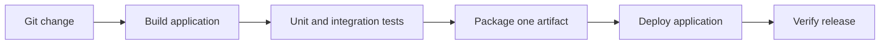
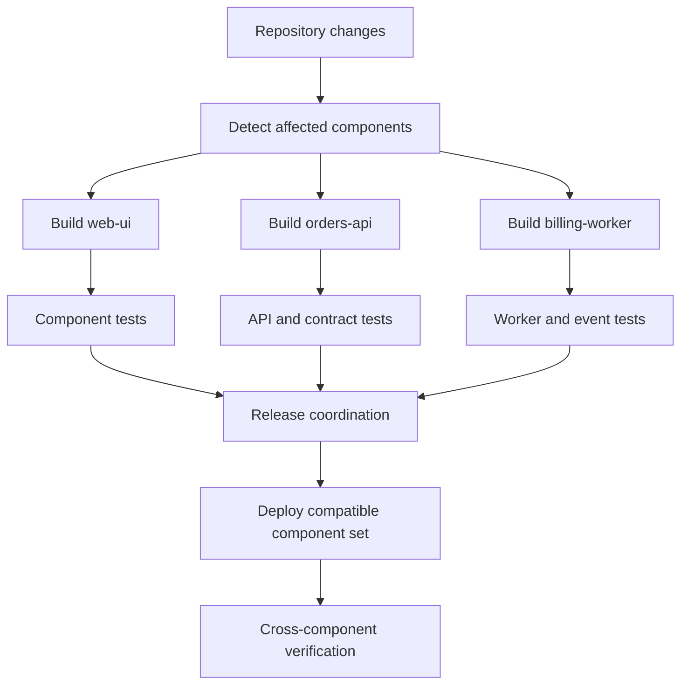
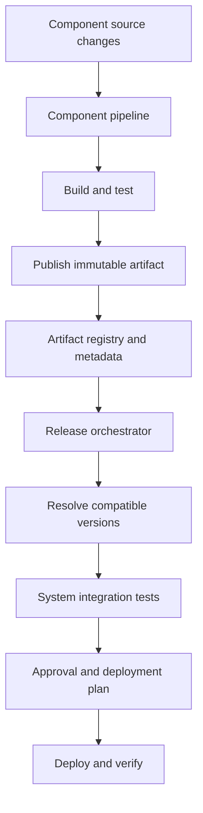
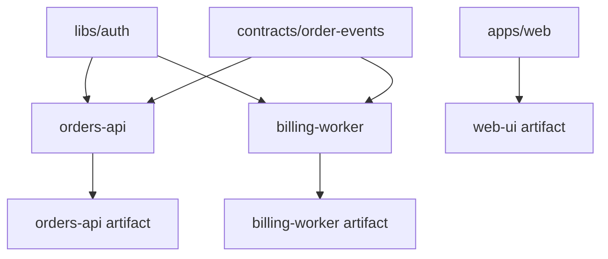
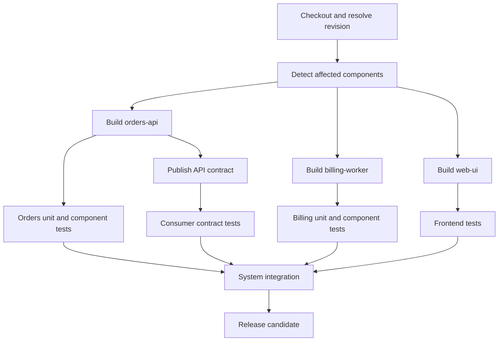

# Distinguishing Pipelines for a Single Application vs. Multiple Components

A small application can be built, tested, and deployed with a single pipeline. As a product grows into multiple components such as frontend, API, worker, database migration, and infrastructure, how pipelines are organized must change. If you keep running everything in one giant workflow, a small change can trigger builds and tests across the entire system. If you split each component into completely independent pipelines without coordination conventions, versions can become incompatible and releasing a feature across multiple services becomes difficult to control.

The first point to understand is that **repository structure, application architecture, and pipeline structure are three related but distinct decisions**. A monorepo does not require a single pipeline; multiple repositories do not mean each repository can be released without coordination. Good design defines component boundaries, ownership, dependencies, artifacts, and how pipelines exchange state.

## 1. Single-Application Pipelines vs. Multi-Component Pipelines

For a simple application, a change typically goes through the same sequence: checkout, build, test, package, and deploy. The steps share the same source revision, dependencies, and release unit.

When a system has multiple components, each part can have:

- Its own source code and dependencies.
- Different development cadences and release schedules.
- Different test suites and resource requirements.
- Separate artifacts such as container images, packages, static bundles, or migrations.
- Separate owners and deployment permissions.
- Compatibility relationships with APIs, event schemas, or databases of other components.

Pipelines need to reflect these boundaries. A change in `web-ui` does not necessarily require rebuilding `billing-worker`; changing a shared contract may require testing multiple consumers; a release spanning multiple services needs a release manifest specifying which versions go together.

### Single-Application Example



### Multi-Component System Example



The second diagram does not mean every change must always build all three components. The impact detection step decides which pipelines need to run; the release coordination step decides when compatible artifacts are deployed together.

## 2. Distinguishing Application Architecture, Repository, and Pipeline

These three dimensions are often confused:

| Dimension | Question | Example Choices |
|---|---|---|
| Application architecture | Which modules/services is the system split into? | Modular monolith, microservices, frontend/API/worker |
| Repository topology | Where is source code stored? | Monorepo, multirepo, one repo per domain |
| Pipeline topology | How are build/test/release organized and orchestrated? | Single pipeline, per-component pipelines, central orchestrator, hybrid model |

A monolith can live in a monorepo and use a single pipeline. It can also span multiple library and application repositories. A microservices system can place multiple services in one monorepo or split each service into its own repository. Pipelines should follow actual dependencies and release boundaries, not just architectural labels.

### Monorepo Does Not Mean a Monolithic Pipeline

In a monorepo, components can live in the same repository while having independent build graphs and release cadences. A change in `services/orders` might only trigger the `orders-api` pipeline, whereas a change in `libs/security` requires running tests for every component using that library.

### Multirepo Does Not Mean No Coordination

In a multirepo setup, each repository has its own pipeline, yet a feature may require simultaneous changes to an API provider, consumer, frontend, and schema. Pipelines need to share contracts, artifact versions, and release manifests to coordinate.

## 3. Identifying Components and Build Boundaries

Before creating multiple pipelines, determine which parts can be built, tested, and released independently.

A component should have relatively clear boundaries:

- Has a defined business purpose and responsibility.
- Has an accountable owner.
- Has identifiable build inputs and output artifacts.
- Has tests verifying its own behavior.
- Has an interface or contract with other components.
- Can determine its dependencies and impact scope when changed.
- Has versioning, deployment, and rollback processes.

Do not split pipelines merely by directory if those directories always have to be built and released together. Conversely, if a component has its own dependencies, tests, and release cadence, bundling it into a large pipeline can create unnecessary wait times.

### Components, Modules, and Deployable Units

A code module is not necessarily a deployable component. For example, `orders-domain` and `orders-persistence` may be modules within the same `orders-api` application, packaged into a single artifact. The pipeline can test modules separately while still releasing one deployable unit.

Conversely, a single repository can produce multiple artifacts: an API container, a worker container, and a migration package. In that case, the pipeline needs to track which artifacts are produced from which source parts and which releases use them.

## 4. Choosing Monorepo vs. Multirepo Based on Needs

There is no single right choice for every organization. Repository topology affects how changes are detected, permissions are managed, code is shared, and pipelines are orchestrated.

| Criterion | Monorepo | Multirepo |
|---|---|---|
| Cross-component changes | One pull request can update multiple components at once | Often requires multiple pull requests or coordinated releases |
| Internal dependencies | Can share a common source revision and update synchronously | Typically uses published package/API versions |
| Pipeline triggers | Requires path filtering or a build graph | Triggered by repository and dependency events |
| Access control | Requires CODEOWNERS/path permissions and appropriate guardrails | Permissions can be separated per repository/team |
| CI scale | Needs optimization for affected-component detection and caching | Many small pipelines, but with cross-repo overhead |
| Release cadence | Can be independent if components are well-designed | Often more independent, but requires contracts/versioning |
| Cross-component refactoring | Easy to make atomic changes | Requires compatibility during transition periods |

### When a Monorepo Fits

- Multiple components are developed by one team or closely collaborating teams.
- Changes frequently cut across multiple modules.
- You can build a dependency graph and run only affected parts.
- You want to review an atomic change spanning multiple components.

### When Multirepo Fits

- Components have separate owners, access controls, or release lifecycles.
- Teams need to deploy independently with clear contract boundaries.
- Repositories have different security or compliance requirements.
- Artifacts are consumed via registries/APIs with managed versions.

### Hybrid Model

An organization can use a monorepo for services within the same domain and multirepo for shared platforms, SDKs, or products with different ownership. What matters is having consistent dependency and release rules.

## 5. Choosing a Pipeline Organization Model

There are three common models. Each suits different scales and levels of coupling.

### 5.1. A Single Pipeline

A central pipeline builds and deploys the entire system.

Pros:

- One place to observe the entire workflow.
- Easy to coordinate steps that must run sequentially.
- Suitable for small products or components that always release together.

Cons:

- Small changes can trigger a lot of unnecessary work.
- The pipeline can become long and hard to maintain.
- One slow or failing component can block the entire release.
- Deployment permissions and ownership tend to become overly centralized.

### 5.2. Separate Pipelines per Component

Each component has its own pipeline to build, test, and publish artifacts. A release pipeline or platform controller can select artifacts to deploy.

Pros:

- Teams have greater autonomy over build/test/release cadences.
- Changes only run relevant pipelines.
- Easy to enforce permissions and resources per component.

Cons:

- Requires managing dependencies and compatibility across artifacts.
- May duplicate workflows and policies.
- A change spanning multiple components requires explicit orchestration.

### 5.3. Hybrid Model: Component Pipelines and a Release Orchestrator

Component pipelines produce artifacts, tests, and provenance. The release orchestrator selects the right set of compatible artifacts, runs system-level integration/acceptance tests, obtains required approvals, and coordinates deployment.



This is a common model when components need autonomy yet the product still requires a system-wide release control point.

## 6. Triggering Pipelines by Change Scope

In a monorepo, path filtering or a build graph can identify affected components. In a multirepo setup, repository events, package publications, or API contract changes can trigger related pipelines.

Monorepo example:

| Changed Path | Pipeline to Run |
|---|---|
| `services/orders/**` | Build/test `orders-api` |
| `services/billing/**` | Build/test `billing-worker` |
| `apps/web/**` | Build/test `web-ui` |
| `libs/auth/**` | Auth library tests and consumer tests of dependent components |
| `contracts/events/**` | Schema validation and consumer/provider contract tests |
| `infra/shared/**` | IaC validation and testing of related deployment targets |
| Root build script or shared workflow | May require broader runs due to repo-wide impact |

### Path Filtering Must Consider the Dependency Graph

If you only look at changed files, the pipeline may miss consumers. For example, `libs/auth` changes while no files in `orders-api` change; `orders-api` can still be affected because it uses that library.

A directed dependency graph can be represented as:



When a node changes, the scheduler needs to compute dependent nodes in the appropriate direction to run consumer builds/tests. For changes to the build toolchain or shared workflows, you may need to invalidate caches and run broader pipelines.

### When Impact Scope Is Uncertain

If the dependency graph is incomplete or cannot be determined reliably, choose a wider test scope. Never treat "no affected paths found" as proof that tests do not need to run.

## 7. Building a Dependency Graph and Pipeline DAG

A dependency graph describes relationships between components; a pipeline DAG describes the execution order of jobs. A job should only wait on dependencies it genuinely needs.

For example, the frontend build can run in parallel with backend unit tests. Contract tests need the provider's artifact or schema. E2E tests only start after the relevant components have been deployed to a test environment.



There is no need to create a sequential chain `orders -> billing -> web` if the three components are independent. Only add a dependency edge when one job needs an output or state from another job.

## 8. Distinguishing Component Pipelines and Release Pipelines

A component pipeline answers: "Can this component be built and released as a valid artifact?" A release pipeline answers: "Is this set of artifacts compatible and allowed to be deployed together to a specific target?"

| Component Pipeline | Release Pipeline |
|---|---|
| Builds source code of one component | Selects an artifact set for a release |
| Runs unit/component/contract tests | Runs system-level integration/acceptance tests |
| Produces an immutable artifact | References already-produced artifact digests |
| Generates SBOM/provenance/scan reports | Verifies evidence and compatibility |
| Publishes metadata and version | Creates release manifest and deployment plan |
| Does not necessarily deploy to production | Orchestrates approvals, deployment, and verification |

A component pipeline can deploy to preview or development environments for verification. However, production release permissions must comply with the system's release policy and environment protections.

## 9. Artifacts and Versioning Across Multiple Components

In a multi-component system, artifacts must be clearly identified and must not rely on mutable tags.

Artifact examples:

- Container image `orders-api`.
- Container image `billing-worker`.
- Static bundle `web-ui`.
- Shared library package.
- Database migration package.
- Helm chart or deployment manifest.

Each artifact needs metadata such as:

- Component name and version.
- Source repository and commit SHA.
- Build pipeline/run ID.
- Artifact digest.
- Dependency versions.
- SBOM, scan results, and provenance.
- Corresponding contract/schema version.

### Semantic Versioning and Compatibility

A `major.minor.patch` version helps consumers understand the degree of API/package changes, but a version number alone does not prove compatibility. Contract tests, compatibility policies, and changelogs are required.

For containers, deploy by immutable digest. Tags like `latest`, `main`, or `stable` are convenient for humans but can be moved. Release manifests should reference exact digests to reproduce releases reliably.

## 10. Release Manifest for a Set of Components

A release can include multiple artifacts. A release manifest specifies exactly which versions are considered a compatible set.

Example:

```yaml
release:
  id: commerce-2026.11.18-rc2
  source_revision: 8f31a2c
  components:
    orders-api:
      version: 3.8.1
      image: registry.example.test/orders-api@sha256:ORDERS_DIGEST
    billing-worker:
      version: 2.4.0
      image: registry.example.test/billing-worker@sha256:BILLING_DIGEST
    web-ui:
      version: 5.2.3
      artifact: registry.example.test/web-ui@sha256:WEB_DIGEST
  contracts:
    order-events: 4
    billing-api: 2
```

This is an illustrative schema. A real manifest needs signatures or trusted storage, policy validation, and links to test/provenance records. The digest values in the example are placeholders.

Manifests help teams know which release has been deployed, which artifacts belong together, and which set of versions to roll back to in case of an incident.

## 11. Managing Contracts Between Providers and Consumers

Components often communicate via REST/gRPC APIs, events, message schemas, or packages. Pipelines need to verify compatibility at those boundaries.

### Provider/Consumer Contracts

- The provider publishes the schema/API and version.
- The consumer describes the part of the contract it uses.
- Contract tests verify that the provider still meets the consumer's requirements.
- Breaking changes require a transition plan or a new version.

### Backward Compatibility

During a multi-component rollout, a new provider may be deployed before consumers or vice versa. API/event design should support a period where two versions coexist:

- Add optional fields instead of removing fields currently in use.
- Consumers ignore unknown fields when the contract permits.
- Do not change the meaning of existing fields without versioning.
- Use expand–migrate–contract for schemas and data.
- Keep old consumers supported during the transition window.

If a release requires deploying multiple components simultaneously due to incompatible contracts, the release orchestrator must manage the ordering and verify readiness of the entire set.

## 12. Coordinating Across Multiple Repositories

In a multirepo setup, one repository's pipeline can emit an artifact event or update release metadata. Consumer repositories can watch for new versions, run compatibility tests, and open pull requests to upgrade dependencies.

Common coordination patterns:

1. **Version pinning:** the consumer declares a specific version of a package/API client.
2. **Artifact events:** the provider publishes an artifact and emits a notification for consumers.
3. **Dependency update automation:** a bot creates a PR to bump the version, after which the consumer pipeline runs tests.
4. **Release manifest:** a repository or registry stores the set of component versions released together.
5. **Central orchestrator:** a central workflow invokes or waits for project pipelines and aggregates results.

Do not let consumers automatically pull `latest` in production. Dependency updates should be tested and traceable to specific artifacts.

### Controlled Downstream Triggers

A provider publishing a new version should not necessarily deploy every production consumer automatically. It can trigger contract tests or create a dependency update PR. The decision to deploy a consumer still follows the consumer's release policy and owner.

## 13. Choosing Central vs. Federated Orchestration

Central orchestration uses one pipeline to manage releases across multiple projects. Federated orchestration lets each component operate autonomously, sharing only events, contracts, and release metadata.

| Criterion | Central Orchestration | Federated Pipelines |
|---|---|---|
| Release coordination | One place decides order and state | Each team releases according to policy |
| Component autonomy | Lower if central control is too deep | Higher |
| System visibility | Easy to have an overall release dashboard | Requires aggregating events/metadata |
| Best suited for | Synchronized releases, tight coupling | Independent services, frequent releases |
| Risk | Orchestrator becomes a bottleneck or single point of failure | Hard to synchronize if contracts and ownership are weak |

### Hybrid Model

A balanced option is to federate build/test/publish per component while centralizing shared policies such as artifact verification, security gates, deployment identity, and auditing. The release orchestrator only intervenes when coordinating multiple components or a release train is needed.

## 14. Downstream Triggers and Avoiding Pipeline Loops

Pipeline A can publish an artifact, which triggers pipeline B. If pipeline B then publishes a metadata event that triggers A, it can cause an infinite loop or unnecessary reruns.

To avoid this:

- Distinguish source change events from artifact publication events.
- Record the origin pipeline/run ID and correlation ID.
- Do not re-trigger a pipeline solely because output files generated by the pipeline itself changed.
- Use an idempotency key for downstream triggers.
- Define which events only require tests and which are allowed to deploy.
- Enforce trigger limits and loop detection.

A downstream trigger should pass the artifact version/digest and source revision, not just a branch name. If an event is redelivered, the consumer must recognize duplicates and handle them idempotently.

## 15. Environments and Multi-Component Deployment Order

Components can have their own environment lifecycles, but the overall release needs to define deployment order and compatibility conditions.

Example of a release sequence:

1. Expand the database schema in a backward-compatible manner.
2. Deploy the provider API supporting both old and new contracts.
3. Deploy the worker consumer that understands the new event.
4. Deploy the frontend calling the new API while keeping an appropriate fallback.
5. Enable the feature flag by cohort.
6. Verify metrics and data.
7. Only after the transition window, remove the old contract and schema.

Not every system uses this exact order. The order must be based on the dependency graph and compatibility. The goal is to avoid a state where component A requires the new contract while component B still only provides the old contract.

### Environment Promotion

A component pipeline can build an artifact once and promote it through development, staging, and production. Do not rebuild an artifact in each environment just to change configuration; environment configuration should be managed separately, versioned, and audited.

A release manifest can be promoted intact, while approvals and policy checks can vary by environment.

## 16. Managing Configuration and Secrets Across Multiple Projects

Multiple components may share some configurations such as endpoints, schema registries, or observability backends, but should not share a single broad administrative secret across all pipelines.

Principles:

- Each component has its own workload identity and least-privilege permissions.
- Secrets are retrieved from a secret manager per project/environment.
- Shared configuration has an owner, versioning, and a change process.
- Pipelines do not pass secrets through artifacts or logs.
- Deployment permissions are separated from artifact publishing permissions where appropriate.
- Cross-project triggers are granted permission to invoke only the specific workflows/targets required.
- Changes to shared secrets or policies must identify affected components.

A central pipeline should not become a vault holding all production credentials. Prefer short-lived identities and target-scoped permissions.

## 17. Sharing Workflows and Templates While Preserving Autonomy

Many projects repeat steps like checkout, runtime setup, testing, scanning, artifact signing, and publishing. Reusable workflows or pipeline templates help reduce duplication.

A good template provides:

- Standardized workflows and pinned versions.
- Security defaults and least-privilege permissions.
- Consistent artifact metadata and provenance.
- Caching policies and test report conventions.
- Bounded extension points for components.
- A way to upgrade template versions and test changes.

Do not force every project to use the exact same detailed pipeline if languages, build tools, or artifact types differ. Standardize input/output contracts and mandatory guardrails; allow components to configure the appropriate execution details.

### Versioning Templates

Reusable workflows should be referenced by an immutable version or commit. Template changes can affect dozens of projects, so they require release notes, compatibility testing, and an upgrade path. Production pipelines should not reference a mutable branch when exact reproducibility is needed.

## 18. Securing Boundaries Between Pipelines

Every project pipeline is a trust boundary. A pipeline running from an untrusted pull request must not inherit production deployment permissions or read secrets from another project.

Required controls:

- Separate untrusted CI workflows from high-privilege release workflows.
- Do not grant production secrets to jobs running code from forks or untrusted branches.
- Use workload identity with an audience/scope matching the exact project and environment.
- Pin reusable workflows/actions to trusted versions.
- Verify artifact provenance before the release orchestrator consumes them.
- Restrict cross-project trigger permissions.
- Audit artifact promotions and deployments.
- Isolate runners for projects with different trust levels.

An orchestrator receiving artifacts from multiple projects must verify their origin, digests, signatures, and policy evidence. Never trust an artifact name or URL solely because it comes from an internal project.

## 19. Testing at Component vs. System Boundaries

Tests should be placed at the right boundaries to avoid repeating everything in every pipeline.

| Test Level | Where It Runs | Goal |
|---|---|---|
| Unit/component | Component pipeline | Verify component logic and modules |
| Contract | Provider/consumer pipeline | Verify the interface between two components |
| Integration | Component or release pipeline | Verify real dependencies and interaction configuration |
| System/E2E | Release candidate environment | Verify flows spanning multiple components |
| Resilience/performance | Controlled environment | Verify the system under load/faults |

If every component pipeline runs the full system E2E suite, costs can escalate quickly. Conversely, running only unit tests per component will miss contract and integration configuration bugs. Distribute tests according to scope and risk.

### Contract Tests Reduce Coupling

Contract tests let providers and consumers verify compatibility without deploying the entire system for every change. However, they do not completely replace integration/E2E tests; some release candidate tests are still needed to verify real configurations and dependencies.

## 20. Observing Status Across Multiple Pipelines and Releases

When there are many projects, a dashboard showing only red/green status per pipeline is not enough. Statuses must be linked by release ID and artifact metadata.

A release view should answer:

- Which components are affected by a change?
- Which pipelines ran on which commit?
- Which artifact digests were produced and which gates did they pass?
- Which contract versions were verified?
- Which components are waiting on dependencies or approvals?
- Which environment is the release manifest currently in?
- Do the actual running versions match the desired manifest?
- Which deployment failed and which set of artifacts can be rolled back to?

### Metadata to Link

- Repository, commit SHA, and pipeline run ID.
- Component name and owner.
- Artifact digest and provenance.
- Test/scan reports and contract versions.
- Release manifest ID.
- Environment, deployment ID, and config revision.
- Approvals, actor, and timestamp.
- Post-deploy validation results.

Do not aggregate status by inferring from branch names or mutable tags. A release record with a stable identifier is required.

## 21. Handling Shared Changes and Blast Radius

A change in a shared library, build script, reusable workflow, or schema can affect more projects than a typical component change.

Changes should be classified:

- **Local change:** affects only one component; run that component's pipeline and related contract tests.
- **Shared library change:** identify consumers via the dependency graph; run consumer compatibility tests.
- **Shared workflow/toolchain change:** run validation against representative project types and may require phased rollouts by group.
- **API/event schema change:** run provider/consumer contracts and migration plans.
- **Infrastructure change:** identify dependent environments/resources, validate IaC, and roll out in a controlled manner.

For changes with a large blast radius, do not promote across the board at once without canaries, staged rollouts, or pilot project groups first.

## 22. End-to-End Example: A Multi-Project Commerce Platform

Suppose a commerce product has four components:

- `web-ui`: checkout interface.
- `orders-api`: creates and manages orders.
- `billing-worker`: processes payments asynchronously.
- `platform-contracts`: shared API schemas and event schemas.

The components live in a monorepo. When a developer only changes CSS in `web-ui`, affected-component detection triggers frontend build/test and visual checks. `orders-api` and `billing-worker` do not need to be rebuilt.

When `platform-contracts` changes the `OrderCreated` event, the pipeline identifies both affected producers and consumers. It runs schema compatibility, provider tests, and consumer contract tests. If the change is backward-compatible, components can release independently on the new version. If it is a breaking change, the release manifest requires an explicit set of versions and transition order.

Component pipelines build immutable artifacts, run tests, scan, and publish provenance. The release orchestrator selects digests of `orders-api`, `billing-worker`, and `web-ui`, runs system integration tests on staging, and then requests production approvals per policy. A release manifest records the deployed versions and contract versions.

After deployment, the dashboard compares the desired manifest with the observed state of each component. If `billing-worker` is not yet ready, the orchestrator keeps the release in a partial/blocked state and does not declare the entire release successful. The team can retry that component or recover following the compatibility plan without rebuilding the entire product.

## 23. Common Anti-Patterns

| Anti-Pattern | Consequence | How to Improve |
|---|---|---|
| One giant pipeline for all components | Small changes still run every build/test | Affected-component detection and DAG |
| Each component releases without contracts | Versions may be incompatible | Contract tests, versioning, and release manifests |
| Equating monorepo with a single pipeline | Loss of independent release capability | Organize pipelines by component boundaries |
| Equating multirepo with total independence | No control over cross-project changes | Dependency metadata and release orchestration |
| Using `latest` in production | Cannot reproduce releases accurately | Immutable artifact digests and manifests |
| Downstream triggers without correlation ID | Hard to detect loops and duplicate events | Event identity, origin, and idempotency |
| Every component pipeline runs full E2E | High cost and slow feedback | Tiered testing, E2E at release candidate |
| Path filters ignoring the dependency graph | Misses affected consumers | Build graph and broader fallback runs |
| Orchestrator holding all production secrets | Over-centralized privilege | Per-component/target workload identity |
| Reusable workflows referencing mutable branches | Pipeline behavior changes unexpectedly | Pin versions/commits and manage upgrades |
| Not storing release manifests | Unclear which version set is running | Release records with digests and observed state |
| Reporting release success when one component failed to deploy | Inconsistent product state | Fan-in gate confirming all required components |

## 24. Checklist for Designing Multi-Component Pipelines

Before adopting a multi-project model, a team can review:

- [ ] Application architecture, repository topology, and pipeline topology have been distinguished.
- [ ] Each component has clear boundaries, owner, artifacts, and release responsibility.
- [ ] Monorepo, multirepo, or a hybrid model has been chosen based on actual needs.
- [ ] A dependency graph exists to identify affected components.
- [ ] Path filtering has a fallback when scope cannot be determined.
- [ ] The DAG only serializes steps that have real dependencies.
- [ ] Component pipelines and release pipelines have separate responsibilities.
- [ ] Artifacts are built once and identified by immutable digests.
- [ ] Release manifests specify versions and contracts for each component.
- [ ] Provider/consumer contracts are verified before promotion.
- [ ] APIs/events/schemas support compatibility during transition windows.
- [ ] Downstream triggers include event ID, origin, correlation, and idempotency.
- [ ] Reusable workflows are versioned and have security defaults.
- [ ] Secrets, workload identities, and deploy permissions are scoped per project/environment.
- [ ] Tests are allocated across component, contract, and system boundaries.
- [ ] The release orchestrator verifies all required components and approvals before production.
- [ ] Dashboards link source revisions, artifact digests, release IDs, and observed states.
- [ ] Shared component changes undergo blast-radius assessment and phased rollouts.
- [ ] Partial failure, retry, and rollback plans exist for multi-component releases.

## 25. Conclusion

A single-application pipeline typically handles one release unit with a relatively uniform build, test, and deploy sequence. Pipelines for multiple components additionally require impact detection, dependency coordination, artifact/version management, contract verification, and release orchestration. Repository structure is only one factor; component boundaries and how they are deployed determine how pipelines should be organized.

A sustainable model usually lets component pipelines operate autonomously for build/test/publish, uses immutable artifacts and standardized metadata, and coordinates via contract tests or a release orchestrator when a compatible set of versions is needed. When ownership, security boundaries, dependency graphs, and release manifests are clearly defined, a system can release components independently while maintaining overall product consistency.
