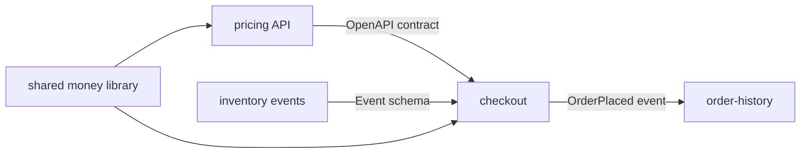
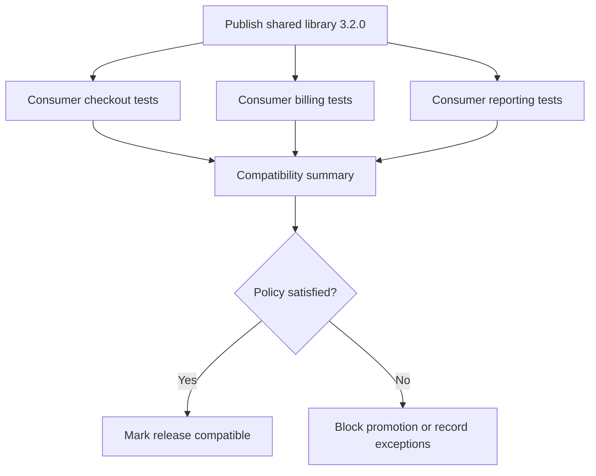

# Reducing Simultaneous Deployment Dependencies Between Services

In a system composed of multiple projects or microservices, a change in service A often triggers a need to update service B, C, or a shared library. If every release requires deploying all components simultaneously, the entire system's release velocity is bounded by its slowest component. A failing pipeline or an unready service can also block unrelated projects.

The goal of multi-project CI/CD is to let each project build, test, and release at its own pace while ensuring integration contracts are upheld. Achieving this requires explicitly managing dependencies, maintaining compatibility across concurrently running versions, passing artifacts/versions between pipelines, and orchestrating multiple projects into a single release only when a genuine technical reason demands it.

Deployment independence does not mean services never coordinate. It means most compatible changes can be released independently, while contract-breaking changes are identified, tested, and coordinated deliberately.

## 1. Why Does Simultaneous Multi-Service Deployment Slow Releases?

Suppose an order flow involves three services:

- `checkout` receives user requests and orchestrates order placement.
- `pricing` calculates prices, promotions, and taxes.
- `inventory` checks and reserves stock.

If `checkout` works only with one exact API version of `pricing`, every time `pricing` changes an endpoint or response schema, the team may have to deploy both services in the same window. If `inventory` also changes a message schema consumed by `checkout`, the release suddenly requires all three projects to be ready together.

Deployment coupling typically arises when:

- Consumers understand only a single contract version.
- Providers remove fields, endpoints, or messages still used by older consumers.
- Multiple services write directly to the same database schema.
- Downstream pipelines always rebuild or deploy from the latest `main` branch rather than a specific artifact version.
- A shared library is released without a compatibility window between old and new versions.
- Release orchestration forces every project to participate even when changes do not affect them.

The result is release trains with components waiting on each other, difficult rollbacks because services cannot revert together to a compatible state, and teams unable to pinpoint which change caused a failure.

### Distinguishing Dependencies from Deployment Dependencies

Two services can have a runtime dependency on each other yet still deploy independently if contracts remain compatible across multiple versions.

| Relationship | Meaning | Must Deploy Together? |
|---|---|---|
| Build dependency | Project needs another project's package or library to build | No, if packages are versioned and fetchable independently |
| Runtime dependency | Service A calls an API or sends messages to service B | No, if both sides keep contracts compatible during transition periods |
| Data dependency | Two services read/write the same data or schema | Often creates tight coupling; requires separating ownership or compatible migrations |
| Release dependency | A change is only safe after another project reaches a minimum version | May require deployment ordering, not necessarily simultaneous deployment |
| Operational dependency | Multiple projects share a cluster, database, queue, or environment | Requires resource coordination; does not mean releasing together |

When drawing a dependency graph, label the relationship type. An edge in a diagram should never be assumed by default to mean two services must deploy at the same time.

## 2. Designing Independently Releasable Services

Independent deployability starts with clear ownership boundaries and contracts. Each service should control its own data and business logic, publish API or event contracts that consumers can rely on, and maintain its own pipeline producing immutable artifacts.

Key principles:

1. **One service owns each contract:** the provider defines APIs/events and compatibility policies; consumers declare the versions or capabilities they require.
2. **Prefer additive changes:** add optional fields, new endpoints, or new event versions before removing old structures.
3. **Maintain an overlap window:** the provider supports old and new consumers concurrently long enough to roll out projects individually.
4. **Publish immutable artifacts:** consumers test against a specific version/digest rather than relying on `latest`.
5. **Test contracts on both sides:** providers verify they still satisfy consumers; consumers verify they still handle responses/events per the contract.
6. **Retire old APIs based on evidence:** remove them only after confirming no supported consumers still use them.

### Consumers Should Not Depend on Internal Implementations

Consumers should depend on public contracts, not on database tables, internal classes, or unversioned internal packages of the provider.

For example, `checkout` should call the `pricing` API or consume the `PriceCalculated` event. It should not directly query the `pricing_rules` table in `pricing`'s database. When the provider changes its storage layout, the consumer does not need to change as long as the contract holds.

If two services must share a library, publish the library as a versioned package with a public API and deprecation policy. Never use a copied source directory or a mutable branch as an integration contract.

## 3. Managing API Contracts for Backward Compatibility

API compatibility is the single most important tool for reducing simultaneous deployments. A provider should be able to release a new version while consumers running the previous version continue working.

### Generally Compatible Changes

For HTTP/JSON APIs, the following changes are typically compatible if consumers follow the contract:

- Adding a new endpoint without altering existing endpoints.
- Adding an optional response field.
- Adding an optional request field with a clear default.
- Adding metadata values that consumers are instructed to ignore if unrecognized.
- Raising limits or adding capabilities without altering existing field semantics.

Compatibility depends on how consumers parse data. A consumer using strict schema validation might reject a response simply because the provider added a field. Therefore, contracts must explicitly specify whether consumers must ignore unknown fields.

### Changes That Risk Breaking Contracts

- Removing or renaming a field currently used by consumers.
- Changing a field's data type, unit of measurement, or business meaning.
- Changing a field from nullable to required or vice versa without compatible defaults.
- Changing status codes, error formats, or retry semantics.
- Changing the ordering or meaning of enums when consumers parse by ordinal.
- Changing endpoints, authentication schemes, or pagination semantics.
- Making responses significantly slower or tightening rate limits that consumers rely on.

Look beyond syntax. An API can keep the exact same JSON shape while changing `totalAmount` from pre-tax to post-tax; that is still a business-logic breaking change.

### Example: Adding a Field Across Multiple Releases

Suppose provider `pricing` wants to add `taxAmount` to its response.

**Provider release P1:** add the new field while keeping all existing fields:

```json
{
  "subtotal": 120000,
  "total": 132000,
  "taxAmount": 12000
}
```

Old consumers keep reading `subtotal` and `total`, ignoring `taxAmount`. The provider can deploy P1 without requiring consumer changes.

**Consumer release C1:** the consumer begins reading `taxAmount` when present, while still handling responses from an older provider if the field is absent in un-upgraded environments. Depending on fallback design, the consumer can deploy before or after the provider.

**Provider release P2:** only after every consumer needing the new field supports it and data is ready does the provider consider removing legacy logic in a separate change. Never drop an old field just because one consumer migrated.

### Using Versioning When Changes Cannot Be Compatible

If semantic or structural changes cannot be made compatible, create a clearly versioned new contract, such as `/v2/prices` or event `PriceCalculated.v2`. Keep the old version for a deprecation window, measure usage, and notify consumer owners.

Versioning is not a reason to create a new version for every field. Only increment the major contract version when a change truly breaks compatibility. Otherwise, proliferating versions forces providers to maintain multiple implementations and complicates the test matrix.

## 4. Message and Event Compatibility Across Projects

In event-driven systems, producers and consumers can be deployed at very different times. Messages sitting in a queue or log may be replayed days after the producer released.

Therefore, message contracts need explicit compatibility policies:

- Consumers must handle optional or unknown fields per published rules.
- Producers must not remove old fields before supported consumers stop using them.
- Adding enum values requires safe handling for unknown values.
- Events need a schema version or stable event type.
- Consumers must be idempotent because messages can be redelivered.
- Broker retention and replay windows must be factored into deprecation windows.

### Example: Adding an Event Field

Old event:

```json
{
  "eventType": "OrderPlaced",
  "eventVersion": 1,
  "orderId": "ord-1042",
  "customerId": "cus-72"
}
```

New event adding an optional `channel` field:

```json
{
  "eventType": "OrderPlaced",
  "eventVersion": 1,
  "orderId": "ord-1042",
  "customerId": "cus-72",
  "channel": "mobile"
}
```

Old consumers must still process events without `channel`; new consumers must handle old events missing that field. If structural changes cannot be compatible, use a new version or new event type and keep consumers handling both during the transition period.

### Schema Registries and Compatibility Policies

When using Avro, Protobuf, or JSON Schema, a schema registry can validate compatibility before a producer publishes a new schema. Choose a policy suited to message storage and replay patterns:

| Policy | General Goal | When Appropriate |
|---|---|---|
| Backward | New consumers can read data written under old schemas | Consumers upgrade before producers |
| Forward | Old consumers can read new data within policy bounds | Producers upgrade before consumers |
| Full | Bidirectional compatibility | Producers and consumers roll out independently within an overlap window |
| Transitive | Checks against multiple historical versions, not just the latest | Old messages may be replayed over long periods |

Exact names and semantics depend on the schema format and registry. Define compatibility around reader/writer schemas and real replay policies rather than picking a label without checking which old versions still exist.

## 5. Separating Data Ownership to Reduce Coupling

Splitting services into separate repositories while letting them write directly to a shared database schema rarely yields real independence. One migration from service A can break service B even when B's pipeline never changed.

Each service should own its own data and write rules. Other services access it through published APIs, events, or read models. When cross-service queries require data, you can use:

- Read-only APIs with clear contracts.
- Events/CDC to maintain separate read models.
- Materialized views or projections owned by the consumer.
- Versioned data products with defined update SLAs.

Never use CDC or events to replicate every internal table without defining a schema contract. If consumers depend directly on internal column names or state, the provider still cannot evolve its schema independently.

### When a Database Must Still Be Shared

During transitions, physically splitting a database may not yet be feasible. At a minimum, designate schema/table owners, grant per-service permissions, forbid non-owners from writing directly to owned tables, and apply multi-step compatible migrations.

If multiple services must alter a shared schema, manage migrations as a database-level dependency. Never run migrations automatically from every service at once. A single migration owner or shared orchestrator pipeline must control versions and sequencing.

Expand-contract, dual-write, and backfill techniques help evolve schemas while keeping old consumers running. However, they must execute in a dedicated data migration workflow with proper data verification and rollback plans.

## 6. Versioning Artifacts and Publishing Shared Packages

Build dependencies should not force rebuilding every dependent project whenever provider source changes. Publish immutable versioned packages to a registry and let consumers declare the versions they have tested.

### Applying Semantic Versioning with Discipline

For libraries using SemVer:

- PATCH: bug fixes that do not alter the public API under compatibility commitments.
- MINOR: backward-compatible functionality additions.
- MAJOR: contract-breaking changes.

SemVer is only useful when providers define a public API and verify compatibility. If a package changes runtime behavior not captured in types/schemas, provide release notes and extra tests. Never auto-increment versions by build number and assume every version carries compatibility meaning.

### Pinning Dependencies in Consumers

Example Gradle library version declaration:

```kotlin
dependencies {
    implementation("com.example.platform:pricing-client:2.4.1")
}
```

Consumers rebuild with the declared version and appropriate dependency locking/verification. When the provider releases `2.5.0`, the consumer can open an update PR, run contract/integration tests, and merge on its own schedule.

Avoid dynamic versions such as `2.+` or `latest.release` in release builds when reproducibility is required. Dynamic versions can resolve differently across builds, causing the same commit to produce different artifacts.

### Promoting the Same Artifact Across Environments

The provider builds the package/image once, signs it, and records its digest. Staging, pre-production, and production consume the exact same tested artifact. Never rebuild packages in each consumer project or environment while assuming equivalent contents.

Release manifests should record source commits, package versions, artifact digests, provenance, and check results. Consumer pipelines record the provider version/digest they tested against so contract changes remain traceable.

## 7. Building a Dependency Graph to Trigger Only Related Pipelines

In a multi-repository system, do not trigger every pipeline whenever one project gets a new commit. Model the dependency graph and define which event types must propagate to consumers.

Example:



This graph helps answer:

- Does an implementation change in `pricing` need to trigger `checkout`?
- Which consumers are affected by an OpenAPI contract change?
- Does a shared library change require rebuilding/testing consumers pinned to that version?
- Which services reading a schema are affected by a database migration?
- Did a provider release produce a new artifact or merely update internal docs?

### Distinguishing Source Events from Release Events

A merged commit does not necessarily mean an artifact was released. Downstream pipelines should be triggered by appropriate events:

| Event | Meaning | Appropriate Downstream Action |
|---|---|---|
| Source merged | Code integrated | May run contract/consumer compatibility checks if contracts changed |
| Build passed | Artifact built | Record build metadata; not necessarily ready to promote |
| Artifact published | Immutable package/image published | Consumers can be notified of the new version |
| Contract changed | API/event schema changed | Run provider verification and relevant consumer contract tests |
| Release approved | Artifact eligible for release | Open promotion or dependency-update candidates |
| Production deployed | Version is live in production | Update deployment ledger and live dependency state |

Separating these events prevents consumers from building/deploying every time a provider lands an unreleased commit.

## 8. Event-Driven Pipelines Across Repositories

Provider pipelines should publish artifacts and metadata. Consumer pipelines can listen for events and decide whether to run compatibility checks or create dependency updates. Never auto-deploy a consumer simply because a provider published a new version, unless policy explicitly proves the change is safe and the consumer has been tested.

### Example: GitHub Actions Sending a Release Event

After publishing an artifact, a provider can send a `repository_dispatch` to a consumer repository using a least-privilege GitHub App token. The payload carries only reference metadata:

```yaml
- name: Notify checkout about pricing release
  env:
    DISPATCH_TOKEN: ${{ steps.app-token.outputs.token }}
    RELEASE_ID: ${{ steps.release.outputs.release_id }}
    ARTIFACT_DIGEST: ${{ steps.release.outputs.digest }}
  run: |
      [[ "$RELEASE_ID" =~ ^[A-Za-z0-9._-]+$ ]]
      [[ "$ARTIFACT_DIGEST" =~ ^sha256:[0-9a-f]{64}$ ]]
      payload="$(jq -n \
        --arg release_id "$RELEASE_ID" \
        --arg digest "$ARTIFACT_DIGEST" \
        '{event_type: "pricing-release-published", client_payload: {release_id: $release_id, digest: $digest}}')"
      curl --fail-with-body \
        -X POST \
        -H "Accept: application/vnd.github+json" \
        -H "Authorization: Bearer $DISPATCH_TOKEN" \
        -H "X-GitHub-Api-Version: 2022-11-28" \
        https://api.github.com/repos/example/checkout/dispatches \
        -d "$payload"
```

This is a condensed example; a GitHub App installation token must be generated in an earlier step, and release ID/digest values must be validated before embedding in JSON. Use `jq` to serialize payloads safely rather than string concatenation. Tokens must never be printed to logs and must be scoped solely to dispatching to the target repository.

Consumer receiving the event:

```yaml
name: Verify upstream release

on:
  repository_dispatch:
    types: [pricing-release-published]

permissions:
  contents: read

jobs:
  compatibility:
    runs-on: ubuntu-latest
    steps:
      - uses: actions/checkout@v4
      - name: Verify release reference
        env:
          UPSTREAM_RELEASE_ID: ${{ github.event.client_payload.release_id }}
          UPSTREAM_DIGEST: ${{ github.event.client_payload.digest }}
        run: |
          ./scripts/verify-pricing-release.sh \
            "$UPSTREAM_RELEASE_ID" \
            "$UPSTREAM_DIGEST"
      - name: Run consumer contract tests
        run: ./gradlew --no-daemon contractTest
```

Payloads are untrusted input. Consumers must fetch the release manifest from a trusted registry/ledger, verify signatures, provenance, and digests, and then run contract checks. Never execute scripts, workflows, or attached artifacts from an upstream repository solely because an event arrived.

This example triggers compatibility verification only. Updating `checkout`'s dependency can be automated as a pull request, subject to the consumer's own gates and reviews. That allows providers to publish independently while consumers actively choose when to upgrade.

### Avoiding Trigger Loops and Uncontrolled Cascades

If A publishing triggers B, and B publishing triggers A, pipelines can enter a loop. Every event needs a source release ID, correlation ID, and event type. Consumers should emit downstream events only when they genuinely produce a new artifact/release, never re-emitting an incoming event as if it were their own release.

Put in place:

- Idempotency keys so redelivered events do not create duplicate updates.
- Allowlists for permitted event types and source repositories.
- Loop prevention using correlation IDs or release lineage.
- Rate limits and fan-out caps.
- Dead-letter or retry policies for failed dispatches.
- Audit logs covering producer, consumer, and processing outcomes.

## 9. Fan-Out and Fan-In in Multi-Project Pipelines

A change in a shared library can affect multiple consumers. A pipeline can fan out to test consumers in parallel, then fan in to aggregate results before marking a release eligible.



Fan-out works well when consumer tests are independent. Fan-in must know which consumers are mandatory, which are retired, and which are warning-only. If a critical consumer fails, policy can block a major release; if an experimental consumer is no longer active, an exception with an owner can be recorded.

### Avoid Waiting on Every Consumer for Every Patch Release

A compatible patch release may not need to run the entire consumer matrix when contracts are unchanged and policy verifies it. For major contract changes or broadly used shared libraries, however, fan-out verification can serve as a pre-release gate.

Fan-out scope must rely on an up-to-date dependency inventory. If the inventory is incomplete, treat it as a risk and widen verification instead of skipping unlisted consumers.

## 10. Consumer-Driven Contract Testing

Consumer-driven contract testing lets consumers describe the exact interactions they require from a provider. The provider runs verification of those contracts inside its own pipeline.

Typical flow:

1. Consumer tests generate contracts for the requests/responses or messages they use.
2. Contracts are published to a versioned broker/store linked to the consumer build.
3. The provider pipeline fetches contracts for supported consumers.
4. Provider verification confirms the current implementation satisfies those contracts.
5. Results are recorded by provider version and consumer version.
6. Release policies check which version combinations are permitted to deploy.

### Benefits

- Providers detect consumer-breaking changes early, before deployment.
- Consumers do not have to wait for providers to deploy to a shared integration environment to test every change.
- Explicit evidence exists for verified provider/consumer combinations.
- Can reduce how often full-system end-to-end tests must run.

### Limitations to Understand

Contract tests only verify interactions explicitly described. They do not prove full business logic, performance, security, or system availability. A contract can pass while production still fails due to real data, networking, timeouts, or external dependencies.

Combine contract tests with representative integration tests, smoke tests, and monitoring. Contracts should reflect actual consumer usage, avoiding overly rigid expectations that prevent providers from refactoring internal implementations.

## 11. Managing a Version Compatibility Matrix

When services deploy independently, multiple version combinations coexist at any given time. Never assume the entire system always moves on the same release train.

A simple matrix:

| Consumer `checkout` | Provider `pricing` 2.3 | Provider `pricing` 2.4 | Provider `pricing` 3.0 |
|---|---:|---:|---:|
| `checkout` 1.8 | Supported | Supported | Not supported |
| `checkout` 1.9 | Supported | Supported | Supported after contract update |
| `checkout` 2.0 | Not supported | Supported | Supported |

The matrix must derive from contract tests, compatibility policies, and release metadata. Never mark "Supported" merely because two services happened to run together in staging.

### Recording Supported Version Ranges

Each consumer can declare:

- Minimum provider version.
- Maximum tested provider version or supported major versions.
- Required contract/schema versions.
- Mandatory capability flags.
- End-of-support date for older versions.

A consumer's release manifest can record tested runtime dependencies. The deployment controller or release gate validates actual combinations before promotion.

### Limiting Supported Combinations

If every service supports unlimited provider versions, the matrix explodes. Establish deprecation policies and upgrade deadlines. For example, support the current major and one prior major during an overlap window, depending on SLAs and system scale.

Retiring a version requires live usage telemetry, notice to consumer owners, and a plan for inactive consumers—never just counting released version numbers.

## 12. Ordered Deployment When Multiple Projects Still Need Coordination

Some changes require deployment ordering without requiring simultaneous deployment. Split changes into compatible releases.

### Adding a New Capability

For example, provider `pricing` adds a shipping-fee calculation API:

1. Deploy the provider with the new endpoint while keeping the old endpoint functional.
2. Verify the new endpoint in staging/canary.
3. Deploy consumers containing code supporting both old and new provider behavior.
4. Enable the feature flag for a small cohort.
5. Monitor metrics and gradually ramp traffic.
6. Once all consumers needing the capability have migrated, consider cleaning up legacy code in a later release.

The provider can release before the consumer because the old API remains intact.

### Retiring a Field or Endpoint

When removing `legacyStatus`:

1. Provider marks it deprecated and emits usage telemetry.
2. Consumers are updated to stop reading the old field/endpoint.
3. Consumer owners confirm updated versions are deployed and legacy traffic has ceased.
4. Provider waits through the deprecation window and batch/job cycles.
5. Provider removes the field/endpoint in a major contract release.

Here consumers must move first, and the provider removes afterward. Both do not need to deploy at the same instant.

### When a Change Is Truly Breaking

If maintaining two contracts in parallel is impossible, use planned release orchestration:

- Pick a change window and identify every affected service.
- Produce a pinned list of artifacts/configs per project.
- Test the version combination in a representative environment.
- Define deployment order and stop conditions between steps.
- Freeze unrelated changes during the required window.
- Prepare rollback/forward-fix plans for both code and data.
- Assign an owner responsible for coordinating and verifying final state.

This is a managed exception, never the default release pattern for routine changes.

## 13. Release Orchestration vs. Deployment Orchestration

Keep these two concepts distinct:

- **Release orchestration:** determines which artifacts, contracts, and version combinations are approved for release.
- **Deployment orchestration:** controls the order and timing of applying artifacts to environments.

A single release may encompass multiple service versions yet deploy in stages. For instance, the provider deploys first, consumers follow, and feature flags turn on last. The release manifest records the entire verified combination.

### When Is a Central Orchestrator Pipeline Needed?

A central pipeline is useful when:

- A release genuinely consists of multiple artifacts that must be validated as a single set.
- A shared approval is required for a change with a large blast radius.
- Migration/provider/consumer ordering cannot be decided independently per repo.
- Statuses from multiple pipelines must be aggregated before production promotion.

Do not turn a central pipeline into the builder for every project. Each repository still owns its own build, tests, and artifacts; the orchestrator pipeline merely references release manifests, invokes necessary jobs, and aggregates results.

### Choreography or Orchestration?

| Coordination Style | Characteristics | When Appropriate |
|---|---|---|
| Event choreography | Projects emit events; consumers react per contract | Loose coupling, many consumers, no fixed deployment order needed |
| Central orchestration | One controller decides steps and order across projects | Releases with mandatory dependencies needing central audit/approval |
| Hybrid | Events announce changes; controller coordinates high-risk changes | Large systems with many independent flows and occasional coordinated releases |

Choreography scales easily but becomes hard to observe without correlation IDs and ownership. Orchestration controls order well but creates bottlenecks if every routine change must pass through a central pipeline.

## 14. Designing Multi-Project Pipelines in GitLab

GitLab supports multi-project pipelines so one project can trigger a pipeline in another project. For example, a provider can trigger a consumer to run contract tests after publishing a release candidate:

```yaml
notify_checkout:
  stage: notify
  trigger:
    project: platform/checkout
    branch: main
    strategy: depend
  variables:
    UPSTREAM_PROJECT: "$CI_PROJECT_PATH"
    UPSTREAM_COMMIT: "$CI_COMMIT_SHA"
    RELEASE_ID: "$RELEASE_ID"
    ARTIFACT_DIGEST: "$ARTIFACT_DIGEST"
```

`strategy: depend` makes the trigger job status depend on the downstream pipeline's outcome in GitLab versions supporting this semantics. Verify your GitLab version and trigger permissions between the two projects. Downstream pipelines must verify release manifests and digests from the registry; never trust passed variables solely because they came from upstream.

Never pass production secrets through variables merely for downstream convenience. Each project should fetch its own secrets from a secret manager using its own identity. Trigger tokens or job tokens must be restricted to the target project and least-privilege permissions.

### Trigger Only Affected Consumers

A provider may have many consumers. Maintain a dependency inventory or contract broker to determine which projects need to run. Never trigger every project in a group when only one contract changed.

If a downstream pipeline only checks compatibility, do not auto-deploy. Creating a dependency update or promoting requires the consumer's own gates.

## 15. Controlling Permissions and Trust Across Repositories

Multi-project pipelines expand trust boundaries. One repository can send events to another repository, create pipelines, request artifacts, or access package registries.

Principles:

- Use GitHub Apps, GitLab job tokens, or workload identities with minimal scope instead of broad-privilege PATs.
- Allowlist only permitted repositories/projects and event types.
- Consumers verify release records, signatures, provenance, and artifact digests.
- Never execute scripts from untrusted upstream branches in pipelines holding secrets.
- Never grant production deployment permissions to pipelines meant only for notifications.
- Separate identities for build, publish, sign, and deploy.
- Audit triggers, artifact downloads, dependency updates, and promotions.
- Enforce concurrency and rate limits so one upstream cannot exhaust runners across the entire organization.

In particular, pull requests from forks or unprotected branches must never have permission to send events that trigger privileged pipelines. Triggers should originate only from policy-approved release jobs using explicitly authorized identities.

## 16. Observing Cross-Project Release Status

When each service deploys independently, dashboards must show currently running version combinations and dependency compatibility, not just individual repository pipeline statuses.

A deployment ledger can record:

| Field | Example |
|---|---|
| Environment | production |
| Service | checkout |
| Release ID | `checkout-2026.11.18.2` |
| Artifact digest | `sha256:<digest>` |
| Dependency | `pricing-client 2.4.1` |
| Runtime provider | `pricing-api 2.5.0` |
| Contract status | verified |
| Deployment time | timestamp |
| Rollout state | complete |

When an incident occurs, teams can trace which services are using the affected contract/version. Link traces or metrics with service versions and dependency versions to diagnose cross-service failures.

### Tracking Deprecation and Consumer Usage

Providers should measure:

- Request counts by API version, endpoint, and consumer identity.
- Error rates and latencies per consumer.
- Message schema versions currently being consumed.
- Number of consumers still using legacy fields/endpoints.
- Consumers sending no traffic for extended periods that still appear in the inventory.

Never delete a contract simply because metrics show zero traffic for one day. Batch consumers or monthly jobs might not have run within the observation window. Combine telemetry with owner confirmation and operational schedules.

## 17. Handling Failures When a Project Releases Independently

If a provider releases a new version and a consumer fails contract tests, do not immediately roll back the provider blindly. Determine whether the old contract is still supposed to be supported.

A workflow:

1. Identify the provider artifact/digest and the running consumer version.
2. Check whether the failure is contract-breaking or merely an implementation bug.
3. If the old contract is still supported, keep the provider on the new version and fix the consumer separately.
4. If the provider violated a published contract, roll back the provider or ship a forward fix based on impact.
5. Check other consumers to determine the blast radius.
6. Update the compatibility matrix and add missing contract tests.

Rolling back a single independent service usually carries less risk than rolling back an entire release train, provided contracts and data remain compatible. If a schema was already contracted or new events were emitted that older consumers cannot parse, a dedicated recovery plan is needed.

### Never Roll Back a Consumer Blindly

An older consumer may fail to process new messages already published by the producer. Before rolling back, verify whether the consumer can read the current backlog, safely skip new events, or needs an adapter/replay. Similarly, rolling back a provider can remove an endpoint that new consumers already call. Compatibility windows must account for the rollback path as well.

## 18. Practices That Lock Projects Into Simultaneous Releases

| Practice | Consequence | How to Improve |
|---|---|---|
| Consumers call APIs without clear contracts/versions | Providers cannot evolve independently | OpenAPI/schemas and compatibility policies |
| Providers delete fields right after deploying new consumers | Old consumers or batch jobs fail | Deprecation windows and usage evidence |
| All consumers use `latest` | Build outputs vary by timing | Pin package versions and artifact digests |
| Every provider commit triggers consumer deploys | Pipeline cascades and unnecessary releases | Trigger on artifact/contract release events |
| Shared database written directly by multiple services | One service's migration breaks others | Data ownership, APIs/events, and migration coordination |
| Central pipeline rebuilds every repository | Bottlenecks and unclear tested artifacts | Build independently; orchestration only references artifacts |
| Blindly trusting event payloads | Risk of spoofed digests or releases | Verify manifests/signatures from trusted registries |
| No compatibility matrix | Unclear which version combinations are supported | Contract tests and deployment ledgers |
| Handling every breaking change with simultaneous deploys | Large release windows, hard rollbacks | Versioned contracts and overlap windows |
| Testing only provider or only consumer | One side can break interactions | Consumer-driven contracts and provider verification |
| Not tracking consumers of legacy APIs | Deleting contracts while active callers remain | Usage telemetry and ownership inventory |

## 19. Checklist for Reducing Simultaneous Deployment Dependencies

Before designing or modifying multi-project pipelines, check:

- [ ] The dependency graph distinguishes build, runtime, data, release, and operational dependencies.
- [ ] Every service has an owner and public contracts.
- [ ] Consumers do not depend directly on a provider's internal implementation or database.
- [ ] API/event changes follow additive-first, remove-later practices.
- [ ] Old and new consumers can operate concurrently within a defined overlap window.
- [ ] Breaking changes have versioning/deprecation policies and an affected-consumer list.
- [ ] Shared libraries are published as immutable versioned packages.
- [ ] Consumers pin dependency versions; release builds avoid arbitrary dynamic versions.
- [ ] Artifacts are built once, signed/verified, and promoted by the same digest.
- [ ] Downstream pipelines trigger on appropriate release/contract events rather than every commit.
- [ ] Events include source identity, release ID, correlation ID, and idempotency handling.
- [ ] Consumers verify manifests, signatures, provenance, and digests before using upstream artifacts.
- [ ] Fan-out targets only affected consumers; fan-in defines explicit mandatory/exception policies.
- [ ] Consumer-driven contract tests and provider verification are integrated into pipelines.
- [ ] The compatibility matrix reflects combinations actually verified by tests.
- [ ] Release orchestration is reserved for changes genuinely requiring multi-project coordination.
- [ ] Cross-repo trigger and deploy permissions are scoped, audited, and separated.
- [ ] Deployment ledgers record service versions, dependency versions, and contract statuses.
- [ ] Procedures exist for handling consumer failures, provider rollbacks, and event backlogs.
- [ ] Deprecation windows are long enough for batch jobs, replays, and infrequent consumers.

Reducing simultaneous deployment dependencies is the result of stable contracts, versioned artifacts, and pipelines that propagate the right events. Providers can release compatible changes first; consumers upgrade once tested; legacy structures are removed only after supported consumers have migrated. When a breaking change is unavoidable, release orchestration coordinates a controlled exception rather than turning every release into a system-wide deployment.
