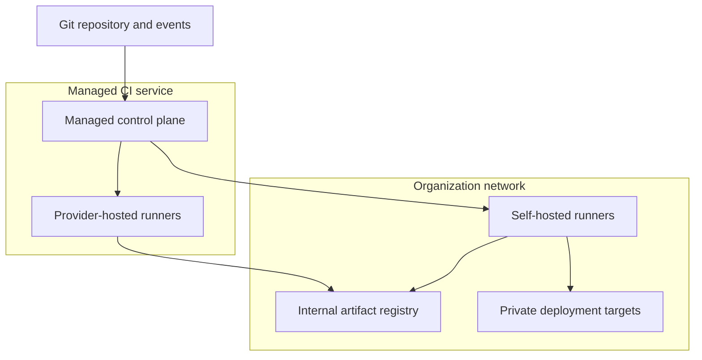

# Distinguishing Managed Services from Self-Hosted CI Systems

When choosing a CI/CD tool, teams often must decide whether to use a provider-managed service (managed CI service) or deploy and operate a CI platform themselves (self-hosted CI). Both models can run pipelines, execute tests, build artifacts, and integrate with release systems. The major difference lies in the boundary of responsibility: who operates the control plane, who provisions and maintains the runners, where data resides, who handles upgrades and incidents, and the actual cost of sustaining the service.

Do not decide based solely on list price or feature count. A managed service may reduce platform administration work, yet still require the team to manage runners, networking, workflows, and secrets themselves. A self-hosted system can offer deeper control, but demands operational, security, backup, upgrade, and on-call capabilities. Some organizations choose a hybrid model: using a managed control plane while executing jobs on private runners inside an internal network.

In CI/CD, the right choice is the model that meets security, compliance, integration, availability, and feedback speed requirements at an acceptable total cost of operations. You must evaluate both the platform and how pipelines execute, because those two parts can be managed by different parties.

## 1. Distinguishing the Control Plane and Execution Plane

Before comparing the two models, separate the orchestration platform from where work executes:

- **Control plane:** receives Git events, resolves workflows, schedules jobs, and manages state, permissions, approvals, logs, and the administration UI.
- **Execution plane:** runners/agents that execute scripts, builds, tests, scans, packaging, and deployments.
- **Artifact/data plane:** where artifacts, caches, logs, test reports, provenance, and metadata are stored.

A managed CI service typically provides the control plane as SaaS. The execution plane can be provider-hosted runners or organization-managed runners. Therefore, "using managed CI" does not necessarily mean all jobs run on external infrastructure.

Conversely, a self-hosted system typically places the control plane in the organization's infrastructure, and the team operates the runners themselves. Artifact registries, caches, databases, or log storage may use separate managed services. The exact boundary depends on the architecture.



The diagram shows that a managed control plane can orchestrate both hosted and self-hosted runners. Jobs may need to run on internal runners to reach private databases, registries, or deployment targets. When evaluating tools, ask clearly which components are operated by the provider and which belong to the team.

## 2. The Managed CI Service Model

A managed CI service is a service where the provider operates most of the control plane: platform updates, job orchestration, workflow state storage, UI, API, and often hosted runners.

Common characteristics:

- Defining pipelines via YAML or configuration inside the repository.
- Direct integration with Git hosting, pull requests, branch protection, and status checks.
- Hosted runners based on provided operating systems or images.
- Support for scaling runners on demand or up to service quotas.
- Built-in logs, artifact storage, caching, approvals, and a marketplace/integrations.
- The provider bears partial responsibility for availability, patching, and control plane operations.

### Benefits

- The team does not have to build and maintain databases, schedulers, web servers, and CI management systems.
- Fast onboarding, well suited for small teams or organizations without a dedicated platform team.
- Easy to scale when workloads grow if quotas and runner types meet requirements.
- Git and developer workflow integrations are usually ready out of the box.
- The provider handles much of the control plane maintenance work.

### Limitations to Evaluate

- Dependent on provider availability, quotas, job duration limits, and policies.
- Costs can grow with runner minutes, concurrency, storage, artifact transfer, or advanced features.
- Hosted runners may not directly reach private resources without dedicated network configuration.
- Customization of operating systems, hardware, kernels, or toolchains may be limited.
- Logs, artifacts, and metadata may be stored in regions or retention periods dictated by the service.
- Changes in pricing, APIs, limits, or terms of service can affect long-term plans.

Managed does not eliminate the organization's responsibility for workflows, token permissions, secrets, dependencies, artifacts, and code running inside pipelines. A platform provider cannot automatically determine whether a workflow is safe.

## 3. The Self-Hosted CI Model

Self-hosted CI is a model where the organization deploys and operates the CI control plane within its own infrastructure. A common example is installing a CI server such as Jenkins or an equivalent platform, then configuring agents/runners, storage, databases, backups, and Git integrations.

Components the team may have to operate:

- Web/API servers and schedulers.
- Databases or metadata stores.
- Queues, caches, and artifact storage.
- Runner/agent pools and image builds.
- Plugins, extensions, and integrations.
- TLS, DNS, ingress, firewalls, and identity providers.
- Backup, restore, disaster recovery, and monitoring.
- Upgrades, patching, vulnerability management, and capacity planning.

### Benefits

- Deeper control over data locality, networking, runner images, and integration methods.
- Ability to run jobs inside internal networks or on specialized hardware.
- Control over upgrade schedules and configurations when sound operational processes exist.
- Flexibility to customize plugins, integrations, schedulers, or build environments as needed.
- Can optimize for specialized workloads such as embedded software builds, GPUs, mobile signing, or legacy systems.

### Costs and Risks

- Requires a team capable of operating the platform and handling incidents.
- The team is responsible for patching, upgrading, backing up, restoring, and securing the control plane.
- Runners can become an entry point for compromise if untrusted jobs share the same host.
- Scaling capacity requires provisioning, internal quotas, networking, and storage.
- Outdated plugins or extensions can introduce vulnerabilities and version conflicts.
- A control plane or database outage can halt all pipelines.
- Time spent maintaining the platform takes resources away from improving developer workflows.

Self-hosted is not inherently more secure. Placing servers inside an internal network only controls part of the data path; weak administrative permissions, vulnerable plugins, shared runners, or slow patching can increase risk.

## 4. The Hybrid Model

Hybrid combines multiple management boundaries. Some common configurations:

1. Managed control plane with self-hosted runners inside a VPC/VNet or datacenter.
2. Managed control plane and hosted runners for regular PRs, internal runners for production deployments.
3. Self-hosted control plane while using managed artifact registries, secrets managers, or databases.
4. Multiple isolated runner pools separated by trust level, CPU architecture, operating system, or environment.

Hybrid is useful when you want to reduce the operational burden of the control plane while still needing jobs to access private resources or use specialized hardware. However, it introduces additional integration responsibilities: runners must authenticate with the control plane, networks must permit the right traffic flows, logs/artifacts must be protected, and permissions for each pool must be isolated.

Do not let a single runner pool be shared across all job types. Jobs from untrusted pull requests, release build jobs with artifact signing permissions, and production deployment jobs with privileged credentials require distinct trust boundaries.

## 5. Comparing Operational Responsibilities

The table below is a general model; actual responsibilities must be verified against the service contract and chosen architecture.

| Item | Managed control plane | Self-hosted control plane |
|---|---|---|
| Platform installation | Provider | Organization |
| Control plane patching/upgrades | Primarily provider | Organization |
| Control plane availability | Per provider SLA | Designed and operated by organization |
| Hosted runners | May be managed by provider | Usually managed by organization |
| Self-hosted runners | Managed by organization | Managed by organization |
| Network access to private resources | Requires runner/network integration | Organization controls the entire path |
| Workflow and pipeline code | Organization | Organization |
| Secrets and tokens in jobs | Shared responsibility | Primarily organization |
| Artifact and cache policies | Configured per service | Designed/operated by organization |
| Control plane backup | Per service capabilities | Executed by organization |
| Compliance evidence | Partially provided by provider; assessed by organization | Collected and maintained by organization |
| Capacity and quotas | Per plan/quota and runner choice | Provisioned and scaled by organization |

Use a shared responsibility matrix for each specific service. For instance, the provider may be responsible for encrypting storage at the platform layer, while the organization remains responsible for configuring artifact read permissions, retention periods, and what types of data are allowed to be uploaded.

## 6. Securing the Control Plane and Runners

CI/CD has access to source code, dependencies, artifact registries, signing keys, and sometimes production itself. Therefore, the CI platform is a critical part of the software supply chain.

### Control plane

For both managed and self-hosted:

- Enable MFA/SSO and manage permissions by group/role.
- Restrict who can edit workflows, secrets, runner groups, and environment protections.
- Protect main branches and require reviews for pipeline changes.
- Scope token permissions per job and grant them only when truly needed.
- Record audit logs for changes to permissions, secrets, runners, and workflows.
- Separate CI administration privileges from production administration privileges where possible.

For self-hosted, additionally patch the OS/runtime, secure databases, ingress, backup credentials, plugins, and admin endpoints. Do not expose the administration dashboard to the Internet without appropriate protective layers.

### Runners and job isolation

Runners execute code from repositories and dependencies. A malicious job can read leftover files, environment variables, tokens, or data from a previous job if an insecure shared environment is used.

- Prefer ephemeral runners for untrusted jobs or high-privilege jobs.
- Clean up workspaces and credentials after each job.
- Do not run pull requests from forks on runners with production permissions.
- Separate runner pools by trust level: untrusted PR, trusted build, release/signing, and deployment.
- Do not mount the Docker socket or host filesystem unless the job requires it.
- Restrict network egress and access to metadata/cloud APIs.
- Do not allow privileged jobs to run on the same host as jobs from untrusted sources.

### Example of separating runner pools

```yaml
jobs:
  pull_request_checks:
    runs-on: ubuntu-24.04
    permissions:
      contents: read
    steps:
      - uses: actions/checkout@<FULL_COMMIT_SHA>
      - run: ./gradlew test

  production_deploy:
    if: github.ref == 'refs/heads/main'
    environment: production
    runs-on: [self-hosted, production-deploy]
    permissions:
      contents: read
      id-token: write
    steps:
      - run: ./scripts/deploy-approved-digest.sh
```

This is a conceptual example. The action SHA is a placeholder that must be replaced with a verified full commit SHA; runner labels, protected environments, approvals, and OIDC trust policies must be configured in practice. Do not allow workflows from pull requests to arbitrarily select privileged runners.

## 7. Networking and Access to Internal Resources

Managed runners typically run within a provider-managed network. If a job needs to reach private databases, registries, or deployment APIs, you may need:

- Self-hosted runners placed inside a VPC/VNet or datacenter.
- Private networking or dedicated connectivity supported by the provider.
- A VPN/tunnel with restricted routes and identities.
- Proxies or private endpoints for artifact/dependency registries.

Self-hosted runners also need network policies. Do not open the entire internal network to all runners simply because they sit in the same datacenter. Segment subnets/security groups, restrict egress, and grant access only to the exact endpoints/ports needed.

Under every model, test DNS, TLS, proxies, certificate trust, outbound access, and secrets manager reachability from the exact runtime context. A green pipeline on hosted runners does not prove that internal production runners share the identical configuration.

## 8. Scaling, Performance, and Availability

CI workloads often spike during working hours, releases, or major merges. Evaluate:

- Concurrent job count and runner wait times.
- Runner provisioning time and image/toolchain download time.
- CPU, memory, disk I/O, and network throughput.
- Scale-out capability and concurrency limits.
- Queue times when the provider or internal infrastructure is under heavy load.
- Availability of the scheduler, database, queue, and artifact store.

A managed service can scale the control plane and hosted runners via the provider's mechanisms, yet still has quotas, concurrency caps, or job timeout limits. Self-hosted allows optimizing dedicated capacity, but requires autoscaling, standardized images, schedulers, and plans for node/zone failures.

### High availability for self-hosted

If CI is a critical service, design for:

- Multiple instances/control-plane replicas if supported by the product.
- Databases with backups and appropriate HA mechanisms.
- Recoverable queues or schedulers.
- Artifact stores with appropriate durability and replication.
- Runner pools across multiple nodes/zones if required.
- Monitoring for queue depth, job latency, runner health, and storage.
- Recovery runbooks and restore drills.

Not every CI system needs active-active. A simpler architecture with backup/restore can be chosen if RTO/RPO targets are met. However, clearly define how pipelines behave when the control plane loses connectivity: whether running jobs continue, whether results are recorded, and whether new jobs can be started.

## 9. Total Cost of Ownership (TCO)

Comparing service fees to server hardware costs is not enough. TCO must account for both direct costs and human engineering time:

**Managed CI:**

- Subscription or usage fees.
- Hosted runner minutes, concurrency, and runner sizes.
- Storage, cache, artifact transfer, and retention.
- Governance, compliance, or support feature fees.
- Self-hosted runner costs if internal networking is needed.
- Effort to manage workflows, security, and integrations.

**Self-hosted CI:**

- VMs/bare metal, storage, databases, networking, and licenses.
- Runner capacity, autoscaling, and image maintenance.
- Backup, DR, monitoring, and log storage.
- Patching, upgrades, plugin compatibility, and security response.
- On-call, incident handling, and platform engineering time.
- Opportunity cost of the team maintaining CI instead of improving the product.

A general calculation model:

```text
TCO =
  infrastructure_or_subscription
  + runner_compute
  + storage_and_network
  + support_and_license
  + security_and_compliance
  + operations_labor
  + outage_and_recovery_cost
```

Labor and incident costs are frequently overlooked. If an engineer spends several days every month upgrading plugins, fixing runners, or restoring a database, that is a real cost of self-hosted CI.

Evaluate against actual workloads: jobs per month, duration, peak concurrency, runner types, artifact sizes, retention, cache hit rates, and support hours. Do not compare based on a single average price figure if the two models have different quotas or billing structures.

## 10. Compliance, Data Residency, and Audit

Organizations may need to control:

- Which region stores source code, build logs, artifacts, and metadata.
- Which data is uploaded to external services.
- Retention duration for logs, artifacts, and caches.
- How data is deleted upon retention expiry or service termination.
- Whether audit events can be exported and retained independently.
- Whether the provider holds certifications/attestations matching internal requirements.
- Whether runners are permitted to access sensitive or production data.

Managed services typically provide compliance documentation and platform control details, but the organization must still verify certification scope, regions, subprocessors, retention, and configuration responsibilities. A provider's certification does not automatically prove the organization's entire pipeline is compliant.

Self-hosted allows choosing where data and logs reside, yet the team must independently maintain evidence of access control, patching, backups, audits, vulnerability handling, and operations. Greater control carries the obligation to prove those controls are operating effectively.

## 11. Integration with the Development Ecosystem

Evaluate alignment with:

- Git hosting, pull requests, branch protection, and code review.
- Artifact registries and dependency proxies.
- Secrets managers, KMS, and workload identity/OIDC.
- Container registries, Kubernetes, cloud accounts, and deployment platforms.
- Security scanners, SBOM, signing, and provenance.
- Issue/change management, chat notifications, and incident platforms.
- Metrics/logging/tracing and audit exports.

Managed CI often has built-in integrations with its Git ecosystem or marketplace. Self-hosted allows deep customization, but requires maintaining compatible plugins/APIs. A critical integration supported only via an unmaintained plugin can become an operational risk.

Prefer portable protocols and formats: pipeline as code, artifact digests, standard test reports, SBOMs, provenance, OIDC, and documented APIs. This reduces switching costs when changing platforms.

## 12. Upgrades, Plugins, and Platform Lifecycle

Managed services typically update the control plane on the provider's schedule. Teams must track release notes, breaking changes, deprecations, and the ability to pin runner/toolchain versions. The fact that a provider updates the platform does not mean the organization's build environment is automatically reproducible.

Self-hosted requires a formal process:

1. Track platform, plugin, and dependency versions.
2. Review security advisories and compatibility matrices.
3. Test upgrades in a staging/separate control plane.
4. Back up databases/configurations and verify restores before major changes.
5. Deploy within a maintenance window or via a supported rolling strategy.
6. Verify workflows, runner registrations, artifacts, and audits after upgrading.
7. Maintain a rollback plan if the upgrade fails.

Plugins extend functionality but also expand the attack surface and compatibility risk. Install only plugins with an owner, trusted source, update cadence, and clear justification. Avoid letting unmaintained plugins hold broad token or filesystem access.

## 13. When to Choose Managed, Self-Hosted, or Hybrid?

There is no single best choice for every organization. Some reference scenarios:

| Context | Typically Suitable Model | Reason |
|---|---|---|
| Small team, limited platform operations capacity | Managed | Reduces the work of standing up and maintaining a control plane |
| Git-hosting SaaS is central, jobs are mostly standard build/test | Managed + hosted runners | Fast integration and onboarding |
| Jobs need access to private networks | Managed + self-hosted runners or hybrid | Managed control plane, execution inside private network |
| Specialized hardware/build environments | Self-hosted or hybrid | Control over devices, OS, and toolchain |
| Strict internal data storage requirements | Self-hosted or managed with suitable region/private options | Must verify data residency and contracts |
| Organization has a platform team and deep customization needs | Self-hosted/hybrid | Has operational capability and control requirements |
| Multiple workloads with different trust levels | Managed or self-hosted with isolated runner pools | Separates untrusted, release, and deployment workloads |

Do not choose self-hosted merely because you want "total control" if nobody is accountable for patching and operational on-call. Conversely, do not choose managed merely because it is easy to start if regions, data handling, quotas, or networking fail to meet requirements.

## 14. Weighted Evaluation Framework

A scorecard helps teams discuss options using consistent criteria. Assign weights based on organizational context, then score each option against real evidence.

| Criterion | Evaluation Question | Suggested Weight |
|---|---|---:|
| Security/isolation | Can untrusted PRs, releases, and production deploys be isolated? | 20% |
| Integration/network | How does it reach Git, registries, private targets, and identity? | 15% |
| Availability/scale | Does it meet peak concurrency, SLA, and recovery needs? | 15% |
| Compliance/data | Do region, retention, audit, and export capabilities meet requirements? | 15% |
| TCO | What is the total cost of service fees, runners, storage, and labor? | 15% |
| Developer experience | What about feedback time, UI, logs, local debugging, and workflow reuse? | 10% |
| Maintainability | How are upgrades, plugins, support, and portability handled? | 10% |

These weights are only a starting point. For organizations bound by strict data residency rules, compliance may carry higher weight; for platforms with continuous releases, availability and feedback time may matter more. Do not score from brochures: run a pilot and collect evidence.

## 15. Pilot Before Deciding

A small pilot should use a representative service that includes build, test, artifacts, and staging deployment. Do not just run an echo job and conclude the platform is suitable.

The pilot should test:

1. Repository connectivity, pull requests, and branch protection.
2. Pipeline as code and workflow/template reuse.
3. Runner provisioning, concurrency, and queue time under normal/peak load.
4. Caching, artifact upload/download, and retention.
5. Secret injection, OIDC/workload identity, and least privilege.
6. Running jobs from untrusted pull requests on isolated runners.
7. Reaching private registries or staging targets if needed.
8. Approvals, audit logs, and evidence exports.
9. Job cancellation, retries, timeouts, and recovery when control plane/runners lose connection.
10. Cost under projected workload and operational effort.

Measure time to first signal, time to required checks, queue time, runtime, failure rate, and administrative effort. Test both a normal pipeline and a failure scenario. Pilot results should be recorded to compare the same workload across models.

## 16. Migration Roadmap Between the Two Models

Migrating from self-hosted to managed or vice versa is not just copying YAML files. You must also migrate identities, secrets, runners, artifacts, caches, audits, and operational procedures.

A safe roadmap:

1. Inventory current workflows, plugins, runner labels, secrets, artifacts, and integrations.
2. Decouple pipeline logic from provider-specific configuration where possible.
3. Standardize artifact identity by digest and store build provenance.
4. Define runner pools by trust level and network requirements.
5. Run selected workflows in parallel on the new platform against the same commit.
6. Compare test results, artifact digests, durations, and logs.
7. Migrate repositories or workload groups incrementally.
8. Preserve rollback capability during the transition period.
9. Decommission the old platform only after verifying history, artifacts, and audits are preserved.

Do not run two pipelines deploying simultaneously to the same production target without locking/concurrency controls and idempotency. Shadow runs should stop before steps with side effects or deploy only to an isolated test environment.

## 17. Common Mistakes

| Mistake | Consequence | Remedy |
|---|---|---|
| Assuming a managed service manages everything | Gaps in runners, secrets, workflows, and access permissions | Build a shared responsibility matrix |
| Assuming self-hosted is inherently more secure | Slow patching, weak plugins, and shared runners | Evaluate actual controls and operational capacity |
| Comparing only runner pricing | Overlooking storage, support, on-call, and outages | Calculate full TCO |
| Using one runner pool for all jobs | Untrusted PRs can impact privileged jobs | Separate pools by trust level |
| Opening broad internal network access to runners | Increases lateral movement scope if compromised | Restrict subnets, egress, and destinations |
| Not checking quotas/regions | Pipelines may bottleneck or violate data policies | Pilot and verify service contracts |
| Installing plugins without an owner | Security and upgrade risks | Manage the plugin lifecycle |
| Piloting only with trivial jobs | Misses issues with artifacts, approvals, and deployments | Pilot with a realistic pipeline |
| Migrating platforms without migrating audit/evidence | Loss of historical traceability | Export and verify retention before cutover |

## 18. CI Model Selection Checklist

- [ ] Separated control plane, execution plane, and artifact/data plane.
- [ ] Identified which components are operated by the provider and which by the organization.
- [ ] Established a shared responsibility matrix for security, backups, upgrades, and incidents.
- [ ] Runners separated by trust level and access permissions.
- [ ] Appropriate network paths to registries, secrets managers, and deployment targets.
- [ ] Verified regions, retention, audit exports, and compliance requirements.
- [ ] Accounted for quotas, peak concurrency, queue times, and scaling behavior.
- [ ] TCO includes subscriptions/licenses, compute, storage, support, and operations labor.
- [ ] Patching, upgrade, backup/restore, and DR processes are in place.
- [ ] Workflows are reusable, versioned, and tied to artifact digests.
- [ ] Piloted with build, test, artifacts, approvals, and staging deployment.
- [ ] Tested timeouts, retries, runner failures, and control-plane outages.
- [ ] Migration, rollback, and audit/evidence preservation plans exist.

Distinguishing managed CI from self-hosted CI comes down to defining who is responsible for each part of the system and whether the organization has the capacity to sustain those responsibilities. Managed services reduce control plane operational burden; self-hosted increases control alongside maintenance obligations; hybrid allows combining both approaches. A sound decision must rest on security boundaries, networking, compliance, scale, TCO, and pilot results with real workloads.
