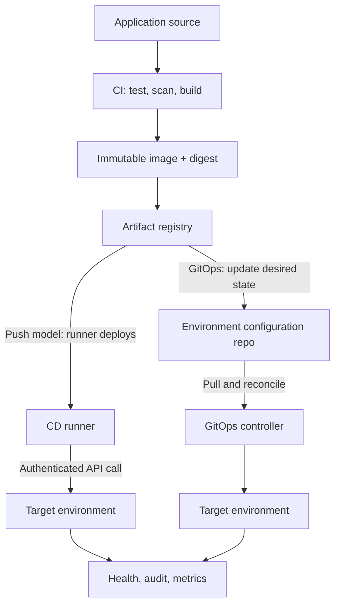
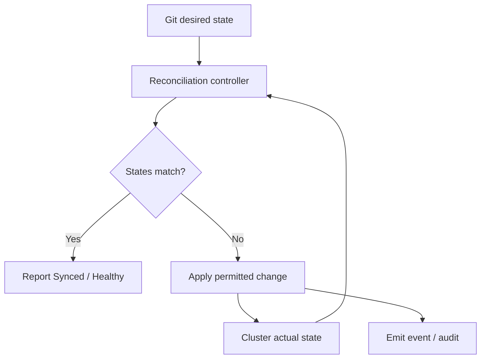

# Distinguishing Direct Pipeline-Driven Deployments from GitOps-Style Deployments

A CI/CD pipeline can ship a new version to production by connecting directly to the target environment and executing deployment commands itself. Another approach is for the pipeline to only update the desired state in Git; a controller running inside the target environment reads that change and continuously adjusts the system to match. The first approach is commonly called push-based or pipeline-driven deployment; the second is pull-based deployment following the GitOps model.

Both approaches can automate releases, but they differ in where control resides, where desired state is stored, how drift is detected, security boundaries, and how failures are handled. Choosing the right model determines who is permitted to change production, which credentials the pipeline needs, how releases are traced, and how to recover when actual state diverges from approved state.

The key point is distinguishing **the CI work that creates and verifies an artifact** from **the CD mechanism that delivers the artifact into an environment**. CI can be identical in both models: checkout source, test, scan, build image, generate SBOM/provenance, and record the digest. The primary difference lies in how deployment state is applied and maintained.

## 1. Two Deployment Control Models

### Pipeline-Driven Deployment (Push-Based)

In the push-based model, a CI/CD runner job actively connects to the API or control plane of the target environment and requests a deployment. For example:

- The pipeline runs `kubectl apply`, `helm upgrade`, or calls a deployment platform API.
- The job runs `terraform apply` to modify infrastructure.
- Release automation calls a PaaS, VM manager, or cloud service API.
- The runner sends an image/version update command to a specific cluster or service.

The pipeline orchestrates the action. The job typically requires a network route and an identity with permissions on the target resources. When the command finishes, the pipeline records the result, though ongoing drift detection and remediation may depend on a separate mechanism.

### GitOps-Style Deployment (Pull-Based Reconciliation)

In GitOps, Git holds the desired state declared via manifests, Helm values, Kustomize overlays, or equivalent configuration. A controller running near the target environment watches this source, compares desired state against actual state, and continuously reconciles to bring the system to the desired state.

The pipeline typically builds and tests the artifact, then updates the digest or release configuration in the configuration repository. A controller such as Argo CD or Flux observes the new commit and applies the changes inside the cluster. CI does not need to directly hold cluster administration credentials.

GitOps is not merely "putting YAML in Git". A process that commits manifests and then has someone manually run `kubectl apply` still lacks an automated reconciliation loop. GitOps requires a versioned source of desired state, a controller that pulls that state automatically, and continuous comparison against the environment.

## 2. Operational Flow Diagram



In both branches, the artifact should be built once and referenced by an immutable digest. The difference is who performs the runtime update operation: the pipeline runner or a controller running inside the target environment.

## 3. Quick Comparison

| Aspect | Direct Pipeline-Driven | GitOps Pull-Based |
|---|---|---|
| Who applies the change? | CI/CD runner or release job | Controller inside/near the target environment |
| Source of desired state | Pipeline parameters, release records, IaC/config repo, or deployment commands | Designated Git repository serving as source of truth |
| Connection direction | Runner actively calls into the target API | Controller actively pulls configuration from a trusted source |
| Primary credentials | Runner needs deploy permissions on target | Controller has permissions in target; CI mainly needs permission to update config repo |
| Drift detection | Depends on tools and post-deploy verification steps | Controller continuously compares desired state with actual state |
| Self-healing drift | Only when the pipeline/automation reruns or another system intervenes | Can auto-reconcile according to policy |
| Audit trail | Pipeline runs, commands, deployment records, and target audits | Git commits/PRs, controller sync events, and target audits |
| Rollback | Run deploy command for previous version/config or call rollback API | Revert desired state in Git; controller reconciles to previous revision |
| Best suited for | Simple flows, few clusters, workflow-driven operations | Multiple environments/clusters, desired state requiring review and continuous enforcement |
| Notable risks | Compromised runner/credentials or state updated only once | Config repo/controller becomes a privileged control plane; drift may self-heal to a bad desired state |

Neither model is automatically secure by name alone. Push deployment can use declarative manifests and least privilege; GitOps can suffer from misconfiguration, over-privileged controllers, or unprotected configuration repositories. You must evaluate the entire path from source to runtime.

## 4. Desired State, Actual State, and Reconciliation

Three concepts explain GitOps:

- **Desired state:** the target state the system should reach, declared in Git or a controlled configuration source.
- **Actual state:** the state currently existing in the cluster/cloud/runtime.
- **Reconciliation:** the process of comparing the two states and taking actions to eliminate differences.

For example, desired state specifies Deployment `orders` has three replicas running image `orders@sha256:abc...`. Actual state currently has two replicas or one replica running an older digest. The controller detects the discrepancy and applies updates to reach the desired state, if policy permits.



Reconciliation is a continuous loop, not a one-time deploy. If someone edits the Deployment directly in the cluster, the controller can detect the drift and restore the configuration to match Git. This is helpful when Git is the source of truth, but can cause surprises if an operator alters production during an incident without updating desired state.

### Principles GitOps Commonly Rests On

A common formulation of GitOps includes:

1. Desired state is expressed declaratively.
2. Desired state is stored in a traceable version control system.
3. Software agents automatically pull desired state and apply it.
4. Agents continuously observe, detect, and correct drift.

These principles make Git the place where changes are reviewed and audited. They do not mandate that every operation be a manual PR; automation can create commits or PRs per policy. What matters is that desired-state changes have clear provenance, authorization, and history.

## 5. The Boundary Between CI and CD in GitOps

An effective division of responsibilities:

| Phase | CI Pipeline | GitOps Controller |
|---|---|---|
| Checkout source | Yes | Does not need to check out application source to build |
| Unit/integration tests | Yes | No |
| Build image/package | Yes | No |
| Scan, SBOM, provenance, signing | Yes, or calls specialized service | Can verify policy prior to sync |
| Select artifact digest | Records into release metadata | Reads digest from desired state |
| Update environment config | Opens PR/commit or calls config automation | Watches configured repository/branch/path |
| Apply workload | Does not necessarily hold direct permissions | Yes |
| Reconcile drift | Not a default capability | Yes |
| Health/rollout observation | CI may track release status | Controller reports sync/health; monitoring verifies SLOs and business behavior |

CI can update the GitOps repository using a bot identity. For example, after an image is built and signed, a workflow opens a pull request updating the image digest value in `environments/production/orders/values.yaml`. Reviewers inspect the commit, digest, scan reports, and release notes. Once merged, the controller picks up the new desired state and deploys.

CI should not both update desired state and retain arbitrary permissions to modify the cluster if the architectural goal is for the controller to own deploy privileges. If the pipeline still holds permission to run `kubectl apply` against production, the pull-based boundary is weakened.

## 6. Push-Based Deployment Example

Suppose the pipeline has built an image and stored the digest in the `IMAGE_REF` variable. The deploy job uses workload identity or short-lived credentials to call the cluster API, then verifies the rollout.

```yaml
name: Deploy orders directly

on:
  workflow_dispatch:

permissions:
  contents: read
  id-token: write

jobs:
  deploy:
    runs-on: ubuntu-latest
    environment: production
    steps:
      - uses: actions/checkout@v4
      - name: Authenticate to cloud with workload identity
        run: ./ci/exchange-oidc-token.sh
      - name: Deploy approved image
        env:
          IMAGE_REF: ${{ vars.ORDERS_IMAGE_DIGEST }}
        run: |
          helm upgrade --install orders ./deploy/orders \
            --namespace production-orders \
            --set image.reference="$IMAGE_REF" \
            --wait --timeout 5m
      - name: Verify deployment
        run: ./ci/verify-orders-production.sh
```

This example assumes cloud trust policies, environment protections, the Helm chart, and verification scripts are already configured. `id-token: write` only allows the job to request an OIDC token; actual permissions are governed by the trust policy and IAM. `IMAGE_REF` must be a verified and approved image digest, not a mutable tag like `latest`.

In this model, the runner has a network route and permissions to call cluster/cloud APIs. Restrict runner pools, egress, target namespaces, IAM/RBAC permissions, and credential lifetimes. Never use runners that process untrusted pull requests to deploy to production.

### Advantages of Push-Based

- Easy to integrate with existing pipelines and sequential release tooling.
- Can deploy to diverse targets that lack a GitOps controller.
- A single workflow can combine approvals, migrations, deployment, and post-deploy verification.
- Well suited for small environments or systems that already have a dedicated deployment control plane.

### Limitations to Manage

- The runner must reach the target, creating an inbound path or network route.
- Deploy credentials reside in or are issued to the pipeline execution environment.
- If the pipeline does not rerun, drift occurring after deployment may go uncorrected.
- When a job times out or loses connectivity, actual state may be ambiguous; reconcile before retrying.
- Multiple pipelines can modify the same target concurrently if concurrency controls are missing.

## 7. GitOps Example with Argo CD

A configuration repository can hold manifests per environment. For example, a Deployment referencing an image by digest:

```yaml
apiVersion: apps/v1
kind: Deployment
metadata:
  name: orders
  namespace: production-orders
spec:
  replicas: 3
  selector:
    matchLabels:
      app: orders
  template:
    metadata:
      labels:
        app: orders
    spec:
      containers:
        - name: orders
          image: registry.example.com/team/orders@sha256:0123456789abcdef
          ports:
            - name: http
              containerPort: 8080
```

An Argo CD Application can point to the production configuration path:

```yaml
apiVersion: argoproj.io/v1alpha1
kind: Application
metadata:
  name: orders-production
  namespace: argocd
spec:
  project: production
  source:
    repoURL: https://git.example.com/platform/environment-config.git
    targetRevision: main
    path: environments/production/orders
  destination:
    server: https://kubernetes.default.svc
    namespace: production-orders
  syncPolicy:
    automated:
      prune: false
      selfHeal: true
    syncOptions:
      - CreateNamespace=false
```

This example only illustrates the structure. Configure Argo CD Project permissions, repository credentials, cluster destinations, sync windows, health assessments, and prune policies according to your needs. `selfHeal: true` lets the controller remediate drift on managed resources; `prune: false` avoids automatically deleting resources absent from Git in this example. Enabling prune requires understanding ownership and deletion impact.

When CI updates the image digest in the configuration repository and the change is merged, Argo CD detects the new revision, diffs the manifest against the cluster, and syncs per policy. The controller may report `Synced` while the application still suffers business-logic failures; independent monitoring, smoke tests, and SLO validation are required.

## 8. How CI Updates the Configuration Repository

A typical release flow:

1. CI checks out application source at a specific commit.
2. Runs tests, scans, builds, and produces the image.
3. Computes the digest, generates provenance/SBOM, and signs the artifact per policy.
4. Verifies the image exists in the registry and evidence is bound to the exact digest.
5. Creates a change in the environment config repo updating the image digest.
6. Opens a PR with release metadata, ticket, test/scan summary, and target environment.
7. Reviewers or policy bots validate the change.
8. Merges the PR; the GitOps controller observes the commit and reconciles.
9. Monitoring and release verification check health, SLOs, and business flows.

Example change diff:

```diff
 image:
-  reference: registry.example.com/team/orders@sha256:old_digest
+  reference: registry.example.com/team/orders@sha256:new_digest
```

The configuration change PR becomes evidence of the version requested to run in production. The config repo commit SHA should be linked to the application commit and artifact digest for bidirectional traceability.

### Do Not Rebuild Inside the GitOps Controller

The controller should deploy artifacts already built and verified in CI. Do not have the controller clone application source and build images during sync, as that blurs the boundary between build and deploy, hurts artifact reproducibility, and makes it hard to bind signatures/provenance to the exact running content.

Some setups use an image updater that automatically modifies the config repo when a new image appears in the registry. If using this approach, enforce strict policies on allowed tags/digests, verify scans/signatures, create audited PRs or commits, and avoid automatically pushing every new image to production.

## 9. Source of Truth and Environment Configuration Management

GitOps requires defining which repository, branch, folder, and revision serves as the source of desired state for each environment. Never allow multiple places to claim to be the source of truth for the same resource.

One way to organize it:

```text
environment-config/
├── base/
│   └── orders/
├── environments/
│   ├── development/
│   │   └── orders/
│   ├── staging/
│   │   └── orders/
│   └── production/
│       └── orders/
└── clusters/
    ├── dev-cluster/
    └── prod-cluster/
```

You can use Kustomize base/overlays, Helm charts/values, or plain manifests. Environment configuration must be reviewed and have an owner. Differences such as replica counts, resource limits, endpoints, policies, and feature flags should be explicit; secret values must be managed through a dedicated secrets mechanism.

### Avoid Multiple Writers to the Same Resource

If a GitOps controller manages Deployment `orders` while another pipeline runs `kubectl set image` on that same Deployment, the two controllers may continuously overwrite each other. The GitOps controller reverts the resource back to Git; the pipeline alters runtime again. This is ownership contention.

Assign an explicit owner for each resource/field and pick one official path for changes. If an emergency operational exception occurs, record the change back into Git afterward so desired state does not remain diverged long-term.

## 10. Drift Detection and Handling

Drift is the difference between desired state and actual state. Drift can arise from:

- An operator editing a resource directly in the cluster.
- Another controller modifying a managed field.
- An autoscaler adjusting replica counts.
- An admission webhook mutating a resource.
- A resource being deleted or altered outside Git.
- Modifying cloud resources via console/API outside IaC.

Not every difference is an error. For example, HPA adjusting replicas is expected runtime behavior; if Git hardcodes `replicas: 3` and GitOps keeps forcing it back to 3, it can conflict with the autoscaler. Distinguish which fields are managed by Git versus runtime controllers and configure appropriate ignores/ownership.

### Drift Handling Strategies

| Policy | Behavior | When Appropriate |
|---|---|---|
| Alert only | Detects and alerts on drift without auto-correcting | Environments needing review prior to change or high-risk resources |
| Manual sync | Controller displays diff; operator decides when to sync | Production with approval gates or change windows |
| Auto sync | Controller automatically applies new desired state from Git | Changes that passed policy and environments permitting automation |
| Self-heal | Controller corrects drift caused by out-of-band changes | Maintaining standardized config and preventing persistent manual edits |
| Prune | Deletes resources managed by the controller that are no longer in desired state | Enable only after ownership, dependencies, and deletion consequences are controlled |

Self-heal can recover from unintended drift, but if Git contains a bad configuration or is compromised, the controller will persistently enforce the bad state. Therefore, protecting Git, reviews, signatures/policies, and auditing is just as critical as protecting the cluster.

## 11. Security and Trust Boundaries

### Push-Based

Pipeline runners often need credentials or tokens to reach target APIs. Controls should include:

- Dedicated runners for release/deploy, never running untrusted PR code.
- Workload identity/OIDC and short-lived credentials instead of long-lived keys.
- RBAC scoped to namespace, service, or resource.
- Network egress restricted to required registries, cloud APIs, and cluster endpoints.
- Protected environments, approvals, and branch/tag policies.
- Verification of artifact digest/signature/provenance before deploying.
- Audit logs linking pipeline run, actor, target, and deployment ID.

### GitOps

GitOps reduces the need for CI runners to directly access production clusters, but the controller holds permission to apply changes and must be protected:

- Git repositories use branch protection, required reviews, and CODEOWNERS.
- Only designated bots/workflows are permitted to update specific paths and branches per policy.
- Controllers use least-privilege service accounts/RBAC per project/namespace.
- Separate controllers or projects along trust boundaries where needed.
- Protect Git/registry credentials with a secrets manager and rotation.
- Admission policies verify image registry, digest, signature, security context, and resource constraints.
- Restrict permissions to create cluster-scoped resources and CRDs.
- Audit commits, sync operations, drift corrections, and manual overrides.

The GitOps repository is part of the production control plane. Anyone authorized to merge production manifests can indirectly alter production; those permissions must be treated like deploy privileges.

### Secrets Must Not Live in Git as Plaintext

GitOps does not mean committing passwords, tokens, or private keys into a repository. You can use External Secrets Operator, Sealed Secrets, SOPS with KMS, or an equivalent secrets manager mechanism. Distinguish encrypted secret material from decrypted secrets inside the cluster, restrict who can decrypt them, and prevent plaintext from appearing in pipeline logs or Git history.

## 12. Rollback in Both Models

### Push-Based Rollback

The pipeline or an operator redeploys the previous stable artifact/config revision, or invokes the platform's rollback API. Release records must store the prior digest, manifest/config revision, and deployment ID. Rollback jobs require dedicated permissions, target verification, and must avoid rebuilding a new artifact instead of reusing the prior artifact.

### GitOps Rollback

Rollback typically means reverting the commit that changed desired state or creating a new commit pointing the image/config back to the previous revision. The controller reads the reverted desired state and reconciles the cluster. Do not edit the cluster directly to roll back while leaving broken configuration in Git, because the controller may push the broken state back.

### Key Caveats

- Rolling back code does not necessarily undo database migrations.
- Schema changes require backward/forward compatibility during rollout windows.
- Secret rotation may not be reversible by reverting to an old commit.
- Prune can delete resources; recovery requires backups or matching manifests.
- Controller sync status does not prove business transactions are healthy.
- If a new release caused data loss, recovery/restore or compensation is required, not merely reverting manifests.

## 13. Handling Failures and Ambiguous States

A push pipeline can time out after the target API already accepted the request. Never assume a deployment failed solely because the runner did not receive a response. Read current deployment status, check the revision/digest, and reconcile before retrying.

GitOps also has states that must be distinguished:

- **OutOfSync:** desired state and actual state differ.
- **Syncing:** the controller is applying changes.
- **Synced:** managed resources match desired state as evaluated by the controller.
- **Degraded/Unhealthy:** one or more resources fail health assessment.
- **Unknown:** the controller cannot determine state due to API, permission, or telemetry errors.

`Synced` does not equate to a healthy application; `Unknown` does not equate to failure or success. Combine health probes, application metrics, logs, traces, smoke tests, and business validation.

When a GitOps controller loses connectivity to Git, the cluster can keep running the current version but will not receive new releases or remediate drift. Alert on controller health, age of the last synced revision, and commit-to-sync latency.

## 14. Progressive Delivery and Rollout Control

A push-based pipeline can invoke canary/blue-green tooling directly or update traffic routing. In GitOps, desired state can declare a rollout strategy while a progressive delivery controller executes each step, such as Argo Rollouts or Flagger.

Regardless of the model, define:

- Traffic/replica weights at each step.
- Observation windows and minimum sample sizes.
- Error rate, latency, saturation, and business guardrails.
- Conditions for pause, abort, promote, or rollback.
- Who holds override authority during an incident.
- Evidence stored against the artifact digest and deployment revision.

The GitOps controller can ensure manifests are applied; the progressive delivery controller governs rollout pacing; monitoring evaluates service quality. Do not collapse all three responsibilities into a single "sync succeeded" status.

## 15. Managing Multiple Environments and Multiple Clusters

GitOps is often helpful when the same application deploys across development, staging, and production or across multiple clusters/regions. Options for structuring include:

- A separate configuration repository per environment.
- A shared repository with folders/overlays per environment.
- A platform repo holding cluster bootstrap and app repos holding workloads.
- One controller managing multiple clusters or separate controllers per trust boundary.

The choice depends on access permissions, change frequency, isolation levels, and review workflows. Never give a development cluster controller write permissions over a production cluster merely to reuse configuration.

For promotion, carry the exact same artifact digest across environments. Each environment can have distinct configuration, yet you should not rebuild the image for production after staging already verified it. Release records must connect application commit, artifact digest, config commit, and environment.

## 16. When to Choose Which Model?

| Condition | Push-Based Typically Fits | GitOps Typically Fits |
|---|---|---|
| Few services, few targets, simple workflow | Yes | May introduce excessive initial operational components |
| Multiple clusters/environments | Requires careful runner/credential and orchestration management | Benefits from controllers and per-cluster desired state |
| Target lacks a GitOps controller | Usually fits | May require adapters or be unsuitable |
| Need continuous drift detection and auto-reconciliation | Requires additional tooling | Core capability |
| Restricting CI runners from reaching production networks | Harder if runners must call targets | Usually fits better as controllers pull from inside the cluster |
| Complex ordered migration procedures | Direct pipeline orchestration can be convenient | Can pair controllers with jobs/operators and explicit gates |
| Want all production changes via PR/review | Can integrate approvals with extra policy | More natural when Git is the desired-state source of truth |
| Team has not operated controllers/config repos | Easier to start | Requires investment in bootstrapping, ownership, and observability |

You do not have to pick a single model for the entire organization. You can use GitOps for Kubernetes workloads and push-based for database migrations or off-cluster services, provided ownership and execution order are clearly defined.

## 17. Common Hybrid Pattern

A practical architecture may use:

1. CI builds and signs the artifact.
2. Release automation opens a PR updating the GitOps repository.
3. The GitOps controller deploys the workload.
4. A pipeline or release verifier monitors the controller and health metrics.
5. Database migrations run via a dedicated job with approvals, locking, and compatibility policies.
6. Monitoring determines whether to promote a canary or halt the rollout.

In this model, the GitOps controller manages the workload's desired state while the pipeline still orchestrates steps outside the controller's scope such as migrations, approvals, and release records. Avoid having two systems write to the same resource.

## 18. Common Anti-Patterns

- **Calling a workflow GitOps just because manifests live in Git:** without a continuous pull/reconcile controller.
- **CI holds direct deploy permissions while GitOps manages the same resource:** two writers fighting over state.
- **Leaving mutable tags in desired state:** the controller can pull different content than the approved artifact.
- **Committing plaintext secrets:** Git history exposes secrets long-term.
- **Controller having cluster-admin across every cluster:** a single misconfiguration or credential leak has a massive blast radius.
- **Enabling prune/self-heal without understanding ownership:** essential resources can be deleted or altered unexpectedly.
- **Treating Synced as Healthy:** manifests match while the application may still be failing.
- **Rolling back by editing the cluster directly:** GitOps can reconcile and revert the manual fix.
- **Rebuilding images during sync:** breaks the link between tests, signatures, and the running artifact.
- **Not storing config commits and application digests:** makes releases hard to trace.
- **No break-glass procedure:** incidents force operators to edit outside Git with no way to record and reconcile afterward.
- **Not monitoring the controller:** Git has new commits while environments fail to sync for long periods unnoticed.

## 19. Checklist for Choosing and Implementing a Model

Before designing CD, verify:

1. Who performs changes on the runtime: a CI runner or an in-environment controller?
2. Where is desired state stored and which source is the source of truth?
3. Is there a single writer for every resource/field?
4. Are artifacts referenced by immutable digest with appropriate provenance/signatures?
5. Are credentials short-lived, narrowly scoped, and separated across build/publish/deploy/controller?
6. Do CI runners need a route into production? If so, how are networks and runner pools restricted?
7. Does the GitOps repository have branch protection, CODEOWNERS, approvals, and auditing?
8. Does the controller have permissions scoped to the right namespace/project/cluster with trust boundary separation?
9. Under which identity are secrets encrypted or fetched from a secrets manager?
10. Under which policy is drift detected, alerted, auto-corrected, or held for manual sync?
11. Were prune/self-heal impacts and dependencies evaluated before enabling?
12. How is rollback performed and is it schema/data compatible?
13. Are Synced, Healthy, SLO pass, and business validation clearly distinguished?
14. If the controller or runner loses connectivity, how does the system represent unknown state and handle retries?
15. Does multi-environment promotion preserve the exact same artifact digest?
16. Are there runbooks for break-glass, manual overrides, and reconciling changes back to the source of truth?
17. Do audit records link source commit, artifact digest, config commit, approver, and deployment ID?

Direct pipeline-driven deployments grant deployment authority to CI/CD jobs and fit when an explicit orchestrated workflow to the target is needed. GitOps grants reconciliation authority to a controller based on desired state versioned in Git, fitting when consistent state must be maintained across multiple environments with continuous drift detection. Whichever approach you choose, releases still require immutable artifacts, least privilege, clear policies, post-deploy observability, and verified recovery plans.
