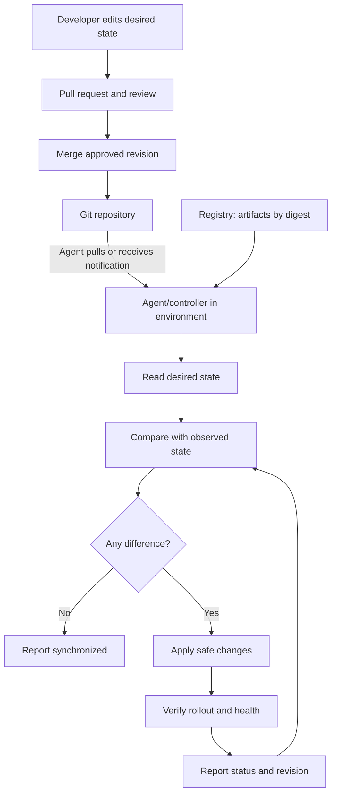
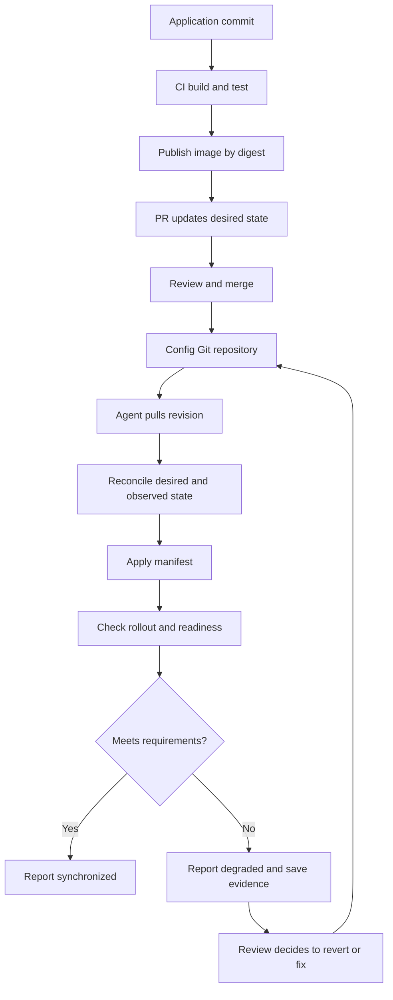

# Understanding the Push-Changes Model vs. Pull-Desired-State Agents

In CI/CD, a system can deliver changes to an environment by sending deployment commands from a pipeline, or by having an agent running inside the target environment actively fetch the desired state and adjust the system to match. These two approaches are commonly called the *push* and *pull* models.

In the push model, the pipeline or orchestrator initiates the action and sends requests to the target environment. In the pull model, an agent or controller observes a source describing the desired state, compares it with the actual state, and performs the actions needed to converge. The core difference lies in where change initiation happens and how the system maintains state after the initial deployment.

Neither model fits every step. A pipeline is typically well suited for building, testing, and publishing artifacts; a state-pulling agent can be well suited for applying configuration or deploying into environments behind private network boundaries. What matters is understanding state ownership, authentication flows, how discrepancies are handled, and how to prove the system has reached the intended version.

## 1. How Does the Push Model Work?

In the push model, an event or operator triggers a pipeline. The pipeline determines the version to release, prepares the artifact, and calls an API or control tool of the target environment to deploy.

A typical flow:

1. A developer makes a commit or opens a pull request.
2. CI runs builds, tests, and quality gates.
3. The pipeline publishes an immutable artifact to a registry.
4. Once eligible, a deploy job fetches the artifact by version or digest.
5. The job authenticates with the target environment and sends an update command.
6. The pipeline waits for results, runs smoke tests, and records status.

For example, a job can call a deployment platform API to update a service's image:

```text
CI pipeline
  -> authenticate to deployment API
  -> request: deploy image@sha256:abc...
  -> wait for rollout
  -> verify health and version
```

The pipeline actively controls the timing and content of the change. Consequently, it can tie the deployment to a specific run, a reviewed commit, or a specific approval. If deployment fails, the job can report failure status directly back to the pull request or release.

Push can also be used to send configuration or commands to servers over SSH, call cloud APIs, update tasks on container platforms, or run configuration management tools from a control machine. Even though execution methods vary, the common thread is that the orchestrator initiates the action on the target system.

## 2. The Pull Model with Desired-State-Pulling Agents

In the pull model, an agent or controller runs inside the target environment. It has permission to read an approved state source, such as a Git repository, a control API, or a configuration store. The agent periodically checks or receives a signal that a change occurred, downloads the desired state version, compares it with actual state, and performs the necessary operations.

General flow:

1. A developer updates desired configuration in the repository.
2. The change is reviewed, checked, and merged according to policy.
3. The agent inside the target environment reads the permitted revision.
4. The agent parses the configuration and identifies the required resources.
5. The agent compares desired state against observed state.
6. The agent applies changes and re-verifies the result.
7. The agent continues observing to detect drift or new changes.

For example, a configuration repository declares which image digest a service must run and how many replicas it should have:

```yaml
application:
  name: checkout
  image: registry.example/checkout@sha256:abc123
  replicas: 3
  configRevision: checkout-prod-v17
```

The agent reads the approved revision, then instructs the platform to run three replicas of that exact image digest. If a replica is manually deleted or a process crashes, the controller can detect that the actual replica count is lower than desired and recreate the replica so the system converges.

Pull does not necessarily mean periodic polling alone. An agent can receive a webhook or notification indicating a new revision exists, then initiate an outbound connection to fetch the configuration. Many systems combine events to reduce latency with periodic resync cycles to catch missed changes. The authenticated state source remains the authoritative basis; notifications are merely a wake-up signal for the agent.

## 3. Comparing Push and Pull

| Criterion | Push | Pull with Agent |
| --- | --- | --- |
| Party initiating the change | Pipeline or orchestrator | Agent/controller inside the target environment |
| Network connectivity | Typically requires a path from runner to target API or machine | Agent typically initiates outbound connections to fetch state |
| Credentials | Pipeline needs deploy permissions in the target environment | Agent needs read access to desired source and apply permissions in its environment |
| Timing of application | Typically tied to a pipeline run | On a sync cycle or when the agent receives a signal |
| State maintenance | Pipeline typically ends after deployment and verification | Agent continues observing and remediating drift per policy |
| Feedback | Results are usually tied directly to the deploy job | Requires observing sync status and reports from the agent |
| Control scope | Centralized in the pipeline/orchestrator | Distributed per agent or controller |
| Suitable use cases | Approved releases, imperative operations, environments with reachable APIs | Private environments, declarative configurations, long-term state maintenance |

Pull often reduces the need to open inbound ports from CI runners into private networks, yet does not automatically make a system secure. The agent still holds permission to alter resources and must be protected. If the agent can read any branch or any file in the configuration repository, an unapproved change could become a deployment command.

Push gives the pipeline direct control over execution timing, yet the runner needs appropriate credentials and network paths. If a runner is compromised or an untrusted job receives deploy permissions, the blast radius can be huge. Permissions must be scoped by environment, repository, workflow, and action type.

## 4. Desired State, Observed State, and Reconciliation

The pull model is typically built around three concepts:

- **Desired state:** the target state the system must reach, described in an approved configuration or API.
- **Observed state:** the state the agent observes in the actual environment.
- **Reconciliation:** the process of comparing the two states and taking action to eliminate differences.

For example, desired state declares three replicas, while observed state has only two. The controller can create the missing replica. Once all three replicas run the right image digest, the status can be reported as synchronized or converged.

A simple reconciliation loop:

```text
loop:
    desired = read_approved_revision()
    observed = inspect_environment()
    diff = compare(desired, observed)

    if diff is empty:
        report_synced(desired.revision)
    else:
        apply_safe_changes(diff)
        verify_environment()
```

This is pseudocode illustrating the concept. A real controller must handle per-resource errors, timeouts, bounded retries, access permissions, and repeatable operations. Never assume a single successful apply means every component is healthy.

Reconciliation should be idempotent: re-running the same desired state must not create duplicate resources or unintended side effects. The agent must inspect current state before acting and verify after acting. For operations that cannot be safely repeated, such as sending a notification or creating a transaction, use request identification or keep those operations outside the reconciliation loop.

A system may take time to converge because resources must start up, images must download, or dependent services are not yet ready. Therefore, status is usually not just a binary success/failure. Distinguish pending, progressing, synchronized, degraded, and failed, accompanied by the revision and reason.

## 5. GitOps as an Implementation of the Pull Model

GitOps is an operational approach in which desired state is declared and version-managed in Git. An agent or controller inside the target environment fetches permitted revisions and continuously compares actual state against that configuration.

A GitOps workflow typically has these components:

- **Source repository:** stores desired configuration, manifests, charts, or deployment definitions.
- **Review and policy:** validates changes, approvals, and branch protection.
- **Artifact registry:** stores immutable images or packages referenced by the configuration.
- **Agent/controller:** watches revisions and applies configuration into the environment.
- **Status/observability:** reports the currently applied revision, sync status, errors, and application health.

Diagram:



Git records change history and facilitates review, but merging itself does not guarantee a configuration is correct. Schema validation, policy checks, artifact references, access permissions, and compatibility must be checked before the agent applies changes. An invalid configuration that gets merged can still cause the controller to converge toward a broken state.

GitOps also does not mean sensitive data must be stored directly in Git. The repository should contain references to secrets or controlled encryption mechanisms. Actual secrets must be fetched from a secrets manager or decrypted by a component with appropriate permissions, with auditing and rotation.

## 6. Choosing a Model by Workload Type

Push and pull can coexist within the same CI/CD system. Choose based on the characteristics of the operation:

| Task | Typically Suitable Model | Reason |
| --- | --- | --- |
| Build and unit tests after commit | Push/event-triggered CI | Commit event triggers the work and results bind to the revision |
| Publish package or image | Push from release pipeline | Pipeline builds, checks, and publishes a specific artifact |
| Send direct deploy commands to an environment | Push from pipeline | Pipeline calls the environment API and awaits the result |
| Record desired-state changes in Git | Push commit/PR; agent pulls after merge | Separates proposing state from applying it to the environment |
| Maintain cluster or server configuration | Pull/reconciliation | Agent continuously detects and remediates drift |
| Deploy into private networks blocking inbound runner access | Pull agent | Agent initiates outbound connections to registry and config source |
| One-off operation requiring direct approval | Push with approval gate or orchestrated workflow | Timing and approver are bound to the execution instance |
| Long-term config distribution across many environments | Pull or hybrid model | Each environment syncs itself to permitted revisions |

A common architecture uses push for CI and publishing artifacts, then updates a configuration repository via a pull request. Once merged, a pull agent inside the target environment deploys the exact digest. That way, the pipeline does not need direct access credentials for every cluster, while deployment state retains full history and evidence.

## 7. Managing Revisions and Avoiding Stale State Application

The agent must clearly determine which revision is currently applied and which revision is newer. Recording only a branch name is insufficient because branch contents can change. Record the commit SHA or an immutable version of the configuration bundle.

Several principles:

- Bind every reconciliation pass to a specific revision.
- Never apply configuration from unmerged pull requests or unpermitted refs.
- When multiple updates arrive close together, determine revision ordering and prevent an older slow job from overwriting newer state.
- Record start time, outcome, and applied revision.
- If an apply fails partway, report non-converged status and resume from actual state after assessment.

For example, the agent is applying revision `v17` while the repository already has `v18`. The agent can complete or safely cancel the older work depending on resource type, then reconcile `v18`. Never allow a slow worker handling revision `v17` to finish late and overwrite the outcome of `v18`.

Generations, resource versions, locks, or compare-and-swap mechanisms can be used depending on the platform to protect updates. Verify the system's exact mechanism; comparing timestamps across multiple machines alone can be unreliable due to clock skew.

## 8. Drift and Self-Healing Policies

Drift is the difference between desired state and observed state. Drift can happen when:

- An operator edits a resource directly via console or CLI.
- An external process modifies configuration.
- A resource is deleted, corrupted, or altered by an infrastructure failure.
- The agent applies partially due to timeout or missing permissions.
- A legitimate change in the environment has not yet been reflected in the desired repository.

The agent can detect drift and react according to policy. Three common options exist:

1. **Notify:** detect and report discrepancies so operators can decide.
2. **Self-heal:** restore the environment to desired state when changes are permitted and safe.
3. **Block changes:** use admission policies or access controls to prevent out-of-band modifications.

Do not automatically overwrite all drift. A manual change may be an approved emergency mitigation that has not yet been committed to Git. Policies must define which resources are self-healed, which only trigger alerts, and how emergency changes are recorded. After emergency mitigation, desired state must be updated so the agent does not unexpectedly revert it.

For stateful resources holding data, self-healing actions must assess the risk of data loss. For instance, a controller can recreate a stateless pod, but cannot arbitrarily delete a data-bearing volume merely because current metadata differs from the manifest. Reconciliation actions must understand resource types and data-preservation policies.

## 9. Securing Agents and State Sources

An agent typically holds permissions to read configuration and modify resources in an environment. If compromised, it can become an unauthorized deployment path. Design security boundaries for both the agent and the state source.

- Grant least privilege scoped by namespace, project, resource type, and action.
- Use workload identities or short-lived tokens when supported by the platform; avoid static credentials shared across environments.
- Allow the agent to read only approved repositories, branches, or paths.
- Protect configuration branches with reviews, status checks, and approval rules.
- Verify artifact provenance and pin images by digest.
- Never store plaintext secrets in Git, logs, or pipeline outputs.
- Separate permissions to read configuration, publish artifacts, and apply to production.
- Update agents in a controlled manner and track running agent versions.
- Audit who changed desired state, which agent applied it, and which resources were affected.

An agent in production should not blindly pull whatever latest commit sits on a branch. It must obey permitted revision policies, trusted sources, and environment approval mechanisms.

## 10. Retries, Timeouts, and Agent Resilience

An agent may lose connectivity to the Git server, registry, control API, or supporting services. The reconciliation loop must withstand disruptions without generating excessive load or dangerous repeated mutations.

- Set per-request timeouts and a deadline for each reconciliation cycle.
- Use exponential backoff with jitter when connections fail.
- Cap consecutive retries and API call rates.
- Respect rate limits or retry directives from services.
- Persist the revision being processed so work can resume or re-evaluate after an agent restart.
- Verify actual state before repeating any operation with side effects.
- Report degraded or error status when the retry budget is exhausted rather than pretending to be synchronized.

Do not retry indefinitely inside a loop that holds a worker or lock. After a bounded number of errors, the agent should log the cause, wait on an appropriate schedule, and continue reconciling in the next cycle. If the error stems from misconfiguration or missing permissions, continuous retries cannot fix it; surface the error clearly.

## 11. Observing State and Proving Convergence

Push pipelines typically have job statuses, while pull agents need additional ways to observe long-running synchronization. A status dashboard or API should show:

- Desired revision and currently applied revision.
- Timestamp of the most recent reconciliation and duration of any active reconciliation.
- Status: synchronized, progressing, degraded, or failed.
- Which resources have not reached desired state and why.
- Retry count, wait time, and latest error.
- Agent/controller version and managed environment.
- Artifact digest and workload health check results.

Logs should include a correlation ID or reconcile ID to link a change from commit, pipeline, and artifact through to the agent and environment. Never log tokens, secrets, or sensitive payloads. Metrics such as time to converge, reconciliation success rate, age of unapplied revisions, and drift counts help uncover stuck agents or unstable dependencies.

A synchronized status should be reported only when the agent verifies the desired revision has been applied and required conditions are met. If manifests were updated but workloads are not yet ready, the status must be progressing or degraded depending on condition, never success.

## 12. Rollback and Restoring Desired State

With push, rollback is typically a command redeploying a previous artifact or running an approved rollback workflow. With pull, rollback can mean reverting the configuration commit or re-selecting a known-good revision; the agent then pulls the new state and reconciles the environment back to that version.

A pull-based rollback process may include:

1. Identify the previously verified release or revision.
2. Verify that the artifact, digest, configuration, and secret references for that revision remain available.
3. Create a revert change or update desired state to the chosen revision.
4. Review and approve per environment policy.
5. The agent picks up the new revision, applies it, and verifies the rollout.
6. Record the result, actual revision, and application status.

Reverting Git does not automatically roll back migrated data. If a release altered schemas or emitted irreversible events, assess data compatibility and you may need to roll forward. Similarly, an agent should not auto-rollback solely because a single health check request failed; clear thresholds, observation windows, and policies are required.

## 13. Example: Deploying an Application to Kubernetes via Desired State

Suppose a team has a CI pipeline that builds an image for `checkout-service`, runs tests, and publishes the image digest. The pipeline updates the production configuration repository via a pull request containing the new digest. After review and merge, the GitOps agent in the cluster detects the new revision.

The agent validates the configuration, verifies the image reference, applies the manifests, and monitors the rollout. If the deployment requires three replicas and only two are ready, the agent continues reporting progressing or degraded depending on status. Once all three replicas run the exact digest and readiness probes pass, the agent reports the revision as synchronized.

If the new image fails to start, the agent records the rollout failure. The team can revert desired state to the prior digest via pull request, or use the platform's approved rollout/rollback mechanism. The agent then reconciles the reverted revision and re-verifies health.

Illustrative flow:



CI does not need cluster administration credentials if its sole responsibility is building images and proposing configuration changes. The agent holds permissions inside the cluster to apply approved revisions. Both parts still coordinate via digests, revisions, statuses, and deployment evidence.

## 14. Common Design Mistakes

| Practice | Consequence | Remedy |
| --- | --- | --- |
| Treating pull as just periodic polling | May miss latency requirements or create unnecessary polling load | Combine notifications with bounded resync |
| Agent pulls any latest branch | Unapproved config can enter production | Pin permitted sources and revisions |
| Desired state changes without review | Git history exists without change control | Enforce branch protection, reviews, and policy checks |
| Agent holds admin rights across the entire platform | A single bug or leaked credential has wide blast radius | Scope permissions by namespace, resource, and action |
| Auto-healing all drift | Can overwrite emergency fixes or cause data loss | Classify drift and set policies per resource type |
| Reporting synchronized immediately after sending apply | Workloads may not be ready yet | Verify rollout, readiness, and actual revision |
| Non-idempotent reconciliation | Retries can create duplicate resources or side effects | Compare state and design safe repeatable operations |
| Unbounded retries | Agent adds load to a failing system and hinders observability | Timeouts, backoff, jitter, and retry budgets |
| Rollback solely by reverting manifests | Can overlook migrations or irreversible data changes | Assess data state and compatibility before rolling back |

## 15. Checklist for Choosing and Operating the Model

Before choosing push, pull, or a combination of both, confirm:

- [ ] Action initiator and desired-state storage location are identified.
- [ ] Chosen model fits networking, security boundaries, and latency requirements.
- [ ] If using pull, the agent reads only approved revisions, branches, and paths.
- [ ] Desired state uses immutable versions or commits; artifacts are pinned by version and digest.
- [ ] The agent distinguishes desired state, observed state, and converging state.
- [ ] Reconciliation is idempotent and handles interrupted execution.
- [ ] Clear drift policy exists: notify, self-heal, or block changes.
- [ ] Stateful data resources are protected from unintended destructive reconciliation.
- [ ] Agent permissions and credentials follow least privilege, with rotation and auditing.
- [ ] Timeouts, backoff, jitter, retry limits, and investigable error states are in place.
- [ ] Dashboards/logs show desired revision, applied revision, health, and reasons for non-convergence.
- [ ] Rollbacks are reviewed, checked for data compatibility, and verified after application.

Push fits when a pipeline needs to control an action tied to a specific run and approval gate. Pull fits when an environment must continuously maintain declared state from a trusted source. Combining both models lets CI build and verify artifacts while an agent inside the target environment applies and maintains desired state. Whichever approach is chosen, every change needs an explicit revision, clear execution permissions, verification results, and sufficient trace evidence for investigation or recovery.
