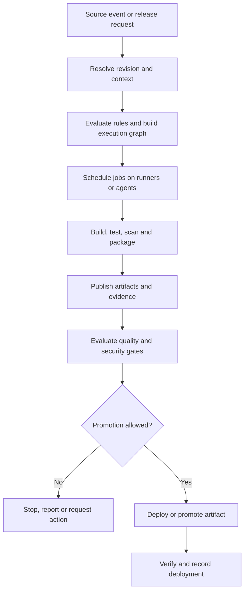
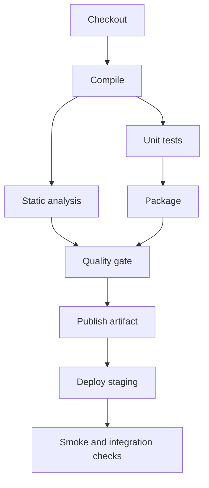

# Identifying Shared Principles Before Learning Platform-Specific Syntax

Every CI/CD platform has its own way of writing pipelines, naming components, and structuring configurations. GitHub Actions uses workflows, jobs, and steps; GitLab CI has pipelines, stages, and jobs; Jenkins Pipeline describes stages, agents, and steps; Azure Pipelines organizes stages, jobs, steps, and agent pools. If you learn each tool by memorizing syntax first, it is easy to confuse naming with substance, struggle to switch between platforms, and design pipelines that depend on a feature without understanding its risks.

A more durable way to learn is to identify the shared principles first: which event starts the workflow, which source code and revision are processed, how work is split into units, where runners execute, how data passes between jobs, how artifacts are built and promoted, what permissions are granted, what quality gates decide, and where evidence is stored. Once you understand these concepts, each platform's syntax becomes merely a way to express an already familiar model.

**CI/CD tools are implementations of release capabilities and rules.** Learn the control model, data flow, trust boundaries, and states first; only then learn the syntax to configure them on a specific platform. This approach helps you read documentation faster, compare tools accurately, and avoid copying configurations without understanding their impact.

## 1. Why Learn Principles Before Syntax?

A pipeline can be written in YAML, Groovy, a drag-and-drop UI, or configured in a specialized system. Syntax differs, yet the core design questions are usually the same:

- What triggers the pipeline and is that event trustworthy?
- Which commit, tag, or artifact is the pipeline processing?
- Which jobs can run in parallel, and which must wait?
- On which machine or environment does the work run?
- Where are job inputs/outputs passed and stored?
- Are artifacts immutable and traceable back to source?
- What identity and secret scope are granted to a job?
- What conditions permit merging, releasing, or deploying?
- When a step fails, how does the system retry, halt, or recover?
- Can you prove which version was deployed and who authorized it?

If you understand these questions, when encountering a new platform you can go straight to the right documentation sections: event model, execution graph, runner model, artifact store, environment protection, identity, policy, and auditing. There is no need to start by memorizing dozens of keywords.

### Syntax Is Not a Mental Model

Two platforms can share the word `stage` while defining execution scope differently. One platform may let you declare dependencies directly between jobs; another defaults to running by stage before allowing a DAG. One platform calls the execution host a runner, another calls it an agent. Comparing names alone leads to false conclusions.

Ask what responsibility each concept fulfills, what state it manages, and what boundary it protects. Only then look up the corresponding syntax.

## 2. General Model of a CI/CD System

CI/CD can be viewed as an event-processing and stateful work-orchestration system. It receives a change or release request, determines what must run, executes work on executors, produces evidence and artifacts, and decides whether results may advance to the next environment.



These steps can sit inside one workflow or across multiple linked pipelines. The key is distinguishing:

1. **Control plane:** receives events, evaluates policies, schedules work, manages state, and decides next steps.
2. **Execution plane:** runners/agents/containers that actually execute commands, tests, builds, or deployments.
3. **Data plane:** source, dependencies, caches, artifacts, reports, secret references, and metadata flowing across steps.
4. **Governance plane:** identity, permissions, approvals, policies, audits, and evidence proving actions were authorized.

This is a separation for thinking and designing, not four mandatory separate products. One platform can provide all of them in a single service; large organizations may use different systems for each capability.

## 3. Pipeline Lifecycle: From Event to Outcome

A pipeline typically passes through these phases:

| Phase | Key Question | Expected Outcome |
|---|---|---|
| Trigger | Why was the workflow started? | Event, actor, repository, and context |
| Resolve | Which revision or release intent is being processed? | Commit SHA, tag, branch, or manifest |
| Plan | What work must run and in what order? | Execution graph/DAG |
| Schedule | Where does the work run and with what resources? | Runner/agent allocation |
| Execute | What did build/test/scan/deploy produce? | Exit status, logs, and reports |
| Publish | Which outputs are stored for downstream use? | Artifacts, digests, provenance, and evidence |
| Gate | Are conditions met to proceed? | Pass, fail, hold, or approval required |
| Promote | Which artifact is delivered to which target? | Deployment/release record |
| Verify | Does post-deployment state meet requirements? | Health, metrics, and validation evidence |

A pipeline is not just a list of commands. It is a process with inputs, outputs, dependencies, states, and failure policies.

## 4. Platform Vocabulary: Workflow, Pipeline, Stage, Job, Task, and Step

Platforms do not fully agree on naming. The following table describes common conceptual meanings, not a guarantee that every product defines them identically.

| Term | Conceptual Meaning | Questions When Reading Docs |
|---|---|---|
| Workflow/Pipeline | High-level automated process triggered by an event or request | When does it start and what state does it manage? |
| Stage | A group of tasks or a phase within a process | Does a stage enforce a sequential boundary or is it purely organizational? |
| Job | A unit of work executed by the scheduler on an executor | Does a job have its own workspace? Can it run in parallel? |
| Task | A unit of operation or group of operations, depending on platform | Does a task run inside a job or is it scheduled independently? |
| Step | A small action inside a job/task, usually a command or action | How do steps share processes, workspaces, and environments with each other? |
| Runner/Agent/Executor | The machine, container, or worker executing the work | Who provisions the machine, manages images, and reclaims resources? |
| Artifact | Output stored for consumption or deployment | Does it have version/digest, retention, and provenance? |
| Cache | Reproducible intermediate data to speed up runs | What are the cache key, scope, and invalidation rules? |

When moving between platforms, map by responsibility rather than translating word-for-word. A `job` in platform A may correspond closely to a `stage` or `task` in platform B depending on how the scheduler works.

## 5. Pipeline as Code and Source of Truth

Pipeline as Code means defining processes via files or code versioned alongside source or in a pipeline governance repository. It enables change reviews, history reproduction, policy testing, and knowing who changed the process.

A sound pipeline definition needs:

- Source control and code review like application code.
- Schema/validation to catch misconfigurations before execution.
- Clearly versioned reusable workflows/templates.
- Separation of shared logic from service-specific configuration.
- Restricted permissions on the pipeline definition.
- Recording of the workflow/template version used in every run.
- A migration procedure when changing pipeline structure.

Not every setting belongs in a single YAML file. Environment protections, identity trust policies, runner pools, and secret permissions may be managed at the platform level. What matters is identifying the source of truth for each configuration type and controlling changes to it.

### Declarative vs. Imperative

- **Declarative:** describes the desired state or rules, e.g., job A must finish before job B.
- **Imperative:** describes each command to execute, e.g., run `./gradlew test` and then package.

Real pipelines usually combine both: the graph and conditions are declared; commands inside steps execute concrete operations.

## 6. Triggers and Event Models

A trigger is the mechanism that starts a pipeline. Events can come from Git, pull/merge requests, tags, schedules, APIs, artifact publication, approvals, or another pipeline.

| Trigger Type | Example | What to Check |
|---|---|---|
| Source event | Push/commit | Branch, actor, revision, and execution permissions |
| Review event | Pull request/merge request | Fork trust, changed files, and approval state |
| Release event | Tag or release request | Is the tag protected and is the artifact immutable? |
| Scheduled | Nightly/weekly | Timezone, duplicate runs, and system load |
| Manual/API | User or system invokes pipeline | Authorization, input validation, and auditing |
| Upstream event | Another pipeline publishes an artifact | Origin, event ID, version, and idempotency |

An event does not automatically mean every job is permitted to run. Triggers determine when a workflow starts; rules/conditions determine which jobs run; permissions determine what jobs may do.

### Trigger Filters and Job Conditions

You can filter by branch, path, tag, actor, event type, or metadata. Ensure a safe fallback when impact scope cannot be determined. If the dependency graph is incomplete, run broader tests rather than concluding no components need checking.

### Idempotency and Duplicate Events

Webhooks or events can be redelivered. The pipeline or downstream consumer must inspect event IDs, source revisions, and intent to avoid unintended duplicate publishes or deployments. Operations with side effects need an idempotency key or state check before executing.

## 7. Execution Graphs and Dependencies

Pipelines are commonly modeled as a directed acyclic graph (DAG). Each node is a job/task; edges show that one task must wait for another's output or status.



Principles to understand:

- Add a dependency only when a job genuinely requires another job's result.
- Independent tasks should run in parallel to shorten the critical path.
- Fan-out splits work; fan-in aggregates results.
- A skipped job is different from a passing job; gates must interpret statuses accurately.
- Retries must account for idempotency and side effects.
- Cancelling a job does not guarantee all external processes have stopped.
- Concurrency limits and locks protect shared resources.

Do not turn an entire pipeline into a sequential chain merely for readability. Conversely, do not run jobs in parallel if they modify the same environment or share unisolated data.

## 8. Runners, Agents, and Executors

The runner/agent is where jobs execute. A platform may offer hosted runners, self-hosted runners, VMs, containers, or worker pools. Understand these properties before picking a configuration:

- Operating system and CPU architecture.
- Available images/runtimes and toolchains.
- CPU, memory, disk, and networking.
- Whether workspaces are clean between jobs.
- Whether jobs can reach the Internet or specific internal networks.
- Runner identity and how secrets are obtained.
- How runners are updated, patched, and decommissioned.
- Whether jobs share a machine with other workloads.

### Hosted vs. Self-Hosted Runners

| Criterion | Hosted Runner | Self-Hosted Runner |
|---|---|---|
| Machine operations | Largely managed by provider | Organization manages OS, images, and patches |
| Customization | Bound by provided images and service limits | More flexible |
| Internal network access | May be restricted or require dedicated setup | Can reach internal networks if permitted |
| Isolation | Depends on provider's runner model | Organization must design and verify |
| Cost | Based on usage and runner size | Infrastructure, operations, and maintenance |

Self-hosted is not automatically safer. If a runner reuses workspaces or credentials after an untrusted job, it can become an intrusion vector into other pipelines. For sensitive workloads, consider ephemeral runners, managed images, and least-privilege network access.

## 9. Workspaces, Processes, and Execution Environments

Steps within a single job may share a workspace, though they do not necessarily share the exact same process or environment. Different jobs typically have separate workspaces unless the platform provides an explicit data-transfer mechanism.

When reading platform documentation, check:

- Default working directory.
- Which files persist across steps and across jobs.
- At which level environment variables are inherited.
- Default shell and differences in quoting/exit codes.
- How container jobs mount workspaces and credentials.
- Whether cleanup runs when a job fails or is cancelled.
- How files/artifacts are transferred across different runners.

Never assume a file created in job A automatically appears in job B. Publish an artifact or use a platform-supported output/transfer mechanism.

## 10. Inputs, Outputs, Artifacts, and Caches

A pipeline handles input and output data. Distinguish outputs used to control the graph, artifacts that must be retained, and caches intended solely for speed.

| Concept | Purpose | Characteristics |
|---|---|---|
| Input/parameter | Configures a run or job | Needs validation of type, value, and modification permissions |
| Output/variable | Passes small values between steps/jobs | Typically bound to the run with explicit scope |
| Artifact | Stores build/test/package outputs for reuse | Requires version, digest, retention, and access control |
| Cache | Reuses reproducible data | Can be evicted or miss while the pipeline must still run correctly |
| Secret reference | References credentials from a secret store | Must not be passed as ordinary output or written to logs |

Artifacts are trustworthy, traceable outputs. Cache is a performance optimization, not a source of truth. If clearing the cache causes a pipeline to fail correctness checks, the process is wrongly depending on cache.

### Build Once, Promote Many

An artifact should be built once from a specific source revision, then promoted across environments using the exact same digest. Do not rebuild separately for staging and production merely because configuration differs; environment configuration should be managed independently.

Artifact metadata should link:

- Repository and commit SHA.
- Pipeline run ID and workflow version.
- Build toolchain/dependency metadata.
- Artifact name, version, and digest.
- Tests, scans, SBOM, and provenance.
- Release manifest and deployment record.

## 11. Configuration, Secrets, and Identity Are Three Different Things

Configuration describes environment behavior, secrets are sensitive data used for authentication or signing, and identity establishes which workload or person is performing an action.

| Component | Example | How to Manage |
|---|---|---|
| Configuration | `LOG_LEVEL`, endpoint, feature setting | Versioned, validated, and scoped per environment |
| Secret | Password, API token, signing key | Secrets manager, rotation, masking, and restricted access |
| Identity | CI workload, deployment service account | Federation/short-lived credentials and least privilege |

Do not share one long-lived secret across all pipelines when short-lived identities can be issued per project and environment. Never put secrets into artifacts, caches, command outputs, or logs. Masking does not replace restricting which secrets are granted to a job.

### Trust Boundary

A job running code from an untrusted pull request must never automatically inherit production deploy permissions. Separate workflows validating untrusted source from high-privilege release workflows; verify artifacts and provenance before granting promotion permissions.

## 12. Quality Gates and Policy Evaluation

A quality gate is a condition deciding whether a pipeline may proceed. Gates can check tests, code quality, vulnerabilities, artifact provenance, approvals, or environment health.

A good gate answers:

- Which risk or quality goal is being protected?
- Which conditions must be met?
- Which evidence is evaluated?
- If a tool fails or data is missing, what is the resulting status?
- Who is authorized to override and how are overrides audited?

### Status Is Not Merely Pass/Fail

| Status | Meaning | Action |
|---|---|---|
| Pass | Sufficient evidence and conditions met | Allow next step |
| Fail | Violation or test failure detected | Block and require remediation |
| Warning | Issue present but policy permits conditional continuation | Record owner/deadline and monitor |
| Skipped | Job did not execute | Verify reason; never treat as pass by default |
| Not applicable | Rule does not apply under defined conditions | Record rule and reason |
| Unknown/error | Insufficient data or checking system failed | Hold or block based on risk level |
| Waived | Approved and valid exception exists | Permit within waiver scope, record audit |

For production protection gates, missing evidence should generally not be treated as a pass. Policies must explicitly define fail-closed or appropriate fallback behavior.

## 13. Approvals and Environment Protection

Approvals make sense when humans must assess risk, business impact, or accept exceptions. They should not replace checks that can be automated.

Approvers need to inspect:

- Commit and artifact digest.
- Test/scan/provenance evidence.
- Scope of affected components and environments.
- Migration, config, and feature flag changes.
- Open findings/waivers.
- Rollout, verification, and recovery plans.

Environment protections can restrict which branches/tags, actors, workflows, or reviewers are allowed to deploy. Understand whether approvals bind to a run, an artifact, or a deployment intent; if inputs change after approval, determine whether the prior approval remains valid.

## 14. Promotion and Deployment Strategies

Promotion advances the same artifact across different environments or release stages, such as development → test → staging → production. Each environment has its own policies and evidence, while the artifact should retain the exact same digest.

Common deployment strategies:

- Rolling: replaces instances in batches.
- Blue-green: maintains two pools and shifts traffic.
- Canary: expands traffic gradually in phases.
- Feature flag: controls feature availability at runtime.
- Recreate: stops the old version then deploys the new version, fitting workloads that tolerate downtime.

Pipelines should separate deploy from verify. A successful deploy command only proves the tool applied the operation; post-deployment validation verifies that the application actually works properly.

## 15. Concurrency, Cancellation, and Rollback

Pipelines can run concurrently for the same service or environment. If two runs modify the same target simultaneously, an older run might finish late and overwrite newer state.

Principles to grasp:

- Lock by deployment target or shared resource.
- Perform stale-run checks before mutation.
- Use deployment generation or intent IDs to identify desired state.
- Use compare-and-swap/fencing when leases or multiple writers exist.
- Treat cancellation as a resource-saving measure, not as the sole safety barrier.
- Treat rollback as a new intent with explicit auditing and ordering.
- Migrations and side effects require separate recovery plans.

When learning a platform, look up how it supports concurrency groups, resource locks, deployment queues, cancellation, and environment serialization. If the platform lacks strong enough features, an external deployment controller or lock service may be needed.

## 16. Observability and Evidence

A pipeline can turn green without being able to explain what it actually deployed. Observability and evidence connect CI/CD activity to the real state of the system.

Every run should record:

- Trigger, actor, repository, and source revision.
- Workflow/template version.
- Job/step statuses, durations, and logs.
- Artifact digest, SBOM, scan reports, and provenance.
- Approvals, policy results, and waivers.
- Environment, deployment ID, and config revision.
- Health checks, baseline comparisons, and post-deploy results.

### Three Questions You Must Be Able to Answer

1. **What changed?** Which commit, dependency, config, or artifact changed?
2. **What ran?** Which pipelines, tests, scans, and policies executed?
3. **What is live?** Which artifact and configuration are currently running in each environment?

If you cannot connect these three questions, traceability and incident investigation remain weak.

## 17. Reusable Workflows, Templates, and Composition

When many projects share similar steps, reusable workflows/templates help standardize builds, tests, scans, signing, and publishing. Understand the levels of reuse:

- **Command/script:** reuses a concrete operation.
- **Action/task/plugin:** packages a capability or group of operations.
- **Reusable workflow/template:** packages job/stage structure and shared policies.
- **Shared library:** reuses programmatic pipeline logic.
- **Pipeline orchestrator:** coordinates multiple workflows/projects or releases.

A good template has an input/output contract, versioning, safe default permissions, and bounded extension points. Do not let every project copy a version and diverge without a way to roll out policy updates.

### Composition and Inheritance

Composition assembles small components with clear interfaces. Inheritance or template extension inherits shared configuration and overrides certain parts. Check precedence and override capabilities: a project could inadvertently disable a security gate if a template allows arbitrary overrides.

## 18. Which Parts Are Portable and Which Are Platform-Dependent?

Not every pipeline detail transfers intact between tools. Separate transferable principles from platform-specific implementation mechanisms.

| Relatively Portable | Typically Platform-Specific |
|---|---|
| Build commands and test commands | Workflow/job/stage syntax |
| Artifact identity and digests | Artifact store and publish/download syntax |
| Dependency graph and ordering conditions | How `needs`, `dependsOn`, or stage ordering is declared |
| Quality criteria and policy intent | How required checks, approval rules, and environment protections are created |
| Least privilege and secret scoping | Identity federation, token permissions, and secret expressions |
| Deployment strategies | Native deployment environments, concurrency controls, and rollout controllers |
| Evidence to retain | UI, APIs, retention, and audit schemas |

Standardize contracts and control objectives. Do not try to craft a single config file that runs everywhere if doing so sacrifices security features or makes configuration cryptic.

## 19. Concept Map Across Several Platforms

The table below is a conceptual map to guide reading documentation. Names are not always strictly equivalent; verify the exact semantics of the platform version in use.

| Common Concept | GitHub Actions | GitLab CI/CD | Jenkins Pipeline | Azure Pipelines |
|---|---|---|---|---|
| High-level process | Workflow | Pipeline | Pipeline | Pipeline |
| Phase/work group | Job grouping via `jobs` and dependencies | Stage | Stage | Stage |
| Scheduled unit | Job | Job | Stage/parallel branch or agent workload depending on structure | Job |
| Execution step | Step | Script or job step | Step | Step |
| Execution machine | Runner | Runner | Agent/node | Agent in an agent pool |
| Dependency relationship | `needs` | `needs` or stage order | Stage/parallel/logic in Jenkinsfile | `dependsOn` |
| Artifact | Artifact service/package registry | Job artifacts/package registry | Archive/stash or artifact manager | Pipeline artifacts/build artifacts |
| Secret | Secrets/variables and OIDC | CI/CD variables and ID tokens | Credentials binding/plugins | Variable groups/secure files/service connections |
| Reuse | Reusable workflow/composite action | Include/component/child pipeline | Shared library | Template/task |

For example, GitHub Actions `needs` and Azure Pipelines `dependsOn` both express job dependencies, yet conditions, output scopes, and stage handling can differ. GitLab `needs` can alter how jobs consume artifacts and bypass default stage ordering. Jenkins Pipeline offers flexibility via Groovy while also demanding plugin and shared library management. Always check official documentation for exact version semantics and limits.

## 20. Example of a Platform-Neutral Pipeline

Before jumping into specific syntax, describe the workflow using a neutral model:

```yaml
pipeline:
  name: orders-api-ci
  trigger:
    events:
      - pull_request
      - push_to_main

  source:
    revision: exact_commit_sha

  jobs:
    build:
      executor: linux_container
      steps:
        - checkout_source
        - resolve_locked_dependencies
        - compile

    unit_tests:
      needs: [build]
      steps:
        - run_unit_tests
        - publish_test_report

    security_checks:
      needs: [build]
      steps:
        - secret_scan
        - dependency_scan

    package:
      needs: [unit_tests, security_checks]
      steps:
        - create_immutable_image
        - generate_sbom_and_provenance
        - publish_artifact

  release_gate:
    require:
      - required_tests_pass
      - security_policy_pass
      - artifact_provenance_valid

  deployment:
    target: staging
    artifact: exact_published_digest
    verify_after_deploy: true
```

This is an explanatory model, not a configuration file that executes directly on GitHub Actions, GitLab, Jenkins, or Azure Pipelines. It clarifies intent and dependencies before translating into concrete syntax.

### How to Translate the Neutral Model to a Platform

1. Choose matching triggers and verify event context.
2. Map jobs/dependencies to the platform's graph model.
3. Select runner/agent images and least-privilege permissions.
4. Pick mechanisms for passing outputs, artifacts, and caches.
5. Map gates to required checks, rules, or approvals.
6. Configure identities/secrets according to trust boundaries.
7. Add concurrency, cancellation, and deployment environments.
8. Test on a safe branch or environment.
9. Inspect logs, evidence, and behavior when jobs fail/cancel.

## 21. How to Read Documentation for a New Platform

Instead of reading documentation cover-to-cover in menu order, follow architectural questions:

| Learning Order | Documentation Topic to Find | Mini Exercise |
|---|---|---|
| 1 | Event/trigger model | Run a pipeline on push and pull request |
| 2 | Workflow/job/step model | Create two dependent jobs and two parallel jobs |
| 3 | Runner/agent/executor | Run on a specific image, check OS/toolchain |
| 4 | Variables, outputs, and artifacts | Pass a version between jobs and publish a file |
| 5 | Cache | Create a dependency cache and test invalidation |
| 6 | Secrets/identity/permissions | Use a mock secret, then test OIDC or identity scope |
| 7 | Conditions, matrix, and concurrency | Filter paths, split a matrix, and prevent concurrent deploys |
| 8 | Environments/approvals | Add a staging gate and approval before production |
| 9 | Reusable workflows/templates | Create a template reused by a second project |
| 10 | Audit/observability/deployment | Record a release ID and verify post-deploy |

For every feature, explore both success and failure cases: runner disconnect, cache miss, missing artifact, secret denied, job cancelled, approval expired, or deployment superseded.

## 22. How to Evaluate a CI/CD Tool

Do not choose a platform merely for concise syntax or plugin count. Evaluate against organizational needs and capabilities required for long-term operations.

| Criterion | Evaluation Question |
|---|---|
| Source integration | How well does it support repositories, review events, protected branches, and monorepos? |
| Execution | Are there runners matching required OS, architecture, networking, and workloads? |
| Scalability | Do the scheduler, queues, and concurrency support project/run volume? |
| Artifact | Does it support registries, immutable digests, retention, and promotion? |
| Security | Does it support OIDC/federation, least privilege, secret scoping, and auditing? |
| Governance | Are there approvals, environment protections, policies, and exception workflows? |
| Reuse | Are there templates, reusable workflows, libraries, or components? |
| Observability | Are logs, metrics, traces, deployment records, and APIs available? |
| Portability | Can build/test logic and artifacts move across environments? |
| Operations | Who patches runners, updates plugins, backs up configs, and handles outages? |
| Cost | What are the license, runner, storage, network, and operational costs? |

A tool strong in workflows but lacking identity federation may need extra integration. A flexible tool heavily reliant on plugins may create maintenance overhead and supply chain risks. Evaluation must cover the full operational lifecycle.

## 23. Anti-Patterns When Learning and Designing by Syntax

| Anti-Pattern | Why It Is Problematic | Improvement |
|---|---|---|
| Memorizing keywords before understanding the graph | Hard to spot wrong dependencies and concurrency | Draw the DAG first, then map to syntax |
| Copying sample YAML without reading permissions | May grant excessive privileges or leak secrets | Review triggers, identities, and permissions per job |
| Assuming stage/job/step mean the same everywhere | Misunderstands scheduler and output scopes | Compare semantics, not just names |
| Using cache as an artifact | Pipelines can lose required outputs on cache miss | Publish versioned artifacts with retention |
| Rebuilding in every environment | Staging artifact differs from production | Build once, promote immutable digests |
| Sharing one common credential | Wide blast radius and hard to audit | Scope workload identities/secrets per target |
| Letting untrusted PR jobs read production secrets | Malicious code could execute inside the runner | Separate trust boundaries and release workflows |
| Treating a green pipeline as a successful deployment | Does not prove the application behaves correctly | Require post-deploy verification and evidence |
| Keeping a frozen template too long | Outdated policies and painful upgrades | Version, test compatibility, and deprecate systematically |
| Trying to make configs 100% portable | Loses native security/governance capabilities | Standardize portable contracts, keep implementation-specific controls |
| Not testing failure/cancel paths | Targets may be left in half-applied states | Rehearse failure paths and recovery |

## 24. Checklist for Learning a New Platform

When starting with a CI/CD platform, confirm you can answer:

- [ ] Which events trigger workflows and what context is provided?
- [ ] How are pipelines, stages, jobs, tasks, and steps defined?
- [ ] How are the dependency graph and execution conditions expressed?
- [ ] On which OS, images, and networks do runners/agents run?
- [ ] How are workspaces and processes shared across steps?
- [ ] How do inputs, outputs, artifacts, and caches differ?
- [ ] How are artifacts versioned, stored, and promoted?
- [ ] What scopes apply to secrets, identities, and permissions?
- [ ] How are untrusted pull requests/forks isolated?
- [ ] How do quality gates handle pass, fail, skipped, and unknown?
- [ ] Do approvals bind to a run, an artifact, or a deployment intent?
- [ ] How do environment protections and concurrency locks work?
- [ ] What state do failed, timed-out, retried, or cancelled jobs leave behind?
- [ ] How are reusable workflows/templates versioned and upgraded?
- [ ] Where are logs, metrics, audits, and deployment evidence retrieved?
- [ ] Can rollbacks and post-deploy verification be simulated?

## 25. Conclusion

CI/CD platforms may differ in syntax, naming, and integrations, yet most solve the same core set of problems: receiving events, building an execution graph, provisioning executors, passing data, producing artifacts, enforcing policies, granting permissions, deploying, and verifying outcomes.

When you grasp these principles first, you can read any tool's syntax by mapping concepts rather than memorizing isolated keywords. Start with events, dependencies, runners, artifacts, identities, quality gates, and evidence; then learn platform-specific features like matrices, reusable workflows, environment protections, or plugins. This approach lays the foundation to switch tools, evaluate options, and design secure, traceable pipelines across multiple platforms.
