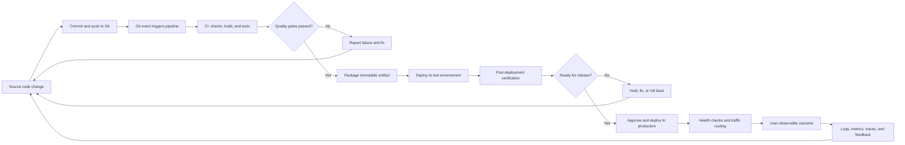

# Describing the Flow from Commit to User-Observable Outcome

CI/CD is a way of organizing the delivery of software changes from a source code repository to the environment where users operate, with automated checks and traceable evidence. A commit is only the starting point of the software delivery flow. A successful pipeline run is not enough on its own to conclude that a change has delivered value to users: the release must be packaged, deployed to the right environment, pass post-deployment verification, and actually reach the intended group of users.

Within the scope of CI/CD fundamentals, this entire chain should be viewed as one continuous flow: a Git event triggers the pipeline; the pipeline validates and produces an artifact; the artifact is managed and promoted across environments; quality gates decide whether release progression continues; and observability systems confirm outcomes after deployment. Each stage must leave behind evidence that links cleanly to the stages before and after it.

## 1. The Big Picture

A common software delivery flow can be represented as follows:



These steps can be split across multiple workflows or pipelines. For example, a pull request pipeline focuses on fast feedback for developers; a pipeline after merging into the main branch builds a releasable artifact; and a release process is responsible for deploying that artifact to environments. Regardless of how the flow is split, the link from commit to running version must be preserved.

### CI, Continuous Delivery, and Continuous Deployment

- **Continuous Integration (CI)** is the practice of integrating changes frequently into a shared branch and automatically running checks to detect conflicts and defects early.
- **Continuous Delivery** keeps software continuously in a releasable state. A verified artifact can be deployed to production whenever conditions are met and an appropriate release decision is made. Promoting to production may still require approval.
- **Continuous Deployment** automatically pushes every change that passes all quality gates to production without a separate manual release approval step.

These three concepts are related but not synonymous. An organization can practice strong CI without yet having a complete delivery process, or implement Continuous Delivery with an approval gate before production.

## 2. From Commit to Pipeline

### 2.1. A Commit Creates a Traceable Unit of Change

A developer edits source code, configuration, or assets, and then creates a commit. The commit carries an identifier (commit SHA), author, timestamp, and descriptive message. When the commit is pushed to the remote repository, the Git hosting platform emits an event that CI/CD tools can consume.

An easily controlled change usually has a small scope, a clear message, and goes through a pull request or merge request. Code review, branch policy checks, and design discussion happen before or alongside automated checks. Human review and machine checks complement each other: machines excel at repeatable rules, while humans evaluate intent, maintainability, and architectural impact.

The commit SHA is a critical anchor. The pipeline must record the exact commit that was tested and the exact artifact produced from that commit. Storing only a branch name such as `main` is not enough because a branch's contents change over time.

### 2.2. Git Events Decide When to Run

A pipeline is typically triggered by one of the following events:

| Event | Common Purpose |
|---|---|
| `pull_request` or merge request | Validate changes before merging |
| `push` | Verify new commits on tracked branches |
| Tag push or release creation | Produce a versioned release |
| Scheduled trigger | Run dependency checks, maintenance tasks, or periodic scans |
| Manual trigger | Re-run, release, or perform a controlled operation |

An event is only the trigger signal. Filters by branch, path, tag, and action type determine which workflow actually executes. Filters should be designed carefully to avoid missing critical changes or running unnecessary duplicates. For instance, documentation edits might not need a full application build, whereas changes to build configuration files must trigger the relevant checks.

Not all events should be treated as equally trusted. A pipeline triggered from an external pull request may require more restricted permissions and secrets than a pipeline running on the main branch. Write permissions to repositories, registries, or production should be granted according to each job's identity and purpose.

## 3. The Pipeline Executes Checks and Produces an Artifact

### 3.1. Orchestrator and Execution Environment

The CI/CD system receives the event, creates a pipeline run, assigns jobs to runners or agents, and orchestrates the execution order. Pipelines are commonly modeled as stages and jobs with dependencies. Independent jobs can run in parallel; deployment jobs only run once the required upstream jobs have succeeded.

A runner can be an ephemeral virtual machine, container, self-hosted machine, or cluster agent. The execution environment directly affects result repeatability. You need to control the operating system version, runtime, compiler, build tools, environment variables, and network access. Long-lived shared runners can retain leftover files or configuration from previous runs, making results hard to reproduce; ephemeral runners help eliminate this leftover state.

### 3.2. CI Validates Changes

A CI pipeline typically performs the following groups of checks, depending on project type:

1. **Formatting and convention checks:** formatters, linters, naming rules, and code structure checks.
2. **Type checking and static analysis:** compilers, type checkers, static analysis, and detection of common bug patterns.
3. **Automated testing:** unit tests, integration tests, contract tests, or end-to-end tests at an appropriate scope.
4. **Security checks:** scanning dependencies, source code, configuration, and exposed secrets; optionally adding license or policy checks.
5. **Packaging checks:** confirming the application can build and produce the required outputs.

Not every project needs every type of test on every single run. Place fast checks that catch common errors at the beginning of the pipeline so developers receive rapid feedback; slower checks can run later or on a separate schedule if risk allows. However, a mandatory check must never be silently skipped just to turn the pipeline green.

Check results should be retained as evidence: job statuses, logs, test reports, coverage where meaningful, scan outputs, and tool versions. Recording only a single line saying "passed" destroys your ability to investigate when an incident occurs.

### 3.3. Reproducible Builds

A build transforms source code and inputs into an executable program or distributable package. For consistent results, lock dependency versions, use lockfiles where the ecosystem supports them, pin critical tool versions, and control external inputs. Builds must not depend on personal files on a developer's machine or random leftover state on a runner.

A build is reproducible when the same set of controlled inputs yields an equivalent output according to the project's criteria. Not every system can achieve byte-for-byte identical artifacts immediately, but recording the exact commit, dependencies, toolchain, build parameters, and environment is the foundational step for investigating discrepancies.

### 3.4. Artifacts as Managed Outputs

An artifact is the output package of the build process, such as a JAR, binary, package, container image, or frontend bundle. Artifacts should be stored in a registry or artifact repository with access control and retention policies.

Artifacts should be identified by version and digest. A tag like `latest` is convenient for manual operations but can point to different content over time; a content digest identifies the exact artifact. Accompanying metadata should record the source commit, pipeline run, build timestamp, toolchain, check results, and provenance or signature details if the platform supports them.

A key principle is **build once, promote the same artifact across environments**. If you rebuild separately for staging and production, the two environments may receive different packages even if tagged with the same version. Instead, store the verified artifact and deploy that exact artifact; environment-specific configuration is supplied at runtime.

## 4. From Artifact to Running Environment

### 4.1. Deployment and Environment Configuration

Deployment is the process of placing an artifact into an environment and making the new version runnable. Common environments include development, test, staging, and production. Each environment may differ in resources, permissions, endpoints, data, and external integrations.

The artifact contains the application; environment configuration determines where the application connects and which policies govern its behavior. Service URLs, feature flags, and operational parameters are usually passed via configuration. Passwords, tokens, and private keys must be retrieved from a secret manager or equivalent secrets management mechanism, restricted according to the principle of least privilege. Never store secrets in source code, artifact files, logs, or command-line arguments where they could be exposed.

A safe deployment process verifies the artifact before running it, uses a deployment identity with limited permissions, records who or which workflow performed the deployment, and logs the environment, timestamp, version, and outcome. When multiple services are involved, deployment ordering and cross-version compatibility must be made explicit.

### 4.2. Quality Gates and Approvals

A quality gate is a condition required for the flow to advance to the next step. Depending on the stage, a gate may require:

- Mandatory build and test pipelines have succeeded.
- No vulnerabilities exist at a policy-blocking severity; dependencies and artifacts comply with policy.
- The artifact has an identifiable origin, valid digest, and resides in a trusted registry.
- Verification tests in the target environment pass.
- An authorized approver signs off when changes carry high risk or when policy mandates it.
- Production health and operational metrics remain within acceptable thresholds after release.

Gates must have measurable criteria and clear rejection reasons. An approval step only adds value when the approver has sufficient context on the change, its risks, test evidence, and rollback plan.

### 4.3. Deployment and Release Strategies

Deployment and feature release are two distinct concepts. A version may already be deployed while a new feature remains turned off behind a feature flag or has not yet been routed user traffic. Separating these two operations gives you control over timing and blast radius.

Common strategies include:

| Strategy | How It Works | Key Considerations |
|---|---|---|
| Recreate | Stops the old version, then starts the new version | Can cause downtime if there is no redundancy |
| Rolling | Replaces groups of instances incrementally with the new version | Requires coexisting versions to remain compatible |
| Blue-green | Maintains two environments and shifts traffic to the new one | Requires managing data and resources across both environments |
| Canary | Routes a portion of traffic to the new version and increases gradually | Requires monitoring errors and behavior per traffic cohort |
| Feature flag | Deploys code but enables features by condition or user segment | Flags need an owner, expiration date, and cleanup plan |

No single strategy fits every system. The choice depends on availability requirements, architecture, data compatibility, resource cost, and level of observability.

## 5. Post-Deployment Verification and User Outcomes

A successful deployment status usually confirms only that the tooling finished applying the update. It does not prove that the application behaves correctly from the user's perspective. Therefore, independent verification is needed after deployment.

Verification layers may include:

- **Health checks:** confirming processes and essential components are running.
- **Smoke tests:** verifying that key flows work, such as logging in or reading basic data.
- **Synthetic checks:** simulating requests from locations or networks close to users to test the real request path.
- **Metrics checks:** monitoring error rates, latency, throughput, resource usage, and relevant business metrics.
- **Logs and traces:** helping pinpoint root causes when a request traverses multiple services or fails at a specific step.
- **Distribution verification:** confirming traffic reaches the intended version, caches/CDNs have refreshed as needed, and feature flags are in the expected state.

User-observable outcomes can be affected by caches, DNS, CDNs, un-updated mobile apps, asynchronous jobs, or segmented rollouts. Consequently, completion criteria should be stated in terms of expected behavior—such as "users in the enabled cohort can create an order and receive confirmation"—rather than merely "deployment job is green."

For data-related changes, schema and application compatibility must be verified. A common safe pattern is to expand the schema first (expand), deploy a version capable of working with both old and new structures, migrate the data, and only remove the old structure (contract) in a subsequent release. This reduces the risk of older versions breaking during rollout or rollback.

## 6. End-to-End Example: Releasing a Promo Code Feature

Suppose a team adds an API to apply promo codes to orders.

1. A developer creates a commit containing the API and unit tests, then opens a pull request. The commit SHA is recorded to pinpoint the exact change.
2. The pull request event triggers the pipeline. The runner checks out that exact commit and runs the formatter, linter, type checks, and unit tests. If any check fails, the pipeline reports the status and logs so the developer can fix it.
3. After review and merging into the main branch, a push event triggers the build pipeline. The pipeline runs integration checks, packages the application, and builds a container image. The image is stored in a registry; its digest and commit SHA are saved as metadata.
4. The deployment process pulls that exact digest and deploys it to staging. Staging configuration and credentials are supplied by the corresponding configuration and secret management systems.
5. Smoke tests exercise the promo code API, integration tests verify total price calculations, and metrics are monitored during validation. If errors or business-logic discrepancies appear, the release is held back.
6. Once qualified, the exact same image digest is promoted to production. The team can use a canary rollout, initially routing a small percentage of traffic while watching error rates, latency, and promo-code success rates before increasing traffic gradually.
7. After the rollout completes, the team verifies that a user in the enabled cohort can enter a code, see the correct discount, and complete an order. Dashboards, logs, and traces correlate cleanly with the newly released version.

This example shows how evidence must connect across multiple systems: pull request, commit, pipeline run, test reports, artifact digest, deployment record, rollout status, and post-release metrics. When an incident happens, the team can trace back from the running version to the exact source change.

## 7. Pipeline as Code

Pipeline as Code stores workflow definitions alongside the repository or in an equivalent version control system. This approach enables reviewing pipeline changes, reusing rules, inspecting history, and applying consistent standards across branches or projects.

The simplified example below uses GitHub Actions syntax to illustrate validating pull requests and packaging only upon pushes to the main branch. Build commands and registry paths must be adapted to your actual project.

```yaml
name: ci

on:
  pull_request:
    branches: [main]
  push:
    branches: [main]

permissions:
  contents: read

jobs:
  verify:
    runs-on: ubuntu-latest
    steps:
      - uses: actions/checkout@v4
      - name: Run checks and tests
        run: ./gradlew check

  package:
    needs: verify
    if: github.event_name == 'push'
    runs-on: ubuntu-latest
    steps:
      - uses: actions/checkout@v4
      - name: Build application
        run: ./gradlew assemble
      - name: Build and publish image
        run: |
          docker build -t registry.example.com/app:${GITHUB_SHA} .
          docker push registry.example.com/app:${GITHUB_SHA}
```

This is an illustrative example, not a complete production configuration. In a real system, you need to add secure registry authentication, record the returned digest, scan and verify the artifact, manage caching, restrict job permissions, and enforce controlled deployment workflows. Tagging by commit SHA is far easier to identify than shared mutable tags, yet when promoting across environments you should still reference the immutable image digest.

As pipelines grow, extract shared logic into versioned actions, tasks, or templates; name jobs and steps after their purpose; declare `needs` dependencies explicitly; restrict default permissions; and avoid embedding secrets directly in workflow files. Any change that weakens a quality gate should be reviewed just as rigorously as a source code change.

## 8. Traceability, Security, and Failure Handling

### 8.1. Preserving the Chain of Evidence

An auditable flow should link the following identifiers:

| Subject | Information to Record |
|---|---|
| Source change | Repository, branch, commit SHA, pull request |
| Pipeline | Workflow/definition version, run ID, runner, timestamps, and job statuses |
| Verification | Test suites, reports, logs, and security scan results |
| Artifact | Name, version, digest, build origin, and storage location |
| Deployment | Environment, artifact digest, executing identity, timestamp, and outcome |
| Release | Traffic scope, feature flags, approvals, and rollout status |
| Operations | Metrics, logs, traces, alerts, and related incidents |

When an alert fires, this chain helps answer: which version is running, which commit built it, which checks it passed, who or which workflow deployed it, and which traffic is hitting it.

### 8.2. Secrets and Deployment Identities

Each job should only hold the permissions required for its task. A pull request test job normally does not need production write access. A release job should use a dedicated identity with narrow permissions and short-lived credentials if the platform supports them. OIDC or an equivalent identity federation mechanism can be used to obtain access from the target provider without storing long-lived keys in the repository.

Logs must be controlled to prevent printing tokens, passwords, or personal data. Whenever a secret is at risk of exposure, revoke or rotate the secret, investigate the blast radius, and handle affected logs/artifacts according to policy.

### 8.3. Retries, Rollbacks, and Recovery

Jobs failing due to transient errors such as service rate limits or network blips may warrant a retry. Only auto-retry when the operation is idempotent or protected against duplicate execution. If a deployment job provisions resources or runs migrations without execution guards, retrying can cause duplicate state or data corruption.

When a release introduces errors, recovery options depend on the nature of the change:

- Halt the rollout or shift traffic back to the previous stable version.
- Turn off a feature flag to stop serving the problematic feature.
- Roll back the artifact when the previous version remains compatible with current data.
- Roll forward with a bug fix if data has changed in a way that cannot be safely reverted.
- Restore data from backups or execute rehearsed recovery procedures when necessary.

Rolling back an application does not automatically roll back the database. Destructive migrations or semantic data changes can render the old version inoperable. Therefore, migrations require a compatibility plan, appropriate backups, and a tested recovery strategy before release.

## 9. Measuring and Improving the Software Delivery Flow

Metrics help identify bottlenecks and evaluate the impact of process changes. Consider tracking:

- **Lead time for changes:** time from when a change is committed or work begins until it runs in production, using agreed measurement boundaries.
- **Deployment frequency:** how often successful deployments reach production.
- **Change failure rate:** percentage of deployments resulting in a rollback, hotfix, or service degradation as defined by the team.
- **Time to restore service:** time required to recover service after an incident caused by a change.
- **CI feedback time:** time from the Git event until developers receive check results.
- **Pipeline success rate and failure causes:** helps distinguish product bugs from infrastructure or pipeline configuration issues.
- **Product and operational metrics:** task completion rate, business error rate, latency, and user satisfaction aligned with the released functionality.

Never optimize a single metric in isolation. Increasing deployment frequency while change failure rate spikes degrades reliability. Cutting pipeline duration by removing critical tests merely shifts the cost into production. Use metrics together to pinpoint where improvement is needed: review wait times, slow builds, flaky tests, manual deployments, or insufficient post-release verification.

## 10. Common Misconceptions

| Misconception | Accurate Understanding |
|---|---|
| Pushing a commit means users already have the change | A commit only starts the flow; checks, build, deployment, and distribution still follow |
| A green pipeline means production is healthy | A pipeline only proves defined steps passed; verification in the environment and from the user's perspective is still required |
| Staging and production can be built separately as long as they share a version | Two separate builds can produce different outputs; promote the exact same artifact digest instead |
| Using the `latest` tag is enough for traceability | Mutable tags can be overwritten; you need version, digest, and build origin metadata |
| Retrying any failed job is always safe | Retrying non-idempotent operations can duplicate side effects |
| Rolling back the application always restores the entire system | Schemas, data, queues, and side effects may be incompatible with the older version |
| Having a feature flag means testing isn't needed | Flags limit release scope, but enabled, disabled, and transition states still require testing |

## 11. Checklist for Designing a Reliable Delivery Flow

- [ ] Every pipeline run records the repository, commit SHA, and triggering event.
- [ ] Trigger rules and branch/path filters are clear; untrusted pull requests have restricted permissions.
- [ ] Fast checks run early; mandatory tests and quality gates produce reports, logs, and clear failure criteria.
- [ ] Toolchains and dependencies are controlled so builds are appropriately reproducible.
- [ ] Artifacts are stored in a trusted registry with version, digest, and links to the commit/pipeline.
- [ ] The same artifact is promoted across environments; configuration and secrets are supplied per environment.
- [ ] Runner permissions and deployment identities follow the principle of least privilege.
- [ ] Deployments use rollout strategies, quality gates, and approval mechanisms matched to risk.
- [ ] Post-deployment smoke tests or equivalent checks run, metrics/logs/traces are monitored, and user behavior is verified.
- [ ] Retries are controlled; rollbacks, roll forwards, and data recovery have verified procedures.
- [ ] Production versions can be traced back to the artifact, pipeline run, commit, and test evidence.

A complete CI/CD flow concludes when the change has been delivered to the intended audience, required behavior is verified, and the team has sufficient data to continue operating or recover. Designing around this chain of evidence turns software delivery from a collection of manual tasks into a repeatable, controllable, and improvable process.
