# Tracking a Change Across Source Code, Artifacts, and Deployments

In a CI/CD system, the critical question is not just "is the pipeline green?". When an error surfaces or a release requires auditing, the team must be able to answer: which change produced the running version, which commit supplied the source code, which pipeline built and tested it, what exact artifact was created, who authorized the deployment, which environment holds that artifact, and what happened after deployment.

The ability to link these facts into a verifiable chain is called **end-to-end traceability**. A traceability chain enables the team to investigate incidents, determine blast radius, prove the release process complied with policy, and roll back to an exact known-good version. In CI/CD, traceability must follow the identity of the change and the artifact across pipelines, registries, deployment environments, and operational systems.

## 1. The Traceability Picture from Change to Production

A change typically starts from an issue or work request, is implemented on a source branch, reviewed via a pull request/merge request, and recorded as a commit. CI processes that commit, produces an artifact, and attaches test results and origin evidence to it. CD selects that exact verified artifact to deploy across environments. After deployment, the system records rollout status and operational signals.

```mermaid
flowchart LR
    A[Issue / work request] --> B[Pull request]
    B --> C[Commit SHA]
    C --> D[Pipeline run]
    D --> E[Build and tests]
    E --> F[Artifact digest]
    F --> G[SBOM, provenance, signature]
    G --> H[Quality gate]
    H --> I[Deploy staging]
    I --> J[Smoke tests and approval]
    J --> K[Deploy production]
    K --> L[Health checks and metrics]
    L -->|Failed| M[Roll back to stable artifact]
```



Every link carries its own identifier. Do not rely solely on branch names, filenames, or version labels to connect them, since those names can move or point to different content over time. A solid traceability chain uses immutable identifiers and stores the relationships between them in a queryable system.

## 2. Identifiers That Must Be Linked

The following identifiers commonly appear in a release:

| Subject | Identifiers to Store | Role in Traceability |
|---|---|---|
| Change request | Issue ID, ticket ID | Explains why the change was made and which requirements it satisfies |
| Code review | PR/MR ID, URL, approvers | Shows how the change was discussed and approved |
| Source code | Repository, commit SHA, branch or tag | Pinpoints the exact input content of the build |
| CI run | Pipeline ID, run ID, attempt, workflow revision | Identifies the execution that built and verified the change |
| CI job | Job ID, runner, status, logs, and reports | Shows where each step ran and what it produced |
| Artifact | Name, version, registry, digest or checksum | Pinpoints the exact output stored and handed off |
| Build evidence | Provenance, SBOM, signature, scan/test results | Explains where the artifact came from and how it was verified |
| Deployment | Release ID, deployment ID, revision | Identifies a specific deployment event |
| Environment | Environment, cluster/namespace, or deploy target | Shows where the artifact was delivered |
| Operational outcome | Verification timestamp, health checks, metrics, incident ID | Shows how the version behaved after deployment |

These values do not substitute for one another. A commit SHA identifies source content; a pipeline ID identifies a workflow execution; a digest identifies artifact content; a deployment ID identifies placing an artifact into an environment. For example, a single commit may be processed by multiple pipeline runs, a single pipeline may emit multiple artifacts, and the exact same artifact may be deployed multiple times to different environments.

### Distinguishing Reference Names from Content Identity

A branch like `main`, a tag like `latest`, or an image label like `2.4.0` is helpful for humans, yet can be moved or reassigned under system policies. Whenever you need proof of exact content, store the commit SHA and artifact digest.

For container images, a reference of the form:

```text
registry.example.com/team/api:2.4.0
```

is normally a tag. A tag can be updated to point to a different image. A reference by digest takes the form:

```text
registry.example.com/team/api@sha256:<image-digest>
```

A digest is computed from the image's content and is the right identifier for deploying, verifying, or rolling back. Tags remain handy for discovery and display, while release records must capture the actual digest used.

## 3. Starting Traceability at Repository Changes

Before building, establish which request the change belongs to and how it entered the repository. A review workflow can record:

- Linked issue or ticket and acceptance criteria.
- PR/MR containing the change, reviewer list, and approval status.
- Final commit SHA fed into the pipeline.
- Triggering branch or tag and event type—such as push, merge, or release tag creation.
- Mandatory checks completed prior to merging.

The commit SHA serves as the anchor for downstream steps. Branch names move to newer commits as further changes land, so never store only `main` or `release/2.x` as source provenance. For repositories with submodules or multiple components, also capture the commits of dependent sources that influence the build.

A pipeline must check out the exact commit that triggered it. If a build runs from a workspace modified after checkout, or a script pulls the latest branch head instead of the run's commit, the resulting artifact may no longer match the commit recorded on the pipeline. Build steps must operate on a deterministic workspace and avoid pulling undeclared inputs.

For example, you can capture the checked-out commit in a Git job via:

```bash
git rev-parse HEAD
```

The returned value should be written into build metadata. When a pipeline handles merge requests, distinguish the source branch commit from the temporary merge commit or actual merge commit the platform tested. Records must clearly indicate which commit was built and which commit was merged into the target branch.

## 4. Binding Pipeline Runs and Test Results to Artifacts

A pipeline ID identifies an execution, yet storing only the ID is insufficient. Build records should link the pipeline to the source commit, workflow configuration, toolchain versions, and key jobs. For each job, retain status, timestamps, runner or executor, logs, and relevant reports according to an appropriate retention policy.

Once the build completes, artifacts must enter an artifact repository or registry with access controls and retention policies. Common outputs include:

- Application packages such as JAR, WAR, ZIP, or binaries.
- Container images stored in a container registry.
- Deployment packages such as Helm charts or packaged manifests.
- Test reports, quality analysis outputs, and security scan reports.

Build an artifact once from a specific commit, then test and promote that exact artifact across environments. Rebuilding separately for staging and production can deliver different bytes to the two environments despite sharing a version label. That undermines your ability to prove the production build is the exact artifact that passed testing.

### Recording Digests and Build Provenance

After an artifact is produced, compute its checksum or capture the digest returned by the registry. For plain files, a SHA-256 checksum helps detect content tampering. For container images, use the digest returned by the registry or build tool. Record the digest after pushing to the registry and reference that exact digest in the release manifest.

Illustrative example building and pushing an image with Docker Buildx:

```bash
docker buildx build \
  --push \
  --tag registry.example.com/team/api:ci-5831 \
  --metadata-file build-metadata.json \
  .

jq -r '.["containerimage.digest"]' build-metadata.json
```

The tag `ci-5831` helps locate the image by CI run; the returned digest is the content identity to record in the release record. The commands above assume an environment with Docker Buildx and `jq`; registry, image name, and metadata extraction must be adapted to your actual platform.

Alongside the digest, store **provenance** (evidence of build origin). Provenance describes which repository, commit, builder/workflow, inputs, and parameters produced the artifact. It lets consumers verify the artifact came from a trusted process. If your platform supports standard attestations such as in-toto/SLSA, store the attestation alongside the artifact and verify its signature before deployment.

An **SBOM** (Software Bill of Materials) lists the software components and dependencies inside an artifact. SBOMs help assess exposure when a newly disclosed vulnerability affects a library. An SBOM must bind to the exact digest; an SBOM from another image sharing a name or tag does not prove what lives inside the running image.

Checksums, signatures, provenance, and SBOMs serve distinct purposes:

| Evidence | Question Answered |
|---|---|
| Checksum/digest | Does the current content match the identified artifact? |
| Signature | Was the artifact or evidence signed by a trusted identity? |
| Provenance/attestation | Which source code, builder, and workflow created the artifact? |
| SBOM | Which libraries and components are contained in the artifact? |
| Test/scan report | Which checks did the artifact or source code pass? |

A checksum alone does not prove who built an artifact. A valid signature alone does not prove software is safe; it only verifies the signer's identity and the integrity of the signed payload. Evidence must be evaluated together against organizational policy.

## 5. Creating a Release Manifest to Link Evidence

Investigators should never have to stitch facts together manually across expired logs. A practical pattern is generating a **release manifest** for each artifact or release. A manifest is structured metadata storing source identifiers, build run details, artifact identity, and verification evidence.

The JSON example below illustrates fields you can store. All IDs and digests are illustrative placeholders:

```json
{
  "schemaVersion": "1.0",
  "service": "api",
  "change": {
    "ticket": "PAY-184",
    "pullRequest": "184",
    "repository": "https://example.com/team/api",
    "commit": "8f2c1d7a9b0e...",
    "sourceRef": "refs/heads/main"
  },
  "build": {
    "pipelineId": "ci-5831",
    "workflowRevision": "8f2c1d7a9b0e...",
    "builder": "trusted-linux-builder",
    "completedAt": "2026-11-18T08:30:00Z"
  },
  "artifact": {
    "type": "oci-image",
    "name": "registry.example.com/team/api",
    "tag": "ci-5831",
    "digest": "sha256:abc123..."
  },
  "evidence": {
    "unitTests": "passed",
    "integrationTests": "passed",
    "securityScan": "passed-policy",
    "sbom": "sbom.spdx.json",
    "provenance": "provenance.intoto.jsonl",
    "signature": "verified"
  },
  "deployments": []
}
```

Manifests can be stored alongside the artifact, inside a release management system, or in a deployment database. Control write and edit permissions carefully: audit metadata needs change history or appropriate immutable storage. If a manifest is updated on deployment, append deployment history entries rather than overwriting prior records.

Never place secrets, tokens, passwords, private keys, or user data inside a manifest. Store only references to secret or configuration versions if traceability requires them; secret values belong exclusively inside an access-controlled secret management system.

## 6. Tests and Quality Gates Must Target the Exact Object

Test results are only meaningful when you know which source code or artifact they apply to. Unit tests typically run during the build and bind to the commit, pipeline run, and job. Integration tests, smoke tests, or acceptance tests should explicitly record the artifact digest or release candidate tested when they run against packaged outputs.

A quality gate may require:

1. Mandatory jobs succeeded and test reports are archived.
2. The artifact has a digest and resides in an authorized registry.
3. Provenance points to an approved repository, commit, and builder.
4. Signatures verify against the trust policy.
5. An SBOM was generated and scan results meet organizational vulnerability thresholds.
6. The tested artifact has the exact same digest as the artifact about to be deployed.
7. Release approval is recorded if the target environment requires it.

That sixth point is critical: if a test job tests a tagged image, yet the deploy job re-pulls that tag after it was overwritten, the deployed artifact may differ from the tested artifact. Prevent this by passing immutable digests between jobs and verifying the digest right before deployment.

A `passed` result also needs context: test suite name, test suite version, execution timestamp, commit or digest, and a link to the report. When scan policies change, an organization may need to re-evaluate archived artifacts using their SBOMs and updated vulnerability feeds. Record each re-evaluation, the policy applied, and the new outcome.

## 7. Promoting the Same Artifact Across Environments

Once an artifact clears mandatory gates, CD can deploy it to development, test, staging, and then production according to organizational workflow. The guiding principle is **build once, promote many times**: the artifact keeps the same digest, and every environment receives identical application binaries while supplying its own configuration and secrets.

For example, `registry.example.com/team/api@sha256:abc123...` deploys to staging, passes verification, and receives approval for production. Production must deploy that exact digest. Never rebuild the image just to swap a database URL or endpoint; environment-specific values belong in configuration files, secrets, ConfigMaps, or equivalent runtime mechanisms.

For configuration traceability, deployment records can store:

- Configuration version or config repository commit.
- Environment name and specific deployment target.
- Secret version or configuration reference used, never the secret value.
- Chart, manifest, or deployment template version.
- Identity of the user or service account executing the deployment.

If a configuration change alters application behavior, manage it as a traceable change as well. The same artifact paired with two different configurations can behave differently; release records must therefore identify both the artifact and the applied configuration.

### Recording Each Deployment

Every deployment should generate a record containing at least:

| Field | Contents |
|---|---|
| Deployment ID | Unique identifier of the deployment |
| Release/artifact | Artifact name and deployed digest |
| Environment | Environment, cluster, namespace, or target |
| Source/build | Commit SHA and pipeline run that produced the artifact |
| Configuration | Applied configuration or manifest version |
| Actor/approval | Executing user or service account, plus approver if any |
| Time | Start time, finish time, and explicit time zone |
| Strategy | Rolling, blue-green, canary, or other strategy |
| Result | Succeeded, failed, canceled, or rolling out |
| Verification | Health checks, smoke tests, and links to metrics/logs |

With Kubernetes, deploying an image by digest might look like:

```bash
kubectl set image deployment/api \
  api=registry.example.com/team/api@sha256:<image-digest> \
  --namespace staging

kubectl rollout status deployment/api --namespace staging
```

These commands illustrate pinning a digest and awaiting rollout completion. Real setups may use Helm, Argo CD, Flux, or other deployment tools. Regardless of tooling, record the actual digest running in workloads, because desired state in configuration and live cluster state can diverge when a rollout fails.

## 8. Post-Deployment Verification and Correlating Operational Data

A green pipeline does not guarantee the service operates properly after release. Following deployment, validate the application in the target environment itself. Typical verification steps include:

- Readiness/liveness or health endpoints showing instances started and are ready to serve.
- Smoke tests verifying critical functional flows.
- Synthetic checks validating paths from a user or external system perspective.
- Metrics covering error rates, latency, throughput, resource usage, and business KPIs.
- Logs, traces, and deployment events helping identify which revision introduced a regression.

Verification results must bind to the deployment ID, artifact digest, environment, and observation window. Recording only "smoke test passed" without knowing which deployment was tested fails to prove the current deployment was verified.

For canary or progressive delivery, record each traffic-increment milestone, continuation criteria, and results at each step. For example, a new revision takes 5% of traffic for 10 minutes; if error rate and latency hold within thresholds, traffic steps up to 25%, 50%, and finally 100%. If thresholds fail, halt rollout and trigger the defined recovery plan. Concrete numbers must derive from service SLOs and characteristics rather than blind templates.

During an incident, linking deployment ID to incident ID and start timestamp quickly reveals whether the issue correlates with a recent release. Observability tools should allow filtering logs, metrics, and traces by service version, release ID, or deployment revision.

## 9. Rolling Back Using Known Artifact Identity

Reliable rollback requires knowing both the current version and the prior stable version. Deployment records must keep the active digest, previous digest, timestamps, associated configuration, and verification outcomes. When recovery is needed, the team can redeploy the prior artifact preserved in the registry instead of rebuilding from an old branch.

Rollback procedures should define beforehand:

1. Trigger conditions: failing health checks, error rates exceeding thresholds, SLO breaches, or failing business checks.
2. Recovery target version: an artifact digest known to be stable and still retained.
3. Configuration to restore or compatibility checks against the older version.
4. Authorized people or systems, approval rules, and event logging.
5. Post-rollback verification confirming the service returned to an acceptable state.

Rolling back application binaries does not automatically undo every database change. Design migrations for backward compatibility whenever possible, such as the expand-and-contract pattern: add compatible schema structures first, deploy new code, migrate data or traffic, and drop legacy structures in a separate later change. Feature flags can also disable new behavior without changing the running artifact.

Once rollback finishes, emit a new deployment event with the restored digest, linked to both the incident-causing deployment and the incident record. Never delete history of failed deployments; that history is vital evidence for post-incident reviews.

## 10. End-to-End Example: From Pull Request to Production

Suppose the API team works on ticket `PAY-184` to fix a billing calculation bug. A traceability chain can be recorded as follows. All IDs and digests in the table illustrate how information connects:

| Step | Event | Traceability Data |
|---|---|---|
| 1. Request | Create ticket and PR | `PAY-184`, PR `#184` |
| 2. Source | Review and merge change | Commit `8f2c1d7a...` |
| 3. CI | Pipeline runs on that commit | Pipeline `ci-5831`, test and scan jobs pass |
| 4. Build | Build and push container image | `registry.example.com/team/api@sha256:abc123...` |
| 5. Evidence | Generate SBOM, provenance, and signature | Provenance points to commit `8f2c1d7a...`, signature verified |
| 6. Staging | Deploy built artifact | Deployment `dep-stg-021`, digest `sha256:abc123...` |
| 7. Verification | Smoke tests and acceptance checks pass | Report linked to `dep-stg-021` and matching digest |
| 8. Production | Approve and deploy exact same digest | Deployment `dep-prod-017`, digest `sha256:abc123...` |
| 9. Operations | Monitor health and metrics | Telemetry linked to `dep-prod-017` |

If error rates climb minutes after release, on-call engineers can start from deployment `dep-prod-017`, inspect the running digest, open the release manifest to locate pipeline `ci-5831`, and trace backward to the commit and PR `#184`. The team immediately sees the related ticket, executed checks, approver, and artifact under review. If they decide to roll back, they retrieve the prior stable digest from the preceding deployment and redeploy that exact artifact.

The key takeaway in this example is that the exact same digest `sha256:abc123...` runs in both staging and production. Each environment's record differs in deployment ID, configuration, and verification outcomes, while the artifact's identity remains constant.

## 11. Mistakes That Break the Traceability Chain

- **Storing only branch or tag names:** mutable references move, making it impossible to know the actual source or artifact.
- **Rebuilding at deploy time:** staging and production can end up with different packages despite identical version labels.
- **Using mutable tags in deploy commands:** a tag can be overwritten between testing and deployment; deploy by digest instead.
- **Not storing pipeline-to-artifact links:** expired logs or deleted pipelines obscure where a running package originated.
- **Not binding reports to digests:** test or scan results may belong to a different artifact than the one deployed.
- **Overwriting deployment history:** loses records of prior versions, actors, and change timestamps.
- **Putting secrets in logs or manifests:** leaks credentials and exposes environments with broad access.
- **Checking only for green pipelines:** skipping post-deployment health checks and metrics delays detection of runtime failures.
- **Failing to retain older artifacts:** when an incident hits, the team lacks the exact prior package needed for recovery.

## 12. Traceability Design Checklist

When designing or reviewing a CI/CD flow, verify the following points:

1. Does every change link to a specific ticket, PR/MR, and commit SHA?
2. Does the pipeline record run ID, trigger event, workflow revision, and job statuses?
3. Are artifacts stored in an access-controlled registry with digests and retention policies?
4. Are provenance, SBOMs, signatures, and test/scan results bound to the exact digest?
5. Do quality gates verify the artifact being deployed is the exact artifact that was tested?
6. Do environments receive the same artifact digest while managing configuration and secrets separately?
7. Does every deployment record a deployment ID, actor, approval, timestamp, and outcome?
8. Are post-deployment health checks, smoke tests, and metrics correlated with the deployment revision?
9. Can the team locate the prior stable digest and roll back without rebuilding?
10. Are logs, reports, and manifests retained long enough with proper access controls and audit trails?

When every answer is clear, the team can trace any change from original requirement to source code, artifact, and live deployment. That foundation enables CI/CD to deliver verifiable, auditable, and safely recoverable releases.
