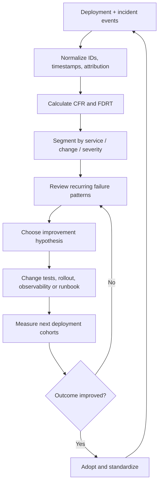

# Tracking Change Failure Rate and Recovery Capability

A pipeline that succeeds technically does not necessarily produce a successful release. An application can start normally yet increase transaction errors, reduce availability, slow down requests, or corrupt data once it receives real traffic. To evaluate release quality, teams must track both the **rate of changes causing failures** and the **ability to restore service when failures occur**.

Two key metrics in the delivery measurement group are **Change Failure Rate (CFR)** and **Failed Deployment Recovery Time (FDRT)**. CFR indicates the percentage of deployments that lead to incidents requiring remediation; FDRT indicates how long it takes to restore service after a failed deployment. They complement deployment frequency and lead time for changes: a team must not only release fast, but also release safely and recover when problems arise.

For both metrics to be meaningful, it is necessary to define the unit of measurement, how failures are attributed to deployments, start/end timestamps, production scope, reporting windows, and rules for handling missing data. If each team calculates them differently, numbers cannot be compared and create incentives to hide incidents.

## 1. The two metrics answer two different questions

| Metric | Question | What the metric reflects |
|---|---|---|
| Change Failure Rate | How many deployments cause failures requiring remediation? | Stability of changes entering the production environment |
| Failed Deployment Recovery Time | When a deployment causes a failure, how long does it take to restore service? | Ability to detect, decide, mitigate impact, and recover |

A system with low CFR but high FDRT may rarely encounter release failures, yet when failures happen, recovery is difficult. Conversely, high CFR with low FDRT indicates the team responds quickly, yet the release process still produces too many incidents. Both cases require improvement.

Do not optimize one metric in isolation. If focused solely on lowering CFR, a team might release less often or bundle many changes into one large release. If focused solely on lowering recovery time, a team might roll back quickly without investing in preventing repeat failures. Evaluate them alongside deployment frequency, lead time, SLOs, error budgets, and user impact.

## 2. Defining Change Failure Rate

Change Failure Rate is the percentage of production deployments that lead to a failure and require intervention to restore service or repair consequences. Intervention actions can include rollback, hotfix, roll-forward, disabling a feature flag, reverting configuration, running compensation, or an equivalent emergency measure.

A common formula:

\[
\text{CFR} = \frac{\text{Number of production deployments causing failures requiring remediation}}{\text{Total number of production deployments}} \times 100\%
\]

For example, in a period there are 80 production deployments. Six deployments cause incidents requiring rollback or hotfix. Then:

\[
\text{CFR} = \frac{6}{80} \times 100\% = 7.5\%
\]

Interpretation: roughly 7.5% of deployments in the period led to failures requiring intervention. This is a signal to investigate change quality, testing scope, rollout guardrails, and service risks.

### Defining the denominator

The denominator should be the total number of production deployments within the measurement scope for the same period. The organization must agree on:

- A deployment is a version or configuration change of a workload on a production target.
- A rollout with multiple replicas or multiple canary steps is still one logical deployment if orchestrated as a single release.
- If deploying the same release to multiple regions/clusters, specify whether to measure at the service-release level or per-target deployment level and stay consistent.
- Changes only in development/staging are not in the production CFR denominator.
- Deployments canceled before making any change in production are not counted as production deployments.
- A retry caused by a tool timeout when the target already received the same artifact should not automatically be counted as two deployments; clearly identify releases and deployment attempts.

The denominator must reflect actual release activity. If only successful deployments are recorded while failed rollouts that already altered production are omitted, CFR will be artificially low.

### Defining the numerator

A deployment is counted as a failed deployment when there is reasonable evidence that the change caused a failure requiring intervention. For example:

- Error rate or latency exceeds thresholds after rollout and requires rollback.
- A hotfix is released to fix a bug introduced by the just-deployed release.
- A feature flag must be disabled urgently because the new behavior causes user errors.
- New configuration causes the service to lose dependency connectivity and must be reverted.
- A migration or new code causes data corruption, forcing compensation/repair runs.
- A deployment is halted mid-rollout because health or business guardrails fail and requires returning the target to a stable state.

Not every incident occurring after a deployment was caused by that deployment. For example, an independent cloud region outage or an external dependency going down might coincide with a release. An attribution process based on timelines, changes, and technical evidence is needed.

## 3. Attribution rules: which deployment caused the failure?

Attribution is linking a failure to the change or deployment likely responsible for it. Without rules, the same incident might be attributed to multiple deployments or to none at all.

Record the following data:

- Service, environment, cluster/region, and deployment ID.
- Release ID, commit SHA, artifact digest, and configuration revision.
- Rollout start time, first-traffic time, and error start time.
- Pre- and post-change SLIs/SLOs, alerts, logs, traces, and smoke-test results.
- Incident ID, impact severity, affected user cohorts or transactions.
- Remediation action: pause, rollback, hotfix, roll-forward, flag disable, or compensation.
- Person or system confirming the cause and confidence level of attribution.

### One incident may involve multiple changes

For example, the `orders` service receives two deployments within one hour: deployment A updates the authentication library; deployment B updates a timeout setting. After deployment B, error rates spike. Investigation shows the error came from too low a timeout in B. Then B is counted as a failed deployment; A is not automatically counted merely for falling in the same time window.

If two deployments jointly contributed to the failure, clear rules are needed. You can count each responsible deployment if both required remediation, or record one incident with multiple contributing changes and report separately. Never alter calculation rules selectively to favor a given reporting period.

### Late-discovered failures

A bug may surface only after hours or days, such as a memory leak, scheduled batch job, or gradual data growth. Cohort-based CFR should link failures back to the source deployment, not only count them on the day the incident is discovered. Therefore, dashboards should support both perspectives:

- **Deployment cohort:** deployments released in the period and the proportion of them later identified as failed.
- **Incident period:** failures detected/handled in the period, even if the source deployment occurred in an earlier period.

Recent periods may not have enough observation time to conclude. Mark recent data as provisional or wait for the attribution window to close instead of treating new deployments as safe simply because no incident has surfaced yet.

## 4. Defining Failed Deployment Recovery Time

Failed Deployment Recovery Time measures the duration from when a deployment-induced failure begins impacting the service until the service is restored to an acceptable operating state.

A formula per failure:

\[
\text{FDRT} = t_{\text{service restored}} - t_{\text{impact start}}
\]

Where:

- `impact start` is the timestamp when the failure began causing measurable impact to users or SLOs, per organizational rules.
- `service restored` is the timestamp when the service returned to an acceptable state and was verified by health, SLI, or business checks.

Do not stop the clock merely because a rollback command returned exit code 0. If traffic is still failing, queues are still backlogged, or transactions are still unreconciled, the service is not fully restored.

### Distinguishing FDRT from MTTR

MTTR is used with several meanings: Mean Time to Repair, Restore, Recover, or Resolve. Because usage varies, dashboards must precisely define start/end events and incident types measured. FDRT focuses on deployment-related failures; MTTR may cover all operational incident types.

| Term | Scope | Example |
|---|---|---|
| FDRT | Deployment-caused failures | Release causes API 5xx errors; team rolls back and verifies service |
| Incident MTTR | All in-scope operational incidents | Region outage, dependency failure, capacity exhaustion, or release failure |
| Time to detect | From error start to detection | Alert fires after 3 minutes |
| Time to acknowledge | From alert to responder acknowledgment | On-call acknowledges after 2 minutes |
| Time to mitigate | From response start to significant impact reduction | Disabling feature flag to reduce errors |
| Time to restore | From impact start to service returning to acceptable levels | Rollback finishes and SLIs return within threshold |

You can track sub-intervals to find bottlenecks. For example, FDRT is high because alerts detect late, not because rollback is hard. Looking only at total time could lead the team to invest in the wrong place.

## 5. Choosing consistent timestamps

Start and end milestones must be recorded in incident/deployment records. A useful breakdown:

| Milestone | Meaning |
|---|---|
| `t_deploy_start` | Target modification begins |
| `t_first_traffic` | New version begins receiving traffic or processing data |
| `t_impact_start` | Failure begins impacting users/SLOs |
| `t_detected` | Monitoring or operators detect the issue |
| `t_acknowledged` | Responsible responder takes ownership |
| `t_mitigated` | Temporary measure significantly reduces impact |
| `t_service_restored` | Service verified back in acceptable state |
| `t_followup_closed` | Remaining data/reconciliation tasks completed if included in recovery definition |

For a stateless API, `t_service_restored` can be when error rate and latency return within thresholds over a confirmation window. For a payment system, additional data reconciliation may be required before marking recovery complete. Separate “service restored” from “all follow-ups closed” so restored serving time is not mixed with lengthy post-incident cleanup.

### Calculating FDRT in an example

Suppose a deployment starts receiving traffic at 10:00. Errors begin affecting requests at 10:04, an alert fires at 10:06, on-call acknowledges at 10:08, rollback completes at 10:15, and health/business checks pass at 10:19.

- Time to detect: 2 minutes.
- Time to acknowledge: 2 minutes.
- Time from impact to mitigation if mitigation is rollback completion: 11 minutes.
- FDRT if service is verified restored at 10:19: 15 minutes.

Do not use 10:15 as the end timestamp if the service was only confirmed healthy at 10:19. If business reconciliation requires an extra 20 minutes, record follow-up duration separately per the service definition.

## 6. Reporting percentiles instead of averages alone

Recovery time usually has a skewed distribution: most minor incidents are resolved quickly, while a few complex incidents stretch for hours. Averages can be dominated by outliers and obscure the typical experience.

Review at least:

- Median (p50): half of failures are recovered within this time or less.
- p75: shows the slower-than-typical cohort of incidents.
- p90 or p95: reflects tail recovery and difficult situations.
- Maximum and a list of the longest incidents for individual investigation.
- Sample count (N) in the period to understand statistical confidence.

Example:

| Metric | Result |
|---|---:|
| Failed deployments | 8 |
| FDRT median | 18 minutes |
| FDRT p75 | 34 minutes |
| FDRT p90 | 92 minutes |
| FDRT average | 31 minutes |

With small sample sizes, p90/p95 can fluctuate sharply. Always display incident counts and avoid ranking teams based on a period with very few deployments.

## 7. Building a data model for deployment failures

To calculate CFR and FDRT reliably, store structured events rather than reading manually from dashboards. You can start with two entities: deployment and incident/failure.

### Deployment record

| Field | Meaning |
|---|---|
| `deployment_id` | Unique ID for the logical deployment |
| `service` | Service or component name |
| `environment` | Target environment, e.g. production |
| `target` | Cluster, region, or workload target |
| `release_id` | Release ID linking multiple jobs/artifacts |
| `commit_sha` | Source revision |
| `artifact_digest` | Deployed image/package digest |
| `config_revision` | Environment configuration revision |
| `started_at` | Deployment start timestamp |
| `traffic_started_at` | First-traffic timestamp |
| `completed_at` | Rollout completion timestamp |
| `deployment_status` | Succeeded, failed, cancelled, superseded, or partial |

### Failure/incident record

| Field | Meaning |
|---|---|
| `incident_id` | Unique incident ID |
| `deployment_id` | Deployment identified as cause or contributing factor |
| `attribution` | Confirmed, probable, unrelated, or unknown |
| `impact_start_at` | Impact start timestamp |
| `detected_at` | Detection timestamp |
| `acknowledged_at` | Acknowledgment timestamp |
| `mitigated_at` | Impact mitigation timestamp |
| `restored_at` | Verified service restoration timestamp |
| `severity` | Impact severity |
| `remediation_type` | Rollback, hotfix, roll-forward, flag-off, config-revert, or compensation |
| `customer_impact` | Identified scope of impact |
| `postmortem_url` | Link to investigation/postmortem if available |

Time fields need a unified timezone—ideally storing UTC timestamps and displaying in the viewer's timezone. Keep event history to know when incident statuses changed rather than overwriting only the final timestamp.

### One deployment can have multiple attempts

If a logical release is retried due to a runner disconnect, distinguish `deployment_id` from `attempt_id`. The CFR denominator should count logical production deployments by convention, not count every job retry as a new deployment. Still, each attempt should be stored for auditing and automation failure analysis.

## 8. Example calculating CFR and FDRT from sample data

Suppose a monthly report has the following production deployments:

| Deployment | Status | Failure requiring intervention? | Impact start | Restored | FDRT |
|---|---|---|---|---|---:|
| D-101 | Succeeded | No | — | — | — |
| D-102 | Rolled back | Yes | 09:10 | 09:28 | 18 minutes |
| D-103 | Succeeded | No | — | — | — |
| D-104 | Hotfix applied | Yes | 13:00 | 13:42 | 42 minutes |
| D-105 | Succeeded | No | — | — | — |
| D-106 | Feature disabled | Yes | 16:15 | 16:25 | 10 minutes |
| D-107 | Succeeded | No | — | — | — |
| D-108 | Succeeded | No | — | — | — |
| D-109 | Succeeded | No | — | — | — |
| D-110 | Succeeded | No | — | — | — |

In total, 10 logical production deployments, of which 3 caused failures requiring intervention:

\[
\text{CFR} = \frac{3}{10} \times 100\% = 30\%
\]

FDRT for the three failures is 18, 42, and 10 minutes respectively. Sorted ascending: 10, 18, 42. The median of the three observations is 18 minutes. The average is roughly 23.3 minutes. When reporting, display both N=3 and the distribution; a small sample is insufficient to conclude a stable trend.

## 9. Segmenting to find where risk originates

An organization-wide number is useful for overall trends but insufficient for improvement decisions. Segment CFR and FDRT by:

- Service or product area.
- Team/ownership, used to support improvement rather than punitive ranking.
- Environment, region, and deployment target.
- Change type: code, dependency, schema, configuration, infrastructure, security policy.
- Rollout strategy: rolling, canary, blue-green, feature flag.
- Risk level or blast radius.
- Artifact type and runtime/platform.
- Remediation type: rollback, hotfix, roll-forward, flag-off, or compensation.
- Severity/customer impact.

For instance, high CFR in migrations can indicate missing backward-compatibility checks; high FDRT in a service may stem from missing dashboards or multi-step rollbacks. Segmentation helps pinpoint specific issues instead of telling every team to “be more careful”.

Do not directly compare a service with hundreds of small deployments against a legacy system releasing only a few times per quarter without considering complexity, blast radius, and sample size.

## 10. What should dashboards display?

A useful dashboard should combine trends, distributions, sample counts, and balancing metrics.

### Overview metric row

- Production deployment count.
- Change Failure Rate (%), including numerator/denominator.
- Failed Deployment Recovery Time median and p90.
- Incident count by severity.
- Deployment frequency and lead time for changes.
- SLO/error budget impact in the period.

### Trend charts

- Weekly/monthly CFR, with a rolling-window line if deployment counts fluctuate.
- FDRT p50/p90 by period, showing failure counts.
- CFR by service and change type.
- FDRT by remediation type to see how long rollbacks, hotfixes, or feature disables take.
- Count of failures with unresolved attribution or open recovery.

### Detail table

Each failed deployment should link to its release ID, artifact digest, incident, timeline, remediation actions, and postmortem. Viewers must be able to drill down from summary metrics to the underlying events.

Do not show only a red/green gauge. A 0% CFR with one deployment in a period does not carry the same confidence as 0% CFR across hundreds of deployments. Always show sample counts and measurement periods.

## 11. Reporting windows and late-arriving data

CFR is a metric based on the ratio of deployments in a cohort; failures may be discovered late. Define:

- Period assigning a deployment to the denominator: by deployment start or completion time.
- Attribution window: how long after deployment a failure can still be linked to that change.
- Handling incidents discovered after a reporting period has closed.
- Updating historical numbers when attribution changes from unknown to confirmed.
- Handling deployments near period end without sufficient observation time.

For instance, when reporting May's CFR on June 1, a May 31 deployment running only a few hours has not had the same exposure time as a May 2 deployment. Mark recent cohorts as provisional and update once the attribution window closes.

FDRT is typically calculated once a failure has recovered. Open incidents must not be dropped from dashboards; show them separately as ongoing recovery with current elapsed time. If only closed incidents are counted, the metric may look better than reality because the longest outages have not appeared in the statistics yet.

## 12. Distinguishing deployment failures from background failures

For CFR to reflect change quality, establish a root-cause attribution workflow:

1. Build a timeline of deployment, traffic, alerts, and symptoms.
2. Compare SLIs pre/post-deployment and between canary/control if available.
3. Identify changed components, configs, dependencies, or data paths.
4. Check for independent events such as provider outages, capacity events, or network incidents.
5. Record attribution level: confirmed, probable, unrelated, or unknown.
6. Review attribution as new evidence emerges or postmortems conclude.

Do not wait for a full RCA before taking recovery action. During an ongoing incident, record provisional attribution `probable`, then update once investigation finishes. Dashboards should distinguish confirmed from provisional figures.

An unrelated deployment can still be a contributing factor. For example, a release increases traffic to an already-degraded dependency; without the release, the outage might not have occurred. Record contributing factors instead of forcing every incident into a single cause label.

## 13. Using CFR and FDRT to improve pipelines

Metrics only have value when they drive concrete action. Analyze recurring causes and choose process changes.

| Signal | Possible cause | CI/CD or operational improvement |
|---|---|---|
| High CFR on schema changes | Incompatible migrations or missing data tests | Expand-and-contract, migration rehearsal, compatibility tests |
| High CFR on shared libraries | Consumers inadequately tested | Dependency impact analysis, contract tests, consumer-based canary |
| High CFR on configuration | Missing validation or environment drift | Config schema validation, policy tests, environment parity |
| High CFR after large releases | Batched changes hard to isolate | Smaller releases, progressive delivery, feature flags |
| High FDRT due to slow detection | Missing alerts or poor thresholds | SLI-based alerts, synthetic checks, deployment annotations |
| High FDRT due to slow decisions | Unclear ownership or runbooks | Incident roles, escalation, rollback decision trees |
| High FDRT due to complex rollbacks | Old artifacts/configs unavailable or incompatible schemas | Immutable artifact retention, rollback rehearsals, expand-and-contract |
| High FDRT due to slow verification | Missing smoke tests/business validation | Automated post-deploy verification and data reconciliation |
| High FDRT in one region | Untested failover or network paths | Regional recovery exercises, routing/failback tests |

Do not react to every CFR spike by adding manual approvals. If the root cause is missing automated tests, adding approvers can raise lead time without reducing failures. Choose measures based on root cause and re-measure after the improvement.

## 14. Linking metrics with deployment strategies

Rollout strategies affect both failure probability and impact-mitigation capability:

- **Rolling deployment:** monitor per batch, readiness, and old/new version compatibility.
- **Canary:** limit initial blast radius, using control groups and guardrails to halt before expanding.
- **Blue-green:** keep the old environment ready to shift traffic back, while handling session/data compatibility.
- **Feature flag:** turn off faulty features without rolling back the entire artifact; record flag changes as remediations.
- **Progressive delivery:** automatically promote/pause/abort based on metrics, requiring sufficient samples and trustworthy telemetry.

If a canary detects a bug and the rollout stops before production users suffer major impact, the organization must clearly specify whether to count it as a failed deployment or a failed rollout. A practical definition is: if the deployment was applied to a production target and required intervention to bring the target back to stability, it counts; if it was only a candidate test in staging before entering production, it is outside production CFR. What matters is applying the rule consistently.

## 15. Example reporting queries

Suppose a data warehouse has `deployments` and `deployment_failures` tables. The following SQL example illustrates calculating CFR by service and month:

```sql
WITH production_deployments AS (
    SELECT
        deployment_id,
        service,
        DATE_TRUNC('month', MAX(completed_at)) AS deployment_month
    FROM deployments
    WHERE environment = 'production'
      AND deployment_status IN ('succeeded', 'rolled_back', 'partially_applied')
      AND completed_at >= TIMESTAMP '2026-01-01 00:00:00'
      AND completed_at <  TIMESTAMP '2026-02-01 00:00:00'
    GROUP BY deployment_id, service
), failed_deployments AS (
    SELECT deployment_id
    FROM deployment_failures
    WHERE attribution IN ('confirmed', 'probable')
    GROUP BY deployment_id
)
SELECT
    d.service,
    d.deployment_month,
    COUNT(*) AS production_deployments,
    COUNT(f.deployment_id) AS failed_deployments,
    100.0 * COUNT(f.deployment_id) / NULLIF(COUNT(*), 0)
        AS change_failure_rate_pct
FROM production_deployments d
LEFT JOIN failed_deployments f
    ON f.deployment_id = d.deployment_id
GROUP BY d.service, d.deployment_month;
```

This SQL is illustrative and must be adapted to your schema and organizational conventions. The two CTEs group events by `deployment_id` so each logical deployment appears once in the denominator and each deployment with failures appears once in the numerator. If a system uses one release ID across multiple target deployments, the grouping key must be the ID of the chosen measurement unit (logical release or target deployment), never merging independent targets into one record. Handle provisional cohorts and attribution windows rather than simply taking whatever records exist at query time.

Example FDRT query by incident:

```sql
SELECT
    service,
    PERCENTILE_CONT(0.50) WITHIN GROUP (
        ORDER BY EXTRACT(EPOCH FROM (restored_at - impact_start_at)) / 60.0
    ) AS fdrt_p50_minutes,
    PERCENTILE_CONT(0.90) WITHIN GROUP (
        ORDER BY EXTRACT(EPOCH FROM (restored_at - impact_start_at)) / 60.0
    ) AS fdrt_p90_minutes,
    COUNT(*) AS recovered_failures
FROM deployment_failures
WHERE attribution IN ('confirmed', 'probable')
  AND impact_start_at IS NOT NULL
  AND restored_at IS NOT NULL
GROUP BY service;
```

Unrecovered incidents are excluded from percentiles in this example, so dashboards must include a separate query for open failures and current elapsed time. Percentile syntax may differ across PostgreSQL, BigQuery, Snowflake, and other engines.

## 16. Example dashboard and trend interpretation

Suppose a team has three-month results:

| Month | Production deployments | Failed deployments | CFR | FDRT median | FDRT p90 |
|---|---:|---:|---:|---:|---:|
| Month 1 | 40 | 6 | 15.0% | 52 minutes | 180 minutes |
| Month 2 | 48 | 5 | 10.4% | 31 minutes | 95 minutes |
| Month 3 | 60 | 3 | 5.0% | 19 minutes | 55 minutes |

The trend shows failure-causing deployment rates dropping and recovery times shrinking. However, check further:

- Did deployment frequency rise because releases got smaller or because changes were batched differently?
- Did severity and number of affected users decrease?
- Has Month 3's attribution window closed yet?
- Are there open incidents not yet reflected in FDRT?
- Did SLOs and business outcomes improve accordingly?
- Were failure classification or reporting practices changed between months?

Only when definitions, scopes, and data are consistent can you conclude that improvements produced better outcomes.

## 17. Avoiding gaming and metric side effects

When CFR/FDRT become evaluation targets, teams may intentionally or unintentionally make numbers look better rather than improving the system.

Behaviors to avoid:

- Failing to log incidents out of fear of raising CFR.
- Labeling rollbacks as “cancelled deployments” to exclude them from the denominator/numerator.
- Counting only failures requiring rollbacks while ignoring hotfixes, flag disables, or compensations.
- Batching many changes into one huge deployment to lower potential failure counts.
- Pushing risky changes to an unmeasured environment that still serves real users.
- Closing incidents prematurely when metrics stabilize briefly even though business validation is incomplete.
- Excluding slow-recovering incidents from reports because they are still open.
- Comparing teams without considering sample size, service type, and risk level.

Countermeasures to reduce gaming:

1. Publish unified definitions and attribution rules.
2. Link deployment records with incident management and release systems.
3. Randomly audit deployments marked non-failing after major alerts.
4. Report open incidents and provisional cohorts.
5. Track customer impact, severity, and SLOs together.
6. Use metrics to find systemic issues, not as individual punitive targets.
7. Allow audited attribution updates when new evidence surfaces.

## 18. Combining with other delivery and reliability metrics

CFR and FDRT should be read alongside other metrics:

| Metric | Role in interpretation |
|---|---|
| Deployment frequency | Cadence of delivering changes to production |
| Lead time for changes | Time from committed change to running in production |
| Change Failure Rate | Percentage of deployments causing failures requiring intervention |
| Failed Deployment Recovery Time | Recovery time after a deployment failure |
| Availability/SLO | Service quality experienced by users |
| Error budget burn | Rate of error budget consumption |
| Escaped defect rate | Defects discovered after passing earlier gates |
| Rollback rate | Percentage of deployments rolled back, only a subset of change failures |

For example, rising deployment frequency alongside falling CFR and FDRT can indicate the team improved both speed and safety. Yet if CFR falls because the team deploys less often, lead time rises, and batch sizes grow, the outcome is not holistic delivery improvement.

## 19. Improvement cycle based on CFR and FDRT

A practical cycle:

1. Automatically collect deployment and incident events.
2. Standardize definitions, attribution, and timestamps.
3. Calculate CFR by cohort and FDRT by recovered failures; display open incidents separately.
4. Segment by service, change type, severity, and remediation.
5. Pick one recurring cause with significant impact.
6. Propose changes to pipelines, tests, rollouts, observability, or runbooks.
7. Define hypotheses and verification metrics before changing anything.
8. Implement the improvement within a scope small enough to evaluate.
9. Compare post-change outcomes against a baseline sharing the same definitions.
10. Share lessons and update engineering standards/runbooks.



### Example improvement hypothesis

“Database schema change deployments account for the majority of the orders service's CFR. If we add migration rehearsals against representative data snapshots and backward-compatibility checks with the prior application version, schema deployments causing failures will decrease over the next two months without increasing lead time beyond the agreed threshold.”

A good hypothesis defines scope, intervention, outcome metrics, balancing metrics, and an evaluation window. If CFR drops while migration lead time spikes excessively, revisit the verification design instead of arbitrarily removing the gate.

## 20. Measurement implementation checklist

Before placing CFR and FDRT on a dashboard, confirm:

1. Is the unit of measurement agreed as logical production deployments or target deployments?
2. Does the denominator include partial/rolled-back deployments and properly exclude staging/canceled-before-impact ones?
3. Are failures requiring intervention defined to include rollback, hotfix, roll-forward, flag disable, and compensation?
4. Do confirmed/probable/unrelated/unknown attribution rules exist?
5. Are late-discovered incidents linked back to the source deployment?
6. Are deployment cohorts distinguished from incident periods?
7. Are impact start and service restored milestones defined, recorded, and verified?
8. Does FDRT separate time to detect, acknowledge, mitigate, and restore?
9. Do dashboards show median, p90, sample count, and open incidents?
10. Is segmentation available by service, change type, rollout strategy, and severity?
11. Are attribution windows and provisional data disclosed?
12. Are deployment ID, commit SHA, artifact digest, config revision, and incident ID linked?
13. Are SLOs, customer impact, and error budgets tracked alongside CFR/FDRT?
14. Are there checks for gaming behavior or definition drift across periods?
15. Does every improvement have an owner, hypothesis, outcome metric, and balancing metric?

CFR shows how often production changes cause failures; FDRT shows how fast the organization recovers when release failures occur. Both metrics are trustworthy only when deployments, failures, and restoration timestamps are recorded consistently, traceably, and without distortion from classification tricks. Using them alongside SLOs, deployment frequency, lead time, and impact severity helps teams improve both change quality and operational capability.
